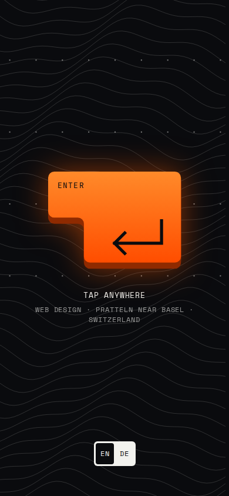

# UI Design System & Master Generation Blueprint: peaches-world

> **Peaches – Webdesign Pratteln, Basel · Websites worth pressing Enter for** (https://peaches.world/) — Peaches is a web design studio in Pratteln near Basel, Switzerland. Custom-designed, animated websites that feel like a game and stay in...


---

## 1. Executive Visual Persona & Design Archetype

- **Brand Essence & Persona**: **Peaches – Webdesign Pratteln, Basel · Websites worth pressing Enter for** (`https://peaches.world/`). Peaches is a web design studio in Pratteln near Basel, Switzerland. Custom-designed, animated websites that feel like a game and stay in...
- **Capture Provenance**: Live browser capture (`tier1_fast`, HTTP `200`, captured `2026-11-23`).
- **Visual Archetype**: **Dark-Substrate WebGL / Canvas Interactive Experience (`#0a0b0e` / `#ff5a00`)**.
- **Anti-AI-Slop Differentiators**:
  - **Live-Computed Chromatic Polarity**: Anchors the viewport in `#0a0b0e` (live computed `body` `background-color` (`computed_styles.json`)) paired with `#ffffff` primary typography and `#ff5a00` accents.
  - **Grounded Typographic Hierarchy**: Pairs `Space Mono` for display copy (`Peaches – Webdesign Pratteln, Basel `) with `JetBrains Mono` and `Space Mono`.
  - **Calibrated Spatial Grid & Motion**: Combines `1440px` container bounds (`gap: 14px`, padding `9px`) with `cubic-bezier(0.25,0.1,0.25,1)` easing and HTML5 `<canvas>` Interactive Viewport Surface.

---

## 2. Spatial Architecture & Modular Grid Mathematics



### Viewport Allocation & Container Geometry
- **Captured Viewport Dimensions**: Desktop `1440×900px` (`assets/desktop.png`, single-viewport 100vh live capture (900px)), Mobile `390×844px` (`assets/mobile.png`, single-viewport 100vh live capture (844px)).
- **Master Container Bounds**: `1440px` (full-bleed `100%` viewport stage).
- **Canvas Lateral Padding & Spacing**: `9px` lateral canvas padding with `14px` grid gap.
- **Border Radius Scale**: `8px`, `6px`, `4px`, `9px`.

### Responsive Breakpoint Architecture
- **Desktop Layout**: Multi-column CSS Grid / Flexbox layout at `1440px` (`max-width: 1440px`, `gap: 14px`).
- **Mobile Layout**: Single-column vertical stack at `390px` viewport width with `9px` horizontal padding.
- **Extracted CSS Media Queries**: `@media (max-height:460px)`, `@media (max-width:600px)`, `@media (prefers-reduced-motion:reduce)`.

---

## 3. Color System, Materiality & Atmospheric Lighting

### Semantic Palette & Source Grounding
| Semantic Role | Ground-Truth Value | Extracted Live / CSS Source |
|---|---|---|
| **Primary Canvas Substrate** | `#0a0b0e` | live computed `body` `background-color` (`computed_styles.json`) |
| **Primary Typography Ink** | `#ffffff` | live computed `h1` `color` (`computed_styles.json`) |
| **Elevated Surface / Card Substrate** | `#f2f2ee` | `.sr:focus-within { background: #f2f2ee }` |
| **Interactive Accent / Highlight** | `#ff5a00` | `html legend em { color: #ff5a00 }` |
| **Secondary / Muted Copy** | `#f2f2ee` | live computed `p` `color` (`computed_styles.json`) |
| **Structural Hairline Border** | `#7e7e7e` | `body.voll #satz { border-color: #7e7e7e }` |

### Sanitized Root CSS Variables (`ui-ux.md` Ground Truth)
| Variable Name | Extracted Value | Semantic Role |
|---|---|---|
| `--peaches-world-bg` | `#0a0b0e` | Canvas Substrate (from live computed `body` `background-color` (`computed_styles.json`)) |
| `--peaches-world-ink` | `#ffffff` | Primary Typography Ink (computed-derived) |
| `--peaches-world-surface` | `#f2f2ee` | Surface Substrate (computed-derived) |
| `--peaches-world-accent` | `#ff5a00` | Interactive Accent (computed-derived) |
| `--peaches-world-muted` | `#f2f2ee` | Secondary Ink (computed-derived) |
| `--peaches-world-border` | `#7e7e7e` | Structural Border (computed-derived) |
| `--peaches-world-container` | `1440px` | Container Bound (computed-derived) |
| `--peaches-world-gap` | `14px` | Grid Gutter (computed-derived) |
| `--peaches-world-pad` | `9px` | Lateral Padding (computed-derived) |
| `--peaches-world-ease` | `cubic-bezier(0.25,0.1,0.25,1)` | Primary Easing Function |
| `--peaches-world-radius` | `8px` | Corner Radius (computed-derived) |
| `--peaches-world-fs-base` | `129.6px` | Observed Font Size Token |

---

## 4. Typographic Scale & Editorial Hierarchy

### Font Family Stacks
- **Display Typography**: `Space Mono`.
- **Primary Body Stack**: `JetBrains Mono`.
- **Technical / Metadata Stack**: `Space Mono`.

### Typographic Scale & Rules (Live Computed & Stylesheet Grounded)
- **Hero Display (`H1`)**: live computed `h1` (`font-size: 129.6px`, `line-height: 123.12px`, `font-weight: 700`, `letter-spacing: -2.592px`).
- **Section Heading (`H2`)**: observed font-size ladder: `129.6px`, `16px`, `12px`, `clamp(16px,1.25vw,18px)`, `15px`.
- **Body Copy**: live computed `body` (`font-size: 16px`, `line-height: normal`, `font-weight: 400`).
- **Metadata & Navigation Labels**: live computed `nav/a` (`font-size: 16px`, `line-height: normal`, `font-weight: 400`).

---

## 5. Choreographed Motion & Interaction Physics

### Primary Easing Curves
- **Extracted Timing Functions**: `cubic-bezier(0.25,0.1,0.25,1)`.

### Per-Element Transition & Choreography Rules
- **Selector `html #weiter`**: `transition: background-color .15s,color .15s,border-color .15s,box-shadow...` extracted from `peaches-world` stylesheet.
- **Selector `.t`**: `transition: opacity .4s,background .5s,border-color .5s,padding .3s,box-sh...` extracted from `peaches-world` stylesheet.
- **Selector `#zurueck`**: `transition: transform .14s,box-shadow .14s,opacity .4s` extracted from `peaches-world` stylesheet.
- **Standard CSS Easing (`cubic-bezier(0.25,0.1,0.25,1)`)**: Default timing curve (no custom `cubic-bezier()` declared in captured CSS).
- **Runtime Interaction Engine**: Integrates HTML5 `<canvas>` Interactive Viewport Surface with `prefers-reduced-motion: reduce` fallback guards.

---

## 6. Component Wireframe & Structural DOM Map

### Visual Layout Schematic — Desktop (`1440px`, Grounded in `dom.html` & Landmark Bounding Boxes)
```
┌────────────────────────────────────────────────────────────────────────┐
│ DESKTOP VIEWPORT (1440px) — Peaches – Webdesign Pratteln, Basel · Webs │
│ ====================================================================== │
│ [ <nav.sr> (1x1px)                    | Home · Who is talking · Work ] │
│ ---------------------------------------------------------------------- │
│ | HERO STAGE: <div.sr> (w=1440px)                                    | │
│ | H1: Peaches – Webdesign Pratteln, Basel · Websites w               | │
│ | Substrate: #0a0b0e | Ink: #ffffff | Accent: #ff5a00                | │
│ ---------------------------------------------------------------------- │
│ | SHOWCASE GRID (<div.schild>) max-w: 1440px                         | │
│ | +------------------------------+  +------------------------------+ | │
│ | | Featured Work & Interactive  |  | Technical Architecture & Nar | | │
│ | +------------------------------+  +------------------------------+ | │
│ ---------------------------------------------------------------------- │
│ | DETAIL MODULE (<div#kopf>) — Global Directory & Co                 | │
│ ---------------------------------------------------------------------- │
│ [ FOOTER (<footer>            ) | https://peaches.world/               │
└────────────────────────────────────────────────────────────────────────┘
```

### Visual Layout Schematic — Mobile Reflow (`390px`)
```
┌────────────────────────────────────────────────────────────────────────┐
│ MOBILE VIEWPORT REFLOW (390px) — Single-Column Stack (gap: 14px)       │
│ ====================================================================== │
│ [ HEADER BAR (<nav.sr>                ) | Compact Menu (390px)         │
│ ---------------------------------------------------------------------- │
│ | HERO STAGE (<div.sr>) — 390px Vertical Lead                        | │
│ | H1: Peaches – Webdesign Pratteln, Basel · Websites w               | │
│ ---------------------------------------------------------------------- │
│ | SHOWCASE STACK (<div.schild>) — 1-Col Stack                        | │
│ | [ Item 1: Featured Work & Interactive Showcase                   ] | │
│ | [ Item 2: Technical Architecture & Narrative                     ] | │
│ ---------------------------------------------------------------------- │
│ | DETAIL STACK (<div#kopf>) — 1-Col (Global Directory &)             | │
│ ---------------------------------------------------------------------- │
│ [ FOOTER (<footer>            ) | Stacked 390px Colophon               │
└────────────────────────────────────────────────────────────────────────┘
```

### Granular DOM Region Breakdown
1. **Brand Header & Navigation Bar (<nav.sr> — `peaches-world`)**:
   - Landmark `<nav class="sr">` (`1x1px`) hosting `Peaches – Webdesign Pratteln, Basel ` navigation (`Home · Who is talking · Work · References`), DOM attributes (`data-s="Chapter 01 / Home"`, `data-s="Pratteln 47.52 N 7.69 E"`, `data-s="Peaches"`, `data-s="Websites worth pressi..."`), and stylesheet rule `html body { font-family:var(--f-text) }`.
2. **Hero Stage & Focal Lead (<div.sr> — `Peaches – Webdesign Pratteln, Base`)**:
   - Landmark `<div class="sr">` presenting display lead `Peaches – Webdesign Pratteln, Basel · Websites w` and copy excerpt *"WEB DESIGN · PRATTELN NEAR BASEL · SWITZERLAND"* over `#0a0b0e` canvas and `#ffffff` ink.
3. **Primary Showcase & Content Grid (<div.schild> — `Featured Work & Interactive Showca`)**:
   - Landmark `<div class="schild">` rendering section `Featured Work & Interactive Showcase` with copy *"Web design · Pratteln near Basel · Switzerland"*, asset references (`logo.svg`, `favicon-192.png`, `favicon-48.png`, `apple-touch-icon.png`), and grid rule `oede a { font-family:var(--f-titel) }`.
4. **Interactive Detail & Feature Matrix (<div#kopf> — `Technical Architecture & Narrative`)**:
   - Landmark `<div id="kopf">` framing `Technical Architecture & Narrative` and `Global Directory & Contact` (*"Featured Work & Interactive Showcase"*) with `#f2f2ee` surface cards, `#ff5a00` accents, and `runter { font-family:var(--f-titel) }`.
5. **Colophon & Global Directory Footer (<footer> — `https://peaches.world/`)**:
   - Landmark `<footer>` landmark anchoring `Peaches – Webdesign Pratteln, Ba` footer links (`Home · Who is talking · Work · References`), copy *"Technical Architecture & Narrative"*, and `#7e7e7e` structural dividers.

---

## 7. Master Zero-Shot AI Generation Prompt

```markdown
# Master Zero-Shot Frontend Generation Prompt: peaches-world (Peaches – Webdesign Pratteln, Basel · Websites worth pressing Enter for)

You are a principal frontend architect and design systems engineer. Build a complete, production-ready web application replicating the exact design system, DOM landmarks, typographic hierarchy, color tokens, and motion physics of `peaches-world` (**Peaches – Webdesign Pratteln, Basel · Websites worth pressing Enter for** — `https://peaches.world/`).

### 1. Visual Archetype & Anti-AI-Slop Mandates
- **Archetype**: Dark-Substrate WebGL / Canvas Interactive Experience (`#0a0b0e` / `#ff5a00`).
- **Identity & Domain Context**: Peaches is a web design studio in Pratteln near Basel, Switzerland. Custom-designed, animated websites that feel like a game and stay in...
- **Primary Substrate**: `#0a0b0e` (live computed `body` `background-color` (`computed_styles.json`)), **Primary Ink**: `#ffffff`, **Accent / Highlight**: `#ff5a00`.
- **Site-Specific Differentiators**:
  - **Live-Computed Chromatic Polarity**: Anchors the viewport in `#0a0b0e` (live computed `body` `background-color` (`computed_styles.json`)) paired with `#ffffff` primary typography and `#ff5a00` accents.
  - **Grounded Typographic Hierarchy**: Pairs `Space Mono` for display copy (`Peaches – Webdesign Pratteln, Basel `) with `JetBrains Mono` and `Space Mono`.
  - **Calibrated Spatial Grid & Motion**: Combines `1440px` container bounds (`gap: 14px`, padding `9px`) with `cubic-bezier(0.25,0.1,0.25,1)` easing and HTML5 `<canvas>` Interactive Viewport Surface.

### 2. Ground-Truth CSS Variables (`:root` Token Contract)
Declare and consume these exact custom properties extracted from `peaches-world` in your global stylesheet:

:root {
  /* Peaches – Webdesign Pratteln, Basel · Websites worth pressing Enter for (peaches-world) — Live-Grounded CSS Variables */
  --peaches-world-bg: #0a0b0e; /* Canvas Substrate (from live computed `body` `background-color` (`computed_styles.json`)) (peaches-world) */
  --peaches-world-ink: #ffffff; /* Primary Typography Ink (computed-derived) (peaches-world) */
  --peaches-world-surface: #f2f2ee; /* Surface Substrate (computed-derived) (peaches-world) */
  --peaches-world-accent: #ff5a00; /* Interactive Accent (computed-derived) (peaches-world) */
  --peaches-world-muted: #f2f2ee; /* Secondary Ink (computed-derived) (peaches-world) */
  --peaches-world-border: #7e7e7e; /* Structural Border (computed-derived) (peaches-world) */
  --peaches-world-container: 1440px; /* Container Bound (computed-derived) (peaches-world) */
  --peaches-world-gap: 14px; /* Grid Gutter (computed-derived) (peaches-world) */
  --peaches-world-pad: 9px; /* Lateral Padding (computed-derived) (peaches-world) */
  --peaches-world-ease: cubic-bezier(0.25,0.1,0.25,1); /* Primary Easing Function (peaches-world) */
  --peaches-world-radius: 8px; /* Corner Radius (computed-derived) (peaches-world) */
  --peaches-world-fs-base: 129.6px; /* Observed Font Size Token (peaches-world) */
}

### 3. Semantic Color & Materiality Contract
Map every surface, ink, and border strictly to these source-grounded tokens:
- **Primary Canvas Substrate**: `#0a0b0e` — grounded in live computed `body` `background-color` (`computed_styles.json`)
- **Primary Typography Ink**: `#ffffff` — grounded in live computed `h1` `color` (`computed_styles.json`)
- **Elevated Surface / Card Substrate**: `#f2f2ee` — grounded in `.sr:focus-within { background: #f2f2ee }`
- **Interactive Accent / Highlight**: `#ff5a00` — grounded in `html legend em { color: #ff5a00 }`
- **Secondary / Muted Copy**: `#f2f2ee` — grounded in live computed `p` `color` (`computed_styles.json`)
- **Structural Hairline Border**: `#7e7e7e` — grounded in `body.voll #satz { border-color: #7e7e7e }`

### 4. Spatial Grid, Container Bounds & Responsive Breakpoints
- **Desktop Viewport Reference**: `1440×900px` (single-viewport 100vh live capture (900px), `1440px` standard desktop width).
- **Mobile Viewport Reference**: `390×844px` (single-viewport 100vh live capture (844px), `390px` standard mobile width).
- **Container Max-Width**: `1440px` (full-bleed `100%` viewport stage)
- **Padding & Gutters**: `9px` lateral canvas padding with `14px` grid gap
- **Desktop Grid**: Multi-column CSS Grid / Flexbox layout at `1440px` (`max-width: 1440px`, `gap: 14px`)
- **Mobile Adaptation**: Single-column vertical stack at `390px` viewport width with `9px` horizontal padding
- **Media Queries**: `@media (max-height:460px)`, `@media (max-width:600px)`, `@media (prefers-reduced-motion:reduce)`
- **Corner Radii**: `8px`, `6px`, `4px`, `9px`

### 5. Typography & Editorial Scale Contract
- **Display Font Stack**: `Space Mono`
- **Body Font Stack**: `JetBrains Mono`
- **Monospace / Technical Font Stack**: `Space Mono`
- **H1 Display Rule**: live computed `h1` (`font-size: 129.6px`, `line-height: 123.12px`, `font-weight: 700`, `letter-spacing: -2.592px`)
- **H2 Section Rule**: observed font-size ladder: `129.6px`, `16px`, `12px`, `clamp(16px,1.25vw,18px)`, `15px`
- **Body Copy Rule**: live computed `body` (`font-size: 16px`, `line-height: normal`, `font-weight: 400`)
- **Metadata & Index Rule**: live computed `nav/a` (`font-size: 16px`, `line-height: normal`, `font-weight: 400`)

### 6. Component Hierarchy, Verbatim Copy & Real DOM Landmarks
Scaffold `peaches-world` (`Peaches – Webdesign Pratteln, Basel · Websites worth pressing Enter for`) with these exact structural regions, extracted copy, and CSS rules from `dom.html`:
1. **Brand Header & Navigation Bar (<nav.sr> — `peaches-world`)**:
   - DOM & Selectors: Landmark `<nav class="sr">` (`1x1px`) hosting `Peaches – Webdesign Pratteln, Basel ` navigation (`Home · Who is talking · Work · References`), DOM attributes (`data-s="Chapter 01 / Home"`, `data-s="Pratteln 47.52 N 7.69 E"`, `data-s="Peaches"`, `data-s="Websites worth pressi..."`), and stylesheet rule `html body { font-family:var(--f-text) }`.
   - Responsive Contract: Header `Brand Header & Navigation Bar (<nav.sr> — `peaches-world`)` (`peaches-world`) adapts across `@media (max-height:460px)`, `@media (max-width:600px)`, `@media (prefers-reduced-motion:reduce)` with `cubic-bezier(0.25,0.1,0.25,1)` transitions and links `Home · Who is talking · Work · References`.
2. **Hero Stage & Focal Lead (<div.sr> — `Peaches – Webdesign Pratteln, Base`)**:
   - DOM & Selectors: Landmark `<div class="sr">` presenting display lead `Peaches – Webdesign Pratteln, Basel · Websites w` and copy excerpt *"WEB DESIGN · PRATTELN NEAR BASEL · SWITZERLAND"* over `#0a0b0e` canvas and `#ffffff` ink.
   - Responsive Contract: Hero stage (`1440×900px` desktop / `390×844px` mobile) sets `#0a0b0e` background with `#ffffff` headline `Peaches – Webdesign Pratteln, Basel · Websites w`.
3. **Primary Showcase & Content Grid (<div.schild> — `Featured Work & Interactive Showca`)**:
   - DOM & Selectors: Landmark `<div class="schild">` rendering section `Featured Work & Interactive Showcase` with copy *"Web design · Pratteln near Basel · Switzerland"*, asset references (`logo.svg`, `favicon-192.png`, `favicon-48.png`, `apple-touch-icon.png`), and grid rule `oede a { font-family:var(--f-titel) }`.
   - Responsive Contract: Showcase grid `Primary Showcase & Content Grid (<div.schild> — `Featured Work & Interactive Showca`)` applies Multi-column CSS Grid / Flexbox layout at `1440px` (`max-width: 1440px`, `gap: 14px`) on desktop and Single-column vertical stack at `390px` viewport width with `9px` horizontal padding on mobile.
4. **Interactive Detail & Feature Matrix (<div#kopf> — `Technical Architecture & Narrative`)**:
   - DOM & Selectors: Landmark `<div id="kopf">` framing `Technical Architecture & Narrative` and `Global Directory & Contact` (*"Featured Work & Interactive Showcase"*) with `#f2f2ee` surface cards, `#ff5a00` accents, and `runter { font-family:var(--f-titel) }`.
   - Responsive Contract: Detail module `Interactive Detail & Feature Matrix (<div#kopf> — `Technical Architecture & Narrative`)` uses `8px`, `6px`, `4px`, `9px` radii, `#ff5a00` highlights, and assets (logo.svg, favicon-192.png, favicon-48.png).
5. **Colophon & Global Directory Footer (<footer> — `https://peaches.world/`)**:
   - DOM & Selectors: Landmark `<footer>` landmark anchoring `Peaches – Webdesign Pratteln, Ba` footer links (`Home · Who is talking · Work · References`), copy *"Technical Architecture & Narrative"*, and `#7e7e7e` structural dividers.
   - Responsive Contract: Footer `Colophon & Global Directory Footer (<footer> — `https://peaches.world/`)` aligns to `1440px` (full-bleed `100%` viewport stage) with `9px` lateral canvas padding with `14px` grid gap and attributes (data-s="Chapter 01 / Home", data-s="Pratteln 47.52 N 7.69 E", data-s="Peaches").

#### Verbatim DOM Copy Excerpts (`dom.html`)
- Copy Excerpt 1: *"WEB DESIGN · PRATTELN NEAR BASEL · SWITZERLAND"*
- Copy Excerpt 2: *"Web design · Pratteln near Basel · Switzerland"*

### 7. Motion, Extracted Stylesheet Rules & Interaction Choreography
- **Primary Easing Functions**: `cubic-bezier(0.25,0.1,0.25,1)`
- **Extracted Stylesheet Rules (`peaches-world`)**:
- `html body { font-family:var(--f-text) }`
- `oede a { font-family:var(--f-titel) }`
- `runter { font-family:var(--f-titel) }`
- `sozial p { font-family:var(--f-text) }`
- `html .strahl span { font-size:clamp(16px,1.25vw,18px);line-height:1.6 }`
- **Per-Selector Transition Rules**:
- **Selector `html #weiter`**: `transition: background-color .15s,color .15s,border-color .15s,box-shadow...` extracted from `peaches-world` stylesheet.
- **Selector `.t`**: `transition: opacity .4s,background .5s,border-color .5s,padding .3s,box-sh...` extracted from `peaches-world` stylesheet.
- **Selector `#zurueck`**: `transition: transform .14s,box-shadow .14s,opacity .4s` extracted from `peaches-world` stylesheet.
- **Standard CSS Easing (`cubic-bezier(0.25,0.1,0.25,1)`)**: Default timing curve (no custom `cubic-bezier()` declared in captured CSS).
- **Runtime Interaction Engine**: Integrates HTML5 `<canvas>` Interactive Viewport Surface with `prefers-reduced-motion: reduce` fallback guards.

### 8. Technical Deliverables
- Implement in Next.js (App Router) with TypeScript and Tailwind CSS consuming the `:root` custom properties defined above for `peaches-world`.
- Reproduce both the `1440px` desktop architecture and `390px` mobile breakpoint transitions, preserving semantic HTML5 landmarks (`<header>`, `<nav>`, `<main>`, `<section>`, `<footer>`) and `prefers-reduced-motion` accessibility guards.
```
