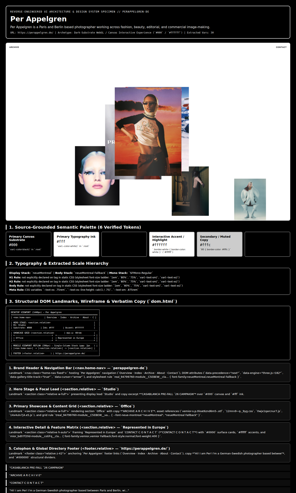
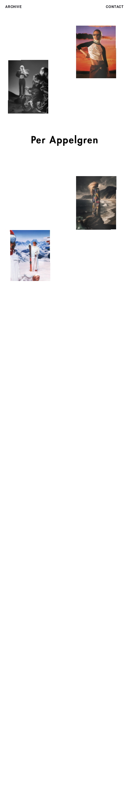

# UI Design System & Master Generation Blueprint: perappelgren-de

> **Per Appelgren** (https://perappelgren.de/) — Per Appelgren is a Paris and Berlin based photographer working across fashion, beauty, editorial, and commercial image-making.



---

## 1. Executive Visual Persona & Design Archetype

- **Brand Essence & Persona**: **Per Appelgren** (`https://perappelgren.de/`). Per Appelgren is a Paris and Berlin based photographer working across fashion, beauty, editorial, and commercial image-making.
- **Visual Archetype**: **Dark-Substrate WebGL / Canvas Interactive Experience (`#000` / `#ffffff`)**.
- **Anti-AI-Slop Differentiators**:
  - **Source-Grounded Chromatic Polarity**: Anchors the viewport in `#000` (`var(--color-black)` in `:root`) paired with `#fff` primary typography and `#ffffff` accents.
  - **Extracted Typographic Hierarchy**: Pairs `neueMontreal` for display copy (`Studio`) with `neueMontreal Fallback` and `SFMono-Regular`.
  - **Calibrated Spatial Grid & Motion**: Combines `40rem` container bounds (`gap: 2px`, padding `216px`) with `cubic-bezier(0,0,.2,1)` easing and Lenis Smooth Scroll (`data-lenis`), Three.js / WebGL Canvas Pipeline.

---

## 2. Spatial Architecture & Modular Grid Mathematics



### Viewport Allocation & Container Geometry
- **Captured Viewport Dimensions**: Desktop `1440×2400px` (`assets/desktop.png`, capped at 2400px multi-section capture), Mobile `390×2400px` (`assets/mobile.png`, capped at 2400px multi-section capture).
- **Master Container Bounds**: `40rem` extracted from `perappelgren-de` stylesheet.
- **Canvas Lateral Padding & Spacing**: `216px` lateral canvas padding with `2px` grid gap.
- **Border Radius Scale**: `4px`, `32px`, `var(--radius-lg)`, `999px`.

### Responsive Breakpoint Architecture
- **Desktop Layout**: Multi-column CSS Grid / Flexbox layout at `1440px` (`max-width: 40rem`, `gap: 2px`).
- **Mobile Layout**: Single-column vertical stack at `390px` viewport width with `216px` horizontal padding.
- **Extracted CSS Media Queries**: `@media (min-width:40rem)`, `@media (min-width:48rem)`, `@media (min-width:64rem)`, `@media (min-width:80rem)`.

---

## 3. Color System, Materiality & Atmospheric Lighting

### Semantic Palette & Source Grounding
| Semantic Role | Ground-Truth Value | Extracted CSS Source / Selector |
|---|---|---|
| **Primary Canvas Substrate** | `#000` | `var(--color-black)` in `:root` |
| **Primary Typography Ink** | `#fff` | `var(--color-white)` in `:root` |
| **Elevated Surface / Card Substrate** | `#0000` | `textarea { background-color: #0000 }` |
| **Interactive Accent / Highlight** | `#ffffff` | `.border-white { border-color: white }` (`#ffffff`) |
| **Secondary / Muted Copy** | `#fffc` | `80 { border-color: #fffc }` |
| **Structural Hairline Border** | `#000000` | `.bg-black { background-color: black }` (`#000000`) |

### Sanitized Root CSS Variables (`ui-ux.md` Ground Truth)
| Variable Name | Extracted Value | Semantic Role |
|---|---|---|
| `--font-neue-montreal` | `"neueMontreal", "neueMontreal Fallback"` | Typography / Scale Token |
| `--font-vemior` | `"vemior", "vemior Fallback"` | Typography / Scale Token |
| `--font-sans` | `var(--font-neue-montreal)` | Typography / Scale Token |
| `--color-black` | `#000` | Canvas / Surface Token |
| `--color-white` | `#fff` | Canvas / Surface Token |
| `--spacing` | `.25rem` | Layout / Spatial Grid Token |
| `--text-xs` | `.75rem` | Typography Ink Token |
| `--text-xs--line-height` | `calc(1 / .75)` | Typography Ink Token |
| `--text-sm` | `.875rem` | Typography Ink Token |
| `--text-sm--line-height` | `calc(1.25 / .875)` | Typography Ink Token |
| `--font-weight-normal` | `400` | Typography / Scale Token |
| `--font-weight-medium` | `500` | Typography / Scale Token |
| `--font-weight-semibold` | `600` | Typography / Scale Token |
| `--tracking-normal` | `0em` | Typography / Scale Token |
| `--radius-lg` | `.5rem` | Elevation / Border Token |
| `--ease-out` | `cubic-bezier(0, 0, .2, 1)` | Motion / Easing Token |

---

## 4. Typographic Scale & Editorial Hierarchy

### Font Family Stacks
- **Display Typography**: `neueMontreal`.
- **Primary Body Stack**: `neueMontreal Fallback`.
- **Technical / Metadata Stack**: `SFMono-Regular`.

### Typographic Scale & Rules (Extracted from Stylesheet & Variables)
- **Hero Display (`H1`)**: not explicitly declared on tag in static CSS (stylesheet font-size ladder: `1em`, `80%`, `75%`, `var(--text-sm)`, `var(--text-xs)`).
- **Section Heading (`H2`)**: not explicitly declared on tag in static CSS (stylesheet font-size ladder: `1em`, `80%`, `75%`, `var(--text-sm)`, `var(--text-xs)`).
- **Body Copy**: not explicitly declared on tag in static CSS (stylesheet font-size ladder: `1em`, `80%`, `75%`, `var(--text-sm)`, `var(--text-xs)`).
- **Metadata & Navigation Labels**: CSS variables `--text-xs: .75rem`, `--text-xs--line-height: calc(1 / .75)`, `--text-sm: .875rem`.

---

## 5. Choreographed Motion & Interaction Physics

### Primary Easing Curves
- **Extracted Timing Functions**: `cubic-bezier(0,0,.2,1)`, `cubic-bezier(.4,0,.2,1)`, `cubic-bezier(.16,1,.3,1)`.

### Per-Element Transition & Choreography Rules
- **Selector `layer theme`**: `transition: .15s` extracted from `perappelgren-de` stylesheet.
- **Selector `.transition`**: `transition: var(--tw-ease,var(--default-transition-timing-function))` extracted from `perappelgren-de` stylesheet.
- **Selector `transform\]`**: `transition: var(--tw-ease,var(--default-transition-timing-function))` extracted from `perappelgren-de` stylesheet.
- **Extracted Easing Curve (`cubic-bezier(0,0,.2,1)`)**: Governs interactive state transitions across `<nav.home-nav>` and `<section.relative>`.
- **Runtime Interaction Engine**: Integrates Lenis Smooth Scroll (`data-lenis`), Three.js / WebGL Canvas Pipeline with `prefers-reduced-motion: reduce` fallback guards.

---

## 6. Component Wireframe & Structural DOM Map

### Visual Layout Schematic (Grounded in `dom.html` — `1440px` Desktop & `390px` Mobile Reflow)
```
┌────────────────────────────────────────────────────────────────────────┐
│ DESKTOP VIEWPORT (1440px) — Per Appelgren                              │
│ ====================================================================== │
│ [ <nav.home-nav>           | Overview · Index · Archive · About · C ]  │
│ ---------------------------------------------------------------------- │
│ | HERO STAGE: <section.relative>                                   |   │
│ | H1: Studio                                                       |   │
│ | Substrate: #000       | Ink: #fff       | Accent: #ffffff        |   │
│ ---------------------------------------------------------------------- │
│ | SHOWCASE GRID (<section.relative>        ) max-w: 40rem          |   │
│ | +------------------------------+  +------------------------------+ | │
│ | | Office                       |  | Represented in Europe        | | │
│ | +------------------------------+  +------------------------------+ | │
│ ---------------------------------------------------------------------- │
│ | MOBILE VIEWPORT REFLOW (390px) — Single-Column Stack (gap: 2px   ) | │
│ | [<nav.home-nav>] -> [<section.relative>] -> [<section.relative>] |   │
│ ---------------------------------------------------------------------- │
│ [ FOOTER (<footer.relative>     ) | https://perappelgren.de/           │
└────────────────────────────────────────────────────────────────────────┘
```

### Granular DOM Region Breakdown
1. **Brand Header & Navigation Bar (<nav.home-nav> — `perappelgren-de`)**:
   - Landmark `<nav class="home-nav fixed">` hosting `Per Appelgren` navigation (`Overview · Index · Archive · About · Contact`), DOM attributes (`data-precedence="next"`, `data-engine="three.js r182"`, `data-gallery-title-track="true"`, `data-cursor="arrow"`), and stylesheet rule `real_94799760-module__C5EBEW__cla... { font-family:neueMontreal,neueMontreal Fallback }`.
2. **Hero Stage & Focal Lead (<section.relative> — `Studio`)**:
   - Landmark `<section class="relative w-full">` presenting display lead `Studio` and copy excerpt *"CASABLANCA PRE-FALL ´26 CAMPAIGN"* over `#000` canvas and `#fff` ink.
3. **Primary Showcase & Content Grid (<section.relative> — `Office`)**:
   - Landmark `<section class="relative w-full">` rendering section `Office` with copy *"ARCHIVE A R C H I V E"*, asset references (`vemior-s.p.0loat6znd6m5-.otf`, `12mrv9~q-_9yg.css`, `0wjx1qarcnur7.js`, `14x4ulv7j4.e5.js`), and grid rule `treal_94799760-module__C5EBEW__va... { --font-neue-montreal:"neueMontreal", "neueMontreal Fallback" }`.
4. **Interactive Detail & Feature Matrix (<section.relative> — `Represented in Europe`)**:
   - Landmark `<section class="relative h-auto">` framing `Represented in Europe` and `CONTACT C O N T A C T` (*"CONTACT C O N T A C T"*) with `#0000` surface cards, `#ffffff` accents, and `mior_bd07f20d-module__cotiFq__cla... { font-family:vemior,vemior Fallback;font-style:normal;font-weight:400 }`.
5. **Colophon & Global Directory Footer (<footer.relative> — `https://perappelgren.de/`)**:
   - Landmark `<footer class="relative z-42">` anchoring `Per Appelgren` footer links (`Overview · Index · Archive · About · Contact`), copy *"Hi! I am Per! I'm a German-Swedish photographer based betwee"*, and `#000000` structural dividers.

---

## 7. Master Zero-Shot AI Generation Prompt

```markdown
# Master Zero-Shot Frontend Generation Prompt: perappelgren-de (Per Appelgren)

You are a principal frontend architect and design systems engineer. Build a complete, production-ready web application replicating the exact design system, DOM landmarks, typographic hierarchy, color tokens, and motion physics of `perappelgren-de` (**Per Appelgren** — `https://perappelgren.de/`).

### 1. Visual Archetype & Anti-AI-Slop Mandates
- **Archetype**: Dark-Substrate WebGL / Canvas Interactive Experience (`#000` / `#ffffff`).
- **Identity & Domain Context**: Per Appelgren is a Paris and Berlin based photographer working across fashion, beauty, editorial, and commercial image-making.
- **Primary Substrate**: `#000` (`var(--color-black)` in `:root`), **Primary Ink**: `#fff`, **Accent / Highlight**: `#ffffff`.
- **Site-Specific Differentiators**:
  - **Source-Grounded Chromatic Polarity**: Anchors the viewport in `#000` (`var(--color-black)` in `:root`) paired with `#fff` primary typography and `#ffffff` accents.
  - **Extracted Typographic Hierarchy**: Pairs `neueMontreal` for display copy (`Studio`) with `neueMontreal Fallback` and `SFMono-Regular`.
  - **Calibrated Spatial Grid & Motion**: Combines `40rem` container bounds (`gap: 2px`, padding `216px`) with `cubic-bezier(0,0,.2,1)` easing and Lenis Smooth Scroll (`data-lenis`), Three.js / WebGL Canvas Pipeline.

### 2. Ground-Truth CSS Variables (`:root` Token Contract)
Declare and consume these exact custom properties extracted from `perappelgren-de` in your global stylesheet:

:root {
  /* Per Appelgren (perappelgren-de) — Ground-Truth Extracted CSS Variables */
  --font-neue-montreal: "neueMontreal", "neueMontreal Fallback"; /* Typography / Scale Token (perappelgren-de) */
  --font-vemior: "vemior", "vemior Fallback"; /* Typography / Scale Token (perappelgren-de) */
  --font-sans: var(--font-neue-montreal); /* Typography / Scale Token (perappelgren-de) */
  --color-black: #000; /* Canvas / Surface Token (perappelgren-de) */
  --color-white: #fff; /* Canvas / Surface Token (perappelgren-de) */
  --spacing: .25rem; /* Layout / Spatial Grid Token (perappelgren-de) */
  --text-xs: .75rem; /* Typography Ink Token (perappelgren-de) */
  --text-xs--line-height: calc(1 / .75); /* Typography Ink Token (perappelgren-de) */
  --text-sm: .875rem; /* Typography Ink Token (perappelgren-de) */
  --text-sm--line-height: calc(1.25 / .875); /* Typography Ink Token (perappelgren-de) */
  --font-weight-normal: 400; /* Typography / Scale Token (perappelgren-de) */
  --font-weight-medium: 500; /* Typography / Scale Token (perappelgren-de) */
  --font-weight-semibold: 600; /* Typography / Scale Token (perappelgren-de) */
  --tracking-normal: 0em; /* Typography / Scale Token (perappelgren-de) */
  --radius-lg: .5rem; /* Elevation / Border Token (perappelgren-de) */
  --ease-out: cubic-bezier(0, 0, .2, 1); /* Motion / Easing Token (perappelgren-de) */
}

### 3. Semantic Color & Materiality Contract
Map every surface, ink, and border strictly to these source-grounded tokens:
- **Primary Canvas Substrate**: `#000` — grounded in `var(--color-black)` in `:root`
- **Primary Typography Ink**: `#fff` — grounded in `var(--color-white)` in `:root`
- **Elevated Surface / Card Substrate**: `#0000` — grounded in `textarea { background-color: #0000 }`
- **Interactive Accent / Highlight**: `#ffffff` — grounded in `.border-white { border-color: white }` (`#ffffff`)
- **Secondary / Muted Copy**: `#fffc` — grounded in `80 { border-color: #fffc }`
- **Structural Hairline Border**: `#000000` — grounded in `.bg-black { background-color: black }` (`#000000`)

### 4. Spatial Grid, Container Bounds & Responsive Breakpoints
- **Desktop Viewport Reference**: `1440×2400px` (capped at 2400px multi-section capture, `1440px` standard desktop width).
- **Mobile Viewport Reference**: `390×2400px` (capped at 2400px multi-section capture, `390px` standard mobile width).
- **Container Max-Width**: `40rem` extracted from `perappelgren-de` stylesheet
- **Padding & Gutters**: `216px` lateral canvas padding with `2px` grid gap
- **Desktop Grid**: Multi-column CSS Grid / Flexbox layout at `1440px` (`max-width: 40rem`, `gap: 2px`)
- **Mobile Adaptation**: Single-column vertical stack at `390px` viewport width with `216px` horizontal padding
- **Media Queries**: `@media (min-width:40rem)`, `@media (min-width:48rem)`, `@media (min-width:64rem)`, `@media (min-width:80rem)`
- **Corner Radii**: `4px`, `32px`, `var(--radius-lg)`, `999px`

### 5. Typography & Editorial Scale Contract
- **Display Font Stack**: `neueMontreal`
- **Body Font Stack**: `neueMontreal Fallback`
- **Monospace / Technical Font Stack**: `SFMono-Regular`
- **H1 Display Rule**: not explicitly declared on tag in static CSS (stylesheet font-size ladder: `1em`, `80%`, `75%`, `var(--text-sm)`, `var(--text-xs)`)
- **H2 Section Rule**: not explicitly declared on tag in static CSS (stylesheet font-size ladder: `1em`, `80%`, `75%`, `var(--text-sm)`, `var(--text-xs)`)
- **Body Copy Rule**: not explicitly declared on tag in static CSS (stylesheet font-size ladder: `1em`, `80%`, `75%`, `var(--text-sm)`, `var(--text-xs)`)
- **Metadata & Index Rule**: CSS variables `--text-xs: .75rem`, `--text-xs--line-height: calc(1 / .75)`, `--text-sm: .875rem`

### 6. Component Hierarchy, Verbatim Copy & Real DOM Landmarks
Scaffold `perappelgren-de` (`Per Appelgren`) with these exact structural regions, extracted copy, and CSS rules from `dom.html`:
1. **Brand Header & Navigation Bar (<nav.home-nav> — `perappelgren-de`)**:
   - DOM & Selectors: Landmark `<nav class="home-nav fixed">` hosting `Per Appelgren` navigation (`Overview · Index · Archive · About · Contact`), DOM attributes (`data-precedence="next"`, `data-engine="three.js r182"`, `data-gallery-title-track="true"`, `data-cursor="arrow"`), and stylesheet rule `real_94799760-module__C5EBEW__cla... { font-family:neueMontreal,neueMontreal Fallback }`.
   - Responsive Contract: Header `Brand Header & Navigation Bar (<nav.home-nav> — `perappelgren-de`)` (`perappelgren-de`) adapts across `@media (min-width:40rem)`, `@media (min-width:48rem)`, `@media (min-width:64rem)`, `@media (min-width:80rem)` with `cubic-bezier(0,0,.2,1)`, `cubic-bezier(.4,0,.2,1)`, `cubic-bezier(.16,1,.3,1)` transitions and links `Overview · Index · Archive · About · Contact`.
2. **Hero Stage & Focal Lead (<section.relative> — `Studio`)**:
   - DOM & Selectors: Landmark `<section class="relative w-full">` presenting display lead `Studio` and copy excerpt *"CASABLANCA PRE-FALL ´26 CAMPAIGN"* over `#000` canvas and `#fff` ink.
   - Responsive Contract: Hero stage (`1440×2400px` desktop / `390×2400px` mobile) sets `#000` background with `#fff` headline `Studio`.
3. **Primary Showcase & Content Grid (<section.relative> — `Office`)**:
   - DOM & Selectors: Landmark `<section class="relative w-full">` rendering section `Office` with copy *"ARCHIVE A R C H I V E"*, asset references (`vemior-s.p.0loat6znd6m5-.otf`, `12mrv9~q-_9yg.css`, `0wjx1qarcnur7.js`, `14x4ulv7j4.e5.js`), and grid rule `treal_94799760-module__C5EBEW__va... { --font-neue-montreal:"neueMontreal", "neueMontreal Fallback" }`.
   - Responsive Contract: Showcase grid `Primary Showcase & Content Grid (<section.relative> — `Office`)` applies Multi-column CSS Grid / Flexbox layout at `1440px` (`max-width: 40rem`, `gap: 2px`) on desktop and Single-column vertical stack at `390px` viewport width with `216px` horizontal padding on mobile.
4. **Interactive Detail & Feature Matrix (<section.relative> — `Represented in Europe`)**:
   - DOM & Selectors: Landmark `<section class="relative h-auto">` framing `Represented in Europe` and `CONTACT C O N T A C T` (*"CONTACT C O N T A C T"*) with `#0000` surface cards, `#ffffff` accents, and `mior_bd07f20d-module__cotiFq__cla... { font-family:vemior,vemior Fallback;font-style:normal;font-weight:400 }`.
   - Responsive Contract: Detail module `Interactive Detail & Feature Matrix (<section.relative> — `Represented in Europe`)` uses `4px`, `32px`, `var(--radius-lg)`, `999px` radii, `#ffffff` highlights, and assets (vemior-s.p.0loat6znd6m5-.otf, 12mrv9~q-_9yg.css, 0wjx1qarcnur7.js).
5. **Colophon & Global Directory Footer (<footer.relative> — `https://perappelgren.de/`)**:
   - DOM & Selectors: Landmark `<footer class="relative z-42">` anchoring `Per Appelgren` footer links (`Overview · Index · Archive · About · Contact`), copy *"Hi! I am Per! I'm a German-Swedish photographer based betwee"*, and `#000000` structural dividers.
   - Responsive Contract: Footer `Colophon & Global Directory Footer (<footer.relative> — `https://perappelgren.de/`)` aligns to `40rem` extracted from `perappelgren-de` stylesheet with `216px` lateral canvas padding with `2px` grid gap and attributes (data-precedence="next", data-engine="three.js r182", data-gallery-title-track="true").

#### Verbatim DOM Copy Excerpts (`dom.html`)
- Copy Excerpt 1: *"CASABLANCA PRE-FALL ´26 CAMPAIGN"*
- Copy Excerpt 2: *"ARCHIVE A R C H I V E"*
- Copy Excerpt 3: *"CONTACT C O N T A C T"*
- Copy Excerpt 4: *"Hi! I am Per! I'm a German-Swedish photographer based between Paris and Berlin, wi..."*

### 7. Motion, Extracted Stylesheet Rules & Interaction Choreography
- **Primary Easing Functions**: `cubic-bezier(0,0,.2,1)`, `cubic-bezier(.4,0,.2,1)`, `cubic-bezier(.16,1,.3,1)`
- **Extracted Stylesheet Rules (`perappelgren-de`)**:
- `real_94799760-module__C5EBEW__cla... { font-family:neueMontreal,neueMontreal Fallback }`
- `treal_94799760-module__C5EBEW__va... { --font-neue-montreal:"neueMontreal", "neueMontreal Fallback" }`
- `mior_bd07f20d-module__cotiFq__cla... { font-family:vemior,vemior Fallback;font-style:normal;font-weight:400 }`
- `emior_bd07f20d-module__cotiFq__va... { --font-vemior:"vemior", "vemior Fallback" }`
- `backdrop { box-sizing:border-box;border:0 solid;margin:0;padding:0 }`
- **Per-Selector Transition Rules**:
- **Selector `layer theme`**: `transition: .15s` extracted from `perappelgren-de` stylesheet.
- **Selector `.transition`**: `transition: var(--tw-ease,var(--default-transition-timing-function))` extracted from `perappelgren-de` stylesheet.
- **Selector `transform\]`**: `transition: var(--tw-ease,var(--default-transition-timing-function))` extracted from `perappelgren-de` stylesheet.
- **Extracted Easing Curve (`cubic-bezier(0,0,.2,1)`)**: Governs interactive state transitions across `<nav.home-nav>` and `<section.relative>`.
- **Runtime Interaction Engine**: Integrates Lenis Smooth Scroll (`data-lenis`), Three.js / WebGL Canvas Pipeline with `prefers-reduced-motion: reduce` fallback guards.

### 8. Technical Deliverables
- Implement in Next.js (App Router) with TypeScript and Tailwind CSS consuming the `:root` custom properties defined above for `perappelgren-de`.
- Reproduce both the `1440px` desktop architecture and `390px` mobile breakpoint transitions, preserving semantic HTML5 landmarks (`<header>`, `<nav>`, `<main>`, `<section>`, `<footer>`) and `prefers-reduced-motion` accessibility guards.
```
