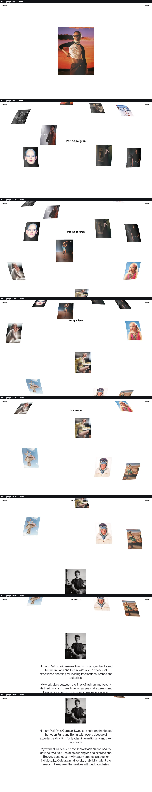
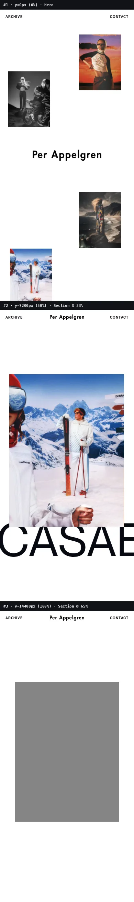

# UI Design System & Master Generation Blueprint: perappelgren-de

> **Per Appelgren · Fashion & Beauty Photographer, Paris & Berlin** (https://perappelgren.de/) — Per Appelgren is a Paris and Berlin based photographer working across fashion, beauty, editorial, and commercial image-making.





---

## 1. Executive Visual Persona & Design Archetype

- **Brand Essence & Persona**: **Per Appelgren · Fashion & Beauty Photographer, Paris & Berlin** (`https://perappelgren.de/`). Per Appelgren is a Paris and Berlin based photographer working across fashion, beauty, editorial, and commercial image-making.
- **Capture Provenance**: Live browser capture (`tier1_fast`, HTTP `200`, captured `2026-11-24`).
- **Visual Archetype**: **Light-Gallery WebGL / Canvas Interactive Experience (`#ffffff` / `#213547`)**.
- **Anti-AI-Slop Differentiators**:
  - **Live-Computed Chromatic Polarity**: Anchors the viewport in `#ffffff` (live computed `body` `background-color` (`computed_styles.json`)) paired with `#0f0f15` primary typography and `#213547` accents.
  - **Grounded Typographic Hierarchy**: Uses `neueMontreal` across display (`Per Appelgren · Fashion & Beauty Pho`) and body copy, paired with `SFMono-Regular` for monospace/code.
  - **Calibrated Spatial Grid & Motion**: Combines `96rem` container bounds (`gap: 2px`, padding `216px`) with `cubic-bezier(0,0,.2,1)` easing and Lenis Smooth Scroll (`data-lenis`), Three.js / WebGL Canvas Pipeline.

---

## 2. Spatial Architecture & Modular Grid Mathematics

### Viewport Allocation & Container Geometry
- **Captured Journey Filmstrips**: Desktop `1280×6624px` (`assets/desktop-journey.webp`, `8` keyframes up to `y=0px` / doc `900px`), Mobile `390×2616px` (`assets/mobile-journey.webp`, `3` keyframes).
- **Master Container Bounds**: `96rem` (non-`@media` desktop container stylesheet rule).
- **Canvas Lateral Padding & Spacing**: `216px` lateral canvas padding with `2px` grid gap.
- **Border Radius Scale**: `4px`, `32px`, `var(--radius-lg)`, `999px`.

### Responsive Breakpoint Architecture
- **Desktop Layout**: Multi-column CSS Grid / Flexbox layout at `1440px` (`max-width: 96rem`, `gap: 2px`).
- **Mobile Layout**: Single-column vertical stack at `390px` viewport width with `216px` horizontal padding.
- **Extracted CSS Media Queries**: `@media (min-width:40rem)`, `@media (min-width:48rem)`, `@media (min-width:64rem)`, `@media (min-width:80rem)`.

---

## 3. Color System, Materiality & Atmospheric Lighting

### Semantic Palette & Source Grounding
| Semantic Role | Ground-Truth Value | Extracted Live / CSS Source |
|---|---|---|
| **Primary Canvas Substrate** | `#ffffff` | live computed `body` `background-color` (`computed_styles.json`) |
| **Primary Typography Ink** | `#0f0f15` | live computed `a` `color` (`computed_styles.json`) |
| **Elevated Surface / Card Substrate** | `#1f1f2b` | `:hover { background-color: #1f1f2b }` |
| **Interactive Accent / Highlight** | `#213547` | live computed `button` `color` (`computed_styles.json`) |
| **Secondary / Muted Copy** | `#33333d` | live computed `p` `color` (`computed_styles.json`) |
| **Structural Hairline Border** | `#33333d` | hairline divider derived from live computed `p` `color` (`computed_styles.json`) |
| **Variable Token (`--color-black`)** | `#000000` | `var(--color-black)` in `:root` |

### Sanitized Root CSS Variables (`ui-ux.md` Ground Truth)
| Variable Name | Extracted Value | Semantic Role |
|---|---|---|
| `--font-neue-montreal` | `"neueMontreal", "neueMontreal Fallback"` | Typography / Scale Token |
| `--font-vemior` | `"vemior", "vemior Fallback"` | Typography / Scale Token |
| `--font-sans` | `var(--font-neue-montreal)` | Typography / Scale Token |
| `--color-black` | `#000` | Canvas / Surface Token |
| `--color-white` | `#fff` | Canvas / Surface Token |
| `--spacing` | `.25rem` | Layout / Spatial Grid Token |
| `--text-xs` | `.75rem` | Typography Ink Token |
| `--text-xs--line-height` | `calc(1 / .75)` | Typography Ink Token |
| `--text-sm` | `.875rem` | Typography Ink Token |
| `--text-sm--line-height` | `calc(1.25 / .875)` | Typography Ink Token |
| `--font-weight-normal` | `400` | Typography / Scale Token |
| `--font-weight-medium` | `500` | Typography / Scale Token |
| `--font-weight-semibold` | `600` | Typography / Scale Token |
| `--tracking-normal` | `0em` | Typography / Scale Token |
| `--radius-lg` | `.5rem` | Elevation / Border Token |
| `--ease-out` | `cubic-bezier(0, 0, .2, 1)` | Motion / Easing Token |

---

## 4. Typographic Scale & Editorial Hierarchy

### Font Family Stacks
- **Display Typography**: `neueMontreal`.
- **Primary Body Stack**: `neueMontreal`.
- **Technical / Metadata Stack**: `SFMono-Regular`.

### Typographic Scale & Rules (Live Computed & Stylesheet Grounded)
- **Hero Display (`H1`)**: observed font-size ladder: `22px`, `16px`, `29px`, `10px`, `1em`.
- **Section Heading (`H2`)**: live computed `h3 (primary section heading)` (`font-size: 22px`, `line-height: 28px`, `font-weight: 400`).
- **Body Copy**: live computed `body` (`font-size: 16px`, `line-height: 24px`, `font-weight: 400`).
- **Metadata & Navigation Labels**: live computed `nav/a` (`font-size: 16px`, `line-height: 24px`, `font-weight: 400`); CSS variables `--text-xs: .75rem`, `--text-xs--line-height: calc(1 / .75)`, `--text-sm: .875rem`.

---

## 5. Choreographed Motion & Interaction Physics

### Primary Easing Curves
- **Extracted Timing Functions**: `cubic-bezier(0,0,.2,1)`, `cubic-bezier(.4,0,.2,1)`, `cubic-bezier(.16,1,.3,1)`.

### Per-Element Transition & Choreography Rules
- **Selector `layer theme`**: `transition: .15s` extracted from `perappelgren-de` stylesheet.
- **Selector `.transition`**: `transition: var(--tw-ease,var(--default-transition-timing-function))` extracted from `perappelgren-de` stylesheet.
- **Selector `transform\]`**: `transition: var(--tw-ease,var(--default-transition-timing-function))` extracted from `perappelgren-de` stylesheet.
- **Extracted Easing Curve (`cubic-bezier(0,0,.2,1)`)**: Governs interactive state transitions across `<nav.home-nav>` and `<section.w-full>`.
- **Runtime Interaction Engine**: Integrates Lenis Smooth Scroll (`data-lenis`), Three.js / WebGL Canvas Pipeline with `prefers-reduced-motion: reduce` fallback guards.
### Measured Runtime Scroll & Interaction Telemetry (`behavioral_journey_v2`)
- **Scroll Driver Mode**: `wheel` (max document height `900px`, deepest scrollY reached `0px` across `8` desktop keyframes).
- **Detected Scroll / Motion Libraries**: `WebGL/Canvas`.
- **Route Transition Architecture**: First internal navigation (`/work`) measured as `SPA` in `1833ms`.

---

## 6. Component Wireframe & Structural DOM Map

### Visual Layout Schematic — Desktop (`1440px`, Grounded in `dom.html` & Landmark Bounding Boxes)
```
┌────────────────────────────────────────────────────────────────────────┐
│ DESKTOP VIEWPORT (1440px) — Per Appelgren · Fashion & Beauty Photograp │
│ ====================================================================== │
│ [ <nav.home-nav> (1440x40px)          | Overview · Index · Archive · ] │
│ ---------------------------------------------------------------------- │
│ | HERO STAGE: <section.relative> (w=1440px)                          | │
│ | H1: Per Appelgren · Fashion & Beauty Photographer, P               | │
│ | Substrate: #ffffff | Ink: #0f0f15 | Accent: #213547                | │
│ ---------------------------------------------------------------------- │
│ | SHOWCASE GRID (<section.w-full>) max-w: 96rem                      | │
│ | +------------------------------+  +------------------------------+ | │
│ | | Featured Work & Interactive  |  | Technical Architecture & Nar | | │
│ | +------------------------------+  +------------------------------+ | │
│ ---------------------------------------------------------------------- │
│ | DETAIL MODULE (<section.h-auto>) — Global Directory & Co           | │
│ ---------------------------------------------------------------------- │
│ [ FOOTER (<footer.z-42>       ) | https://perappelgren.de/             │
└────────────────────────────────────────────────────────────────────────┘
```

### Visual Layout Schematic — Mobile Reflow (`390px`)
```
┌────────────────────────────────────────────────────────────────────────┐
│ MOBILE VIEWPORT REFLOW (390px) — Single-Column Stack (gap: 2px)        │
│ ====================================================================== │
│ [ HEADER BAR (<nav.home-nav>          ) | Compact Menu (390px)         │
│ ---------------------------------------------------------------------- │
│ | HERO STAGE (<section.relative>) — 390px Vertical Lead              | │
│ | H1: Per Appelgren · Fashion & Beauty Photographer, P               | │
│ ---------------------------------------------------------------------- │
│ | SHOWCASE STACK (<section.w-full>) — 1-Col Stack                    | │
│ | [ Item 1: Featured Work & Interactive Showcase                   ] | │
│ | [ Item 2: Technical Architecture & Narrative                     ] | │
│ ---------------------------------------------------------------------- │
│ | DETAIL STACK (<section.h-auto>) — 1-Col (Global Directory &)       | │
│ ---------------------------------------------------------------------- │
│ [ FOOTER (<footer.z-42>       ) | Stacked 390px Colophon               │
└────────────────────────────────────────────────────────────────────────┘
```

### Granular DOM Region Breakdown
1. **Brand Header & Navigation Bar (<nav.home-nav> — `perappelgren-de`)**:
   - Landmark `<nav class="home-nav top-0">` (`1440x40px`) hosting `Per Appelgren · Fashion & Beauty Pho` navigation (`Overview · Index · Archive · About · Contact`), DOM attributes (`data-precedence="next"`, `data-engine="three.js r182"`, `data-gallery-title-track="true"`, `data-cursor="arrow"`), and stylesheet rule `real_94799760-module__C5EBEW__cla... { font-family:neueMontreal,neueMontreal Fallback }`.
2. **Hero Stage & Focal Lead (<section.relative> — `Per Appelgren · Fashion & Beauty P`)**:
   - Landmark `<section class="relative w-full">` presenting display lead `Per Appelgren · Fashion & Beauty Photographer, P` and copy excerpt *"Hi! I am Per! I'm a German-Swedish photographer based between Par"* over `#ffffff` canvas and `#0f0f15` ink.
3. **Primary Showcase & Content Grid (<section.w-full> — `Featured Work & Interactive Showca`)**:
   - Landmark `<section class="relative w-full">` rendering section `Featured Work & Interactive Showcase` with copy *"CASABLANCA PRE-FALL ´26 CAMPAIGN"*, asset references (`vemior-s.p.0loat6znd6m5-.otf`, `12mrv9~q-_9yg.css`, `0wjx1qarcnur7.js`, `14x4ulv7j4.e5.js`), and grid rule `treal_94799760-module__C5EBEW__va... { --font-neue-montreal:"neueMontreal", "neueMontreal Fallback" }`.
4. **Interactive Detail & Feature Matrix (<section.h-auto> — `Technical Architecture & Narrative`)**:
   - Landmark `<section class="h-auto relative">` framing `Technical Architecture & Narrative` and `Global Directory & Contact` (*"ARCHIVE A R C H I V E"*) with `#1f1f2b` surface cards, `#213547` accents, and `mior_bd07f20d-module__cotiFq__cla... { font-family:vemior,vemior Fallback;font-style:normal;font-weight:400 }`.
5. **Colophon & Global Directory Footer (<footer.z-42> — `https://perappelgren.de/`)**:
   - Landmark `<footer class="z-42 relative">` anchoring `Per Appelgren · Fashion & Beauty` footer links (`Overview · Index · Archive · About · Contact`), copy *"CONTACT C O N T A C T"*, and `#33333d` structural dividers.
### Full Vertical Scroll Sequence (Desktop `1440×900` Keyframes)
- **Step 01** (`y=0px`, `0%`): Active landmark `Hero` · sticky/fixed elements: `4`
- **Step 02** (`y=0px`, `8%`): Active landmark `Hero` · sticky/fixed elements: `4`
- **Step 03** (`y=0px`, `17%`): Active landmark `Hero` · sticky/fixed elements: `4`
- **Step 04** (`y=0px`, `25%`): Active landmark `Hero` · sticky/fixed elements: `4`
- **Step 05** (`y=0px`, `33%`): Active landmark `Hero` · sticky/fixed elements: `4`
- **Step 06** (`y=0px`, `42%`): Active landmark `Hero` · sticky/fixed elements: `4`
- **Step 07** (`y=0px`, `50%`): Active landmark `Hero` · sticky/fixed elements: `4`
- **Step 08** (`y=0px`, `58%`): Active landmark `Hero` · sticky/fixed elements: `18`

### Multi-Page Internal Route Map
- **Listing Route (`/work`)**: `https://perappelgren.de/work` — H1: `Photography archive`, scrollHeight `900px`, transition `SPA` (`1833ms`)

---

## 7. Master Zero-Shot AI Generation Prompt

```markdown
# Master Zero-Shot Frontend Generation Prompt: perappelgren-de (Per Appelgren · Fashion & Beauty Photographer, Paris & Berlin)

You are a principal frontend architect and design systems engineer. Build a complete, production-ready web application replicating the exact design system, DOM landmarks, typographic hierarchy, color tokens, and motion physics of `perappelgren-de` (**Per Appelgren · Fashion & Beauty Photographer, Paris & Berlin** — `https://perappelgren.de/`).

### 1. Visual Archetype & Anti-AI-Slop Mandates
- **Archetype**: Light-Gallery WebGL / Canvas Interactive Experience (`#ffffff` / `#213547`).
- **Identity & Domain Context**: Per Appelgren is a Paris and Berlin based photographer working across fashion, beauty, editorial, and commercial image-making.
- **Primary Substrate**: `#ffffff` (live computed `body` `background-color` (`computed_styles.json`)), **Primary Ink**: `#0f0f15`, **Accent / Highlight**: `#213547`.
- **Site-Specific Differentiators**:
  - **Live-Computed Chromatic Polarity**: Anchors the viewport in `#ffffff` (live computed `body` `background-color` (`computed_styles.json`)) paired with `#0f0f15` primary typography and `#213547` accents.
  - **Grounded Typographic Hierarchy**: Uses `neueMontreal` across display (`Per Appelgren · Fashion & Beauty Pho`) and body copy, paired with `SFMono-Regular` for monospace/code.
  - **Calibrated Spatial Grid & Motion**: Combines `96rem` container bounds (`gap: 2px`, padding `216px`) with `cubic-bezier(0,0,.2,1)` easing and Lenis Smooth Scroll (`data-lenis`), Three.js / WebGL Canvas Pipeline.

### 2. Ground-Truth CSS Variables (`:root` Token Contract)
Declare and consume these exact custom properties extracted from `perappelgren-de` in your global stylesheet:

:root {
  /* Per Appelgren · Fashion & Beauty Photographer, Paris & Berlin (perappelgren-de) — Live-Grounded CSS Variables */
  --font-neue-montreal: "neueMontreal", "neueMontreal Fallback"; /* Typography / Scale Token (perappelgren-de) */
  --font-vemior: "vemior", "vemior Fallback"; /* Typography / Scale Token (perappelgren-de) */
  --font-sans: var(--font-neue-montreal); /* Typography / Scale Token (perappelgren-de) */
  --color-black: #000; /* Canvas / Surface Token (perappelgren-de) */
  --color-white: #fff; /* Canvas / Surface Token (perappelgren-de) */
  --spacing: .25rem; /* Layout / Spatial Grid Token (perappelgren-de) */
  --text-xs: .75rem; /* Typography Ink Token (perappelgren-de) */
  --text-xs--line-height: calc(1 / .75); /* Typography Ink Token (perappelgren-de) */
  --text-sm: .875rem; /* Typography Ink Token (perappelgren-de) */
  --text-sm--line-height: calc(1.25 / .875); /* Typography Ink Token (perappelgren-de) */
  --font-weight-normal: 400; /* Typography / Scale Token (perappelgren-de) */
  --font-weight-medium: 500; /* Typography / Scale Token (perappelgren-de) */
  --font-weight-semibold: 600; /* Typography / Scale Token (perappelgren-de) */
  --tracking-normal: 0em; /* Typography / Scale Token (perappelgren-de) */
  --radius-lg: .5rem; /* Elevation / Border Token (perappelgren-de) */
  --ease-out: cubic-bezier(0, 0, .2, 1); /* Motion / Easing Token (perappelgren-de) */
}

### 3. Semantic Color & Materiality Contract
Map every surface, ink, and border strictly to these source-grounded tokens:
- **Primary Canvas Substrate**: `#ffffff` — grounded in live computed `body` `background-color` (`computed_styles.json`)
- **Primary Typography Ink**: `#0f0f15` — grounded in live computed `a` `color` (`computed_styles.json`)
- **Elevated Surface / Card Substrate**: `#1f1f2b` — grounded in `:hover { background-color: #1f1f2b }`
- **Interactive Accent / Highlight**: `#213547` — grounded in live computed `button` `color` (`computed_styles.json`)
- **Secondary / Muted Copy**: `#33333d` — grounded in live computed `p` `color` (`computed_styles.json`)
- **Structural Hairline Border**: `#33333d` — grounded in hairline divider derived from live computed `p` `color` (`computed_styles.json`)
- **Variable Token (`--color-black`)**: `#000000` — grounded in `var(--color-black)` in `:root`

### 4. Spatial Grid, Container Bounds & Responsive Breakpoints
- **Desktop Viewport Reference**: `1280×6624px` (multi-frame vertical journey filmstrip (6624px), `1440px` standard desktop width).
- **Mobile Viewport Reference**: `390×2616px` (multi-frame vertical journey filmstrip (2616px), `390px` standard mobile width).
- **Container Max-Width**: `96rem` (non-`@media` desktop container stylesheet rule)
- **Padding & Gutters**: `216px` lateral canvas padding with `2px` grid gap
- **Desktop Grid**: Multi-column CSS Grid / Flexbox layout at `1440px` (`max-width: 96rem`, `gap: 2px`)
- **Mobile Adaptation**: Single-column vertical stack at `390px` viewport width with `216px` horizontal padding
- **Media Queries**: `@media (min-width:40rem)`, `@media (min-width:48rem)`, `@media (min-width:64rem)`, `@media (min-width:80rem)`
- **Corner Radii**: `4px`, `32px`, `var(--radius-lg)`, `999px`

### 5. Typography & Editorial Scale Contract
- **Display Font Stack**: `neueMontreal`
- **Body Font Stack**: `neueMontreal`
- **Monospace / Technical Font Stack**: `SFMono-Regular`
- **H1 Display Rule**: observed font-size ladder: `22px`, `16px`, `29px`, `10px`, `1em`
- **H2 Section Rule**: live computed `h3 (primary section heading)` (`font-size: 22px`, `line-height: 28px`, `font-weight: 400`)
- **Body Copy Rule**: live computed `body` (`font-size: 16px`, `line-height: 24px`, `font-weight: 400`)
- **Metadata & Index Rule**: live computed `nav/a` (`font-size: 16px`, `line-height: 24px`, `font-weight: 400`); CSS variables `--text-xs: .75rem`, `--text-xs--line-height: calc(1 / .75)`, `--text-sm: .875rem`

### 6. Component Hierarchy, Verbatim Copy & Real DOM Landmarks
Scaffold `perappelgren-de` (`Per Appelgren · Fashion & Beauty Photographer, Paris & Berlin`) with these exact structural regions, extracted copy, and CSS rules from `dom.html`:
1. **Brand Header & Navigation Bar (<nav.home-nav> — `perappelgren-de`)**:
   - DOM & Selectors: Landmark `<nav class="home-nav top-0">` (`1440x40px`) hosting `Per Appelgren · Fashion & Beauty Pho` navigation (`Overview · Index · Archive · About · Contact`), DOM attributes (`data-precedence="next"`, `data-engine="three.js r182"`, `data-gallery-title-track="true"`, `data-cursor="arrow"`), and stylesheet rule `real_94799760-module__C5EBEW__cla... { font-family:neueMontreal,neueMontreal Fallback }`.
   - Responsive Contract: Header `Brand Header & Navigation Bar (<nav.home-nav> — `perappelgren-de`)` (`perappelgren-de`) adapts across `@media (min-width:40rem)`, `@media (min-width:48rem)`, `@media (min-width:64rem)`, `@media (min-width:80rem)` with `cubic-bezier(0,0,.2,1)`, `cubic-bezier(.4,0,.2,1)`, `cubic-bezier(.16,1,.3,1)` transitions and links `Overview · Index · Archive · About · Contact`.
2. **Hero Stage & Focal Lead (<section.relative> — `Per Appelgren · Fashion & Beauty P`)**:
   - DOM & Selectors: Landmark `<section class="relative w-full">` presenting display lead `Per Appelgren · Fashion & Beauty Photographer, P` and copy excerpt *"Hi! I am Per! I'm a German-Swedish photographer based between Par"* over `#ffffff` canvas and `#0f0f15` ink.
   - Responsive Contract: Hero stage (`1280×6624px` desktop / `390×2616px` mobile) sets `#ffffff` background with `#0f0f15` headline `Per Appelgren · Fashion & Beauty Photographer, P`.
3. **Primary Showcase & Content Grid (<section.w-full> — `Featured Work & Interactive Showca`)**:
   - DOM & Selectors: Landmark `<section class="relative w-full">` rendering section `Featured Work & Interactive Showcase` with copy *"CASABLANCA PRE-FALL ´26 CAMPAIGN"*, asset references (`vemior-s.p.0loat6znd6m5-.otf`, `12mrv9~q-_9yg.css`, `0wjx1qarcnur7.js`, `14x4ulv7j4.e5.js`), and grid rule `treal_94799760-module__C5EBEW__va... { --font-neue-montreal:"neueMontreal", "neueMontreal Fallback" }`.
   - Responsive Contract: Showcase grid `Primary Showcase & Content Grid (<section.w-full> — `Featured Work & Interactive Showca`)` applies Multi-column CSS Grid / Flexbox layout at `1440px` (`max-width: 96rem`, `gap: 2px`) on desktop and Single-column vertical stack at `390px` viewport width with `216px` horizontal padding on mobile.
4. **Interactive Detail & Feature Matrix (<section.h-auto> — `Technical Architecture & Narrative`)**:
   - DOM & Selectors: Landmark `<section class="h-auto relative">` framing `Technical Architecture & Narrative` and `Global Directory & Contact` (*"ARCHIVE A R C H I V E"*) with `#1f1f2b` surface cards, `#213547` accents, and `mior_bd07f20d-module__cotiFq__cla... { font-family:vemior,vemior Fallback;font-style:normal;font-weight:400 }`.
   - Responsive Contract: Detail module `Interactive Detail & Feature Matrix (<section.h-auto> — `Technical Architecture & Narrative`)` uses `4px`, `32px`, `var(--radius-lg)`, `999px` radii, `#213547` highlights, and assets (vemior-s.p.0loat6znd6m5-.otf, 12mrv9~q-_9yg.css, 0wjx1qarcnur7.js).
5. **Colophon & Global Directory Footer (<footer.z-42> — `https://perappelgren.de/`)**:
   - DOM & Selectors: Landmark `<footer class="z-42 relative">` anchoring `Per Appelgren · Fashion & Beauty` footer links (`Overview · Index · Archive · About · Contact`), copy *"CONTACT C O N T A C T"*, and `#33333d` structural dividers.
   - Responsive Contract: Footer `Colophon & Global Directory Footer (<footer.z-42> — `https://perappelgren.de/`)` aligns to `96rem` (non-`@media` desktop container stylesheet rule) with `216px` lateral canvas padding with `2px` grid gap and attributes (data-precedence="next", data-engine="three.js r182", data-gallery-title-track="true").

#### Verbatim DOM Copy Excerpts (`dom.html`)
- Copy Excerpt 1: *"Hi! I am Per! I'm a German-Swedish photographer based between Paris and Berlin, wi..."*
- Copy Excerpt 2: *"CASABLANCA PRE-FALL ´26 CAMPAIGN"*
- Copy Excerpt 3: *"ARCHIVE A R C H I V E"*
- Copy Excerpt 4: *"CONTACT C O N T A C T"*

### 7. Motion, Extracted Stylesheet Rules & Interaction Choreography
- **Primary Easing Functions**: `cubic-bezier(0,0,.2,1)`, `cubic-bezier(.4,0,.2,1)`, `cubic-bezier(.16,1,.3,1)`
- **Extracted Stylesheet Rules (`perappelgren-de`)**:
- `real_94799760-module__C5EBEW__cla... { font-family:neueMontreal,neueMontreal Fallback }`
- `treal_94799760-module__C5EBEW__va... { --font-neue-montreal:"neueMontreal", "neueMontreal Fallback" }`
- `mior_bd07f20d-module__cotiFq__cla... { font-family:vemior,vemior Fallback;font-style:normal;font-weight:400 }`
- `emior_bd07f20d-module__cotiFq__va... { --font-vemior:"vemior", "vemior Fallback" }`
- `backdrop { box-sizing:border-box;border:0 solid;margin:0;padding:0 }`
- **Per-Selector Transition Rules**:
- **Selector `layer theme`**: `transition: .15s` extracted from `perappelgren-de` stylesheet.
- **Selector `.transition`**: `transition: var(--tw-ease,var(--default-transition-timing-function))` extracted from `perappelgren-de` stylesheet.
- **Selector `transform\]`**: `transition: var(--tw-ease,var(--default-transition-timing-function))` extracted from `perappelgren-de` stylesheet.
- **Extracted Easing Curve (`cubic-bezier(0,0,.2,1)`)**: Governs interactive state transitions across `<nav.home-nav>` and `<section.w-full>`.
- **Runtime Interaction Engine**: Integrates Lenis Smooth Scroll (`data-lenis`), Three.js / WebGL Canvas Pipeline with `prefers-reduced-motion: reduce` fallback guards.
### 7b. Full-Page Scroll Choreography, Interactive States & Multi-Page Routes
- **Scroll Mechanics**: Implement `wheel` vertical progression up to `900px` across 8 distinct viewport chapters using WebGL/Canvas.
- **Vertical Chapter Sequence**: Hero (0%) -> Hero (8%) -> Hero (17%) -> Hero (25%) -> Hero (33%) -> Hero (42%) -> Hero (50%) -> Hero (58%).
- **Multi-Page Routes**: Scaffold internal routes `/work` (listing, SPA) sharing the global header/footer shell and design tokens.

### 8. Technical Deliverables
- Implement in Next.js (App Router) with TypeScript and Tailwind CSS consuming the `:root` custom properties defined above for `perappelgren-de`.
- Reproduce both the `1440px` desktop architecture and `390px` mobile breakpoint transitions, preserving semantic HTML5 landmarks (`<header>`, `<nav>`, `<main>`, `<section>`, `<footer>`) and `prefers-reduced-motion` accessibility guards.
```
---

## 8. Full-Page Scroll Journey, Interactive States & Subpage Inventory

### Desktop Scroll Keyframes (`1440×900` WebP)
| Step | Scroll Y | Progress | Active Landmark / Section | Sticky/Fixed | Visual Asset |
| :---: | :---: | :---: | :--- | :---: | :--- |
| `#01` | `0px` | `0%` | Hero | `4` | [desktop-step-01.webp](assets/desktop-step-01.webp) |
| `#02` | `0px` | `8%` | Hero | `4` | [desktop-step-02.webp](assets/desktop-step-02.webp) |
| `#03` | `0px` | `17%` | Hero | `4` | [desktop-step-03.webp](assets/desktop-step-03.webp) |
| `#04` | `0px` | `25%` | Hero | `4` | [desktop-step-04.webp](assets/desktop-step-04.webp) |
| `#05` | `0px` | `33%` | Hero | `4` | [desktop-step-05.webp](assets/desktop-step-05.webp) |
| `#06` | `0px` | `42%` | Hero | `4` | [desktop-step-06.webp](assets/desktop-step-06.webp) |
| `#07` | `0px` | `50%` | Hero | `4` | [desktop-step-07.webp](assets/desktop-step-07.webp) |
| `#08` | `0px` | `58%` | Hero | `18` | [desktop-step-08.webp](assets/desktop-step-08.webp) |

### Mobile Condensed Keyframes (`390×844` WebP)
| Step | Scroll Y | Progress | Active Landmark | Visual Asset |
| :---: | :---: | :---: | :--- | :--- |
| `#01` | `0px` | `0%` | Hero | [mobile-step-01.webp](assets/mobile-step-01.webp) |
| `#02` | `7200px` | `50%` | Section @ 33% | [mobile-step-02.webp](assets/mobile-step-02.webp) |
| `#03` | `14400px` | `100%` | Section @ 65% | [mobile-step-03.webp](assets/mobile-step-03.webp) |

### Internal Subpage Filmstrips (`1080px` Wide WebP)
| # | Template | Route URL | H1 / Title | Scroll Height | Transition | Filmstrip Asset |
| :-: | :---: | :--- | :--- | :---: | :---: | :--- |
| `1` | `listing` | `https://perappelgren.de/work` | Photography archive | `900px` | `SPA` (`1833ms`) | [subpage-01-work.webp](assets/subpage-01-work.webp) |

