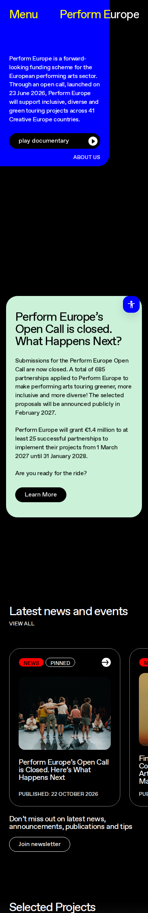

# UI Design System & Master Generation Blueprint: performeurope-eu

> **Perform Europe - Reimagine International Touring** (https://performeurope.eu/) — Discover Perform Europe: a funding scheme for the European performing arts. Supporting inclusive, diverse and green touring projects via...


---

## 1. Executive Visual Persona & Design Archetype

- **Brand Essence & Persona**: **Perform Europe - Reimagine International Touring** (`https://performeurope.eu/`). Discover Perform Europe: a funding scheme for the European performing arts. Supporting inclusive, diverse and green touring projects via...
- **Visual Archetype**: **Light-Substrate Editorial & Modular Grid System (`#CBF2D9` canvas, `#000` ink, `#7a00df` accent)**.
- **Anti-AI-Slop Differentiators**:
  - **Source-Grounded Chromatic Polarity**: Anchors the viewport in `#CBF2D9` (`var(--mint-color)` in `:root`) paired with `#000` primary typography and `#7a00df` accents.
  - **Extracted Typographic Hierarchy**: Pairs `Favorit` for display copy (`Dear performing arts communities acr`) with `ABC Favorit` and not declared in static CSS (uses primary stack / `ui-monospace`).
  - **Calibrated Spatial Grid & Motion**: Combines `800px` container bounds (`gap: 1rem`, padding `35px`) with `cubic-bezier(0,0,.2,1)` easing and GSAP Timeline & ScrollTrigger, Swiper Touch Carousel Engine.

---

## 2. Spatial Architecture & Modular Grid Mathematics



### Viewport Allocation & Container Geometry
- **Captured Viewport Dimensions**: Desktop `1440×4533px` (`assets/desktop.png`, full-page scroll capture), Mobile `390×2400px` (`assets/mobile.png`, capped at 2400px multi-section capture).
- **Master Container Bounds**: `800px` extracted from `performeurope-eu` stylesheet.
- **Canvas Lateral Padding & Spacing**: `35px` lateral canvas padding with `1rem` grid gap.
- **Border Radius Scale**: `5rem`, `999px`, `12px`, `4px`.

### Responsive Breakpoint Architecture
- **Desktop Layout**: Multi-column CSS Grid / Flexbox layout at `1440px` (`max-width: 800px`, `gap: 1rem`).
- **Mobile Layout**: Single-column vertical stack at `390px` viewport width with `35px` horizontal padding.
- **Extracted CSS Media Queries**: `@media screen and (max-width: 479px)`, `@media screen and (max-width: 1479px)`, `@media screen and (max-width: 1300px)`, `@media screen and (max-width: 767px)`.

---

## 3. Color System, Materiality & Atmospheric Lighting

### Semantic Palette & Source Grounding
| Semantic Role | Ground-Truth Value | Extracted CSS Source / Selector |
|---|---|---|
| **Primary Canvas Substrate** | `#CBF2D9` | `var(--mint-color)` in `:root` |
| **Primary Typography Ink** | `#ff00ff` | `var(--magenta-color)` in `:root` |
| **Elevated Surface / Card Substrate** | `#000` | `var(--w2w-start-background-color)` in `:root` |
| **Interactive Accent / Highlight** | `#7a00df` | `var(--wp-block-synced-color)` in `:root` |
| **Secondary / Muted Copy** | `#ddd` | `var(--wp-editor-canvas-background)` in `:root` |
| **Structural Hairline Border** | `#007cba` | `var(--wp-admin-theme-color)` in `:root` |

### Sanitized Root CSS Variables (`ui-ux.md` Ground Truth)
| Variable Name | Extracted Value | Semantic Role |
|---|---|---|
| `--mint-color` | `#CBF2D9` | Brand / Palette Token |
| `--magenta-color` | `#ff00ff` | Brand / Palette Token |
| `--magenta` | `#ff00ff` | Color / Atmospheric Token |
| `--light-blue` | `rgba(0, 0, 255, .0)` | Canvas / Surface Token |
| `--slider-padding` | `5rem` | Layout / Spatial Grid Token |
| `--slider-column-gap` | `5rem` | Layout / Spatial Grid Token |
| `--slide-width` | `33%` | Layout / Spatial Grid Token |
| `--slide-min-width` | `35rem` | Layout / Spatial Grid Token |
| `--td176b92ada598f8f` | `initial` | Design System Custom Token |
| `--td851cd75a8793667` | `initial` | Design System Custom Token |
| `--tc58f4bf5a9869b3e` | `initial` | Design System Custom Token |
| `--t3a480c2f814ef19c` | `initial` | Design System Custom Token |
| `--t77e217518bcd986b` | `initial` | Design System Custom Token |
| `--tc5e0863356bf5767` | `initial` | Design System Custom Token |
| `--t7a2234c5eadde886` | `initial` | Design System Custom Token |
| `--td340014d093b0821` | `initial` | Design System Custom Token |

---

## 4. Typographic Scale & Editorial Hierarchy

### Font Family Stacks
- **Display Typography**: `Favorit`.
- **Primary Body Stack**: `ABC Favorit`.
- **Technical / Metadata Stack**: not declared in static CSS (uses primary stack / `ui-monospace`).

### Typographic Scale & Rules (Extracted from Stylesheet & Variables)
- **Hero Display (`H1`)**: rule `h1` (`font-size: 2em`).
- **Section Heading (`H2`)**: rule `h2` (`font-size: 32px`, `line-height: 36px`).
- **Body Copy**: rule `.paragraph` (`font-size: 1rem`).
- **Metadata & Navigation Labels**: CSS variables `--wp--custom--spacing--small: max(1.5rem, 2vw)`, `--wp--custom--typography--line-height--small: 1.2`; rule `small` (`font-size: 80%`).

---

## 5. Choreographed Motion & Interaction Physics

### Primary Easing Curves
- **Extracted Timing Functions**: `cubic-bezier(0,0,.2,1)`, `cubic-bezier(.4,0,1,1)`, `cubic-bezier(.05,0,0,1)`.

### Per-Element Transition & Choreography Rules
- **Selector `#reset-pass-submit`**: `transition: background-color .2s` extracted from `performeurope-eu` stylesheet.
- **Selector `::after`**: `transition: 0.01ms !important` extracted from `performeurope-eu` stylesheet.
- **Selector `html.sl-a11y-reduce-motion *::after`**: `transition: 0.01ms !important` extracted from `performeurope-eu` stylesheet.
- **Extracted Easing Curve (`cubic-bezier(0,0,.2,1)`)**: Governs interactive state transitions across `<nav.nav__cont>` and `<section.section-wrp>`.
- **Runtime Interaction Engine**: Integrates GSAP Timeline & ScrollTrigger, Swiper Touch Carousel Engine with `prefers-reduced-motion: reduce` fallback guards.

---

## 6. Component Wireframe & Structural DOM Map

### Visual Layout Schematic (Grounded in `dom.html` — `1440px` Desktop & `390px` Mobile Reflow)
```
┌────────────────────────────────────────────────────────────────────────┐
│ DESKTOP VIEWPORT (1440px) — Perform Europe - Reimagine International T │
│ ====================================================================== │
│ [ <nav.nav__cont>          | L o g i n · Home · About Us · who we a ]  │
│ ---------------------------------------------------------------------- │
│ | HERO STAGE: <section.section-wrp>                                |   │
│ | H1: Dear performing arts communities across Europe… hi!          |   │
│ | Substrate: #CBF2D9    | Ink: #000       | Accent: #7a00df        |   │
│ ---------------------------------------------------------------------- │
│ | SHOWCASE GRID (<section.section-wrp>     ) max-w: 800px          |   │
│ | +------------------------------+  +------------------------------+ | │
│ | | Innovative                   |  | Green                        | | │
│ | +------------------------------+  +------------------------------+ | │
│ ---------------------------------------------------------------------- │
│ | MOBILE VIEWPORT REFLOW (390px) — Single-Column Stack (gap: 1rem  ) | │
│ | [<nav.nav__cont>] -> [<section.section-w] -> [<section.section-w] |  │
│ ---------------------------------------------------------------------- │
│ [ FOOTER (<footer.footer>       ) | https://performeurope.eu/          │
└────────────────────────────────────────────────────────────────────────┘
```

### Granular DOM Region Breakdown
1. **Brand Header & Navigation Bar (<nav.nav__cont> — `performeurope-eu`)**:
   - Landmark `<nav class="nav__cont">` hosting `Perform Europe - Reimagine Internati` navigation (`L o g i n · Home · About Us · who we are · Timeline`), DOM attributes (`data-speed="1.09"`, `data-lag="0"`, `data-speed="0.95"`, `data-lag="0"`), and stylesheet rule `.display_user_data { display:none; }`.
2. **Hero Stage & Focal Lead (<section.section-wrp> — `Dear performing arts communities a`)**:
   - Landmark `<section class="section-wrp s-landing-animation">` presenting display lead `Dear performing arts communities across Europe… hi!` and copy excerpt *"Press Enter to Menu"* over `#CBF2D9` canvas and `#000` ink.
3. **Primary Showcase & Content Grid (<section.section-wrp> — `Innovative`)**:
   - Landmark `<section class="section-wrp s-card">` rendering section `Innovative` with copy *"Press Enter to Content"*, asset references (`perform-europe-fav.png`, `cdnjs.cloudflare.com`, `embed`, `password-lost.css`), and grid rule `img.open-eyes.closed { display: none; }`.
4. **Interactive Detail & Feature Matrix (<section.section-wrp> — `Green`)**:
   - Landmark `<section class="section-wrp s-latest">` framing `Green` and `Diverse` (*"Press Enter to Footer"*) with `#000` surface cards, `#7a00df` accents, and `.s-profile-first h1.page__title { max-width: 800px; }`.
5. **Colophon & Global Directory Footer (<footer.footer> — `https://performeurope.eu/`)**:
   - Landmark `<footer class="footer">` anchoring `Perform Europe - Reimagine Inter` footer links (`L o g i n · Home · About Us · who we are · Timeline`), copy *"P e r f o r m E u r o p e"*, and `#007cba` structural dividers.

---

## 7. Master Zero-Shot AI Generation Prompt

```markdown
# Master Zero-Shot Frontend Generation Prompt: performeurope-eu (Perform Europe - Reimagine International Touring)

You are a principal frontend architect and design systems engineer. Build a complete, production-ready web application replicating the exact design system, DOM landmarks, typographic hierarchy, color tokens, and motion physics of `performeurope-eu` (**Perform Europe - Reimagine International Touring** — `https://performeurope.eu/`).

### 1. Visual Archetype & Anti-AI-Slop Mandates
- **Archetype**: Light-Substrate Editorial & Modular Grid System (`#CBF2D9` canvas, `#000` ink, `#7a00df` accent).
- **Identity & Domain Context**: Discover Perform Europe: a funding scheme for the European performing arts. Supporting inclusive, diverse and green touring projects via...
- **Primary Substrate**: `#CBF2D9` (`var(--mint-color)` in `:root`), **Primary Ink**: `#000`, **Accent / Highlight**: `#7a00df`.
- **Site-Specific Differentiators**:
  - **Source-Grounded Chromatic Polarity**: Anchors the viewport in `#CBF2D9` (`var(--mint-color)` in `:root`) paired with `#000` primary typography and `#7a00df` accents.
  - **Extracted Typographic Hierarchy**: Pairs `Favorit` for display copy (`Dear performing arts communities acr`) with `ABC Favorit` and not declared in static CSS (uses primary stack / `ui-monospace`).
  - **Calibrated Spatial Grid & Motion**: Combines `800px` container bounds (`gap: 1rem`, padding `35px`) with `cubic-bezier(0,0,.2,1)` easing and GSAP Timeline & ScrollTrigger, Swiper Touch Carousel Engine.

### 2. Ground-Truth CSS Variables (`:root` Token Contract)
Declare and consume these exact custom properties extracted from `performeurope-eu` in your global stylesheet:

:root {
  /* Perform Europe - Reimagine International Touring (performeurope-eu) — Ground-Truth Extracted CSS Variables */
  --mint-color: #CBF2D9; /* Brand / Palette Token (performeurope-eu) */
  --magenta-color: #ff00ff; /* Brand / Palette Token (performeurope-eu) */
  --magenta: #ff00ff; /* Color / Atmospheric Token (performeurope-eu) */
  --light-blue: rgba(0, 0, 255, .0); /* Canvas / Surface Token (performeurope-eu) */
  --slider-padding: 5rem; /* Layout / Spatial Grid Token (performeurope-eu) */
  --slider-column-gap: 5rem; /* Layout / Spatial Grid Token (performeurope-eu) */
  --slide-width: 33%; /* Layout / Spatial Grid Token (performeurope-eu) */
  --slide-min-width: 35rem; /* Layout / Spatial Grid Token (performeurope-eu) */
  --td176b92ada598f8f: initial; /* Design System Custom Token (performeurope-eu) */
  --td851cd75a8793667: initial; /* Design System Custom Token (performeurope-eu) */
  --tc58f4bf5a9869b3e: initial; /* Design System Custom Token (performeurope-eu) */
  --t3a480c2f814ef19c: initial; /* Design System Custom Token (performeurope-eu) */
  --t77e217518bcd986b: initial; /* Design System Custom Token (performeurope-eu) */
  --tc5e0863356bf5767: initial; /* Design System Custom Token (performeurope-eu) */
  --t7a2234c5eadde886: initial; /* Design System Custom Token (performeurope-eu) */
  --td340014d093b0821: initial; /* Design System Custom Token (performeurope-eu) */
}

### 3. Semantic Color & Materiality Contract
Map every surface, ink, and border strictly to these source-grounded tokens:
- **Primary Canvas Substrate**: `#CBF2D9` — grounded in `var(--mint-color)` in `:root`
- **Primary Typography Ink**: `#ff00ff` — grounded in `var(--magenta-color)` in `:root`
- **Elevated Surface / Card Substrate**: `#000` — grounded in `var(--w2w-start-background-color)` in `:root`
- **Interactive Accent / Highlight**: `#7a00df` — grounded in `var(--wp-block-synced-color)` in `:root`
- **Secondary / Muted Copy**: `#ddd` — grounded in `var(--wp-editor-canvas-background)` in `:root`
- **Structural Hairline Border**: `#007cba` — grounded in `var(--wp-admin-theme-color)` in `:root`

### 4. Spatial Grid, Container Bounds & Responsive Breakpoints
- **Desktop Viewport Reference**: `1440×4533px` (full-page scroll capture, `1440px` standard desktop width).
- **Mobile Viewport Reference**: `390×2400px` (capped at 2400px multi-section capture, `390px` standard mobile width).
- **Container Max-Width**: `800px` extracted from `performeurope-eu` stylesheet
- **Padding & Gutters**: `35px` lateral canvas padding with `1rem` grid gap
- **Desktop Grid**: Multi-column CSS Grid / Flexbox layout at `1440px` (`max-width: 800px`, `gap: 1rem`)
- **Mobile Adaptation**: Single-column vertical stack at `390px` viewport width with `35px` horizontal padding
- **Media Queries**: `@media screen and (max-width: 479px)`, `@media screen and (max-width: 1479px)`, `@media screen and (max-width: 1300px)`, `@media screen and (max-width: 767px)`
- **Corner Radii**: `5rem`, `999px`, `12px`, `4px`

### 5. Typography & Editorial Scale Contract
- **Display Font Stack**: `Favorit`
- **Body Font Stack**: `ABC Favorit`
- **Monospace / Technical Font Stack**: not declared in static CSS (uses primary stack / `ui-monospace`)
- **H1 Display Rule**: rule `h1` (`font-size: 2em`)
- **H2 Section Rule**: rule `h2` (`font-size: 32px`, `line-height: 36px`)
- **Body Copy Rule**: rule `.paragraph` (`font-size: 1rem`)
- **Metadata & Index Rule**: CSS variables `--wp--custom--spacing--small: max(1.5rem, 2vw)`, `--wp--custom--typography--line-height--small: 1.2`; rule `small` (`font-size: 80%`)

### 6. Component Hierarchy, Verbatim Copy & Real DOM Landmarks
Scaffold `performeurope-eu` (`Perform Europe - Reimagine International Touring`) with these exact structural regions, extracted copy, and CSS rules from `dom.html`:
1. **Brand Header & Navigation Bar (<nav.nav__cont> — `performeurope-eu`)**:
   - DOM & Selectors: Landmark `<nav class="nav__cont">` hosting `Perform Europe - Reimagine Internati` navigation (`L o g i n · Home · About Us · who we are · Timeline`), DOM attributes (`data-speed="1.09"`, `data-lag="0"`, `data-speed="0.95"`, `data-lag="0"`), and stylesheet rule `.display_user_data { display:none; }`.
   - Responsive Contract: Header `Brand Header & Navigation Bar (<nav.nav__cont> — `performeurope-eu`)` (`performeurope-eu`) adapts across `@media screen and (max-width: 479px)`, `@media screen and (max-width: 1479px)`, `@media screen and (max-width: 1300px)`, `@media screen and (max-width: 767px)` with `cubic-bezier(0,0,.2,1)`, `cubic-bezier(.4,0,1,1)`, `cubic-bezier(.05,0,0,1)` transitions and links `L o g i n · Home · About Us · who we are · Timeline`.
2. **Hero Stage & Focal Lead (<section.section-wrp> — `Dear performing arts communities a`)**:
   - DOM & Selectors: Landmark `<section class="section-wrp s-landing-animation">` presenting display lead `Dear performing arts communities across Europe… hi!` and copy excerpt *"Press Enter to Menu"* over `#CBF2D9` canvas and `#000` ink.
   - Responsive Contract: Hero stage (`1440×4533px` desktop / `390×2400px` mobile) sets `#CBF2D9` background with `#000` headline `Dear performing arts communities across Europe… hi!`.
3. **Primary Showcase & Content Grid (<section.section-wrp> — `Innovative`)**:
   - DOM & Selectors: Landmark `<section class="section-wrp s-card">` rendering section `Innovative` with copy *"Press Enter to Content"*, asset references (`perform-europe-fav.png`, `cdnjs.cloudflare.com`, `embed`, `password-lost.css`), and grid rule `img.open-eyes.closed { display: none; }`.
   - Responsive Contract: Showcase grid `Primary Showcase & Content Grid (<section.section-wrp> — `Innovative`)` applies Multi-column CSS Grid / Flexbox layout at `1440px` (`max-width: 800px`, `gap: 1rem`) on desktop and Single-column vertical stack at `390px` viewport width with `35px` horizontal padding on mobile.
4. **Interactive Detail & Feature Matrix (<section.section-wrp> — `Green`)**:
   - DOM & Selectors: Landmark `<section class="section-wrp s-latest">` framing `Green` and `Diverse` (*"Press Enter to Footer"*) with `#000` surface cards, `#7a00df` accents, and `.s-profile-first h1.page__title { max-width: 800px; }`.
   - Responsive Contract: Detail module `Interactive Detail & Feature Matrix (<section.section-wrp> — `Green`)` uses `5rem`, `999px`, `12px`, `4px` radii, `#7a00df` highlights, and assets (perform-europe-fav.png, cdnjs.cloudflare.com, embed).
5. **Colophon & Global Directory Footer (<footer.footer> — `https://performeurope.eu/`)**:
   - DOM & Selectors: Landmark `<footer class="footer">` anchoring `Perform Europe - Reimagine Inter` footer links (`L o g i n · Home · About Us · who we are · Timeline`), copy *"P e r f o r m E u r o p e"*, and `#007cba` structural dividers.
   - Responsive Contract: Footer `Colophon & Global Directory Footer (<footer.footer> — `https://performeurope.eu/`)` aligns to `800px` extracted from `performeurope-eu` stylesheet with `35px` lateral canvas padding with `1rem` grid gap and attributes (data-speed="1.09", data-lag="0", data-speed="0.95").

#### Verbatim DOM Copy Excerpts (`dom.html`)
- Copy Excerpt 1: *"Press Enter to Menu"*
- Copy Excerpt 2: *"Press Enter to Content"*
- Copy Excerpt 3: *"Press Enter to Footer"*
- Copy Excerpt 4: *"P e r f o r m E u r o p e"*

### 7. Motion, Extracted Stylesheet Rules & Interaction Choreography
- **Primary Easing Functions**: `cubic-bezier(0,0,.2,1)`, `cubic-bezier(.4,0,1,1)`, `cubic-bezier(.05,0,0,1)`
- **Extracted Stylesheet Rules (`performeurope-eu`)**:
- `.display_user_data { display:none; }`
- `img.open-eyes.closed { display: none; }`
- `.s-profile-first h1.page__title { max-width: 800px; }`
- `img.eye_closed.open { display: block !important; }`
- `.action-warning { z-index: 999999; height: 100%; min-height: 100vh; }`
- **Per-Selector Transition Rules**:
- **Selector `#reset-pass-submit`**: `transition: background-color .2s` extracted from `performeurope-eu` stylesheet.
- **Selector `::after`**: `transition: 0.01ms !important` extracted from `performeurope-eu` stylesheet.
- **Selector `html.sl-a11y-reduce-motion *::after`**: `transition: 0.01ms !important` extracted from `performeurope-eu` stylesheet.
- **Extracted Easing Curve (`cubic-bezier(0,0,.2,1)`)**: Governs interactive state transitions across `<nav.nav__cont>` and `<section.section-wrp>`.
- **Runtime Interaction Engine**: Integrates GSAP Timeline & ScrollTrigger, Swiper Touch Carousel Engine with `prefers-reduced-motion: reduce` fallback guards.

### 8. Technical Deliverables
- Implement in Next.js (App Router) with TypeScript and Tailwind CSS consuming the `:root` custom properties defined above for `performeurope-eu`.
- Reproduce both the `1440px` desktop architecture and `390px` mobile breakpoint transitions, preserving semantic HTML5 landmarks (`<header>`, `<nav>`, `<main>`, `<section>`, `<footer>`) and `prefers-reduced-motion` accessibility guards.
```
