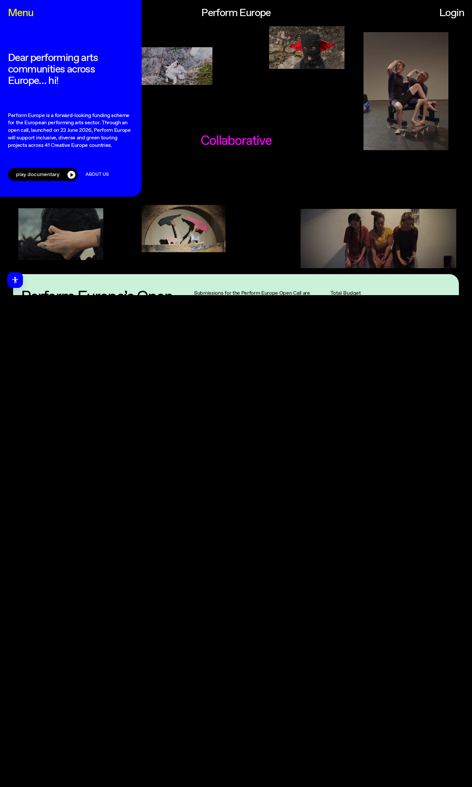

# UI Design System & Master Generation Blueprint: performeurope-eu

> **Perform Europe - Reimagine International Touring** (https://performeurope.eu/) — Discover Perform Europe: a funding scheme for the European performing arts. Supporting inclusive, diverse and green touring projects via...



---

## 1. Executive Visual Persona & Design Archetype

- **Brand Essence & Persona**: **Perform Europe - Reimagine International Touring** (`https://performeurope.eu/`). Discover Perform Europe: a funding scheme for the European performing arts. Supporting inclusive, diverse and green touring projects via...
- **Capture Provenance**: Live browser capture (`tier1_fast`, HTTP `200`, captured `2026-11-23`).
- **Visual Archetype**: **High-Contrast Obsidian / Atmospheric Design System (`#000000` canvas, `#ffffff` ink, `#0000ff` accent)**.
- **Anti-AI-Slop Differentiators**:
  - **Live-Computed Chromatic Polarity**: Anchors the viewport in `#000000` (live computed `body` `background-color` (`computed_styles.json`)) paired with `#ffffff` primary typography and `#0000ff` accents.
  - **Grounded Typographic Hierarchy**: Pairs `Favorit` for display copy (`Dear performing arts communities acr`) with `Favorit` and not declared in live computed styles (uses primary stack / `ui-monospace`).
  - **Calibrated Spatial Grid & Motion**: Combines `100vw` container bounds (`gap: 1.5rem`, padding `24px`) with `cubic-bezier(0,0,.2,1)` easing and GSAP Timeline & ScrollTrigger, Swiper Touch Carousel Engine.

---

## 2. Spatial Architecture & Modular Grid Mathematics


### Viewport Allocation & Container Geometry
- **Captured Viewport Dimensions**: Desktop `1440×2400px` (`assets/desktop.png`, clamped at 2400px live multi-section capture), Mobile `390×2400px` (`assets/mobile.png`, clamped at 2400px live multi-section capture).
- **Master Container Bounds**: `100vw` (non-`@media` desktop container stylesheet rule).
- **Canvas Lateral Padding & Spacing**: `24px` lateral canvas padding with `1.5rem` grid gap.
- **Border Radius Scale**: `16px`, `999px`, `4px`, `8px`.

### Responsive Breakpoint Architecture
- **Desktop Layout**: Multi-column CSS Grid / Flexbox layout at `1440px` (`max-width: 100vw`, `gap: 1.5rem`).
- **Mobile Layout**: Single-column vertical stack at `390px` viewport width with `24px` horizontal padding.
- **Extracted CSS Media Queries**: `@media screen and (max-width: 991px)`, `@media screen and (max-width: 767px)`, `@media screen and (max-width: 479px)`, `@media (min-width: 768px)`.

---

## 3. Color System, Materiality & Atmospheric Lighting

### Semantic Palette & Source Grounding
| Semantic Role | Ground-Truth Value | Extracted Live / CSS Source |
|---|---|---|
| **Primary Canvas Substrate** | `#000000` | live computed `body` `background-color` (`computed_styles.json`) |
| **Primary Typography Ink** | `#ffffff` | live computed `main` `color` (`computed_styles.json`) |
| **Elevated Surface / Card Substrate** | `#0000ff` | live computed `button` `background-color` (`computed_styles.json`) |
| **Interactive Accent / Highlight** | `#0000ff` | live computed `button` `background-color` (`computed_styles.json`) |
| **Secondary / Muted Copy** | `#111111` | live computed `a` `color` (`computed_styles.json`) |
| **Structural Hairline Border** | `#5897fb` | `--classic .select2-selection--s... { border: #5897fb }` |
| **Variable Token (`--wp-block-synced-color`)** | `#7a00df` | `var(--wp-block-synced-color)` in `:root` |
| **Variable Token (`--wp-editor-canvas-background`)** | `#dddddd` | `var(--wp-editor-canvas-background)` in `:root` |
| **Variable Token (`--wp-admin-theme-color`)** | `#007cba` | `var(--wp-admin-theme-color)` in `:root` |
| **Variable Token (`--wp-admin-theme-color-darker-10`)** | `#006ba1` | `var(--wp-admin-theme-color-darker-10)` in `:root` |
| **Variable Token (`--wp-admin-theme-color-darker-20`)** | `#005a87` | `var(--wp-admin-theme-color-darker-20)` in `:root` |

### Sanitized Root CSS Variables (`ui-ux.md` Ground Truth)
| Variable Name | Extracted Value | Semantic Role |
|---|---|---|
| `--wp-block-synced-color` | `#7a00df` | Brand / Palette Token |
| `--wp-block-synced-color--rgb` | `122,0,223` | Brand / Palette Token |
| `--wp-bound-block-color` | `var(--wp-block-synced-color)` | Brand / Palette Token |
| `--wp-editor-canvas-background` | `#ddd` | Canvas / Surface Token |
| `--wp-admin-theme-color` | `#007cba` | Brand / Palette Token |
| `--wp-admin-theme-color--rgb` | `0,124,186` | Brand / Palette Token |
| `--wp-admin-theme-color-darker-10` | `#006ba1` | Canvas / Surface Token |
| `--wp-admin-theme-color-darker-10--rgb` | `0,107,160.5` | Canvas / Surface Token |
| `--wp-admin-theme-color-darker-20` | `#005a87` | Canvas / Surface Token |
| `--wp-admin-theme-color-darker-20--rgb` | `0,90,135` | Canvas / Surface Token |
| `--wp-admin-border-width-focus` | `2px` | Layout / Spatial Grid Token |
| `--wp-admin--admin-bar--position-offset` | `var(--wp-admin--admin-bar--height,0px)` | Dimension / Scale Token |
| `--wp--custom--spacing--small` | `max(1.5rem, 2vw)` | Layout / Spatial Grid Token |
| `--wp--custom--spacing--medium` | `clamp(2rem, 8vw, calc(4 * 1.5rem))` | Layout / Spatial Grid Token |
| `--wp--custom--spacing--large` | `clamp(4rem, 10vw, 8rem)` | Layout / Spatial Grid Token |
| `--wp--custom--spacing--outer` | `var(--wp--custom--spacing--small, 1.5rem)` | Layout / Spatial Grid Token |

---

## 4. Typographic Scale & Editorial Hierarchy

### Font Family Stacks
- **Display Typography**: `Favorit`.
- **Primary Body Stack**: `Favorit`.
- **Technical / Metadata Stack**: not declared in live computed styles (uses primary stack / `ui-monospace`).

### Typographic Scale & Rules (Live Computed & Stylesheet Grounded)
- **Hero Display (`H1`)**: rule `h1` (`font-size: 2em`).
- **Section Heading (`H2`)**: live computed `h2` (`font-size: 48px`, `line-height: 48px`, `font-weight: 400`, `letter-spacing: -2.4px`); rule `h2` (`font-size: 32px`, `line-height: 36px`).
- **Body Copy**: live computed `body` (`font-size: 19px`, `line-height: 22.8px`, `font-weight: 400`); rule `p` (`font-size: 1.25rem`, `line-height: 130%`, `letter-spacing: -.05rem`).
- **Metadata & Navigation Labels**: live computed `nav/a` (`font-size: 19px`, `line-height: 22.8px`, `font-weight: 400`); CSS variables `--wp--custom--spacing--small: max(1.5rem, 2vw)`, `--wp--custom--typography--line-height--small: 1.2`; rule `small` (`font-size: 80%`).

---

## 5. Choreographed Motion & Interaction Physics

### Primary Easing Curves
- **Extracted Timing Functions**: `cubic-bezier(0,0,.2,1)`, `cubic-bezier(.4,0,1,1)`, `cubic-bezier(.05,0,0,1)`.

### Per-Element Transition & Choreography Rules
- **Selector `.swiper-slide .txt--4rem-slid.txt...`**: `transition: all .2s` extracted from `performeurope-eu` stylesheet.
- **Selector `.cta__arrow__img`**: `transition: 200ms` extracted from `performeurope-eu` stylesheet.
- **Selector `.dd__txt`**: `transition: 0ms` extracted from `performeurope-eu` stylesheet.
- **Extracted Easing Curve (`cubic-bezier(0,0,.2,1)`)**: Governs interactive state transitions across `<nav.nav__cont>` and `<section.s-card>`.
- **Runtime Interaction Engine**: Integrates GSAP Timeline & ScrollTrigger, Swiper Touch Carousel Engine with `prefers-reduced-motion: reduce` fallback guards.

---

## 6. Component Wireframe & Structural DOM Map

### Visual Layout Schematic — Desktop (`1440px`, Grounded in `dom.html` & Landmark Bounding Boxes)
```
┌────────────────────────────────────────────────────────────────────────┐
│ DESKTOP VIEWPORT (1440px) — Perform Europe - Reimagine International T │
│ ====================================================================== │
│ [ <nav.nav__cont> (1440x0px)          | L o g i n · Home · About Us  ] │
│ ---------------------------------------------------------------------- │
│ | HERO STAGE: <section.section-wrp> (w=1440px)                       | │
│ | H1: Dear performing arts communities across Europe… hi!            | │
│ | Substrate: #000000 | Ink: #ffffff | Accent: #0000ff                | │
│ ---------------------------------------------------------------------- │
│ | SHOWCASE GRID (<section.s-card>) max-w: 100vw                      | │
│ | +------------------------------+  +------------------------------+ | │
│ | | Collaborative                |  | Perform Europe’s Open Call i | | │
│ | +------------------------------+  +------------------------------+ | │
│ ---------------------------------------------------------------------- │
│ | DETAIL MODULE (<section.s-latest>) — Latest news and event         | │
│ ---------------------------------------------------------------------- │
│ [ FOOTER (<footer.footer>     ) | https://performeurope.eu/            │
└────────────────────────────────────────────────────────────────────────┘
```

### Visual Layout Schematic — Mobile Reflow (`390px`)
```
┌────────────────────────────────────────────────────────────────────────┐
│ MOBILE VIEWPORT REFLOW (390px) — Single-Column Stack (gap: 1.5rem)     │
│ ====================================================================== │
│ [ HEADER BAR (<nav.nav__cont>         ) | Compact Menu (390px)         │
│ ---------------------------------------------------------------------- │
│ | HERO STAGE (<section.section-wrp>) — 390px Vertical Lead           | │
│ | H1: Dear performing arts communities across Europe… hi!            | │
│ ---------------------------------------------------------------------- │
│ | SHOWCASE STACK (<section.s-card>) — 1-Col Stack                    | │
│ | [ Item 1: Collaborative                                          ] | │
│ | [ Item 2: Perform Europe’s Open Call is closed. What Happen...   ] | │
│ ---------------------------------------------------------------------- │
│ | DETAIL STACK (<section.s-latest>) — 1-Col (Latest news and ev)     | │
│ ---------------------------------------------------------------------- │
│ [ FOOTER (<footer.footer>     ) | Stacked 390px Colophon               │
└────────────────────────────────────────────────────────────────────────┘
```

### Granular DOM Region Breakdown
1. **Brand Header & Navigation Bar (<nav.nav__cont> — `performeurope-eu`)**:
   - Landmark `<nav class="nav__cont">` (`1440x0px`) hosting `Perform Europe - Reimagine Internati` navigation (`L o g i n · Home · About Us · who we are · Timeline`), DOM attributes (`data-speed="1.09"`, `data-lag="0"`, `data-speed="0.95"`, `data-lag="0"`), and stylesheet rule `.select2-container { box-sizing:border-box;display:inline-block;margin:0;position:relative;ve... }`.
2. **Hero Stage & Focal Lead (<section.section-wrp> — `Dear performing arts communities a`)**:
   - Landmark `<section class="section-wrp s-landing-animation">` presenting display lead `Dear performing arts communities across Europe… hi!` and copy excerpt *"Perform Europe is a forward-looking funding scheme for the Europe"* over `#000000` canvas and `#ffffff` ink.
3. **Primary Showcase & Content Grid (<section.s-card> — `Collaborative`)**:
   - Landmark `<section class="section-wrp s-card">` rendering section `Collaborative` with copy *"Submissions for the Perform Europe Open Call are now closed. A to"*, asset references (`perform-europe-fav.png`, `cdnjs.cloudflare.com`, `embed`, `password-lost.css`), and grid rule `t2-container .select2-selection--... { box-sizing:border-box;cursor:pointer;display:block;height:28px;user-sele... }`.
4. **Interactive Detail & Feature Matrix (<section.s-latest> — `Perform Europe’s Open Call is clos`)**:
   - Landmark `<section class="section-wrp s-latest">` framing `Perform Europe’s Open Call is closed. What Happen...` and `Latest news and events` (*"While we await the public announcement of the selected projects f"*) with `#0000ff` surface cards, `#0000ff` accents, and `on--single .select2-selection__re... { display:block;padding-left:8px;padding-right:20px;overflow:hidden;text-o... }`.
5. **Colophon & Global Directory Footer (<footer.footer> — `https://performeurope.eu/`)**:
   - Landmark `<footer class="footer">` anchoring `Perform Europe - Reimagine Inter` footer links (`L o g i n · Home · About Us · who we are · Timeline`), copy *"Perform Europe is co-funded by the European Union and implem"*, and `#5897fb` structural dividers.

---

## 7. Master Zero-Shot AI Generation Prompt

```markdown
# Master Zero-Shot Frontend Generation Prompt: performeurope-eu (Perform Europe - Reimagine International Touring)

You are a principal frontend architect and design systems engineer. Build a complete, production-ready web application replicating the exact design system, DOM landmarks, typographic hierarchy, color tokens, and motion physics of `performeurope-eu` (**Perform Europe - Reimagine International Touring** — `https://performeurope.eu/`).

### 1. Visual Archetype & Anti-AI-Slop Mandates
- **Archetype**: High-Contrast Obsidian / Atmospheric Design System (`#000000` canvas, `#ffffff` ink, `#0000ff` accent).
- **Identity & Domain Context**: Discover Perform Europe: a funding scheme for the European performing arts. Supporting inclusive, diverse and green touring projects via...
- **Primary Substrate**: `#000000` (live computed `body` `background-color` (`computed_styles.json`)), **Primary Ink**: `#ffffff`, **Accent / Highlight**: `#0000ff`.
- **Site-Specific Differentiators**:
  - **Live-Computed Chromatic Polarity**: Anchors the viewport in `#000000` (live computed `body` `background-color` (`computed_styles.json`)) paired with `#ffffff` primary typography and `#0000ff` accents.
  - **Grounded Typographic Hierarchy**: Pairs `Favorit` for display copy (`Dear performing arts communities acr`) with `Favorit` and not declared in live computed styles (uses primary stack / `ui-monospace`).
  - **Calibrated Spatial Grid & Motion**: Combines `100vw` container bounds (`gap: 1.5rem`, padding `24px`) with `cubic-bezier(0,0,.2,1)` easing and GSAP Timeline & ScrollTrigger, Swiper Touch Carousel Engine.

### 2. Ground-Truth CSS Variables (`:root` Token Contract)
Declare and consume these exact custom properties extracted from `performeurope-eu` in your global stylesheet:

:root {
  /* Perform Europe - Reimagine International Touring (performeurope-eu) — Live-Grounded CSS Variables */
  --wp-block-synced-color: #7a00df; /* Brand / Palette Token (performeurope-eu) */
  --wp-block-synced-color--rgb: 122,0,223; /* Brand / Palette Token (performeurope-eu) */
  --wp-bound-block-color: var(--wp-block-synced-color); /* Brand / Palette Token (performeurope-eu) */
  --wp-editor-canvas-background: #ddd; /* Canvas / Surface Token (performeurope-eu) */
  --wp-admin-theme-color: #007cba; /* Brand / Palette Token (performeurope-eu) */
  --wp-admin-theme-color--rgb: 0,124,186; /* Brand / Palette Token (performeurope-eu) */
  --wp-admin-theme-color-darker-10: #006ba1; /* Canvas / Surface Token (performeurope-eu) */
  --wp-admin-theme-color-darker-10--rgb: 0,107,160.5; /* Canvas / Surface Token (performeurope-eu) */
  --wp-admin-theme-color-darker-20: #005a87; /* Canvas / Surface Token (performeurope-eu) */
  --wp-admin-theme-color-darker-20--rgb: 0,90,135; /* Canvas / Surface Token (performeurope-eu) */
  --wp-admin-border-width-focus: 2px; /* Layout / Spatial Grid Token (performeurope-eu) */
  --wp-admin--admin-bar--position-offset: var(--wp-admin--admin-bar--height,0px); /* Dimension / Scale Token (performeurope-eu) */
  --wp--custom--spacing--small: max(1.5rem, 2vw); /* Layout / Spatial Grid Token (performeurope-eu) */
  --wp--custom--spacing--medium: clamp(2rem, 8vw, calc(4 * 1.5rem)); /* Layout / Spatial Grid Token (performeurope-eu) */
  --wp--custom--spacing--large: clamp(4rem, 10vw, 8rem); /* Layout / Spatial Grid Token (performeurope-eu) */
  --wp--custom--spacing--outer: var(--wp--custom--spacing--small, 1.5rem); /* Layout / Spatial Grid Token (performeurope-eu) */
}

### 3. Semantic Color & Materiality Contract
Map every surface, ink, and border strictly to these source-grounded tokens:
- **Primary Canvas Substrate**: `#000000` — grounded in live computed `body` `background-color` (`computed_styles.json`)
- **Primary Typography Ink**: `#ffffff` — grounded in live computed `main` `color` (`computed_styles.json`)
- **Elevated Surface / Card Substrate**: `#0000ff` — grounded in live computed `button` `background-color` (`computed_styles.json`)
- **Interactive Accent / Highlight**: `#0000ff` — grounded in live computed `button` `background-color` (`computed_styles.json`)
- **Secondary / Muted Copy**: `#111111` — grounded in live computed `a` `color` (`computed_styles.json`)
- **Structural Hairline Border**: `#5897fb` — grounded in `--classic .select2-selection--s... { border: #5897fb }`
- **Variable Token (`--wp-block-synced-color`)**: `#7a00df` — grounded in `var(--wp-block-synced-color)` in `:root`
- **Variable Token (`--wp-editor-canvas-background`)**: `#dddddd` — grounded in `var(--wp-editor-canvas-background)` in `:root`
- **Variable Token (`--wp-admin-theme-color`)**: `#007cba` — grounded in `var(--wp-admin-theme-color)` in `:root`
- **Variable Token (`--wp-admin-theme-color-darker-10`)**: `#006ba1` — grounded in `var(--wp-admin-theme-color-darker-10)` in `:root`
- **Variable Token (`--wp-admin-theme-color-darker-20`)**: `#005a87` — grounded in `var(--wp-admin-theme-color-darker-20)` in `:root`

### 4. Spatial Grid, Container Bounds & Responsive Breakpoints
- **Desktop Viewport Reference**: `1440×2400px` (clamped at 2400px live multi-section capture, `1440px` standard desktop width).
- **Mobile Viewport Reference**: `390×2400px` (clamped at 2400px live multi-section capture, `390px` standard mobile width).
- **Container Max-Width**: `100vw` (non-`@media` desktop container stylesheet rule)
- **Padding & Gutters**: `24px` lateral canvas padding with `1.5rem` grid gap
- **Desktop Grid**: Multi-column CSS Grid / Flexbox layout at `1440px` (`max-width: 100vw`, `gap: 1.5rem`)
- **Mobile Adaptation**: Single-column vertical stack at `390px` viewport width with `24px` horizontal padding
- **Media Queries**: `@media screen and (max-width: 991px)`, `@media screen and (max-width: 767px)`, `@media screen and (max-width: 479px)`, `@media (min-width: 768px)`
- **Corner Radii**: `16px`, `999px`, `4px`, `8px`

### 5. Typography & Editorial Scale Contract
- **Display Font Stack**: `Favorit`
- **Body Font Stack**: `Favorit`
- **Monospace / Technical Font Stack**: not declared in live computed styles (uses primary stack / `ui-monospace`)
- **H1 Display Rule**: rule `h1` (`font-size: 2em`)
- **H2 Section Rule**: live computed `h2` (`font-size: 48px`, `line-height: 48px`, `font-weight: 400`, `letter-spacing: -2.4px`); rule `h2` (`font-size: 32px`, `line-height: 36px`)
- **Body Copy Rule**: live computed `body` (`font-size: 19px`, `line-height: 22.8px`, `font-weight: 400`); rule `p` (`font-size: 1.25rem`, `line-height: 130%`, `letter-spacing: -.05rem`)
- **Metadata & Index Rule**: live computed `nav/a` (`font-size: 19px`, `line-height: 22.8px`, `font-weight: 400`); CSS variables `--wp--custom--spacing--small: max(1.5rem, 2vw)`, `--wp--custom--typography--line-height--small: 1.2`; rule `small` (`font-size: 80%`)

### 6. Component Hierarchy, Verbatim Copy & Real DOM Landmarks
Scaffold `performeurope-eu` (`Perform Europe - Reimagine International Touring`) with these exact structural regions, extracted copy, and CSS rules from `dom.html`:
1. **Brand Header & Navigation Bar (<nav.nav__cont> — `performeurope-eu`)**:
   - DOM & Selectors: Landmark `<nav class="nav__cont">` (`1440x0px`) hosting `Perform Europe - Reimagine Internati` navigation (`L o g i n · Home · About Us · who we are · Timeline`), DOM attributes (`data-speed="1.09"`, `data-lag="0"`, `data-speed="0.95"`, `data-lag="0"`), and stylesheet rule `.select2-container { box-sizing:border-box;display:inline-block;margin:0;position:relative;ve... }`.
   - Responsive Contract: Header `Brand Header & Navigation Bar (<nav.nav__cont> — `performeurope-eu`)` (`performeurope-eu`) adapts across `@media screen and (max-width: 991px)`, `@media screen and (max-width: 767px)`, `@media screen and (max-width: 479px)`, `@media (min-width: 768px)` with `cubic-bezier(0,0,.2,1)`, `cubic-bezier(.4,0,1,1)`, `cubic-bezier(.05,0,0,1)` transitions and links `L o g i n · Home · About Us · who we are · Timeline`.
2. **Hero Stage & Focal Lead (<section.section-wrp> — `Dear performing arts communities a`)**:
   - DOM & Selectors: Landmark `<section class="section-wrp s-landing-animation">` presenting display lead `Dear performing arts communities across Europe… hi!` and copy excerpt *"Perform Europe is a forward-looking funding scheme for the Europe"* over `#000000` canvas and `#ffffff` ink.
   - Responsive Contract: Hero stage (`1440×2400px` desktop / `390×2400px` mobile) sets `#000000` background with `#ffffff` headline `Dear performing arts communities across Europe… hi!`.
3. **Primary Showcase & Content Grid (<section.s-card> — `Collaborative`)**:
   - DOM & Selectors: Landmark `<section class="section-wrp s-card">` rendering section `Collaborative` with copy *"Submissions for the Perform Europe Open Call are now closed. A to"*, asset references (`perform-europe-fav.png`, `cdnjs.cloudflare.com`, `embed`, `password-lost.css`), and grid rule `t2-container .select2-selection--... { box-sizing:border-box;cursor:pointer;display:block;height:28px;user-sele... }`.
   - Responsive Contract: Showcase grid `Primary Showcase & Content Grid (<section.s-card> — `Collaborative`)` applies Multi-column CSS Grid / Flexbox layout at `1440px` (`max-width: 100vw`, `gap: 1.5rem`) on desktop and Single-column vertical stack at `390px` viewport width with `24px` horizontal padding on mobile.
4. **Interactive Detail & Feature Matrix (<section.s-latest> — `Perform Europe’s Open Call is clos`)**:
   - DOM & Selectors: Landmark `<section class="section-wrp s-latest">` framing `Perform Europe’s Open Call is closed. What Happen...` and `Latest news and events` (*"While we await the public announcement of the selected projects f"*) with `#0000ff` surface cards, `#0000ff` accents, and `on--single .select2-selection__re... { display:block;padding-left:8px;padding-right:20px;overflow:hidden;text-o... }`.
   - Responsive Contract: Detail module `Interactive Detail & Feature Matrix (<section.s-latest> — `Perform Europe’s Open Call is clos`)` uses `16px`, `999px`, `4px`, `8px` radii, `#0000ff` highlights, and assets (perform-europe-fav.png, cdnjs.cloudflare.com, embed).
5. **Colophon & Global Directory Footer (<footer.footer> — `https://performeurope.eu/`)**:
   - DOM & Selectors: Landmark `<footer class="footer">` anchoring `Perform Europe - Reimagine Inter` footer links (`L o g i n · Home · About Us · who we are · Timeline`), copy *"Perform Europe is co-funded by the European Union and implem"*, and `#5897fb` structural dividers.
   - Responsive Contract: Footer `Colophon & Global Directory Footer (<footer.footer> — `https://performeurope.eu/`)` aligns to `100vw` (non-`@media` desktop container stylesheet rule) with `24px` lateral canvas padding with `1.5rem` grid gap and attributes (data-speed="1.09", data-lag="0", data-speed="0.95").

#### Verbatim DOM Copy Excerpts (`dom.html`)
- Copy Excerpt 1: *"Perform Europe is a forward-looking funding scheme for the European performing art..."*
- Copy Excerpt 2: *"Submissions for the Perform Europe Open Call are now closed. A total of 685 partne..."*
- Copy Excerpt 3: *"While we await the public announcement of the selected projects from the third Per..."*
- Copy Excerpt 4: *"Perform Europe is co-funded by the European Union and implemented by a consortium..."*

### 7. Motion, Extracted Stylesheet Rules & Interaction Choreography
- **Primary Easing Functions**: `cubic-bezier(0,0,.2,1)`, `cubic-bezier(.4,0,1,1)`, `cubic-bezier(.05,0,0,1)`
- **Extracted Stylesheet Rules (`performeurope-eu`)**:
- `.select2-container { box-sizing:border-box;display:inline-block;margin:0;position:relative;ve... }`
- `t2-container .select2-selection--... { box-sizing:border-box;cursor:pointer;display:block;height:28px;user-sele... }`
- `on--single .select2-selection__re... { display:block;padding-left:8px;padding-right:20px;overflow:hidden;text-o... }`
- `ction--single .select2-selection_... { position:relative }`
- `container .select2-selection--mul... { box-sizing:border-box;cursor:pointer;display:block;min-height:32px;user-... }`
- **Per-Selector Transition Rules**:
- **Selector `.swiper-slide .txt--4rem-slid.txt...`**: `transition: all .2s` extracted from `performeurope-eu` stylesheet.
- **Selector `.cta__arrow__img`**: `transition: 200ms` extracted from `performeurope-eu` stylesheet.
- **Selector `.dd__txt`**: `transition: 0ms` extracted from `performeurope-eu` stylesheet.
- **Extracted Easing Curve (`cubic-bezier(0,0,.2,1)`)**: Governs interactive state transitions across `<nav.nav__cont>` and `<section.s-card>`.
- **Runtime Interaction Engine**: Integrates GSAP Timeline & ScrollTrigger, Swiper Touch Carousel Engine with `prefers-reduced-motion: reduce` fallback guards.

### 8. Technical Deliverables
- Implement in Next.js (App Router) with TypeScript and Tailwind CSS consuming the `:root` custom properties defined above for `performeurope-eu`.
- Reproduce both the `1440px` desktop architecture and `390px` mobile breakpoint transitions, preserving semantic HTML5 landmarks (`<header>`, `<nav>`, `<main>`, `<section>`, `<footer>`) and `prefers-reduced-motion` accessibility guards.
```
