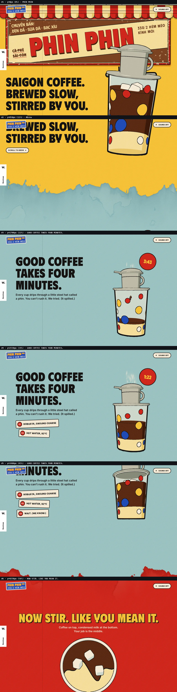
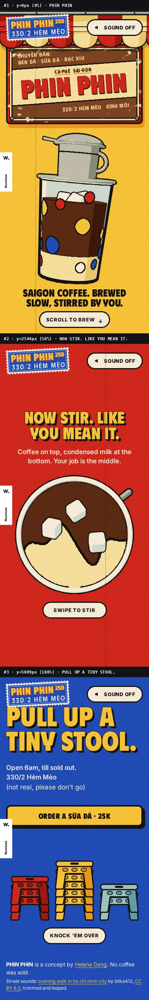

# UI Design System & Master Generation Blueprint: phin-helenadang-work

> **PHIN PHIN · Saigon coffee, stirred by you** (https://phin.helenadang.work/) — PHIN PHIN is a made-up Saigon coffee shop. Watch your coffee drip, then stir it yourself. A concept by Helena Dang.





---

## 1. Executive Visual Persona & Design Archetype

- **Brand Essence & Persona**: **PHIN PHIN · Saigon coffee, stirred by you** (`https://phin.helenadang.work/`). PHIN PHIN is a made-up Saigon coffee shop. Watch your coffee drip, then stir it yourself. A concept by Helena Dang.
- **Capture Provenance**: Live browser capture (`tier1_fast`, HTTP `200`, captured `2026-11-24`).
- **Visual Archetype**: **Light-Gallery WebGL / Canvas Interactive Experience (`#ffd23f` / `#ffffff`)**.
- **Anti-AI-Slop Differentiators**:
  - **Live-Computed Chromatic Polarity**: Anchors the viewport in `#ffd23f` (live computed `body` `background-color` (`computed_styles.json`)) paired with `#111111` primary typography and `#ffffff` accents.
  - **Grounded Typographic Hierarchy**: Pairs `Phudu` for display copy (`PHIN PHIN`) with `Inter`.
  - **Calibrated Spatial Grid & Motion**: Combines `1440px` container bounds (`gap: 12px`, padding `48px`) with `cubic-bezier(.34,1.56,.64,1)` easing and Lenis Smooth Scroll (`data-lenis`), Three.js / WebGL Canvas Pipeline.

---

## 2. Spatial Architecture & Modular Grid Mathematics

### Viewport Allocation & Container Geometry
- **Captured Journey Filmstrips**: Desktop `1280×4968px` (`assets/desktop-journey.webp`, `6` keyframes up to `y=4250px` / doc `8473px`), Mobile `390×2616px` (`assets/mobile-journey.webp`, `3` keyframes).
- **Master Container Bounds**: `1440px` (full-bleed `100%` desktop stage measured on `1440px` viewport).
- **Canvas Lateral Padding & Spacing**: `48px` lateral canvas padding with `12px` grid gap.
- **Border Radius Scale**: `999px`, `4px`, `6px`, `10px`.

### Responsive Breakpoint Architecture
- **Desktop Layout**: Multi-column CSS Grid / Flexbox layout at `1440px` (`max-width: 1440px`, `gap: 12px`).
- **Mobile Layout**: Single-column vertical stack at `390px` viewport width with `48px` horizontal padding.
- **Extracted CSS Media Queries**: `@media (prefers-reduced-motion:reduce)`, `@media (max-width:360px)`, `@media (orientation:landscape) and (max-height:520px)`, `@media (max-width:820px)`.

---

## 3. Color System, Materiality & Atmospheric Lighting

### Semantic Palette & Source Grounding
| Semantic Role | Ground-Truth Value | Extracted Live / CSS Source |
|---|---|---|
| **Primary Canvas Substrate** | `#ffd23f` | live computed `body` `background-color` (`computed_styles.json`) |
| **Primary Typography Ink** | `#111111` | live computed `main` `color` (`computed_styles.json`) |
| **Elevated Surface / Card Substrate** | `#ffffff` | live computed `a` `background-color` (`computed_styles.json`) |
| **Interactive Accent / Highlight** | `#ffffff` | live computed `a` `background-color` (`computed_styles.json`) |
| **Secondary / Muted Copy** | `#d7261e` | live computed `h1` `color` (`computed_styles.json`) |
| **Structural Hairline Border** | `#ff0000` | `.sign-lockup span { border-bottom: #ff0000 }` |
| **Variable Token (`--sign-yellow-shade`)** | `#f0a51f` | `var(--sign-yellow-shade)` in `:root` |
| **Variable Token (`--sign-red-shade`)** | `#a3170f` | `var(--sign-red-shade)` in `:root` |
| **Variable Token (`--enamel-blue`)** | `#1e4fd8` | `var(--enamel-blue)` in `:root` |
| **Variable Token (`--enamel-blue-shade`)** | `#1336a0` | `var(--enamel-blue-shade)` in `:root` |
| **Variable Token (`--tin-sky`)** | `#9fd3e6` | `var(--tin-sky)` in `:root` |
| **Variable Token (`--tin-sky-shade`)** | `#62a9c6` | `var(--tin-sky-shade)` in `:root` |
| **Variable Token (`--coffee`)** | `#5b2a12` | `var(--coffee)` in `:root` |
| **Variable Token (`--coffee-shade`)** | `#3a1708` | `var(--coffee-shade)` in `:root` |
| **Variable Token (`--caramel`)** | `#a8653a` | `var(--caramel)` in `:root` |
| **Variable Token (`--caramel-shade`)** | `#7e4524` | `var(--caramel-shade)` in `:root` |
| **Variable Token (`--milk`)** | `#fff1b8` | `var(--milk)` in `:root` |
| **Variable Token (`--milk-shade`)** | `#f2d77c` | `var(--milk-shade)` in `:root` |

### Sanitized Root CSS Variables (`ui-ux.md` Ground Truth)
| Variable Name | Extracted Value | Semantic Role |
|---|---|---|
| `--sign-yellow` | `#ffd23f` | Color / Atmospheric Token |
| `--sign-yellow-shade` | `#f0a51f` | Color / Atmospheric Token |
| `--sign-red` | `#d7261e` | Color / Atmospheric Token |
| `--sign-red-shade` | `#a3170f` | Color / Atmospheric Token |
| `--enamel-blue` | `#1e4fd8` | Color / Atmospheric Token |
| `--enamel-blue-shade` | `#1336a0` | Color / Atmospheric Token |
| `--tin-sky` | `#9fd3e6` | Color / Atmospheric Token |
| `--tin-sky-shade` | `#62a9c6` | Color / Atmospheric Token |
| `--ink` | `#111` | Typography Ink Token |
| `--coffee` | `#5b2a12` | Color / Atmospheric Token |
| `--coffee-shade` | `#3a1708` | Color / Atmospheric Token |
| `--caramel` | `#a8653a` | Color / Atmospheric Token |
| `--caramel-shade` | `#7e4524` | Color / Atmospheric Token |
| `--milk` | `#fff1b8` | Color / Atmospheric Token |
| `--milk-shade` | `#f2d77c` | Color / Atmospheric Token |
| `--white` | `#fff` | Canvas / Surface Token |

---

## 4. Typographic Scale & Editorial Hierarchy

### Font Family Stacks
- **Display Typography**: `Phudu`.
- **Primary Body Stack**: `Inter`.
- **Technical / Metadata Stack**: not declared in live computed styles (uses primary stack / `ui-monospace`).

### Typographic Scale & Rules (Live Computed & Stylesheet Grounded)
- **Hero Display (`H1`)**: live computed `h1` (`font-size: 207.144px`, `line-height: 178.144px`, `font-weight: 900`, `letter-spacing: 3.10716px`).
- **Section Heading (`H2`)**: live computed `h2` (`font-size: 236.8px`, `line-height: 213.12px`, `font-weight: 900`, `letter-spacing: 1.184px`).
- **Body Copy**: live computed `body` (`font-size: 16px`, `line-height: 24px`, `font-weight: 400`); CSS variables `--font-body: "Inter", system-ui, -apple-system, "Segoe UI", sans-serif`.
- **Metadata & Navigation Labels**: live computed `nav/a` (`font-size: 16px`, `line-height: 24px`, `font-weight: 800`).

---

## 5. Choreographed Motion & Interaction Physics

### Primary Easing Curves
- **Extracted Timing Functions**: `cubic-bezier(.34,1.56,.64,1)`, `cubic-bezier(.22,1,.36,1)`, `cubic-bezier(.45,0,.2,1)`.

### Per-Element Transition & Choreography Rules
- **Selector `.lenis.lenis-autoToggle`**: `transition: 1ms` extracted from `phin-helenadang-work` stylesheet.
- **Selector `media (hover:hover) and (pointer:...`**: `transition: transform .2s var(--ease-out)` extracted from `phin-helenadang-work` stylesheet.
- **Selector `.wordmark-stamp`**: `transition: transform .35s var(--ease-pop)` extracted from `phin-helenadang-work` stylesheet.
- **Extracted Easing Curve (`cubic-bezier(.34,1.56,.64,1)`)**: Governs interactive state transitions across `<header.site-header>` and `<section.beat-brew>`.
- **Runtime Interaction Engine**: Integrates Lenis Smooth Scroll (`data-lenis`), Three.js / WebGL Canvas Pipeline with `prefers-reduced-motion: reduce` fallback guards.
### Measured Runtime Scroll & Interaction Telemetry (`behavioral_journey_v2`)
- **Scroll Driver Mode**: `native` (max document height `8473px`, deepest scrollY reached `4250px` across `6` desktop keyframes).
- **Detected Scroll / Motion Libraries**: `Lenis`, `GSAP/ScrollTrigger`, `WebGL/Canvas`.
- **Hover Physics (`primary_cta` · `SOUND OFF`)**: `transform`: `none` -> `matrix(1, 0, 0, 1, 0, 0)` (`transition-duration: 0.2s`, `timing: cubic-bezier(0.22, 1, 0.36, 1)`).

---

## 6. Component Wireframe & Structural DOM Map

### Visual Layout Schematic — Desktop (`1440px`, Grounded in `dom.html` & Landmark Bounding Boxes)
```
┌────────────────────────────────────────────────────────────────────────┐
│ DESKTOP VIEWPORT (1440px) — PHIN PHIN · Saigon coffee, stirred by you  │
│ ====================================================================== │
│ [ <header.site-header> (1440x88px)    | Overview · Index · Archive · ] │
│ ---------------------------------------------------------------------- │
│ | HERO STAGE: <section.beat> (w=1440px)                              | │
│ | H1: PHIN PHIN                                                      | │
│ | Substrate: #ffd23f | Ink: #111111 | Accent: #ffffff                | │
│ ---------------------------------------------------------------------- │
│ | SHOWCASE GRID (<section.beat-brew>) max-w: 1440px                  | │
│ | +------------------------------+  +------------------------------+ | │
│ | | Good coffee takes four minut |  | Now stir. Like you mean it.  | | │
│ | +------------------------------+  +------------------------------+ | │
│ ---------------------------------------------------------------------- │
│ | DETAIL MODULE (<section.beat-stir>) — Pick your poison. (It        | │
│ ---------------------------------------------------------------------- │
│ [ FOOTER (<footer.wrap>       ) | https://phin.helenadang.work/        │
└────────────────────────────────────────────────────────────────────────┘
```

### Visual Layout Schematic — Mobile Reflow (`390px`)
```
┌────────────────────────────────────────────────────────────────────────┐
│ MOBILE VIEWPORT REFLOW (390px) — Single-Column Stack (gap: 12px)       │
│ ====================================================================== │
│ [ HEADER BAR (<header.site-header>    ) | Compact Menu (390px)         │
│ ---------------------------------------------------------------------- │
│ | HERO STAGE (<section.beat>) — 390px Vertical Lead                  | │
│ | H1: PHIN PHIN                                                      | │
│ ---------------------------------------------------------------------- │
│ | SHOWCASE STACK (<section.beat-brew>) — 1-Col Stack                 | │
│ | [ Item 1: Good coffee takes four minutes.                        ] | │
│ | [ Item 2: Now stir. Like you mean it.                            ] | │
│ ---------------------------------------------------------------------- │
│ | DETAIL STACK (<section.beat-stir>) — 1-Col (Pick your poison. )    | │
│ ---------------------------------------------------------------------- │
│ [ FOOTER (<footer.wrap>       ) | Stacked 390px Colophon               │
└────────────────────────────────────────────────────────────────────────┘
```

### Granular DOM Region Breakdown
1. **Brand Header & Navigation Bar (<header.site-header> — `phin-helenadang-work`)**:
   - Landmark `<header class="site-header">` (`1440x88px`) hosting `PHIN PHIN · Saigon coffee, stirred b` navigation (`Overview · Index · Archive · About · Contact`), DOM attributes (`data-js-only`, `data-from="sign-yellow"`, `data-to="tin-sky"`, `data-from="tin-sky"`), and stylesheet rule `html.lenis body { height:auto }`.
2. **Hero Stage & Focal Lead (<section.beat> — `PHIN PHIN`)**:
   - Landmark `<section class="beat beat-sign">` presenting display lead `PHIN PHIN` and copy excerpt *"Chuyên bán: đen đá · sữa đá · bạc xỉu"* over `#ffd23f` canvas and `#111111` ink.
3. **Primary Showcase & Content Grid (<section.beat-brew> — `Good coffee takes four minutes.`)**:
   - Landmark `<section class="beat beat-brew">` rendering section `Good coffee takes four minutes.` with copy *"330/2 Hẻm Mèo kính mời"*, asset references (`favicon.svg`, `favicon-32.png`, `apple-touch-icon.png`, `index-BrMebdgu.js`), and grid rule `.lenis-stopped { overflow:clip }`.
4. **Interactive Detail & Feature Matrix (<section.beat-stir> — `Now stir. Like you mean it.`)**:
   - Landmark `<section class="beat beat-stir">` framing `Now stir. Like you mean it.` and `Pick your poison. (It's coffee.)` (*"Saigon coffee. Brewed slow, stirred by you."*) with `#ffffff` surface cards, `#ffffff` accents, and `.lenis.lenis-smooth iframe { pointer-events:none }`.
5. **Colophon & Global Directory Footer (<footer.wrap> — `https://phin.helenadang.work/`)**:
   - Landmark `<footer class="wrap site-footer">` anchoring `PHIN PHIN · Saigon coffee, stirr` footer links (`Overview · Index · Archive · About · Contact`), copy *"Every cup drips through a little steel hat called a phin . Y"*, and `#ff0000` structural dividers.
### Full Vertical Scroll Sequence (Desktop `1440×900` Keyframes)
- **Step 01** (`y=0px`, `0%`): Active landmark `PHIN PHIN` · sticky/fixed elements: `3`
- **Step 02** (`y=850px`, `11%`): Active landmark `#brew` · sticky/fixed elements: `3`
- **Step 03** (`y=1700px`, `22%`): Active landmark `GOOD COFFEE TAKES FOUR MINUTES.` · sticky/fixed elements: `3`
- **Step 04** (`y=2550px`, `34%`): Active landmark `GOOD COFFEE TAKES FOUR MINUTES.` · sticky/fixed elements: `3`
- **Step 05** (`y=3400px`, `45%`): Active landmark `GOOD COFFEE TAKES FOUR MINUTES.` · sticky/fixed elements: `2`
- **Step 06** (`y=4250px`, `56%`): Active landmark `NOW STIR. LIKE YOU MEAN IT.` · sticky/fixed elements: `2`

---

## 7. Master Zero-Shot AI Generation Prompt

```markdown
# Master Zero-Shot Frontend Generation Prompt: phin-helenadang-work (PHIN PHIN · Saigon coffee, stirred by you)

You are a principal frontend architect and design systems engineer. Build a complete, production-ready web application replicating the exact design system, DOM landmarks, typographic hierarchy, color tokens, and motion physics of `phin-helenadang-work` (**PHIN PHIN · Saigon coffee, stirred by you** — `https://phin.helenadang.work/`).

### 1. Visual Archetype & Anti-AI-Slop Mandates
- **Archetype**: Light-Gallery WebGL / Canvas Interactive Experience (`#ffd23f` / `#ffffff`).
- **Identity & Domain Context**: PHIN PHIN is a made-up Saigon coffee shop. Watch your coffee drip, then stir it yourself. A concept by Helena Dang.
- **Primary Substrate**: `#ffd23f` (live computed `body` `background-color` (`computed_styles.json`)), **Primary Ink**: `#111111`, **Accent / Highlight**: `#ffffff`.
- **Site-Specific Differentiators**:
  - **Live-Computed Chromatic Polarity**: Anchors the viewport in `#ffd23f` (live computed `body` `background-color` (`computed_styles.json`)) paired with `#111111` primary typography and `#ffffff` accents.
  - **Grounded Typographic Hierarchy**: Pairs `Phudu` for display copy (`PHIN PHIN`) with `Inter`.
  - **Calibrated Spatial Grid & Motion**: Combines `1440px` container bounds (`gap: 12px`, padding `48px`) with `cubic-bezier(.34,1.56,.64,1)` easing and Lenis Smooth Scroll (`data-lenis`), Three.js / WebGL Canvas Pipeline.

### 2. Ground-Truth CSS Variables (`:root` Token Contract)
Declare and consume these exact custom properties extracted from `phin-helenadang-work` in your global stylesheet:

:root {
  /* PHIN PHIN · Saigon coffee, stirred by you (phin-helenadang-work) — Live-Grounded CSS Variables */
  --sign-yellow: #ffd23f; /* Color / Atmospheric Token (phin-helenadang-work) */
  --sign-yellow-shade: #f0a51f; /* Color / Atmospheric Token (phin-helenadang-work) */
  --sign-red: #d7261e; /* Color / Atmospheric Token (phin-helenadang-work) */
  --sign-red-shade: #a3170f; /* Color / Atmospheric Token (phin-helenadang-work) */
  --enamel-blue: #1e4fd8; /* Color / Atmospheric Token (phin-helenadang-work) */
  --enamel-blue-shade: #1336a0; /* Color / Atmospheric Token (phin-helenadang-work) */
  --tin-sky: #9fd3e6; /* Color / Atmospheric Token (phin-helenadang-work) */
  --tin-sky-shade: #62a9c6; /* Color / Atmospheric Token (phin-helenadang-work) */
  --ink: #111; /* Typography Ink Token (phin-helenadang-work) */
  --coffee: #5b2a12; /* Color / Atmospheric Token (phin-helenadang-work) */
  --coffee-shade: #3a1708; /* Color / Atmospheric Token (phin-helenadang-work) */
  --caramel: #a8653a; /* Color / Atmospheric Token (phin-helenadang-work) */
  --caramel-shade: #7e4524; /* Color / Atmospheric Token (phin-helenadang-work) */
  --milk: #fff1b8; /* Color / Atmospheric Token (phin-helenadang-work) */
  --milk-shade: #f2d77c; /* Color / Atmospheric Token (phin-helenadang-work) */
  --white: #fff; /* Canvas / Surface Token (phin-helenadang-work) */
}

### 3. Semantic Color & Materiality Contract
Map every surface, ink, and border strictly to these source-grounded tokens:
- **Primary Canvas Substrate**: `#ffd23f` — grounded in live computed `body` `background-color` (`computed_styles.json`)
- **Primary Typography Ink**: `#111111` — grounded in live computed `main` `color` (`computed_styles.json`)
- **Elevated Surface / Card Substrate**: `#ffffff` — grounded in live computed `a` `background-color` (`computed_styles.json`)
- **Interactive Accent / Highlight**: `#ffffff` — grounded in live computed `a` `background-color` (`computed_styles.json`)
- **Secondary / Muted Copy**: `#d7261e` — grounded in live computed `h1` `color` (`computed_styles.json`)
- **Structural Hairline Border**: `#ff0000` — grounded in `.sign-lockup span { border-bottom: #ff0000 }`
- **Variable Token (`--sign-yellow-shade`)**: `#f0a51f` — grounded in `var(--sign-yellow-shade)` in `:root`
- **Variable Token (`--sign-red-shade`)**: `#a3170f` — grounded in `var(--sign-red-shade)` in `:root`
- **Variable Token (`--enamel-blue`)**: `#1e4fd8` — grounded in `var(--enamel-blue)` in `:root`
- **Variable Token (`--enamel-blue-shade`)**: `#1336a0` — grounded in `var(--enamel-blue-shade)` in `:root`
- **Variable Token (`--tin-sky`)**: `#9fd3e6` — grounded in `var(--tin-sky)` in `:root`
- **Variable Token (`--tin-sky-shade`)**: `#62a9c6` — grounded in `var(--tin-sky-shade)` in `:root`
- **Variable Token (`--coffee`)**: `#5b2a12` — grounded in `var(--coffee)` in `:root`
- **Variable Token (`--coffee-shade`)**: `#3a1708` — grounded in `var(--coffee-shade)` in `:root`
- **Variable Token (`--caramel`)**: `#a8653a` — grounded in `var(--caramel)` in `:root`
- **Variable Token (`--caramel-shade`)**: `#7e4524` — grounded in `var(--caramel-shade)` in `:root`
- **Variable Token (`--milk`)**: `#fff1b8` — grounded in `var(--milk)` in `:root`
- **Variable Token (`--milk-shade`)**: `#f2d77c` — grounded in `var(--milk-shade)` in `:root`

### 4. Spatial Grid, Container Bounds & Responsive Breakpoints
- **Desktop Viewport Reference**: `1280×4968px` (multi-frame vertical journey filmstrip (4968px), `1440px` standard desktop width).
- **Mobile Viewport Reference**: `390×2616px` (multi-frame vertical journey filmstrip (2616px), `390px` standard mobile width).
- **Container Max-Width**: `1440px` (full-bleed `100%` desktop stage measured on `1440px` viewport)
- **Padding & Gutters**: `48px` lateral canvas padding with `12px` grid gap
- **Desktop Grid**: Multi-column CSS Grid / Flexbox layout at `1440px` (`max-width: 1440px`, `gap: 12px`)
- **Mobile Adaptation**: Single-column vertical stack at `390px` viewport width with `48px` horizontal padding
- **Media Queries**: `@media (prefers-reduced-motion:reduce)`, `@media (max-width:360px)`, `@media (orientation:landscape) and (max-height:520px)`, `@media (max-width:820px)`
- **Corner Radii**: `999px`, `4px`, `6px`, `10px`

### 5. Typography & Editorial Scale Contract
- **Display Font Stack**: `Phudu`
- **Body Font Stack**: `Inter`
- **Monospace / Technical Font Stack**: not declared in live computed styles (uses primary stack / `ui-monospace`)
- **H1 Display Rule**: live computed `h1` (`font-size: 207.144px`, `line-height: 178.144px`, `font-weight: 900`, `letter-spacing: 3.10716px`)
- **H2 Section Rule**: live computed `h2` (`font-size: 236.8px`, `line-height: 213.12px`, `font-weight: 900`, `letter-spacing: 1.184px`)
- **Body Copy Rule**: live computed `body` (`font-size: 16px`, `line-height: 24px`, `font-weight: 400`); CSS variables `--font-body: "Inter", system-ui, -apple-system, "Segoe UI", sans-serif`
- **Metadata & Index Rule**: live computed `nav/a` (`font-size: 16px`, `line-height: 24px`, `font-weight: 800`)

### 6. Component Hierarchy, Verbatim Copy & Real DOM Landmarks
Scaffold `phin-helenadang-work` (`PHIN PHIN · Saigon coffee, stirred by you`) with these exact structural regions, extracted copy, and CSS rules from `dom.html`:
1. **Brand Header & Navigation Bar (<header.site-header> — `phin-helenadang-work`)**:
   - DOM & Selectors: Landmark `<header class="site-header">` (`1440x88px`) hosting `PHIN PHIN · Saigon coffee, stirred b` navigation (`Overview · Index · Archive · About · Contact`), DOM attributes (`data-js-only`, `data-from="sign-yellow"`, `data-to="tin-sky"`, `data-from="tin-sky"`), and stylesheet rule `html.lenis body { height:auto }`.
   - Responsive Contract: Header `Brand Header & Navigation Bar (<header.site-header> — `phin-helenadang-work`)` (`phin-helenadang-work`) adapts across `@media (prefers-reduced-motion:reduce)`, `@media (max-width:360px)`, `@media (orientation:landscape) and (max-height:520px)`, `@media (max-width:820px)` with `cubic-bezier(.34,1.56,.64,1)`, `cubic-bezier(.22,1,.36,1)`, `cubic-bezier(.45,0,.2,1)` transitions and links `Overview · Index · Archive · About · Contact`.
2. **Hero Stage & Focal Lead (<section.beat> — `PHIN PHIN`)**:
   - DOM & Selectors: Landmark `<section class="beat beat-sign">` presenting display lead `PHIN PHIN` and copy excerpt *"Chuyên bán: đen đá · sữa đá · bạc xỉu"* over `#ffd23f` canvas and `#111111` ink.
   - Responsive Contract: Hero stage (`1280×4968px` desktop / `390×2616px` mobile) sets `#ffd23f` background with `#111111` headline `PHIN PHIN`.
3. **Primary Showcase & Content Grid (<section.beat-brew> — `Good coffee takes four minutes.`)**:
   - DOM & Selectors: Landmark `<section class="beat beat-brew">` rendering section `Good coffee takes four minutes.` with copy *"330/2 Hẻm Mèo kính mời"*, asset references (`favicon.svg`, `favicon-32.png`, `apple-touch-icon.png`, `index-BrMebdgu.js`), and grid rule `.lenis-stopped { overflow:clip }`.
   - Responsive Contract: Showcase grid `Primary Showcase & Content Grid (<section.beat-brew> — `Good coffee takes four minutes.`)` applies Multi-column CSS Grid / Flexbox layout at `1440px` (`max-width: 1440px`, `gap: 12px`) on desktop and Single-column vertical stack at `390px` viewport width with `48px` horizontal padding on mobile.
4. **Interactive Detail & Feature Matrix (<section.beat-stir> — `Now stir. Like you mean it.`)**:
   - DOM & Selectors: Landmark `<section class="beat beat-stir">` framing `Now stir. Like you mean it.` and `Pick your poison. (It's coffee.)` (*"Saigon coffee. Brewed slow, stirred by you."*) with `#ffffff` surface cards, `#ffffff` accents, and `.lenis.lenis-smooth iframe { pointer-events:none }`.
   - Responsive Contract: Detail module `Interactive Detail & Feature Matrix (<section.beat-stir> — `Now stir. Like you mean it.`)` uses `999px`, `4px`, `6px`, `10px` radii, `#ffffff` highlights, and assets (favicon.svg, favicon-32.png, apple-touch-icon.png).
5. **Colophon & Global Directory Footer (<footer.wrap> — `https://phin.helenadang.work/`)**:
   - DOM & Selectors: Landmark `<footer class="wrap site-footer">` anchoring `PHIN PHIN · Saigon coffee, stirr` footer links (`Overview · Index · Archive · About · Contact`), copy *"Every cup drips through a little steel hat called a phin . Y"*, and `#ff0000` structural dividers.
   - Responsive Contract: Footer `Colophon & Global Directory Footer (<footer.wrap> — `https://phin.helenadang.work/`)` aligns to `1440px` (full-bleed `100%` desktop stage measured on `1440px` viewport) with `48px` lateral canvas padding with `12px` grid gap and attributes (data-js-only, data-from="sign-yellow", data-to="tin-sky").

#### Verbatim DOM Copy Excerpts (`dom.html`)
- Copy Excerpt 1: *"Chuyên bán: đen đá · sữa đá · bạc xỉu"*
- Copy Excerpt 2: *"330/2 Hẻm Mèo kính mời"*
- Copy Excerpt 3: *"Saigon coffee. Brewed slow, stirred by you."*
- Copy Excerpt 4: *"Every cup drips through a little steel hat called a phin . You can't rush it. We t..."*

### 7. Motion, Extracted Stylesheet Rules & Interaction Choreography
- **Primary Easing Functions**: `cubic-bezier(.34,1.56,.64,1)`, `cubic-bezier(.22,1,.36,1)`, `cubic-bezier(.45,0,.2,1)`
- **Extracted Stylesheet Rules (`phin-helenadang-work`)**:
- `html.lenis body { height:auto }`
- `.lenis-stopped { overflow:clip }`
- `.lenis.lenis-smooth iframe { pointer-events:none }`
- `.lenis.lenis-autoToggle { transition-behavior:allow-discrete;transition-property:overflow;transiti... }`
- `after { box-sizing:border-box }`
- **Per-Selector Transition Rules**:
- **Selector `.lenis.lenis-autoToggle`**: `transition: 1ms` extracted from `phin-helenadang-work` stylesheet.
- **Selector `media (hover:hover) and (pointer:...`**: `transition: transform .2s var(--ease-out)` extracted from `phin-helenadang-work` stylesheet.
- **Selector `.wordmark-stamp`**: `transition: transform .35s var(--ease-pop)` extracted from `phin-helenadang-work` stylesheet.
- **Extracted Easing Curve (`cubic-bezier(.34,1.56,.64,1)`)**: Governs interactive state transitions across `<header.site-header>` and `<section.beat-brew>`.
- **Runtime Interaction Engine**: Integrates Lenis Smooth Scroll (`data-lenis`), Three.js / WebGL Canvas Pipeline with `prefers-reduced-motion: reduce` fallback guards.
### 7b. Full-Page Scroll Choreography, Interactive States & Multi-Page Routes
- **Scroll Mechanics**: Implement `native` vertical progression up to `8473px` across 6 distinct viewport chapters using Lenis, GSAP/ScrollTrigger, WebGL/Canvas.
- **Vertical Chapter Sequence**: PHIN PHIN (0%) -> #brew (11%) -> GOOD COFFEE TAKES FOUR MINU... (22%) -> GOOD COFFEE TAKES FOUR MINU... (34%) -> GOOD COFFEE TAKES FOUR MINU... (45%) -> NOW STIR. LIKE YOU MEAN IT. (56%).
- **Hover Micro-Interaction (`primary_cta`)**: Animate `transform` with `0.2s cubic-bezier(0.22, 1, 0.36, 1)`.

### 8. Technical Deliverables
- Implement in Next.js (App Router) with TypeScript and Tailwind CSS consuming the `:root` custom properties defined above for `phin-helenadang-work`.
- Reproduce both the `1440px` desktop architecture and `390px` mobile breakpoint transitions, preserving semantic HTML5 landmarks (`<header>`, `<nav>`, `<main>`, `<section>`, `<footer>`) and `prefers-reduced-motion` accessibility guards.
```
---

## 8. Full-Page Scroll Journey, Interactive States & Subpage Inventory

### Desktop Scroll Keyframes (`1440×900` WebP)
| Step | Scroll Y | Progress | Active Landmark / Section | Sticky/Fixed | Visual Asset |
| :---: | :---: | :---: | :--- | :---: | :--- |
| `#01` | `0px` | `0%` | PHIN PHIN | `3` | [desktop-step-01.webp](assets/desktop-step-01.webp) |
| `#02` | `850px` | `11%` | #brew | `3` | [desktop-step-02.webp](assets/desktop-step-02.webp) |
| `#03` | `1700px` | `22%` | GOOD COFFEE TAKES FOUR MINUTES. | `3` | [desktop-step-03.webp](assets/desktop-step-03.webp) |
| `#04` | `2550px` | `34%` | GOOD COFFEE TAKES FOUR MINUTES. | `3` | [desktop-step-04.webp](assets/desktop-step-04.webp) |
| `#05` | `3400px` | `45%` | GOOD COFFEE TAKES FOUR MINUTES. | `2` | [desktop-step-05.webp](assets/desktop-step-05.webp) |
| `#06` | `4250px` | `56%` | NOW STIR. LIKE YOU MEAN IT. | `2` | [desktop-step-06.webp](assets/desktop-step-06.webp) |

### Mobile Condensed Keyframes (`390×844` WebP)
| Step | Scroll Y | Progress | Active Landmark | Visual Asset |
| :---: | :---: | :---: | :--- | :--- |
| `#01` | `0px` | `0%` | PHIN PHIN | [mobile-step-01.webp](assets/mobile-step-01.webp) |
| `#02` | `2544px` | `50%` | NOW STIR. LIKE YOU MEAN IT. | [mobile-step-02.webp](assets/mobile-step-02.webp) |
| `#03` | `5089px` | `100%` | PULL UP A TINY STOOL. | [mobile-step-03.webp](assets/mobile-step-03.webp) |

