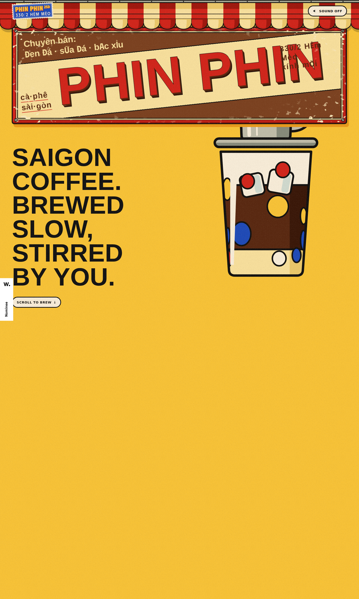
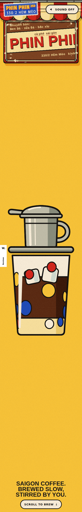

# UI Design System & Master Generation Blueprint: phin-helenadang-work

> **PHIN PHIN · Saigon coffee, stirred by you** (https://phin.helenadang.work/) — PHIN PHIN is a made-up Saigon coffee shop. Watch your coffee drip, then stir it yourself. A concept by Helena Dang.



---

## 1. Executive Visual Persona & Design Archetype

- **Brand Essence & Persona**: **PHIN PHIN · Saigon coffee, stirred by you** (`https://phin.helenadang.work/`). PHIN PHIN is a made-up Saigon coffee shop. Watch your coffee drip, then stir it yourself. A concept by Helena Dang.
- **Visual Archetype**: **Light-Gallery WebGL / Canvas Interactive Experience (`#ffd23f` / `#a3170f`)**.
- **Anti-AI-Slop Differentiators**:
  - **Source-Grounded Chromatic Polarity**: Anchors the viewport in `#ffd23f` (`var(--sign-yellow)` in `:root`) paired with `#a3170f` primary typography and `#a3170f` accents.
  - **Extracted Typographic Hierarchy**: Pairs `Phudu` for display copy (`PHIN PHIN`) with `Inter` and not declared in static CSS (uses primary stack / `ui-monospace`).
  - **Calibrated Spatial Grid & Motion**: Combines `var(--max)` container bounds (`gap: 8px`, padding `10px`) with `cubic-bezier(.34,1.56,.64,1)` easing and Lenis Smooth Scroll (`data-lenis`), Three.js / WebGL Canvas Pipeline.

---

## 2. Spatial Architecture & Modular Grid Mathematics



### Viewport Allocation & Container Geometry
- **Captured Viewport Dimensions**: Desktop `1440×2400px` (`assets/desktop.png`, capped at 2400px multi-section capture), Mobile `390×2400px` (`assets/mobile.png`, capped at 2400px multi-section capture).
- **Master Container Bounds**: `var(--max)` extracted from `phin-helenadang-work` stylesheet.
- **Canvas Lateral Padding & Spacing**: `10px` lateral canvas padding with `8px` grid gap.
- **Border Radius Scale**: `999px`, `4px`, `6px`, `10px`.

### Responsive Breakpoint Architecture
- **Desktop Layout**: Multi-column CSS Grid / Flexbox layout at `1440px` (`max-width: var(--max)`, `gap: 8px`).
- **Mobile Layout**: Single-column vertical stack at `390px` viewport width with `10px` horizontal padding.
- **Extracted CSS Media Queries**: `@media (prefers-reduced-motion:reduce)`, `@media (max-width:360px)`, `@media (orientation:landscape) and (max-height:520px)`, `@media (max-width:820px)`.

---

## 3. Color System, Materiality & Atmospheric Lighting

### Semantic Palette & Source Grounding
| Semantic Role | Ground-Truth Value | Extracted CSS Source / Selector |
|---|---|---|
| **Primary Canvas Substrate** | `#ffd23f` | `var(--sign-yellow)` in `:root` |
| **Primary Typography Ink** | `#f0a51f` | `var(--sign-yellow-shade)` in `:root` |
| **Elevated Surface / Card Substrate** | `#d7261e` | `var(--sign-red)` in `:root` |
| **Interactive Accent / Highlight** | `#a3170f` | `var(--sign-red-shade)` in `:root` |
| **Secondary / Muted Copy** | `#1e4fd8` | `var(--enamel-blue)` in `:root` |
| **Structural Hairline Border** | `#1336a0` | `var(--enamel-blue-shade)` in `:root` |
| **Variable Token (`--tin-sky`)** | `#9fd3e6` | `var(--tin-sky)` in `:root` |
| **Variable Token (`--tin-sky-shade`)** | `#62a9c6` | `var(--tin-sky-shade)` in `:root` |
| **Variable Token (`--ink`)** | `#111` | `var(--ink)` in `:root` |
| **Variable Token (`--coffee`)** | `#5b2a12` | `var(--coffee)` in `:root` |
| **Variable Token (`--coffee-shade`)** | `#3a1708` | `var(--coffee-shade)` in `:root` |
| **Variable Token (`--caramel`)** | `#a8653a` | `var(--caramel)` in `:root` |
| **Variable Token (`--caramel-shade`)** | `#7e4524` | `var(--caramel-shade)` in `:root` |
| **Variable Token (`--milk`)** | `#fff1b8` | `var(--milk)` in `:root` |
| **Variable Token (`--milk-shade`)** | `#f2d77c` | `var(--milk-shade)` in `:root` |
| **Variable Token (`--white`)** | `#fff` | `var(--white)` in `:root` |

### Sanitized Root CSS Variables (`ui-ux.md` Ground Truth)
| Variable Name | Extracted Value | Semantic Role |
|---|---|---|
| `--sign-yellow` | `#ffd23f` | Color / Atmospheric Token |
| `--sign-yellow-shade` | `#f0a51f` | Color / Atmospheric Token |
| `--sign-red` | `#d7261e` | Color / Atmospheric Token |
| `--sign-red-shade` | `#a3170f` | Color / Atmospheric Token |
| `--enamel-blue` | `#1e4fd8` | Color / Atmospheric Token |
| `--enamel-blue-shade` | `#1336a0` | Color / Atmospheric Token |
| `--tin-sky` | `#9fd3e6` | Color / Atmospheric Token |
| `--tin-sky-shade` | `#62a9c6` | Color / Atmospheric Token |
| `--ink` | `#111` | Typography Ink Token |
| `--coffee` | `#5b2a12` | Color / Atmospheric Token |
| `--coffee-shade` | `#3a1708` | Color / Atmospheric Token |
| `--caramel` | `#a8653a` | Color / Atmospheric Token |
| `--caramel-shade` | `#7e4524` | Color / Atmospheric Token |
| `--milk` | `#fff1b8` | Color / Atmospheric Token |
| `--milk-shade` | `#f2d77c` | Color / Atmospheric Token |
| `--white` | `#fff` | Canvas / Surface Token |

---

## 4. Typographic Scale & Editorial Hierarchy

### Font Family Stacks
- **Display Typography**: `Phudu`.
- **Primary Body Stack**: `Inter`.
- **Technical / Metadata Stack**: not declared in static CSS (uses primary stack / `ui-monospace`).

### Typographic Scale & Rules (Extracted from Stylesheet & Variables)
- **Hero Display (`H1`)**: not explicitly declared on tag in static CSS (stylesheet font-size ladder: `clamp(4.25rem,11.5vw,12rem)`, `clamp(.875rem,2.42vw,2.4rem)`, `clamp(.8125rem,2.12vw,2.4rem)`, `clamp(4.25rem,min(14.385vw,17.05v...`, `.1525em`).
- **Section Heading (`H2`)**: not explicitly declared on tag in static CSS (stylesheet font-size ladder: `clamp(4.25rem,11.5vw,12rem)`, `clamp(.875rem,2.42vw,2.4rem)`, `clamp(.8125rem,2.12vw,2.4rem)`, `clamp(4.25rem,min(14.385vw,17.05v...`, `.1525em`).
- **Body Copy**: CSS variables `--font-body: "Inter", system-ui, -apple-system, "Segoe UI", sans-serif`.
- **Metadata & Navigation Labels**: not explicitly declared on tag in static CSS (stylesheet font-size ladder: `clamp(4.25rem,11.5vw,12rem)`, `clamp(.875rem,2.42vw,2.4rem)`, `clamp(.8125rem,2.12vw,2.4rem)`, `clamp(4.25rem,min(14.385vw,17.05v...`, `.1525em`).

---

## 5. Choreographed Motion & Interaction Physics

### Primary Easing Curves
- **Extracted Timing Functions**: `cubic-bezier(.34,1.56,.64,1)`, `cubic-bezier(.22,1,.36,1)`, `cubic-bezier(.45,0,.2,1)`.

### Per-Element Transition & Choreography Rules
- **Selector `.lenis.lenis-autoToggle`**: `transition: 1ms` extracted from `phin-helenadang-work` stylesheet.
- **Selector `media (hover:hover) and (pointer:...`**: `transition: transform .2s var(--ease-out)` extracted from `phin-helenadang-work` stylesheet.
- **Selector `.wordmark-stamp`**: `transition: transform .35s var(--ease-pop)` extracted from `phin-helenadang-work` stylesheet.
- **Extracted Easing Curve (`cubic-bezier(.34,1.56,.64,1)`)**: Governs interactive state transitions across `<header.site-header>` and `<section.beat>`.
- **Runtime Interaction Engine**: Integrates Lenis Smooth Scroll (`data-lenis`), Three.js / WebGL Canvas Pipeline with `prefers-reduced-motion: reduce` fallback guards.

---

## 6. Component Wireframe & Structural DOM Map

### Visual Layout Schematic (Grounded in `dom.html` — `1440px` Desktop & `390px` Mobile Reflow)
```
┌────────────────────────────────────────────────────────────────────────┐
│ DESKTOP VIEWPORT (1440px) — PHIN PHIN · Saigon coffee, stirred by you  │
│ ====================================================================== │
│ [ <header.site-header>     | Overview · Index · Archive · About · C ]  │
│ ---------------------------------------------------------------------- │
│ | HERO STAGE: <section.beat>                                       |   │
│ | H1: PHIN PHIN                                                    |   │
│ | Substrate: #ffd23f    | Ink: #a3170f    | Accent: #a3170f        |   │
│ ---------------------------------------------------------------------- │
│ | SHOWCASE GRID (<section.beat>            ) max-w: var(--max)     |   │
│ | +------------------------------+  +------------------------------+ | │
│ | | Good coffee takes four minut |  | Now stir. Like you mean it.  | | │
│ | +------------------------------+  +------------------------------+ | │
│ ---------------------------------------------------------------------- │
│ | MOBILE VIEWPORT REFLOW (390px) — Single-Column Stack (gap: 8px   ) | │
│ | [<header.site-heade] -> [<section.beat>] -> [<section.beat>] |       │
│ ---------------------------------------------------------------------- │
│ [ FOOTER (<footer.wrap>         ) | https://phin.helenadang.work/      │
└────────────────────────────────────────────────────────────────────────┘
```

### Granular DOM Region Breakdown
1. **Brand Header & Navigation Bar (<header.site-header> — `phin-helenadang-work`)**:
   - Landmark `<header class="site-header">` hosting `PHIN PHIN · Saigon coffee, stirred b` navigation (`Overview · Index · Archive · About · Contact`), DOM attributes (`data-engine="three.js r186"`, `data-js-only`, `data-from="sign-yellow"`, `data-to="tin-sky"`), and stylesheet rule `html.lenis body { height:auto }`.
2. **Hero Stage & Focal Lead (<section.beat> — `PHIN PHIN`)**:
   - Landmark `<section class="beat beat-sign">` presenting display lead `PHIN PHIN` and copy excerpt *"Skip to the coffee"* over `#ffd23f` canvas and `#a3170f` ink.
3. **Primary Showcase & Content Grid (<section.beat> — `Good coffee takes four minutes.`)**:
   - Landmark `<section class="beat beat-brew">` rendering section `Good coffee takes four minutes.` with copy *"Chuyên bán: đen đá · sữa đá · bạc xỉu"*, asset references (`favicon.svg`, `favicon-32.png`, `apple-touch-icon.png`, `index-BrMebdgu.js`), and grid rule `.lenis-stopped { overflow:clip }`.
4. **Interactive Detail & Feature Matrix (<section.beat> — `Now stir. Like you mean it.`)**:
   - Landmark `<section class="beat beat-stir">` framing `Now stir. Like you mean it.` and `Pick your poison. (It's coffee.)` (*"330/2 Hẻm Mèo kính mời"*) with `#d7261e` surface cards, `#a3170f` accents, and `.lenis.lenis-smooth iframe { pointer-events:none }`.
5. **Colophon & Global Directory Footer (<footer.wrap> — `https://phin.helenadang.work/`)**:
   - Landmark `<footer class="wrap site-footer">` anchoring `PHIN PHIN · Saigon coffee, stirr` footer links (`Overview · Index · Archive · About · Contact`), copy *"Saigon coffee. Brewed slow, stirred by you."*, and `#1336a0` structural dividers.

---

## 7. Master Zero-Shot AI Generation Prompt

```markdown
# Master Zero-Shot Frontend Generation Prompt: phin-helenadang-work (PHIN PHIN · Saigon coffee, stirred by you)

You are a principal frontend architect and design systems engineer. Build a complete, production-ready web application replicating the exact design system, DOM landmarks, typographic hierarchy, color tokens, and motion physics of `phin-helenadang-work` (**PHIN PHIN · Saigon coffee, stirred by you** — `https://phin.helenadang.work/`).

### 1. Visual Archetype & Anti-AI-Slop Mandates
- **Archetype**: Light-Gallery WebGL / Canvas Interactive Experience (`#ffd23f` / `#a3170f`).
- **Identity & Domain Context**: PHIN PHIN is a made-up Saigon coffee shop. Watch your coffee drip, then stir it yourself. A concept by Helena Dang.
- **Primary Substrate**: `#ffd23f` (`var(--sign-yellow)` in `:root`), **Primary Ink**: `#a3170f`, **Accent / Highlight**: `#a3170f`.
- **Site-Specific Differentiators**:
  - **Source-Grounded Chromatic Polarity**: Anchors the viewport in `#ffd23f` (`var(--sign-yellow)` in `:root`) paired with `#a3170f` primary typography and `#a3170f` accents.
  - **Extracted Typographic Hierarchy**: Pairs `Phudu` for display copy (`PHIN PHIN`) with `Inter` and not declared in static CSS (uses primary stack / `ui-monospace`).
  - **Calibrated Spatial Grid & Motion**: Combines `var(--max)` container bounds (`gap: 8px`, padding `10px`) with `cubic-bezier(.34,1.56,.64,1)` easing and Lenis Smooth Scroll (`data-lenis`), Three.js / WebGL Canvas Pipeline.

### 2. Ground-Truth CSS Variables (`:root` Token Contract)
Declare and consume these exact custom properties extracted from `phin-helenadang-work` in your global stylesheet:

:root {
  /* PHIN PHIN · Saigon coffee, stirred by you (phin-helenadang-work) — Ground-Truth Extracted CSS Variables */
  --sign-yellow: #ffd23f; /* Color / Atmospheric Token (phin-helenadang-work) */
  --sign-yellow-shade: #f0a51f; /* Color / Atmospheric Token (phin-helenadang-work) */
  --sign-red: #d7261e; /* Color / Atmospheric Token (phin-helenadang-work) */
  --sign-red-shade: #a3170f; /* Color / Atmospheric Token (phin-helenadang-work) */
  --enamel-blue: #1e4fd8; /* Color / Atmospheric Token (phin-helenadang-work) */
  --enamel-blue-shade: #1336a0; /* Color / Atmospheric Token (phin-helenadang-work) */
  --tin-sky: #9fd3e6; /* Color / Atmospheric Token (phin-helenadang-work) */
  --tin-sky-shade: #62a9c6; /* Color / Atmospheric Token (phin-helenadang-work) */
  --ink: #111; /* Typography Ink Token (phin-helenadang-work) */
  --coffee: #5b2a12; /* Color / Atmospheric Token (phin-helenadang-work) */
  --coffee-shade: #3a1708; /* Color / Atmospheric Token (phin-helenadang-work) */
  --caramel: #a8653a; /* Color / Atmospheric Token (phin-helenadang-work) */
  --caramel-shade: #7e4524; /* Color / Atmospheric Token (phin-helenadang-work) */
  --milk: #fff1b8; /* Color / Atmospheric Token (phin-helenadang-work) */
  --milk-shade: #f2d77c; /* Color / Atmospheric Token (phin-helenadang-work) */
  --white: #fff; /* Canvas / Surface Token (phin-helenadang-work) */
}

### 3. Semantic Color & Materiality Contract
Map every surface, ink, and border strictly to these source-grounded tokens:
- **Primary Canvas Substrate**: `#ffd23f` — grounded in `var(--sign-yellow)` in `:root`
- **Primary Typography Ink**: `#f0a51f` — grounded in `var(--sign-yellow-shade)` in `:root`
- **Elevated Surface / Card Substrate**: `#d7261e` — grounded in `var(--sign-red)` in `:root`
- **Interactive Accent / Highlight**: `#a3170f` — grounded in `var(--sign-red-shade)` in `:root`
- **Secondary / Muted Copy**: `#1e4fd8` — grounded in `var(--enamel-blue)` in `:root`
- **Structural Hairline Border**: `#1336a0` — grounded in `var(--enamel-blue-shade)` in `:root`
- **Variable Token (`--tin-sky`)**: `#9fd3e6` — grounded in `var(--tin-sky)` in `:root`
- **Variable Token (`--tin-sky-shade`)**: `#62a9c6` — grounded in `var(--tin-sky-shade)` in `:root`
- **Variable Token (`--ink`)**: `#111` — grounded in `var(--ink)` in `:root`
- **Variable Token (`--coffee`)**: `#5b2a12` — grounded in `var(--coffee)` in `:root`
- **Variable Token (`--coffee-shade`)**: `#3a1708` — grounded in `var(--coffee-shade)` in `:root`
- **Variable Token (`--caramel`)**: `#a8653a` — grounded in `var(--caramel)` in `:root`
- **Variable Token (`--caramel-shade`)**: `#7e4524` — grounded in `var(--caramel-shade)` in `:root`
- **Variable Token (`--milk`)**: `#fff1b8` — grounded in `var(--milk)` in `:root`
- **Variable Token (`--milk-shade`)**: `#f2d77c` — grounded in `var(--milk-shade)` in `:root`
- **Variable Token (`--white`)**: `#fff` — grounded in `var(--white)` in `:root`

### 4. Spatial Grid, Container Bounds & Responsive Breakpoints
- **Desktop Viewport Reference**: `1440×2400px` (capped at 2400px multi-section capture, `1440px` standard desktop width).
- **Mobile Viewport Reference**: `390×2400px` (capped at 2400px multi-section capture, `390px` standard mobile width).
- **Container Max-Width**: `var(--max)` extracted from `phin-helenadang-work` stylesheet
- **Padding & Gutters**: `10px` lateral canvas padding with `8px` grid gap
- **Desktop Grid**: Multi-column CSS Grid / Flexbox layout at `1440px` (`max-width: var(--max)`, `gap: 8px`)
- **Mobile Adaptation**: Single-column vertical stack at `390px` viewport width with `10px` horizontal padding
- **Media Queries**: `@media (prefers-reduced-motion:reduce)`, `@media (max-width:360px)`, `@media (orientation:landscape) and (max-height:520px)`, `@media (max-width:820px)`
- **Corner Radii**: `999px`, `4px`, `6px`, `10px`

### 5. Typography & Editorial Scale Contract
- **Display Font Stack**: `Phudu`
- **Body Font Stack**: `Inter`
- **Monospace / Technical Font Stack**: not declared in static CSS (uses primary stack / `ui-monospace`)
- **H1 Display Rule**: not explicitly declared on tag in static CSS (stylesheet font-size ladder: `clamp(4.25rem,11.5vw,12rem)`, `clamp(.875rem,2.42vw,2.4rem)`, `clamp(.8125rem,2.12vw,2.4rem)`, `clamp(4.25rem,min(14.385vw,17.05v...`, `.1525em`)
- **H2 Section Rule**: not explicitly declared on tag in static CSS (stylesheet font-size ladder: `clamp(4.25rem,11.5vw,12rem)`, `clamp(.875rem,2.42vw,2.4rem)`, `clamp(.8125rem,2.12vw,2.4rem)`, `clamp(4.25rem,min(14.385vw,17.05v...`, `.1525em`)
- **Body Copy Rule**: CSS variables `--font-body: "Inter", system-ui, -apple-system, "Segoe UI", sans-serif`
- **Metadata & Index Rule**: not explicitly declared on tag in static CSS (stylesheet font-size ladder: `clamp(4.25rem,11.5vw,12rem)`, `clamp(.875rem,2.42vw,2.4rem)`, `clamp(.8125rem,2.12vw,2.4rem)`, `clamp(4.25rem,min(14.385vw,17.05v...`, `.1525em`)

### 6. Component Hierarchy, Verbatim Copy & Real DOM Landmarks
Scaffold `phin-helenadang-work` (`PHIN PHIN · Saigon coffee, stirred by you`) with these exact structural regions, extracted copy, and CSS rules from `dom.html`:
1. **Brand Header & Navigation Bar (<header.site-header> — `phin-helenadang-work`)**:
   - DOM & Selectors: Landmark `<header class="site-header">` hosting `PHIN PHIN · Saigon coffee, stirred b` navigation (`Overview · Index · Archive · About · Contact`), DOM attributes (`data-engine="three.js r186"`, `data-js-only`, `data-from="sign-yellow"`, `data-to="tin-sky"`), and stylesheet rule `html.lenis body { height:auto }`.
   - Responsive Contract: Header `Brand Header & Navigation Bar (<header.site-header> — `phin-helenadang-work`)` (`phin-helenadang-work`) adapts across `@media (prefers-reduced-motion:reduce)`, `@media (max-width:360px)`, `@media (orientation:landscape) and (max-height:520px)`, `@media (max-width:820px)` with `cubic-bezier(.34,1.56,.64,1)`, `cubic-bezier(.22,1,.36,1)`, `cubic-bezier(.45,0,.2,1)` transitions and links `Overview · Index · Archive · About · Contact`.
2. **Hero Stage & Focal Lead (<section.beat> — `PHIN PHIN`)**:
   - DOM & Selectors: Landmark `<section class="beat beat-sign">` presenting display lead `PHIN PHIN` and copy excerpt *"Skip to the coffee"* over `#ffd23f` canvas and `#a3170f` ink.
   - Responsive Contract: Hero stage (`1440×2400px` desktop / `390×2400px` mobile) sets `#ffd23f` background with `#a3170f` headline `PHIN PHIN`.
3. **Primary Showcase & Content Grid (<section.beat> — `Good coffee takes four minutes.`)**:
   - DOM & Selectors: Landmark `<section class="beat beat-brew">` rendering section `Good coffee takes four minutes.` with copy *"Chuyên bán: đen đá · sữa đá · bạc xỉu"*, asset references (`favicon.svg`, `favicon-32.png`, `apple-touch-icon.png`, `index-BrMebdgu.js`), and grid rule `.lenis-stopped { overflow:clip }`.
   - Responsive Contract: Showcase grid `Primary Showcase & Content Grid (<section.beat> — `Good coffee takes four minutes.`)` applies Multi-column CSS Grid / Flexbox layout at `1440px` (`max-width: var(--max)`, `gap: 8px`) on desktop and Single-column vertical stack at `390px` viewport width with `10px` horizontal padding on mobile.
4. **Interactive Detail & Feature Matrix (<section.beat> — `Now stir. Like you mean it.`)**:
   - DOM & Selectors: Landmark `<section class="beat beat-stir">` framing `Now stir. Like you mean it.` and `Pick your poison. (It's coffee.)` (*"330/2 Hẻm Mèo kính mời"*) with `#d7261e` surface cards, `#a3170f` accents, and `.lenis.lenis-smooth iframe { pointer-events:none }`.
   - Responsive Contract: Detail module `Interactive Detail & Feature Matrix (<section.beat> — `Now stir. Like you mean it.`)` uses `999px`, `4px`, `6px`, `10px` radii, `#a3170f` highlights, and assets (favicon.svg, favicon-32.png, apple-touch-icon.png).
5. **Colophon & Global Directory Footer (<footer.wrap> — `https://phin.helenadang.work/`)**:
   - DOM & Selectors: Landmark `<footer class="wrap site-footer">` anchoring `PHIN PHIN · Saigon coffee, stirr` footer links (`Overview · Index · Archive · About · Contact`), copy *"Saigon coffee. Brewed slow, stirred by you."*, and `#1336a0` structural dividers.
   - Responsive Contract: Footer `Colophon & Global Directory Footer (<footer.wrap> — `https://phin.helenadang.work/`)` aligns to `var(--max)` extracted from `phin-helenadang-work` stylesheet with `10px` lateral canvas padding with `8px` grid gap and attributes (data-engine="three.js r186", data-js-only, data-from="sign-yellow").

#### Verbatim DOM Copy Excerpts (`dom.html`)
- Copy Excerpt 1: *"Skip to the coffee"*
- Copy Excerpt 2: *"Chuyên bán: đen đá · sữa đá · bạc xỉu"*
- Copy Excerpt 3: *"330/2 Hẻm Mèo kính mời"*
- Copy Excerpt 4: *"Saigon coffee. Brewed slow, stirred by you."*

### 7. Motion, Extracted Stylesheet Rules & Interaction Choreography
- **Primary Easing Functions**: `cubic-bezier(.34,1.56,.64,1)`, `cubic-bezier(.22,1,.36,1)`, `cubic-bezier(.45,0,.2,1)`
- **Extracted Stylesheet Rules (`phin-helenadang-work`)**:
- `html.lenis body { height:auto }`
- `.lenis-stopped { overflow:clip }`
- `.lenis.lenis-smooth iframe { pointer-events:none }`
- `.lenis.lenis-autoToggle { transition-behavior:allow-discrete;transition-property:overflow;transiti... }`
- `after { box-sizing:border-box }`
- **Per-Selector Transition Rules**:
- **Selector `.lenis.lenis-autoToggle`**: `transition: 1ms` extracted from `phin-helenadang-work` stylesheet.
- **Selector `media (hover:hover) and (pointer:...`**: `transition: transform .2s var(--ease-out)` extracted from `phin-helenadang-work` stylesheet.
- **Selector `.wordmark-stamp`**: `transition: transform .35s var(--ease-pop)` extracted from `phin-helenadang-work` stylesheet.
- **Extracted Easing Curve (`cubic-bezier(.34,1.56,.64,1)`)**: Governs interactive state transitions across `<header.site-header>` and `<section.beat>`.
- **Runtime Interaction Engine**: Integrates Lenis Smooth Scroll (`data-lenis`), Three.js / WebGL Canvas Pipeline with `prefers-reduced-motion: reduce` fallback guards.

### 8. Technical Deliverables
- Implement in Next.js (App Router) with TypeScript and Tailwind CSS consuming the `:root` custom properties defined above for `phin-helenadang-work`.
- Reproduce both the `1440px` desktop architecture and `390px` mobile breakpoint transitions, preserving semantic HTML5 landmarks (`<header>`, `<nav>`, `<main>`, `<section>`, `<footer>`) and `prefers-reduced-motion` accessibility guards.
```
