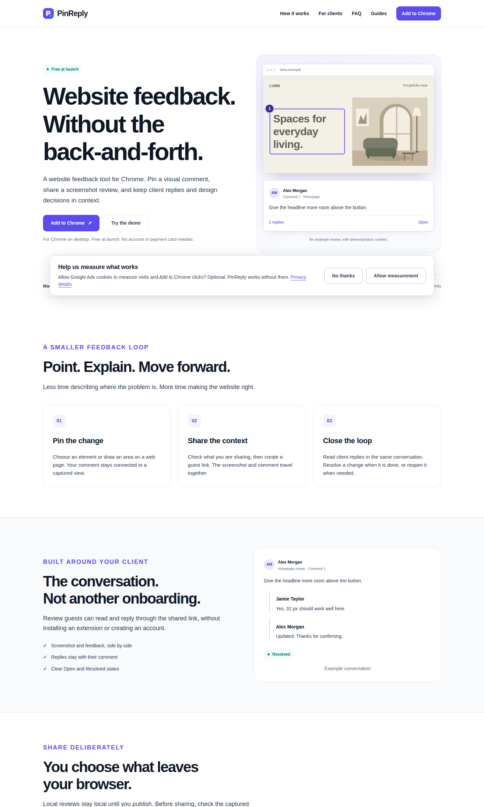

# UI Design System & Master Generation Blueprint: pinreply-com

> **Website Feedback Tool for Chrome · PinReply** (https://pinreply.com/) — Pin visual comments on websites, share screenshot reviews, and collect client replies without accounts. A free-at-launch website feedback...



---

## 1. Executive Visual Persona & Design Archetype

- **Brand Essence & Persona**: **Website Feedback Tool for Chrome · PinReply** (`https://pinreply.com/`). Pin visual comments on websites, share screenshot reviews, and collect client replies without accounts. A free-at-launch website feedback...
- **Capture Provenance**: Live browser capture (`tier1_fast`, HTTP `200`, captured `2026-11-23`).
- **Visual Archetype**: **Light-Substrate Editorial & Modular Grid System (`#ffffff` canvas, `#101828` ink, `#5b4cee` accent)**.
- **Anti-AI-Slop Differentiators**:
  - **Live-Computed Chromatic Polarity**: Anchors the viewport in `#ffffff` (live computed `body` `background-color` (`computed_styles.json`)) paired with `#101828` primary typography and `#5b4cee` accents.
  - **Grounded Typographic Hierarchy**: Pairs `Inter` for display copy (`Website feedback. Without the back-a`) with `Inter` and not declared in live computed styles (uses primary stack / `ui-monospace`).
  - **Calibrated Spatial Grid & Motion**: Combines `1440px` container bounds (`gap: 28px`, padding `12px`) with `cubic-bezier(0.25,0.1,0.25,1)` easing.

---

## 2. Spatial Architecture & Modular Grid Mathematics


### Viewport Allocation & Container Geometry
- **Captured Viewport Dimensions**: Desktop `1440×2400px` (`assets/desktop.png`, clamped at 2400px live multi-section capture), Mobile `390×2400px` (`assets/mobile.png`, clamped at 2400px live multi-section capture).
- **Master Container Bounds**: `1440px` (full-bleed `100%` desktop stage measured on `1440px` viewport).
- **Canvas Lateral Padding & Spacing**: `12px` lateral canvas padding with `28px` grid gap.
- **Border Radius Scale**: `10px`, `100px`, `50%`, `24px`.

### Responsive Breakpoint Architecture
- **Desktop Layout**: Multi-column CSS Grid / Flexbox layout at `1440px` (`max-width: 1440px`, `gap: 28px`).
- **Mobile Layout**: Single-column vertical stack at `390px` viewport width with `12px` horizontal padding.
- **Extracted CSS Media Queries**: `@media (max-width:900px)`, `@media (max-width:620px)`, `@media (prefers-reduced-motion:reduce)`, `@media (max-width:760px)`.

---

## 3. Color System, Materiality & Atmospheric Lighting

### Semantic Palette & Source Grounding
| Semantic Role | Ground-Truth Value | Extracted Live / CSS Source |
|---|---|---|
| **Primary Canvas Substrate** | `#ffffff` | live computed `body` `background-color` (`computed_styles.json`) |
| **Primary Typography Ink** | `#101828` | live computed `h1` `color` (`computed_styles.json`) |
| **Elevated Surface / Card Substrate** | `#f8fafc` | `var(--canvas)` in `:root` |
| **Interactive Accent / Highlight** | `#5b4cee` | `var(--brand)` in `:root` |
| **Secondary / Muted Copy** | `#667085` | `var(--muted)` in `:root` |
| **Structural Hairline Border** | `#e4e7ec` | `var(--line)` in `:root` |
| **Variable Token (`--secondary`)** | `#344054` | `var(--secondary)` in `:root` |
| **Variable Token (`--hover`)** | `#4938d1` | `var(--hover)` in `:root` |
| **Variable Token (`--soft`)** | `#f5f3ff` | `var(--soft)` in `:root` |
| **Variable Token (`--mint`)** | `#087c6f` | `var(--mint)` in `:root` |
| **Variable Token (`--mint-soft`)** | `#f0fdf9` | `var(--mint-soft)` in `:root` |

### Sanitized Root CSS Variables (`ui-ux.md` Ground Truth)
| Variable Name | Extracted Value | Semantic Role |
|---|---|---|
| `--ink` | `#101828` | Typography Ink Token |
| `--secondary` | `#344054` | Brand / Palette Token |
| `--muted` | `#667085` | Color / Atmospheric Token |
| `--line` | `#e4e7ec` | Color / Atmospheric Token |
| `--canvas` | `#f8fafc` | Canvas / Surface Token |
| `--brand` | `#5b4cee` | Brand / Palette Token |
| `--hover` | `#4938d1` | Color / Atmospheric Token |
| `--soft` | `#f5f3ff` | Color / Atmospheric Token |
| `--mint` | `#087c6f` | Color / Atmospheric Token |
| `--mint-soft` | `#f0fdf9` | Color / Atmospheric Token |
| `--radius` | `18px` | Elevation / Border Token |
| `--pinreply-com-bg` | `#ffffff` | Canvas Substrate (from live computed `body` `background-color` (`computed_styles.json`)) |
| `--pinreply-com-ink` | `#101828` | Primary Typography Ink (computed-derived) |
| `--pinreply-com-surface` | `#f8fafc` | Surface Substrate (computed-derived) |
| `--pinreply-com-accent` | `#5b4cee` | Interactive Accent (computed-derived) |
| `--pinreply-com-muted` | `#667085` | Secondary Ink (computed-derived) |

---

## 4. Typographic Scale & Editorial Hierarchy

### Font Family Stacks
- **Display Typography**: `Inter`.
- **Primary Body Stack**: `Inter`.
- **Technical / Metadata Stack**: not declared in live computed styles (uses primary stack / `ui-monospace`).

### Typographic Scale & Rules (Live Computed & Stylesheet Grounded)
- **Hero Display (`H1`)**: live computed `h1` (`font-size: 72px`, `line-height: 82.8px`, `font-weight: 700`, `letter-spacing: -3.24px`); rule `h1` (`font-size: 46px`).
- **Section Heading (`H2`)**: live computed `h2` (`font-size: 44px`, `line-height: 50.6px`, `font-weight: 700`, `letter-spacing: -1.98px`); rule `h2` (`font-size: 36px`).
- **Body Copy**: live computed `body` (`font-size: 16px`, `line-height: 25.6px`, `font-weight: 400`); rule `p` (`font-size: 14px`).
- **Metadata & Navigation Labels**: live computed `nav/a` (`font-size: 14px`, `line-height: 22.4px`, `font-weight: 600`).

---

## 5. Choreographed Motion & Interaction Physics

### Primary Easing Curves
- **Extracted Timing Functions**: `cubic-bezier(0.25,0.1,0.25,1)`.

### Per-Element Transition & Choreography Rules
- **Selector `.button`**: `transition: background .15s,border-color .15s` extracted from `pinreply-com` stylesheet.
- **Selector `:after`**: `transition: none!important` extracted from `pinreply-com` stylesheet.
- **Standard CSS Easing (`cubic-bezier(0.25,0.1,0.25,1)`)**: Default timing curve (no custom `cubic-bezier()` declared in captured CSS).
- **State & Hover Choreography**: Opacity and transform transitions on `<section.hero>` and `<section.section>` interactive targets.

---

## 6. Component Wireframe & Structural DOM Map

### Visual Layout Schematic — Desktop (`1440px`, Grounded in `dom.html` & Landmark Bounding Boxes)
```
┌────────────────────────────────────────────────────────────────────────┐
│ DESKTOP VIEWPORT (1440px) — Website Feedback Tool for Chrome · PinRepl │
│ ====================================================================== │
│ [ <header.header> (1440x81px)         | How it works · For clients · ] │
│ ---------------------------------------------------------------------- │
│ | HERO STAGE: <section.hero> (w=1440px)                              | │
│ | H1: Website feedback. Without the back-and-forth.                  | │
│ | Substrate: #ffffff | Ink: #101828 | Accent: #5b4cee                | │
│ ---------------------------------------------------------------------- │
│ | SHOWCASE GRID (<section.section>) max-w: 1440px                    | │
│ | +------------------------------+  +------------------------------+ | │
│ | | 1 Spaces for everyday living |  | Point. Explain. Move forward | | │
│ | +------------------------------+  +------------------------------+ | │
│ ---------------------------------------------------------------------- │
│ | DETAIL MODULE (<article.card>) — Pin the change                    | │
│ ---------------------------------------------------------------------- │
│ [ FOOTER (<footer.footer>     ) | https://pinreply.com/                │
└────────────────────────────────────────────────────────────────────────┘
```

### Visual Layout Schematic — Mobile Reflow (`390px`)
```
┌────────────────────────────────────────────────────────────────────────┐
│ MOBILE VIEWPORT REFLOW (390px) — Single-Column Stack (gap: 28px)       │
│ ====================================================================== │
│ [ HEADER BAR (<header.header>         ) | Compact Menu (390px)         │
│ ---------------------------------------------------------------------- │
│ | HERO STAGE (<section.hero>) — 390px Vertical Lead                  | │
│ | H1: Website feedback. Without the back-and-forth.                  | │
│ ---------------------------------------------------------------------- │
│ | SHOWCASE STACK (<section.section>) — 1-Col Stack                   | │
│ | [ Item 1: 1 Spaces for everyday living.                          ] | │
│ | [ Item 2: Point. Explain. Move forward.                          ] | │
│ ---------------------------------------------------------------------- │
│ | DETAIL STACK (<article.card>) — 1-Col (Pin the change)             | │
│ ---------------------------------------------------------------------- │
│ [ FOOTER (<footer.footer>     ) | Stacked 390px Colophon               │
└────────────────────────────────────────────────────────────────────────┘
```

### Granular DOM Region Breakdown
1. **Brand Header & Navigation Bar (<header.header> — `pinreply-com`)**:
   - Landmark `<header class="header">` (`1440x81px`) hosting `Website Feedback Tool for Chrome · P` navigation (`How it works · For clients · FAQ · Guides · Add to Chrome`), DOM attributes (`data-ads-conversion="add-to-chrome"`, `data-ads-conversion="add-to-chrome"`, `data-ads-conversion="add-to-chrome"`, `data-ads-choice="decline"`), and stylesheet rule `html { scroll-behavior:smooth;scroll-padding-top:100px }`.
2. **Hero Stage & Focal Lead (<section.hero> — `Website feedback. Without the back`)**:
   - Landmark `<section class="hero">` presenting display lead `Website feedback. Without the back-and-forth.` and copy excerpt *"A website feedback tool for Chrome. Pin a visual comment, share a"* over `#ffffff` canvas and `#101828` ink.
3. **Primary Showcase & Content Grid (<section.section> — `1 Spaces for everyday living.`)**:
   - Landmark `<section class="section">` rendering section `1 Spaces for everyday living.` with copy *"For Chrome on desktop. Free at launch. No account or payment card"*, asset references (`favicon.png`, `site.css`, `ads.js`, `pinreply-mark.svg`), and grid rule `textarea { font:inherit }`.
4. **Interactive Detail & Feature Matrix (<article.card> — `Point. Explain. Move forward.`)**:
   - Landmark `<article class="card">` framing `Point. Explain. Move forward.` and `Pin the change` (*"Give the headline more room above the button."*) with `#f8fafc` surface cards, `#5b4cee` accents, and `summary { -webkit-tap-highlight-color:transparent }`.
5. **Colophon & Global Directory Footer (<footer.footer> — `https://pinreply.com/`)**:
   - Landmark `<footer class="footer">` anchoring `Website Feedback Tool for Chrome` footer links (`How it works · For clients · FAQ · Guides · Add to Chrome`), copy *"An example review, with demonstration content."*, and `#e4e7ec` structural dividers.

---

## 7. Master Zero-Shot AI Generation Prompt

```markdown
# Master Zero-Shot Frontend Generation Prompt: pinreply-com (Website Feedback Tool for Chrome · PinReply)

You are a principal frontend architect and design systems engineer. Build a complete, production-ready web application replicating the exact design system, DOM landmarks, typographic hierarchy, color tokens, and motion physics of `pinreply-com` (**Website Feedback Tool for Chrome · PinReply** — `https://pinreply.com/`).

### 1. Visual Archetype & Anti-AI-Slop Mandates
- **Archetype**: Light-Substrate Editorial & Modular Grid System (`#ffffff` canvas, `#101828` ink, `#5b4cee` accent).
- **Identity & Domain Context**: Pin visual comments on websites, share screenshot reviews, and collect client replies without accounts. A free-at-launch website feedback...
- **Primary Substrate**: `#ffffff` (live computed `body` `background-color` (`computed_styles.json`)), **Primary Ink**: `#101828`, **Accent / Highlight**: `#5b4cee`.
- **Site-Specific Differentiators**:
  - **Live-Computed Chromatic Polarity**: Anchors the viewport in `#ffffff` (live computed `body` `background-color` (`computed_styles.json`)) paired with `#101828` primary typography and `#5b4cee` accents.
  - **Grounded Typographic Hierarchy**: Pairs `Inter` for display copy (`Website feedback. Without the back-a`) with `Inter` and not declared in live computed styles (uses primary stack / `ui-monospace`).
  - **Calibrated Spatial Grid & Motion**: Combines `1440px` container bounds (`gap: 28px`, padding `12px`) with `cubic-bezier(0.25,0.1,0.25,1)` easing.

### 2. Ground-Truth CSS Variables (`:root` Token Contract)
Declare and consume these exact custom properties extracted from `pinreply-com` in your global stylesheet:

:root {
  /* Website Feedback Tool for Chrome · PinReply (pinreply-com) — Live-Grounded CSS Variables */
  --ink: #101828; /* Typography Ink Token (pinreply-com) */
  --secondary: #344054; /* Brand / Palette Token (pinreply-com) */
  --muted: #667085; /* Color / Atmospheric Token (pinreply-com) */
  --line: #e4e7ec; /* Color / Atmospheric Token (pinreply-com) */
  --canvas: #f8fafc; /* Canvas / Surface Token (pinreply-com) */
  --brand: #5b4cee; /* Brand / Palette Token (pinreply-com) */
  --hover: #4938d1; /* Color / Atmospheric Token (pinreply-com) */
  --soft: #f5f3ff; /* Color / Atmospheric Token (pinreply-com) */
  --mint: #087c6f; /* Color / Atmospheric Token (pinreply-com) */
  --mint-soft: #f0fdf9; /* Color / Atmospheric Token (pinreply-com) */
  --radius: 18px; /* Elevation / Border Token (pinreply-com) */
  --pinreply-com-bg: #ffffff; /* Canvas Substrate (from live computed `body` `background-color` (`computed_styles.json`)) (pinreply-com) */
  --pinreply-com-ink: #101828; /* Primary Typography Ink (computed-derived) (pinreply-com) */
  --pinreply-com-surface: #f8fafc; /* Surface Substrate (computed-derived) (pinreply-com) */
  --pinreply-com-accent: #5b4cee; /* Interactive Accent (computed-derived) (pinreply-com) */
  --pinreply-com-muted: #667085; /* Secondary Ink (computed-derived) (pinreply-com) */
}

### 3. Semantic Color & Materiality Contract
Map every surface, ink, and border strictly to these source-grounded tokens:
- **Primary Canvas Substrate**: `#ffffff` — grounded in live computed `body` `background-color` (`computed_styles.json`)
- **Primary Typography Ink**: `#101828` — grounded in live computed `h1` `color` (`computed_styles.json`)
- **Elevated Surface / Card Substrate**: `#f8fafc` — grounded in `var(--canvas)` in `:root`
- **Interactive Accent / Highlight**: `#5b4cee` — grounded in `var(--brand)` in `:root`
- **Secondary / Muted Copy**: `#667085` — grounded in `var(--muted)` in `:root`
- **Structural Hairline Border**: `#e4e7ec` — grounded in `var(--line)` in `:root`
- **Variable Token (`--secondary`)**: `#344054` — grounded in `var(--secondary)` in `:root`
- **Variable Token (`--hover`)**: `#4938d1` — grounded in `var(--hover)` in `:root`
- **Variable Token (`--soft`)**: `#f5f3ff` — grounded in `var(--soft)` in `:root`
- **Variable Token (`--mint`)**: `#087c6f` — grounded in `var(--mint)` in `:root`
- **Variable Token (`--mint-soft`)**: `#f0fdf9` — grounded in `var(--mint-soft)` in `:root`

### 4. Spatial Grid, Container Bounds & Responsive Breakpoints
- **Desktop Viewport Reference**: `1440×2400px` (clamped at 2400px live multi-section capture, `1440px` standard desktop width).
- **Mobile Viewport Reference**: `390×2400px` (clamped at 2400px live multi-section capture, `390px` standard mobile width).
- **Container Max-Width**: `1440px` (full-bleed `100%` desktop stage measured on `1440px` viewport)
- **Padding & Gutters**: `12px` lateral canvas padding with `28px` grid gap
- **Desktop Grid**: Multi-column CSS Grid / Flexbox layout at `1440px` (`max-width: 1440px`, `gap: 28px`)
- **Mobile Adaptation**: Single-column vertical stack at `390px` viewport width with `12px` horizontal padding
- **Media Queries**: `@media (max-width:900px)`, `@media (max-width:620px)`, `@media (prefers-reduced-motion:reduce)`, `@media (max-width:760px)`
- **Corner Radii**: `10px`, `100px`, `50%`, `24px`

### 5. Typography & Editorial Scale Contract
- **Display Font Stack**: `Inter`
- **Body Font Stack**: `Inter`
- **Monospace / Technical Font Stack**: not declared in live computed styles (uses primary stack / `ui-monospace`)
- **H1 Display Rule**: live computed `h1` (`font-size: 72px`, `line-height: 82.8px`, `font-weight: 700`, `letter-spacing: -3.24px`); rule `h1` (`font-size: 46px`)
- **H2 Section Rule**: live computed `h2` (`font-size: 44px`, `line-height: 50.6px`, `font-weight: 700`, `letter-spacing: -1.98px`); rule `h2` (`font-size: 36px`)
- **Body Copy Rule**: live computed `body` (`font-size: 16px`, `line-height: 25.6px`, `font-weight: 400`); rule `p` (`font-size: 14px`)
- **Metadata & Index Rule**: live computed `nav/a` (`font-size: 14px`, `line-height: 22.4px`, `font-weight: 600`)

### 6. Component Hierarchy, Verbatim Copy & Real DOM Landmarks
Scaffold `pinreply-com` (`Website Feedback Tool for Chrome · PinReply`) with these exact structural regions, extracted copy, and CSS rules from `dom.html`:
1. **Brand Header & Navigation Bar (<header.header> — `pinreply-com`)**:
   - DOM & Selectors: Landmark `<header class="header">` (`1440x81px`) hosting `Website Feedback Tool for Chrome · P` navigation (`How it works · For clients · FAQ · Guides · Add to Chrome`), DOM attributes (`data-ads-conversion="add-to-chrome"`, `data-ads-conversion="add-to-chrome"`, `data-ads-conversion="add-to-chrome"`, `data-ads-choice="decline"`), and stylesheet rule `html { scroll-behavior:smooth;scroll-padding-top:100px }`.
   - Responsive Contract: Header `Brand Header & Navigation Bar (<header.header> — `pinreply-com`)` (`pinreply-com`) adapts across `@media (max-width:900px)`, `@media (max-width:620px)`, `@media (prefers-reduced-motion:reduce)`, `@media (max-width:760px)` with `cubic-bezier(0.25,0.1,0.25,1)` transitions and links `How it works · For clients · FAQ · Guides · Add to Chrome`.
2. **Hero Stage & Focal Lead (<section.hero> — `Website feedback. Without the back`)**:
   - DOM & Selectors: Landmark `<section class="hero">` presenting display lead `Website feedback. Without the back-and-forth.` and copy excerpt *"A website feedback tool for Chrome. Pin a visual comment, share a"* over `#ffffff` canvas and `#101828` ink.
   - Responsive Contract: Hero stage (`1440×2400px` desktop / `390×2400px` mobile) sets `#ffffff` background with `#101828` headline `Website feedback. Without the back-and-forth.`.
3. **Primary Showcase & Content Grid (<section.section> — `1 Spaces for everyday living.`)**:
   - DOM & Selectors: Landmark `<section class="section">` rendering section `1 Spaces for everyday living.` with copy *"For Chrome on desktop. Free at launch. No account or payment card"*, asset references (`favicon.png`, `site.css`, `ads.js`, `pinreply-mark.svg`), and grid rule `textarea { font:inherit }`.
   - Responsive Contract: Showcase grid `Primary Showcase & Content Grid (<section.section> — `1 Spaces for everyday living.`)` applies Multi-column CSS Grid / Flexbox layout at `1440px` (`max-width: 1440px`, `gap: 28px`) on desktop and Single-column vertical stack at `390px` viewport width with `12px` horizontal padding on mobile.
4. **Interactive Detail & Feature Matrix (<article.card> — `Point. Explain. Move forward.`)**:
   - DOM & Selectors: Landmark `<article class="card">` framing `Point. Explain. Move forward.` and `Pin the change` (*"Give the headline more room above the button."*) with `#f8fafc` surface cards, `#5b4cee` accents, and `summary { -webkit-tap-highlight-color:transparent }`.
   - Responsive Contract: Detail module `Interactive Detail & Feature Matrix (<article.card> — `Point. Explain. Move forward.`)` uses `10px`, `100px`, `50%`, `24px` radii, `#5b4cee` highlights, and assets (favicon.png, site.css, ads.js).
5. **Colophon & Global Directory Footer (<footer.footer> — `https://pinreply.com/`)**:
   - DOM & Selectors: Landmark `<footer class="footer">` anchoring `Website Feedback Tool for Chrome` footer links (`How it works · For clients · FAQ · Guides · Add to Chrome`), copy *"An example review, with demonstration content."*, and `#e4e7ec` structural dividers.
   - Responsive Contract: Footer `Colophon & Global Directory Footer (<footer.footer> — `https://pinreply.com/`)` aligns to `1440px` (full-bleed `100%` desktop stage measured on `1440px` viewport) with `12px` lateral canvas padding with `28px` grid gap and attributes (data-ads-conversion="add-to-chrome", data-ads-conversion="add-to-chrome", data-ads-conversion="add-to-chrome").

#### Verbatim DOM Copy Excerpts (`dom.html`)
- Copy Excerpt 1: *"A website feedback tool for Chrome. Pin a visual comment, share a screenshot revie..."*
- Copy Excerpt 2: *"For Chrome on desktop. Free at launch. No account or payment card needed."*
- Copy Excerpt 3: *"Give the headline more room above the button."*
- Copy Excerpt 4: *"An example review, with demonstration content."*

### 7. Motion, Extracted Stylesheet Rules & Interaction Choreography
- **Primary Easing Functions**: `cubic-bezier(0.25,0.1,0.25,1)`
- **Extracted Stylesheet Rules (`pinreply-com`)**:
- `html { scroll-behavior:smooth;scroll-padding-top:100px }`
- `textarea { font:inherit }`
- `summary { -webkit-tap-highlight-color:transparent }`
- `button { cursor:pointer }`
- `button:disabled { cursor:wait;opacity:.6 }`
- **Per-Selector Transition Rules**:
- **Selector `.button`**: `transition: background .15s,border-color .15s` extracted from `pinreply-com` stylesheet.
- **Selector `:after`**: `transition: none!important` extracted from `pinreply-com` stylesheet.
- **Standard CSS Easing (`cubic-bezier(0.25,0.1,0.25,1)`)**: Default timing curve (no custom `cubic-bezier()` declared in captured CSS).
- **State & Hover Choreography**: Opacity and transform transitions on `<section.hero>` and `<section.section>` interactive targets.

### 8. Technical Deliverables
- Implement in Next.js (App Router) with TypeScript and Tailwind CSS consuming the `:root` custom properties defined above for `pinreply-com`.
- Reproduce both the `1440px` desktop architecture and `390px` mobile breakpoint transitions, preserving semantic HTML5 landmarks (`<header>`, `<nav>`, `<main>`, `<section>`, `<footer>`) and `prefers-reduced-motion` accessibility guards.
```
