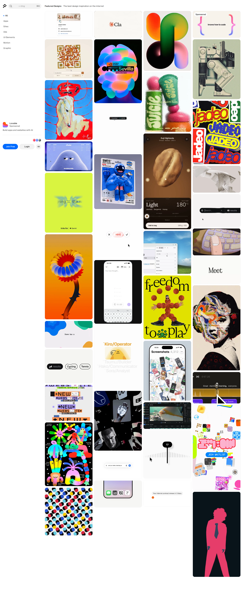

# UI Design System & Master Generation Blueprint: pixlpin-com_designs

> **Pixlpin: 58K+ Free UI Designs, App Screens, Motion & Graphics** (https://pixlpin.com/designs) — Join free. Browse 58K+ real app screens, user flows, websites, motion, logos & 3D, curated from the internet and updated daily.



---

## 1. Executive Visual Persona & Design Archetype

- **Brand Essence & Persona**: **Pixlpin: 58K+ Free UI Designs, App Screens, Motion & Graphics** (`https://pixlpin.com/designs`). Join free. Browse 58K+ real app screens, user flows, websites, motion, logos & 3D, curated from the internet and updated daily.
- **Visual Archetype**: **Light-Substrate Editorial & Modular Grid System (`#fff` canvas, `#c9c9c9` ink, `#ebebeb` accent)**.
- **Anti-AI-Slop Differentiators**:
  - **Source-Grounded Chromatic Polarity**: Anchors the viewport in `#fff` (`var(--ds-background-100)` in `:root`) paired with `#c9c9c9` primary typography and `#ebebeb` accents.
  - **Extracted Typographic Hierarchy**: Pairs `monoFont` for display copy (`Featured Designs`) with `GeistSans` and `monoFont`.
  - **Calibrated Spatial Grid & Motion**: Combines `var(--peek-page-width)` container bounds (`gap: var(--space-4)`, padding `var(--space-6)`) with `cubic-bezier(.45,0,.55,1)` easing.

---

## 2. Spatial Architecture & Modular Grid Mathematics


### Viewport Allocation & Container Geometry
- **Captured Viewport Dimensions**: Desktop `1440×3513px` (`assets/desktop.png`, full-page scroll capture), Mobile `390×2400px` (`assets/mobile.png`, capped at 2400px multi-section capture).
- **Master Container Bounds**: `var(--peek-page-width)` extracted from `pixlpin-com_designs` stylesheet.
- **Canvas Lateral Padding & Spacing**: `var(--space-6)` lateral canvas padding with `var(--space-4)` grid gap.
- **Border Radius Scale**: `var(--radius-m)`, `var(--radius-l)`, `var(--radius-xs)`, `var(--radius-pill)`.

### Responsive Breakpoint Architecture
- **Desktop Layout**: Multi-column CSS Grid / Flexbox layout at `1440px` (`max-width: var(--peek-page-width)`, `gap: var(--space-4)`).
- **Mobile Layout**: Single-column vertical stack at `390px` viewport width with `var(--space-6)` horizontal padding.
- **Extracted CSS Media Queries**: `@media not (min-width:600px)`, `@media (not (min-width:600px)) and (prefers-reduced-motion:reduce)`, `@media not (min-height:560px)`, `@media (768px<=width<1024px)`.

---

## 3. Color System, Materiality & Atmospheric Lighting

### Semantic Palette & Source Grounding
| Semantic Role | Ground-Truth Value | Extracted CSS Source / Selector |
|---|---|---|
| **Primary Canvas Substrate** | `#fff` | `var(--ds-background-100)` in `:root` |
| **Primary Typography Ink** | `#fafafa` | `var(--ds-background-200)` in `:root` |
| **Elevated Surface / Card Substrate** | `#f2f2f2` | `var(--ds-gray-100)` in `:root` |
| **Interactive Accent / Highlight** | `#ebebeb` | `var(--ds-gray-200)` in `:root` |
| **Secondary / Muted Copy** | `#e6e6e6` | `var(--ds-gray-300)` in `:root` |
| **Structural Hairline Border** | `#c9c9c9` | `var(--ds-gray-500)` in `:root` |

### Sanitized Root CSS Variables (`ui-ux.md` Ground Truth)
| Variable Name | Extracted Value | Semantic Role |
|---|---|---|
| `--control-height` | `var(--topbar-control)` | Layout / Spatial Grid Token |
| `--palette-inset` | `max(var(--palette-top), (100svh - var(--palette-height)) / 2)` | Brand / Palette Token |
| `--control-padding-x` | `0px` | Layout / Spatial Grid Token |
| `--icon-size` | `0px` | Layout / Spatial Grid Token |
| `--text-size` | `var(--palette-input-size)` | Typography Ink Token |
| `--text-line` | `var(--palette-input-line)` | Typography Ink Token |
| `--palette-top` | `var(--space-4)` | Brand / Palette Token |
| `--text-wipe-time` | `var(--duration-swap)` | Typography Ink Token |
| `--text-wipe-delay` | `var(--duration-swap)` | Typography Ink Token |
| `--sweep-spread` | `3em` | Dimension / Scale Token |
| `--placeholder-spread` | `3em` | Dimension / Scale Token |
| `--button-bg` | `var(--color-accent)` | Canvas / Surface Token |
| `--button-shadow` | `var(--shadow-s)` | Elevation / Border Token |
| `--nav-pin-top` | `calc(var(--space-6) * -1)` | Layout / Spatial Grid Token |
| `--nav-fade-top` | `var(--space-12)` | Layout / Spatial Grid Token |
| `--main-pad-end` | `var(--space-5)` | Layout / Spatial Grid Token |

---

## 4. Typographic Scale & Editorial Hierarchy

### Font Family Stacks
- **Display Typography**: `monoFont`.
- **Primary Body Stack**: `GeistSans`.
- **Technical / Metadata Stack**: `monoFont`.

### Typographic Scale & Rules (Extracted from Stylesheet & Variables)
- **Hero Display (`H1`)**: CSS variables `--text-size-display: 48px`, `--text-line-display: 56px`, `--text-track-display: -.06em`.
- **Section Heading (`H2`)**: not explicitly declared on tag in static CSS (stylesheet font-size ladder: `var(--text-size)`, `var(--text-size-heading)`, `var(--input-size)`, `var(--palette-input-size)`, `var(--field-size)`).
- **Body Copy**: not explicitly declared on tag in static CSS (stylesheet font-size ladder: `var(--text-size)`, `var(--text-size-heading)`, `var(--input-size)`, `var(--palette-input-size)`, `var(--field-size)`).
- **Metadata & Navigation Labels**: CSS variables `--font-geist-mono: "monoFont", ui-monospace, SFMono-Regular, Menlo, monospace`, `--font-mono: var(--font-geist-mono), ui-monospace, monospace`, `--read-small-size: 15px`.

---

## 5. Choreographed Motion & Interaction Physics

### Primary Easing Curves
- **Extracted Timing Functions**: `cubic-bezier(.45,0,.55,1)`, `cubic-bezier(.16,1,.3,1)`, `cubic-bezier(.32,.72,0,1)`.

### Per-Element Transition & Choreography Rules
- **Selector `media not (min-width:600px)`**: `transition: margin-bottom var(--duration-base) var(--ease-out)` extracted from `pixlpin-com_designs` stylesheet.
- **Selector `.palette-trigger`**: `transition: background-color var(--duration-fast) var(--ease-out), transfo...` extracted from `pixlpin-com_designs` stylesheet.
- **Selector `.sidebar-sponsor__tile`**: `transition: transform var(--duration-spring) var(--ease-spring)` extracted from `pixlpin-com_designs` stylesheet.
- **Extracted Easing Curve (`cubic-bezier(.45,0,.55,1)`)**: Governs interactive state transitions across `<header.top-bar>` and `<article.tile>`.
- **State & Hover Choreography**: Opacity and transform transitions on `<section.sidebar__bottom>` and `<article.tile>` interactive targets.

---

## 6. Component Wireframe & Structural DOM Map

### Visual Layout Schematic (Grounded in `dom.html` — `1440px` Desktop & `390px` Mobile Reflow)
```
┌────────────────────────────────────────────────────────────────────────┐
│ DESKTOP VIEWPORT (1440px) — Pixlpin: 58K+ Free UI Designs, App Screens │
│ ====================================================================== │
│ [ <header.top-bar>         | All · Apps · AI · Productivity · Busin ]  │
│ ---------------------------------------------------------------------- │
│ | HERO STAGE: <section.sidebar__bottom>                            |   │
│ | H1: Featured Designs                                             |   │
│ | Substrate: #fff       | Ink: #c9c9c9    | Accent: #ebebeb        |   │
│ ---------------------------------------------------------------------- │
│ | SHOWCASE GRID (<article.tile>            ) max-w: var(--peek-pag |   │
│ | +------------------------------+  +------------------------------+ | │
│ | | Search Pixlpin               |  | Join 1,000+ Members Join 1,0 | | │
│ | +------------------------------+  +------------------------------+ | │
│ ---------------------------------------------------------------------- │
│ | MOBILE VIEWPORT REFLOW (390px) — Single-Column Stack (gap: var(--) | │
│ | [<header.top-bar>] -> [<section.sidebar__] -> [<article.tile>] |     │
│ ---------------------------------------------------------------------- │
│ [ FOOTER (<footer.shell-footer> ) | https://pixlpin.com/designs        │
└────────────────────────────────────────────────────────────────────────┘
```

### Granular DOM Region Breakdown
1. **Brand Header & Navigation Bar (<header.top-bar> — `pixlpin-com_designs`)**:
   - Landmark `<header class="top-bar">` hosting `Pixlpin: 58K+ Free UI Designs, App S` navigation (`All · Apps · AI · Productivity · Business and SaaS`), DOM attributes (`data-precedence="next"`, `data-precedence="next"`, `data-precedence="next"`, `data-precedence="next"`), and stylesheet rule `.modal--narrow { width:min(440px, calc(100vw - var(--space-8)));border-radius:var(--radiu... }`.
2. **Hero Stage & Focal Lead (<section.sidebar__bottom> — `Featured Designs`)**:
   - Landmark `<section class="sidebar__bottom">` presenting display lead `Featured Designs` and copy excerpt *"Onboarding Onboarding"* over `#fff` canvas and `#c9c9c9` ink.
3. **Primary Showcase & Content Grid (<article.tile> — `Search Pixlpin`)**:
   - Landmark `<article class="tile tile--video">` rendering section `Search Pixlpin` with copy *"Join 1,000+ Members Join 1,000+ Members, Explore 58,000+ designs"*, asset references (`2hottykkrbx1p.css`, `349k6yv56b9jt.css`, `3l0ai14c31l8b.css`, `0ejnx84aea1e4.css`), and grid rule `.modal--wide { width:min(720px, calc(100vw - var(--space-8)));border-radius:var(--radiu... }`.
4. **Interactive Detail & Feature Matrix (<article.tile> — `Join 1,000+ Members Join 1,000+ Me`)**:
   - Landmark `<article class="tile tile--video">` framing `Join 1,000+ Members Join 1,000+ Members, Explore` and `Join 1,000+ Members` (*"Join 1,000+ Members"*) with `#f2f2f2` surface cards, `#ebebeb` accents, and `.modal::backdrop { background:var(--color-overlay) }`.
5. **Colophon & Global Directory Footer (<footer.shell-footer> — `https://pixlpin.com/designs`)**:
   - Landmark `<footer class="shell-footer">` anchoring `Pixlpin: 58K+ Free UI Designs, A` footer links (`All · Apps · AI · Productivity · Business and SaaS`), copy *"Join 1,000+ Members, Explore 58,000+ designs"*, and `#c9c9c9` structural dividers.

---

## 7. Master Zero-Shot AI Generation Prompt

```markdown
# Master Zero-Shot Frontend Generation Prompt: pixlpin-com_designs (Pixlpin: 58K+ Free UI Designs, App Screens, Motion & Graphics)

You are a principal frontend architect and design systems engineer. Build a complete, production-ready web application replicating the exact design system, DOM landmarks, typographic hierarchy, color tokens, and motion physics of `pixlpin-com_designs` (**Pixlpin: 58K+ Free UI Designs, App Screens, Motion & Graphics** — `https://pixlpin.com/designs`).

### 1. Visual Archetype & Anti-AI-Slop Mandates
- **Archetype**: Light-Substrate Editorial & Modular Grid System (`#fff` canvas, `#c9c9c9` ink, `#ebebeb` accent).
- **Identity & Domain Context**: Join free. Browse 58K+ real app screens, user flows, websites, motion, logos & 3D, curated from the internet and updated daily.
- **Primary Substrate**: `#fff` (`var(--ds-background-100)` in `:root`), **Primary Ink**: `#c9c9c9`, **Accent / Highlight**: `#ebebeb`.
- **Site-Specific Differentiators**:
  - **Source-Grounded Chromatic Polarity**: Anchors the viewport in `#fff` (`var(--ds-background-100)` in `:root`) paired with `#c9c9c9` primary typography and `#ebebeb` accents.
  - **Extracted Typographic Hierarchy**: Pairs `monoFont` for display copy (`Featured Designs`) with `GeistSans` and `monoFont`.
  - **Calibrated Spatial Grid & Motion**: Combines `var(--peek-page-width)` container bounds (`gap: var(--space-4)`, padding `var(--space-6)`) with `cubic-bezier(.45,0,.55,1)` easing.

### 2. Ground-Truth CSS Variables (`:root` Token Contract)
Declare and consume these exact custom properties extracted from `pixlpin-com_designs` in your global stylesheet:

:root {
  /* Pixlpin: 58K+ Free UI Designs, App Screens, Motion & Graphics (pixlpin-com_designs) — Ground-Truth Extracted CSS Variables */
  --control-height: var(--topbar-control); /* Layout / Spatial Grid Token (pixlpin-com_designs) */
  --palette-inset: max(var(--palette-top), (100svh - var(--palette-height)) / 2); /* Brand / Palette Token (pixlpin-com_designs) */
  --control-padding-x: 0px; /* Layout / Spatial Grid Token (pixlpin-com_designs) */
  --icon-size: 0px; /* Layout / Spatial Grid Token (pixlpin-com_designs) */
  --text-size: var(--palette-input-size); /* Typography Ink Token (pixlpin-com_designs) */
  --text-line: var(--palette-input-line); /* Typography Ink Token (pixlpin-com_designs) */
  --palette-top: var(--space-4); /* Brand / Palette Token (pixlpin-com_designs) */
  --text-wipe-time: var(--duration-swap); /* Typography Ink Token (pixlpin-com_designs) */
  --text-wipe-delay: var(--duration-swap); /* Typography Ink Token (pixlpin-com_designs) */
  --sweep-spread: 3em; /* Dimension / Scale Token (pixlpin-com_designs) */
  --placeholder-spread: 3em; /* Dimension / Scale Token (pixlpin-com_designs) */
  --button-bg: var(--color-accent); /* Canvas / Surface Token (pixlpin-com_designs) */
  --button-shadow: var(--shadow-s); /* Elevation / Border Token (pixlpin-com_designs) */
  --nav-pin-top: calc(var(--space-6) * -1); /* Layout / Spatial Grid Token (pixlpin-com_designs) */
  --nav-fade-top: var(--space-12); /* Layout / Spatial Grid Token (pixlpin-com_designs) */
  --main-pad-end: var(--space-5); /* Layout / Spatial Grid Token (pixlpin-com_designs) */
}

### 3. Semantic Color & Materiality Contract
Map every surface, ink, and border strictly to these source-grounded tokens:
- **Primary Canvas Substrate**: `#fff` — grounded in `var(--ds-background-100)` in `:root`
- **Primary Typography Ink**: `#fafafa` — grounded in `var(--ds-background-200)` in `:root`
- **Elevated Surface / Card Substrate**: `#f2f2f2` — grounded in `var(--ds-gray-100)` in `:root`
- **Interactive Accent / Highlight**: `#ebebeb` — grounded in `var(--ds-gray-200)` in `:root`
- **Secondary / Muted Copy**: `#e6e6e6` — grounded in `var(--ds-gray-300)` in `:root`
- **Structural Hairline Border**: `#c9c9c9` — grounded in `var(--ds-gray-500)` in `:root`

### 4. Spatial Grid, Container Bounds & Responsive Breakpoints
- **Desktop Viewport Reference**: `1440×3513px` (full-page scroll capture, `1440px` standard desktop width).
- **Mobile Viewport Reference**: `390×2400px` (capped at 2400px multi-section capture, `390px` standard mobile width).
- **Container Max-Width**: `var(--peek-page-width)` extracted from `pixlpin-com_designs` stylesheet
- **Padding & Gutters**: `var(--space-6)` lateral canvas padding with `var(--space-4)` grid gap
- **Desktop Grid**: Multi-column CSS Grid / Flexbox layout at `1440px` (`max-width: var(--peek-page-width)`, `gap: var(--space-4)`)
- **Mobile Adaptation**: Single-column vertical stack at `390px` viewport width with `var(--space-6)` horizontal padding
- **Media Queries**: `@media not (min-width:600px)`, `@media (not (min-width:600px)) and (prefers-reduced-motion:reduce)`, `@media not (min-height:560px)`, `@media (768px<=width<1024px)`
- **Corner Radii**: `var(--radius-m)`, `var(--radius-l)`, `var(--radius-xs)`, `var(--radius-pill)`

### 5. Typography & Editorial Scale Contract
- **Display Font Stack**: `monoFont`
- **Body Font Stack**: `GeistSans`
- **Monospace / Technical Font Stack**: `monoFont`
- **H1 Display Rule**: CSS variables `--text-size-display: 48px`, `--text-line-display: 56px`, `--text-track-display: -.06em`
- **H2 Section Rule**: not explicitly declared on tag in static CSS (stylesheet font-size ladder: `var(--text-size)`, `var(--text-size-heading)`, `var(--input-size)`, `var(--palette-input-size)`, `var(--field-size)`)
- **Body Copy Rule**: not explicitly declared on tag in static CSS (stylesheet font-size ladder: `var(--text-size)`, `var(--text-size-heading)`, `var(--input-size)`, `var(--palette-input-size)`, `var(--field-size)`)
- **Metadata & Index Rule**: CSS variables `--font-geist-mono: "monoFont", ui-monospace, SFMono-Regular, Menlo, monospace`, `--font-mono: var(--font-geist-mono), ui-monospace, monospace`, `--read-small-size: 15px`

### 6. Component Hierarchy, Verbatim Copy & Real DOM Landmarks
Scaffold `pixlpin-com_designs` (`Pixlpin: 58K+ Free UI Designs, App Screens, Motion & Graphics`) with these exact structural regions, extracted copy, and CSS rules from `dom.html`:
1. **Brand Header & Navigation Bar (<header.top-bar> — `pixlpin-com_designs`)**:
   - DOM & Selectors: Landmark `<header class="top-bar">` hosting `Pixlpin: 58K+ Free UI Designs, App S` navigation (`All · Apps · AI · Productivity · Business and SaaS`), DOM attributes (`data-precedence="next"`, `data-precedence="next"`, `data-precedence="next"`, `data-precedence="next"`), and stylesheet rule `.modal--narrow { width:min(440px, calc(100vw - var(--space-8)));border-radius:var(--radiu... }`.
   - Responsive Contract: Header `Brand Header & Navigation Bar (<header.top-bar> — `pixlpin-com_designs`)` (`pixlpin-com_designs`) adapts across `@media not (min-width:600px)`, `@media (not (min-width:600px)) and (prefers-reduced-motion:reduce)`, `@media not (min-height:560px)`, `@media (768px<=width<1024px)` with `cubic-bezier(.45,0,.55,1)`, `cubic-bezier(.16,1,.3,1)`, `cubic-bezier(.32,.72,0,1)` transitions and links `All · Apps · AI · Productivity · Business and SaaS`.
2. **Hero Stage & Focal Lead (<section.sidebar__bottom> — `Featured Designs`)**:
   - DOM & Selectors: Landmark `<section class="sidebar__bottom">` presenting display lead `Featured Designs` and copy excerpt *"Onboarding Onboarding"* over `#fff` canvas and `#c9c9c9` ink.
   - Responsive Contract: Hero stage (`1440×3513px` desktop / `390×2400px` mobile) sets `#fff` background with `#c9c9c9` headline `Featured Designs`.
3. **Primary Showcase & Content Grid (<article.tile> — `Search Pixlpin`)**:
   - DOM & Selectors: Landmark `<article class="tile tile--video">` rendering section `Search Pixlpin` with copy *"Join 1,000+ Members Join 1,000+ Members, Explore 58,000+ designs"*, asset references (`2hottykkrbx1p.css`, `349k6yv56b9jt.css`, `3l0ai14c31l8b.css`, `0ejnx84aea1e4.css`), and grid rule `.modal--wide { width:min(720px, calc(100vw - var(--space-8)));border-radius:var(--radiu... }`.
   - Responsive Contract: Showcase grid `Primary Showcase & Content Grid (<article.tile> — `Search Pixlpin`)` applies Multi-column CSS Grid / Flexbox layout at `1440px` (`max-width: var(--peek-page-width)`, `gap: var(--space-4)`) on desktop and Single-column vertical stack at `390px` viewport width with `var(--space-6)` horizontal padding on mobile.
4. **Interactive Detail & Feature Matrix (<article.tile> — `Join 1,000+ Members Join 1,000+ Me`)**:
   - DOM & Selectors: Landmark `<article class="tile tile--video">` framing `Join 1,000+ Members Join 1,000+ Members, Explore` and `Join 1,000+ Members` (*"Join 1,000+ Members"*) with `#f2f2f2` surface cards, `#ebebeb` accents, and `.modal::backdrop { background:var(--color-overlay) }`.
   - Responsive Contract: Detail module `Interactive Detail & Feature Matrix (<article.tile> — `Join 1,000+ Members Join 1,000+ Me`)` uses `var(--radius-m)`, `var(--radius-l)`, `var(--radius-xs)`, `var(--radius-pill)` radii, `#ebebeb` highlights, and assets (2hottykkrbx1p.css, 349k6yv56b9jt.css, 3l0ai14c31l8b.css).
5. **Colophon & Global Directory Footer (<footer.shell-footer> — `https://pixlpin.com/designs`)**:
   - DOM & Selectors: Landmark `<footer class="shell-footer">` anchoring `Pixlpin: 58K+ Free UI Designs, A` footer links (`All · Apps · AI · Productivity · Business and SaaS`), copy *"Join 1,000+ Members, Explore 58,000+ designs"*, and `#c9c9c9` structural dividers.
   - Responsive Contract: Footer `Colophon & Global Directory Footer (<footer.shell-footer> — `https://pixlpin.com/designs`)` aligns to `var(--peek-page-width)` extracted from `pixlpin-com_designs` stylesheet with `var(--space-6)` lateral canvas padding with `var(--space-4)` grid gap and attributes (data-precedence="next", data-precedence="next", data-precedence="next").

#### Verbatim DOM Copy Excerpts (`dom.html`)
- Copy Excerpt 1: *"Onboarding Onboarding"*
- Copy Excerpt 2: *"Join 1,000+ Members Join 1,000+ Members, Explore 58,000+ designs"*
- Copy Excerpt 3: *"Join 1,000+ Members"*
- Copy Excerpt 4: *"Join 1,000+ Members, Explore 58,000+ designs"*

### 7. Motion, Extracted Stylesheet Rules & Interaction Choreography
- **Primary Easing Functions**: `cubic-bezier(.45,0,.55,1)`, `cubic-bezier(.16,1,.3,1)`, `cubic-bezier(.32,.72,0,1)`
- **Extracted Stylesheet Rules (`pixlpin-com_designs`)**:
- `.modal--narrow { width:min(440px, calc(100vw - var(--space-8)));border-radius:var(--radiu... }`
- `.modal--wide { width:min(720px, calc(100vw - var(--space-8)));border-radius:var(--radiu... }`
- `.modal::backdrop { background:var(--color-overlay) }`
- `backdrop { animation:fade-in var(--duration-modal) var(--ease-out) }`
- `.modal__content { flex-direction:column;display:flex }`
- **Per-Selector Transition Rules**:
- **Selector `media not (min-width:600px)`**: `transition: margin-bottom var(--duration-base) var(--ease-out)` extracted from `pixlpin-com_designs` stylesheet.
- **Selector `.palette-trigger`**: `transition: background-color var(--duration-fast) var(--ease-out), transfo...` extracted from `pixlpin-com_designs` stylesheet.
- **Selector `.sidebar-sponsor__tile`**: `transition: transform var(--duration-spring) var(--ease-spring)` extracted from `pixlpin-com_designs` stylesheet.
- **Extracted Easing Curve (`cubic-bezier(.45,0,.55,1)`)**: Governs interactive state transitions across `<header.top-bar>` and `<article.tile>`.
- **State & Hover Choreography**: Opacity and transform transitions on `<section.sidebar__bottom>` and `<article.tile>` interactive targets.

### 8. Technical Deliverables
- Implement in Next.js (App Router) with TypeScript and Tailwind CSS consuming the `:root` custom properties defined above for `pixlpin-com_designs`.
- Reproduce both the `1440px` desktop architecture and `390px` mobile breakpoint transitions, preserving semantic HTML5 landmarks (`<header>`, `<nav>`, `<main>`, `<section>`, `<footer>`) and `prefers-reduced-motion` accessibility guards.
```
