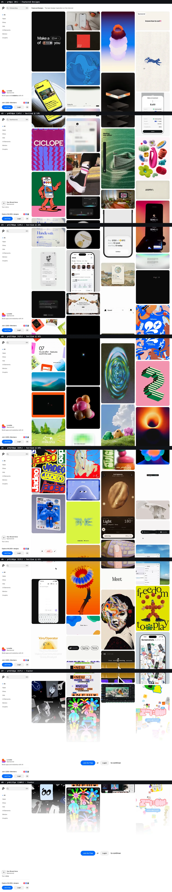
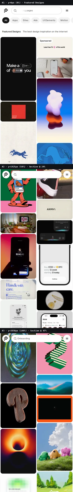

# UI Design System & Master Generation Blueprint: pixlpin-com_designs

> **Pixlpin: 64K+ Free UI Designs, App Screens, Motion & Graphics** (https://pixlpin.com/designs) — Join free. Browse 64K+ real app screens, user flows, websites, motion, logos & 3D, curated from the internet and updated daily.





---

## 1. Executive Visual Persona & Design Archetype

- **Brand Essence & Persona**: **Pixlpin: 64K+ Free UI Designs, App Screens, Motion & Graphics** (`https://pixlpin.com/designs`). Join free. Browse 64K+ real app screens, user flows, websites, motion, logos & 3D, curated from the internet and updated daily.
- **Capture Provenance**: Live browser capture (`tier1_fast`, HTTP `200`, captured `2026-11-24`).
- **Visual Archetype**: **Light-Substrate Editorial & Modular Grid System (`#ffffff` canvas, `#171717` ink, `#ff0844` accent)**.
- **Anti-AI-Slop Differentiators**:
  - **Live-Computed Chromatic Polarity**: Anchors the viewport in `#ffffff` (live computed `body` `background-color` (`computed_styles.json`)) paired with `#171717` primary typography and `#ff0844` accents.
  - **Grounded Typographic Hierarchy**: Uses `GeistSans` across display (`Featured Designs`) and body copy, paired with `monoFont` for monospace/code.
  - **Calibrated Spatial Grid & Motion**: Combines `1176px` container bounds (`gap: var(--space-2)`, padding `16px`) with `cubic-bezier(.45,0,.55,1)` easing and Framer Motion Layout Physics.

---

## 2. Spatial Architecture & Modular Grid Mathematics

### Viewport Allocation & Container Geometry
- **Captured Journey Filmstrips**: Desktop `1280×6624px` (`assets/desktop-journey.webp`, `8` keyframes up to `y=6127px` / doc `7027px`), Mobile `390×2616px` (`assets/mobile-journey.webp`, `3` keyframes).
- **Master Container Bounds**: `1176px` (measured `<main>` bounding box width within `1440px` desktop viewport).
- **Canvas Lateral Padding & Spacing**: `16px` lateral canvas padding with `var(--space-2)` grid gap.
- **Border Radius Scale**: `999px`, `var(--radius-s)`, `var(--radius-pill)`, `var(--radius-m)`.

### Responsive Breakpoint Architecture
- **Desktop Layout**: Multi-column CSS Grid / Flexbox layout at `1440px` (`max-width: 1176px`, `gap: var(--space-2)`).
- **Mobile Layout**: Single-column vertical stack at `390px` viewport width with `16px` horizontal padding.
- **Extracted CSS Media Queries**: `@media (prefers-reduced-motion:reduce)`, `@media not (min-width:1280px)`, `@media not (min-width:768px)`, `@media not (min-width:600px)`.

---

## 3. Color System, Materiality & Atmospheric Lighting

### Semantic Palette & Source Grounding
| Semantic Role | Ground-Truth Value | Extracted Live / CSS Source |
|---|---|---|
| **Primary Canvas Substrate** | `#ffffff` | live computed `body` `background-color` (`computed_styles.json`) |
| **Primary Typography Ink** | `#171717` | live computed `h1` `color` (`computed_styles.json`) |
| **Elevated Surface / Card Substrate** | `#f2f2f2` | live computed `button` `background-color` (`computed_styles.json`) |
| **Interactive Accent / Highlight** | `#ff0844` | `var(--gradient-member-1)` in `:root` |
| **Secondary / Muted Copy** | `#808080` | live computed `hr` `color` (`computed_styles.json`) |
| **Structural Hairline Border** | `#f2f2f2` | `var(--color-card-border)` in `:root` |
| **Variable Token (`--ds-background-200`)** | `#fafafa` | `var(--ds-background-200)` in `:root` |
| **Variable Token (`--ds-gray-200`)** | `#ebebeb` | `var(--ds-gray-200)` in `:root` |
| **Variable Token (`--ds-gray-300`)** | `#e6e6e6` | `var(--ds-gray-300)` in `:root` |
| **Variable Token (`--ds-gray-500`)** | `#c9c9c9` | `var(--ds-gray-500)` in `:root` |
| **Variable Token (`--ds-gray-600`)** | `#a8a8a8` | `var(--ds-gray-600)` in `:root` |
| **Variable Token (`--ds-gray-700`)** | `#8f8f8f` | `var(--ds-gray-700)` in `:root` |
| **Variable Token (`--ds-gray-900`)** | `#666666` | `var(--ds-gray-900)` in `:root` |
| **Variable Token (`--ds-gray-alpha-400`)** | `#000000` | `var(--ds-gray-alpha-400)` in `:root` |
| **Variable Token (`--ds-blue-700`)** | `#006bff` | `var(--ds-blue-700)` in `:root` |
| **Variable Token (`--ds-blue-800`)** | `#005ae0` | `var(--ds-blue-800)` in `:root` |
| **Variable Token (`--ds-blue-900`)** | `#005ff2` | `var(--ds-blue-900)` in `:root` |

### Sanitized Root CSS Variables (`ui-ux.md` Ground Truth)
| Variable Name | Extracted Value | Semantic Role |
|---|---|---|
| `--lightningcss-light` | `initial` | Canvas / Surface Token |
| `--ds-background-100` | `#fff` | Canvas / Surface Token |
| `--ds-background-200` | `#fafafa` | Canvas / Surface Token |
| `--ds-gray-100` | `#f2f2f2` | Color / Atmospheric Token |
| `--ds-gray-200` | `#ebebeb` | Color / Atmospheric Token |
| `--ds-gray-300` | `#e6e6e6` | Color / Atmospheric Token |
| `--ds-gray-400` | `#ebebeb` | Color / Atmospheric Token |
| `--ds-gray-500` | `#c9c9c9` | Color / Atmospheric Token |
| `--ds-gray-600` | `#a8a8a8` | Color / Atmospheric Token |
| `--ds-gray-700` | `#8f8f8f` | Color / Atmospheric Token |
| `--ds-gray-900` | `#666` | Color / Atmospheric Token |
| `--ds-gray-1000` | `#171717` | Color / Atmospheric Token |
| `--ds-gray-alpha-400` | `#00000014` | Color / Atmospheric Token |
| `--ds-blue-700` | `#006bff` | Color / Atmospheric Token |
| `--ds-blue-800` | `#005ae0` | Color / Atmospheric Token |
| `--ds-blue-900` | `#005ff2` | Color / Atmospheric Token |

---

## 4. Typographic Scale & Editorial Hierarchy

### Font Family Stacks
- **Display Typography**: `GeistSans`.
- **Primary Body Stack**: `GeistSans`.
- **Technical / Metadata Stack**: `monoFont`.

### Typographic Scale & Rules (Live Computed & Stylesheet Grounded)
- **Hero Display (`H1`)**: live computed `h1` (`font-size: 12px`, `line-height: 16px`, `font-weight: 500`); CSS variables `--text-size-display: 48px`, `--text-line-display: 56px`, `--text-track-display: -.06em`.
- **Section Heading (`H2`)**: live computed `h2` (`font-size: 18px`, `line-height: 16px`, `font-weight: 500`).
- **Body Copy**: live computed `body` (`font-size: 12px`, `line-height: 16px`, `font-weight: 500`).
- **Metadata & Navigation Labels**: live computed `nav/a` (`font-size: 12px`, `line-height: 16px`, `font-weight: 500`); CSS variables `--video-button-size-small: 48px`, `--font-mono: var(--font-geist-mono), ui-monospace, monospace`, `--read-small-size: 15px`.

---

## 5. Choreographed Motion & Interaction Physics

### Primary Easing Curves
- **Extracted Timing Functions**: `cubic-bezier(.45,0,.55,1)`, `cubic-bezier(.16,1,.3,1)`, `cubic-bezier(.32,.72,0,1)`.

### Per-Element Transition & Choreography Rules
- **Selector `.sidebar-sponsor__tile`**: `transition: transform var(--duration-spring) var(--ease-spring)` extracted from `pixlpin-com_designs` stylesheet.
- **Selector `debar-sponsor:active .sidebar-spo...`**: `transition: var(--duration-fast)` extracted from `pixlpin-com_designs` stylesheet.
- **Selector `media (hover:hover) and (pointer:...`**: `transition: var(--duration-base)` extracted from `pixlpin-com_designs` stylesheet.
- **Extracted Easing Curve (`cubic-bezier(.45,0,.55,1)`)**: Governs interactive state transitions across `<header.top-bar>` and `<article.tile--video>`.
- **Runtime Interaction Engine**: Integrates Framer Motion Layout Physics with `prefers-reduced-motion: reduce` fallback guards.
### Measured Runtime Scroll & Interaction Telemetry (`behavioral_journey_v2`)
- **Scroll Driver Mode**: `native` (max document height `7027px`, deepest scrollY reached `6127px` across `8` desktop keyframes).
- **Detected Scroll / Motion Libraries**: Native browser scroll / standard CSS transitions.
- **Hover Physics (`primary_cta` · `Sponsored`)**: Computed transition `0.12s` / `cubic-bezier(0.16, 1, 0.3, 1)` (no static color/transform shift captured at rest).
- **Hover Physics (`first_card` · `Gemini AI GIF Generation Feature...`)**: Computed transition `0s` / `ease` (no static color/transform shift captured at rest).
- **Interactive Control Probe (`accordion` · `Share Gemini AI GIF Generation Fe...`)**: Triggered visual diff `22.328` (attr `false -> true`, captured in `assets/state-interactive.webp`).
- **Route Transition Architecture**: First internal navigation (`/blog`) measured as `direct` in `1350ms`.

---

## 6. Component Wireframe & Structural DOM Map

### Visual Layout Schematic — Desktop (`1440px`, Grounded in `dom.html` & Landmark Bounding Boxes)
```
┌────────────────────────────────────────────────────────────────────────┐
│ DESKTOP VIEWPORT (1440px) — Pixlpin: 64K+ Free UI Designs, App Screens │
│ ====================================================================== │
│ [ <header.top-bar> (264x900px)        | All · Apps · AI · Productivi ] │
│ ---------------------------------------------------------------------- │
│ | HERO STAGE: <article.tile> (w=1176px)                              | │
│ | H1: Featured Designs                                               | │
│ | Substrate: #ffffff | Ink: #171717 | Accent: #ff0844                | │
│ ---------------------------------------------------------------------- │
│ | SHOWCASE GRID (<article.tile--video>) max-w: 1176px                | │
│ | +------------------------------+  +------------------------------+ | │
│ | | Join 1,000+ Members Join 1,0 |  | Gemini AI GIF Generation Fea | | │
│ | +------------------------------+  +------------------------------+ | │
│ ---------------------------------------------------------------------- │
│ | DETAIL MODULE (<article.tile:nth(2)>) — Gemini AI GIF Generat      | │
│ ---------------------------------------------------------------------- │
│ [ FOOTER (<footer.shell-footer) | https://pixlpin.com/designs          │
└────────────────────────────────────────────────────────────────────────┘
```

### Visual Layout Schematic — Mobile Reflow (`390px`)
```
┌────────────────────────────────────────────────────────────────────────┐
│ MOBILE VIEWPORT REFLOW (390px) — Single-Column Stack (gap: var(--sp)   │
│ ====================================================================== │
│ [ HEADER BAR (<header.top-bar>        ) | Compact Menu (390px)         │
│ ---------------------------------------------------------------------- │
│ | HERO STAGE (<article.tile>) — 390px Vertical Lead                  | │
│ | H1: Featured Designs                                               | │
│ ---------------------------------------------------------------------- │
│ | SHOWCASE STACK (<article.tile--video>) — 1-Col Stack               | │
│ | [ Item 1: Join 1,000+ Members Join 1,000+ Members, Explore       ] | │
│ | [ Item 2: Gemini AI GIF Generation Feature Announcement by       ] | │
│ ---------------------------------------------------------------------- │
│ | DETAIL STACK (<article.tile:nth(2)>) — 1-Col (Gemini AI GIF Gene)  | │
│ ---------------------------------------------------------------------- │
│ [ FOOTER (<footer.shell-footer) | Stacked 390px Colophon               │
└────────────────────────────────────────────────────────────────────────┘
```

### Granular DOM Region Breakdown
1. **Brand Header & Navigation Bar (<header.top-bar> — `pixlpin-com_designs`)**:
   - Landmark `<header class="top-bar">` (`264x900px`) hosting `Pixlpin: 64K+ Free UI Designs, App S` navigation (`All · Apps · AI · Productivity · Business and SaaS`), DOM attributes (`data-precedence="next"`, `data-precedence="next"`, `data-precedence="next"`, `data-precedence="next"`), and stylesheet rule `.sidebar-sponsor { gap:var(--space-2);min-width:0;color:var(--color-text);border-radius:var... }`.
2. **Hero Stage & Focal Lead (<article.tile> — `Featured Designs`)**:
   - Landmark `<article class="tile tile--video">` presenting display lead `Featured Designs` and copy excerpt *"Join 1,000+ Members Join 1,000+ Members, Explore 64,000+ designs"* over `#ffffff` canvas and `#171717` ink.
3. **Primary Showcase & Content Grid (<article.tile--video> — `Join 1,000+ Members Join 1,000+ Me`)**:
   - Landmark `<article class="tile tile--video">` rendering section `Join 1,000+ Members Join 1,000+ Members, Explore` with copy *"Gemini AI GIF Generation Feature Announcement by Google Gemini Sh"*, asset references (`lovable.webp`, `0kk6rsknggpp4.css`, `349k6yv56b9jt.css`, `3l0ai14c31l8b.css`), and grid rule `.sidebar-sponsor:focus-visible { box-shadow:var(--focus-ring) }`.
4. **Interactive Detail & Feature Matrix (<article.tile:nth(2)> — `Gemini AI GIF Generation Feature A`)**:
   - Landmark `<article class="tile tile--video">` framing `Gemini AI GIF Generation Feature Announcement by` and `Gemini AI GIF Generation Feature Announcement by` (*"Gemini AI GIF Generation Feature Announcement by Google Gemini"*) with `#f2f2f2` surface cards, `#ff0844` accents, and `.sidebar-sponsor__tile { transition:transform var(--duration-spring) var(--ease-spring);flex:none... }`.
5. **Colophon & Global Directory Footer (<footer.shell-footer> — `https://pixlpin.com/designs`)**:
   - Landmark `<footer class="shell-footer">` anchoring `Pixlpin: 64K+ Free UI Designs, A` footer links (`All · Apps · AI · Productivity · Business and SaaS`), copy *"Claude Mobile App Redesign Walkthrough by Daniel Destefanis "*, and `#f2f2f2` structural dividers.
### Full Vertical Scroll Sequence (Desktop `1440×900` Keyframes)
- **Step 01** (`y=0px`, `0%`): Active landmark `Featured Designs` · sticky/fixed elements: `1`
- **Step 02** (`y=850px`, `14%`): Active landmark `Section @ 14%` · sticky/fixed elements: `1`
- **Step 03** (`y=1700px`, `28%`): Active landmark `Section @ 28%` · sticky/fixed elements: `1`
- **Step 04** (`y=2550px`, `42%`): Active landmark `Section @ 42%` · sticky/fixed elements: `1`
- **Step 05** (`y=4250px`, `69%`): Active landmark `Section @ 69%` · sticky/fixed elements: `1`
- **Step 06** (`y=5100px`, `83%`): Active landmark `Section @ 83%` · sticky/fixed elements: `1`
- **Step 07** (`y=5950px`, `97%`): Active landmark `Footer` · sticky/fixed elements: `1`
- **Step 08** (`y=6127px`, `100%`): Active landmark `Footer` · sticky/fixed elements: `1`

### Multi-Page Internal Route Map
- **Listing Route (`/blog`)**: `https://pixlpin.com/blog` — H1: `Blog`, scrollHeight `1106px`, transition `direct` (`1350ms`)
- **Detail Route (`/designs/app`)**: `https://pixlpin.com/designs/app` — H1: `All Apps`, scrollHeight `3584px`, transition `direct` (`1549ms`)
- **About Route (`/info`)**: `https://pixlpin.com/info` — H1: `Info`, scrollHeight `900px`, transition `direct` (`1274ms`)

---

## 7. Master Zero-Shot AI Generation Prompt

```markdown
# Master Zero-Shot Frontend Generation Prompt: pixlpin-com_designs (Pixlpin: 64K+ Free UI Designs, App Screens, Motion & Graphics)

You are a principal frontend architect and design systems engineer. Build a complete, production-ready web application replicating the exact design system, DOM landmarks, typographic hierarchy, color tokens, and motion physics of `pixlpin-com_designs` (**Pixlpin: 64K+ Free UI Designs, App Screens, Motion & Graphics** — `https://pixlpin.com/designs`).

### 1. Visual Archetype & Anti-AI-Slop Mandates
- **Archetype**: Light-Substrate Editorial & Modular Grid System (`#ffffff` canvas, `#171717` ink, `#ff0844` accent).
- **Identity & Domain Context**: Join free. Browse 64K+ real app screens, user flows, websites, motion, logos & 3D, curated from the internet and updated daily.
- **Primary Substrate**: `#ffffff` (live computed `body` `background-color` (`computed_styles.json`)), **Primary Ink**: `#171717`, **Accent / Highlight**: `#ff0844`.
- **Site-Specific Differentiators**:
  - **Live-Computed Chromatic Polarity**: Anchors the viewport in `#ffffff` (live computed `body` `background-color` (`computed_styles.json`)) paired with `#171717` primary typography and `#ff0844` accents.
  - **Grounded Typographic Hierarchy**: Uses `GeistSans` across display (`Featured Designs`) and body copy, paired with `monoFont` for monospace/code.
  - **Calibrated Spatial Grid & Motion**: Combines `1176px` container bounds (`gap: var(--space-2)`, padding `16px`) with `cubic-bezier(.45,0,.55,1)` easing and Framer Motion Layout Physics.

### 2. Ground-Truth CSS Variables (`:root` Token Contract)
Declare and consume these exact custom properties extracted from `pixlpin-com_designs` in your global stylesheet:

:root {
  /* Pixlpin: 64K+ Free UI Designs, App Screens, Motion & Graphics (pixlpin-com_designs) — Live-Grounded CSS Variables */
  --lightningcss-light: initial; /* Canvas / Surface Token (pixlpin-com_designs) */
  --ds-background-100: #fff; /* Canvas / Surface Token (pixlpin-com_designs) */
  --ds-background-200: #fafafa; /* Canvas / Surface Token (pixlpin-com_designs) */
  --ds-gray-100: #f2f2f2; /* Color / Atmospheric Token (pixlpin-com_designs) */
  --ds-gray-200: #ebebeb; /* Color / Atmospheric Token (pixlpin-com_designs) */
  --ds-gray-300: #e6e6e6; /* Color / Atmospheric Token (pixlpin-com_designs) */
  --ds-gray-400: #ebebeb; /* Color / Atmospheric Token (pixlpin-com_designs) */
  --ds-gray-500: #c9c9c9; /* Color / Atmospheric Token (pixlpin-com_designs) */
  --ds-gray-600: #a8a8a8; /* Color / Atmospheric Token (pixlpin-com_designs) */
  --ds-gray-700: #8f8f8f; /* Color / Atmospheric Token (pixlpin-com_designs) */
  --ds-gray-900: #666; /* Color / Atmospheric Token (pixlpin-com_designs) */
  --ds-gray-1000: #171717; /* Color / Atmospheric Token (pixlpin-com_designs) */
  --ds-gray-alpha-400: #00000014; /* Color / Atmospheric Token (pixlpin-com_designs) */
  --ds-blue-700: #006bff; /* Color / Atmospheric Token (pixlpin-com_designs) */
  --ds-blue-800: #005ae0; /* Color / Atmospheric Token (pixlpin-com_designs) */
  --ds-blue-900: #005ff2; /* Color / Atmospheric Token (pixlpin-com_designs) */
}

### 3. Semantic Color & Materiality Contract
Map every surface, ink, and border strictly to these source-grounded tokens:
- **Primary Canvas Substrate**: `#ffffff` — grounded in live computed `body` `background-color` (`computed_styles.json`)
- **Primary Typography Ink**: `#171717` — grounded in live computed `h1` `color` (`computed_styles.json`)
- **Elevated Surface / Card Substrate**: `#f2f2f2` — grounded in live computed `button` `background-color` (`computed_styles.json`)
- **Interactive Accent / Highlight**: `#ff0844` — grounded in `var(--gradient-member-1)` in `:root`
- **Secondary / Muted Copy**: `#808080` — grounded in live computed `hr` `color` (`computed_styles.json`)
- **Structural Hairline Border**: `#f2f2f2` — grounded in `var(--color-card-border)` in `:root`
- **Variable Token (`--ds-background-200`)**: `#fafafa` — grounded in `var(--ds-background-200)` in `:root`
- **Variable Token (`--ds-gray-200`)**: `#ebebeb` — grounded in `var(--ds-gray-200)` in `:root`
- **Variable Token (`--ds-gray-300`)**: `#e6e6e6` — grounded in `var(--ds-gray-300)` in `:root`
- **Variable Token (`--ds-gray-500`)**: `#c9c9c9` — grounded in `var(--ds-gray-500)` in `:root`
- **Variable Token (`--ds-gray-600`)**: `#a8a8a8` — grounded in `var(--ds-gray-600)` in `:root`
- **Variable Token (`--ds-gray-700`)**: `#8f8f8f` — grounded in `var(--ds-gray-700)` in `:root`
- **Variable Token (`--ds-gray-900`)**: `#666666` — grounded in `var(--ds-gray-900)` in `:root`
- **Variable Token (`--ds-gray-alpha-400`)**: `#000000` — grounded in `var(--ds-gray-alpha-400)` in `:root`
- **Variable Token (`--ds-blue-700`)**: `#006bff` — grounded in `var(--ds-blue-700)` in `:root`
- **Variable Token (`--ds-blue-800`)**: `#005ae0` — grounded in `var(--ds-blue-800)` in `:root`
- **Variable Token (`--ds-blue-900`)**: `#005ff2` — grounded in `var(--ds-blue-900)` in `:root`

### 4. Spatial Grid, Container Bounds & Responsive Breakpoints
- **Desktop Viewport Reference**: `1280×6624px` (multi-frame vertical journey filmstrip (6624px), `1440px` standard desktop width).
- **Mobile Viewport Reference**: `390×2616px` (multi-frame vertical journey filmstrip (2616px), `390px` standard mobile width).
- **Container Max-Width**: `1176px` (measured `<main>` bounding box width within `1440px` desktop viewport)
- **Padding & Gutters**: `16px` lateral canvas padding with `var(--space-2)` grid gap
- **Desktop Grid**: Multi-column CSS Grid / Flexbox layout at `1440px` (`max-width: 1176px`, `gap: var(--space-2)`)
- **Mobile Adaptation**: Single-column vertical stack at `390px` viewport width with `16px` horizontal padding
- **Media Queries**: `@media (prefers-reduced-motion:reduce)`, `@media not (min-width:1280px)`, `@media not (min-width:768px)`, `@media not (min-width:600px)`
- **Corner Radii**: `999px`, `var(--radius-s)`, `var(--radius-pill)`, `var(--radius-m)`

### 5. Typography & Editorial Scale Contract
- **Display Font Stack**: `GeistSans`
- **Body Font Stack**: `GeistSans`
- **Monospace / Technical Font Stack**: `monoFont`
- **H1 Display Rule**: live computed `h1` (`font-size: 12px`, `line-height: 16px`, `font-weight: 500`); CSS variables `--text-size-display: 48px`, `--text-line-display: 56px`, `--text-track-display: -.06em`
- **H2 Section Rule**: live computed `h2` (`font-size: 18px`, `line-height: 16px`, `font-weight: 500`)
- **Body Copy Rule**: live computed `body` (`font-size: 12px`, `line-height: 16px`, `font-weight: 500`)
- **Metadata & Index Rule**: live computed `nav/a` (`font-size: 12px`, `line-height: 16px`, `font-weight: 500`); CSS variables `--video-button-size-small: 48px`, `--font-mono: var(--font-geist-mono), ui-monospace, monospace`, `--read-small-size: 15px`

### 6. Component Hierarchy, Verbatim Copy & Real DOM Landmarks
Scaffold `pixlpin-com_designs` (`Pixlpin: 64K+ Free UI Designs, App Screens, Motion & Graphics`) with these exact structural regions, extracted copy, and CSS rules from `dom.html`:
1. **Brand Header & Navigation Bar (<header.top-bar> — `pixlpin-com_designs`)**:
   - DOM & Selectors: Landmark `<header class="top-bar">` (`264x900px`) hosting `Pixlpin: 64K+ Free UI Designs, App S` navigation (`All · Apps · AI · Productivity · Business and SaaS`), DOM attributes (`data-precedence="next"`, `data-precedence="next"`, `data-precedence="next"`, `data-precedence="next"`), and stylesheet rule `.sidebar-sponsor { gap:var(--space-2);min-width:0;color:var(--color-text);border-radius:var... }`.
   - Responsive Contract: Header `Brand Header & Navigation Bar (<header.top-bar> — `pixlpin-com_designs`)` (`pixlpin-com_designs`) adapts across `@media (prefers-reduced-motion:reduce)`, `@media not (min-width:1280px)`, `@media not (min-width:768px)`, `@media not (min-width:600px)` with `cubic-bezier(.45,0,.55,1)`, `cubic-bezier(.16,1,.3,1)`, `cubic-bezier(.32,.72,0,1)` transitions and links `All · Apps · AI · Productivity · Business and SaaS`.
2. **Hero Stage & Focal Lead (<article.tile> — `Featured Designs`)**:
   - DOM & Selectors: Landmark `<article class="tile tile--video">` presenting display lead `Featured Designs` and copy excerpt *"Join 1,000+ Members Join 1,000+ Members, Explore 64,000+ designs"* over `#ffffff` canvas and `#171717` ink.
   - Responsive Contract: Hero stage (`1280×6624px` desktop / `390×2616px` mobile) sets `#ffffff` background with `#171717` headline `Featured Designs`.
3. **Primary Showcase & Content Grid (<article.tile--video> — `Join 1,000+ Members Join 1,000+ Me`)**:
   - DOM & Selectors: Landmark `<article class="tile tile--video">` rendering section `Join 1,000+ Members Join 1,000+ Members, Explore` with copy *"Gemini AI GIF Generation Feature Announcement by Google Gemini Sh"*, asset references (`lovable.webp`, `0kk6rsknggpp4.css`, `349k6yv56b9jt.css`, `3l0ai14c31l8b.css`), and grid rule `.sidebar-sponsor:focus-visible { box-shadow:var(--focus-ring) }`.
   - Responsive Contract: Showcase grid `Primary Showcase & Content Grid (<article.tile--video> — `Join 1,000+ Members Join 1,000+ Me`)` applies Multi-column CSS Grid / Flexbox layout at `1440px` (`max-width: 1176px`, `gap: var(--space-2)`) on desktop and Single-column vertical stack at `390px` viewport width with `16px` horizontal padding on mobile.
4. **Interactive Detail & Feature Matrix (<article.tile:nth(2)> — `Gemini AI GIF Generation Feature A`)**:
   - DOM & Selectors: Landmark `<article class="tile tile--video">` framing `Gemini AI GIF Generation Feature Announcement by` and `Gemini AI GIF Generation Feature Announcement by` (*"Gemini AI GIF Generation Feature Announcement by Google Gemini"*) with `#f2f2f2` surface cards, `#ff0844` accents, and `.sidebar-sponsor__tile { transition:transform var(--duration-spring) var(--ease-spring);flex:none... }`.
   - Responsive Contract: Detail module `Interactive Detail & Feature Matrix (<article.tile:nth(2)> — `Gemini AI GIF Generation Feature A`)` uses `999px`, `var(--radius-s)`, `var(--radius-pill)`, `var(--radius-m)` radii, `#ff0844` highlights, and assets (lovable.webp, 0kk6rsknggpp4.css, 349k6yv56b9jt.css).
5. **Colophon & Global Directory Footer (<footer.shell-footer> — `https://pixlpin.com/designs`)**:
   - DOM & Selectors: Landmark `<footer class="shell-footer">` anchoring `Pixlpin: 64K+ Free UI Designs, A` footer links (`All · Apps · AI · Productivity · Business and SaaS`), copy *"Claude Mobile App Redesign Walkthrough by Daniel Destefanis "*, and `#f2f2f2` structural dividers.
   - Responsive Contract: Footer `Colophon & Global Directory Footer (<footer.shell-footer> — `https://pixlpin.com/designs`)` aligns to `1176px` (measured `<main>` bounding box width within `1440px` desktop viewport) with `16px` lateral canvas padding with `var(--space-2)` grid gap and attributes (data-precedence="next", data-precedence="next", data-precedence="next").

#### Verbatim DOM Copy Excerpts (`dom.html`)
- Copy Excerpt 1: *"Join 1,000+ Members Join 1,000+ Members, Explore 64,000+ designs"*
- Copy Excerpt 2: *"Gemini AI GIF Generation Feature Announcement by Google Gemini Share Save Google G..."*
- Copy Excerpt 3: *"Gemini AI GIF Generation Feature Announcement by Google Gemini"*
- Copy Excerpt 4: *"Claude Mobile App Redesign Walkthrough by Daniel Destefanis Share Save Daniel Dest..."*

### 7. Motion, Extracted Stylesheet Rules & Interaction Choreography
- **Primary Easing Functions**: `cubic-bezier(.45,0,.55,1)`, `cubic-bezier(.16,1,.3,1)`, `cubic-bezier(.32,.72,0,1)`
- **Extracted Stylesheet Rules (`pixlpin-com_designs`)**:
- `.sidebar-sponsor { gap:var(--space-2);min-width:0;color:var(--color-text);border-radius:var... }`
- `.sidebar-sponsor:focus-visible { box-shadow:var(--focus-ring) }`
- `.sidebar-sponsor__tile { transition:transform var(--duration-spring) var(--ease-spring);flex:none... }`
- `sor:hover:active .sidebar-sponsor... { transform:scale(var(--sponsor-press-scale));transition-duration:var(--du... }`
- `r--preview:hover .sidebar-sponsor... { transform:none }`
- **Per-Selector Transition Rules**:
- **Selector `.sidebar-sponsor__tile`**: `transition: transform var(--duration-spring) var(--ease-spring)` extracted from `pixlpin-com_designs` stylesheet.
- **Selector `debar-sponsor:active .sidebar-spo...`**: `transition: var(--duration-fast)` extracted from `pixlpin-com_designs` stylesheet.
- **Selector `media (hover:hover) and (pointer:...`**: `transition: var(--duration-base)` extracted from `pixlpin-com_designs` stylesheet.
- **Extracted Easing Curve (`cubic-bezier(.45,0,.55,1)`)**: Governs interactive state transitions across `<header.top-bar>` and `<article.tile--video>`.
- **Runtime Interaction Engine**: Integrates Framer Motion Layout Physics with `prefers-reduced-motion: reduce` fallback guards.
### 7b. Full-Page Scroll Choreography, Interactive States & Multi-Page Routes
- **Scroll Mechanics**: Implement `native` vertical progression up to `7027px` across 8 distinct viewport chapters.
- **Vertical Chapter Sequence**: Featured Designs (0%) -> Section @ 14% (14%) -> Section @ 28% (28%) -> Section @ 42% (42%) -> Section @ 69% (69%) -> Section @ 83% (83%) -> Footer (97%) -> Footer (100%).
- **Multi-Page Routes**: Scaffold internal routes `/blog` (listing, direct), `/designs/app` (detail, direct), `/info` (about, direct) sharing the global header/footer shell and design tokens.

### 8. Technical Deliverables
- Implement in Next.js (App Router) with TypeScript and Tailwind CSS consuming the `:root` custom properties defined above for `pixlpin-com_designs`.
- Reproduce both the `1440px` desktop architecture and `390px` mobile breakpoint transitions, preserving semantic HTML5 landmarks (`<header>`, `<nav>`, `<main>`, `<section>`, `<footer>`) and `prefers-reduced-motion` accessibility guards.
```
---

## 8. Full-Page Scroll Journey, Interactive States & Subpage Inventory

### Desktop Scroll Keyframes (`1440×900` WebP)
| Step | Scroll Y | Progress | Active Landmark / Section | Sticky/Fixed | Visual Asset |
| :---: | :---: | :---: | :--- | :---: | :--- |
| `#01` | `0px` | `0%` | Featured Designs | `1` | [desktop-step-01.webp](assets/desktop-step-01.webp) |
| `#02` | `850px` | `14%` | Section @ 14% | `1` | [desktop-step-02.webp](assets/desktop-step-02.webp) |
| `#03` | `1700px` | `28%` | Section @ 28% | `1` | [desktop-step-03.webp](assets/desktop-step-03.webp) |
| `#04` | `2550px` | `42%` | Section @ 42% | `1` | [desktop-step-04.webp](assets/desktop-step-04.webp) |
| `#05` | `4250px` | `69%` | Section @ 69% | `1` | [desktop-step-05.webp](assets/desktop-step-05.webp) |
| `#06` | `5100px` | `83%` | Section @ 83% | `1` | [desktop-step-06.webp](assets/desktop-step-06.webp) |
| `#07` | `5950px` | `97%` | Footer | `1` | [desktop-step-07.webp](assets/desktop-step-07.webp) |
| `#08` | `6127px` | `100%` | Footer | `1` | [desktop-step-08.webp](assets/desktop-step-08.webp) |

### Mobile Condensed Keyframes (`390×844` WebP)
| Step | Scroll Y | Progress | Active Landmark | Visual Asset |
| :---: | :---: | :---: | :--- | :--- |
| `#01` | `0px` | `0%` | Featured Designs | [mobile-step-01.webp](assets/mobile-step-01.webp) |
| `#02` | `1925px` | `50%` | Section @ 24% | [mobile-step-02.webp](assets/mobile-step-02.webp) |
| `#03` | `3850px` | `100%` | Section @ 47% | [mobile-step-03.webp](assets/mobile-step-03.webp) |

### Interactive UI State Captures (`1440×900` WebP)
| State Type | Trigger / Observation | Visual Asset |
| :--- | :--- | :--- |
| `interactive_control` | Control `accordion` (`Share Gemini AI GIF Generatio...`, diff `22.328`) | [state-interactive.webp](assets/state-interactive.webp) |

### Internal Subpage Filmstrips (`1080px` Wide WebP)
| # | Template | Route URL | H1 / Title | Scroll Height | Transition | Filmstrip Asset |
| :-: | :---: | :--- | :--- | :---: | :---: | :--- |
| `1` | `listing` | `https://pixlpin.com/blog` | Blog | `1106px` | `direct` (`1350ms`) | [subpage-01-blog.webp](assets/subpage-01-blog.webp) |
| `2` | `detail` | `https://pixlpin.com/designs/app` | All Apps | `3584px` | `direct` (`1549ms`) | [subpage-02-designs-app.webp](assets/subpage-02-designs-app.webp) |
| `3` | `about` | `https://pixlpin.com/info` | Info | `900px` | `direct` (`1274ms`) | [subpage-03-info.webp](assets/subpage-03-info.webp) |

