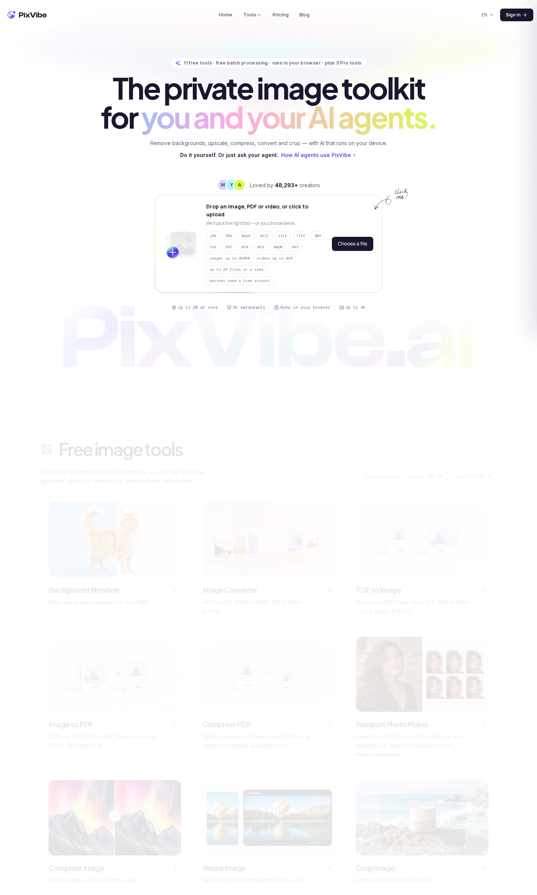
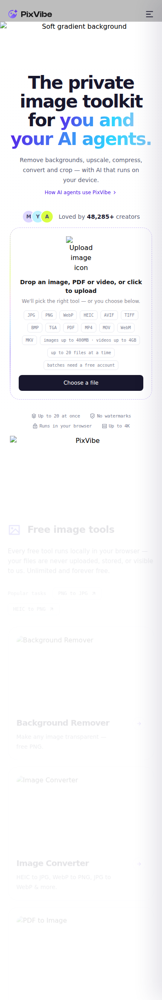

# UI Design System & Master Generation Blueprint: pixvibe-ai

> **PixVibe — Free Background Remover, Converter & Upscaler** (https://pixvibe.ai) — Remove backgrounds, convert, compress, resize, crop and upscale images — free, batch up to 20 at once, right in your browser.



---

## 1. Executive Visual Persona & Design Archetype

- **Brand Essence & Persona**: **PixVibe — Free Background Remover, Converter & Upscaler** (`https://pixvibe.ai`). Remove backgrounds, convert, compress, resize, crop and upscale images — free, batch up to 20 at once, right in your browser.
- **Visual Archetype**: **Light-Gallery WebGL / Canvas Interactive Experience (`#bdbdbd` / `#c23a58`)**.
- **Anti-AI-Slop Differentiators**:
  - **Source-Grounded Chromatic Polarity**: Anchors the viewport in `#bdbdbd` (`var(--tool-background-gray)` in `:root`) paired with `#000` primary typography and `#c23a58` accents.
  - **Extracted Typographic Hierarchy**: Pairs `fontInter` for display copy (`The private image toolkit for you an`) with `fontInter Fallback` and `fontDmMono`.
  - **Calibrated Spatial Grid & Motion**: Combines `24ch` container bounds (`gap: 6px`, padding `12px`) with `cubic-bezier(.16,1,.3,1)` easing and GSAP Timeline & ScrollTrigger, Three.js / WebGL Canvas Pipeline.

---

## 2. Spatial Architecture & Modular Grid Mathematics



### Viewport Allocation & Container Geometry
- **Captured Viewport Dimensions**: Desktop `1440×7137px` (`assets/desktop.png`, full-page scroll capture), Mobile `390×2400px` (`assets/mobile.png`, capped at 2400px multi-section capture).
- **Master Container Bounds**: `24ch` extracted from `pixvibe-ai` stylesheet.
- **Canvas Lateral Padding & Spacing**: `12px` lateral canvas padding with `6px` grid gap.
- **Border Radius Scale**: `50%`, `var(--radius-card)`, `var(--radius-control)`, `var(--radius-pill)`.

### Responsive Breakpoint Architecture
- **Desktop Layout**: Multi-column CSS Grid / Flexbox layout at `1440px` (`max-width: 24ch`, `gap: 6px`).
- **Mobile Layout**: Single-column vertical stack at `390px` viewport width with `12px` horizontal padding.
- **Extracted CSS Media Queries**: `@media (max-width:700px)`, `@media (prefers-reduced-motion:reduce)`, `@media (min-width:901px)`, `@media (max-width:900px)`.

---

## 3. Color System, Materiality & Atmospheric Lighting

### Semantic Palette & Source Grounding
| Semantic Role | Ground-Truth Value | Extracted CSS Source / Selector |
|---|---|---|
| **Primary Canvas Substrate** | `#bdbdbd` | `var(--tool-background-gray)` in `:root` |
| **Primary Typography Ink** | `#000` | `var(--tool-background-black)` in `:root` |
| **Elevated Surface / Card Substrate** | `#4d9c63` | `var(--status-success)` in `:root` |
| **Interactive Accent / Highlight** | `#c23a58` | `var(--status-error)` in `:root` |
| **Secondary / Muted Copy** | `#a36b28` | `var(--status-warning)` in `:root` |
| **Structural Hairline Border** | `#232324` | `var(--footer-background)` in `:root` |

### Sanitized Root CSS Variables (`ui-ux.md` Ground Truth)
| Variable Name | Extracted Value | Semantic Role |
|---|---|---|
| `--tool-color-picker-width` | `260px` | Brand / Palette Token |
| `--tool-file-name-max-width` | `24ch` | Layout / Spatial Grid Token |
| `--tool-processing-label-size` | `10px` | Layout / Spatial Grid Token |
| `--remover-scope-title-size` | `13px` | Layout / Spatial Grid Token |
| `--tool-thumbnail-action-font-size` | `11px` | Typography / Scale Token |
| `--tool-thumbnail-action-icon-size` | `14px` | Layout / Spatial Grid Token |
| `--tool-background-gray` | `#bdbdbd` | Canvas / Surface Token |
| `--tool-background-black` | `#000` | Canvas / Surface Token |
| `--tool-hero-enhancer-max-width` | `1760px` | Layout / Spatial Grid Token |
| `--tool-hero-label-height` | `36px` | Layout / Spatial Grid Token |
| `--tool-hero-label-font-size` | `14px` | Typography / Scale Token |
| `--tool-hero-label-icon-size` | `20px` | Layout / Spatial Grid Token |
| `--tool-hero-title-badge-font-size` | `12px` | Typography / Scale Token |
| `--layer-credit-modal` | `9998` | Design System Custom Token |
| `--layer-auth-modal` | `1000000` | Design System Custom Token |
| `--layer-confirm-modal` | `1200` | Design System Custom Token |

---

## 4. Typographic Scale & Editorial Hierarchy

### Font Family Stacks
- **Display Typography**: `fontInter`.
- **Primary Body Stack**: `fontInter Fallback`.
- **Technical / Metadata Stack**: `fontDmMono`.

### Typographic Scale & Rules (Extracted from Stylesheet & Variables)
- **Hero Display (`H1`)**: CSS variables `--tool-hero-title-badge-font-size: 12px`, `--text-display: 68px`, `--home-hero-title-size: clamp(44px, 6.3vw, var(--text-hero))`; rule `h1` (`font-size: var(--text-subpage-hero)`, `line-height: var(--leading-subpage...`, `letter-spacing: var(--tracking-subpag...`, `font-weight: var(--subpage...`).
- **Section Heading (`H2`)**: rule `h2` (`font-size: 25px`, `line-height: 1.14`, `letter-spacing: -.05em`, `font-weight: 700`).
- **Body Copy**: CSS variables `--body: var(--font-inter), Inter, ui-sans-serif, system-ui, sans-serif`, `--text-body-sm: 16px`, `--text-body: 18px`; rule `p` (`font-size: var(--text-body-sm)`).
- **Metadata & Navigation Labels**: CSS variables `--tool-processing-label-size: 10px`, `--tool-hero-label-height: 36px`, `--tool-hero-label-font-size: 14px`; rule `small` (`font-size: 12px`).

---

## 5. Choreographed Motion & Interaction Physics

### Primary Easing Curves
- **Extracted Timing Functions**: `cubic-bezier(.16,1,.3,1)`, `cubic-bezier(.22,1,.36,1)`, `cubic-bezier(.4,0,.2,1)`.

### Per-Element Transition & Choreography Rules
- **Selector `.uikit-button`**: `transition: background-color var(--duration-fast) var(--ease), color var(-...` extracted from `pixvibe-ai` stylesheet.
- **Selector `.uikit-dark-button`**: `transition: transform var(--duration-base) var(--spring), box-shadow var(-...` extracted from `pixvibe-ai` stylesheet.
- **Selector `.uikit-dark-button:before`**: `transition: opacity var(--duration-fast) var(--ease)` extracted from `pixvibe-ai` stylesheet.
- **Extracted Easing Curve (`cubic-bezier(.16,1,.3,1)`)**: Governs interactive state transitions across `<header.pv-notification-header>` and `<section.home-section>`.
- **Runtime Interaction Engine**: Integrates GSAP Timeline & ScrollTrigger, Three.js / WebGL Canvas Pipeline with `prefers-reduced-motion: reduce` fallback guards.

---

## 6. Component Wireframe & Structural DOM Map

### Visual Layout Schematic (Grounded in `dom.html` — `1440px` Desktop & `390px` Mobile Reflow)
```
┌────────────────────────────────────────────────────────────────────────┐
│ DESKTOP VIEWPORT (1440px) — PixVibe — Free Background Remover, Convert │
│ ====================================================================== │
│ [ <header.pv-notification- | Home · Pricing · Blog                  ]  │
│ ---------------------------------------------------------------------- │
│ | HERO STAGE: <section.home-hero>                                  |   │
│ | H1: The private image toolkit for you and your AI age...         |   │
│ | Substrate: #bdbdbd    | Ink: #000       | Accent: #c23a58        |   │
│ ---------------------------------------------------------------------- │
│ | SHOWCASE GRID (<section.home-section>    ) max-w: 24ch           |   │
│ | +------------------------------+  +------------------------------+ | │
│ | | Free image tools             |  | Background Remover           | | │
│ | +------------------------------+  +------------------------------+ | │
│ ---------------------------------------------------------------------- │
│ | MOBILE VIEWPORT REFLOW (390px) — Single-Column Stack (gap: 6px   ) | │
│ | [<header.pv-notific] -> [<section.home-hero] -> [<section.home-sect] │
│ ---------------------------------------------------------------------- │
│ [ FOOTER (<footer.site-footer>  ) | https://pixvibe.ai                 │
└────────────────────────────────────────────────────────────────────────┘
```

### Granular DOM Region Breakdown
1. **Brand Header & Navigation Bar (<header.pv-notification-header> — `pixvibe-ai`)**:
   - Landmark `<header class="pv-notification-header">` hosting `PixVibe — Free Background Remover, C` navigation (`Home · Pricing · Blog`), DOM attributes (`data-precedence="next"`, `data-precedence="next"`, `data-precedence="next"`, `data-precedence="next"`), and stylesheet rule `root { --status-success-soft:color-mix(in srgb, var(--status-success) 10%, var(... }`.
2. **Hero Stage & Focal Lead (<section.home-hero> — `The private image toolkit for you `)**:
   - Landmark `<section class="home-hero">` presenting display lead `The private image toolkit for you and your AI age...` and copy excerpt *"Free · In-browser processing"* over `#bdbdbd` canvas and `#000` ink.
3. **Primary Showcase & Content Grid (<section.home-section> — `Free image tools`)**:
   - Landmark `<section class="home-section home-toolkit">` rendering section `Free image tools` with copy *"Remove Background Transparent PNG in seconds."*, asset references (`dm_mono_400_latin-s.p.38hmww4cj4v...`, `dm_mono_500_latin-s.p.2yee423r7ah...`, `inter_400_700_latin-s.p.2bn3s6zvc...`, `manrope_400_700_latin-s.p.1sj6eob...`), and grid rule `html { scroll-behavior:smooth;background:var(--canvas) }`.
4. **Interactive Detail & Feature Matrix (<section.home-tool-group> — `Background Remover`)**:
   - Landmark `<section class="home-tool-group">` framing `Background Remover` and `Image Converter` (*"Transparent PNG in seconds."*) with `#4d9c63` surface cards, `#c23a58` accents, and `body { min-width:320px;color:var(--ink);background:var(--canvas);font-family:va... }`.
5. **Colophon & Global Directory Footer (<footer.site-footer> — `https://pixvibe.ai`)**:
   - Landmark `<footer class="site-footer feedback-footer">` anchoring `PixVibe — Free Background Remove` footer links (`Home · Pricing · Blog`), copy *"Image Converter Switch between image formats."*, and `#232324` structural dividers.

---

## 7. Master Zero-Shot AI Generation Prompt

```markdown
# Master Zero-Shot Frontend Generation Prompt: pixvibe-ai (PixVibe — Free Background Remover, Converter & Upscaler)

You are a principal frontend architect and design systems engineer. Build a complete, production-ready web application replicating the exact design system, DOM landmarks, typographic hierarchy, color tokens, and motion physics of `pixvibe-ai` (**PixVibe — Free Background Remover, Converter & Upscaler** — `https://pixvibe.ai`).

### 1. Visual Archetype & Anti-AI-Slop Mandates
- **Archetype**: Light-Gallery WebGL / Canvas Interactive Experience (`#bdbdbd` / `#c23a58`).
- **Identity & Domain Context**: Remove backgrounds, convert, compress, resize, crop and upscale images — free, batch up to 20 at once, right in your browser.
- **Primary Substrate**: `#bdbdbd` (`var(--tool-background-gray)` in `:root`), **Primary Ink**: `#000`, **Accent / Highlight**: `#c23a58`.
- **Site-Specific Differentiators**:
  - **Source-Grounded Chromatic Polarity**: Anchors the viewport in `#bdbdbd` (`var(--tool-background-gray)` in `:root`) paired with `#000` primary typography and `#c23a58` accents.
  - **Extracted Typographic Hierarchy**: Pairs `fontInter` for display copy (`The private image toolkit for you an`) with `fontInter Fallback` and `fontDmMono`.
  - **Calibrated Spatial Grid & Motion**: Combines `24ch` container bounds (`gap: 6px`, padding `12px`) with `cubic-bezier(.16,1,.3,1)` easing and GSAP Timeline & ScrollTrigger, Three.js / WebGL Canvas Pipeline.

### 2. Ground-Truth CSS Variables (`:root` Token Contract)
Declare and consume these exact custom properties extracted from `pixvibe-ai` in your global stylesheet:

:root {
  /* PixVibe — Free Background Remover, Converter & Upscaler (pixvibe-ai) — Ground-Truth Extracted CSS Variables */
  --tool-color-picker-width: 260px; /* Brand / Palette Token (pixvibe-ai) */
  --tool-file-name-max-width: 24ch; /* Layout / Spatial Grid Token (pixvibe-ai) */
  --tool-processing-label-size: 10px; /* Layout / Spatial Grid Token (pixvibe-ai) */
  --remover-scope-title-size: 13px; /* Layout / Spatial Grid Token (pixvibe-ai) */
  --tool-thumbnail-action-font-size: 11px; /* Typography / Scale Token (pixvibe-ai) */
  --tool-thumbnail-action-icon-size: 14px; /* Layout / Spatial Grid Token (pixvibe-ai) */
  --tool-background-gray: #bdbdbd; /* Canvas / Surface Token (pixvibe-ai) */
  --tool-background-black: #000; /* Canvas / Surface Token (pixvibe-ai) */
  --tool-hero-enhancer-max-width: 1760px; /* Layout / Spatial Grid Token (pixvibe-ai) */
  --tool-hero-label-height: 36px; /* Layout / Spatial Grid Token (pixvibe-ai) */
  --tool-hero-label-font-size: 14px; /* Typography / Scale Token (pixvibe-ai) */
  --tool-hero-label-icon-size: 20px; /* Layout / Spatial Grid Token (pixvibe-ai) */
  --tool-hero-title-badge-font-size: 12px; /* Typography / Scale Token (pixvibe-ai) */
  --layer-credit-modal: 9998; /* Design System Custom Token (pixvibe-ai) */
  --layer-auth-modal: 1000000; /* Design System Custom Token (pixvibe-ai) */
  --layer-confirm-modal: 1200; /* Design System Custom Token (pixvibe-ai) */
}

### 3. Semantic Color & Materiality Contract
Map every surface, ink, and border strictly to these source-grounded tokens:
- **Primary Canvas Substrate**: `#bdbdbd` — grounded in `var(--tool-background-gray)` in `:root`
- **Primary Typography Ink**: `#000` — grounded in `var(--tool-background-black)` in `:root`
- **Elevated Surface / Card Substrate**: `#4d9c63` — grounded in `var(--status-success)` in `:root`
- **Interactive Accent / Highlight**: `#c23a58` — grounded in `var(--status-error)` in `:root`
- **Secondary / Muted Copy**: `#a36b28` — grounded in `var(--status-warning)` in `:root`
- **Structural Hairline Border**: `#232324` — grounded in `var(--footer-background)` in `:root`

### 4. Spatial Grid, Container Bounds & Responsive Breakpoints
- **Desktop Viewport Reference**: `1440×7137px` (full-page scroll capture, `1440px` standard desktop width).
- **Mobile Viewport Reference**: `390×2400px` (capped at 2400px multi-section capture, `390px` standard mobile width).
- **Container Max-Width**: `24ch` extracted from `pixvibe-ai` stylesheet
- **Padding & Gutters**: `12px` lateral canvas padding with `6px` grid gap
- **Desktop Grid**: Multi-column CSS Grid / Flexbox layout at `1440px` (`max-width: 24ch`, `gap: 6px`)
- **Mobile Adaptation**: Single-column vertical stack at `390px` viewport width with `12px` horizontal padding
- **Media Queries**: `@media (max-width:700px)`, `@media (prefers-reduced-motion:reduce)`, `@media (min-width:901px)`, `@media (max-width:900px)`
- **Corner Radii**: `50%`, `var(--radius-card)`, `var(--radius-control)`, `var(--radius-pill)`

### 5. Typography & Editorial Scale Contract
- **Display Font Stack**: `fontInter`
- **Body Font Stack**: `fontInter Fallback`
- **Monospace / Technical Font Stack**: `fontDmMono`
- **H1 Display Rule**: CSS variables `--tool-hero-title-badge-font-size: 12px`, `--text-display: 68px`, `--home-hero-title-size: clamp(44px, 6.3vw, var(--text-hero))`; rule `h1` (`font-size: var(--text-subpage-hero)`, `line-height: var(--leading-subpage...`, `letter-spacing: var(--tracking-subpag...`, `font-weight: var(--subpage...`)
- **H2 Section Rule**: rule `h2` (`font-size: 25px`, `line-height: 1.14`, `letter-spacing: -.05em`, `font-weight: 700`)
- **Body Copy Rule**: CSS variables `--body: var(--font-inter), Inter, ui-sans-serif, system-ui, sans-serif`, `--text-body-sm: 16px`, `--text-body: 18px`; rule `p` (`font-size: var(--text-body-sm)`)
- **Metadata & Index Rule**: CSS variables `--tool-processing-label-size: 10px`, `--tool-hero-label-height: 36px`, `--tool-hero-label-font-size: 14px`; rule `small` (`font-size: 12px`)

### 6. Component Hierarchy, Verbatim Copy & Real DOM Landmarks
Scaffold `pixvibe-ai` (`PixVibe — Free Background Remover, Converter & Upscaler`) with these exact structural regions, extracted copy, and CSS rules from `dom.html`:
1. **Brand Header & Navigation Bar (<header.pv-notification-header> — `pixvibe-ai`)**:
   - DOM & Selectors: Landmark `<header class="pv-notification-header">` hosting `PixVibe — Free Background Remover, C` navigation (`Home · Pricing · Blog`), DOM attributes (`data-precedence="next"`, `data-precedence="next"`, `data-precedence="next"`, `data-precedence="next"`), and stylesheet rule `root { --status-success-soft:color-mix(in srgb, var(--status-success) 10%, var(... }`.
   - Responsive Contract: Header `Brand Header & Navigation Bar (<header.pv-notification-header> — `pixvibe-ai`)` (`pixvibe-ai`) adapts across `@media (max-width:700px)`, `@media (prefers-reduced-motion:reduce)`, `@media (min-width:901px)`, `@media (max-width:900px)` with `cubic-bezier(.16,1,.3,1)`, `cubic-bezier(.22,1,.36,1)`, `cubic-bezier(.4,0,.2,1)` transitions and links `Home · Pricing · Blog`.
2. **Hero Stage & Focal Lead (<section.home-hero> — `The private image toolkit for you `)**:
   - DOM & Selectors: Landmark `<section class="home-hero">` presenting display lead `The private image toolkit for you and your AI age...` and copy excerpt *"Free · In-browser processing"* over `#bdbdbd` canvas and `#000` ink.
   - Responsive Contract: Hero stage (`1440×7137px` desktop / `390×2400px` mobile) sets `#bdbdbd` background with `#000` headline `The private image toolkit for you and your AI age...`.
3. **Primary Showcase & Content Grid (<section.home-section> — `Free image tools`)**:
   - DOM & Selectors: Landmark `<section class="home-section home-toolkit">` rendering section `Free image tools` with copy *"Remove Background Transparent PNG in seconds."*, asset references (`dm_mono_400_latin-s.p.38hmww4cj4v...`, `dm_mono_500_latin-s.p.2yee423r7ah...`, `inter_400_700_latin-s.p.2bn3s6zvc...`, `manrope_400_700_latin-s.p.1sj6eob...`), and grid rule `html { scroll-behavior:smooth;background:var(--canvas) }`.
   - Responsive Contract: Showcase grid `Primary Showcase & Content Grid (<section.home-section> — `Free image tools`)` applies Multi-column CSS Grid / Flexbox layout at `1440px` (`max-width: 24ch`, `gap: 6px`) on desktop and Single-column vertical stack at `390px` viewport width with `12px` horizontal padding on mobile.
4. **Interactive Detail & Feature Matrix (<section.home-tool-group> — `Background Remover`)**:
   - DOM & Selectors: Landmark `<section class="home-tool-group">` framing `Background Remover` and `Image Converter` (*"Transparent PNG in seconds."*) with `#4d9c63` surface cards, `#c23a58` accents, and `body { min-width:320px;color:var(--ink);background:var(--canvas);font-family:va... }`.
   - Responsive Contract: Detail module `Interactive Detail & Feature Matrix (<section.home-tool-group> — `Background Remover`)` uses `50%`, `var(--radius-card)`, `var(--radius-control)`, `var(--radius-pill)` radii, `#c23a58` highlights, and assets (dm_mono_400_latin-s.p.38hmww4cj4v..., dm_mono_500_latin-s.p.2yee423r7ah..., inter_400_700_latin-s.p.2bn3s6zvc...).
5. **Colophon & Global Directory Footer (<footer.site-footer> — `https://pixvibe.ai`)**:
   - DOM & Selectors: Landmark `<footer class="site-footer feedback-footer">` anchoring `PixVibe — Free Background Remove` footer links (`Home · Pricing · Blog`), copy *"Image Converter Switch between image formats."*, and `#232324` structural dividers.
   - Responsive Contract: Footer `Colophon & Global Directory Footer (<footer.site-footer> — `https://pixvibe.ai`)` aligns to `24ch` extracted from `pixvibe-ai` stylesheet with `12px` lateral canvas padding with `6px` grid gap and attributes (data-precedence="next", data-precedence="next", data-precedence="next").

#### Verbatim DOM Copy Excerpts (`dom.html`)
- Copy Excerpt 1: *"Free · In-browser processing"*
- Copy Excerpt 2: *"Remove Background Transparent PNG in seconds."*
- Copy Excerpt 3: *"Transparent PNG in seconds."*
- Copy Excerpt 4: *"Image Converter Switch between image formats."*

### 7. Motion, Extracted Stylesheet Rules & Interaction Choreography
- **Primary Easing Functions**: `cubic-bezier(.16,1,.3,1)`, `cubic-bezier(.22,1,.36,1)`, `cubic-bezier(.4,0,.2,1)`
- **Extracted Stylesheet Rules (`pixvibe-ai`)**:
- `root { --status-success-soft:color-mix(in srgb, var(--status-success) 10%, var(... }`
- `html { scroll-behavior:smooth;background:var(--canvas) }`
- `body { min-width:320px;color:var(--ink);background:var(--canvas);font-family:va... }`
- `textarea { font:inherit }`
- `button { cursor:pointer;border:0 }`
- **Per-Selector Transition Rules**:
- **Selector `.uikit-button`**: `transition: background-color var(--duration-fast) var(--ease), color var(-...` extracted from `pixvibe-ai` stylesheet.
- **Selector `.uikit-dark-button`**: `transition: transform var(--duration-base) var(--spring), box-shadow var(-...` extracted from `pixvibe-ai` stylesheet.
- **Selector `.uikit-dark-button:before`**: `transition: opacity var(--duration-fast) var(--ease)` extracted from `pixvibe-ai` stylesheet.
- **Extracted Easing Curve (`cubic-bezier(.16,1,.3,1)`)**: Governs interactive state transitions across `<header.pv-notification-header>` and `<section.home-section>`.
- **Runtime Interaction Engine**: Integrates GSAP Timeline & ScrollTrigger, Three.js / WebGL Canvas Pipeline with `prefers-reduced-motion: reduce` fallback guards.

### 8. Technical Deliverables
- Implement in Next.js (App Router) with TypeScript and Tailwind CSS consuming the `:root` custom properties defined above for `pixvibe-ai`.
- Reproduce both the `1440px` desktop architecture and `390px` mobile breakpoint transitions, preserving semantic HTML5 landmarks (`<header>`, `<nav>`, `<main>`, `<section>`, `<footer>`) and `prefers-reduced-motion` accessibility guards.
```
