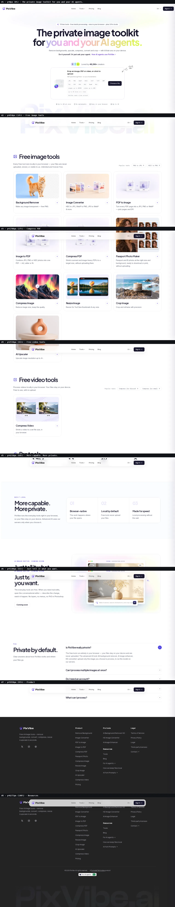
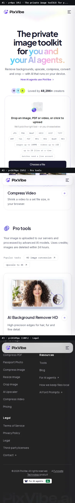

# UI Design System & Master Generation Blueprint: pixvibe-ai

> **PixVibe — Free Background Remover, Converter & Upscaler** (https://pixvibe.ai) — Remove backgrounds, convert, compress, resize, crop and upscale images — free, batch up to 20 at once, right in your browser.





---

## 1. Executive Visual Persona & Design Archetype

- **Brand Essence & Persona**: **PixVibe — Free Background Remover, Converter & Upscaler** (`https://pixvibe.ai`). Remove backgrounds, convert, compress, resize, crop and upscale images — free, batch up to 20 at once, right in your browser.
- **Capture Provenance**: Live browser capture (`tier1_fast`, HTTP `200`, captured `2026-11-24`).
- **Visual Archetype**: **Light-Gallery WebGL / Canvas Interactive Experience (`#ffffff` / `#0000ff`)**.
- **Anti-AI-Slop Differentiators**:
  - **Live-Computed Chromatic Polarity**: Anchors the viewport in `#ffffff` (live computed `body` `background-color` (`computed_styles.json`)) paired with `#18172d` primary typography and `#0000ff` accents.
  - **Grounded Typographic Hierarchy**: Pairs `fontJakarta` for display copy (`The private image toolkit for you an`) with `fontInter` and `SFMono-Regular`.
  - **Calibrated Spatial Grid & Motion**: Combines `1418px` container bounds (`gap: 16px`, padding `20px`) with `cubic-bezier(.16,1,.3,1)` easing and GSAP Timeline & ScrollTrigger, Three.js / WebGL Canvas Pipeline.

---

## 2. Spatial Architecture & Modular Grid Mathematics

### Viewport Allocation & Container Geometry
- **Captured Journey Filmstrips**: Desktop `1280×6624px` (`assets/desktop-journey.webp`, `8` keyframes up to `y=6273px` / doc `7173px`), Mobile `390×2616px` (`assets/mobile-journey.webp`, `3` keyframes).
- **Master Container Bounds**: `1418px` (measured widest bounded `<section>` landmark width on `1440px` desktop).
- **Canvas Lateral Padding & Spacing**: `20px` lateral canvas padding with `16px` grid gap.
- **Border Radius Scale**: `50%`, `var(--radius-card)`, `var(--radius-control)`, `var(--radius-pill)`.

### Responsive Breakpoint Architecture
- **Desktop Layout**: Multi-column CSS Grid / Flexbox layout at `1440px` (`max-width: 1418px`, `gap: 16px`).
- **Mobile Layout**: Single-column vertical stack at `390px` viewport width with `20px` horizontal padding.
- **Extracted CSS Media Queries**: `@media (max-width:700px)`, `@media (prefers-reduced-motion:reduce)`, `@media (min-width:901px)`, `@media (max-width:900px)`.

---

## 3. Color System, Materiality & Atmospheric Lighting

### Semantic Palette & Source Grounding
| Semantic Role | Ground-Truth Value | Extracted Live / CSS Source |
|---|---|---|
| **Primary Canvas Substrate** | `#ffffff` | live computed `body` `background-color` (`computed_styles.json`) |
| **Primary Typography Ink** | `#18172d` | live computed `h1` `color` (`computed_styles.json`) |
| **Elevated Surface / Card Substrate** | `#bdbdbd` | `var(--tool-background-gray)` in `:root` |
| **Interactive Accent / Highlight** | `#0000ff` | `.uikit-button-ai { background: blue }` (`#0000ff`) |
| **Secondary / Muted Copy** | `#4d94ff` | `var(--color-secondary)` in `:root` |
| **Structural Hairline Border** | `#e7e9f0` | `var(--module-line)` in `:root` |
| **Variable Token (`--color-primary`)** | `#9b6dff` | `var(--color-primary)` in `:root` |
| **Variable Token (`--pv-bone`)** | `#f0ebe1` | `var(--pv-bone)` in `:root` |
| **Variable Token (`--pv-sheet`)** | `#faf6f0` | `var(--pv-sheet)` in `:root` |
| **Variable Token (`--pv-ink`)** | `#1b1620` | `var(--pv-ink)` in `:root` |
| **Variable Token (`--pv-violet`)** | `#7c3aed` | `var(--pv-violet)` in `:root` |
| **Variable Token (`--pv-fuchsia`)** | `#d946ef` | `var(--pv-fuchsia)` in `:root` |
| **Variable Token (`--pv-coral`)** | `#fb7185` | `var(--pv-coral)` in `:root` |

### Sanitized Root CSS Variables (`ui-ux.md` Ground Truth)
| Variable Name | Extracted Value | Semantic Role |
|---|---|---|
| `--color-primary` | `#9b6dff` | Brand / Palette Token |
| `--color-primary-dark` | `#9b6dff` | Canvas / Surface Token |
| `--color-secondary` | `#4d94ff` | Brand / Palette Token |
| `--gradient-primary` | `linear-gradient(135deg, #9b6dff, #4d94ff)` | Brand / Palette Token |
| `--pv-bone` | `#f0ebe1` | Color / Atmospheric Token |
| `--pv-sheet` | `#faf6f0` | Color / Atmospheric Token |
| `--pv-card` | `#fff` | Color / Atmospheric Token |
| `--pv-ink` | `#1b1620` | Typography Ink Token |
| `--pv-muted` | `#1b16209e` | Color / Atmospheric Token |
| `--pv-faint` | `#1b16206b` | Color / Atmospheric Token |
| `--pv-violet` | `#7c3aed` | Color / Atmospheric Token |
| `--pv-fuchsia` | `#d946ef` | Color / Atmospheric Token |
| `--pv-coral` | `#fb7185` | Color / Atmospheric Token |
| `--pv-line` | `#1b16201a` | Color / Atmospheric Token |
| `--pv-line-2` | `#1b16200f` | Color / Atmospheric Token |
| `--pv-grad` | `linear-gradient(100deg,#7c3aed 0%,#d946ef 48%,#fb7185 100%)` | Color / Atmospheric Token |

---

## 4. Typographic Scale & Editorial Hierarchy

### Font Family Stacks
- **Display Typography**: `fontJakarta`.
- **Primary Body Stack**: `fontInter`.
- **Technical / Metadata Stack**: `SFMono-Regular`.

### Typographic Scale & Rules (Live Computed & Stylesheet Grounded)
- **Hero Display (`H1`)**: live computed `h1` (`font-size: 78px`, `line-height: 78px`, `font-weight: 700`, `letter-spacing: -4px`); CSS variables `--pv-font-display: "Clash Display",system-ui,sans-serif`, `--tool-hero-title-badge-font-size: 12px`, `--text-display: 68px`; rule `h1` (`font-size: var(--text-subpage-hero)`, `line-height: var(--leading-subpage...`, `letter-spacing: var(--tracking-subpag...`, `font-weight: var(--subpage...`).
- **Section Heading (`H2`)**: live computed `h2` (`font-size: 48px`, `line-height: 52.8px`, `font-weight: 600`, `letter-spacing: -2.64px`); rule `h2` (`font-size: 25px`, `line-height: 1.14`, `letter-spacing: -.05em`, `font-weight: 700`).
- **Body Copy**: live computed `body` (`font-size: 16px`, `line-height: 24px`, `font-weight: 400`); CSS variables `--pv-font-body: "Satoshi",system-ui,sans-serif`, `--body: var(--font-inter), Inter, ui-sans-serif, system-ui, sans-serif`, `--text-body-sm: 16px`; rule `p` (`font-size: var(--text-body-sm)`).
- **Metadata & Navigation Labels**: live computed `nav/a` (`font-size: 16px`, `line-height: 24px`, `font-weight: 400`); CSS variables `--tool-processing-label-size: 10px`, `--tool-hero-label-height: 36px`, `--tool-hero-label-font-size: 14px`; rule `small` (`font-size: 12px`).

---

## 5. Choreographed Motion & Interaction Physics

### Primary Easing Curves
- **Extracted Timing Functions**: `cubic-bezier(.16,1,.3,1)`, `cubic-bezier(.22,1,.36,1)`, `cubic-bezier(.4,0,.2,1)`.

### Per-Element Transition & Choreography Rules
- **Selector `.uikit-button`**: `transition: background-color var(--duration-fast) var(--ease), color var(-...` extracted from `pixvibe-ai` stylesheet.
- **Selector `.uikit-dark-button`**: `transition: transform var(--duration-base) var(--spring), box-shadow var(-...` extracted from `pixvibe-ai` stylesheet.
- **Selector `.uikit-dark-button:before`**: `transition: opacity var(--duration-fast) var(--ease)` extracted from `pixvibe-ai` stylesheet.
- **Extracted Easing Curve (`cubic-bezier(.16,1,.3,1)`)**: Governs interactive state transitions across `<header.pv-notification-header>` and `<section.home-section>`.
- **Runtime Interaction Engine**: Integrates GSAP Timeline & ScrollTrigger, Three.js / WebGL Canvas Pipeline with `prefers-reduced-motion: reduce` fallback guards.
### Measured Runtime Scroll & Interaction Telemetry (`behavioral_journey_v2`)
- **Scroll Driver Mode**: `native` (max document height `7173px`, deepest scrollY reached `6273px` across `8` desktop keyframes).
- **Detected Scroll / Motion Libraries**: `WebGL/Canvas`.
- **Nav / Drawer Probe (`Tools`)**: Triggered visual change (pixel diff `8.964`, captured in `assets/state-nav.webp`); revealed links: https://webforagents...., PixVibe, Home, Pricing, Blog, Remove Background Tra....
- **Hover Physics (`primary_cta` · `How AI agents use PixVibe`)**: Computed transition `0s` / `ease` (no static color/transform shift captured at rest).
- **Interactive Control Probe (`accordion` · `Can I process multiple images at...`)**: Triggered visual diff `9.649` (attr `false -> true`, captured in `assets/state-interactive.webp`).
- **Route Transition Architecture**: First internal navigation (`/pricing`) measured as `SPA` in `1064ms`.

---

## 6. Component Wireframe & Structural DOM Map

### Visual Layout Schematic — Desktop (`1440px`, Grounded in `dom.html` & Landmark Bounding Boxes)
```
┌────────────────────────────────────────────────────────────────────────┐
│ DESKTOP VIEWPORT (1440px) — PixVibe — Free Background Remover, Convert │
│ ====================================================================== │
│ [ <header.pv-notificatio (419x65px)   | Home · Pricing · Blog        ] │
│ ---------------------------------------------------------------------- │
│ | HERO STAGE: <section.home-hero> (w=1440px)                         | │
│ | H1: The private image toolkit for you and your AI age...           | │
│ | Substrate: #ffffff | Ink: #18172d | Accent: #0000ff                | │
│ ---------------------------------------------------------------------- │
│ | SHOWCASE GRID (<section.home-section>) max-w: 1418px               | │
│ | +------------------------------+  +------------------------------+ | │
│ | | Free image tools             |  | Background Remover           | | │
│ | +------------------------------+  +------------------------------+ | │
│ ---------------------------------------------------------------------- │
│ | DETAIL MODULE (<section.home-tool-group>) — Image Converter        | │
│ ---------------------------------------------------------------------- │
│ [ FOOTER (<footer.site-footer>) | https://pixvibe.ai                   │
└────────────────────────────────────────────────────────────────────────┘
```

### Visual Layout Schematic — Mobile Reflow (`390px`)
```
┌────────────────────────────────────────────────────────────────────────┐
│ MOBILE VIEWPORT REFLOW (390px) — Single-Column Stack (gap: 16px)       │
│ ====================================================================== │
│ [ HEADER BAR (<header.pv-notification-) | Compact Menu (390px)         │
│ ---------------------------------------------------------------------- │
│ | HERO STAGE (<section.home-hero>) — 390px Vertical Lead             | │
│ | H1: The private image toolkit for you and your AI age...           | │
│ ---------------------------------------------------------------------- │
│ | SHOWCASE STACK (<section.home-section>) — 1-Col Stack              | │
│ | [ Item 1: Free image tools                                       ] | │
│ | [ Item 2: Background Remover                                     ] | │
│ ---------------------------------------------------------------------- │
│ | DETAIL STACK (<section.home-tool-group) — 1-Col (Image Converter)  | │
│ ---------------------------------------------------------------------- │
│ [ FOOTER (<footer.site-footer>) | Stacked 390px Colophon               │
└────────────────────────────────────────────────────────────────────────┘
```

### Granular DOM Region Breakdown
1. **Brand Header & Navigation Bar (<header.pv-notification-header> — `pixvibe-ai`)**:
   - Landmark `<header class="pv-notification-header">` (`419x65px`) hosting `PixVibe — Free Background Remover, C` navigation (`Home · Pricing · Blog`), DOM attributes (`data-precedence="next"`, `data-precedence="next"`, `data-precedence="next"`, `data-precedence="next"`), and stylesheet rule `.juZLRa_className { font-family:fontInter,fontInter Fallback }`.
2. **Hero Stage & Focal Lead (<section.home-hero> — `The private image toolkit for you `)**:
   - Landmark `<section class="home-hero">` presenting display lead `The private image toolkit for you and your AI age...` and copy excerpt *"Full guide for AI agents, with shortcut URLs and parameters for e"* over `#ffffff` canvas and `#18172d` ink.
3. **Primary Showcase & Content Grid (<section.home-section> — `Free image tools`)**:
   - Landmark `<section class="home-section home-toolkit">` rendering section `Free image tools` with copy *"11 free tools · free batch processing · runs in your browser · pl"*, asset references (`dm_mono_400_latin-s.p.38hmww4cj4v...`, `dm_mono_500_latin-s.p.2yee423r7ah...`, `inter_400_700_latin-s.p.2bn3s6zvc...`, `manrope_400_700_latin-s.p.1sj6eob...`), and grid rule `.juZLRa_variable { --font-inter:"fontInter", "fontInter Fallback" }`.
4. **Interactive Detail & Feature Matrix (<section.home-tool-group> — `Background Remover`)**:
   - Landmark `<section class="home-tool-group">` framing `Background Remover` and `Image Converter` (*"11 free tools · free batch processing · runs in your browser"*) with `#bdbdbd` surface cards, `#0000ff` accents, and `.It_wna_className { font-family:fontJakarta,fontJakarta Fallback }`.
5. **Colophon & Global Directory Footer (<footer.site-footer> — `https://pixvibe.ai`)**:
   - Landmark `<footer class="site-footer feedback-footer">` anchoring `PixVibe — Free Background Remove` footer links (`Home · Pricing · Blog`), copy *"· plus 3 Pro tools"*, and `#e7e9f0` structural dividers.
### Full Vertical Scroll Sequence (Desktop `1440×900` Keyframes)
- **Step 01** (`y=0px`, `0%`): Active landmark `The private image toolkit for you and your AI age...` · sticky/fixed elements: `1`
- **Step 02** (`y=850px`, `14%`): Active landmark `Free image tools` · sticky/fixed elements: `1`
- **Step 03** (`y=1700px`, `27%`): Active landmark `Compress PDF` · sticky/fixed elements: `1`
- **Step 04** (`y=2550px`, `41%`): Active landmark `Free video tools` · sticky/fixed elements: `1`
- **Step 05** (`y=4250px`, `68%`): Active landmark `More capable. More private.` · sticky/fixed elements: `1`
- **Step 06** (`y=5100px`, `81%`): Active landmark `Just tell it what you want.` · sticky/fixed elements: `1`
- **Step 07** (`y=5950px`, `95%`): Active landmark `Product` · sticky/fixed elements: `1`
- **Step 08** (`y=6273px`, `100%`): Active landmark `Resources` · sticky/fixed elements: `1`

### Multi-Page Internal Route Map
- **Listing Route (`/pricing`)**: `https://pixvibe.ai/pricing` — H1: `Simple, transparent pricing`, scrollHeight `3599px`, transition `SPA` (`1064ms`)
- **Detail Route (`/tools/image-converter/png-to-jpg`)**: `https://pixvibe.ai/tools/image-converter/png-to-jpg` — H1: `PNG to JPG Converter`, scrollHeight `8031px`, transition `direct` (`600ms`)
- **Listing Route (`/blog`)**: `https://pixvibe.ai/blog` — H1: `Guides & tips for better images`, scrollHeight `3081px`, transition `direct` (`449ms`)

---

## 7. Master Zero-Shot AI Generation Prompt

```markdown
# Master Zero-Shot Frontend Generation Prompt: pixvibe-ai (PixVibe — Free Background Remover, Converter & Upscaler)

You are a principal frontend architect and design systems engineer. Build a complete, production-ready web application replicating the exact design system, DOM landmarks, typographic hierarchy, color tokens, and motion physics of `pixvibe-ai` (**PixVibe — Free Background Remover, Converter & Upscaler** — `https://pixvibe.ai`).

### 1. Visual Archetype & Anti-AI-Slop Mandates
- **Archetype**: Light-Gallery WebGL / Canvas Interactive Experience (`#ffffff` / `#0000ff`).
- **Identity & Domain Context**: Remove backgrounds, convert, compress, resize, crop and upscale images — free, batch up to 20 at once, right in your browser.
- **Primary Substrate**: `#ffffff` (live computed `body` `background-color` (`computed_styles.json`)), **Primary Ink**: `#18172d`, **Accent / Highlight**: `#0000ff`.
- **Site-Specific Differentiators**:
  - **Live-Computed Chromatic Polarity**: Anchors the viewport in `#ffffff` (live computed `body` `background-color` (`computed_styles.json`)) paired with `#18172d` primary typography and `#0000ff` accents.
  - **Grounded Typographic Hierarchy**: Pairs `fontJakarta` for display copy (`The private image toolkit for you an`) with `fontInter` and `SFMono-Regular`.
  - **Calibrated Spatial Grid & Motion**: Combines `1418px` container bounds (`gap: 16px`, padding `20px`) with `cubic-bezier(.16,1,.3,1)` easing and GSAP Timeline & ScrollTrigger, Three.js / WebGL Canvas Pipeline.

### 2. Ground-Truth CSS Variables (`:root` Token Contract)
Declare and consume these exact custom properties extracted from `pixvibe-ai` in your global stylesheet:

:root {
  /* PixVibe — Free Background Remover, Converter & Upscaler (pixvibe-ai) — Live-Grounded CSS Variables */
  --color-primary: #9b6dff; /* Brand / Palette Token (pixvibe-ai) */
  --color-primary-dark: #9b6dff; /* Canvas / Surface Token (pixvibe-ai) */
  --color-secondary: #4d94ff; /* Brand / Palette Token (pixvibe-ai) */
  --gradient-primary: linear-gradient(135deg, #9b6dff, #4d94ff); /* Brand / Palette Token (pixvibe-ai) */
  --pv-bone: #f0ebe1; /* Color / Atmospheric Token (pixvibe-ai) */
  --pv-sheet: #faf6f0; /* Color / Atmospheric Token (pixvibe-ai) */
  --pv-card: #fff; /* Color / Atmospheric Token (pixvibe-ai) */
  --pv-ink: #1b1620; /* Typography Ink Token (pixvibe-ai) */
  --pv-muted: #1b16209e; /* Color / Atmospheric Token (pixvibe-ai) */
  --pv-faint: #1b16206b; /* Color / Atmospheric Token (pixvibe-ai) */
  --pv-violet: #7c3aed; /* Color / Atmospheric Token (pixvibe-ai) */
  --pv-fuchsia: #d946ef; /* Color / Atmospheric Token (pixvibe-ai) */
  --pv-coral: #fb7185; /* Color / Atmospheric Token (pixvibe-ai) */
  --pv-line: #1b16201a; /* Color / Atmospheric Token (pixvibe-ai) */
  --pv-line-2: #1b16200f; /* Color / Atmospheric Token (pixvibe-ai) */
  --pv-grad: linear-gradient(100deg,#7c3aed 0%,#d946ef 48%,#fb7185 100%); /* Color / Atmospheric Token (pixvibe-ai) */
}

### 3. Semantic Color & Materiality Contract
Map every surface, ink, and border strictly to these source-grounded tokens:
- **Primary Canvas Substrate**: `#ffffff` — grounded in live computed `body` `background-color` (`computed_styles.json`)
- **Primary Typography Ink**: `#18172d` — grounded in live computed `h1` `color` (`computed_styles.json`)
- **Elevated Surface / Card Substrate**: `#bdbdbd` — grounded in `var(--tool-background-gray)` in `:root`
- **Interactive Accent / Highlight**: `#0000ff` — grounded in `.uikit-button-ai { background: blue }` (`#0000ff`)
- **Secondary / Muted Copy**: `#4d94ff` — grounded in `var(--color-secondary)` in `:root`
- **Structural Hairline Border**: `#e7e9f0` — grounded in `var(--module-line)` in `:root`
- **Variable Token (`--color-primary`)**: `#9b6dff` — grounded in `var(--color-primary)` in `:root`
- **Variable Token (`--pv-bone`)**: `#f0ebe1` — grounded in `var(--pv-bone)` in `:root`
- **Variable Token (`--pv-sheet`)**: `#faf6f0` — grounded in `var(--pv-sheet)` in `:root`
- **Variable Token (`--pv-ink`)**: `#1b1620` — grounded in `var(--pv-ink)` in `:root`
- **Variable Token (`--pv-violet`)**: `#7c3aed` — grounded in `var(--pv-violet)` in `:root`
- **Variable Token (`--pv-fuchsia`)**: `#d946ef` — grounded in `var(--pv-fuchsia)` in `:root`
- **Variable Token (`--pv-coral`)**: `#fb7185` — grounded in `var(--pv-coral)` in `:root`

### 4. Spatial Grid, Container Bounds & Responsive Breakpoints
- **Desktop Viewport Reference**: `1280×6624px` (multi-frame vertical journey filmstrip (6624px), `1440px` standard desktop width).
- **Mobile Viewport Reference**: `390×2616px` (multi-frame vertical journey filmstrip (2616px), `390px` standard mobile width).
- **Container Max-Width**: `1418px` (measured widest bounded `<section>` landmark width on `1440px` desktop)
- **Padding & Gutters**: `20px` lateral canvas padding with `16px` grid gap
- **Desktop Grid**: Multi-column CSS Grid / Flexbox layout at `1440px` (`max-width: 1418px`, `gap: 16px`)
- **Mobile Adaptation**: Single-column vertical stack at `390px` viewport width with `20px` horizontal padding
- **Media Queries**: `@media (max-width:700px)`, `@media (prefers-reduced-motion:reduce)`, `@media (min-width:901px)`, `@media (max-width:900px)`
- **Corner Radii**: `50%`, `var(--radius-card)`, `var(--radius-control)`, `var(--radius-pill)`

### 5. Typography & Editorial Scale Contract
- **Display Font Stack**: `fontJakarta`
- **Body Font Stack**: `fontInter`
- **Monospace / Technical Font Stack**: `SFMono-Regular`
- **H1 Display Rule**: live computed `h1` (`font-size: 78px`, `line-height: 78px`, `font-weight: 700`, `letter-spacing: -4px`); CSS variables `--pv-font-display: "Clash Display",system-ui,sans-serif`, `--tool-hero-title-badge-font-size: 12px`, `--text-display: 68px`; rule `h1` (`font-size: var(--text-subpage-hero)`, `line-height: var(--leading-subpage...`, `letter-spacing: var(--tracking-subpag...`, `font-weight: var(--subpage...`)
- **H2 Section Rule**: live computed `h2` (`font-size: 48px`, `line-height: 52.8px`, `font-weight: 600`, `letter-spacing: -2.64px`); rule `h2` (`font-size: 25px`, `line-height: 1.14`, `letter-spacing: -.05em`, `font-weight: 700`)
- **Body Copy Rule**: live computed `body` (`font-size: 16px`, `line-height: 24px`, `font-weight: 400`); CSS variables `--pv-font-body: "Satoshi",system-ui,sans-serif`, `--body: var(--font-inter), Inter, ui-sans-serif, system-ui, sans-serif`, `--text-body-sm: 16px`; rule `p` (`font-size: var(--text-body-sm)`)
- **Metadata & Index Rule**: live computed `nav/a` (`font-size: 16px`, `line-height: 24px`, `font-weight: 400`); CSS variables `--tool-processing-label-size: 10px`, `--tool-hero-label-height: 36px`, `--tool-hero-label-font-size: 14px`; rule `small` (`font-size: 12px`)

### 6. Component Hierarchy, Verbatim Copy & Real DOM Landmarks
Scaffold `pixvibe-ai` (`PixVibe — Free Background Remover, Converter & Upscaler`) with these exact structural regions, extracted copy, and CSS rules from `dom.html`:
1. **Brand Header & Navigation Bar (<header.pv-notification-header> — `pixvibe-ai`)**:
   - DOM & Selectors: Landmark `<header class="pv-notification-header">` (`419x65px`) hosting `PixVibe — Free Background Remover, C` navigation (`Home · Pricing · Blog`), DOM attributes (`data-precedence="next"`, `data-precedence="next"`, `data-precedence="next"`, `data-precedence="next"`), and stylesheet rule `.juZLRa_className { font-family:fontInter,fontInter Fallback }`.
   - Responsive Contract: Header `Brand Header & Navigation Bar (<header.pv-notification-header> — `pixvibe-ai`)` (`pixvibe-ai`) adapts across `@media (max-width:700px)`, `@media (prefers-reduced-motion:reduce)`, `@media (min-width:901px)`, `@media (max-width:900px)` with `cubic-bezier(.16,1,.3,1)`, `cubic-bezier(.22,1,.36,1)`, `cubic-bezier(.4,0,.2,1)` transitions and links `Home · Pricing · Blog`.
2. **Hero Stage & Focal Lead (<section.home-hero> — `The private image toolkit for you `)**:
   - DOM & Selectors: Landmark `<section class="home-hero">` presenting display lead `The private image toolkit for you and your AI age...` and copy excerpt *"Full guide for AI agents, with shortcut URLs and parameters for e"* over `#ffffff` canvas and `#18172d` ink.
   - Responsive Contract: Hero stage (`1280×6624px` desktop / `390×2616px` mobile) sets `#ffffff` background with `#18172d` headline `The private image toolkit for you and your AI age...`.
3. **Primary Showcase & Content Grid (<section.home-section> — `Free image tools`)**:
   - DOM & Selectors: Landmark `<section class="home-section home-toolkit">` rendering section `Free image tools` with copy *"11 free tools · free batch processing · runs in your browser · pl"*, asset references (`dm_mono_400_latin-s.p.38hmww4cj4v...`, `dm_mono_500_latin-s.p.2yee423r7ah...`, `inter_400_700_latin-s.p.2bn3s6zvc...`, `manrope_400_700_latin-s.p.1sj6eob...`), and grid rule `.juZLRa_variable { --font-inter:"fontInter", "fontInter Fallback" }`.
   - Responsive Contract: Showcase grid `Primary Showcase & Content Grid (<section.home-section> — `Free image tools`)` applies Multi-column CSS Grid / Flexbox layout at `1440px` (`max-width: 1418px`, `gap: 16px`) on desktop and Single-column vertical stack at `390px` viewport width with `20px` horizontal padding on mobile.
4. **Interactive Detail & Feature Matrix (<section.home-tool-group> — `Background Remover`)**:
   - DOM & Selectors: Landmark `<section class="home-tool-group">` framing `Background Remover` and `Image Converter` (*"11 free tools · free batch processing · runs in your browser"*) with `#bdbdbd` surface cards, `#0000ff` accents, and `.It_wna_className { font-family:fontJakarta,fontJakarta Fallback }`.
   - Responsive Contract: Detail module `Interactive Detail & Feature Matrix (<section.home-tool-group> — `Background Remover`)` uses `50%`, `var(--radius-card)`, `var(--radius-control)`, `var(--radius-pill)` radii, `#0000ff` highlights, and assets (dm_mono_400_latin-s.p.38hmww4cj4v..., dm_mono_500_latin-s.p.2yee423r7ah..., inter_400_700_latin-s.p.2bn3s6zvc...).
5. **Colophon & Global Directory Footer (<footer.site-footer> — `https://pixvibe.ai`)**:
   - DOM & Selectors: Landmark `<footer class="site-footer feedback-footer">` anchoring `PixVibe — Free Background Remove` footer links (`Home · Pricing · Blog`), copy *"· plus 3 Pro tools"*, and `#e7e9f0` structural dividers.
   - Responsive Contract: Footer `Colophon & Global Directory Footer (<footer.site-footer> — `https://pixvibe.ai`)` aligns to `1418px` (measured widest bounded `<section>` landmark width on `1440px` desktop) with `20px` lateral canvas padding with `16px` grid gap and attributes (data-precedence="next", data-precedence="next", data-precedence="next").

#### Verbatim DOM Copy Excerpts (`dom.html`)
- Copy Excerpt 1: *"Full guide for AI agents, with shortcut URLs and parameters for each task on this..."*
- Copy Excerpt 2: *"11 free tools · free batch processing · runs in your browser · plus 3 Pro tools"*
- Copy Excerpt 3: *"11 free tools · free batch processing · runs in your browser"*
- Copy Excerpt 4: *"· plus 3 Pro tools"*

### 7. Motion, Extracted Stylesheet Rules & Interaction Choreography
- **Primary Easing Functions**: `cubic-bezier(.16,1,.3,1)`, `cubic-bezier(.22,1,.36,1)`, `cubic-bezier(.4,0,.2,1)`
- **Extracted Stylesheet Rules (`pixvibe-ai`)**:
- `.juZLRa_className { font-family:fontInter,fontInter Fallback }`
- `.juZLRa_variable { --font-inter:"fontInter", "fontInter Fallback" }`
- `.It_wna_className { font-family:fontJakarta,fontJakarta Fallback }`
- `.It_wna_variable { --font-jakarta:"fontJakarta", "fontJakarta Fallback" }`
- `.OpVorq_className { font-family:fontManrope,fontManrope Fallback }`
- **Per-Selector Transition Rules**:
- **Selector `.uikit-button`**: `transition: background-color var(--duration-fast) var(--ease), color var(-...` extracted from `pixvibe-ai` stylesheet.
- **Selector `.uikit-dark-button`**: `transition: transform var(--duration-base) var(--spring), box-shadow var(-...` extracted from `pixvibe-ai` stylesheet.
- **Selector `.uikit-dark-button:before`**: `transition: opacity var(--duration-fast) var(--ease)` extracted from `pixvibe-ai` stylesheet.
- **Extracted Easing Curve (`cubic-bezier(.16,1,.3,1)`)**: Governs interactive state transitions across `<header.pv-notification-header>` and `<section.home-section>`.
- **Runtime Interaction Engine**: Integrates GSAP Timeline & ScrollTrigger, Three.js / WebGL Canvas Pipeline with `prefers-reduced-motion: reduce` fallback guards.
### 7b. Full-Page Scroll Choreography, Interactive States & Multi-Page Routes
- **Scroll Mechanics**: Implement `native` vertical progression up to `7173px` across 8 distinct viewport chapters using WebGL/Canvas.
- **Vertical Chapter Sequence**: The private image toolkit f... (0%) -> Free image tools (14%) -> Compress PDF (27%) -> Free video tools (41%) -> More capable. More private. (68%) -> Just tell it what you want. (81%) -> Product (95%) -> Resources (100%).
- **Navigation Drawer / Menu State**: Replicate interactive menu toggle (`Tools`) with Escape-to-close keyboard handling.
- **Multi-Page Routes**: Scaffold internal routes `/pricing` (listing, SPA), `/tools/image-converter/png-to-jpg` (detail, direct), `/blog` (listing, direct) sharing the global header/footer shell and design tokens.

### 8. Technical Deliverables
- Implement in Next.js (App Router) with TypeScript and Tailwind CSS consuming the `:root` custom properties defined above for `pixvibe-ai`.
- Reproduce both the `1440px` desktop architecture and `390px` mobile breakpoint transitions, preserving semantic HTML5 landmarks (`<header>`, `<nav>`, `<main>`, `<section>`, `<footer>`) and `prefers-reduced-motion` accessibility guards.
```
---

## 8. Full-Page Scroll Journey, Interactive States & Subpage Inventory

### Desktop Scroll Keyframes (`1440×900` WebP)
| Step | Scroll Y | Progress | Active Landmark / Section | Sticky/Fixed | Visual Asset |
| :---: | :---: | :---: | :--- | :---: | :--- |
| `#01` | `0px` | `0%` | The private image toolkit for you and your AI... | `1` | [desktop-step-01.webp](assets/desktop-step-01.webp) |
| `#02` | `850px` | `14%` | Free image tools | `1` | [desktop-step-02.webp](assets/desktop-step-02.webp) |
| `#03` | `1700px` | `27%` | Compress PDF | `1` | [desktop-step-03.webp](assets/desktop-step-03.webp) |
| `#04` | `2550px` | `41%` | Free video tools | `1` | [desktop-step-04.webp](assets/desktop-step-04.webp) |
| `#05` | `4250px` | `68%` | More capable. More private. | `1` | [desktop-step-05.webp](assets/desktop-step-05.webp) |
| `#06` | `5100px` | `81%` | Just tell it what you want. | `1` | [desktop-step-06.webp](assets/desktop-step-06.webp) |
| `#07` | `5950px` | `95%` | Product | `1` | [desktop-step-07.webp](assets/desktop-step-07.webp) |
| `#08` | `6273px` | `100%` | Resources | `1` | [desktop-step-08.webp](assets/desktop-step-08.webp) |

### Mobile Condensed Keyframes (`390×844` WebP)
| Step | Scroll Y | Progress | Active Landmark | Visual Asset |
| :---: | :---: | :---: | :--- | :--- |
| `#01` | `0px` | `0%` | The private image toolkit for you and you... | [mobile-step-01.webp](assets/mobile-step-01.webp) |
| `#02` | `5074px` | `50%` | Pro tools | [mobile-step-02.webp](assets/mobile-step-02.webp) |
| `#03` | `10149px` | `100%` | Legal | [mobile-step-03.webp](assets/mobile-step-03.webp) |

### Interactive UI State Captures (`1440×900` WebP)
| State Type | Trigger / Observation | Visual Asset |
| :--- | :--- | :--- |
| `nav_menu` | Nav/Menu opened (`Tools`, diff `8.964`) | [state-nav.webp](assets/state-nav.webp) |
| `interactive_control` | Control `accordion` (`Can I process multiple images...`, diff `9.649`) | [state-interactive.webp](assets/state-interactive.webp) |

### Internal Subpage Filmstrips (`1080px` Wide WebP)
| # | Template | Route URL | H1 / Title | Scroll Height | Transition | Filmstrip Asset |
| :-: | :---: | :--- | :--- | :---: | :---: | :--- |
| `1` | `listing` | `https://pixvibe.ai/pricing` | Simple, transparent pricing | `3599px` | `SPA` (`1064ms`) | [subpage-01-pricing.webp](assets/subpage-01-pricing.webp) |
| `2` | `detail` | `https://pixvibe.ai/tools/image-converter/png-to-jpg` | PNG to JPG Converter | `8031px` | `direct` (`600ms`) | [subpage-02-tools-image-converter-png-to-jpg.webp](assets/subpage-02-tools-image-converter-png-to-jpg.webp) |
| `3` | `listing` | `https://pixvibe.ai/blog` | Guides & tips for better images | `3081px` | `direct` (`449ms`) | [subpage-03-blog.webp](assets/subpage-03-blog.webp) |

