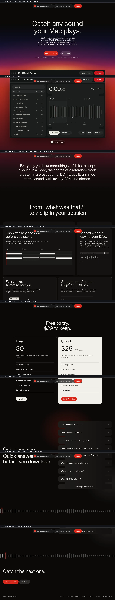
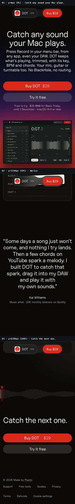

# UI Design System & Master Generation Blueprint: plastic-audio_dot

> **Record internal audio on Mac, with key and BPM · DOT** (https://plastic.audio/dot/) — Record internal audio on Mac with no BlackHole or Soundflower to set up. DOT gives every clip its key, BPM and chords. Drag it into your...





---

## 1. Executive Visual Persona & Design Archetype

- **Brand Essence & Persona**: **Record internal audio on Mac, with key and BPM · DOT** (`https://plastic.audio/dot/`). Record internal audio on Mac with no BlackHole or Soundflower to set up. DOT gives every clip its key, BPM and chords. Drag it into your...
- **Capture Provenance**: Live browser capture (`tier1_fast`, HTTP `200`, captured `2026-11-24`).
- **Visual Archetype**: **High-Contrast Obsidian / Atmospheric Design System (`#0a0908` canvas, `#f2f0ea` ink, `#088ef9` accent)**.
- **Anti-AI-Slop Differentiators**:
  - **Live-Computed Chromatic Polarity**: Anchors the viewport in `#0a0908` (live computed `body` `background-color` (`computed_styles.json`)) paired with `#f2f0ea` primary typography and `#088ef9` accents.
  - **Grounded Typographic Hierarchy**: Uses `Uncut Sans` across display (`Catch any sound your Mac plays.`) and body copy, paired with `IBM Plex Mono` for monospace/code.
  - **Calibrated Spatial Grid & Motion**: Combines `1920px` container bounds (`gap: 16px`, padding `36px`) with `cubic-bezier(.3,1.7,.5,1)` easing.

---

## 2. Spatial Architecture & Modular Grid Mathematics

### Viewport Allocation & Container Geometry
- **Captured Journey Filmstrips**: Desktop `1280×6624px` (`assets/desktop-journey.webp`, `8` keyframes up to `y=6326px` / doc `7226px`), Mobile `390×2616px` (`assets/mobile-journey.webp`, `3` keyframes).
- **Master Container Bounds**: `1920px` (non-`@media` desktop container stylesheet rule).
- **Canvas Lateral Padding & Spacing**: `36px` lateral canvas padding with `16px` grid gap.
- **Border Radius Scale**: `22px`, `50%`, `12px`, `999px`.

### Responsive Breakpoint Architecture
- **Desktop Layout**: Multi-column CSS Grid / Flexbox layout at `1440px` (`max-width: 1920px`, `gap: 16px`).
- **Mobile Layout**: Single-column vertical stack at `390px` viewport width with `36px` horizontal padding.
- **Extracted CSS Media Queries**: `@media (prefers-reduced-motion: no-preference)`, `@media (prefers-reduced-motion: reduce)`, `@media (prefers-reduced-motion:reduce)`, `@media (max-width:880px)`.

---

## 3. Color System, Materiality & Atmospheric Lighting

### Semantic Palette & Source Grounding
| Semantic Role | Ground-Truth Value | Extracted Live / CSS Source |
|---|---|---|
| **Primary Canvas Substrate** | `#0a0908` | live computed `body` `background-color` (`computed_styles.json`) |
| **Primary Typography Ink** | `#f2f0ea` | live computed `h1` `color` (`computed_styles.json`) |
| **Elevated Surface / Card Substrate** | `#141414` | `var(--lemon-background)` in `:root` |
| **Interactive Accent / Highlight** | `#088ef9` | `var(--linkUi-colorInfo400)` in `:root` |
| **Secondary / Muted Copy** | `#808080` | `var(--lemon-secondary-text)` in `:root` |
| **Structural Hairline Border** | `#ff0000` | `.dragmock .slot { border: #ff0000 }` |
| **Variable Token (`--grey`)** | `#86847e` | `var(--grey)` in `:root` |
| **Variable Token (`--faint`)** | `#5a5853` | `var(--faint)` in `:root` |
| **Variable Token (`--hair`)** | `#3a3834` | `var(--hair)` in `:root` |
| **Variable Token (`--red`)** | `#da291c` | `var(--red)` in `:root` |

### Sanitized Root CSS Variables (`ui-ux.md` Ground Truth)
| Variable Name | Extracted Value | Semantic Role |
|---|---|---|
| `--paper` | `#F2F0EA` | Canvas / Surface Token |
| `--ink` | `#0A0908` | Typography Ink Token |
| `--grey` | `#86847E` | Color / Atmospheric Token |
| `--faint` | `#5A5853` | Color / Atmospheric Token |
| `--hair` | `#3A3834` | Color / Atmospheric Token |
| `--red` | `#DA291C` | Color / Atmospheric Token |
| `--serif` | `"Uncut Sans","Helvetica Neue",Helvetica,sans-serif` | Typography / Scale Token |
| `--in` | `92px` | Dimension / Scale Token |
| `--tie` | `9px` | Dimension / Scale Token |
| `--pair` | `18px` | Dimension / Scale Token |
| `--gs` | `27px` | Dimension / Scale Token |
| `--row` | `36px` | Dimension / Scale Token |
| `--group` | `54px` | Dimension / Scale Token |
| `--section` | `72px` | Dimension / Scale Token |
| `--s96` | `108px` | Dimension / Scale Token |
| `--s128` | `144px` | Dimension / Scale Token |

---

## 4. Typographic Scale & Editorial Hierarchy

### Font Family Stacks
- **Display Typography**: `Uncut Sans`.
- **Primary Body Stack**: `Uncut Sans`.
- **Technical / Metadata Stack**: `IBM Plex Mono`.

### Typographic Scale & Rules (Live Computed & Stylesheet Grounded)
- **Hero Display (`H1`)**: live computed `h1` (`font-size: 88px`, `line-height: 89.76px`, `font-weight: 400`, `letter-spacing: -1.76px`); CSS variables `--listItemCheckMobileDisplay: none`, `--listItemCheckDesktopDisplay: block`; rule `h1` (`font-size: 36px`, `line-height: 48px`, `letter-spacing: -.025em`, `font-weight: 500`).
- **Section Heading (`H2`)**: live computed `h2` (`font-size: 72px`, `line-height: 73.44px`, `font-weight: 400`, `letter-spacing: -1.44px`); rule `h2` (`font-size: 30px`, `line-height: 39px`, `letter-spacing: -.025em`, `font-weight: 500`).
- **Body Copy**: live computed `body` (`font-size: 16px`, `line-height: normal`, `font-weight: 400`); CSS variables `--linkBrandedRoot-fontSizeBodyLg: clamp(14px,1.143em,20px)`, `--linkBrandedRoot-fontLineHeightBodyLg: clamp(17px,1.43em,25px)`, `--linkBrandedRoot-fontSizeBodyMd: clamp(12px,1em,20px)`; rule `p` (`font-size: calc(var(--u)*16/18)`, `line-height: calc(var(--u)*24/18)`).
- **Metadata & Navigation Labels**: live computed `nav/a` (`font-size: 16px`, `line-height: 19px`, `font-weight: 400`); CSS variables `--linkUi-fontSizeLabelLg: var(--linkUi-fontSizeBodyLg)`, `--linkUi-fontSizeLabelMd: var(--linkUi-fontSizeBodyMd)`, `--linkUi-fontSizeLabelSm: var(--linkUi-fontSizeBodySm)`; rule `.label` (`font-size: calc(var(--u)*12/18)`, `line-height: calc(var(--u)*20/18)`, `letter-spacing: .1em`).

---

## 5. Choreographed Motion & Interaction Physics

### Primary Easing Curves
- **Extracted Timing Functions**: `cubic-bezier(.3,1.7,.5,1)`, `cubic-bezier(.2,.8,.2,1)`, `cubic-bezier(.25,1.25,.45,1)`.

### Per-Element Transition & Choreography Rules
- **Selector `.links a:not(.key)`**: `transition: box-shadow .15s ease` extracted from `plastic-audio_dot` stylesheet.
- **Selector `.key`**: `transition: background-color .15s ease,transform .24s cubic-bezier(.3,1.7,...` extracted from `plastic-audio_dot` stylesheet.
- **Selector `.tlink`**: `transition: box-shadow .15s ease` extracted from `plastic-audio_dot` stylesheet.
- **Extracted Easing Curve (`cubic-bezier(.3,1.7,.5,1)`)**: Governs interactive state transitions across `<header.pn>` and `<section.intro>`.
- **State & Hover Choreography**: Opacity and transform transitions on `<section.hero>` and `<section.intro>` interactive targets.
### Measured Runtime Scroll & Interaction Telemetry (`behavioral_journey_v2`)
- **Scroll Driver Mode**: `native` (max document height `7226px`, deepest scrollY reached `6326px` across `8` desktop keyframes).
- **Detected Scroll / Motion Libraries**: Native browser scroll / standard CSS transitions.
- **Nav / Drawer Probe**: Tested trigger `DOT Audio Recorder, all apps` (diff `3.817`, below state-capture threshold).
- **Hover Physics (`primary_cta` · `How it works`)**: `color`: `rgb(207, 207, 207)` -> `rgb(255, 255, 255)`; `borderColor`: `rgb(207, 207, 207)` -> `rgb(255, 255, 255)` (`transition-duration: 0.15s`, `timing: ease`).
- **Route Transition Architecture**: First internal navigation (`/dot/buy/`) measured as `MPA` in `1113ms`.

---

## 6. Component Wireframe & Structural DOM Map

### Visual Layout Schematic — Desktop (`1440px`, Grounded in `dom.html` & Landmark Bounding Boxes)
```
┌────────────────────────────────────────────────────────────────────────┐
│ DESKTOP VIEWPORT (1440px) — Record internal audio on Mac, with key and │
│ ====================================================================== │
│ [ <header.pn> (621x56px)              | How it works · Pricing       ] │
│ ---------------------------------------------------------------------- │
│ | HERO STAGE: <section.hero> (w=1440px)                              | │
│ | H1: Catch any sound your Mac plays.                                | │
│ | Substrate: #0a0908 | Ink: #f2f0ea | Accent: #088ef9                | │
│ ---------------------------------------------------------------------- │
│ | SHOWCASE GRID (<section.intro>) max-w: 1920px                      | │
│ | +------------------------------+  +------------------------------+ | │
│ | | Press Record in your menu ba |  | DOT Audio Recorder           | | │
│ | +------------------------------+  +------------------------------+ | │
│ ---------------------------------------------------------------------- │
│ | DETAIL MODULE (<section.statement>) — DOT Audio Recorder Ca        | │
│ ---------------------------------------------------------------------- │
│ [ FOOTER (<footer.foot>       ) | https://plastic.audio/dot/           │
└────────────────────────────────────────────────────────────────────────┘
```

### Visual Layout Schematic — Mobile Reflow (`390px`)
```
┌────────────────────────────────────────────────────────────────────────┐
│ MOBILE VIEWPORT REFLOW (390px) — Single-Column Stack (gap: 16px)       │
│ ====================================================================== │
│ [ HEADER BAR (<header.pn>             ) | Compact Menu (390px)         │
│ ---------------------------------------------------------------------- │
│ | HERO STAGE (<section.hero>) — 390px Vertical Lead                  | │
│ | H1: Catch any sound your Mac plays.                                | │
│ ---------------------------------------------------------------------- │
│ | SHOWCASE STACK (<section.intro>) — 1-Col Stack                     | │
│ | [ Item 1: Press Record in your menu bar, from any app, eve       ] | │
│ | [ Item 2: DOT Audio Recorder                                     ] | │
│ ---------------------------------------------------------------------- │
│ | DETAIL STACK (<section.statement>) — 1-Col (DOT Audio Recorder)    | │
│ ---------------------------------------------------------------------- │
│ [ FOOTER (<footer.foot>       ) | Stacked 390px Colophon               │
└────────────────────────────────────────────────────────────────────────┘
```

### Granular DOM Region Breakdown
1. **Brand Header & Navigation Bar (<header.pn> — `plastic-audio_dot`)**:
   - Landmark `<header class="pn">` (`621x56px`) hosting `Record internal audio on Mac, with k` navigation (`How it works · Pricing`), DOM attributes (`data-cfasync="false"`, `data-state="open"`, `data-loaded="1"`, `data-src="media/demo-av1.mp4?v=..."`), and stylesheet rule `a:hover { color:F2F0EA }`.
2. **Hero Stage & Focal Lead (<section.hero> — `Catch any sound your Mac plays.`)**:
   - Landmark `<section class="hero">` presenting display lead `Catch any sound your Mac plays.` and copy excerpt *"Press Record in your menu bar, from any app, even your DAW. DOT k"* over `#0a0908` canvas and `#f2f0ea` ink.
3. **Primary Showcase & Content Grid (<section.intro> — `Press Record in your menu bar, fro`)**:
   - Landmark `<section class="intro">` rendering section `Press Record in your menu bar, from any app, eve` with copy *"DOT Audio Recorder"*, asset references (`s.js`, `favicon.ico`, `icon.svg`, `apple-touch-icon.png`), and grid rule `.sr { position:absolute;width:1px;height:1px;overflow:hidden;clip:rect(0 0 0 0) }`.
4. **Interactive Detail & Feature Matrix (<section.statement> — `DOT Audio Recorder`)**:
   - Landmark `<section class="statement">` framing `DOT Audio Recorder` and `DOT Audio Recorder Catch any sound your Mac play` (*"DOT Audio Recorder Catch any sound your Mac plays."*) with `#141414` surface cards, `#088ef9` accents, and `.rdot.s { width:8px;height:8px;margin:0 10px 0 0;transform:none;vertical-align:1px }`.
5. **Colophon & Global Directory Footer (<footer.foot> — `https://plastic.audio/dot/`)**:
   - Landmark `<footer class="foot pfoot">` anchoring `Record internal audio on Mac, wi` footer links (`How it works · Pricing`), copy *"Catch any sound your Mac plays."*, and `#ff0000` structural dividers.
### Full Vertical Scroll Sequence (Desktop `1440×900` Keyframes)
- **Step 01** (`y=0px`, `0%`): Active landmark `Catch any sound your Mac plays.` · sticky/fixed elements: `1`
- **Step 02** (`y=850px`, `13%`): Active landmark `#app` · sticky/fixed elements: `1`
- **Step 03** (`y=1700px`, `27%`): Active landmark `From “what was that?” to a clip in your session` · sticky/fixed elements: `1`
- **Step 04** (`y=2550px`, `40%`): Active landmark `Know the key and BPM before you use it.` · sticky/fixed elements: `1`
- **Step 05** (`y=4250px`, `67%`): Active landmark `Free to try. $29 to keep.` · sticky/fixed elements: `1`
- **Step 06** (`y=5100px`, `81%`): Active landmark `#faq` · sticky/fixed elements: `1`
- **Step 07** (`y=5950px`, `94%`): Active landmark `Quick answers before you download.` · sticky/fixed elements: `1`
- **Step 08** (`y=6326px`, `100%`): Active landmark `Catch the next one.` · sticky/fixed elements: `1`

### Multi-Page Internal Route Map
- **Detail Route (`/dot/buy/`)**: `https://plastic.audio/dot/buy/` — H1: `DOT Audio Recorder`, scrollHeight `1424px`, transition `MPA` (`1113ms`)
- **Other Route (`/clips/`)**: `https://plastic.audio/clips/` — H1: `Lyric video maker for Mac and Windows.`, scrollHeight `13429px`, transition `direct` (`1841ms`)

---

## 7. Master Zero-Shot AI Generation Prompt

```markdown
# Master Zero-Shot Frontend Generation Prompt: plastic-audio_dot (Record internal audio on Mac, with key and BPM · DOT)

You are a principal frontend architect and design systems engineer. Build a complete, production-ready web application replicating the exact design system, DOM landmarks, typographic hierarchy, color tokens, and motion physics of `plastic-audio_dot` (**Record internal audio on Mac, with key and BPM · DOT** — `https://plastic.audio/dot/`).

### 1. Visual Archetype & Anti-AI-Slop Mandates
- **Archetype**: High-Contrast Obsidian / Atmospheric Design System (`#0a0908` canvas, `#f2f0ea` ink, `#088ef9` accent).
- **Identity & Domain Context**: Record internal audio on Mac with no BlackHole or Soundflower to set up. DOT gives every clip its key, BPM and chords. Drag it into your...
- **Primary Substrate**: `#0a0908` (live computed `body` `background-color` (`computed_styles.json`)), **Primary Ink**: `#f2f0ea`, **Accent / Highlight**: `#088ef9`.
- **Site-Specific Differentiators**:
  - **Live-Computed Chromatic Polarity**: Anchors the viewport in `#0a0908` (live computed `body` `background-color` (`computed_styles.json`)) paired with `#f2f0ea` primary typography and `#088ef9` accents.
  - **Grounded Typographic Hierarchy**: Uses `Uncut Sans` across display (`Catch any sound your Mac plays.`) and body copy, paired with `IBM Plex Mono` for monospace/code.
  - **Calibrated Spatial Grid & Motion**: Combines `1920px` container bounds (`gap: 16px`, padding `36px`) with `cubic-bezier(.3,1.7,.5,1)` easing.

### 2. Ground-Truth CSS Variables (`:root` Token Contract)
Declare and consume these exact custom properties extracted from `plastic-audio_dot` in your global stylesheet:

:root {
  /* Record internal audio on Mac, with key and BPM · DOT (plastic-audio_dot) — Live-Grounded CSS Variables */
  --paper: #F2F0EA; /* Canvas / Surface Token (plastic-audio_dot) */
  --ink: #0A0908; /* Typography Ink Token (plastic-audio_dot) */
  --grey: #86847E; /* Color / Atmospheric Token (plastic-audio_dot) */
  --faint: #5A5853; /* Color / Atmospheric Token (plastic-audio_dot) */
  --hair: #3A3834; /* Color / Atmospheric Token (plastic-audio_dot) */
  --red: #DA291C; /* Color / Atmospheric Token (plastic-audio_dot) */
  --serif: "Uncut Sans","Helvetica Neue",Helvetica,sans-serif; /* Typography / Scale Token (plastic-audio_dot) */
  --in: 92px; /* Dimension / Scale Token (plastic-audio_dot) */
  --tie: 9px; /* Dimension / Scale Token (plastic-audio_dot) */
  --pair: 18px; /* Dimension / Scale Token (plastic-audio_dot) */
  --gs: 27px; /* Dimension / Scale Token (plastic-audio_dot) */
  --row: 36px; /* Dimension / Scale Token (plastic-audio_dot) */
  --group: 54px; /* Dimension / Scale Token (plastic-audio_dot) */
  --section: 72px; /* Dimension / Scale Token (plastic-audio_dot) */
  --s96: 108px; /* Dimension / Scale Token (plastic-audio_dot) */
  --s128: 144px; /* Dimension / Scale Token (plastic-audio_dot) */
}

### 3. Semantic Color & Materiality Contract
Map every surface, ink, and border strictly to these source-grounded tokens:
- **Primary Canvas Substrate**: `#0a0908` — grounded in live computed `body` `background-color` (`computed_styles.json`)
- **Primary Typography Ink**: `#f2f0ea` — grounded in live computed `h1` `color` (`computed_styles.json`)
- **Elevated Surface / Card Substrate**: `#141414` — grounded in `var(--lemon-background)` in `:root`
- **Interactive Accent / Highlight**: `#088ef9` — grounded in `var(--linkUi-colorInfo400)` in `:root`
- **Secondary / Muted Copy**: `#808080` — grounded in `var(--lemon-secondary-text)` in `:root`
- **Structural Hairline Border**: `#ff0000` — grounded in `.dragmock .slot { border: #ff0000 }`
- **Variable Token (`--grey`)**: `#86847e` — grounded in `var(--grey)` in `:root`
- **Variable Token (`--faint`)**: `#5a5853` — grounded in `var(--faint)` in `:root`
- **Variable Token (`--hair`)**: `#3a3834` — grounded in `var(--hair)` in `:root`
- **Variable Token (`--red`)**: `#da291c` — grounded in `var(--red)` in `:root`

### 4. Spatial Grid, Container Bounds & Responsive Breakpoints
- **Desktop Viewport Reference**: `1280×6624px` (multi-frame vertical journey filmstrip (6624px), `1440px` standard desktop width).
- **Mobile Viewport Reference**: `390×2616px` (multi-frame vertical journey filmstrip (2616px), `390px` standard mobile width).
- **Container Max-Width**: `1920px` (non-`@media` desktop container stylesheet rule)
- **Padding & Gutters**: `36px` lateral canvas padding with `16px` grid gap
- **Desktop Grid**: Multi-column CSS Grid / Flexbox layout at `1440px` (`max-width: 1920px`, `gap: 16px`)
- **Mobile Adaptation**: Single-column vertical stack at `390px` viewport width with `36px` horizontal padding
- **Media Queries**: `@media (prefers-reduced-motion: no-preference)`, `@media (prefers-reduced-motion: reduce)`, `@media (prefers-reduced-motion:reduce)`, `@media (max-width:880px)`
- **Corner Radii**: `22px`, `50%`, `12px`, `999px`

### 5. Typography & Editorial Scale Contract
- **Display Font Stack**: `Uncut Sans`
- **Body Font Stack**: `Uncut Sans`
- **Monospace / Technical Font Stack**: `IBM Plex Mono`
- **H1 Display Rule**: live computed `h1` (`font-size: 88px`, `line-height: 89.76px`, `font-weight: 400`, `letter-spacing: -1.76px`); CSS variables `--listItemCheckMobileDisplay: none`, `--listItemCheckDesktopDisplay: block`; rule `h1` (`font-size: 36px`, `line-height: 48px`, `letter-spacing: -.025em`, `font-weight: 500`)
- **H2 Section Rule**: live computed `h2` (`font-size: 72px`, `line-height: 73.44px`, `font-weight: 400`, `letter-spacing: -1.44px`); rule `h2` (`font-size: 30px`, `line-height: 39px`, `letter-spacing: -.025em`, `font-weight: 500`)
- **Body Copy Rule**: live computed `body` (`font-size: 16px`, `line-height: normal`, `font-weight: 400`); CSS variables `--linkBrandedRoot-fontSizeBodyLg: clamp(14px,1.143em,20px)`, `--linkBrandedRoot-fontLineHeightBodyLg: clamp(17px,1.43em,25px)`, `--linkBrandedRoot-fontSizeBodyMd: clamp(12px,1em,20px)`; rule `p` (`font-size: calc(var(--u)*16/18)`, `line-height: calc(var(--u)*24/18)`)
- **Metadata & Index Rule**: live computed `nav/a` (`font-size: 16px`, `line-height: 19px`, `font-weight: 400`); CSS variables `--linkUi-fontSizeLabelLg: var(--linkUi-fontSizeBodyLg)`, `--linkUi-fontSizeLabelMd: var(--linkUi-fontSizeBodyMd)`, `--linkUi-fontSizeLabelSm: var(--linkUi-fontSizeBodySm)`; rule `.label` (`font-size: calc(var(--u)*12/18)`, `line-height: calc(var(--u)*20/18)`, `letter-spacing: .1em`)

### 6. Component Hierarchy, Verbatim Copy & Real DOM Landmarks
Scaffold `plastic-audio_dot` (`Record internal audio on Mac, with key and BPM · DOT`) with these exact structural regions, extracted copy, and CSS rules from `dom.html`:
1. **Brand Header & Navigation Bar (<header.pn> — `plastic-audio_dot`)**:
   - DOM & Selectors: Landmark `<header class="pn">` (`621x56px`) hosting `Record internal audio on Mac, with k` navigation (`How it works · Pricing`), DOM attributes (`data-cfasync="false"`, `data-state="open"`, `data-loaded="1"`, `data-src="media/demo-av1.mp4?v=..."`), and stylesheet rule `a:hover { color:F2F0EA }`.
   - Responsive Contract: Header `Brand Header & Navigation Bar (<header.pn> — `plastic-audio_dot`)` (`plastic-audio_dot`) adapts across `@media (prefers-reduced-motion: no-preference)`, `@media (prefers-reduced-motion: reduce)`, `@media (prefers-reduced-motion:reduce)`, `@media (max-width:880px)` with `cubic-bezier(.3,1.7,.5,1)`, `cubic-bezier(.2,.8,.2,1)`, `cubic-bezier(.25,1.25,.45,1)` transitions and links `How it works · Pricing`.
2. **Hero Stage & Focal Lead (<section.hero> — `Catch any sound your Mac plays.`)**:
   - DOM & Selectors: Landmark `<section class="hero">` presenting display lead `Catch any sound your Mac plays.` and copy excerpt *"Press Record in your menu bar, from any app, even your DAW. DOT k"* over `#0a0908` canvas and `#f2f0ea` ink.
   - Responsive Contract: Hero stage (`1280×6624px` desktop / `390×2616px` mobile) sets `#0a0908` background with `#f2f0ea` headline `Catch any sound your Mac plays.`.
3. **Primary Showcase & Content Grid (<section.intro> — `Press Record in your menu bar, fro`)**:
   - DOM & Selectors: Landmark `<section class="intro">` rendering section `Press Record in your menu bar, from any app, eve` with copy *"DOT Audio Recorder"*, asset references (`s.js`, `favicon.ico`, `icon.svg`, `apple-touch-icon.png`), and grid rule `.sr { position:absolute;width:1px;height:1px;overflow:hidden;clip:rect(0 0 0 0) }`.
   - Responsive Contract: Showcase grid `Primary Showcase & Content Grid (<section.intro> — `Press Record in your menu bar, fro`)` applies Multi-column CSS Grid / Flexbox layout at `1440px` (`max-width: 1920px`, `gap: 16px`) on desktop and Single-column vertical stack at `390px` viewport width with `36px` horizontal padding on mobile.
4. **Interactive Detail & Feature Matrix (<section.statement> — `DOT Audio Recorder`)**:
   - DOM & Selectors: Landmark `<section class="statement">` framing `DOT Audio Recorder` and `DOT Audio Recorder Catch any sound your Mac play` (*"DOT Audio Recorder Catch any sound your Mac plays."*) with `#141414` surface cards, `#088ef9` accents, and `.rdot.s { width:8px;height:8px;margin:0 10px 0 0;transform:none;vertical-align:1px }`.
   - Responsive Contract: Detail module `Interactive Detail & Feature Matrix (<section.statement> — `DOT Audio Recorder`)` uses `22px`, `50%`, `12px`, `999px` radii, `#088ef9` highlights, and assets (s.js, favicon.ico, icon.svg).
5. **Colophon & Global Directory Footer (<footer.foot> — `https://plastic.audio/dot/`)**:
   - DOM & Selectors: Landmark `<footer class="foot pfoot">` anchoring `Record internal audio on Mac, wi` footer links (`How it works · Pricing`), copy *"Catch any sound your Mac plays."*, and `#ff0000` structural dividers.
   - Responsive Contract: Footer `Colophon & Global Directory Footer (<footer.foot> — `https://plastic.audio/dot/`)` aligns to `1920px` (non-`@media` desktop container stylesheet rule) with `36px` lateral canvas padding with `16px` grid gap and attributes (data-cfasync="false", data-state="open", data-loaded="1").

#### Verbatim DOM Copy Excerpts (`dom.html`)
- Copy Excerpt 1: *"Press Record in your menu bar, from any app, even your DAW. DOT keeps what’s playi..."*
- Copy Excerpt 2: *"DOT Audio Recorder"*
- Copy Excerpt 3: *"DOT Audio Recorder Catch any sound your Mac plays."*
- Copy Excerpt 4: *"Catch any sound your Mac plays."*

### 7. Motion, Extracted Stylesheet Rules & Interaction Choreography
- **Primary Easing Functions**: `cubic-bezier(.3,1.7,.5,1)`, `cubic-bezier(.2,.8,.2,1)`, `cubic-bezier(.25,1.25,.45,1)`
- **Extracted Stylesheet Rules (`plastic-audio_dot`)**:
- `a:hover { color:F2F0EA }`
- `.sr { position:absolute;width:1px;height:1px;overflow:hidden;clip:rect(0 0 0 0) }`
- `.rdot.s { width:8px;height:8px;margin:0 10px 0 0;transform:none;vertical-align:1px }`
- `.rdot.big { width:.8em;height:.8em;margin:0 .02em;transform:translateY(.02em) }`
- `.strip { position:relative;height:104px;overflow:hidden }`
- **Per-Selector Transition Rules**:
- **Selector `.links a:not(.key)`**: `transition: box-shadow .15s ease` extracted from `plastic-audio_dot` stylesheet.
- **Selector `.key`**: `transition: background-color .15s ease,transform .24s cubic-bezier(.3,1.7,...` extracted from `plastic-audio_dot` stylesheet.
- **Selector `.tlink`**: `transition: box-shadow .15s ease` extracted from `plastic-audio_dot` stylesheet.
- **Extracted Easing Curve (`cubic-bezier(.3,1.7,.5,1)`)**: Governs interactive state transitions across `<header.pn>` and `<section.intro>`.
- **State & Hover Choreography**: Opacity and transform transitions on `<section.hero>` and `<section.intro>` interactive targets.
### 7b. Full-Page Scroll Choreography, Interactive States & Multi-Page Routes
- **Scroll Mechanics**: Implement `native` vertical progression up to `7226px` across 8 distinct viewport chapters.
- **Vertical Chapter Sequence**: Catch any sound your Mac pl... (0%) -> #app (13%) -> From “what was that?” to a... (27%) -> Know the key and BPM before... (40%) -> Free to try. $29 to keep. (67%) -> #faq (81%) -> Quick answers before you do... (94%) -> Catch the next one. (100%).
- **Hover Micro-Interaction (`primary_cta`)**: Animate `color, borderColor` with `0.15s ease`.
- **Multi-Page Routes**: Scaffold internal routes `/dot/buy/` (detail, MPA), `/clips/` (other, direct) sharing the global header/footer shell and design tokens.

### 8. Technical Deliverables
- Implement in Next.js (App Router) with TypeScript and Tailwind CSS consuming the `:root` custom properties defined above for `plastic-audio_dot`.
- Reproduce both the `1440px` desktop architecture and `390px` mobile breakpoint transitions, preserving semantic HTML5 landmarks (`<header>`, `<nav>`, `<main>`, `<section>`, `<footer>`) and `prefers-reduced-motion` accessibility guards.
```
---

## 8. Full-Page Scroll Journey, Interactive States & Subpage Inventory

### Desktop Scroll Keyframes (`1440×900` WebP)
| Step | Scroll Y | Progress | Active Landmark / Section | Sticky/Fixed | Visual Asset |
| :---: | :---: | :---: | :--- | :---: | :--- |
| `#01` | `0px` | `0%` | Catch any sound your Mac plays. | `1` | [desktop-step-01.webp](assets/desktop-step-01.webp) |
| `#02` | `850px` | `13%` | #app | `1` | [desktop-step-02.webp](assets/desktop-step-02.webp) |
| `#03` | `1700px` | `27%` | From “what was that?” to a clip in your session | `1` | [desktop-step-03.webp](assets/desktop-step-03.webp) |
| `#04` | `2550px` | `40%` | Know the key and BPM before you use it. | `1` | [desktop-step-04.webp](assets/desktop-step-04.webp) |
| `#05` | `4250px` | `67%` | Free to try. $29 to keep. | `1` | [desktop-step-05.webp](assets/desktop-step-05.webp) |
| `#06` | `5100px` | `81%` | #faq | `1` | [desktop-step-06.webp](assets/desktop-step-06.webp) |
| `#07` | `5950px` | `94%` | Quick answers before you download. | `1` | [desktop-step-07.webp](assets/desktop-step-07.webp) |
| `#08` | `6326px` | `100%` | Catch the next one. | `1` | [desktop-step-08.webp](assets/desktop-step-08.webp) |

### Mobile Condensed Keyframes (`390×844` WebP)
| Step | Scroll Y | Progress | Active Landmark | Visual Asset |
| :---: | :---: | :---: | :--- | :--- |
| `#01` | `0px` | `0%` | Catch any sound your Mac plays. | [mobile-step-01.webp](assets/mobile-step-01.webp) |
| `#02` | `3144px` | `50%` | #price | [mobile-step-02.webp](assets/mobile-step-02.webp) |
| `#03` | `6289px` | `100%` | Catch the next one. | [mobile-step-03.webp](assets/mobile-step-03.webp) |

### Internal Subpage Filmstrips (`1080px` Wide WebP)
| # | Template | Route URL | H1 / Title | Scroll Height | Transition | Filmstrip Asset |
| :-: | :---: | :--- | :--- | :---: | :---: | :--- |
| `1` | `detail` | `https://plastic.audio/dot/buy/` | DOT Audio Recorder | `1424px` | `MPA` (`1113ms`) | [subpage-01-dot-buy.webp](assets/subpage-01-dot-buy.webp) |
| `3` | `other` | `https://plastic.audio/clips/` | Lyric video maker for Mac and Windows. | `13429px` | `direct` (`1841ms`) | [subpage-03-clips.webp](assets/subpage-03-clips.webp) |

