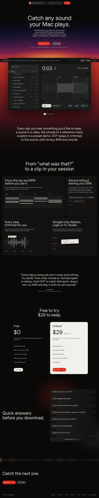
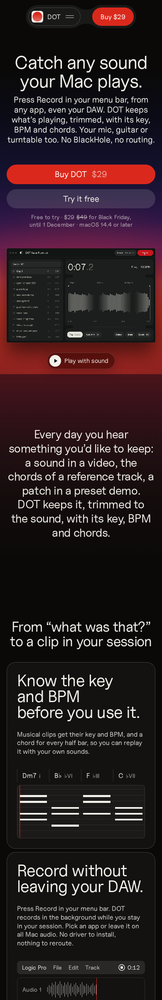

# UI Design System & Master Generation Blueprint: plastic-audio_dot

> **Record internal audio on Mac, with key and BPM · DOT** (https://plastic.audio/dot/) — Record internal audio on Mac with no BlackHole or Soundflower to set up. DOT gives every clip its key, BPM and chords. Drag it into your...



---

## 1. Executive Visual Persona & Design Archetype

- **Brand Essence & Persona**: **Record internal audio on Mac, with key and BPM · DOT** (`https://plastic.audio/dot/`). Record internal audio on Mac with no BlackHole or Soundflower to set up. DOT gives every clip its key, BPM and chords. Drag it into your...
- **Visual Archetype**: **Light-Substrate Editorial & Modular Grid System (`#F2F0EA` canvas, `#0A0908` ink, `#5A5853` accent)**.
- **Anti-AI-Slop Differentiators**:
  - **Source-Grounded Chromatic Polarity**: Anchors the viewport in `#F2F0EA` (`var(--paper)` in `:root`) paired with `#0A0908` primary typography and `#5A5853` accents.
  - **Extracted Typographic Hierarchy**: Pairs `Archivo` for display copy (`Catch any sound your Mac plays.`) with `Uncut Sans` and not declared in static CSS (uses primary stack / `ui-monospace`).
  - **Calibrated Spatial Grid & Motion**: Combines `999px` container bounds (`gap: 2px`, padding `4px`) with `cubic-bezier(.3,1.7,.5,1)` easing.

---

## 2. Spatial Architecture & Modular Grid Mathematics



### Viewport Allocation & Container Geometry
- **Captured Viewport Dimensions**: Desktop `1440×7226px` (`assets/desktop.png`, full-page scroll capture), Mobile `390×2400px` (`assets/mobile.png`, capped at 2400px multi-section capture).
- **Master Container Bounds**: `999px` extracted from `plastic-audio_dot` stylesheet.
- **Canvas Lateral Padding & Spacing**: `4px` lateral canvas padding with `2px` grid gap.
- **Border Radius Scale**: `50%`, `12px`, `999px`, `8px`.

### Responsive Breakpoint Architecture
- **Desktop Layout**: Multi-column CSS Grid / Flexbox layout at `1440px` (`max-width: 999px`, `gap: 2px`).
- **Mobile Layout**: Single-column vertical stack at `390px` viewport width with `4px` horizontal padding.
- **Extracted CSS Media Queries**: `@media (prefers-reduced-motion: no-preference)`, `@media (prefers-reduced-motion: reduce)`, `@media (prefers-reduced-motion:reduce)`, `@media (max-width:880px)`.

---

## 3. Color System, Materiality & Atmospheric Lighting

### Semantic Palette & Source Grounding
| Semantic Role | Ground-Truth Value | Extracted CSS Source / Selector |
|---|---|---|
| **Primary Canvas Substrate** | `#F2F0EA` | `var(--paper)` in `:root` |
| **Primary Typography Ink** | `#0A0908` | `var(--ink)` in `:root` |
| **Elevated Surface / Card Substrate** | `#86847E` | `var(--grey)` in `:root` |
| **Interactive Accent / Highlight** | `#5A5853` | `var(--faint)` in `:root` |
| **Secondary / Muted Copy** | `#3A3834` | `var(--hair)` in `:root` |
| **Structural Hairline Border** | `#DA291C` | `var(--red)` in `:root` |

### Sanitized Root CSS Variables (`ui-ux.md` Ground Truth)
| Variable Name | Extracted Value | Semantic Role |
|---|---|---|
| `--paper` | `#F2F0EA` | Canvas / Surface Token |
| `--ink` | `#0A0908` | Typography Ink Token |
| `--grey` | `#86847E` | Color / Atmospheric Token |
| `--faint` | `#5A5853` | Color / Atmospheric Token |
| `--hair` | `#3A3834` | Color / Atmospheric Token |
| `--red` | `#DA291C` | Color / Atmospheric Token |
| `--serif` | `"Uncut Sans","Helvetica Neue",Helvetica,sans-serif` | Typography / Scale Token |
| `--in` | `92px` | Dimension / Scale Token |
| `--tie` | `9px` | Dimension / Scale Token |
| `--pair` | `18px` | Dimension / Scale Token |
| `--gs` | `27px` | Dimension / Scale Token |
| `--row` | `36px` | Dimension / Scale Token |
| `--group` | `54px` | Dimension / Scale Token |
| `--section` | `72px` | Dimension / Scale Token |
| `--s96` | `108px` | Dimension / Scale Token |
| `--s128` | `144px` | Dimension / Scale Token |

---

## 4. Typographic Scale & Editorial Hierarchy

### Font Family Stacks
- **Display Typography**: `Archivo`.
- **Primary Body Stack**: `Uncut Sans`.
- **Technical / Metadata Stack**: not declared in static CSS (uses primary stack / `ui-monospace`).

### Typographic Scale & Rules (Extracted from Stylesheet & Variables)
- **Hero Display (`H1`)**: not explicitly declared on tag in static CSS (stylesheet font-size ladder: `.78em`, `12px`, `15px`, `11px`, `18px`).
- **Section Heading (`H2`)**: not explicitly declared on tag in static CSS (stylesheet font-size ladder: `.78em`, `12px`, `15px`, `11px`, `18px`).
- **Body Copy**: rule `p` (`font-size: calc(var(--u)*16/18)`, `line-height: calc(var(--u)*24/18)`).
- **Metadata & Navigation Labels**: rule `.label` (`font-size: calc(var(--u)*12/18)`, `line-height: calc(var(--u)*20/18)`, `letter-spacing: .1em`).

---

## 5. Choreographed Motion & Interaction Physics

### Primary Easing Curves
- **Extracted Timing Functions**: `cubic-bezier(.3,1.7,.5,1)`, `cubic-bezier(.2,.8,.2,1)`, `cubic-bezier(.25,1.25,.45,1)`.

### Per-Element Transition & Choreography Rules
- **Selector `.links a:not(.key)`**: `transition: box-shadow .15s ease` extracted from `plastic-audio_dot` stylesheet.
- **Selector `.key`**: `transition: background-color .15s ease,transform .24s cubic-bezier(.3,1.7,...` extracted from `plastic-audio_dot` stylesheet.
- **Selector `.tlink`**: `transition: box-shadow .15s ease` extracted from `plastic-audio_dot` stylesheet.
- **Extracted Easing Curve (`cubic-bezier(.3,1.7,.5,1)`)**: Governs interactive state transitions across `<header.pn>` and `<section.intro>`.
- **State & Hover Choreography**: Opacity and transform transitions on `<section.hero>` and `<section.intro>` interactive targets.

---

## 6. Component Wireframe & Structural DOM Map

### Visual Layout Schematic (Grounded in `dom.html` — `1440px` Desktop & `390px` Mobile Reflow)
```
┌────────────────────────────────────────────────────────────────────────┐
│ DESKTOP VIEWPORT (1440px) — Record internal audio on Mac, with key and │
│ ====================================================================== │
│ [ <header.pn>              | How it works · Pricing                 ]  │
│ ---------------------------------------------------------------------- │
│ | HERO STAGE: <section.hero>                                       |   │
│ | H1: Catch any sound your Mac plays.                              |   │
│ | Substrate: #F2F0EA    | Ink: #0A0908    | Accent: #5A5853        |   │
│ ---------------------------------------------------------------------- │
│ | SHOWCASE GRID (<section.intro>           ) max-w: 999px          |   │
│ | +------------------------------+  +------------------------------+ | │
│ | | From “what was that?” to a c |  | Know the key and BPM before  | | │
│ | +------------------------------+  +------------------------------+ | │
│ ---------------------------------------------------------------------- │
│ | MOBILE VIEWPORT REFLOW (390px) — Single-Column Stack (gap: 2px   ) | │
│ | [<header.pn>] -> [<section.hero>] -> [<section.intro>] |             │
│ ---------------------------------------------------------------------- │
│ [ FOOTER (<footer.foot>         ) | https://plastic.audio/dot/         │
└────────────────────────────────────────────────────────────────────────┘
```

### Granular DOM Region Breakdown
1. **Brand Header & Navigation Bar (<header.pn> — `plastic-audio_dot`)**:
   - Landmark `<header class="pn">` hosting `Record internal audio on Mac, with k` navigation (`How it works · Pricing`), DOM attributes (`data-cfasync="false"`, `data-state="open"`, `data-loaded="1"`, `data-src="media/demo-av1.mp4?v=..."`), and stylesheet rule `a:hover { color:F2F0EA }`.
2. **Hero Stage & Focal Lead (<section.hero> — `Catch any sound your Mac plays.`)**:
   - Landmark `<section class="hero">` presenting display lead `Catch any sound your Mac plays.` and copy excerpt *"DOT Audio Recorder DOT"* over `#F2F0EA` canvas and `#0A0908` ink.
3. **Primary Showcase & Content Grid (<section.intro> — `From “what was that?” to a clip in`)**:
   - Landmark `<section class="intro">` rendering section `From “what was that?” to a clip in your session` with copy *"DOT Audio Recorder"*, asset references (`s.js`, `favicon.ico`, `icon.svg`, `apple-touch-icon.png`), and grid rule `.sr { position:absolute;width:1px;height:1px;overflow:hidden;clip:rect(0 0 0 0) }`.
4. **Interactive Detail & Feature Matrix (<section.statement> — `Know the key and BPM before you us`)**:
   - Landmark `<section class="statement">` framing `Know the key and BPM before you use it.` and `Record without leaving your DAW.` (*"DOT Audio Recorder Catch any sound your Mac plays."*) with `#86847E` surface cards, `#5A5853` accents, and `.rdot.s { width:8px;height:8px;margin:0 10px 0 0;transform:none;vertical-align:1px }`.
5. **Colophon & Global Directory Footer (<footer.foot> — `https://plastic.audio/dot/`)**:
   - Landmark `<footer class="foot pfoot">` anchoring `Record internal audio on Mac, wi` footer links (`How it works · Pricing`), copy *"Catch any sound your Mac plays."*, and `#DA291C` structural dividers.

---

## 7. Master Zero-Shot AI Generation Prompt

```markdown
# Master Zero-Shot Frontend Generation Prompt: plastic-audio_dot (Record internal audio on Mac, with key and BPM · DOT)

You are a principal frontend architect and design systems engineer. Build a complete, production-ready web application replicating the exact design system, DOM landmarks, typographic hierarchy, color tokens, and motion physics of `plastic-audio_dot` (**Record internal audio on Mac, with key and BPM · DOT** — `https://plastic.audio/dot/`).

### 1. Visual Archetype & Anti-AI-Slop Mandates
- **Archetype**: Light-Substrate Editorial & Modular Grid System (`#F2F0EA` canvas, `#0A0908` ink, `#5A5853` accent).
- **Identity & Domain Context**: Record internal audio on Mac with no BlackHole or Soundflower to set up. DOT gives every clip its key, BPM and chords. Drag it into your...
- **Primary Substrate**: `#F2F0EA` (`var(--paper)` in `:root`), **Primary Ink**: `#0A0908`, **Accent / Highlight**: `#5A5853`.
- **Site-Specific Differentiators**:
  - **Source-Grounded Chromatic Polarity**: Anchors the viewport in `#F2F0EA` (`var(--paper)` in `:root`) paired with `#0A0908` primary typography and `#5A5853` accents.
  - **Extracted Typographic Hierarchy**: Pairs `Archivo` for display copy (`Catch any sound your Mac plays.`) with `Uncut Sans` and not declared in static CSS (uses primary stack / `ui-monospace`).
  - **Calibrated Spatial Grid & Motion**: Combines `999px` container bounds (`gap: 2px`, padding `4px`) with `cubic-bezier(.3,1.7,.5,1)` easing.

### 2. Ground-Truth CSS Variables (`:root` Token Contract)
Declare and consume these exact custom properties extracted from `plastic-audio_dot` in your global stylesheet:

:root {
  /* Record internal audio on Mac, with key and BPM · DOT (plastic-audio_dot) — Ground-Truth Extracted CSS Variables */
  --paper: #F2F0EA; /* Canvas / Surface Token (plastic-audio_dot) */
  --ink: #0A0908; /* Typography Ink Token (plastic-audio_dot) */
  --grey: #86847E; /* Color / Atmospheric Token (plastic-audio_dot) */
  --faint: #5A5853; /* Color / Atmospheric Token (plastic-audio_dot) */
  --hair: #3A3834; /* Color / Atmospheric Token (plastic-audio_dot) */
  --red: #DA291C; /* Color / Atmospheric Token (plastic-audio_dot) */
  --serif: "Uncut Sans","Helvetica Neue",Helvetica,sans-serif; /* Typography / Scale Token (plastic-audio_dot) */
  --in: 92px; /* Dimension / Scale Token (plastic-audio_dot) */
  --tie: 9px; /* Dimension / Scale Token (plastic-audio_dot) */
  --pair: 18px; /* Dimension / Scale Token (plastic-audio_dot) */
  --gs: 27px; /* Dimension / Scale Token (plastic-audio_dot) */
  --row: 36px; /* Dimension / Scale Token (plastic-audio_dot) */
  --group: 54px; /* Dimension / Scale Token (plastic-audio_dot) */
  --section: 72px; /* Dimension / Scale Token (plastic-audio_dot) */
  --s96: 108px; /* Dimension / Scale Token (plastic-audio_dot) */
  --s128: 144px; /* Dimension / Scale Token (plastic-audio_dot) */
}

### 3. Semantic Color & Materiality Contract
Map every surface, ink, and border strictly to these source-grounded tokens:
- **Primary Canvas Substrate**: `#F2F0EA` — grounded in `var(--paper)` in `:root`
- **Primary Typography Ink**: `#0A0908` — grounded in `var(--ink)` in `:root`
- **Elevated Surface / Card Substrate**: `#86847E` — grounded in `var(--grey)` in `:root`
- **Interactive Accent / Highlight**: `#5A5853` — grounded in `var(--faint)` in `:root`
- **Secondary / Muted Copy**: `#3A3834` — grounded in `var(--hair)` in `:root`
- **Structural Hairline Border**: `#DA291C` — grounded in `var(--red)` in `:root`

### 4. Spatial Grid, Container Bounds & Responsive Breakpoints
- **Desktop Viewport Reference**: `1440×7226px` (full-page scroll capture, `1440px` standard desktop width).
- **Mobile Viewport Reference**: `390×2400px` (capped at 2400px multi-section capture, `390px` standard mobile width).
- **Container Max-Width**: `999px` extracted from `plastic-audio_dot` stylesheet
- **Padding & Gutters**: `4px` lateral canvas padding with `2px` grid gap
- **Desktop Grid**: Multi-column CSS Grid / Flexbox layout at `1440px` (`max-width: 999px`, `gap: 2px`)
- **Mobile Adaptation**: Single-column vertical stack at `390px` viewport width with `4px` horizontal padding
- **Media Queries**: `@media (prefers-reduced-motion: no-preference)`, `@media (prefers-reduced-motion: reduce)`, `@media (prefers-reduced-motion:reduce)`, `@media (max-width:880px)`
- **Corner Radii**: `50%`, `12px`, `999px`, `8px`

### 5. Typography & Editorial Scale Contract
- **Display Font Stack**: `Archivo`
- **Body Font Stack**: `Uncut Sans`
- **Monospace / Technical Font Stack**: not declared in static CSS (uses primary stack / `ui-monospace`)
- **H1 Display Rule**: not explicitly declared on tag in static CSS (stylesheet font-size ladder: `.78em`, `12px`, `15px`, `11px`, `18px`)
- **H2 Section Rule**: not explicitly declared on tag in static CSS (stylesheet font-size ladder: `.78em`, `12px`, `15px`, `11px`, `18px`)
- **Body Copy Rule**: rule `p` (`font-size: calc(var(--u)*16/18)`, `line-height: calc(var(--u)*24/18)`)
- **Metadata & Index Rule**: rule `.label` (`font-size: calc(var(--u)*12/18)`, `line-height: calc(var(--u)*20/18)`, `letter-spacing: .1em`)

### 6. Component Hierarchy, Verbatim Copy & Real DOM Landmarks
Scaffold `plastic-audio_dot` (`Record internal audio on Mac, with key and BPM · DOT`) with these exact structural regions, extracted copy, and CSS rules from `dom.html`:
1. **Brand Header & Navigation Bar (<header.pn> — `plastic-audio_dot`)**:
   - DOM & Selectors: Landmark `<header class="pn">` hosting `Record internal audio on Mac, with k` navigation (`How it works · Pricing`), DOM attributes (`data-cfasync="false"`, `data-state="open"`, `data-loaded="1"`, `data-src="media/demo-av1.mp4?v=..."`), and stylesheet rule `a:hover { color:F2F0EA }`.
   - Responsive Contract: Header `Brand Header & Navigation Bar (<header.pn> — `plastic-audio_dot`)` (`plastic-audio_dot`) adapts across `@media (prefers-reduced-motion: no-preference)`, `@media (prefers-reduced-motion: reduce)`, `@media (prefers-reduced-motion:reduce)`, `@media (max-width:880px)` with `cubic-bezier(.3,1.7,.5,1)`, `cubic-bezier(.2,.8,.2,1)`, `cubic-bezier(.25,1.25,.45,1)` transitions and links `How it works · Pricing`.
2. **Hero Stage & Focal Lead (<section.hero> — `Catch any sound your Mac plays.`)**:
   - DOM & Selectors: Landmark `<section class="hero">` presenting display lead `Catch any sound your Mac plays.` and copy excerpt *"DOT Audio Recorder DOT"* over `#F2F0EA` canvas and `#0A0908` ink.
   - Responsive Contract: Hero stage (`1440×7226px` desktop / `390×2400px` mobile) sets `#F2F0EA` background with `#0A0908` headline `Catch any sound your Mac plays.`.
3. **Primary Showcase & Content Grid (<section.intro> — `From “what was that?” to a clip in`)**:
   - DOM & Selectors: Landmark `<section class="intro">` rendering section `From “what was that?” to a clip in your session` with copy *"DOT Audio Recorder"*, asset references (`s.js`, `favicon.ico`, `icon.svg`, `apple-touch-icon.png`), and grid rule `.sr { position:absolute;width:1px;height:1px;overflow:hidden;clip:rect(0 0 0 0) }`.
   - Responsive Contract: Showcase grid `Primary Showcase & Content Grid (<section.intro> — `From “what was that?” to a clip in`)` applies Multi-column CSS Grid / Flexbox layout at `1440px` (`max-width: 999px`, `gap: 2px`) on desktop and Single-column vertical stack at `390px` viewport width with `4px` horizontal padding on mobile.
4. **Interactive Detail & Feature Matrix (<section.statement> — `Know the key and BPM before you us`)**:
   - DOM & Selectors: Landmark `<section class="statement">` framing `Know the key and BPM before you use it.` and `Record without leaving your DAW.` (*"DOT Audio Recorder Catch any sound your Mac plays."*) with `#86847E` surface cards, `#5A5853` accents, and `.rdot.s { width:8px;height:8px;margin:0 10px 0 0;transform:none;vertical-align:1px }`.
   - Responsive Contract: Detail module `Interactive Detail & Feature Matrix (<section.statement> — `Know the key and BPM before you us`)` uses `50%`, `12px`, `999px`, `8px` radii, `#5A5853` highlights, and assets (s.js, favicon.ico, icon.svg).
5. **Colophon & Global Directory Footer (<footer.foot> — `https://plastic.audio/dot/`)**:
   - DOM & Selectors: Landmark `<footer class="foot pfoot">` anchoring `Record internal audio on Mac, wi` footer links (`How it works · Pricing`), copy *"Catch any sound your Mac plays."*, and `#DA291C` structural dividers.
   - Responsive Contract: Footer `Colophon & Global Directory Footer (<footer.foot> — `https://plastic.audio/dot/`)` aligns to `999px` extracted from `plastic-audio_dot` stylesheet with `4px` lateral canvas padding with `2px` grid gap and attributes (data-cfasync="false", data-state="open", data-loaded="1").

#### Verbatim DOM Copy Excerpts (`dom.html`)
- Copy Excerpt 1: *"DOT Audio Recorder DOT"*
- Copy Excerpt 2: *"DOT Audio Recorder"*
- Copy Excerpt 3: *"DOT Audio Recorder Catch any sound your Mac plays."*
- Copy Excerpt 4: *"Catch any sound your Mac plays."*

### 7. Motion, Extracted Stylesheet Rules & Interaction Choreography
- **Primary Easing Functions**: `cubic-bezier(.3,1.7,.5,1)`, `cubic-bezier(.2,.8,.2,1)`, `cubic-bezier(.25,1.25,.45,1)`
- **Extracted Stylesheet Rules (`plastic-audio_dot`)**:
- `a:hover { color:F2F0EA }`
- `.sr { position:absolute;width:1px;height:1px;overflow:hidden;clip:rect(0 0 0 0) }`
- `.rdot.s { width:8px;height:8px;margin:0 10px 0 0;transform:none;vertical-align:1px }`
- `.rdot.big { width:.8em;height:.8em;margin:0 .02em;transform:translateY(.02em) }`
- `.strip { position:relative;height:104px;overflow:hidden }`
- **Per-Selector Transition Rules**:
- **Selector `.links a:not(.key)`**: `transition: box-shadow .15s ease` extracted from `plastic-audio_dot` stylesheet.
- **Selector `.key`**: `transition: background-color .15s ease,transform .24s cubic-bezier(.3,1.7,...` extracted from `plastic-audio_dot` stylesheet.
- **Selector `.tlink`**: `transition: box-shadow .15s ease` extracted from `plastic-audio_dot` stylesheet.
- **Extracted Easing Curve (`cubic-bezier(.3,1.7,.5,1)`)**: Governs interactive state transitions across `<header.pn>` and `<section.intro>`.
- **State & Hover Choreography**: Opacity and transform transitions on `<section.hero>` and `<section.intro>` interactive targets.

### 8. Technical Deliverables
- Implement in Next.js (App Router) with TypeScript and Tailwind CSS consuming the `:root` custom properties defined above for `plastic-audio_dot`.
- Reproduce both the `1440px` desktop architecture and `390px` mobile breakpoint transitions, preserving semantic HTML5 landmarks (`<header>`, `<nav>`, `<main>`, `<section>`, `<footer>`) and `prefers-reduced-motion` accessibility guards.
```
