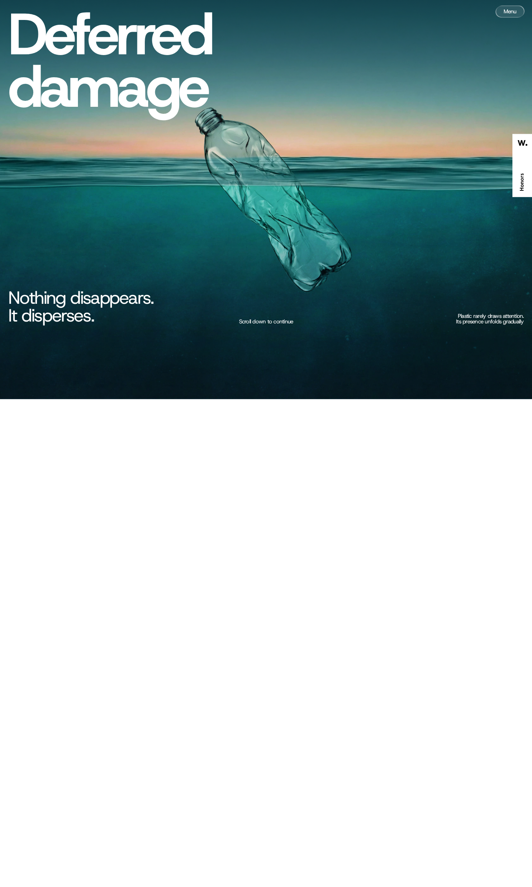
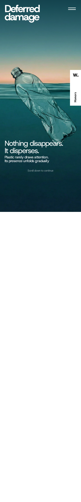

# UI Design System & Master Generation Blueprint: plastic-ocean-com

> **Plastic Ocean** (http://plastic-ocean.com/) — Plastic Ocean



---

## 1. Executive Visual Persona & Design Archetype

- **Brand Essence & Persona**: **Plastic Ocean** (`http://plastic-ocean.com/`). Plastic Ocean
- **Capture Provenance**: Live browser capture (`tier1_fast`, HTTP `200`, captured `2026-11-23`).
- **Visual Archetype**: **Light-Substrate Editorial & Modular Grid System (`#ffffff` canvas, `#000000` ink, `#0d70ff` accent)**.
- **Anti-AI-Slop Differentiators**:
  - **Live-Computed Chromatic Polarity**: Anchors the viewport in `#ffffff` (live computed `body` `background-color` (`computed_styles.json`)) paired with `#000000` primary typography and `#0d70ff` accents.
  - **Grounded Typographic Hierarchy**: Pairs `Host Grotesk Regular` for display copy (`Plastic Ocean`) with `Inter Tight` and not declared in live computed styles (uses primary stack / `ui-monospace`).
  - **Calibrated Spatial Grid & Motion**: Combines `100vw` container bounds (`gap: 5px`, padding `10px`) with `cubic-bezier(0.4,0,0.22,1)` easing and Lenis Smooth Scroll (`data-lenis`), GSAP Timeline & ScrollTrigger.

---

## 2. Spatial Architecture & Modular Grid Mathematics



### Viewport Allocation & Container Geometry
- **Captured Viewport Dimensions**: Desktop `1440×2400px` (`assets/desktop.png`, clamped at 2400px live multi-section capture), Mobile `390×2400px` (`assets/mobile.png`, clamped at 2400px live multi-section capture).
- **Master Container Bounds**: `100vw` (non-`@media` desktop container stylesheet rule).
- **Canvas Lateral Padding & Spacing**: `10px` lateral canvas padding with `5px` grid gap.
- **Border Radius Scale**: `3px`, `5px`, `50%`, `6px`.

### Responsive Breakpoint Architecture
- **Desktop Layout**: Multi-column CSS Grid / Flexbox layout at `1440px` (`max-width: 100vw`, `gap: 5px`).
- **Mobile Layout**: Single-column vertical stack at `390px` viewport width with `10px` horizontal padding.
- **Extracted CSS Media Queries**: `@media (prefers-reduced-motion:reduce)`, `@media (max-width:479px)`, `@media (min-width:480px) and (max-width:767px)`, `@media (min-width:768px) and (max-width:991px)`.

---

## 3. Color System, Materiality & Atmospheric Lighting

### Semantic Palette & Source Grounding
| Semantic Role | Ground-Truth Value | Extracted Live / CSS Source |
|---|---|---|
| **Primary Canvas Substrate** | `#ffffff` | live computed `body` `background-color` (`computed_styles.json`) |
| **Primary Typography Ink** | `#000000` | live computed `body` `color` (`computed_styles.json`) |
| **Elevated Surface / Card Substrate** | `#eeeeee` | `.form .tt-form__captcha .form__... { background-color: #eeeeee }` |
| **Interactive Accent / Highlight** | `#0d70ff` | `.tt-rich-link { color: #0d70ff }` |
| **Secondary / Muted Copy** | `#4f4f4f` | `var(--pswp-icon-color-secondary)` in `:root` |
| **Structural Hairline Border** | `#4f4f4f` | `var(--pswp-icon-stroke-color)` in `:root` |
| **Variable Token (`--pswp-placeholder-bg`)** | `#222222` | `var(--pswp-placeholder-bg)` in `:root` |

### Sanitized Root CSS Variables (`ui-ux.md` Ground Truth)
| Variable Name | Extracted Value | Semantic Role |
|---|---|---|
| `--default-cell-min-width` | `35px` | Layout / Spatial Grid Token |
| `--pswp-bg` | `#000` | Canvas / Surface Token |
| `--pswp-placeholder-bg` | `#222` | Canvas / Surface Token |
| `--pswp-root-z-index` | `100000` | Elevation / Border Token |
| `--pswp-preloader-color` | `rgba(79, 79, 79, 0.4)` | Brand / Palette Token |
| `--pswp-preloader-color-secondary` | `rgba(255, 255, 255, 0.9)` | Brand / Palette Token |
| `--pswp-icon-color` | `#fff` | Brand / Palette Token |
| `--pswp-icon-color-secondary` | `#4f4f4f` | Brand / Palette Token |
| `--pswp-icon-stroke-color` | `#4f4f4f` | Brand / Palette Token |
| `--pswp-icon-stroke-width` | `2px` | Layout / Spatial Grid Token |
| `--pswp-error-text-color` | `var(--pswp-icon-color)` | Typography Ink Token |
| `--custom-fade` | `1` | Design System Custom Token |
| `--webp-bottle-opacity` | `0` | Design System Custom Token |
| `--white-bg-opacity` | `1` | Canvas / Surface Token |
| `--plastic-ocean-co-bg` | `#ffffff` | Canvas Substrate (from live computed `body` `background-color` (`computed_styles.json`)) |
| `--plastic-ocean-co-ink` | `#000000` | Primary Typography Ink (computed-derived) |

---

## 4. Typographic Scale & Editorial Hierarchy

### Font Family Stacks
- **Display Typography**: `Host Grotesk Regular`.
- **Primary Body Stack**: `Inter Tight`.
- **Technical / Metadata Stack**: not declared in live computed styles (uses primary stack / `ui-monospace`).

### Typographic Scale & Rules (Live Computed & Stylesheet Grounded)
- **Hero Display (`H1`)**: observed font-size ladder: `16px`, `14px`, `22px`, `20px`, `10px`.
- **Section Heading (`H2`)**: observed font-size ladder: `16px`, `14px`, `22px`, `20px`, `10px`.
- **Body Copy**: live computed `body` (`font-size: 16px`, `line-height: normal`, `font-weight: 400`).
- **Metadata & Navigation Labels**: live computed `nav/a` (`font-size: 16px`, `line-height: normal`, `font-weight: 400`).

---

## 5. Choreographed Motion & Interaction Physics

### Primary Easing Curves
- **Extracted Timing Functions**: `cubic-bezier(0.4,0,0.22,1)`.

### Per-Element Transition & Choreography Rules
- **Selector `.icon *`**: `transition: inherit` extracted from `plastic-ocean-com` stylesheet.
- **Selector `media (prefers-reduced-motion:red...`**: `transition: .01ms!important` extracted from `plastic-ocean-com` stylesheet.
- **Selector `.slider__list`**: `transition: linear` extracted from `plastic-ocean-com` stylesheet.
- **Extracted Easing Curve (`cubic-bezier(0.4,0,0.22,1)`)**: Governs interactive state transitions across `<header.wf-displayswap-n4-inactive>` and `<section.section--u-i8upocq6y>`.
- **Runtime Interaction Engine**: Integrates Lenis Smooth Scroll (`data-lenis`), GSAP Timeline & ScrollTrigger, Three.js / WebGL Canvas Pipeline, Swiper Touch Carousel Engine with `prefers-reduced-motion: reduce` fallback guards.

---

## 6. Component Wireframe & Structural DOM Map

### Visual Layout Schematic — Desktop (`1440px`, Grounded in `dom.html` & Landmark Bounding Boxes)
```
┌────────────────────────────────────────────────────────────────────────┐
│ DESKTOP VIEWPORT (1440px) — Plastic Ocean                              │
│ ====================================================================== │
│ [ <header.wf-displayswap (1440px)     | get in touch · Case · Nikola ] │
│ ---------------------------------------------------------------------- │
│ | HERO STAGE: <section.section> (w=1440px)                           | │
│ | H1: Plastic Ocean                                                  | │
│ | Substrate: #ffffff | Ink: #000000 | Accent: #0d70ff                | │
│ ---------------------------------------------------------------------- │
│ | SHOWCASE GRID (<section.section--u-i8upoc) max-w: 100vw            | │
│ | +------------------------------+  +------------------------------+ | │
│ | | Featured Work & Interactive  |  | Technical Architecture & Nar | | │
│ | +------------------------------+  +------------------------------+ | │
│ ---------------------------------------------------------------------- │
│ | DETAIL MODULE (<section.section--u-ir9wd7) — Global Directory & Co | │
│ ---------------------------------------------------------------------- │
│ [ FOOTER (<footer.lenis-smooth) | http://plastic-ocean.com/            │
└────────────────────────────────────────────────────────────────────────┘
```

### Visual Layout Schematic — Mobile Reflow (`390px`)
```
┌────────────────────────────────────────────────────────────────────────┐
│ MOBILE VIEWPORT REFLOW (390px) — Single-Column Stack (gap: 5px)        │
│ ====================================================================== │
│ [ HEADER BAR (<header.wf-displayswap-n) | Compact Menu (390px)         │
│ ---------------------------------------------------------------------- │
│ | HERO STAGE (<section.section>) — 390px Vertical Lead               | │
│ | H1: Plastic Ocean                                                  | │
│ ---------------------------------------------------------------------- │
│ | SHOWCASE STACK (<section.section--u-i8) — 1-Col Stack              | │
│ | [ Item 1: Featured Work & Interactive Showcase                   ] | │
│ | [ Item 2: Technical Architecture & Narrative                     ] | │
│ ---------------------------------------------------------------------- │
│ | DETAIL STACK (<section.section--u-ir9w) — 1-Col (Global Directory &) │
│ ---------------------------------------------------------------------- │
│ [ FOOTER (<footer.lenis-smooth) | Stacked 390px Colophon               │
└────────────────────────────────────────────────────────────────────────┘
```

### Granular DOM Region Breakdown
1. **Brand Header & Navigation Bar (<header.wf-displayswap-n4-inactive> — `plastic-ocean-com`)**:
   - Landmark `<header class="wf-displayswap-n4-inactive">` (`1440px`) hosting `Plastic Ocean` navigation (`get in touch · Case · Nikolai Kudriavtsev · Natalia Pugacheva · Evgeny Kuzmin`), DOM attributes (`data-size="1920x1080"`, `data-origin-src="/thumb/2/evC8fvcePJXD..."`, `data-lenis-prevent="true"`, `data-url="https://t.me/nick_kudrya"`), and stylesheet rule `body { overflow-anchor:none;overflow-wrap:break-word;background:fff;margin:0;fo... }`.
2. **Hero Stage & Focal Lead (<section.section> — `Plastic Ocean`)**:
   - Landmark `<section class="section section--u-iqub3glf6">` presenting display lead `Plastic Ocean` and copy excerpt *"This website is a non-commercial demonstration project. We do not"* over `#ffffff` canvas and `#000000` ink.
3. **Primary Showcase & Content Grid (<section.section--u-i8upocq6y> — `Featured Work & Interactive Showca`)**:
   - Landmark `<section class="section section--u-i8upocq6y">` rendering section `Featured Work & Interactive Showcase` with copy *"If you’re interested in this format of storytelling — get in touc"*, asset references (`tt_default_styles.css`, `design-i8z5xo3zc-1649318570_style...`, `shared-design-styles.css`, `animation-design-styles.css`), and grid rule `a:hover { text-decoration:none }`.
4. **Interactive Detail & Feature Matrix (<section.section--u-ir9wd7wkv> — `Technical Architecture & Narrative`)**:
   - Landmark `<section class="section section--u-ir9wd7wkv">` framing `Technical Architecture & Narrative` and `Global Directory & Contact` (*"Plastic pollution is often communicated through overwhelming stat"*) with `#eeeeee` surface cards, `#0d70ff` accents, and `.text-block-wrap-div { flex-grow:1;max-width:100% }`.
5. **Colophon & Global Directory Footer (<footer.lenis-smooth> — `http://plastic-ocean.com/`)**:
   - Landmark `<footer class="lenis-smooth">` anchoring `Plastic Ocean` footer links (`get in touch · Case · Nikolai Kudriavtsev · Natalia Pugacheva · Evgeny Kuzmin`), copy *"The vertical scroll acts as a timeline. As the user scrolls "*, and `#4f4f4f` structural dividers.

---

## 7. Master Zero-Shot AI Generation Prompt

```markdown
# Master Zero-Shot Frontend Generation Prompt: plastic-ocean-com (Plastic Ocean)

You are a principal frontend architect and design systems engineer. Build a complete, production-ready web application replicating the exact design system, DOM landmarks, typographic hierarchy, color tokens, and motion physics of `plastic-ocean-com` (**Plastic Ocean** — `http://plastic-ocean.com/`).

### 1. Visual Archetype & Anti-AI-Slop Mandates
- **Archetype**: Light-Substrate Editorial & Modular Grid System (`#ffffff` canvas, `#000000` ink, `#0d70ff` accent).
- **Identity & Domain Context**: Plastic Ocean
- **Primary Substrate**: `#ffffff` (live computed `body` `background-color` (`computed_styles.json`)), **Primary Ink**: `#000000`, **Accent / Highlight**: `#0d70ff`.
- **Site-Specific Differentiators**:
  - **Live-Computed Chromatic Polarity**: Anchors the viewport in `#ffffff` (live computed `body` `background-color` (`computed_styles.json`)) paired with `#000000` primary typography and `#0d70ff` accents.
  - **Grounded Typographic Hierarchy**: Pairs `Host Grotesk Regular` for display copy (`Plastic Ocean`) with `Inter Tight` and not declared in live computed styles (uses primary stack / `ui-monospace`).
  - **Calibrated Spatial Grid & Motion**: Combines `100vw` container bounds (`gap: 5px`, padding `10px`) with `cubic-bezier(0.4,0,0.22,1)` easing and Lenis Smooth Scroll (`data-lenis`), GSAP Timeline & ScrollTrigger.

### 2. Ground-Truth CSS Variables (`:root` Token Contract)
Declare and consume these exact custom properties extracted from `plastic-ocean-com` in your global stylesheet:

:root {
  /* Plastic Ocean (plastic-ocean-com) — Live-Grounded CSS Variables */
  --default-cell-min-width: 35px; /* Layout / Spatial Grid Token (plastic-ocean-com) */
  --pswp-bg: #000; /* Canvas / Surface Token (plastic-ocean-com) */
  --pswp-placeholder-bg: #222; /* Canvas / Surface Token (plastic-ocean-com) */
  --pswp-root-z-index: 100000; /* Elevation / Border Token (plastic-ocean-com) */
  --pswp-preloader-color: rgba(79, 79, 79, 0.4); /* Brand / Palette Token (plastic-ocean-com) */
  --pswp-preloader-color-secondary: rgba(255, 255, 255, 0.9); /* Brand / Palette Token (plastic-ocean-com) */
  --pswp-icon-color: #fff; /* Brand / Palette Token (plastic-ocean-com) */
  --pswp-icon-color-secondary: #4f4f4f; /* Brand / Palette Token (plastic-ocean-com) */
  --pswp-icon-stroke-color: #4f4f4f; /* Brand / Palette Token (plastic-ocean-com) */
  --pswp-icon-stroke-width: 2px; /* Layout / Spatial Grid Token (plastic-ocean-com) */
  --pswp-error-text-color: var(--pswp-icon-color); /* Typography Ink Token (plastic-ocean-com) */
  --custom-fade: 1; /* Design System Custom Token (plastic-ocean-com) */
  --webp-bottle-opacity: 0; /* Design System Custom Token (plastic-ocean-com) */
  --white-bg-opacity: 1; /* Canvas / Surface Token (plastic-ocean-com) */
  --plastic-ocean-co-bg: #ffffff; /* Canvas Substrate (from live computed `body` `background-color` (`computed_styles.json`)) (plastic-ocean-com) */
  --plastic-ocean-co-ink: #000000; /* Primary Typography Ink (computed-derived) (plastic-ocean-com) */
}

### 3. Semantic Color & Materiality Contract
Map every surface, ink, and border strictly to these source-grounded tokens:
- **Primary Canvas Substrate**: `#ffffff` — grounded in live computed `body` `background-color` (`computed_styles.json`)
- **Primary Typography Ink**: `#000000` — grounded in live computed `body` `color` (`computed_styles.json`)
- **Elevated Surface / Card Substrate**: `#eeeeee` — grounded in `.form .tt-form__captcha .form__... { background-color: #eeeeee }`
- **Interactive Accent / Highlight**: `#0d70ff` — grounded in `.tt-rich-link { color: #0d70ff }`
- **Secondary / Muted Copy**: `#4f4f4f` — grounded in `var(--pswp-icon-color-secondary)` in `:root`
- **Structural Hairline Border**: `#4f4f4f` — grounded in `var(--pswp-icon-stroke-color)` in `:root`
- **Variable Token (`--pswp-placeholder-bg`)**: `#222222` — grounded in `var(--pswp-placeholder-bg)` in `:root`

### 4. Spatial Grid, Container Bounds & Responsive Breakpoints
- **Desktop Viewport Reference**: `1440×2400px` (clamped at 2400px live multi-section capture, `1440px` standard desktop width).
- **Mobile Viewport Reference**: `390×2400px` (clamped at 2400px live multi-section capture, `390px` standard mobile width).
- **Container Max-Width**: `100vw` (non-`@media` desktop container stylesheet rule)
- **Padding & Gutters**: `10px` lateral canvas padding with `5px` grid gap
- **Desktop Grid**: Multi-column CSS Grid / Flexbox layout at `1440px` (`max-width: 100vw`, `gap: 5px`)
- **Mobile Adaptation**: Single-column vertical stack at `390px` viewport width with `10px` horizontal padding
- **Media Queries**: `@media (prefers-reduced-motion:reduce)`, `@media (max-width:479px)`, `@media (min-width:480px) and (max-width:767px)`, `@media (min-width:768px) and (max-width:991px)`
- **Corner Radii**: `3px`, `5px`, `50%`, `6px`

### 5. Typography & Editorial Scale Contract
- **Display Font Stack**: `Host Grotesk Regular`
- **Body Font Stack**: `Inter Tight`
- **Monospace / Technical Font Stack**: not declared in live computed styles (uses primary stack / `ui-monospace`)
- **H1 Display Rule**: observed font-size ladder: `16px`, `14px`, `22px`, `20px`, `10px`
- **H2 Section Rule**: observed font-size ladder: `16px`, `14px`, `22px`, `20px`, `10px`
- **Body Copy Rule**: live computed `body` (`font-size: 16px`, `line-height: normal`, `font-weight: 400`)
- **Metadata & Index Rule**: live computed `nav/a` (`font-size: 16px`, `line-height: normal`, `font-weight: 400`)

### 6. Component Hierarchy, Verbatim Copy & Real DOM Landmarks
Scaffold `plastic-ocean-com` (`Plastic Ocean`) with these exact structural regions, extracted copy, and CSS rules from `dom.html`:
1. **Brand Header & Navigation Bar (<header.wf-displayswap-n4-inactive> — `plastic-ocean-com`)**:
   - DOM & Selectors: Landmark `<header class="wf-displayswap-n4-inactive">` (`1440px`) hosting `Plastic Ocean` navigation (`get in touch · Case · Nikolai Kudriavtsev · Natalia Pugacheva · Evgeny Kuzmin`), DOM attributes (`data-size="1920x1080"`, `data-origin-src="/thumb/2/evC8fvcePJXD..."`, `data-lenis-prevent="true"`, `data-url="https://t.me/nick_kudrya"`), and stylesheet rule `body { overflow-anchor:none;overflow-wrap:break-word;background:fff;margin:0;fo... }`.
   - Responsive Contract: Header `Brand Header & Navigation Bar (<header.wf-displayswap-n4-inactive> — `plastic-ocean-com`)` (`plastic-ocean-com`) adapts across `@media (prefers-reduced-motion:reduce)`, `@media (max-width:479px)`, `@media (min-width:480px) and (max-width:767px)`, `@media (min-width:768px) and (max-width:991px)` with `cubic-bezier(0.4,0,0.22,1)` transitions and links `get in touch · Case · Nikolai Kudriavtsev · Natalia Pugacheva · Evgeny Kuzmin`.
2. **Hero Stage & Focal Lead (<section.section> — `Plastic Ocean`)**:
   - DOM & Selectors: Landmark `<section class="section section--u-iqub3glf6">` presenting display lead `Plastic Ocean` and copy excerpt *"This website is a non-commercial demonstration project. We do not"* over `#ffffff` canvas and `#000000` ink.
   - Responsive Contract: Hero stage (`1440×2400px` desktop / `390×2400px` mobile) sets `#ffffff` background with `#000000` headline `Plastic Ocean`.
3. **Primary Showcase & Content Grid (<section.section--u-i8upocq6y> — `Featured Work & Interactive Showca`)**:
   - DOM & Selectors: Landmark `<section class="section section--u-i8upocq6y">` rendering section `Featured Work & Interactive Showcase` with copy *"If you’re interested in this format of storytelling — get in touc"*, asset references (`tt_default_styles.css`, `design-i8z5xo3zc-1649318570_style...`, `shared-design-styles.css`, `animation-design-styles.css`), and grid rule `a:hover { text-decoration:none }`.
   - Responsive Contract: Showcase grid `Primary Showcase & Content Grid (<section.section--u-i8upocq6y> — `Featured Work & Interactive Showca`)` applies Multi-column CSS Grid / Flexbox layout at `1440px` (`max-width: 100vw`, `gap: 5px`) on desktop and Single-column vertical stack at `390px` viewport width with `10px` horizontal padding on mobile.
4. **Interactive Detail & Feature Matrix (<section.section--u-ir9wd7wkv> — `Technical Architecture & Narrative`)**:
   - DOM & Selectors: Landmark `<section class="section section--u-ir9wd7wkv">` framing `Technical Architecture & Narrative` and `Global Directory & Contact` (*"Plastic pollution is often communicated through overwhelming stat"*) with `#eeeeee` surface cards, `#0d70ff` accents, and `.text-block-wrap-div { flex-grow:1;max-width:100% }`.
   - Responsive Contract: Detail module `Interactive Detail & Feature Matrix (<section.section--u-ir9wd7wkv> — `Technical Architecture & Narrative`)` uses `3px`, `5px`, `50%`, `6px` radii, `#0d70ff` highlights, and assets (tt_default_styles.css, design-i8z5xo3zc-1649318570_style..., shared-design-styles.css).
5. **Colophon & Global Directory Footer (<footer.lenis-smooth> — `http://plastic-ocean.com/`)**:
   - DOM & Selectors: Landmark `<footer class="lenis-smooth">` anchoring `Plastic Ocean` footer links (`get in touch · Case · Nikolai Kudriavtsev · Natalia Pugacheva · Evgeny Kuzmin`), copy *"The vertical scroll acts as a timeline. As the user scrolls "*, and `#4f4f4f` structural dividers.
   - Responsive Contract: Footer `Colophon & Global Directory Footer (<footer.lenis-smooth> — `http://plastic-ocean.com/`)` aligns to `100vw` (non-`@media` desktop container stylesheet rule) with `10px` lateral canvas padding with `5px` grid gap and attributes (data-size="1920x1080", data-origin-src="/thumb/2/evC8fvcePJXD...", data-lenis-prevent="true").

#### Verbatim DOM Copy Excerpts (`dom.html`)
- Copy Excerpt 1: *"This website is a non-commercial demonstration project. We do not use contact form..."*
- Copy Excerpt 2: *"If you’re interested in this format of storytelling — get in touch"*
- Copy Excerpt 3: *"Plastic pollution is often communicated through overwhelming statistics. Our goal..."*
- Copy Excerpt 4: *"The vertical scroll acts as a timeline. As the user scrolls down, the bottle sinks..."*

### 7. Motion, Extracted Stylesheet Rules & Interaction Choreography
- **Primary Easing Functions**: `cubic-bezier(0.4,0,0.22,1)`
- **Extracted Stylesheet Rules (`plastic-ocean-com`)**:
- `body { overflow-anchor:none;overflow-wrap:break-word;background:fff;margin:0;fo... }`
- `a:hover { text-decoration:none }`
- `.text-block-wrap-div { flex-grow:1;max-width:100% }`
- `.text-block span a { color:inherit }`
- `.is-removed { display:none!important }`
- **Per-Selector Transition Rules**:
- **Selector `.icon *`**: `transition: inherit` extracted from `plastic-ocean-com` stylesheet.
- **Selector `media (prefers-reduced-motion:red...`**: `transition: .01ms!important` extracted from `plastic-ocean-com` stylesheet.
- **Selector `.slider__list`**: `transition: linear` extracted from `plastic-ocean-com` stylesheet.
- **Extracted Easing Curve (`cubic-bezier(0.4,0,0.22,1)`)**: Governs interactive state transitions across `<header.wf-displayswap-n4-inactive>` and `<section.section--u-i8upocq6y>`.
- **Runtime Interaction Engine**: Integrates Lenis Smooth Scroll (`data-lenis`), GSAP Timeline & ScrollTrigger, Three.js / WebGL Canvas Pipeline, Swiper Touch Carousel Engine with `prefers-reduced-motion: reduce` fallback guards.

### 8. Technical Deliverables
- Implement in Next.js (App Router) with TypeScript and Tailwind CSS consuming the `:root` custom properties defined above for `plastic-ocean-com`.
- Reproduce both the `1440px` desktop architecture and `390px` mobile breakpoint transitions, preserving semantic HTML5 landmarks (`<header>`, `<nav>`, `<main>`, `<section>`, `<footer>`) and `prefers-reduced-motion` accessibility guards.
```
