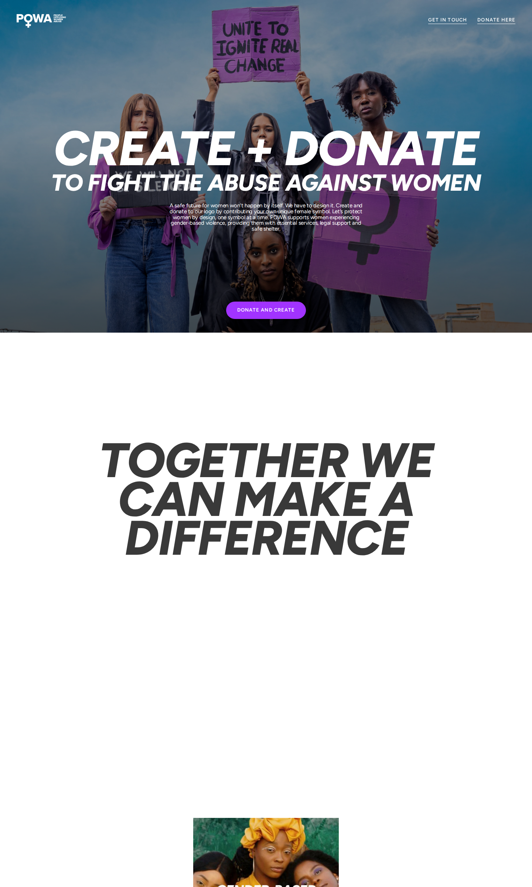

# UI Design System & Master Generation Blueprint: powa-snp-agency

> **Donate to POWA & Stand for Women's Equality · Help End Gender-Based Viol...** (https://powa.snp.agency/) — Join POWA's campaign to stand against gender-based violence. Donate and create a symbol for women's equality. Together, we can make a dif...



---

## 1. Executive Visual Persona & Design Archetype

- **Brand Essence & Persona**: **Donate to POWA & Stand for Women's Equality · Help End Gender-Based Viol...** (`https://powa.snp.agency/`). Join POWA's campaign to stand against gender-based violence. Donate and create a symbol for women's equality. Together, we can make a dif...
- **Capture Provenance**: Live browser capture (`tier1_fast`, HTTP `200`, captured `2026-11-23`).
- **Visual Archetype**: **Light-Substrate Editorial & Modular Grid System (`#f6f4f2` canvas, `#242424` ink, `#a133ff` accent)**.
- **Anti-AI-Slop Differentiators**:
  - **Live-Computed Chromatic Polarity**: Anchors the viewport in `#f6f4f2` (live computed `body` `background-color` (`computed_styles.json`)) paired with `#242424` primary typography and `#a133ff` accents.
  - **Grounded Typographic Hierarchy**: Pairs `__figtree_6417dc` for display copy (`CREATE + DONATE`) with `__figtree_6417dc` and not declared in live computed styles (uses primary stack / `ui-monospace`).
  - **Calibrated Spatial Grid & Motion**: Combines `1440px` container bounds (`gap: 0px (flush layout)`, padding `0px`) with `cubic-bezier(0.55,0.085,0.68,0.53)` easing and Lenis Smooth Scroll (`data-lenis`), Three.js / WebGL Canvas Pipeline.

---

## 2. Spatial Architecture & Modular Grid Mathematics


### Viewport Allocation & Container Geometry
- **Captured Viewport Dimensions**: Desktop `1440×2400px` (`assets/desktop.png`, clamped at 2400px live multi-section capture), Mobile `390×2400px` (`assets/mobile.png`, clamped at 2400px live multi-section capture).
- **Master Container Bounds**: `1440px` (full-bleed `100%` desktop stage measured on `1440px` viewport).
- **Canvas Lateral Padding & Spacing**: `0px` lateral canvas padding with `0px (flush layout)` grid gap.
- **Border Radius Scale**: `50%`, `2px`, `100%`.

### Responsive Breakpoint Architecture
- **Desktop Layout**: Multi-column CSS Grid / Flexbox layout at `1440px` (`max-width: 1440px`, `gap: 0px (flush layout)`).
- **Mobile Layout**: Single-column vertical stack at `390px` viewport width with `0px` horizontal padding.
- **Extracted CSS Media Queries**: `@media screen and (max-width:1024px)`, `@media screen and (max-width:1440px)`, `@media screen and (max-width:1024px)and (hover:hover)`, `@media screen and (min-width:768px)`.

---

## 3. Color System, Materiality & Atmospheric Lighting

### Semantic Palette & Source Grounding
| Semantic Role | Ground-Truth Value | Extracted Live / CSS Source |
|---|---|---|
| **Primary Canvas Substrate** | `#f6f4f2` | live computed `body` `background-color` (`computed_styles.json`) |
| **Primary Typography Ink** | `#242424` | live computed `main` `color` (`computed_styles.json`) |
| **Elevated Surface / Card Substrate** | `#ffffff` | `.WaterfallImageAnimation_item__... { background: #ffffff }` |
| **Interactive Accent / Highlight** | `#a133ff` | `var(--primary-purple)` in `:root` |
| **Secondary / Muted Copy** | `#adabaa` | `var(--secondary-grey)` in `:root` |
| **Structural Hairline Border** | `#acaba9` | `.StyledButton_preset-payment__z... { border: #acaba9 }` |

### Sanitized Root CSS Variables (`ui-ux.md` Ground Truth)
| Variable Name | Extracted Value | Semantic Role |
|---|---|---|
| `--vw-screen` | `360` | Layout / Spatial Grid Token |
| `--logo-size` | `max(2.5rem,28px)` | Layout / Spatial Grid Token |
| `--z-preloader` | `10` | Elevation / Border Token |
| `--z-cursor` | `9` | Elevation / Border Token |
| `--z-page-transition` | `8` | Motion / Easing Token |
| `--z-overflow` | `7` | Elevation / Border Token |
| `--z-banner` | `6` | Elevation / Border Token |
| `--z-modal` | `5` | Elevation / Border Token |
| `--z-header` | `4` | Layout / Spatial Grid Token |
| `--z-transition` | `3` | Motion / Easing Token |
| `--z-header-dropdown` | `2` | Layout / Spatial Grid Token |
| `--z-selectors` | `1` | Elevation / Border Token |
| `--gap-4` | `calc(4 / var(--vw-screen) * 100 * 1vw)` | Layout / Spatial Grid Token |
| `--gap-8` | `calc(8 / var(--vw-screen) * 100 * 1vw)` | Layout / Spatial Grid Token |
| `--gap-12` | `calc(12 / var(--vw-screen) * 100 * 1vw)` | Layout / Spatial Grid Token |
| `--gap-16` | `calc(16 / var(--vw-screen) * 100 * 1vw)` | Layout / Spatial Grid Token |

---

## 4. Typographic Scale & Editorial Hierarchy

### Font Family Stacks
- **Display Typography**: `__figtree_6417dc`.
- **Primary Body Stack**: `__figtree_6417dc`.
- **Technical / Metadata Stack**: not declared in live computed styles (uses primary stack / `ui-monospace`).

### Typographic Scale & Rules (Live Computed & Stylesheet Grounded)
- **Hero Display (`H1`)**: live computed `h1` (`font-size: 131.25px`, `line-height: 105px`, `font-weight: 800`, `letter-spacing: -2.625px`).
- **Section Heading (`H2`)**: live computed `h2` (`font-size: 131.25px`, `line-height: 105px`, `font-weight: 800`, `letter-spacing: -2.625px`).
- **Body Copy**: live computed `body` (`font-size: 15px`, `line-height: 15px`, `font-weight: 400`); rule `p` (`letter-spacing: -.02em`).
- **Metadata & Navigation Labels**: live computed `nav/a` (`font-size: 15px`, `line-height: 15px`, `font-weight: 400`).

---

## 5. Choreographed Motion & Interaction Physics

### Primary Easing Curves
- **Extracted Timing Functions**: `cubic-bezier(0.55,0.085,0.68,0.53)`, `cubic-bezier(0.55,0.055,0.675,0.19)`, `cubic-bezier(0.895,0.03,0.685,0.22)`.

### Per-Element Transition & Choreography Rules
- **Selector `::-webkit-input-placeholder`**: `transition: opacity .3s` extracted from `powa-snp-agency` stylesheet.
- **Selector `::-moz-input-placeholder`**: `transition: opacity .3s` extracted from `powa-snp-agency` stylesheet.
- **Selector `:-moz-placeholder`**: `transition: opacity .3s` extracted from `powa-snp-agency` stylesheet.
- **Extracted Easing Curve (`cubic-bezier(0.55,0.085,0.68,0.53)`)**: Governs interactive state transitions across `<header.fonts-loaded>` and `<section.Intro_root__El5X_>`.
- **Runtime Interaction Engine**: Integrates Lenis Smooth Scroll (`data-lenis`), Three.js / WebGL Canvas Pipeline with `prefers-reduced-motion: reduce` fallback guards.

---

## 6. Component Wireframe & Structural DOM Map

### Visual Layout Schematic — Desktop (`1440px`, Grounded in `dom.html` & Landmark Bounding Boxes)
```
┌────────────────────────────────────────────────────────────────────────┐
│ DESKTOP VIEWPORT (1440px) — Donate to POWA & Stand for Women's Equalit │
│ ====================================================================== │
│ [ <header.fonts-loaded> (1440px)      | Get in touch · DONATE AND CR ] │
│ ---------------------------------------------------------------------- │
│ | HERO STAGE: <section.Land_root__Wp6AW> (w=1440px)                  | │
│ | H1: CREATE + DONATE                                                | │
│ | Substrate: #f6f4f2 | Ink: #242424 | Accent: #a133ff                | │
│ ---------------------------------------------------------------------- │
│ | SHOWCASE GRID (<section.Intro_root__El5X_) max-w: 1440px           | │
│ | +------------------------------+  +------------------------------+ | │
│ | | together we can make a diffe |  | to fight the abuse against w | | │
│ | +------------------------------+  +------------------------------+ | │
│ ---------------------------------------------------------------------- │
│ | DETAIL MODULE (<section.Intro_root__El5X_) — powa-snp-agency Archi | │
│ ---------------------------------------------------------------------- │
│ [ FOOTER (<footer.Cursor_inner) | https://powa.snp.agency/             │
└────────────────────────────────────────────────────────────────────────┘
```

### Visual Layout Schematic — Mobile Reflow (`390px`)
```
┌────────────────────────────────────────────────────────────────────────┐
│ MOBILE VIEWPORT REFLOW (390px) — Single-Column Stack (gap: 0px (flu)   │
│ ====================================================================== │
│ [ HEADER BAR (<header.fonts-loaded>   ) | Compact Menu (390px)         │
│ ---------------------------------------------------------------------- │
│ | HERO STAGE (<section.Land_root__Wp6A) — 390px Vertical Lead        | │
│ | H1: CREATE + DONATE                                                | │
│ ---------------------------------------------------------------------- │
│ | SHOWCASE STACK (<section.Intro_root__E) — 1-Col Stack              | │
│ | [ Item 1: together we can make a difference                      ] | │
│ | [ Item 2: to fight the abuse against women                       ] | │
│ ---------------------------------------------------------------------- │
│ | DETAIL STACK (<section.Intro_root__El5) — 1-Col (powa-snp-agency Ar) │
│ ---------------------------------------------------------------------- │
│ [ FOOTER (<footer.Cursor_inner) | Stacked 390px Colophon               │
└────────────────────────────────────────────────────────────────────────┘
```

### Granular DOM Region Breakdown
1. **Brand Header & Navigation Bar (<header.fonts-loaded> — `powa-snp-agency`)**:
   - Landmark `<header class="fonts-loaded">` (`1440px`) hosting `Donate to POWA & Stand for Women's E` navigation (`Get in touch · DONATE AND CREATE`), DOM attributes (`data-next-font="size-adjust"`, `data-next-font="size-adjust"`, `data-next-font="size-adjust"`, `data-next-font="size-adjust"`), and stylesheet rule `.__className_6417dc { font-family:__figtree_6417dc,__figtree_Fallback_6417dc }`.
2. **Hero Stage & Focal Lead (<section.Land_root__Wp6AW> — `CREATE + DONATE`)**:
   - Landmark `<section class="Land_root__Wp6AW Home_land__wexsp">` presenting display lead `CREATE + DONATE` and copy excerpt *"A safe future for women won’t happen by itself. We have to design"* over `#f6f4f2` canvas and `#242424` ink.
3. **Primary Showcase & Content Grid (<section.Intro_root__El5X_> — `together we can make a difference`)**:
   - Landmark `<section class="Intro_root__El5X_">` rendering section `together we can make a difference` with copy *"to fight the abuse against women"*, asset references (`light-apple-touch-icon.png`, `light-favicon-32x32.png`, `light-favicon-16x16.png`, `light-site.webmanifest`), and grid rule `.__variable_6417dc { --primary-font:"__figtree_6417dc","__figtree_Fallback_6417dc" }`.
4. **Interactive Detail & Feature Matrix (<section.Intro_root__El5X_:nth(2)> — `to fight the abuse against women`)**:
   - Landmark `<section class="Intro_root__El5X_">` framing `to fight the abuse against women` and `powa-snp-agency Archive & Directory` (*"together we can make a difference"*) with `#ffffff` surface cards, `#a133ff` accents, and `before { box-sizing:inherit }`.
5. **Colophon & Global Directory Footer (<footer.Cursor_innerWrap__BCUuD> — `https://powa.snp.agency/`)**:
   - Landmark `<footer class="Cursor_innerWrap__BCUuD">` anchoring `Donate to POWA & Stand for Women` footer links (`Get in touch · DONATE AND CREATE`), copy *"to fight the abuse against women"*, and `#acaba9` structural dividers.

---

## 7. Master Zero-Shot AI Generation Prompt

```markdown
# Master Zero-Shot Frontend Generation Prompt: powa-snp-agency (Donate to POWA & Stand for Women's Equality · Help End Gender-Based Viol...)

You are a principal frontend architect and design systems engineer. Build a complete, production-ready web application replicating the exact design system, DOM landmarks, typographic hierarchy, color tokens, and motion physics of `powa-snp-agency` (**Donate to POWA & Stand for Women's Equality · Help End Gender-Based Viol...** — `https://powa.snp.agency/`).

### 1. Visual Archetype & Anti-AI-Slop Mandates
- **Archetype**: Light-Substrate Editorial & Modular Grid System (`#f6f4f2` canvas, `#242424` ink, `#a133ff` accent).
- **Identity & Domain Context**: Join POWA's campaign to stand against gender-based violence. Donate and create a symbol for women's equality. Together, we can make a dif...
- **Primary Substrate**: `#f6f4f2` (live computed `body` `background-color` (`computed_styles.json`)), **Primary Ink**: `#242424`, **Accent / Highlight**: `#a133ff`.
- **Site-Specific Differentiators**:
  - **Live-Computed Chromatic Polarity**: Anchors the viewport in `#f6f4f2` (live computed `body` `background-color` (`computed_styles.json`)) paired with `#242424` primary typography and `#a133ff` accents.
  - **Grounded Typographic Hierarchy**: Pairs `__figtree_6417dc` for display copy (`CREATE + DONATE`) with `__figtree_6417dc` and not declared in live computed styles (uses primary stack / `ui-monospace`).
  - **Calibrated Spatial Grid & Motion**: Combines `1440px` container bounds (`gap: 0px (flush layout)`, padding `0px`) with `cubic-bezier(0.55,0.085,0.68,0.53)` easing and Lenis Smooth Scroll (`data-lenis`), Three.js / WebGL Canvas Pipeline.

### 2. Ground-Truth CSS Variables (`:root` Token Contract)
Declare and consume these exact custom properties extracted from `powa-snp-agency` in your global stylesheet:

:root {
  /* Donate to POWA & Stand for Women's Equality · Help End Gender-Based Viol... (powa-snp-agency) — Live-Grounded CSS Variables */
  --vw-screen: 360; /* Layout / Spatial Grid Token (powa-snp-agency) */
  --logo-size: max(2.5rem,28px); /* Layout / Spatial Grid Token (powa-snp-agency) */
  --z-preloader: 10; /* Elevation / Border Token (powa-snp-agency) */
  --z-cursor: 9; /* Elevation / Border Token (powa-snp-agency) */
  --z-page-transition: 8; /* Motion / Easing Token (powa-snp-agency) */
  --z-overflow: 7; /* Elevation / Border Token (powa-snp-agency) */
  --z-banner: 6; /* Elevation / Border Token (powa-snp-agency) */
  --z-modal: 5; /* Elevation / Border Token (powa-snp-agency) */
  --z-header: 4; /* Layout / Spatial Grid Token (powa-snp-agency) */
  --z-transition: 3; /* Motion / Easing Token (powa-snp-agency) */
  --z-header-dropdown: 2; /* Layout / Spatial Grid Token (powa-snp-agency) */
  --z-selectors: 1; /* Elevation / Border Token (powa-snp-agency) */
  --gap-4: calc(4 / var(--vw-screen) * 100 * 1vw); /* Layout / Spatial Grid Token (powa-snp-agency) */
  --gap-8: calc(8 / var(--vw-screen) * 100 * 1vw); /* Layout / Spatial Grid Token (powa-snp-agency) */
  --gap-12: calc(12 / var(--vw-screen) * 100 * 1vw); /* Layout / Spatial Grid Token (powa-snp-agency) */
  --gap-16: calc(16 / var(--vw-screen) * 100 * 1vw); /* Layout / Spatial Grid Token (powa-snp-agency) */
}

### 3. Semantic Color & Materiality Contract
Map every surface, ink, and border strictly to these source-grounded tokens:
- **Primary Canvas Substrate**: `#f6f4f2` — grounded in live computed `body` `background-color` (`computed_styles.json`)
- **Primary Typography Ink**: `#242424` — grounded in live computed `main` `color` (`computed_styles.json`)
- **Elevated Surface / Card Substrate**: `#ffffff` — grounded in `.WaterfallImageAnimation_item__... { background: #ffffff }`
- **Interactive Accent / Highlight**: `#a133ff` — grounded in `var(--primary-purple)` in `:root`
- **Secondary / Muted Copy**: `#adabaa` — grounded in `var(--secondary-grey)` in `:root`
- **Structural Hairline Border**: `#acaba9` — grounded in `.StyledButton_preset-payment__z... { border: #acaba9 }`

### 4. Spatial Grid, Container Bounds & Responsive Breakpoints
- **Desktop Viewport Reference**: `1440×2400px` (clamped at 2400px live multi-section capture, `1440px` standard desktop width).
- **Mobile Viewport Reference**: `390×2400px` (clamped at 2400px live multi-section capture, `390px` standard mobile width).
- **Container Max-Width**: `1440px` (full-bleed `100%` desktop stage measured on `1440px` viewport)
- **Padding & Gutters**: `0px` lateral canvas padding with `0px (flush layout)` grid gap
- **Desktop Grid**: Multi-column CSS Grid / Flexbox layout at `1440px` (`max-width: 1440px`, `gap: 0px (flush layout)`)
- **Mobile Adaptation**: Single-column vertical stack at `390px` viewport width with `0px` horizontal padding
- **Media Queries**: `@media screen and (max-width:1024px)`, `@media screen and (max-width:1440px)`, `@media screen and (max-width:1024px)and (hover:hover)`, `@media screen and (min-width:768px)`
- **Corner Radii**: `50%`, `2px`, `100%`

### 5. Typography & Editorial Scale Contract
- **Display Font Stack**: `__figtree_6417dc`
- **Body Font Stack**: `__figtree_6417dc`
- **Monospace / Technical Font Stack**: not declared in live computed styles (uses primary stack / `ui-monospace`)
- **H1 Display Rule**: live computed `h1` (`font-size: 131.25px`, `line-height: 105px`, `font-weight: 800`, `letter-spacing: -2.625px`)
- **H2 Section Rule**: live computed `h2` (`font-size: 131.25px`, `line-height: 105px`, `font-weight: 800`, `letter-spacing: -2.625px`)
- **Body Copy Rule**: live computed `body` (`font-size: 15px`, `line-height: 15px`, `font-weight: 400`); rule `p` (`letter-spacing: -.02em`)
- **Metadata & Index Rule**: live computed `nav/a` (`font-size: 15px`, `line-height: 15px`, `font-weight: 400`)

### 6. Component Hierarchy, Verbatim Copy & Real DOM Landmarks
Scaffold `powa-snp-agency` (`Donate to POWA & Stand for Women's Equality · Help End Gender-Based Viol...`) with these exact structural regions, extracted copy, and CSS rules from `dom.html`:
1. **Brand Header & Navigation Bar (<header.fonts-loaded> — `powa-snp-agency`)**:
   - DOM & Selectors: Landmark `<header class="fonts-loaded">` (`1440px`) hosting `Donate to POWA & Stand for Women's E` navigation (`Get in touch · DONATE AND CREATE`), DOM attributes (`data-next-font="size-adjust"`, `data-next-font="size-adjust"`, `data-next-font="size-adjust"`, `data-next-font="size-adjust"`), and stylesheet rule `.__className_6417dc { font-family:__figtree_6417dc,__figtree_Fallback_6417dc }`.
   - Responsive Contract: Header `Brand Header & Navigation Bar (<header.fonts-loaded> — `powa-snp-agency`)` (`powa-snp-agency`) adapts across `@media screen and (max-width:1024px)`, `@media screen and (max-width:1440px)`, `@media screen and (max-width:1024px)and (hover:hover)`, `@media screen and (min-width:768px)` with `cubic-bezier(0.55,0.085,0.68,0.53)`, `cubic-bezier(0.55,0.055,0.675,0.19)`, `cubic-bezier(0.895,0.03,0.685,0.22)` transitions and links `Get in touch · DONATE AND CREATE`.
2. **Hero Stage & Focal Lead (<section.Land_root__Wp6AW> — `CREATE + DONATE`)**:
   - DOM & Selectors: Landmark `<section class="Land_root__Wp6AW Home_land__wexsp">` presenting display lead `CREATE + DONATE` and copy excerpt *"A safe future for women won’t happen by itself. We have to design"* over `#f6f4f2` canvas and `#242424` ink.
   - Responsive Contract: Hero stage (`1440×2400px` desktop / `390×2400px` mobile) sets `#f6f4f2` background with `#242424` headline `CREATE + DONATE`.
3. **Primary Showcase & Content Grid (<section.Intro_root__El5X_> — `together we can make a difference`)**:
   - DOM & Selectors: Landmark `<section class="Intro_root__El5X_">` rendering section `together we can make a difference` with copy *"to fight the abuse against women"*, asset references (`light-apple-touch-icon.png`, `light-favicon-32x32.png`, `light-favicon-16x16.png`, `light-site.webmanifest`), and grid rule `.__variable_6417dc { --primary-font:"__figtree_6417dc","__figtree_Fallback_6417dc" }`.
   - Responsive Contract: Showcase grid `Primary Showcase & Content Grid (<section.Intro_root__El5X_> — `together we can make a difference`)` applies Multi-column CSS Grid / Flexbox layout at `1440px` (`max-width: 1440px`, `gap: 0px (flush layout)`) on desktop and Single-column vertical stack at `390px` viewport width with `0px` horizontal padding on mobile.
4. **Interactive Detail & Feature Matrix (<section.Intro_root__El5X_:nth(2)> — `to fight the abuse against women`)**:
   - DOM & Selectors: Landmark `<section class="Intro_root__El5X_">` framing `to fight the abuse against women` and `powa-snp-agency Archive & Directory` (*"together we can make a difference"*) with `#ffffff` surface cards, `#a133ff` accents, and `before { box-sizing:inherit }`.
   - Responsive Contract: Detail module `Interactive Detail & Feature Matrix (<section.Intro_root__El5X_:nth(2)> — `to fight the abuse against women`)` uses `50%`, `2px`, `100%` radii, `#a133ff` highlights, and assets (light-apple-touch-icon.png, light-favicon-32x32.png, light-favicon-16x16.png).
5. **Colophon & Global Directory Footer (<footer.Cursor_innerWrap__BCUuD> — `https://powa.snp.agency/`)**:
   - DOM & Selectors: Landmark `<footer class="Cursor_innerWrap__BCUuD">` anchoring `Donate to POWA & Stand for Women` footer links (`Get in touch · DONATE AND CREATE`), copy *"to fight the abuse against women"*, and `#acaba9` structural dividers.
   - Responsive Contract: Footer `Colophon & Global Directory Footer (<footer.Cursor_innerWrap__BCUuD> — `https://powa.snp.agency/`)` aligns to `1440px` (full-bleed `100%` desktop stage measured on `1440px` viewport) with `0px` lateral canvas padding with `0px (flush layout)` grid gap and attributes (data-next-font="size-adjust", data-next-font="size-adjust", data-next-font="size-adjust").

#### Verbatim DOM Copy Excerpts (`dom.html`)
- Copy Excerpt 1: *"A safe future for women won’t happen by itself. We have to design it. Create and d..."*
- Copy Excerpt 2: *"to fight the abuse against women"*

### 7. Motion, Extracted Stylesheet Rules & Interaction Choreography
- **Primary Easing Functions**: `cubic-bezier(0.55,0.085,0.68,0.53)`, `cubic-bezier(0.55,0.055,0.675,0.19)`, `cubic-bezier(0.895,0.03,0.685,0.22)`
- **Extracted Stylesheet Rules (`powa-snp-agency`)**:
- `.__className_6417dc { font-family:__figtree_6417dc,__figtree_Fallback_6417dc }`
- `.__variable_6417dc { --primary-font:"__figtree_6417dc","__figtree_Fallback_6417dc" }`
- `before { box-sizing:inherit }`
- `html { box-sizing:border-box;height:100% }`
- `webkit-input-placeholder { color:inherit;opacity:1;-webkit-transition:opacity .3s;transition:opacit... }`
- **Per-Selector Transition Rules**:
- **Selector `::-webkit-input-placeholder`**: `transition: opacity .3s` extracted from `powa-snp-agency` stylesheet.
- **Selector `::-moz-input-placeholder`**: `transition: opacity .3s` extracted from `powa-snp-agency` stylesheet.
- **Selector `:-moz-placeholder`**: `transition: opacity .3s` extracted from `powa-snp-agency` stylesheet.
- **Extracted Easing Curve (`cubic-bezier(0.55,0.085,0.68,0.53)`)**: Governs interactive state transitions across `<header.fonts-loaded>` and `<section.Intro_root__El5X_>`.
- **Runtime Interaction Engine**: Integrates Lenis Smooth Scroll (`data-lenis`), Three.js / WebGL Canvas Pipeline with `prefers-reduced-motion: reduce` fallback guards.

### 8. Technical Deliverables
- Implement in Next.js (App Router) with TypeScript and Tailwind CSS consuming the `:root` custom properties defined above for `powa-snp-agency`.
- Reproduce both the `1440px` desktop architecture and `390px` mobile breakpoint transitions, preserving semantic HTML5 landmarks (`<header>`, `<nav>`, `<main>`, `<section>`, `<footer>`) and `prefers-reduced-motion` accessibility guards.
```
