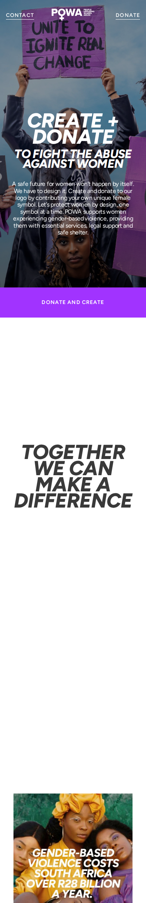

# UI Design System & Master Generation Blueprint: powa-snp-agency

> **Donate to POWA & Stand for Women's Equality · Help End Gender-Based Viol...** (https://powa.snp.agency/) — Join POWA's campaign to stand against gender-based violence. Donate and create a symbol for women's equality. Together, we can make a dif...


---

## 1. Executive Visual Persona & Design Archetype

- **Brand Essence & Persona**: **Donate to POWA & Stand for Women's Equality · Help End Gender-Based Viol...** (`https://powa.snp.agency/`). Join POWA's campaign to stand against gender-based violence. Donate and create a symbol for women's equality. Together, we can make a dif...
- **Visual Archetype**: **Light-Substrate Editorial & Modular Grid System (`#f6f4f2` canvas, `#000` ink, `#000` accent)**.
- **Anti-AI-Slop Differentiators**:
  - **Source-Grounded Chromatic Polarity**: Anchors the viewport in `#f6f4f2` (`var(--color-1)` in `:root`) paired with `#000` primary typography and `#000` accents.
  - **Extracted Typographic Hierarchy**: Pairs `__figtree_6417dc` for display copy (`CREATE + DONATE`) with `__figtree_Fallback_6417dc` and not declared in static CSS (uses primary stack / `ui-monospace`).
  - **Calibrated Spatial Grid & Motion**: Combines `1024px` container bounds (`gap: 0px (flush layout)`, padding `0px`) with `cubic-bezier(0.55,0.085,0.68,0.53)` easing and Lenis Smooth Scroll (`data-lenis`), Three.js / WebGL Canvas Pipeline.

---

## 2. Spatial Architecture & Modular Grid Mathematics



### Viewport Allocation & Container Geometry
- **Captured Viewport Dimensions**: Desktop `1440×8138px` (`assets/desktop.png`, full-page scroll capture), Mobile `390×2400px` (`assets/mobile.png`, capped at 2400px multi-section capture).
- **Master Container Bounds**: `1024px` extracted from `powa-snp-agency` stylesheet.
- **Canvas Lateral Padding & Spacing**: `0px` lateral canvas padding with `0px (flush layout)` grid gap.
- **Border Radius Scale**: `50%`, `2px`, `100%`.

### Responsive Breakpoint Architecture
- **Desktop Layout**: Multi-column CSS Grid / Flexbox layout at `1440px` (`max-width: 1024px`, `gap: 0px (flush layout)`).
- **Mobile Layout**: Single-column vertical stack at `390px` viewport width with `0px` horizontal padding.
- **Extracted CSS Media Queries**: `@media screen and (max-width:1024px)`, `@media screen and (max-width:1024px)and (hover:hover)`, `@media screen and (min-width:768px)`, `@media screen and (max-width:768px)`.

---

## 3. Color System, Materiality & Atmospheric Lighting

### Semantic Palette & Source Grounding
| Semantic Role | Ground-Truth Value | Extracted CSS Source / Selector |
|---|---|---|
| **Primary Canvas Substrate** | `#f6f4f2` | `var(--color-1)` in `:root` |
| **Primary Typography Ink** | `#b7b6b4` | `var(--color-4)` in `:root` |
| **Elevated Surface / Card Substrate** | `#404040` | `var(--color-5)` in `:root` |
| **Interactive Accent / Highlight** | `#000` | `var(--black)` in `:root` |
| **Secondary / Muted Copy** | `#fff` | `var(--white)` in `:root` |
| **Structural Hairline Border** | `#a133ff` | `var(--primary-purple)` in `:root` |

### Sanitized Root CSS Variables (`ui-ux.md` Ground Truth)
| Variable Name | Extracted Value | Semantic Role |
|---|---|---|
| `--gradient-position` | `0%!important` | Dimension / Scale Token |
| `--hsp` | `calc(14.12% * (1 - var(--gradient-val)) + 100% * var(--gradient-val))` | Dimension / Scale Token |
| `--color` | `hsl(0 0% var(--hsp)/1)` | Brand / Palette Token |
| `--p2` | `1` | Design System Custom Token |
| `--p3` | `1` | Design System Custom Token |
| `--content-position` | `none` | Design System Custom Token |
| `--card-width` | `max(26.25rem,294px)` | Layout / Spatial Grid Token |
| `--card-height` | `max(35rem,392px)` | Layout / Spatial Grid Token |
| `--in` | `0` | Design System Custom Token |
| `--scale-bg-image` | `calc(1 * (1 - var(--parallax)) + 1.08 * var(--parallax))` | Canvas / Surface Token |
| `--primary-font` | `"__figtree_6417dc","__figtree_Fallback_6417dc"` | Brand / Palette Token |
| `--vw-screen` | `360` | Layout / Spatial Grid Token |
| `--logo-size` | `max(2.5rem,28px)` | Layout / Spatial Grid Token |
| `--z-preloader` | `10` | Elevation / Border Token |
| `--z-cursor` | `9` | Elevation / Border Token |
| `--z-page-transition` | `8` | Motion / Easing Token |

---

## 4. Typographic Scale & Editorial Hierarchy

### Font Family Stacks
- **Display Typography**: `__figtree_6417dc`.
- **Primary Body Stack**: `__figtree_Fallback_6417dc`.
- **Technical / Metadata Stack**: not declared in static CSS (uses primary stack / `ui-monospace`).

### Typographic Scale & Rules (Extracted from Stylesheet & Variables)
- **Hero Display (`H1`)**: not explicitly declared on tag in static CSS (stylesheet font-size ladder: `12px`, `15px`).
- **Section Heading (`H2`)**: not explicitly declared on tag in static CSS (stylesheet font-size ladder: `12px`, `15px`).
- **Body Copy**: rule `p` (`letter-spacing: -.02em`).
- **Metadata & Navigation Labels**: not explicitly declared on tag in static CSS (stylesheet font-size ladder: `12px`, `15px`).

---

## 5. Choreographed Motion & Interaction Physics

### Primary Easing Curves
- **Extracted Timing Functions**: `cubic-bezier(0.55,0.085,0.68,0.53)`, `cubic-bezier(0.55,0.055,0.675,0.19)`, `cubic-bezier(0.895,0.03,0.685,0.22)`.

### Per-Element Transition & Choreography Rules
- **Selector `.StyledButton_preset-circle__HejjF`**: `transition: background-color .38s var(--ease-out-cubic)` extracted from `powa-snp-agency` stylesheet.
- **Selector `ledButton_preset-circle-white__h_...`**: `transition: background-color .2s ease,color .2s ease` extracted from `powa-snp-agency` stylesheet.
- **Selector `.StyledButton_preset-payment__zbtBF`**: `transition: background-color .38s var(--ease-out-cubic),opacity .28s var(-...` extracted from `powa-snp-agency` stylesheet.
- **Extracted Easing Curve (`cubic-bezier(0.55,0.085,0.68,0.53)`)**: Governs interactive state transitions across `<header.lenis>` and `<section.Intro_root__El5X_>`.
- **Runtime Interaction Engine**: Integrates Lenis Smooth Scroll (`data-lenis`), Three.js / WebGL Canvas Pipeline with `prefers-reduced-motion: reduce` fallback guards.

---

## 6. Component Wireframe & Structural DOM Map

### Visual Layout Schematic (Grounded in `dom.html` — `1440px` Desktop & `390px` Mobile Reflow)
```
┌────────────────────────────────────────────────────────────────────────┐
│ DESKTOP VIEWPORT (1440px) — Donate to POWA & Stand for Women's Equalit │
│ ====================================================================== │
│ [ <header.lenis>           | Get in touch · DONATE AND CREATE       ]  │
│ ---------------------------------------------------------------------- │
│ | HERO STAGE: <section.Land_root__Wp6AW>                           |   │
│ | H1: CREATE + DONATE                                              |   │
│ | Substrate: #f6f4f2    | Ink: #000       | Accent: #000           |   │
│ ---------------------------------------------------------------------- │
│ | SHOWCASE GRID (<section.Intro_root__El5X_) max-w: 1024px         |   │
│ | +------------------------------+  +------------------------------+ | │
│ | | together we can make a diffe |  | to fight the abuse against w | | │
│ | +------------------------------+  +------------------------------+ | │
│ ---------------------------------------------------------------------- │
│ | MOBILE VIEWPORT REFLOW (390px) — Single-Column Stack (gap: 0px (f) | │
│ | [<header.lenis>] -> [<section.Land_root] -> [<section.Intro_roo] |   │
│ ---------------------------------------------------------------------- │
│ [ FOOTER (<footer.Cursor_innerWr) | https://powa.snp.agency/           │
└────────────────────────────────────────────────────────────────────────┘
```

### Granular DOM Region Breakdown
1. **Brand Header & Navigation Bar (<header.lenis> — `powa-snp-agency`)**:
   - Landmark `<header class="lenis">` hosting `Donate to POWA & Stand for Women's E` navigation (`Get in touch · DONATE AND CREATE`), DOM attributes (`data-next-font="size-adjust"`, `data-next-font="size-adjust"`, `data-next-font="size-adjust"`, `data-next-font="size-adjust"`), and stylesheet rule `.Button_root__tsZ_o { position:relative;-webkit-user-select:none;-moz-user-select:none;user-se... }`.
2. **Hero Stage & Focal Lead (<section.Land_root__Wp6AW> — `CREATE + DONATE`)**:
   - Landmark `<section class="Land_root__Wp6AW Home_land__wexsp">` presenting display lead `CREATE + DONATE` and copy excerpt *"People Opposing Women Abuse People Opposing Women Abuse"* over `#f6f4f2` canvas and `#000` ink.
3. **Primary Showcase & Content Grid (<section.Intro_root__El5X_> — `together we can make a difference`)**:
   - Landmark `<section class="Intro_root__El5X_">` rendering section `together we can make a difference` with copy *"to fight the abuse against women"*, asset references (`pre_loader_1_1ff729f650.webp`, `pre_loader_2_ab07e72eb0.webp`, `pre_loader_3_518c8cc74b.webp`, `pre_loader_4_35a48a8bf5.webp`), and grid rule `.StyledButton_root___XGUu { display:inline-flex }`.
4. **Interactive Detail & Feature Matrix (<section.Intro_root__El5X_> — `to fight the abuse against women`)**:
   - Landmark `<section class="Intro_root__El5X_">` framing `to fight the abuse against women` and `A safe future for women won’t happen by itself. ` (*"A safe future for women won’t happen by itself. We have to design"*) with `#404040` surface cards, `#000` accents, and `.StyledButton_inner__p0jg2 { -webkit-user-select:none;-moz-user-select:none;user-select:none }`.
5. **Colophon & Global Directory Footer (<footer.Cursor_innerWrap__BCUuD> — `https://powa.snp.agency/`)**:
   - Landmark `<footer class="Cursor_innerWrap__BCUuD">` anchoring `Donate to POWA & Stand for Women` footer links (`Get in touch · DONATE AND CREATE`), copy *"to fight the abuse against women"*, and `#a133ff` structural dividers.

---

## 7. Master Zero-Shot AI Generation Prompt

```markdown
# Master Zero-Shot Frontend Generation Prompt: powa-snp-agency (Donate to POWA & Stand for Women's Equality · Help End Gender-Based Viol...)

You are a principal frontend architect and design systems engineer. Build a complete, production-ready web application replicating the exact design system, DOM landmarks, typographic hierarchy, color tokens, and motion physics of `powa-snp-agency` (**Donate to POWA & Stand for Women's Equality · Help End Gender-Based Viol...** — `https://powa.snp.agency/`).

### 1. Visual Archetype & Anti-AI-Slop Mandates
- **Archetype**: Light-Substrate Editorial & Modular Grid System (`#f6f4f2` canvas, `#000` ink, `#000` accent).
- **Identity & Domain Context**: Join POWA's campaign to stand against gender-based violence. Donate and create a symbol for women's equality. Together, we can make a dif...
- **Primary Substrate**: `#f6f4f2` (`var(--color-1)` in `:root`), **Primary Ink**: `#000`, **Accent / Highlight**: `#000`.
- **Site-Specific Differentiators**:
  - **Source-Grounded Chromatic Polarity**: Anchors the viewport in `#f6f4f2` (`var(--color-1)` in `:root`) paired with `#000` primary typography and `#000` accents.
  - **Extracted Typographic Hierarchy**: Pairs `__figtree_6417dc` for display copy (`CREATE + DONATE`) with `__figtree_Fallback_6417dc` and not declared in static CSS (uses primary stack / `ui-monospace`).
  - **Calibrated Spatial Grid & Motion**: Combines `1024px` container bounds (`gap: 0px (flush layout)`, padding `0px`) with `cubic-bezier(0.55,0.085,0.68,0.53)` easing and Lenis Smooth Scroll (`data-lenis`), Three.js / WebGL Canvas Pipeline.

### 2. Ground-Truth CSS Variables (`:root` Token Contract)
Declare and consume these exact custom properties extracted from `powa-snp-agency` in your global stylesheet:

:root {
  /* Donate to POWA & Stand for Women's Equality · Help End Gender-Based Viol... (powa-snp-agency) — Ground-Truth Extracted CSS Variables */
  --gradient-position: 0%!important; /* Dimension / Scale Token (powa-snp-agency) */
  --hsp: calc(14.12% * (1 - var(--gradient-val)) + 100% * var(--gradient-val)); /* Dimension / Scale Token (powa-snp-agency) */
  --color: hsl(0 0% var(--hsp)/1); /* Brand / Palette Token (powa-snp-agency) */
  --p2: 1; /* Design System Custom Token (powa-snp-agency) */
  --p3: 1; /* Design System Custom Token (powa-snp-agency) */
  --content-position: none; /* Design System Custom Token (powa-snp-agency) */
  --card-width: max(26.25rem,294px); /* Layout / Spatial Grid Token (powa-snp-agency) */
  --card-height: max(35rem,392px); /* Layout / Spatial Grid Token (powa-snp-agency) */
  --in: 0; /* Design System Custom Token (powa-snp-agency) */
  --scale-bg-image: calc(1 * (1 - var(--parallax)) + 1.08 * var(--parallax)); /* Canvas / Surface Token (powa-snp-agency) */
  --primary-font: "__figtree_6417dc","__figtree_Fallback_6417dc"; /* Brand / Palette Token (powa-snp-agency) */
  --vw-screen: 360; /* Layout / Spatial Grid Token (powa-snp-agency) */
  --logo-size: max(2.5rem,28px); /* Layout / Spatial Grid Token (powa-snp-agency) */
  --z-preloader: 10; /* Elevation / Border Token (powa-snp-agency) */
  --z-cursor: 9; /* Elevation / Border Token (powa-snp-agency) */
  --z-page-transition: 8; /* Motion / Easing Token (powa-snp-agency) */
}

### 3. Semantic Color & Materiality Contract
Map every surface, ink, and border strictly to these source-grounded tokens:
- **Primary Canvas Substrate**: `#f6f4f2` — grounded in `var(--color-1)` in `:root`
- **Primary Typography Ink**: `#b7b6b4` — grounded in `var(--color-4)` in `:root`
- **Elevated Surface / Card Substrate**: `#404040` — grounded in `var(--color-5)` in `:root`
- **Interactive Accent / Highlight**: `#000` — grounded in `var(--black)` in `:root`
- **Secondary / Muted Copy**: `#fff` — grounded in `var(--white)` in `:root`
- **Structural Hairline Border**: `#a133ff` — grounded in `var(--primary-purple)` in `:root`

### 4. Spatial Grid, Container Bounds & Responsive Breakpoints
- **Desktop Viewport Reference**: `1440×8138px` (full-page scroll capture, `1440px` standard desktop width).
- **Mobile Viewport Reference**: `390×2400px` (capped at 2400px multi-section capture, `390px` standard mobile width).
- **Container Max-Width**: `1024px` extracted from `powa-snp-agency` stylesheet
- **Padding & Gutters**: `0px` lateral canvas padding with `0px (flush layout)` grid gap
- **Desktop Grid**: Multi-column CSS Grid / Flexbox layout at `1440px` (`max-width: 1024px`, `gap: 0px (flush layout)`)
- **Mobile Adaptation**: Single-column vertical stack at `390px` viewport width with `0px` horizontal padding
- **Media Queries**: `@media screen and (max-width:1024px)`, `@media screen and (max-width:1024px)and (hover:hover)`, `@media screen and (min-width:768px)`, `@media screen and (max-width:768px)`
- **Corner Radii**: `50%`, `2px`, `100%`

### 5. Typography & Editorial Scale Contract
- **Display Font Stack**: `__figtree_6417dc`
- **Body Font Stack**: `__figtree_Fallback_6417dc`
- **Monospace / Technical Font Stack**: not declared in static CSS (uses primary stack / `ui-monospace`)
- **H1 Display Rule**: not explicitly declared on tag in static CSS (stylesheet font-size ladder: `12px`, `15px`)
- **H2 Section Rule**: not explicitly declared on tag in static CSS (stylesheet font-size ladder: `12px`, `15px`)
- **Body Copy Rule**: rule `p` (`letter-spacing: -.02em`)
- **Metadata & Index Rule**: not explicitly declared on tag in static CSS (stylesheet font-size ladder: `12px`, `15px`)

### 6. Component Hierarchy, Verbatim Copy & Real DOM Landmarks
Scaffold `powa-snp-agency` (`Donate to POWA & Stand for Women's Equality · Help End Gender-Based Viol...`) with these exact structural regions, extracted copy, and CSS rules from `dom.html`:
1. **Brand Header & Navigation Bar (<header.lenis> — `powa-snp-agency`)**:
   - DOM & Selectors: Landmark `<header class="lenis">` hosting `Donate to POWA & Stand for Women's E` navigation (`Get in touch · DONATE AND CREATE`), DOM attributes (`data-next-font="size-adjust"`, `data-next-font="size-adjust"`, `data-next-font="size-adjust"`, `data-next-font="size-adjust"`), and stylesheet rule `.Button_root__tsZ_o { position:relative;-webkit-user-select:none;-moz-user-select:none;user-se... }`.
   - Responsive Contract: Header `Brand Header & Navigation Bar (<header.lenis> — `powa-snp-agency`)` (`powa-snp-agency`) adapts across `@media screen and (max-width:1024px)`, `@media screen and (max-width:1024px)and (hover:hover)`, `@media screen and (min-width:768px)`, `@media screen and (max-width:768px)` with `cubic-bezier(0.55,0.085,0.68,0.53)`, `cubic-bezier(0.55,0.055,0.675,0.19)`, `cubic-bezier(0.895,0.03,0.685,0.22)` transitions and links `Get in touch · DONATE AND CREATE`.
2. **Hero Stage & Focal Lead (<section.Land_root__Wp6AW> — `CREATE + DONATE`)**:
   - DOM & Selectors: Landmark `<section class="Land_root__Wp6AW Home_land__wexsp">` presenting display lead `CREATE + DONATE` and copy excerpt *"People Opposing Women Abuse People Opposing Women Abuse"* over `#f6f4f2` canvas and `#000` ink.
   - Responsive Contract: Hero stage (`1440×8138px` desktop / `390×2400px` mobile) sets `#f6f4f2` background with `#000` headline `CREATE + DONATE`.
3. **Primary Showcase & Content Grid (<section.Intro_root__El5X_> — `together we can make a difference`)**:
   - DOM & Selectors: Landmark `<section class="Intro_root__El5X_">` rendering section `together we can make a difference` with copy *"to fight the abuse against women"*, asset references (`pre_loader_1_1ff729f650.webp`, `pre_loader_2_ab07e72eb0.webp`, `pre_loader_3_518c8cc74b.webp`, `pre_loader_4_35a48a8bf5.webp`), and grid rule `.StyledButton_root___XGUu { display:inline-flex }`.
   - Responsive Contract: Showcase grid `Primary Showcase & Content Grid (<section.Intro_root__El5X_> — `together we can make a difference`)` applies Multi-column CSS Grid / Flexbox layout at `1440px` (`max-width: 1024px`, `gap: 0px (flush layout)`) on desktop and Single-column vertical stack at `390px` viewport width with `0px` horizontal padding on mobile.
4. **Interactive Detail & Feature Matrix (<section.Intro_root__El5X_> — `to fight the abuse against women`)**:
   - DOM & Selectors: Landmark `<section class="Intro_root__El5X_">` framing `to fight the abuse against women` and `A safe future for women won’t happen by itself. ` (*"A safe future for women won’t happen by itself. We have to design"*) with `#404040` surface cards, `#000` accents, and `.StyledButton_inner__p0jg2 { -webkit-user-select:none;-moz-user-select:none;user-select:none }`.
   - Responsive Contract: Detail module `Interactive Detail & Feature Matrix (<section.Intro_root__El5X_> — `to fight the abuse against women`)` uses `50%`, `2px`, `100%` radii, `#000` highlights, and assets (pre_loader_1_1ff729f650.webp, pre_loader_2_ab07e72eb0.webp, pre_loader_3_518c8cc74b.webp).
5. **Colophon & Global Directory Footer (<footer.Cursor_innerWrap__BCUuD> — `https://powa.snp.agency/`)**:
   - DOM & Selectors: Landmark `<footer class="Cursor_innerWrap__BCUuD">` anchoring `Donate to POWA & Stand for Women` footer links (`Get in touch · DONATE AND CREATE`), copy *"to fight the abuse against women"*, and `#a133ff` structural dividers.
   - Responsive Contract: Footer `Colophon & Global Directory Footer (<footer.Cursor_innerWrap__BCUuD> — `https://powa.snp.agency/`)` aligns to `1024px` extracted from `powa-snp-agency` stylesheet with `0px` lateral canvas padding with `0px (flush layout)` grid gap and attributes (data-next-font="size-adjust", data-next-font="size-adjust", data-next-font="size-adjust").

#### Verbatim DOM Copy Excerpts (`dom.html`)
- Copy Excerpt 1: *"People Opposing Women Abuse People Opposing Women Abuse"*
- Copy Excerpt 2: *"to fight the abuse against women"*
- Copy Excerpt 3: *"A safe future for women won’t happen by itself. We have to design it. Create and d..."*

### 7. Motion, Extracted Stylesheet Rules & Interaction Choreography
- **Primary Easing Functions**: `cubic-bezier(0.55,0.085,0.68,0.53)`, `cubic-bezier(0.55,0.055,0.675,0.19)`, `cubic-bezier(0.895,0.03,0.685,0.22)`
- **Extracted Stylesheet Rules (`powa-snp-agency`)**:
- `.Button_root__tsZ_o { position:relative;-webkit-user-select:none;-moz-user-select:none;user-se... }`
- `.StyledButton_root___XGUu { display:inline-flex }`
- `.StyledButton_inner__p0jg2 { -webkit-user-select:none;-moz-user-select:none;user-select:none }`
- `StyledButton_preset-circle-white_... { background:var(--white);color:var(--black) }`
- `Button_preset-circle-white__h_hvR... { background:var(--primary-magnolia-2) }`
- **Per-Selector Transition Rules**:
- **Selector `.StyledButton_preset-circle__HejjF`**: `transition: background-color .38s var(--ease-out-cubic)` extracted from `powa-snp-agency` stylesheet.
- **Selector `ledButton_preset-circle-white__h_...`**: `transition: background-color .2s ease,color .2s ease` extracted from `powa-snp-agency` stylesheet.
- **Selector `.StyledButton_preset-payment__zbtBF`**: `transition: background-color .38s var(--ease-out-cubic),opacity .28s var(-...` extracted from `powa-snp-agency` stylesheet.
- **Extracted Easing Curve (`cubic-bezier(0.55,0.085,0.68,0.53)`)**: Governs interactive state transitions across `<header.lenis>` and `<section.Intro_root__El5X_>`.
- **Runtime Interaction Engine**: Integrates Lenis Smooth Scroll (`data-lenis`), Three.js / WebGL Canvas Pipeline with `prefers-reduced-motion: reduce` fallback guards.

### 8. Technical Deliverables
- Implement in Next.js (App Router) with TypeScript and Tailwind CSS consuming the `:root` custom properties defined above for `powa-snp-agency`.
- Reproduce both the `1440px` desktop architecture and `390px` mobile breakpoint transitions, preserving semantic HTML5 landmarks (`<header>`, `<nav>`, `<main>`, `<section>`, `<footer>`) and `prefers-reduced-motion` accessibility guards.
```
