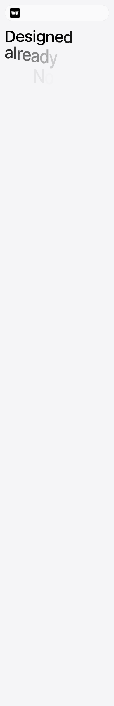

# UI Design System & Master Generation Blueprint: premotio-com

> **premotio — finished design into polished motion** (https://premotio.com/) — premotio turns finished design into polished motion without sending you into a video editor. Pick a preset, drop in your work and export...


---

## 1. Executive Visual Persona & Design Archetype

- **Brand Essence & Persona**: **premotio — finished design into polished motion** (`https://premotio.com/`). premotio turns finished design into polished motion without sending you into a video editor. Pick a preset, drop in your work and export...
- **Capture Provenance**: Live browser capture (`tier2_webgl`, HTTP `200`, captured `2026-11-23`).
- **Visual Archetype**: **Light-Gallery WebGL / Canvas Interactive Experience (`#f5f5f7` / `#f59e0b`)**.
- **Anti-AI-Slop Differentiators**:
  - **Live-Computed Chromatic Polarity**: Anchors the viewport in `#f5f5f7` (live computed `body` `background-color` (`computed_styles.json`)) paired with `#1d1d1f` primary typography and `#f59e0b` accents.
  - **Grounded Typographic Hierarchy**: Pairs `Inter Tight` for display copy (`D e s i g n e d a l r e a d y N o w `) with `Inter Tight` and not declared in live computed styles (uses primary stack / `ui-monospace`).
  - **Calibrated Spatial Grid & Motion**: Combines `1440px` container bounds (`gap: 20px`, padding `63.9999px`) with `cubic-bezier(.16,1,.3,1)` easing and Lenis Smooth Scroll (`data-lenis`), HTML5 `<canvas>` Interactive Viewport Surface.

---

## 2. Spatial Architecture & Modular Grid Mathematics



### Viewport Allocation & Container Geometry
- **Captured Viewport Dimensions**: Desktop `1440×900px` (`assets/desktop.png`, single-viewport 100vh live capture (900px)), Mobile `390×2400px` (`assets/mobile.png`, clamped at 2400px live multi-section capture).
- **Master Container Bounds**: `1440px` (full-bleed `100%` desktop stage measured on `1440px` viewport).
- **Canvas Lateral Padding & Spacing**: `63.9999px` lateral canvas padding with `20px` grid gap.
- **Border Radius Scale**: `999px`, `var(--corner)`, `var(--radius-pill)`, `var(--radius-card)`.

### Responsive Breakpoint Architecture
- **Desktop Layout**: Multi-column CSS Grid / Flexbox layout at `1440px` (`max-width: 1440px`, `gap: 20px`).
- **Mobile Layout**: Single-column vertical stack at `390px` viewport width with `63.9999px` horizontal padding.
- **Extracted CSS Media Queries**: `@media (width<=1024px)`, `@media (width<=640px) and (aspect-ratio<=1)`, `@media (width<=640px)`, `@media (prefers-reduced-motion:reduce)`.

---

## 3. Color System, Materiality & Atmospheric Lighting

### Semantic Palette & Source Grounding
| Semantic Role | Ground-Truth Value | Extracted Live / CSS Source |
|---|---|---|
| **Primary Canvas Substrate** | `#f5f5f7` | live computed `body` `background-color` (`computed_styles.json`) |
| **Primary Typography Ink** | `#1d1d1f` | live computed `main` `color` (`computed_styles.json`) |
| **Elevated Surface / Card Substrate** | `#000000` | live computed `footer` `background-color` (`computed_styles.json`) |
| **Interactive Accent / Highlight** | `#f59e0b` | `var(--color-amber-500)` in `:root` |
| **Secondary / Muted Copy** | `#98989d` | `var(--inverse-muted)` in `:root` |
| **Structural Hairline Border** | `#e5e5ea` | `var(--border)` in `:root` |
| **Variable Token (`--on-fg`)** | `#ffffff` | `var(--on-fg)` in `:root` |
| **Variable Token (`--fg-muted`)** | `#6e6e73` | `var(--fg-muted)` in `:root` |

### Sanitized Root CSS Variables (`ui-ux.md` Ground Truth)
| Variable Name | Extracted Value | Semantic Role |
|---|---|---|
| `--bg` | `#f5f5f7` | Canvas / Surface Token |
| `--bg-rgb` | `245,245,247` | Canvas / Surface Token |
| `--fg` | `#1d1d1f` | Typography Ink Token |
| `--fg-rgb` | `29,29,31` | Typography Ink Token |
| `--on-fg` | `#ffffff` | Typography Ink Token |
| `--on-fg-rgb` | `255,255,255` | Typography Ink Token |
| `--on-media` | `var(--bg)` | Design System Custom Token |
| `--glass` | `rgba(255, 255, 255, 0.5)` | Color / Atmospheric Token |
| `--glass-rgb` | `255,255,255` | Design System Custom Token |
| `--hairline` | `rgba(29, 29, 31, 0.1)` | Color / Atmospheric Token |
| `--hairline-rgb` | `29,29,31` | Design System Custom Token |
| `--logo` | `#000000` | Color / Atmospheric Token |
| `--logo-rgb` | `0,0,0` | Design System Custom Token |
| `--fg-muted` | `#6e6e73` | Typography Ink Token |
| `--fg-muted-rgb` | `110,110,115` | Typography Ink Token |
| `--fg-secondary` | `rgba(29, 29, 31, 0.8)` | Typography Ink Token |

---

## 4. Typographic Scale & Editorial Hierarchy

### Font Family Stacks
- **Display Typography**: `Inter Tight`.
- **Primary Body Stack**: `Inter Tight`.
- **Technical / Metadata Stack**: not declared in live computed styles (uses primary stack / `ui-monospace`).

### Typographic Scale & Rules (Live Computed & Stylesheet Grounded)
- **Hero Display (`H1`)**: live computed `h1` (`font-size: 99.9999px`, `line-height: 89.9999px`, `font-weight: 500`); CSS variables `--font-size-h1: 6.25rem`, `--font-size-tablet-h1: 5rem`, `--font-size-mobile-h1: 3.5rem`.
- **Section Heading (`H2`)**: live computed `h2` (`font-size: 24px`, `line-height: 26.4px`, `font-weight: 700`); CSS variables `--font-size-h2: 3.25rem`, `--font-size-tablet-h2: 2.75rem`, `--font-size-mobile-h2: 2rem`.
- **Body Copy**: live computed `body` (`font-size: 16px`, `line-height: 17.6px`, `font-weight: 600`); CSS variables `--font-size-paragraph: 1rem`, `--font-size-body: 1.0625rem`, `--font-size-mobile-body: 1rem`.
- **Metadata & Navigation Labels**: live computed `nav/a` (`font-size: 16px`, `line-height: 17.6px`, `font-weight: 600`); CSS variables `--font-size-label: .9375rem`, `--font-size-meta: .75rem`, `--leading-label: 1`.

---

## 5. Choreographed Motion & Interaction Physics

### Primary Easing Curves
- **Extracted Timing Functions**: `cubic-bezier(.16,1,.3,1)`.

### Per-Element Transition & Choreography Rules
- **Selector `.handoff-layer__fill[data-v-90766...`**: `transition: transform .12s linear` extracted from `premotio-com` stylesheet.
- **Selector `.fade-leave-active`**: `transition: opacity .3s` extracted from `premotio-com` stylesheet.
- **Selector `.app-loader.is-fading>*`**: `transition: opacity .3s linear` extracted from `premotio-com` stylesheet.
- **Extracted Easing Curve (`cubic-bezier(.16,1,.3,1)`)**: Governs interactive state transitions across `<header.app-nav>` and `<section.library>`.
- **Runtime Interaction Engine**: Integrates Lenis Smooth Scroll (`data-lenis`), HTML5 `<canvas>` Interactive Viewport Surface with `prefers-reduced-motion: reduce` fallback guards.

---

## 6. Component Wireframe & Structural DOM Map

### Visual Layout Schematic — Desktop (`1440px`, Grounded in `dom.html` & Landmark Bounding Boxes)
```
┌────────────────────────────────────────────────────────────────────────┐
│ DESKTOP VIEWPORT (1440px) — premotio — finished design into polished m │
│ ====================================================================== │
│ [ <header.app-nav> (1312x56px)        | Library · How it works · MCP ] │
│ ---------------------------------------------------------------------- │
│ | HERO STAGE: <section.hero> (w=1440px)                              | │
│ | H1: D e s i g n e d a l r e a d y N o w m a k e i t (...           | │
│ | Substrate: #f5f5f7 | Ink: #1d1d1f | Accent: #f59e0b                | │
│ ---------------------------------------------------------------------- │
│ | SHOWCASE GRID (<section.library>) max-w: 1440px                    | │
│ | +------------------------------+  +------------------------------+ | │
│ | | S t a r t w i t h t h e g o  |  | Preset categories            | | │
│ | +------------------------------+  +------------------------------+ | │
│ ---------------------------------------------------------------------- │
│ | DETAIL MODULE (<section.categories>) — T a k e t h e s h o r       | │
│ ---------------------------------------------------------------------- │
│ [ FOOTER (<footer.app-footer> ) | https://premotio.com/                │
└────────────────────────────────────────────────────────────────────────┘
```

### Visual Layout Schematic — Mobile Reflow (`390px`)
```
┌────────────────────────────────────────────────────────────────────────┐
│ MOBILE VIEWPORT REFLOW (390px) — Single-Column Stack (gap: 20px)       │
│ ====================================================================== │
│ [ HEADER BAR (<header.app-nav>        ) | Compact Menu (390px)         │
│ ---------------------------------------------------------------------- │
│ | HERO STAGE (<section.hero>) — 390px Vertical Lead                  | │
│ | H1: D e s i g n e d a l r e a d y N o w m a k e i t (...           | │
│ ---------------------------------------------------------------------- │
│ | SHOWCASE STACK (<section.library>) — 1-Col Stack                   | │
│ | [ Item 1: S t a r t w i t h t h e g o o d p a r t                ] | │
│ | [ Item 2: Preset categories                                      ] | │
│ ---------------------------------------------------------------------- │
│ | DETAIL STACK (<section.categories>) — 1-Col (T a k e t h e s h )   | │
│ ---------------------------------------------------------------------- │
│ [ FOOTER (<footer.app-footer> ) | Stacked 390px Colophon               │
└────────────────────────────────────────────────────────────────────────┘
```

### Granular DOM Region Breakdown
1. **Brand Header & Navigation Bar (<header.app-nav> — `premotio-com`)**:
   - Landmark `<header class="app-nav app-nav--active">` (`1312x56px`) hosting `premotio — finished design into poli` navigation (`Library · How it works · MCP · Pricing · Contact`), DOM attributes (`data-v-a799f99b`, `data-v-a3457c20`, `data-v-39640a56`, `data-v-f9a31650`), and stylesheet rule `before { content:attr(data-word) }`.
2. **Hero Stage & Focal Lead (<section.hero> — `D e s i g n e d a l r e a d y N o `)**:
   - Landmark `<section class="hero is-on">` presenting display lead `D e s i g n e d a l r e a d y N o w m a k e i t (...` and copy excerpt *"D e s i g n e d a l r e a d y"* over `#f5f5f7` canvas and `#1d1d1f` ink.
3. **Primary Showcase & Content Grid (<section.library> — `S t a r t w i t h t h e g o o d p `)**:
   - Landmark `<section class="library">` rendering section `S t a r t w i t h t h e g o o d p a r t` with copy *"N o w m a k e i t ( move )"*, asset references (`favicon.ico`, `favicon.svg`, `apple-touch-icon.png`, `_payload.json`), and grid rule `.reveal-line-mask { clip-path:inset(0 -100vw -.2em -.15em) }`.
4. **Interactive Detail & Feature Matrix (<section.categories> — `Preset categories`)**:
   - Landmark `<section class="categories">` framing `Preset categories` and `T a k e t h e s h o r t c u t . K i l l t h e ( t...` (*"Designed already Now make it move"*) with `#000000` surface cards, `#f59e0b` accents, and `focus-visible { outline:2px solid var(--fg);outline-offset:.125rem }`.
5. **Colophon & Global Directory Footer (<footer.app-footer> — `https://premotio.com/`)**:
   - Landmark `<footer class="app-footer">` anchoring `premotio — finished design into ` footer links (`Library · How it works · MCP · Pricing · Contact`), copy *"Drop in your work. Pick a starting point. Take it as far as "*, and `#e5e5ea` structural dividers.

---

## 7. Master Zero-Shot AI Generation Prompt

```markdown
# Master Zero-Shot Frontend Generation Prompt: premotio-com (premotio — finished design into polished motion)

You are a principal frontend architect and design systems engineer. Build a complete, production-ready web application replicating the exact design system, DOM landmarks, typographic hierarchy, color tokens, and motion physics of `premotio-com` (**premotio — finished design into polished motion** — `https://premotio.com/`).

### 1. Visual Archetype & Anti-AI-Slop Mandates
- **Archetype**: Light-Gallery WebGL / Canvas Interactive Experience (`#f5f5f7` / `#f59e0b`).
- **Identity & Domain Context**: premotio turns finished design into polished motion without sending you into a video editor. Pick a preset, drop in your work and export...
- **Primary Substrate**: `#f5f5f7` (live computed `body` `background-color` (`computed_styles.json`)), **Primary Ink**: `#1d1d1f`, **Accent / Highlight**: `#f59e0b`.
- **Site-Specific Differentiators**:
  - **Live-Computed Chromatic Polarity**: Anchors the viewport in `#f5f5f7` (live computed `body` `background-color` (`computed_styles.json`)) paired with `#1d1d1f` primary typography and `#f59e0b` accents.
  - **Grounded Typographic Hierarchy**: Pairs `Inter Tight` for display copy (`D e s i g n e d a l r e a d y N o w `) with `Inter Tight` and not declared in live computed styles (uses primary stack / `ui-monospace`).
  - **Calibrated Spatial Grid & Motion**: Combines `1440px` container bounds (`gap: 20px`, padding `63.9999px`) with `cubic-bezier(.16,1,.3,1)` easing and Lenis Smooth Scroll (`data-lenis`), HTML5 `<canvas>` Interactive Viewport Surface.

### 2. Ground-Truth CSS Variables (`:root` Token Contract)
Declare and consume these exact custom properties extracted from `premotio-com` in your global stylesheet:

:root {
  /* premotio — finished design into polished motion (premotio-com) — Live-Grounded CSS Variables */
  --bg: #f5f5f7; /* Canvas / Surface Token (premotio-com) */
  --bg-rgb: 245,245,247; /* Canvas / Surface Token (premotio-com) */
  --fg: #1d1d1f; /* Typography Ink Token (premotio-com) */
  --fg-rgb: 29,29,31; /* Typography Ink Token (premotio-com) */
  --on-fg: #ffffff; /* Typography Ink Token (premotio-com) */
  --on-fg-rgb: 255,255,255; /* Typography Ink Token (premotio-com) */
  --on-media: var(--bg); /* Design System Custom Token (premotio-com) */
  --glass: rgba(255, 255, 255, 0.5); /* Color / Atmospheric Token (premotio-com) */
  --glass-rgb: 255,255,255; /* Design System Custom Token (premotio-com) */
  --hairline: rgba(29, 29, 31, 0.1); /* Color / Atmospheric Token (premotio-com) */
  --hairline-rgb: 29,29,31; /* Design System Custom Token (premotio-com) */
  --logo: #000000; /* Color / Atmospheric Token (premotio-com) */
  --logo-rgb: 0,0,0; /* Design System Custom Token (premotio-com) */
  --fg-muted: #6e6e73; /* Typography Ink Token (premotio-com) */
  --fg-muted-rgb: 110,110,115; /* Typography Ink Token (premotio-com) */
  --fg-secondary: rgba(29, 29, 31, 0.8); /* Typography Ink Token (premotio-com) */
}

### 3. Semantic Color & Materiality Contract
Map every surface, ink, and border strictly to these source-grounded tokens:
- **Primary Canvas Substrate**: `#f5f5f7` — grounded in live computed `body` `background-color` (`computed_styles.json`)
- **Primary Typography Ink**: `#1d1d1f` — grounded in live computed `main` `color` (`computed_styles.json`)
- **Elevated Surface / Card Substrate**: `#000000` — grounded in live computed `footer` `background-color` (`computed_styles.json`)
- **Interactive Accent / Highlight**: `#f59e0b` — grounded in `var(--color-amber-500)` in `:root`
- **Secondary / Muted Copy**: `#98989d` — grounded in `var(--inverse-muted)` in `:root`
- **Structural Hairline Border**: `#e5e5ea` — grounded in `var(--border)` in `:root`
- **Variable Token (`--on-fg`)**: `#ffffff` — grounded in `var(--on-fg)` in `:root`
- **Variable Token (`--fg-muted`)**: `#6e6e73` — grounded in `var(--fg-muted)` in `:root`

### 4. Spatial Grid, Container Bounds & Responsive Breakpoints
- **Desktop Viewport Reference**: `1440×900px` (single-viewport 100vh live capture (900px), `1440px` standard desktop width).
- **Mobile Viewport Reference**: `390×2400px` (clamped at 2400px live multi-section capture, `390px` standard mobile width).
- **Container Max-Width**: `1440px` (full-bleed `100%` desktop stage measured on `1440px` viewport)
- **Padding & Gutters**: `63.9999px` lateral canvas padding with `20px` grid gap
- **Desktop Grid**: Multi-column CSS Grid / Flexbox layout at `1440px` (`max-width: 1440px`, `gap: 20px`)
- **Mobile Adaptation**: Single-column vertical stack at `390px` viewport width with `63.9999px` horizontal padding
- **Media Queries**: `@media (width<=1024px)`, `@media (width<=640px) and (aspect-ratio<=1)`, `@media (width<=640px)`, `@media (prefers-reduced-motion:reduce)`
- **Corner Radii**: `999px`, `var(--corner)`, `var(--radius-pill)`, `var(--radius-card)`

### 5. Typography & Editorial Scale Contract
- **Display Font Stack**: `Inter Tight`
- **Body Font Stack**: `Inter Tight`
- **Monospace / Technical Font Stack**: not declared in live computed styles (uses primary stack / `ui-monospace`)
- **H1 Display Rule**: live computed `h1` (`font-size: 99.9999px`, `line-height: 89.9999px`, `font-weight: 500`); CSS variables `--font-size-h1: 6.25rem`, `--font-size-tablet-h1: 5rem`, `--font-size-mobile-h1: 3.5rem`
- **H2 Section Rule**: live computed `h2` (`font-size: 24px`, `line-height: 26.4px`, `font-weight: 700`); CSS variables `--font-size-h2: 3.25rem`, `--font-size-tablet-h2: 2.75rem`, `--font-size-mobile-h2: 2rem`
- **Body Copy Rule**: live computed `body` (`font-size: 16px`, `line-height: 17.6px`, `font-weight: 600`); CSS variables `--font-size-paragraph: 1rem`, `--font-size-body: 1.0625rem`, `--font-size-mobile-body: 1rem`
- **Metadata & Index Rule**: live computed `nav/a` (`font-size: 16px`, `line-height: 17.6px`, `font-weight: 600`); CSS variables `--font-size-label: .9375rem`, `--font-size-meta: .75rem`, `--leading-label: 1`

### 6. Component Hierarchy, Verbatim Copy & Real DOM Landmarks
Scaffold `premotio-com` (`premotio — finished design into polished motion`) with these exact structural regions, extracted copy, and CSS rules from `dom.html`:
1. **Brand Header & Navigation Bar (<header.app-nav> — `premotio-com`)**:
   - DOM & Selectors: Landmark `<header class="app-nav app-nav--active">` (`1312x56px`) hosting `premotio — finished design into poli` navigation (`Library · How it works · MCP · Pricing · Contact`), DOM attributes (`data-v-a799f99b`, `data-v-a3457c20`, `data-v-39640a56`, `data-v-f9a31650`), and stylesheet rule `before { content:attr(data-word) }`.
   - Responsive Contract: Header `Brand Header & Navigation Bar (<header.app-nav> — `premotio-com`)` (`premotio-com`) adapts across `@media (width<=1024px)`, `@media (width<=640px) and (aspect-ratio<=1)`, `@media (width<=640px)`, `@media (prefers-reduced-motion:reduce)` with `cubic-bezier(.16,1,.3,1)` transitions and links `Library · How it works · MCP · Pricing · Contact`.
2. **Hero Stage & Focal Lead (<section.hero> — `D e s i g n e d a l r e a d y N o `)**:
   - DOM & Selectors: Landmark `<section class="hero is-on">` presenting display lead `D e s i g n e d a l r e a d y N o w m a k e i t (...` and copy excerpt *"D e s i g n e d a l r e a d y"* over `#f5f5f7` canvas and `#1d1d1f` ink.
   - Responsive Contract: Hero stage (`1440×900px` desktop / `390×2400px` mobile) sets `#f5f5f7` background with `#1d1d1f` headline `D e s i g n e d a l r e a d y N o w m a k e i t (...`.
3. **Primary Showcase & Content Grid (<section.library> — `S t a r t w i t h t h e g o o d p `)**:
   - DOM & Selectors: Landmark `<section class="library">` rendering section `S t a r t w i t h t h e g o o d p a r t` with copy *"N o w m a k e i t ( move )"*, asset references (`favicon.ico`, `favicon.svg`, `apple-touch-icon.png`, `_payload.json`), and grid rule `.reveal-line-mask { clip-path:inset(0 -100vw -.2em -.15em) }`.
   - Responsive Contract: Showcase grid `Primary Showcase & Content Grid (<section.library> — `S t a r t w i t h t h e g o o d p `)` applies Multi-column CSS Grid / Flexbox layout at `1440px` (`max-width: 1440px`, `gap: 20px`) on desktop and Single-column vertical stack at `390px` viewport width with `63.9999px` horizontal padding on mobile.
4. **Interactive Detail & Feature Matrix (<section.categories> — `Preset categories`)**:
   - DOM & Selectors: Landmark `<section class="categories">` framing `Preset categories` and `T a k e t h e s h o r t c u t . K i l l t h e ( t...` (*"Designed already Now make it move"*) with `#000000` surface cards, `#f59e0b` accents, and `focus-visible { outline:2px solid var(--fg);outline-offset:.125rem }`.
   - Responsive Contract: Detail module `Interactive Detail & Feature Matrix (<section.categories> — `Preset categories`)` uses `999px`, `var(--corner)`, `var(--radius-pill)`, `var(--radius-card)` radii, `#f59e0b` highlights, and assets (favicon.ico, favicon.svg, apple-touch-icon.png).
5. **Colophon & Global Directory Footer (<footer.app-footer> — `https://premotio.com/`)**:
   - DOM & Selectors: Landmark `<footer class="app-footer">` anchoring `premotio — finished design into ` footer links (`Library · How it works · MCP · Pricing · Contact`), copy *"Drop in your work. Pick a starting point. Take it as far as "*, and `#e5e5ea` structural dividers.
   - Responsive Contract: Footer `Colophon & Global Directory Footer (<footer.app-footer> — `https://premotio.com/`)` aligns to `1440px` (full-bleed `100%` desktop stage measured on `1440px` viewport) with `63.9999px` lateral canvas padding with `20px` grid gap and attributes (data-v-a799f99b, data-v-a3457c20, data-v-39640a56).

#### Verbatim DOM Copy Excerpts (`dom.html`)
- Copy Excerpt 1: *"D e s i g n e d a l r e a d y"*
- Copy Excerpt 2: *"N o w m a k e i t ( move )"*
- Copy Excerpt 3: *"Designed already Now make it move"*
- Copy Excerpt 4: *"Drop in your work. Pick a starting point. Take it as far as you want"*

### 7. Motion, Extracted Stylesheet Rules & Interaction Choreography
- **Primary Easing Functions**: `cubic-bezier(.16,1,.3,1)`
- **Extracted Stylesheet Rules (`premotio-com`)**:
- `before { content:attr(data-word) }`
- `.reveal-line-mask { clip-path:inset(0 -100vw -.2em -.15em) }`
- `focus-visible { outline:2px solid var(--fg);outline-offset:.125rem }`
- `root { --layout-margin:max(var(--space-32), var(--safe-x));--grid-columns:8;--g... }`
- `video { vertical-align:baseline;border:0;margin:0;padding:0 }`
- **Per-Selector Transition Rules**:
- **Selector `.handoff-layer__fill[data-v-90766...`**: `transition: transform .12s linear` extracted from `premotio-com` stylesheet.
- **Selector `.fade-leave-active`**: `transition: opacity .3s` extracted from `premotio-com` stylesheet.
- **Selector `.app-loader.is-fading>*`**: `transition: opacity .3s linear` extracted from `premotio-com` stylesheet.
- **Extracted Easing Curve (`cubic-bezier(.16,1,.3,1)`)**: Governs interactive state transitions across `<header.app-nav>` and `<section.library>`.
- **Runtime Interaction Engine**: Integrates Lenis Smooth Scroll (`data-lenis`), HTML5 `<canvas>` Interactive Viewport Surface with `prefers-reduced-motion: reduce` fallback guards.

### 8. Technical Deliverables
- Implement in Next.js (App Router) with TypeScript and Tailwind CSS consuming the `:root` custom properties defined above for `premotio-com`.
- Reproduce both the `1440px` desktop architecture and `390px` mobile breakpoint transitions, preserving semantic HTML5 landmarks (`<header>`, `<nav>`, `<main>`, `<section>`, `<footer>`) and `prefers-reduced-motion` accessibility guards.
```
