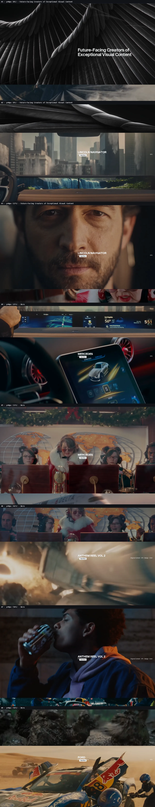
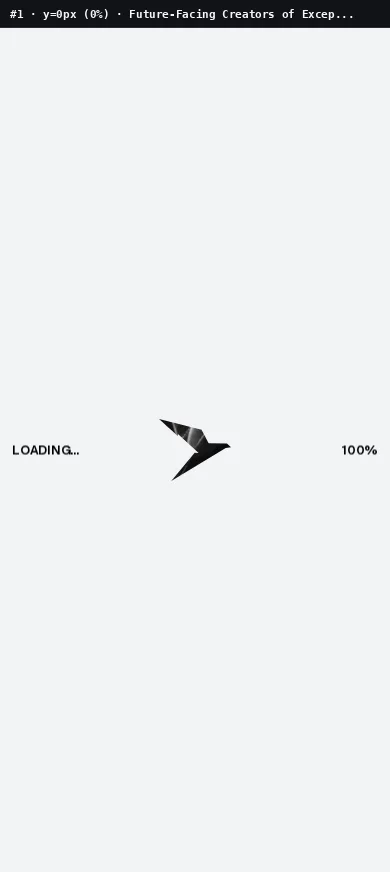

# UI Design System & Master Generation Blueprint: preymaker-com

> **Preymaker** (https://preymaker.com/) — Preymaker





---

## 1. Executive Visual Persona & Design Archetype

- **Brand Essence & Persona**: **Preymaker** (`https://preymaker.com/`). Preymaker
- **Capture Provenance**: Live browser capture (`tier1_fast`, HTTP `200`, captured `2026-11-24`).
- **Visual Archetype**: **High-Contrast Obsidian / Atmospheric Design System (`#000000` canvas, `#f1f3f5` ink, `#ffffff` accent)**.
- **Anti-AI-Slop Differentiators**:
  - **Live-Computed Chromatic Polarity**: Anchors the viewport in `#000000` (live computed `html` `background-color` (`computed_styles.json`)) paired with `#f1f3f5` primary typography and `#ffffff` accents.
  - **Grounded Typographic Hierarchy**: Uses `NewGrotesk` across display (`Future-Facing Creators of Exceptiona`) and body copy.
  - **Calibrated Spatial Grid & Motion**: Combines `100vw` container bounds (`gap: 0px 4px`, padding `var(--spacings-l)`) with `cubic-bezier(.19,1,.22,1)` easing and Lenis Smooth Scroll (`data-lenis`), GSAP Timeline & ScrollTrigger.

---

## 2. Spatial Architecture & Modular Grid Mathematics

### Viewport Allocation & Container Geometry
- **Captured Journey Filmstrips**: Desktop `1280×6624px` (`assets/desktop-journey.webp`, `8` keyframes up to `y=0px` / doc `900px`), Mobile `390×872px` (`assets/mobile-journey.webp`, `1` keyframes).
- **Master Container Bounds**: `100vw` (non-`@media` desktop container stylesheet rule).
- **Canvas Lateral Padding & Spacing**: `var(--spacings-l)` lateral canvas padding with `0px 4px` grid gap.
- **Border Radius Scale**: `10px`, `50%`, `.4rem`.

### Responsive Breakpoint Architecture
- **Desktop Layout**: Multi-column CSS Grid / Flexbox layout at `1440px` (`max-width: 100vw`, `gap: 0px 4px`).
- **Mobile Layout**: Single-column vertical stack at `390px` viewport width with `var(--spacings-l)` horizontal padding.
- **Extracted CSS Media Queries**: `@media (max-width:768px)`, `@media (max-width:1920px)`, `@media (min-width:1920px)`.

---

## 3. Color System, Materiality & Atmospheric Lighting

### Semantic Palette & Source Grounding
| Semantic Role | Ground-Truth Value | Extracted Live / CSS Source |
|---|---|---|
| **Primary Canvas Substrate** | `#000000` | live computed `html` `background-color` (`computed_styles.json`) |
| **Primary Typography Ink** | `#f1f3f5` | live computed `h1` `color` (`computed_styles.json`) |
| **Elevated Surface / Card Substrate** | `#b9c1c8` | `er_top__x5W2Y .cookie-banner_to... { background: #b9c1c8 }` |
| **Interactive Accent / Highlight** | `#ffffff` | `.media button { color: #ffffff }` |
| **Secondary / Muted Copy** | `#859099` | `_links__dYPZS button .footer_co... { color: #859099 }` |
| **Structural Hairline Border** | `#dde1e4` | `_filter__uwOx_.filters-modal_ac... { border-bottom: #dde1e4 }` |

### Sanitized Root CSS Variables (`ui-ux.md` Ground Truth)
| Variable Name | Extracted Value | Semantic Role |
|---|---|---|
| `--breakpoints-desktop` | `1920` | Design System Custom Token |
| `--breakpoints-tablet` | `1920` | Design System Custom Token |
| `--breakpoints-mobile` | `768` | Design System Custom Token |
| `--sizes-desktop` | `1920` | Layout / Spatial Grid Token |
| `--sizes-tablet` | `1440` | Layout / Spatial Grid Token |
| `--sizes-mobile` | `390` | Layout / Spatial Grid Token |
| `--spacings-xl` | `2rem` | Layout / Spatial Grid Token |
| `--spacings-l` | `1.2rem` | Layout / Spatial Grid Token |
| `--spacings-m` | `0.8rem` | Layout / Spatial Grid Token |
| `--spacings-s` | `0.4rem` | Layout / Spatial Grid Token |
| `--spacings-xs` | `0.2rem` | Layout / Spatial Grid Token |
| `--paddings-xxl` | `24rem` | Layout / Spatial Grid Token |
| `--paddings-xl` | `16rem` | Layout / Spatial Grid Token |
| `--paddings-l` | `10rem` | Layout / Spatial Grid Token |
| `--paddings-m` | `8rem` | Layout / Spatial Grid Token |
| `--paddings-s` | `4rem` | Layout / Spatial Grid Token |

---

## 4. Typographic Scale & Editorial Hierarchy

### Font Family Stacks
- **Display Typography**: `NewGrotesk`.
- **Primary Body Stack**: `NewGrotesk`.
- **Technical / Metadata Stack**: not declared in live computed styles (uses primary stack / `ui-monospace`).

### Typographic Scale & Rules (Live Computed & Stylesheet Grounded)
- **Hero Display (`H1`)**: live computed `h1` (`font-size: 40px`, `line-height: 42px`, `font-weight: 600`, `letter-spacing: -0.8px`).
- **Section Heading (`H2`)**: live computed `h2` (`font-size: 40px`, `line-height: 42px`, `font-weight: 600`, `letter-spacing: -0.8px`).
- **Body Copy**: live computed `body` (`font-size: 10px`, `line-height: 10px`, `font-weight: 400`).
- **Metadata & Navigation Labels**: live computed `nav/a` (`font-size: 10px`, `line-height: 10px`, `font-weight: 400`).

---

## 5. Choreographed Motion & Interaction Physics

### Primary Easing Curves
- **Extracted Timing Functions**: `cubic-bezier(.19,1,.22,1)`, `cubic-bezier(.39,.575,.565,1)`, `cubic-bezier(.14,1,.34,1)`.

### Per-Element Transition & Choreography Rules
- **Selector `ner_top__x5W2Y .cookie-banner_tog...`**: `transition: background .7s cubic-bezier(.19,1,.22,1)` extracted from `preymaker-com` stylesheet.
- **Selector `op__x5W2Y .cookie-banner_toggle__...`**: `transition: transform .7s cubic-bezier(.19,1,.22,1)` extracted from `preymaker-com` stylesheet.
- **Selector `filters-modal_filter_inner__Osqwe...`**: `transition: color .7s cubic-bezier(.19,1,.22,1)` extracted from `preymaker-com` stylesheet.
- **Extracted Easing Curve (`cubic-bezier(.19,1,.22,1)`)**: Governs interactive state transitions across `<header.menu_header__bK96y>` and `<section.sticky_sticky__yNlFf>`.
- **Runtime Interaction Engine**: Integrates Lenis Smooth Scroll (`data-lenis`), GSAP Timeline & ScrollTrigger with `prefers-reduced-motion: reduce` fallback guards.
### Measured Runtime Scroll & Interaction Telemetry (`behavioral_journey_v2`)
- **Scroll Driver Mode**: `wheel` (max document height `900px`, deepest scrollY reached `0px` across `8` desktop keyframes).
- **Detected Scroll / Motion Libraries**: Native browser scroll / standard CSS transitions.
- **Route Transition Architecture**: First internal navigation (`/work`) measured as `direct` in `5176ms`.

---

## 6. Component Wireframe & Structural DOM Map

### Visual Layout Schematic — Desktop (`1440px`, Grounded in `dom.html` & Landmark Bounding Boxes)
```
┌────────────────────────────────────────────────────────────────────────┐
│ DESKTOP VIEWPORT (1440px) — Preymaker                                  │
│ ====================================================================== │
│ [ <header.menu_header__b (1416x42px)  | Preymaker                    ] │
│ ---------------------------------------------------------------------- │
│ | HERO STAGE: <section.hero_hero__Sbbfz> (w=1440px)                  | │
│ | H1: Future-Facing Creators of Exceptional Visual Content           | │
│ | Substrate: #000000 | Ink: #f1f3f5 | Accent: #ffffff                | │
│ ---------------------------------------------------------------------- │
│ | SHOWCASE GRID (<section.sticky_sticky__yN) max-w: 100vw            | │
│ | +------------------------------+  +------------------------------+ | │
│ | | An award-winning creative co |  | W+K NY, Director Rupert Sand | | │
│ | +------------------------------+  +------------------------------+ | │
│ ---------------------------------------------------------------------- │
│ | DETAIL MODULE (<article.sticky_article__z) — Preymaker Welcomes Th | │
│ ---------------------------------------------------------------------- │
│ [ FOOTER (<footer.footer_foote) | https://preymaker.com/               │
└────────────────────────────────────────────────────────────────────────┘
```

### Visual Layout Schematic — Mobile Reflow (`390px`)
```
┌────────────────────────────────────────────────────────────────────────┐
│ MOBILE VIEWPORT REFLOW (390px) — Single-Column Stack (gap: 0px 4px)    │
│ ====================================================================== │
│ [ HEADER BAR (<header.menu_header__bK9) | Compact Menu (390px)         │
│ ---------------------------------------------------------------------- │
│ | HERO STAGE (<section.hero_hero__Sbbf) — 390px Vertical Lead        | │
│ | H1: Future-Facing Creators of Exceptional Visual Content           | │
│ ---------------------------------------------------------------------- │
│ | SHOWCASE STACK (<section.sticky_sticky) — 1-Col Stack              | │
│ | [ Item 1: An award-winning creative collective specializing...   ] | │
│ | [ Item 2: W+K NY, Director Rupert Sanders Mark Ford’s F1 Re...   ] | │
│ ---------------------------------------------------------------------- │
│ | DETAIL STACK (<article.sticky_article_) — 1-Col (Preymaker Welcomes) │
│ ---------------------------------------------------------------------- │
│ [ FOOTER (<footer.footer_foote) | Stacked 390px Colophon               │
└────────────────────────────────────────────────────────────────────────┘
```

### Granular DOM Region Breakdown
1. **Brand Header & Navigation Bar (<header.menu_header__bK96y> — `preymaker-com`)**:
   - Landmark `<header class="menu_header__bK96y">` (`1416x42px`) hosting `Preymaker` navigation (`Preymaker`), DOM attributes (`data-scroll-orientation="vertical"`, `data-theme="dark"`, `data-precedence="next"`, `data-precedence="next"`), and stylesheet rule `ner__CJ8LS .cookie-banner_header_... { position:relative;display:flex;justify-content:space-between;align-items... }`.
2. **Hero Stage & Focal Lead (<section.hero_hero__Sbbfz> — `Future-Facing Creators of Exceptio`)**:
   - Landmark `<section class="hero_hero__Sbbfz">` presenting display lead `Future-Facing Creators of Exceptional Visual Content` and copy excerpt *"Into the Wild 60sec"* over `#000000` canvas and `#f1f3f5` ink.
3. **Primary Showcase & Content Grid (<section.sticky_sticky__yNlFf> — `An award-winning creative collecti`)**:
   - Landmark `<section class="sticky_sticky__yNlFf">` rendering section `An award-winning creative collective specializing...` with copy *"Aviators, the film"*, asset references (`aecae019b9172d3b647d798d28fcbf7f8...`, `d2ed2c41a495322ff01622c1c5438d3c4...`, `94387763ebca6d854c48dda1a76ba924b...`, `577cb103f4f05fe570f1f09d872e4a6ad...`), and grid rule `CJ8LS .cookie-banner_header__83vY... { cursor:pointer }`.
4. **Interactive Detail & Feature Matrix (<article.sticky_article__zGMPW> — `W+K NY, Director Rupert Sanders Ma`)**:
   - Landmark `<article class="sticky_article__zGMPW is-inview">` framing `W+K NY, Director Rupert Sanders Mark Ford’s F1 Re...` and `Preymaker Welcomes Theuns Van Rensburg and Robert...` (*"Apple Watch Greek God Group Chat"*) with `#b9c1c8` surface cards, `#ffffff` accents, and `er__83vYQ .cookie-banner_buttons_... { display:flex;align-items:center;gap:var(--spacings-l) }`.
5. **Colophon & Global Directory Footer (<footer.footer_footer__1m2ab> — `https://preymaker.com/`)**:
   - Landmark `<footer class="footer_footer__1m2ab">` anchoring `Preymaker` footer links (`Preymaker`), copy *"Google Tech partner"*, and `#dde1e4` structural dividers.
### Full Vertical Scroll Sequence (Desktop `1440×900` Keyframes)
- **Step 01** (`y=0px`, `0%`): Active landmark `Future-Facing Creators of Exceptional Visual Content` · sticky/fixed elements: `0`
- **Step 02** (`y=0px`, `8%`): Active landmark `Future-Facing Creators of Exceptional Visual Content` · sticky/fixed elements: `0`
- **Step 03** (`y=0px`, `17%`): Active landmark `Future-Facing Creators of Exceptional Visual Content` · sticky/fixed elements: `0`
- **Step 04** (`y=0px`, `25%`): Active landmark `Hero` · sticky/fixed elements: `0`
- **Step 05** (`y=0px`, `33%`): Active landmark `Hero` · sticky/fixed elements: `0`
- **Step 06** (`y=0px`, `42%`): Active landmark `Hero` · sticky/fixed elements: `0`
- **Step 07** (`y=0px`, `50%`): Active landmark `Hero` · sticky/fixed elements: `0`
- **Step 08** (`y=0px`, `58%`): Active landmark `Hero` · sticky/fixed elements: `0`

### Multi-Page Internal Route Map
- **Listing Route (`/work`)**: `https://preymaker.com/work` — H1: `Work · Preymaker`, scrollHeight `900px`, transition `direct` (`5176ms`)
- **Detail Route (`/insights-and-studio-news/w-k-ny-director-rupert-sanders-mark-ford-s-f1-return-via-moving-portraits-and-caravaggio`)**: `https://preymaker.com/insights-and-studio-news/w-k-ny-director-rupert-sanders-mark-ford-s-f1-return-via-moving-portraits-and-caravaggio` — H1: `W+K NY, DIRECTOR RUPERT SANDERS MARK FORD’S F1 RE...`, scrollHeight `900px`, transition `direct` (`2832ms`)
- **Detail Route (`/insights-and-studio-news/preymaker-welcomes-theuns-van-rensburg-and-robert-bruce`)**: `https://preymaker.com/insights-and-studio-news/preymaker-welcomes-theuns-van-rensburg-and-robert-bruce` — H1: `PREYMAKER WELCOMES THEUNS VAN RENSBURG AND ROBERT...`, scrollHeight `900px`, transition `direct` (`2498ms`)

---

## 7. Master Zero-Shot AI Generation Prompt

```markdown
# Master Zero-Shot Frontend Generation Prompt: preymaker-com (Preymaker)

You are a principal frontend architect and design systems engineer. Build a complete, production-ready web application replicating the exact design system, DOM landmarks, typographic hierarchy, color tokens, and motion physics of `preymaker-com` (**Preymaker** — `https://preymaker.com/`).

### 1. Visual Archetype & Anti-AI-Slop Mandates
- **Archetype**: High-Contrast Obsidian / Atmospheric Design System (`#000000` canvas, `#f1f3f5` ink, `#ffffff` accent).
- **Identity & Domain Context**: Preymaker
- **Primary Substrate**: `#000000` (live computed `html` `background-color` (`computed_styles.json`)), **Primary Ink**: `#f1f3f5`, **Accent / Highlight**: `#ffffff`.
- **Site-Specific Differentiators**:
  - **Live-Computed Chromatic Polarity**: Anchors the viewport in `#000000` (live computed `html` `background-color` (`computed_styles.json`)) paired with `#f1f3f5` primary typography and `#ffffff` accents.
  - **Grounded Typographic Hierarchy**: Uses `NewGrotesk` across display (`Future-Facing Creators of Exceptiona`) and body copy.
  - **Calibrated Spatial Grid & Motion**: Combines `100vw` container bounds (`gap: 0px 4px`, padding `var(--spacings-l)`) with `cubic-bezier(.19,1,.22,1)` easing and Lenis Smooth Scroll (`data-lenis`), GSAP Timeline & ScrollTrigger.

### 2. Ground-Truth CSS Variables (`:root` Token Contract)
Declare and consume these exact custom properties extracted from `preymaker-com` in your global stylesheet:

:root {
  /* Preymaker (preymaker-com) — Live-Grounded CSS Variables */
  --breakpoints-desktop: 1920; /* Design System Custom Token (preymaker-com) */
  --breakpoints-tablet: 1920; /* Design System Custom Token (preymaker-com) */
  --breakpoints-mobile: 768; /* Design System Custom Token (preymaker-com) */
  --sizes-desktop: 1920; /* Layout / Spatial Grid Token (preymaker-com) */
  --sizes-tablet: 1440; /* Layout / Spatial Grid Token (preymaker-com) */
  --sizes-mobile: 390; /* Layout / Spatial Grid Token (preymaker-com) */
  --spacings-xl: 2rem; /* Layout / Spatial Grid Token (preymaker-com) */
  --spacings-l: 1.2rem; /* Layout / Spatial Grid Token (preymaker-com) */
  --spacings-m: 0.8rem; /* Layout / Spatial Grid Token (preymaker-com) */
  --spacings-s: 0.4rem; /* Layout / Spatial Grid Token (preymaker-com) */
  --spacings-xs: 0.2rem; /* Layout / Spatial Grid Token (preymaker-com) */
  --paddings-xxl: 24rem; /* Layout / Spatial Grid Token (preymaker-com) */
  --paddings-xl: 16rem; /* Layout / Spatial Grid Token (preymaker-com) */
  --paddings-l: 10rem; /* Layout / Spatial Grid Token (preymaker-com) */
  --paddings-m: 8rem; /* Layout / Spatial Grid Token (preymaker-com) */
  --paddings-s: 4rem; /* Layout / Spatial Grid Token (preymaker-com) */
}

### 3. Semantic Color & Materiality Contract
Map every surface, ink, and border strictly to these source-grounded tokens:
- **Primary Canvas Substrate**: `#000000` — grounded in live computed `html` `background-color` (`computed_styles.json`)
- **Primary Typography Ink**: `#f1f3f5` — grounded in live computed `h1` `color` (`computed_styles.json`)
- **Elevated Surface / Card Substrate**: `#b9c1c8` — grounded in `er_top__x5W2Y .cookie-banner_to... { background: #b9c1c8 }`
- **Interactive Accent / Highlight**: `#ffffff` — grounded in `.media button { color: #ffffff }`
- **Secondary / Muted Copy**: `#859099` — grounded in `_links__dYPZS button .footer_co... { color: #859099 }`
- **Structural Hairline Border**: `#dde1e4` — grounded in `_filter__uwOx_.filters-modal_ac... { border-bottom: #dde1e4 }`

### 4. Spatial Grid, Container Bounds & Responsive Breakpoints
- **Desktop Viewport Reference**: `1280×6624px` (multi-frame vertical journey filmstrip (6624px), `1440px` standard desktop width).
- **Mobile Viewport Reference**: `390×872px` (full-page live capture (872px), `390px` standard mobile width).
- **Container Max-Width**: `100vw` (non-`@media` desktop container stylesheet rule)
- **Padding & Gutters**: `var(--spacings-l)` lateral canvas padding with `0px 4px` grid gap
- **Desktop Grid**: Multi-column CSS Grid / Flexbox layout at `1440px` (`max-width: 100vw`, `gap: 0px 4px`)
- **Mobile Adaptation**: Single-column vertical stack at `390px` viewport width with `var(--spacings-l)` horizontal padding
- **Media Queries**: `@media (max-width:768px)`, `@media (max-width:1920px)`, `@media (min-width:1920px)`
- **Corner Radii**: `10px`, `50%`, `.4rem`

### 5. Typography & Editorial Scale Contract
- **Display Font Stack**: `NewGrotesk`
- **Body Font Stack**: `NewGrotesk`
- **Monospace / Technical Font Stack**: not declared in live computed styles (uses primary stack / `ui-monospace`)
- **H1 Display Rule**: live computed `h1` (`font-size: 40px`, `line-height: 42px`, `font-weight: 600`, `letter-spacing: -0.8px`)
- **H2 Section Rule**: live computed `h2` (`font-size: 40px`, `line-height: 42px`, `font-weight: 600`, `letter-spacing: -0.8px`)
- **Body Copy Rule**: live computed `body` (`font-size: 10px`, `line-height: 10px`, `font-weight: 400`)
- **Metadata & Index Rule**: live computed `nav/a` (`font-size: 10px`, `line-height: 10px`, `font-weight: 400`)

### 6. Component Hierarchy, Verbatim Copy & Real DOM Landmarks
Scaffold `preymaker-com` (`Preymaker`) with these exact structural regions, extracted copy, and CSS rules from `dom.html`:
1. **Brand Header & Navigation Bar (<header.menu_header__bK96y> — `preymaker-com`)**:
   - DOM & Selectors: Landmark `<header class="menu_header__bK96y">` (`1416x42px`) hosting `Preymaker` navigation (`Preymaker`), DOM attributes (`data-scroll-orientation="vertical"`, `data-theme="dark"`, `data-precedence="next"`, `data-precedence="next"`), and stylesheet rule `ner__CJ8LS .cookie-banner_header_... { position:relative;display:flex;justify-content:space-between;align-items... }`.
   - Responsive Contract: Header `Brand Header & Navigation Bar (<header.menu_header__bK96y> — `preymaker-com`)` (`preymaker-com`) adapts across `@media (max-width:768px)`, `@media (max-width:1920px)`, `@media (min-width:1920px)` with `cubic-bezier(.19,1,.22,1)`, `cubic-bezier(.39,.575,.565,1)`, `cubic-bezier(.14,1,.34,1)` transitions and links `Preymaker`.
2. **Hero Stage & Focal Lead (<section.hero_hero__Sbbfz> — `Future-Facing Creators of Exceptio`)**:
   - DOM & Selectors: Landmark `<section class="hero_hero__Sbbfz">` presenting display lead `Future-Facing Creators of Exceptional Visual Content` and copy excerpt *"Into the Wild 60sec"* over `#000000` canvas and `#f1f3f5` ink.
   - Responsive Contract: Hero stage (`1280×6624px` desktop / `390×872px` mobile) sets `#000000` background with `#f1f3f5` headline `Future-Facing Creators of Exceptional Visual Content`.
3. **Primary Showcase & Content Grid (<section.sticky_sticky__yNlFf> — `An award-winning creative collecti`)**:
   - DOM & Selectors: Landmark `<section class="sticky_sticky__yNlFf">` rendering section `An award-winning creative collective specializing...` with copy *"Aviators, the film"*, asset references (`aecae019b9172d3b647d798d28fcbf7f8...`, `d2ed2c41a495322ff01622c1c5438d3c4...`, `94387763ebca6d854c48dda1a76ba924b...`, `577cb103f4f05fe570f1f09d872e4a6ad...`), and grid rule `CJ8LS .cookie-banner_header__83vY... { cursor:pointer }`.
   - Responsive Contract: Showcase grid `Primary Showcase & Content Grid (<section.sticky_sticky__yNlFf> — `An award-winning creative collecti`)` applies Multi-column CSS Grid / Flexbox layout at `1440px` (`max-width: 100vw`, `gap: 0px 4px`) on desktop and Single-column vertical stack at `390px` viewport width with `var(--spacings-l)` horizontal padding on mobile.
4. **Interactive Detail & Feature Matrix (<article.sticky_article__zGMPW> — `W+K NY, Director Rupert Sanders Ma`)**:
   - DOM & Selectors: Landmark `<article class="sticky_article__zGMPW is-inview">` framing `W+K NY, Director Rupert Sanders Mark Ford’s F1 Re...` and `Preymaker Welcomes Theuns Van Rensburg and Robert...` (*"Apple Watch Greek God Group Chat"*) with `#b9c1c8` surface cards, `#ffffff` accents, and `er__83vYQ .cookie-banner_buttons_... { display:flex;align-items:center;gap:var(--spacings-l) }`.
   - Responsive Contract: Detail module `Interactive Detail & Feature Matrix (<article.sticky_article__zGMPW> — `W+K NY, Director Rupert Sanders Ma`)` uses `10px`, `50%`, `.4rem` radii, `#ffffff` highlights, and assets (aecae019b9172d3b647d798d28fcbf7f8..., d2ed2c41a495322ff01622c1c5438d3c4..., 94387763ebca6d854c48dda1a76ba924b...).
5. **Colophon & Global Directory Footer (<footer.footer_footer__1m2ab> — `https://preymaker.com/`)**:
   - DOM & Selectors: Landmark `<footer class="footer_footer__1m2ab">` anchoring `Preymaker` footer links (`Preymaker`), copy *"Google Tech partner"*, and `#dde1e4` structural dividers.
   - Responsive Contract: Footer `Colophon & Global Directory Footer (<footer.footer_footer__1m2ab> — `https://preymaker.com/`)` aligns to `100vw` (non-`@media` desktop container stylesheet rule) with `var(--spacings-l)` lateral canvas padding with `0px 4px` grid gap and attributes (data-scroll-orientation="vertical", data-theme="dark", data-precedence="next").

#### Verbatim DOM Copy Excerpts (`dom.html`)
- Copy Excerpt 1: *"Into the Wild 60sec"*
- Copy Excerpt 2: *"Aviators, the film"*
- Copy Excerpt 3: *"Apple Watch Greek God Group Chat"*
- Copy Excerpt 4: *"Google Tech partner"*

### 7. Motion, Extracted Stylesheet Rules & Interaction Choreography
- **Primary Easing Functions**: `cubic-bezier(.19,1,.22,1)`, `cubic-bezier(.39,.575,.565,1)`, `cubic-bezier(.14,1,.34,1)`
- **Extracted Stylesheet Rules (`preymaker-com`)**:
- `ner__CJ8LS .cookie-banner_header_... { position:relative;display:flex;justify-content:space-between;align-items... }`
- `CJ8LS .cookie-banner_header__83vY... { cursor:pointer }`
- `er__83vYQ .cookie-banner_buttons_... { display:flex;align-items:center;gap:var(--spacings-l) }`
- `er__CJ8LS .cookie-banner_content_... { position:relative;height:0;overflow:hidden }`
- `tent__ev3Mq .cookie-banner_inner_... { padding:var(--spacings-l) }`
- **Per-Selector Transition Rules**:
- **Selector `ner_top__x5W2Y .cookie-banner_tog...`**: `transition: background .7s cubic-bezier(.19,1,.22,1)` extracted from `preymaker-com` stylesheet.
- **Selector `op__x5W2Y .cookie-banner_toggle__...`**: `transition: transform .7s cubic-bezier(.19,1,.22,1)` extracted from `preymaker-com` stylesheet.
- **Selector `filters-modal_filter_inner__Osqwe...`**: `transition: color .7s cubic-bezier(.19,1,.22,1)` extracted from `preymaker-com` stylesheet.
- **Extracted Easing Curve (`cubic-bezier(.19,1,.22,1)`)**: Governs interactive state transitions across `<header.menu_header__bK96y>` and `<section.sticky_sticky__yNlFf>`.
- **Runtime Interaction Engine**: Integrates Lenis Smooth Scroll (`data-lenis`), GSAP Timeline & ScrollTrigger with `prefers-reduced-motion: reduce` fallback guards.
### 7b. Full-Page Scroll Choreography, Interactive States & Multi-Page Routes
- **Scroll Mechanics**: Implement `wheel` vertical progression up to `900px` across 8 distinct viewport chapters.
- **Vertical Chapter Sequence**: Future-Facing Creators of E... (0%) -> Future-Facing Creators of E... (8%) -> Future-Facing Creators of E... (17%) -> Hero (25%) -> Hero (33%) -> Hero (42%) -> Hero (50%) -> Hero (58%).
- **Multi-Page Routes**: Scaffold internal routes `/work` (listing, direct), `/insights-and-studio-news/w-k-ny-director-rupert-sanders-mark-ford-s-f1-return-via-moving-portraits-and-caravaggio` (detail, direct), `/insights-and-studio-news/preymaker-welcomes-theuns-van-rensburg-and-robert-bruce` (detail, direct) sharing the global header/footer shell and design tokens.

### 8. Technical Deliverables
- Implement in Next.js (App Router) with TypeScript and Tailwind CSS consuming the `:root` custom properties defined above for `preymaker-com`.
- Reproduce both the `1440px` desktop architecture and `390px` mobile breakpoint transitions, preserving semantic HTML5 landmarks (`<header>`, `<nav>`, `<main>`, `<section>`, `<footer>`) and `prefers-reduced-motion` accessibility guards.
```
---

## 8. Full-Page Scroll Journey, Interactive States & Subpage Inventory

### Desktop Scroll Keyframes (`1440×900` WebP)
| Step | Scroll Y | Progress | Active Landmark / Section | Sticky/Fixed | Visual Asset |
| :---: | :---: | :---: | :--- | :---: | :--- |
| `#01` | `0px` | `0%` | Future-Facing Creators of Exceptional Visual... | `0` | [desktop-step-01.webp](assets/desktop-step-01.webp) |
| `#02` | `0px` | `8%` | Future-Facing Creators of Exceptional Visual... | `0` | [desktop-step-02.webp](assets/desktop-step-02.webp) |
| `#03` | `0px` | `17%` | Future-Facing Creators of Exceptional Visual... | `0` | [desktop-step-03.webp](assets/desktop-step-03.webp) |
| `#04` | `0px` | `25%` | Hero | `0` | [desktop-step-04.webp](assets/desktop-step-04.webp) |
| `#05` | `0px` | `33%` | Hero | `0` | [desktop-step-05.webp](assets/desktop-step-05.webp) |
| `#06` | `0px` | `42%` | Hero | `0` | [desktop-step-06.webp](assets/desktop-step-06.webp) |
| `#07` | `0px` | `50%` | Hero | `0` | [desktop-step-07.webp](assets/desktop-step-07.webp) |
| `#08` | `0px` | `58%` | Hero | `0` | [desktop-step-08.webp](assets/desktop-step-08.webp) |

### Mobile Condensed Keyframes (`390×844` WebP)
| Step | Scroll Y | Progress | Active Landmark | Visual Asset |
| :---: | :---: | :---: | :--- | :--- |
| `#01` | `0px` | `0%` | Future-Facing Creators of Exceptional Vis... | [mobile-step-01.webp](assets/mobile-step-01.webp) |

### Internal Subpage Filmstrips (`1080px` Wide WebP)
| # | Template | Route URL | H1 / Title | Scroll Height | Transition | Filmstrip Asset |
| :-: | :---: | :--- | :--- | :---: | :---: | :--- |
| `1` | `listing` | `https://preymaker.com/work` | Work · Preymaker | `900px` | `direct` (`5176ms`) | [subpage-01-work.webp](assets/subpage-01-work.webp) |
| `2` | `detail` | `https://preymaker.com/insights-and-studio-news/w-k-ny-director-rupert-sanders-mark-ford-s-f1-return-via-moving-portraits-and-caravaggio` | W+K NY, DIRECTOR RUPERT SANDERS MARK... | `900px` | `direct` (`2832ms`) | [subpage-02-insights-and-studio-news-w-k-ny-dire.webp](assets/subpage-02-insights-and-studio-news-w-k-ny-dire.webp) |
| `3` | `detail` | `https://preymaker.com/insights-and-studio-news/preymaker-welcomes-theuns-van-rensburg-and-robert-bruce` | PREYMAKER WELCOMES THEUNS VAN RENSBUR... | `900px` | `direct` (`2498ms`) | [subpage-03-insights-and-studio-news-preymaker-w.webp](assets/subpage-03-insights-and-studio-news-preymaker-w.webp) |

