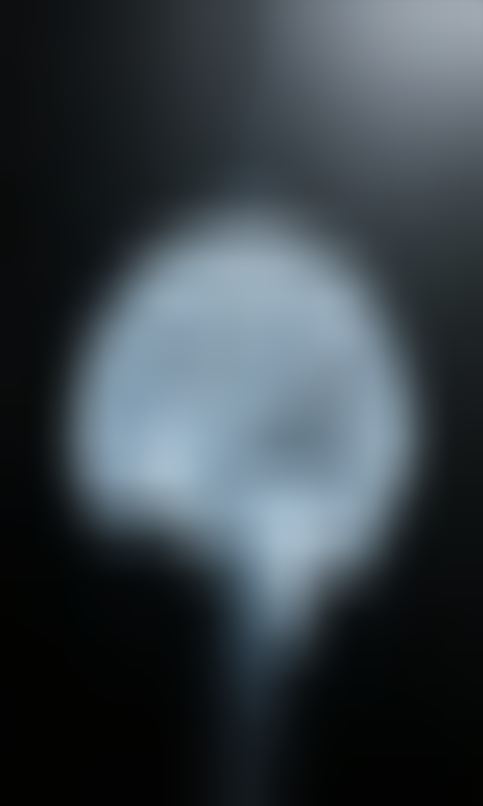

# UI Design System & Master Generation Blueprint: preymaker-com

> **Preymaker** (https://preymaker.com/) — Preymaker



---

## 1. Executive Visual Persona & Design Archetype

- **Brand Essence & Persona**: **Preymaker** (`https://preymaker.com/`). Preymaker
- **Visual Archetype**: **High-Contrast Obsidian / Atmospheric Design System (`#000000` canvas, `#f1f3f5` ink, `#c0c6ca` accent)**.
- **Anti-AI-Slop Differentiators**:
  - **Source-Grounded Chromatic Polarity**: Anchors the viewport in `#000000` (`var(--black)` in `:root`) paired with `#f1f3f5` primary typography and `#c0c6ca` accents.
  - **Extracted Typographic Hierarchy**: Pairs `NewGrotesk` for display copy (`Future-Facing Creators of Exceptiona`) with `NewGrotesk Fallback` and not declared in static CSS (uses primary stack / `ui-monospace`).
  - **Calibrated Spatial Grid & Motion**: Combines `100vw` container bounds (`gap: var(--spacings-l)`, padding `var(--spacings-l)`) with `cubic-bezier(.19,1,.22,1)` easing and Lenis Smooth Scroll (`data-lenis`), GSAP Timeline & ScrollTrigger.

---

## 2. Spatial Architecture & Modular Grid Mathematics


### Viewport Allocation & Container Geometry
- **Captured Viewport Dimensions**: Desktop `1440×2400px` (`assets/desktop.png`, capped at 2400px multi-section capture), Mobile `390×2400px` (`assets/mobile.png`, capped at 2400px multi-section capture).
- **Master Container Bounds**: `100vw` extracted from `preymaker-com` stylesheet.
- **Canvas Lateral Padding & Spacing**: `var(--spacings-l)` lateral canvas padding with `var(--spacings-l)` grid gap.
- **Border Radius Scale**: `10px`, `50%`, `.4rem`.

### Responsive Breakpoint Architecture
- **Desktop Layout**: Multi-column CSS Grid / Flexbox layout at `1440px` (`max-width: 100vw`, `gap: var(--spacings-l)`).
- **Mobile Layout**: Single-column vertical stack at `390px` viewport width with `var(--spacings-l)` horizontal padding.
- **Extracted CSS Media Queries**: `@media (max-width:768px)`, `@media (max-width:1920px)`, `@media (min-width:1920px)`.

---

## 3. Color System, Materiality & Atmospheric Lighting

### Semantic Palette & Source Grounding
| Semantic Role | Ground-Truth Value | Extracted CSS Source / Selector |
|---|---|---|
| **Primary Canvas Substrate** | `#000000` | `var(--black)` in `:root` |
| **Primary Typography Ink** | `#859099` | `var(--mid-grey-shade)` in `:root` |
| **Elevated Surface / Card Substrate** | `#b9c1c8` | `var(--mid-grey)` in `:root` |
| **Interactive Accent / Highlight** | `#c0c6ca` | `var(--grey-shade)` in `:root` |
| **Secondary / Muted Copy** | `#dde1e4` | `var(--grey)` in `:root` |
| **Structural Hairline Border** | `#f1f3f5` | `var(--white)` in `:root` |

### Sanitized Root CSS Variables (`ui-ux.md` Ground Truth)
| Variable Name | Extracted Value | Semantic Role |
|---|---|---|
| `--new-grotesk` | `"NewGrotesk","NewGrotesk Fallback"` | Design System Custom Token |
| `--breakpoints-desktop` | `1920` | Design System Custom Token |
| `--breakpoints-tablet` | `1920` | Design System Custom Token |
| `--breakpoints-mobile` | `768` | Design System Custom Token |
| `--sizes-desktop` | `1920` | Layout / Spatial Grid Token |
| `--sizes-tablet` | `1440` | Layout / Spatial Grid Token |
| `--sizes-mobile` | `390` | Layout / Spatial Grid Token |
| `--spacings-xl` | `2rem` | Layout / Spatial Grid Token |
| `--spacings-l` | `1.2rem` | Layout / Spatial Grid Token |
| `--spacings-m` | `0.8rem` | Layout / Spatial Grid Token |
| `--spacings-s` | `0.4rem` | Layout / Spatial Grid Token |
| `--spacings-xs` | `0.2rem` | Layout / Spatial Grid Token |
| `--paddings-xxl` | `24rem` | Layout / Spatial Grid Token |
| `--paddings-xl` | `16rem` | Layout / Spatial Grid Token |
| `--paddings-l` | `10rem` | Layout / Spatial Grid Token |
| `--paddings-m` | `8rem` | Layout / Spatial Grid Token |

---

## 4. Typographic Scale & Editorial Hierarchy

### Font Family Stacks
- **Display Typography**: `NewGrotesk`.
- **Primary Body Stack**: `NewGrotesk Fallback`.
- **Technical / Metadata Stack**: not declared in static CSS (uses primary stack / `ui-monospace`).

### Typographic Scale & Rules (Extracted from Stylesheet & Variables)
- **Hero Display (`H1`)**: not explicitly declared on tag in static CSS (stylesheet font-size ladder: `4rem`, `2.4rem`, `2rem`, `1.6rem`, `14rem`).
- **Section Heading (`H2`)**: not explicitly declared on tag in static CSS (stylesheet font-size ladder: `4rem`, `2.4rem`, `2rem`, `1.6rem`, `14rem`).
- **Body Copy**: not explicitly declared on tag in static CSS (stylesheet font-size ladder: `4rem`, `2.4rem`, `2rem`, `1.6rem`, `14rem`).
- **Metadata & Navigation Labels**: not explicitly declared on tag in static CSS (stylesheet font-size ladder: `4rem`, `2.4rem`, `2rem`, `1.6rem`, `14rem`).

---

## 5. Choreographed Motion & Interaction Physics

### Primary Easing Curves
- **Extracted Timing Functions**: `cubic-bezier(.19,1,.22,1)`, `cubic-bezier(.39,.575,.565,1)`, `cubic-bezier(.14,1,.34,1)`.

### Per-Element Transition & Choreography Rules
- **Selector `ner_top__x5W2Y .cookie-banner_tog...`**: `transition: background .7s cubic-bezier(.19,1,.22,1)` extracted from `preymaker-com` stylesheet.
- **Selector `op__x5W2Y .cookie-banner_toggle__...`**: `transition: transform .7s cubic-bezier(.19,1,.22,1)` extracted from `preymaker-com` stylesheet.
- **Selector `filters-modal_filter_inner__Osqwe...`**: `transition: color .7s cubic-bezier(.19,1,.22,1)` extracted from `preymaker-com` stylesheet.
- **Extracted Easing Curve (`cubic-bezier(.19,1,.22,1)`)**: Governs interactive state transitions across `<header.menu_header__bK96y>` and `<section.sticky_sticky__yNlFf>`.
- **Runtime Interaction Engine**: Integrates Lenis Smooth Scroll (`data-lenis`), GSAP Timeline & ScrollTrigger with `prefers-reduced-motion: reduce` fallback guards.

---

## 6. Component Wireframe & Structural DOM Map

### Visual Layout Schematic (Grounded in `dom.html` — `1440px` Desktop & `390px` Mobile Reflow)
```
┌────────────────────────────────────────────────────────────────────────┐
│ DESKTOP VIEWPORT (1440px) — Preymaker                                  │
│ ====================================================================== │
│ [ <header.menu_header__bK9 | Preymaker                              ]  │
│ ---------------------------------------------------------------------- │
│ | HERO STAGE: <section.hero_hero__Sbbfz>                           |   │
│ | H1: Future-Facing Creators of Exceptional Visual Content         |   │
│ | Substrate: #000000    | Ink: #f1f3f5    | Accent: #c0c6ca        |   │
│ ---------------------------------------------------------------------- │
│ | SHOWCASE GRID (<section.sticky_sticky__yN) max-w: 100vw          |   │
│ | +------------------------------+  +------------------------------+ | │
│ | | An award-winning creative co |  | Partners                     | | │
│ | +------------------------------+  +------------------------------+ | │
│ ---------------------------------------------------------------------- │
│ | MOBILE VIEWPORT REFLOW (390px) — Single-Column Stack (gap: var(--) | │
│ | [<header.menu_heade] -> [<section.hero_hero] -> [<section.sticky_st] │
│ ---------------------------------------------------------------------- │
│ [ FOOTER (<footer.footer_footer_) | https://preymaker.com/             │
└────────────────────────────────────────────────────────────────────────┘
```

### Granular DOM Region Breakdown
1. **Brand Header & Navigation Bar (<header.menu_header__bK96y> — `preymaker-com`)**:
   - Landmark `<header class="menu_header__bK96y">` hosting `Preymaker` navigation (`Preymaker`), DOM attributes (`data-scroll-orientation="vertical"`, `data-theme="dark"`, `data-precedence="next"`, `data-precedence="next"`), and stylesheet rule `ner__CJ8LS .cookie-banner_header_... { position:relative;display:flex;justify-content:space-between;align-items... }`.
2. **Hero Stage & Focal Lead (<section.hero_hero__Sbbfz> — `Future-Facing Creators of Exceptio`)**:
   - Landmark `<section class="hero_hero__Sbbfz">` presenting display lead `Future-Facing Creators of Exceptional Visual Content` and copy excerpt *"Terms & Conditions"* over `#000000` canvas and `#f1f3f5` ink.
3. **Primary Showcase & Content Grid (<section.sticky_sticky__yNlFf> — `An award-winning creative collecti`)**:
   - Landmark `<section class="sticky_sticky__yNlFf">` rendering section `An award-winning creative collective specializing...` with copy *"American Red Cross"*, asset references (`aecae019b9172d3b647d798d28fcbf7f8...`, `d2ed2c41a495322ff01622c1c5438d3c4...`, `94387763ebca6d854c48dda1a76ba924b...`, `577cb103f4f05fe570f1f09d872e4a6ad...`), and grid rule `CJ8LS .cookie-banner_header__83vY... { cursor:pointer }`.
4. **Interactive Detail & Feature Matrix (<article.sticky_article__zGMPW> — `Partners`)**:
   - Landmark `<article class="sticky_article__zGMPW">` framing `Partners` and `News` (*"Army National Guard"*) with `#b9c1c8` surface cards, `#c0c6ca` accents, and `er__83vYQ .cookie-banner_buttons_... { display:flex;align-items:center;gap:var(--spacings-l) }`.
5. **Colophon & Global Directory Footer (<footer.footer_footer__1m2ab> — `https://preymaker.com/`)**:
   - Landmark `<footer class="footer_footer__1m2ab">` anchoring `Preymaker` footer links (`Preymaker`), copy *"Energy Upgrade California"*, and `#f1f3f5` structural dividers.

---

## 7. Master Zero-Shot AI Generation Prompt

```markdown
# Master Zero-Shot Frontend Generation Prompt: preymaker-com (Preymaker)

You are a principal frontend architect and design systems engineer. Build a complete, production-ready web application replicating the exact design system, DOM landmarks, typographic hierarchy, color tokens, and motion physics of `preymaker-com` (**Preymaker** — `https://preymaker.com/`).

### 1. Visual Archetype & Anti-AI-Slop Mandates
- **Archetype**: High-Contrast Obsidian / Atmospheric Design System (`#000000` canvas, `#f1f3f5` ink, `#c0c6ca` accent).
- **Identity & Domain Context**: Preymaker
- **Primary Substrate**: `#000000` (`var(--black)` in `:root`), **Primary Ink**: `#f1f3f5`, **Accent / Highlight**: `#c0c6ca`.
- **Site-Specific Differentiators**:
  - **Source-Grounded Chromatic Polarity**: Anchors the viewport in `#000000` (`var(--black)` in `:root`) paired with `#f1f3f5` primary typography and `#c0c6ca` accents.
  - **Extracted Typographic Hierarchy**: Pairs `NewGrotesk` for display copy (`Future-Facing Creators of Exceptiona`) with `NewGrotesk Fallback` and not declared in static CSS (uses primary stack / `ui-monospace`).
  - **Calibrated Spatial Grid & Motion**: Combines `100vw` container bounds (`gap: var(--spacings-l)`, padding `var(--spacings-l)`) with `cubic-bezier(.19,1,.22,1)` easing and Lenis Smooth Scroll (`data-lenis`), GSAP Timeline & ScrollTrigger.

### 2. Ground-Truth CSS Variables (`:root` Token Contract)
Declare and consume these exact custom properties extracted from `preymaker-com` in your global stylesheet:

:root {
  /* Preymaker (preymaker-com) — Ground-Truth Extracted CSS Variables */
  --new-grotesk: "NewGrotesk","NewGrotesk Fallback"; /* Design System Custom Token (preymaker-com) */
  --breakpoints-desktop: 1920; /* Design System Custom Token (preymaker-com) */
  --breakpoints-tablet: 1920; /* Design System Custom Token (preymaker-com) */
  --breakpoints-mobile: 768; /* Design System Custom Token (preymaker-com) */
  --sizes-desktop: 1920; /* Layout / Spatial Grid Token (preymaker-com) */
  --sizes-tablet: 1440; /* Layout / Spatial Grid Token (preymaker-com) */
  --sizes-mobile: 390; /* Layout / Spatial Grid Token (preymaker-com) */
  --spacings-xl: 2rem; /* Layout / Spatial Grid Token (preymaker-com) */
  --spacings-l: 1.2rem; /* Layout / Spatial Grid Token (preymaker-com) */
  --spacings-m: 0.8rem; /* Layout / Spatial Grid Token (preymaker-com) */
  --spacings-s: 0.4rem; /* Layout / Spatial Grid Token (preymaker-com) */
  --spacings-xs: 0.2rem; /* Layout / Spatial Grid Token (preymaker-com) */
  --paddings-xxl: 24rem; /* Layout / Spatial Grid Token (preymaker-com) */
  --paddings-xl: 16rem; /* Layout / Spatial Grid Token (preymaker-com) */
  --paddings-l: 10rem; /* Layout / Spatial Grid Token (preymaker-com) */
  --paddings-m: 8rem; /* Layout / Spatial Grid Token (preymaker-com) */
}

### 3. Semantic Color & Materiality Contract
Map every surface, ink, and border strictly to these source-grounded tokens:
- **Primary Canvas Substrate**: `#000000` — grounded in `var(--black)` in `:root`
- **Primary Typography Ink**: `#859099` — grounded in `var(--mid-grey-shade)` in `:root`
- **Elevated Surface / Card Substrate**: `#b9c1c8` — grounded in `var(--mid-grey)` in `:root`
- **Interactive Accent / Highlight**: `#c0c6ca` — grounded in `var(--grey-shade)` in `:root`
- **Secondary / Muted Copy**: `#dde1e4` — grounded in `var(--grey)` in `:root`
- **Structural Hairline Border**: `#f1f3f5` — grounded in `var(--white)` in `:root`

### 4. Spatial Grid, Container Bounds & Responsive Breakpoints
- **Desktop Viewport Reference**: `1440×2400px` (capped at 2400px multi-section capture, `1440px` standard desktop width).
- **Mobile Viewport Reference**: `390×2400px` (capped at 2400px multi-section capture, `390px` standard mobile width).
- **Container Max-Width**: `100vw` extracted from `preymaker-com` stylesheet
- **Padding & Gutters**: `var(--spacings-l)` lateral canvas padding with `var(--spacings-l)` grid gap
- **Desktop Grid**: Multi-column CSS Grid / Flexbox layout at `1440px` (`max-width: 100vw`, `gap: var(--spacings-l)`)
- **Mobile Adaptation**: Single-column vertical stack at `390px` viewport width with `var(--spacings-l)` horizontal padding
- **Media Queries**: `@media (max-width:768px)`, `@media (max-width:1920px)`, `@media (min-width:1920px)`
- **Corner Radii**: `10px`, `50%`, `.4rem`

### 5. Typography & Editorial Scale Contract
- **Display Font Stack**: `NewGrotesk`
- **Body Font Stack**: `NewGrotesk Fallback`
- **Monospace / Technical Font Stack**: not declared in static CSS (uses primary stack / `ui-monospace`)
- **H1 Display Rule**: not explicitly declared on tag in static CSS (stylesheet font-size ladder: `4rem`, `2.4rem`, `2rem`, `1.6rem`, `14rem`)
- **H2 Section Rule**: not explicitly declared on tag in static CSS (stylesheet font-size ladder: `4rem`, `2.4rem`, `2rem`, `1.6rem`, `14rem`)
- **Body Copy Rule**: not explicitly declared on tag in static CSS (stylesheet font-size ladder: `4rem`, `2.4rem`, `2rem`, `1.6rem`, `14rem`)
- **Metadata & Index Rule**: not explicitly declared on tag in static CSS (stylesheet font-size ladder: `4rem`, `2.4rem`, `2rem`, `1.6rem`, `14rem`)

### 6. Component Hierarchy, Verbatim Copy & Real DOM Landmarks
Scaffold `preymaker-com` (`Preymaker`) with these exact structural regions, extracted copy, and CSS rules from `dom.html`:
1. **Brand Header & Navigation Bar (<header.menu_header__bK96y> — `preymaker-com`)**:
   - DOM & Selectors: Landmark `<header class="menu_header__bK96y">` hosting `Preymaker` navigation (`Preymaker`), DOM attributes (`data-scroll-orientation="vertical"`, `data-theme="dark"`, `data-precedence="next"`, `data-precedence="next"`), and stylesheet rule `ner__CJ8LS .cookie-banner_header_... { position:relative;display:flex;justify-content:space-between;align-items... }`.
   - Responsive Contract: Header `Brand Header & Navigation Bar (<header.menu_header__bK96y> — `preymaker-com`)` (`preymaker-com`) adapts across `@media (max-width:768px)`, `@media (max-width:1920px)`, `@media (min-width:1920px)` with `cubic-bezier(.19,1,.22,1)`, `cubic-bezier(.39,.575,.565,1)`, `cubic-bezier(.14,1,.34,1)` transitions and links `Preymaker`.
2. **Hero Stage & Focal Lead (<section.hero_hero__Sbbfz> — `Future-Facing Creators of Exceptio`)**:
   - DOM & Selectors: Landmark `<section class="hero_hero__Sbbfz">` presenting display lead `Future-Facing Creators of Exceptional Visual Content` and copy excerpt *"Terms & Conditions"* over `#000000` canvas and `#f1f3f5` ink.
   - Responsive Contract: Hero stage (`1440×2400px` desktop / `390×2400px` mobile) sets `#000000` background with `#f1f3f5` headline `Future-Facing Creators of Exceptional Visual Content`.
3. **Primary Showcase & Content Grid (<section.sticky_sticky__yNlFf> — `An award-winning creative collecti`)**:
   - DOM & Selectors: Landmark `<section class="sticky_sticky__yNlFf">` rendering section `An award-winning creative collective specializing...` with copy *"American Red Cross"*, asset references (`aecae019b9172d3b647d798d28fcbf7f8...`, `d2ed2c41a495322ff01622c1c5438d3c4...`, `94387763ebca6d854c48dda1a76ba924b...`, `577cb103f4f05fe570f1f09d872e4a6ad...`), and grid rule `CJ8LS .cookie-banner_header__83vY... { cursor:pointer }`.
   - Responsive Contract: Showcase grid `Primary Showcase & Content Grid (<section.sticky_sticky__yNlFf> — `An award-winning creative collecti`)` applies Multi-column CSS Grid / Flexbox layout at `1440px` (`max-width: 100vw`, `gap: var(--spacings-l)`) on desktop and Single-column vertical stack at `390px` viewport width with `var(--spacings-l)` horizontal padding on mobile.
4. **Interactive Detail & Feature Matrix (<article.sticky_article__zGMPW> — `Partners`)**:
   - DOM & Selectors: Landmark `<article class="sticky_article__zGMPW">` framing `Partners` and `News` (*"Army National Guard"*) with `#b9c1c8` surface cards, `#c0c6ca` accents, and `er__83vYQ .cookie-banner_buttons_... { display:flex;align-items:center;gap:var(--spacings-l) }`.
   - Responsive Contract: Detail module `Interactive Detail & Feature Matrix (<article.sticky_article__zGMPW> — `Partners`)` uses `10px`, `50%`, `.4rem` radii, `#c0c6ca` highlights, and assets (aecae019b9172d3b647d798d28fcbf7f8..., d2ed2c41a495322ff01622c1c5438d3c4..., 94387763ebca6d854c48dda1a76ba924b...).
5. **Colophon & Global Directory Footer (<footer.footer_footer__1m2ab> — `https://preymaker.com/`)**:
   - DOM & Selectors: Landmark `<footer class="footer_footer__1m2ab">` anchoring `Preymaker` footer links (`Preymaker`), copy *"Energy Upgrade California"*, and `#f1f3f5` structural dividers.
   - Responsive Contract: Footer `Colophon & Global Directory Footer (<footer.footer_footer__1m2ab> — `https://preymaker.com/`)` aligns to `100vw` extracted from `preymaker-com` stylesheet with `var(--spacings-l)` lateral canvas padding with `var(--spacings-l)` grid gap and attributes (data-scroll-orientation="vertical", data-theme="dark", data-precedence="next").

#### Verbatim DOM Copy Excerpts (`dom.html`)
- Copy Excerpt 1: *"Terms & Conditions"*
- Copy Excerpt 2: *"American Red Cross"*
- Copy Excerpt 3: *"Army National Guard"*
- Copy Excerpt 4: *"Energy Upgrade California"*

### 7. Motion, Extracted Stylesheet Rules & Interaction Choreography
- **Primary Easing Functions**: `cubic-bezier(.19,1,.22,1)`, `cubic-bezier(.39,.575,.565,1)`, `cubic-bezier(.14,1,.34,1)`
- **Extracted Stylesheet Rules (`preymaker-com`)**:
- `ner__CJ8LS .cookie-banner_header_... { position:relative;display:flex;justify-content:space-between;align-items... }`
- `CJ8LS .cookie-banner_header__83vY... { cursor:pointer }`
- `er__83vYQ .cookie-banner_buttons_... { display:flex;align-items:center;gap:var(--spacings-l) }`
- `er__CJ8LS .cookie-banner_content_... { position:relative;height:0;overflow:hidden }`
- `tent__ev3Mq .cookie-banner_inner_... { padding:var(--spacings-l) }`
- **Per-Selector Transition Rules**:
- **Selector `ner_top__x5W2Y .cookie-banner_tog...`**: `transition: background .7s cubic-bezier(.19,1,.22,1)` extracted from `preymaker-com` stylesheet.
- **Selector `op__x5W2Y .cookie-banner_toggle__...`**: `transition: transform .7s cubic-bezier(.19,1,.22,1)` extracted from `preymaker-com` stylesheet.
- **Selector `filters-modal_filter_inner__Osqwe...`**: `transition: color .7s cubic-bezier(.19,1,.22,1)` extracted from `preymaker-com` stylesheet.
- **Extracted Easing Curve (`cubic-bezier(.19,1,.22,1)`)**: Governs interactive state transitions across `<header.menu_header__bK96y>` and `<section.sticky_sticky__yNlFf>`.
- **Runtime Interaction Engine**: Integrates Lenis Smooth Scroll (`data-lenis`), GSAP Timeline & ScrollTrigger with `prefers-reduced-motion: reduce` fallback guards.

### 8. Technical Deliverables
- Implement in Next.js (App Router) with TypeScript and Tailwind CSS consuming the `:root` custom properties defined above for `preymaker-com`.
- Reproduce both the `1440px` desktop architecture and `390px` mobile breakpoint transitions, preserving semantic HTML5 landmarks (`<header>`, `<nav>`, `<main>`, `<section>`, `<footer>`) and `prefers-reduced-motion` accessibility guards.
```
