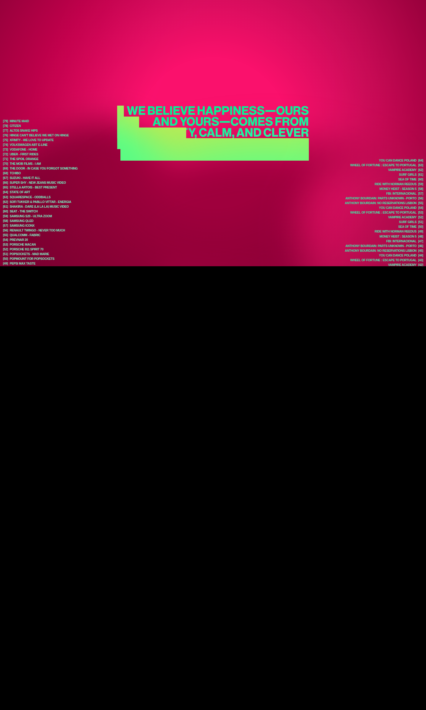
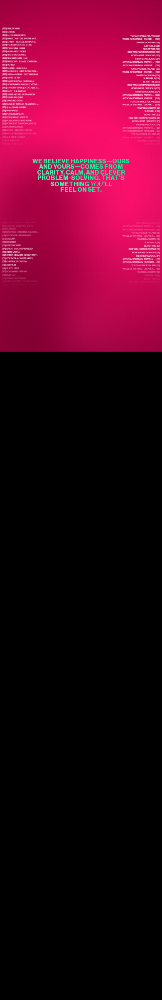

# UI Design System & Master Generation Blueprint: productionportugal-com

> **Production Portugal: Your trusted film production company in Portugal an...** (https://productionportugal.com/) — Dive into cinematic excellence with expert location scouting. Explore possibilities with Production Portugal - Your Trusted film producti...



---

## 1. Executive Visual Persona & Design Archetype

- **Brand Essence & Persona**: **Production Portugal: Your trusted film production company in Portugal an...** (`https://productionportugal.com/`). Dive into cinematic excellence with expert location scouting. Explore possibilities with Production Portugal - Your Trusted film producti...
- **Capture Provenance**: Live browser capture (`tier1_fast`, HTTP `200`, captured `2026-11-23`).
- **Visual Archetype**: **Dark-Substrate WebGL / Canvas Interactive Experience (`#000000` / `#ff0063`)**.
- **Anti-AI-Slop Differentiators**:
  - **Live-Computed Chromatic Polarity**: Anchors the viewport in `#000000` (live computed `body` `background-color` (`computed_styles.json`)) paired with `#ffffff` primary typography and `#ff0063` accents.
  - **Grounded Typographic Hierarchy**: Pairs `Neue Haas Grotesk Display Pro` for display copy (`Production Portugal: Your trusted fi`) with `Neue Haas Grotesk Display Pro` and not declared in live computed styles (uses primary stack / `ui-monospace`).
  - **Calibrated Spatial Grid & Motion**: Combines `1440px` container bounds (`gap: 16px`, padding `10px`) with `cubic-bezier(0.4,0,0.2,1)` easing and Lenis Smooth Scroll (`data-lenis`), GSAP Timeline & ScrollTrigger.

---

## 2. Spatial Architecture & Modular Grid Mathematics



### Viewport Allocation & Container Geometry
- **Captured Viewport Dimensions**: Desktop `1440×2400px` (`assets/desktop.png`, clamped at 2400px live multi-section capture), Mobile `390×2400px` (`assets/mobile.png`, clamped at 2400px live multi-section capture).
- **Master Container Bounds**: `1440px` (full-bleed `100%` desktop stage measured on `1440px` viewport).
- **Canvas Lateral Padding & Spacing**: `10px` lateral canvas padding with `16px` grid gap.
- **Border Radius Scale**: `3px`, `100%`, `50%`, `2px`.

### Responsive Breakpoint Architecture
- **Desktop Layout**: Multi-column CSS Grid / Flexbox layout at `1440px` (`max-width: 1440px`, `gap: 16px`).
- **Mobile Layout**: Single-column vertical stack at `390px` viewport width with `10px` horizontal padding.
- **Extracted CSS Media Queries**: `@media screen and (max-width: 991px)`, `@media screen and (max-width: 767px)`, `@media screen and (max-width: 479px)`, `@media (min-width: 768px)`.

---

## 3. Color System, Materiality & Atmospheric Lighting

### Semantic Palette & Source Grounding
| Semantic Role | Ground-Truth Value | Extracted Live / CSS Source |
|---|---|---|
| **Primary Canvas Substrate** | `#000000` | live computed `body` `background-color` (`computed_styles.json`) |
| **Primary Typography Ink** | `#ffffff` | live computed `p` `color` (`computed_styles.json`) |
| **Elevated Surface / Card Substrate** | `#ff0080` | `var(--base-bg)` in `:root` |
| **Interactive Accent / Highlight** | `#ff0063` | `var(--_colours---brand)` in `:root` |
| **Secondary / Muted Copy** | `#7f7f7f` | `.switcher__button { color: #7f7f7f }` |
| **Structural Hairline Border** | `#3898ec` | `.w-select:focus { border-color: #3898ec }` |
| **Variable Token (`--_colours---color--grey--grey-100`)** | `#6b6d79` | `var(--_colours---color--grey--grey-100)` in `:root` |
| **Variable Token (`--home__about__links-edge`)** | `#ff1972` | `var(--home__about__links-edge)` in `:root` |
| **Variable Token (`--blob-1`)** | `#ff126f` | `var(--blob-1)` in `:root` |
| **Variable Token (`--blob-2`)** | `#a3003f` | `var(--blob-2)` in `:root` |
| **Variable Token (`--vignette`)** | `#590224` | `var(--vignette)` in `:root` |

### Sanitized Root CSS Variables (`ui-ux.md` Ground Truth)
| Variable Name | Extracted Value | Semantic Role |
|---|---|---|
| `--_colours---color--grey--grey-100` | `#6b6d79` | Brand / Palette Token |
| `--home__about__links-edge` | `#ff1972` | Typography Ink Token |
| `--_colours---brand` | `#ff0063` | Brand / Palette Token |
| `--psp-intro-height` | `100vh` | Layout / Spatial Grid Token |
| `--psp-stage-height` | `var(--psp-viewport-height, 100dvh)` | Layout / Spatial Grid Token |
| `--psp-stage-bottom-inset` | `0px` | Dimension / Scale Token |
| `--psp-viewport-height` | `100vh` | Layout / Spatial Grid Token |
| `--base-bg` | `#ff0080` | Canvas / Surface Token |
| `--blob-1` | `#ff126f` | Color / Atmospheric Token |
| `--blob-2` | `#a3003f` | Color / Atmospheric Token |
| `--vignette` | `#590224d9` | Color / Atmospheric Token |
| `--sec-bg` | `#00000005` | Canvas / Surface Token |
| `--w-backdrop-animation` | `initial` | Motion / Easing Token |
| `--home-hero-project-progress` | `0%` | Dimension / Scale Token |
| `--home-brands-project-progress` | `0%` | Brand / Palette Token |
| `--psp-hover-x` | `0px` | Dimension / Scale Token |

---

## 4. Typographic Scale & Editorial Hierarchy

### Font Family Stacks
- **Display Typography**: `Neue Haas Grotesk Display Pro`.
- **Primary Body Stack**: `Neue Haas Grotesk Display Pro`.
- **Technical / Metadata Stack**: not declared in live computed styles (uses primary stack / `ui-monospace`).

### Typographic Scale & Rules (Live Computed & Stylesheet Grounded)
- **Hero Display (`H1`)**: rule `h1` (`font-size: 2em`).
- **Section Heading (`H2`)**: live computed `h2` (`font-size: 40px`, `line-height: 36px`, `font-weight: 900`); rule `h2` (`font-size: 32px`, `line-height: 36px`).
- **Body Copy**: live computed `body` (`font-size: 12px`, `line-height: 11.52px`, `font-weight: 700`, `letter-spacing: -0.36px`); rule `body` (`font-size: 14px`, `line-height: 20px`).
- **Metadata & Navigation Labels**: live computed `nav/a` (`font-size: 12px`, `line-height: 11.52px`, `font-weight: 700`, `letter-spacing: -0.36px`); rule `small` (`font-size: 80%`).

---

## 5. Choreographed Motion & Interaction Physics

### Primary Easing Curves
- **Extracted Timing Functions**: `cubic-bezier(0.4,0,0.2,1)`, `cubic-bezier(0.22,1,0.36,1)`, `cubic-bezier(0.16,1,0.3,1)`.

### Per-Element Transition & Choreography Rules
- **Selector `.w-webflow-badge > img`**: `transition: unset` extracted from `productionportugal-com` stylesheet.
- **Selector `.w-slider-dot`**: `transition: background-color .1s, color .1s` extracted from `productionportugal-com` stylesheet.
- **Selector `.w-lightbox-control`**: `transition: all .3s` extracted from `productionportugal-com` stylesheet.
- **Extracted Easing Curve (`cubic-bezier(0.4,0,0.2,1)`)**: Governs interactive state transitions across `<header.header>` and `<section.home__about>`.
- **Runtime Interaction Engine**: Integrates Lenis Smooth Scroll (`data-lenis`), GSAP Timeline & ScrollTrigger, Three.js / WebGL Canvas Pipeline with `prefers-reduced-motion: reduce` fallback guards.

---

## 6. Component Wireframe & Structural DOM Map

### Visual Layout Schematic — Desktop (`1440px`, Grounded in `dom.html` & Landmark Bounding Boxes)
```
┌────────────────────────────────────────────────────────────────────────┐
│ DESKTOP VIEWPORT (1440px) — Production Portugal: Your trusted film pro │
│ ====================================================================== │
│ [ <header.header> (1440x55px)         | [ WORK ] · [ Commercials ] · ] │
│ ---------------------------------------------------------------------- │
│ | HERO STAGE: <section.home__hero> (w=1440px)                        | │
│ | H1: Production Portugal: Your trusted film productio               | │
│ | Substrate: #000000 | Ink: #ffffff | Accent: #ff0063                | │
│ ---------------------------------------------------------------------- │
│ | SHOWCASE GRID (<section.home__about>) max-w: 1440px                | │
│ | +------------------------------+  +------------------------------+ | │
│ | | Featured Work & Interactive  |  | Technical Architecture & Nar | | │
│ | +------------------------------+  +------------------------------+ | │
│ ---------------------------------------------------------------------- │
│ | DETAIL MODULE (<section.home__brands>) — Global Directory & Co     | │
│ ---------------------------------------------------------------------- │
│ [ FOOTER (<footer.footer>     ) | https://productionportugal.com/      │
└────────────────────────────────────────────────────────────────────────┘
```

### Visual Layout Schematic — Mobile Reflow (`390px`)
```
┌────────────────────────────────────────────────────────────────────────┐
│ MOBILE VIEWPORT REFLOW (390px) — Single-Column Stack (gap: 16px)       │
│ ====================================================================== │
│ [ HEADER BAR (<header.header>         ) | Compact Menu (390px)         │
│ ---------------------------------------------------------------------- │
│ | HERO STAGE (<section.home__hero>) — 390px Vertical Lead            | │
│ | H1: Production Portugal: Your trusted film productio               | │
│ ---------------------------------------------------------------------- │
│ | SHOWCASE STACK (<section.home__about>) — 1-Col Stack               | │
│ | [ Item 1: Featured Work & Interactive Showcase                   ] | │
│ | [ Item 2: Technical Architecture & Narrative                     ] | │
│ ---------------------------------------------------------------------- │
│ | DETAIL STACK (<section.home__brands>) — 1-Col (Global Directory &) | │
│ ---------------------------------------------------------------------- │
│ [ FOOTER (<footer.footer>     ) | Stacked 390px Colophon               │
└────────────────────────────────────────────────────────────────────────┘
```

### Granular DOM Region Breakdown
1. **Brand Header & Navigation Bar (<header.header> — `productionportugal-com`)**:
   - Landmark `<header class="header">` (`1440x55px`) hosting `Production Portugal: Your trusted fi` navigation (`[ WORK ] · [ Commercials ] · [ Long Format ] · [ DIRECTORS ] · [ CLIENTS ]`), DOM attributes (`data-wf-domain="productionportugal.com"`, `data-wf-page="69f205b2a0439779a1d74754"`, `data-wf-site="69f205b0a0439779a1d746f7"`, `data-home-intro-title="Minute Maid"`), and stylesheet rule `html { -webkit-text-size-adjust: 100%; -ms-text-size-adjust: 100%; font-family:... }`.
2. **Hero Stage & Focal Lead (<section.home__hero> — `Production Portugal: Your trusted `)**:
   - Landmark `<section class="home__hero">` presenting display lead `Production Portugal: Your trusted film productio` and copy excerpt *"At PSP Production, every project is guided by senior executive pr"* over `#000000` canvas and `#ffffff` ink.
3. **Primary Showcase & Content Grid (<section.home__about> — `Featured Work & Interactive Showca`)**:
   - Landmark `<section class="home__about">` rendering section `Featured Work & Interactive Showcase` with copy *"Hinge Can't Believe We Met on Hinge"*, asset references (`cdn.prod.website-files.com`, `psp-6eb01f.webflow.shared.c80d7d9...`, `6a68884496439a79375f31d1_PSP-Logo...`, `6a688844292fe50b266154c7_PSP-Logo...`), and grid rule `body { margin: 0; }`.
4. **Interactive Detail & Feature Matrix (<section.home__brands> — `Technical Architecture & Narrative`)**:
   - Landmark `<section class="home__brands">` framing `Technical Architecture & Narrative` and `Global Directory & Contact` (*"Xfinity - We Love To Update"*) with `#ff0080` surface cards, `#ff0063` accents, and `summary { display: block; }`.
5. **Colophon & Global Directory Footer (<footer.footer> — `https://productionportugal.com/`)**:
   - Landmark `<footer class="footer">` anchoring `Production Portugal: Your truste` footer links (`[ WORK ] · [ Commercials ] · [ Long Format ] · [ DIRECTORS ] · [ CLIENTS ]`), copy *"Volkswagen Abt E-Line"*, and `#3898ec` structural dividers.

---

## 7. Master Zero-Shot AI Generation Prompt

```markdown
# Master Zero-Shot Frontend Generation Prompt: productionportugal-com (Production Portugal: Your trusted film production company in Portugal an...)

You are a principal frontend architect and design systems engineer. Build a complete, production-ready web application replicating the exact design system, DOM landmarks, typographic hierarchy, color tokens, and motion physics of `productionportugal-com` (**Production Portugal: Your trusted film production company in Portugal an...** — `https://productionportugal.com/`).

### 1. Visual Archetype & Anti-AI-Slop Mandates
- **Archetype**: Dark-Substrate WebGL / Canvas Interactive Experience (`#000000` / `#ff0063`).
- **Identity & Domain Context**: Dive into cinematic excellence with expert location scouting. Explore possibilities with Production Portugal - Your Trusted film producti...
- **Primary Substrate**: `#000000` (live computed `body` `background-color` (`computed_styles.json`)), **Primary Ink**: `#ffffff`, **Accent / Highlight**: `#ff0063`.
- **Site-Specific Differentiators**:
  - **Live-Computed Chromatic Polarity**: Anchors the viewport in `#000000` (live computed `body` `background-color` (`computed_styles.json`)) paired with `#ffffff` primary typography and `#ff0063` accents.
  - **Grounded Typographic Hierarchy**: Pairs `Neue Haas Grotesk Display Pro` for display copy (`Production Portugal: Your trusted fi`) with `Neue Haas Grotesk Display Pro` and not declared in live computed styles (uses primary stack / `ui-monospace`).
  - **Calibrated Spatial Grid & Motion**: Combines `1440px` container bounds (`gap: 16px`, padding `10px`) with `cubic-bezier(0.4,0,0.2,1)` easing and Lenis Smooth Scroll (`data-lenis`), GSAP Timeline & ScrollTrigger.

### 2. Ground-Truth CSS Variables (`:root` Token Contract)
Declare and consume these exact custom properties extracted from `productionportugal-com` in your global stylesheet:

:root {
  /* Production Portugal: Your trusted film production company in Portugal an... (productionportugal-com) — Live-Grounded CSS Variables */
  --_colours---color--grey--grey-100: #6b6d79; /* Brand / Palette Token (productionportugal-com) */
  --home__about__links-edge: #ff1972; /* Typography Ink Token (productionportugal-com) */
  --_colours---brand: #ff0063; /* Brand / Palette Token (productionportugal-com) */
  --psp-intro-height: 100vh; /* Layout / Spatial Grid Token (productionportugal-com) */
  --psp-stage-height: var(--psp-viewport-height, 100dvh); /* Layout / Spatial Grid Token (productionportugal-com) */
  --psp-stage-bottom-inset: 0px; /* Dimension / Scale Token (productionportugal-com) */
  --psp-viewport-height: 100vh; /* Layout / Spatial Grid Token (productionportugal-com) */
  --base-bg: #ff0080; /* Canvas / Surface Token (productionportugal-com) */
  --blob-1: #ff126f; /* Color / Atmospheric Token (productionportugal-com) */
  --blob-2: #a3003f; /* Color / Atmospheric Token (productionportugal-com) */
  --vignette: #590224d9; /* Color / Atmospheric Token (productionportugal-com) */
  --sec-bg: #00000005; /* Canvas / Surface Token (productionportugal-com) */
  --w-backdrop-animation: initial; /* Motion / Easing Token (productionportugal-com) */
  --home-hero-project-progress: 0%; /* Dimension / Scale Token (productionportugal-com) */
  --home-brands-project-progress: 0%; /* Brand / Palette Token (productionportugal-com) */
  --psp-hover-x: 0px; /* Dimension / Scale Token (productionportugal-com) */
}

### 3. Semantic Color & Materiality Contract
Map every surface, ink, and border strictly to these source-grounded tokens:
- **Primary Canvas Substrate**: `#000000` — grounded in live computed `body` `background-color` (`computed_styles.json`)
- **Primary Typography Ink**: `#ffffff` — grounded in live computed `p` `color` (`computed_styles.json`)
- **Elevated Surface / Card Substrate**: `#ff0080` — grounded in `var(--base-bg)` in `:root`
- **Interactive Accent / Highlight**: `#ff0063` — grounded in `var(--_colours---brand)` in `:root`
- **Secondary / Muted Copy**: `#7f7f7f` — grounded in `.switcher__button { color: #7f7f7f }`
- **Structural Hairline Border**: `#3898ec` — grounded in `.w-select:focus { border-color: #3898ec }`
- **Variable Token (`--_colours---color--grey--grey-100`)**: `#6b6d79` — grounded in `var(--_colours---color--grey--grey-100)` in `:root`
- **Variable Token (`--home__about__links-edge`)**: `#ff1972` — grounded in `var(--home__about__links-edge)` in `:root`
- **Variable Token (`--blob-1`)**: `#ff126f` — grounded in `var(--blob-1)` in `:root`
- **Variable Token (`--blob-2`)**: `#a3003f` — grounded in `var(--blob-2)` in `:root`
- **Variable Token (`--vignette`)**: `#590224` — grounded in `var(--vignette)` in `:root`

### 4. Spatial Grid, Container Bounds & Responsive Breakpoints
- **Desktop Viewport Reference**: `1440×2400px` (clamped at 2400px live multi-section capture, `1440px` standard desktop width).
- **Mobile Viewport Reference**: `390×2400px` (clamped at 2400px live multi-section capture, `390px` standard mobile width).
- **Container Max-Width**: `1440px` (full-bleed `100%` desktop stage measured on `1440px` viewport)
- **Padding & Gutters**: `10px` lateral canvas padding with `16px` grid gap
- **Desktop Grid**: Multi-column CSS Grid / Flexbox layout at `1440px` (`max-width: 1440px`, `gap: 16px`)
- **Mobile Adaptation**: Single-column vertical stack at `390px` viewport width with `10px` horizontal padding
- **Media Queries**: `@media screen and (max-width: 991px)`, `@media screen and (max-width: 767px)`, `@media screen and (max-width: 479px)`, `@media (min-width: 768px)`
- **Corner Radii**: `3px`, `100%`, `50%`, `2px`

### 5. Typography & Editorial Scale Contract
- **Display Font Stack**: `Neue Haas Grotesk Display Pro`
- **Body Font Stack**: `Neue Haas Grotesk Display Pro`
- **Monospace / Technical Font Stack**: not declared in live computed styles (uses primary stack / `ui-monospace`)
- **H1 Display Rule**: rule `h1` (`font-size: 2em`)
- **H2 Section Rule**: live computed `h2` (`font-size: 40px`, `line-height: 36px`, `font-weight: 900`); rule `h2` (`font-size: 32px`, `line-height: 36px`)
- **Body Copy Rule**: live computed `body` (`font-size: 12px`, `line-height: 11.52px`, `font-weight: 700`, `letter-spacing: -0.36px`); rule `body` (`font-size: 14px`, `line-height: 20px`)
- **Metadata & Index Rule**: live computed `nav/a` (`font-size: 12px`, `line-height: 11.52px`, `font-weight: 700`, `letter-spacing: -0.36px`); rule `small` (`font-size: 80%`)

### 6. Component Hierarchy, Verbatim Copy & Real DOM Landmarks
Scaffold `productionportugal-com` (`Production Portugal: Your trusted film production company in Portugal an...`) with these exact structural regions, extracted copy, and CSS rules from `dom.html`:
1. **Brand Header & Navigation Bar (<header.header> — `productionportugal-com`)**:
   - DOM & Selectors: Landmark `<header class="header">` (`1440x55px`) hosting `Production Portugal: Your trusted fi` navigation (`[ WORK ] · [ Commercials ] · [ Long Format ] · [ DIRECTORS ] · [ CLIENTS ]`), DOM attributes (`data-wf-domain="productionportugal.com"`, `data-wf-page="69f205b2a0439779a1d74754"`, `data-wf-site="69f205b0a0439779a1d746f7"`, `data-home-intro-title="Minute Maid"`), and stylesheet rule `html { -webkit-text-size-adjust: 100%; -ms-text-size-adjust: 100%; font-family:... }`.
   - Responsive Contract: Header `Brand Header & Navigation Bar (<header.header> — `productionportugal-com`)` (`productionportugal-com`) adapts across `@media screen and (max-width: 991px)`, `@media screen and (max-width: 767px)`, `@media screen and (max-width: 479px)`, `@media (min-width: 768px)` with `cubic-bezier(0.4,0,0.2,1)`, `cubic-bezier(0.22,1,0.36,1)`, `cubic-bezier(0.16,1,0.3,1)` transitions and links `[ WORK ] · [ Commercials ] · [ Long Format ] · [ DIRECTORS ] · [ CLIENTS ]`.
2. **Hero Stage & Focal Lead (<section.home__hero> — `Production Portugal: Your trusted `)**:
   - DOM & Selectors: Landmark `<section class="home__hero">` presenting display lead `Production Portugal: Your trusted film productio` and copy excerpt *"At PSP Production, every project is guided by senior executive pr"* over `#000000` canvas and `#ffffff` ink.
   - Responsive Contract: Hero stage (`1440×2400px` desktop / `390×2400px` mobile) sets `#000000` background with `#ffffff` headline `Production Portugal: Your trusted film productio`.
3. **Primary Showcase & Content Grid (<section.home__about> — `Featured Work & Interactive Showca`)**:
   - DOM & Selectors: Landmark `<section class="home__about">` rendering section `Featured Work & Interactive Showcase` with copy *"Hinge Can't Believe We Met on Hinge"*, asset references (`cdn.prod.website-files.com`, `psp-6eb01f.webflow.shared.c80d7d9...`, `6a68884496439a79375f31d1_PSP-Logo...`, `6a688844292fe50b266154c7_PSP-Logo...`), and grid rule `body { margin: 0; }`.
   - Responsive Contract: Showcase grid `Primary Showcase & Content Grid (<section.home__about> — `Featured Work & Interactive Showca`)` applies Multi-column CSS Grid / Flexbox layout at `1440px` (`max-width: 1440px`, `gap: 16px`) on desktop and Single-column vertical stack at `390px` viewport width with `10px` horizontal padding on mobile.
4. **Interactive Detail & Feature Matrix (<section.home__brands> — `Technical Architecture & Narrative`)**:
   - DOM & Selectors: Landmark `<section class="home__brands">` framing `Technical Architecture & Narrative` and `Global Directory & Contact` (*"Xfinity - We Love To Update"*) with `#ff0080` surface cards, `#ff0063` accents, and `summary { display: block; }`.
   - Responsive Contract: Detail module `Interactive Detail & Feature Matrix (<section.home__brands> — `Technical Architecture & Narrative`)` uses `3px`, `100%`, `50%`, `2px` radii, `#ff0063` highlights, and assets (cdn.prod.website-files.com, psp-6eb01f.webflow.shared.c80d7d9..., 6a68884496439a79375f31d1_PSP-Logo...).
5. **Colophon & Global Directory Footer (<footer.footer> — `https://productionportugal.com/`)**:
   - DOM & Selectors: Landmark `<footer class="footer">` anchoring `Production Portugal: Your truste` footer links (`[ WORK ] · [ Commercials ] · [ Long Format ] · [ DIRECTORS ] · [ CLIENTS ]`), copy *"Volkswagen Abt E-Line"*, and `#3898ec` structural dividers.
   - Responsive Contract: Footer `Colophon & Global Directory Footer (<footer.footer> — `https://productionportugal.com/`)` aligns to `1440px` (full-bleed `100%` desktop stage measured on `1440px` viewport) with `10px` lateral canvas padding with `16px` grid gap and attributes (data-wf-domain="productionportugal.com", data-wf-page="69f205b2a0439779a1d74754", data-wf-site="69f205b0a0439779a1d746f7").

#### Verbatim DOM Copy Excerpts (`dom.html`)
- Copy Excerpt 1: *"At PSP Production, every project is guided by senior executive producers with deca..."*
- Copy Excerpt 2: *"Hinge Can't Believe We Met on Hinge"*
- Copy Excerpt 3: *"Xfinity - We Love To Update"*
- Copy Excerpt 4: *"Volkswagen Abt E-Line"*

### 7. Motion, Extracted Stylesheet Rules & Interaction Choreography
- **Primary Easing Functions**: `cubic-bezier(0.4,0,0.2,1)`, `cubic-bezier(0.22,1,0.36,1)`, `cubic-bezier(0.16,1,0.3,1)`
- **Extracted Stylesheet Rules (`productionportugal-com`)**:
- `html { -webkit-text-size-adjust: 100%; -ms-text-size-adjust: 100%; font-family:... }`
- `body { margin: 0; }`
- `summary { display: block; }`
- `video { vertical-align: baseline; display: inline-block; }`
- `template { display: none; }`
- **Per-Selector Transition Rules**:
- **Selector `.w-webflow-badge > img`**: `transition: unset` extracted from `productionportugal-com` stylesheet.
- **Selector `.w-slider-dot`**: `transition: background-color .1s, color .1s` extracted from `productionportugal-com` stylesheet.
- **Selector `.w-lightbox-control`**: `transition: all .3s` extracted from `productionportugal-com` stylesheet.
- **Extracted Easing Curve (`cubic-bezier(0.4,0,0.2,1)`)**: Governs interactive state transitions across `<header.header>` and `<section.home__about>`.
- **Runtime Interaction Engine**: Integrates Lenis Smooth Scroll (`data-lenis`), GSAP Timeline & ScrollTrigger, Three.js / WebGL Canvas Pipeline with `prefers-reduced-motion: reduce` fallback guards.

### 8. Technical Deliverables
- Implement in Next.js (App Router) with TypeScript and Tailwind CSS consuming the `:root` custom properties defined above for `productionportugal-com`.
- Reproduce both the `1440px` desktop architecture and `390px` mobile breakpoint transitions, preserving semantic HTML5 landmarks (`<header>`, `<nav>`, `<main>`, `<section>`, `<footer>`) and `prefers-reduced-motion` accessibility guards.
```
