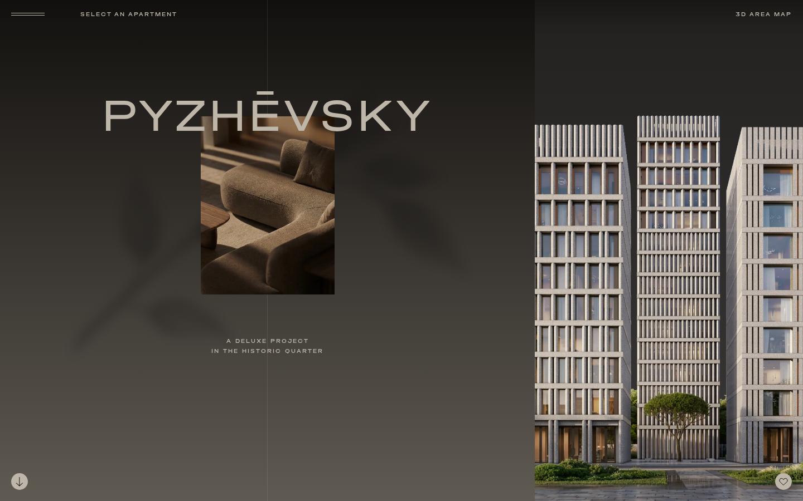
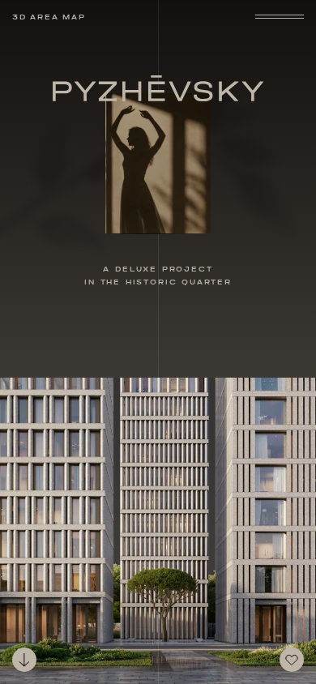

# UI Design System & Master Generation Blueprint: pyzhevsky-estate

> **Pyzhevsky — official website of a deluxe residence five minutes from the...** (https://pyzhevsky.estate/) — An intimate residential project. Apartments in the historic centre. Panoramic views and original architecture.



---

## 1. Executive Visual Persona & Design Archetype

- **Brand Essence & Persona**: **Pyzhevsky — official website of a deluxe residence five minutes from the...** (`https://pyzhevsky.estate/`). An intimate residential project. Apartments in the historic centre. Panoramic views and original architecture.
- **Capture Provenance**: Live browser capture (`tier1_fast`, HTTP `200`, captured `2026-11-23`).
- **Visual Archetype**: **Light-Gallery WebGL / Canvas Interactive Experience (`#f7f2e8` / `#75736d`)**.
- **Anti-AI-Slop Differentiators**:
  - **Live-Computed Chromatic Polarity**: Anchors the viewport in `#f7f2e8` (live computed `body` `background-color` (`computed_styles.json`)) paired with `#12100e` primary typography and `#75736d` accents.
  - **Grounded Typographic Hierarchy**: Pairs `Halvar Breitschrift` for display copy (`PYZHEVSKY`) with `Garamond Light` and `Consolas`.
  - **Calibrated Spatial Grid & Motion**: Combines `1440px` container bounds (`gap: 3px`, padding `10px`) with `cubic-bezier(.25,.74,.22,.99)` easing and Lenis Smooth Scroll (`data-lenis`), Three.js / WebGL Canvas Pipeline.

---

## 2. Spatial Architecture & Modular Grid Mathematics



### Viewport Allocation & Container Geometry
- **Captured Viewport Dimensions**: Desktop `1440×900px` (`assets/desktop.png`, single-viewport 100vh live capture (900px)), Mobile `390×844px` (`assets/mobile.png`, single-viewport 100vh live capture (844px)).
- **Master Container Bounds**: `1440px` (full-bleed `100%` desktop stage measured on `1440px` viewport).
- **Canvas Lateral Padding & Spacing**: `10px` lateral canvas padding with `3px` grid gap.
- **Border Radius Scale**: `min(50%, 8px)`, `3px`, `6px`, `var(--btn-rx)`.

### Responsive Breakpoint Architecture
- **Desktop Layout**: Multi-column CSS Grid / Flexbox layout at `1440px` (`max-width: 1440px`, `gap: 3px`).
- **Mobile Layout**: Single-column vertical stack at `390px` viewport width with `10px` horizontal padding.
- **Extracted CSS Media Queries**: `@media (min-width:568px) and (max-width:667px) and (max-aspect-r...`, `@media (min-width:1px)`, `@media (min-aspect-ratio:13/9) and (min-width:1px),(min-width:56...`, `@media (min-width:1440px) and (min-width:1px),(min-width:980px)...`.

---

## 3. Color System, Materiality & Atmospheric Lighting

### Semantic Palette & Source Grounding
| Semantic Role | Ground-Truth Value | Extracted Live / CSS Source |
|---|---|---|
| **Primary Canvas Substrate** | `#f7f2e8` | live computed `body` `background-color` (`computed_styles.json`) |
| **Primary Typography Ink** | `#12100e` | live computed `main` `color` (`computed_styles.json`) |
| **Elevated Surface / Card Substrate** | `#ffffff` | `.overlay { background: #ffffff }` |
| **Interactive Accent / Highlight** | `#75736d` | live computed `a` `color` (`computed_styles.json`) |
| **Secondary / Muted Copy** | `#75736d` | live computed `footer` `color` (`computed_styles.json`) |
| **Structural Hairline Border** | `#000000` | `var(--t-button-border-black-text)` in `:root` |
| **Variable Token (`--c-black-hover`)** | `#2f2b27` | `var(--c-black-hover)` in `:root` |

### Sanitized Root CSS Variables (`ui-ux.md` Ground Truth)
| Variable Name | Extracted Value | Semantic Role |
|---|---|---|
| `--scale-px` | `1px` | Dimension / Scale Token |
| `--scale-rem` | `1rem` | Dimension / Scale Token |
| `--scale-em` | `1em` | Dimension / Scale Token |
| `--scale-text-px` | `1px` | Typography Ink Token |
| `--scale-text-rem` | `1rem` | Typography Ink Token |
| `--scale-text-em` | `1em` | Typography Ink Token |
| `--scale-none-px` | `1px` | Dimension / Scale Token |
| `--scale-none-rem` | `1rem` | Dimension / Scale Token |
| `--vw` | `1vw` | Layout / Spatial Grid Token |
| `--vw100` | `100vw` | Layout / Spatial Grid Token |
| `--c-black` | `#12100e` | Canvas / Surface Token |
| `--c-black-rgb` | `18,16,14` | Canvas / Surface Token |
| `--c-black-hover` | `#2f2b27` | Canvas / Surface Token |
| `--c-black-hover-rgb` | `47,43,39` | Canvas / Surface Token |
| `--c-white` | `#fff` | Canvas / Surface Token |
| `--c-white-rgb` | `255,255,255` | Canvas / Surface Token |

---

## 4. Typographic Scale & Editorial Hierarchy

### Font Family Stacks
- **Display Typography**: `Halvar Breitschrift`.
- **Primary Body Stack**: `Garamond Light`.
- **Technical / Metadata Stack**: `Consolas`.

### Typographic Scale & Rules (Live Computed & Stylesheet Grounded)
- **Hero Display (`H1`)**: live computed `h1` (`font-size: 107px`, `line-height: 140px`, `font-weight: 400`); rule `,h1` (`font-size: 2em`).
- **Section Heading (`H2`)**: live computed `h2` (`font-size: 60px`, `line-height: 60px`, `font-weight: 400`); rule `,h2` (`font-weight: 400`).
- **Body Copy**: live computed `body` (`font-size: 16px`, `line-height: 20px`, `font-weight: 400`, `letter-spacing: 0.32px`).
- **Metadata & Navigation Labels**: live computed `nav/a` (`font-size: 16px`, `line-height: 20px`, `font-weight: 400`, `letter-spacing: 0.32px`); CSS variables `--t-small: var(--c-pale-dark)`, `--t-small-rgb: var(--c-pale-dark-rgb)`; rule `,small` (`font-weight: 500`).

---

## 5. Choreographed Motion & Interaction Physics

### Primary Easing Curves
- **Extracted Timing Functions**: `cubic-bezier(.25,.74,.22,.99)`, `cubic-bezier(.7,0,.4,1)`, `cubic-bezier(0.7,0,0.4,1)`.

### Per-Element Transition & Choreography Rules
- **Selector `vig-smooth-scroll::part(scrollbar)`**: `transition: .4s` extracted from `pyzhevsky-estate` stylesheet.
- **Selector `--checkmark .form-control-radio__...`**: `transition: .6s` extracted from `pyzhevsky-estate` stylesheet.
- **Selector `a.link-text:where(:not(.btn))`**: `transition: .8s` extracted from `pyzhevsky-estate` stylesheet.
- **Extracted Easing Curve (`cubic-bezier(.25,.74,.22,.99)`)**: Governs interactive state transitions across `<header.header>` and `<section.ui-dark>`.
- **Runtime Interaction Engine**: Integrates Lenis Smooth Scroll (`data-lenis`), Three.js / WebGL Canvas Pipeline, Barba.js Page Transition Router with `prefers-reduced-motion: reduce` fallback guards.

---

## 6. Component Wireframe & Structural DOM Map

### Visual Layout Schematic — Desktop (`1440px`, Grounded in `dom.html` & Landmark Bounding Boxes)
```
┌────────────────────────────────────────────────────────────────────────┐
│ DESKTOP VIEWPORT (1440px) — Pyzhevsky — official website of a deluxe r │
│ ====================================================================== │
│ [ <header.header> (1440x50px)         | Select an apartment · 3D are ] │
│ ---------------------------------------------------------------------- │
│ | HERO STAGE: <section.section> (w=1440px)                           | │
│ | H1: PYZHEVSKY                                                      | │
│ | Substrate: #f7f2e8 | Ink: #12100e | Accent: #75736d                | │
│ ---------------------------------------------------------------------- │
│ | SHOWCASE GRID (<section.ui-dark>) max-w: 1440px                    | │
│ | +------------------------------+  +------------------------------+ | │
│ | | Pyzhevsky                    |  | Smart systems                | | │
│ | +------------------------------+  +------------------------------+ | │
│ ---------------------------------------------------------------------- │
│ | DETAIL MODULE (<section.section--top-2>) — Service entrance        | │
│ ---------------------------------------------------------------------- │
│ [ FOOTER (<footer.section>    ) | https://pyzhevsky.estate/            │
└────────────────────────────────────────────────────────────────────────┘
```

### Visual Layout Schematic — Mobile Reflow (`390px`)
```
┌────────────────────────────────────────────────────────────────────────┐
│ MOBILE VIEWPORT REFLOW (390px) — Single-Column Stack (gap: 3px)        │
│ ====================================================================== │
│ [ HEADER BAR (<header.header>         ) | Compact Menu (390px)         │
│ ---------------------------------------------------------------------- │
│ | HERO STAGE (<section.section>) — 390px Vertical Lead               | │
│ | H1: PYZHEVSKY                                                      | │
│ ---------------------------------------------------------------------- │
│ | SHOWCASE STACK (<section.ui-dark>) — 1-Col Stack                   | │
│ | [ Item 1: Pyzhevsky                                              ] | │
│ | [ Item 2: Smart systems                                          ] | │
│ ---------------------------------------------------------------------- │
│ | DETAIL STACK (<section.section--top-2>) — 1-Col (Service entrance) | │
│ ---------------------------------------------------------------------- │
│ [ FOOTER (<footer.section>    ) | Stacked 390px Colophon               │
└────────────────────────────────────────────────────────────────────────┘
```

### Granular DOM Region Breakdown
1. **Brand Header & Navigation Bar (<header.header> — `pyzhevsky-estate`)**:
   - Landmark `<header class="header is-hidden--print">` (`1440x50px`) hosting `Pyzhevsky — official website of a de` navigation (`Select an apartment · 3D area map`), DOM attributes (`data-barba="wrapper"`, `data-nosnippet`, `data-plugin="preloader"`, `data-preloader-animation-name-in="preloader-in"`), and stylesheet rule `html { line-height:1.15;-webkit-text-size-adjust:100% }`.
2. **Hero Stage & Focal Lead (<section.section> — `PYZHEVSKY`)**:
   - Landmark `<section class="section l-intro-section">` presenting display lead `PYZHEVSKY` and copy excerpt *"ADELUXEPROJECT INTHEHISTORICQUARTER"* over `#f7f2e8` canvas and `#12100e` ink.
3. **Primary Showcase & Content Grid (<section.ui-dark> — `Pyzhevsky`)**:
   - Landmark `<section class="section ui-dark">` rendering section `Pyzhevsky` with copy *"A d e l u x e p r o j e c t i n t h e h i s t o r i c q u a r t e"*, asset references (`storage.googleapis.com`, `itc-garamond_light.woff2`, `Halvar-Breitschrift-Regular-Web.w...`, `Halvar-Breitschrift-Medium-Web.woff2`), and grid rule `pre { font-family:monospace,monospace;font-size:1em }`.
4. **Interactive Detail & Feature Matrix (<section.section--top-2> — `Smart systems`)**:
   - Landmark `<section class="section section--top-2">` framing `Smart systems` and `Service entrance` (*"Restrained, assured, timeless — they put the city on pause, so al"*) with `#ffffff` surface cards, `#75736d` accents, and `strong { font-weight:bolder }`.
5. **Colophon & Global Directory Footer (<footer.section> — `https://pyzhevsky.estate/`)**:
   - Landmark `<footer class="section section--no-overflow">` anchoring `Pyzhevsky — official website of ` footer links (`Select an apartment · 3D area map`), copy *"The minimalist form of the three buildings draws on the sign"*, and `#000000` structural dividers.

---

## 7. Master Zero-Shot AI Generation Prompt

```markdown
# Master Zero-Shot Frontend Generation Prompt: pyzhevsky-estate (Pyzhevsky — official website of a deluxe residence five minutes from the...)

You are a principal frontend architect and design systems engineer. Build a complete, production-ready web application replicating the exact design system, DOM landmarks, typographic hierarchy, color tokens, and motion physics of `pyzhevsky-estate` (**Pyzhevsky — official website of a deluxe residence five minutes from the...** — `https://pyzhevsky.estate/`).

### 1. Visual Archetype & Anti-AI-Slop Mandates
- **Archetype**: Light-Gallery WebGL / Canvas Interactive Experience (`#f7f2e8` / `#75736d`).
- **Identity & Domain Context**: An intimate residential project. Apartments in the historic centre. Panoramic views and original architecture.
- **Primary Substrate**: `#f7f2e8` (live computed `body` `background-color` (`computed_styles.json`)), **Primary Ink**: `#12100e`, **Accent / Highlight**: `#75736d`.
- **Site-Specific Differentiators**:
  - **Live-Computed Chromatic Polarity**: Anchors the viewport in `#f7f2e8` (live computed `body` `background-color` (`computed_styles.json`)) paired with `#12100e` primary typography and `#75736d` accents.
  - **Grounded Typographic Hierarchy**: Pairs `Halvar Breitschrift` for display copy (`PYZHEVSKY`) with `Garamond Light` and `Consolas`.
  - **Calibrated Spatial Grid & Motion**: Combines `1440px` container bounds (`gap: 3px`, padding `10px`) with `cubic-bezier(.25,.74,.22,.99)` easing and Lenis Smooth Scroll (`data-lenis`), Three.js / WebGL Canvas Pipeline.

### 2. Ground-Truth CSS Variables (`:root` Token Contract)
Declare and consume these exact custom properties extracted from `pyzhevsky-estate` in your global stylesheet:

:root {
  /* Pyzhevsky — official website of a deluxe residence five minutes from the... (pyzhevsky-estate) — Live-Grounded CSS Variables */
  --scale-px: 1px; /* Dimension / Scale Token (pyzhevsky-estate) */
  --scale-rem: 1rem; /* Dimension / Scale Token (pyzhevsky-estate) */
  --scale-em: 1em; /* Dimension / Scale Token (pyzhevsky-estate) */
  --scale-text-px: 1px; /* Typography Ink Token (pyzhevsky-estate) */
  --scale-text-rem: 1rem; /* Typography Ink Token (pyzhevsky-estate) */
  --scale-text-em: 1em; /* Typography Ink Token (pyzhevsky-estate) */
  --scale-none-px: 1px; /* Dimension / Scale Token (pyzhevsky-estate) */
  --scale-none-rem: 1rem; /* Dimension / Scale Token (pyzhevsky-estate) */
  --vw: 1vw; /* Layout / Spatial Grid Token (pyzhevsky-estate) */
  --vw100: 100vw; /* Layout / Spatial Grid Token (pyzhevsky-estate) */
  --c-black: #12100e; /* Canvas / Surface Token (pyzhevsky-estate) */
  --c-black-rgb: 18,16,14; /* Canvas / Surface Token (pyzhevsky-estate) */
  --c-black-hover: #2f2b27; /* Canvas / Surface Token (pyzhevsky-estate) */
  --c-black-hover-rgb: 47,43,39; /* Canvas / Surface Token (pyzhevsky-estate) */
  --c-white: #fff; /* Canvas / Surface Token (pyzhevsky-estate) */
  --c-white-rgb: 255,255,255; /* Canvas / Surface Token (pyzhevsky-estate) */
}

### 3. Semantic Color & Materiality Contract
Map every surface, ink, and border strictly to these source-grounded tokens:
- **Primary Canvas Substrate**: `#f7f2e8` — grounded in live computed `body` `background-color` (`computed_styles.json`)
- **Primary Typography Ink**: `#12100e` — grounded in live computed `main` `color` (`computed_styles.json`)
- **Elevated Surface / Card Substrate**: `#ffffff` — grounded in `.overlay { background: #ffffff }`
- **Interactive Accent / Highlight**: `#75736d` — grounded in live computed `a` `color` (`computed_styles.json`)
- **Secondary / Muted Copy**: `#75736d` — grounded in live computed `footer` `color` (`computed_styles.json`)
- **Structural Hairline Border**: `#000000` — grounded in `var(--t-button-border-black-text)` in `:root`
- **Variable Token (`--c-black-hover`)**: `#2f2b27` — grounded in `var(--c-black-hover)` in `:root`

### 4. Spatial Grid, Container Bounds & Responsive Breakpoints
- **Desktop Viewport Reference**: `1440×900px` (single-viewport 100vh live capture (900px), `1440px` standard desktop width).
- **Mobile Viewport Reference**: `390×844px` (single-viewport 100vh live capture (844px), `390px` standard mobile width).
- **Container Max-Width**: `1440px` (full-bleed `100%` desktop stage measured on `1440px` viewport)
- **Padding & Gutters**: `10px` lateral canvas padding with `3px` grid gap
- **Desktop Grid**: Multi-column CSS Grid / Flexbox layout at `1440px` (`max-width: 1440px`, `gap: 3px`)
- **Mobile Adaptation**: Single-column vertical stack at `390px` viewport width with `10px` horizontal padding
- **Media Queries**: `@media (min-width:568px) and (max-width:667px) and (max-aspect-r...`, `@media (min-width:1px)`, `@media (min-aspect-ratio:13/9) and (min-width:1px),(min-width:56...`, `@media (min-width:1440px) and (min-width:1px),(min-width:980px)...`
- **Corner Radii**: `min(50%, 8px)`, `3px`, `6px`, `var(--btn-rx)`

### 5. Typography & Editorial Scale Contract
- **Display Font Stack**: `Halvar Breitschrift`
- **Body Font Stack**: `Garamond Light`
- **Monospace / Technical Font Stack**: `Consolas`
- **H1 Display Rule**: live computed `h1` (`font-size: 107px`, `line-height: 140px`, `font-weight: 400`); rule `,h1` (`font-size: 2em`)
- **H2 Section Rule**: live computed `h2` (`font-size: 60px`, `line-height: 60px`, `font-weight: 400`); rule `,h2` (`font-weight: 400`)
- **Body Copy Rule**: live computed `body` (`font-size: 16px`, `line-height: 20px`, `font-weight: 400`, `letter-spacing: 0.32px`)
- **Metadata & Index Rule**: live computed `nav/a` (`font-size: 16px`, `line-height: 20px`, `font-weight: 400`, `letter-spacing: 0.32px`); CSS variables `--t-small: var(--c-pale-dark)`, `--t-small-rgb: var(--c-pale-dark-rgb)`; rule `,small` (`font-weight: 500`)

### 6. Component Hierarchy, Verbatim Copy & Real DOM Landmarks
Scaffold `pyzhevsky-estate` (`Pyzhevsky — official website of a deluxe residence five minutes from the...`) with these exact structural regions, extracted copy, and CSS rules from `dom.html`:
1. **Brand Header & Navigation Bar (<header.header> — `pyzhevsky-estate`)**:
   - DOM & Selectors: Landmark `<header class="header is-hidden--print">` (`1440x50px`) hosting `Pyzhevsky — official website of a de` navigation (`Select an apartment · 3D area map`), DOM attributes (`data-barba="wrapper"`, `data-nosnippet`, `data-plugin="preloader"`, `data-preloader-animation-name-in="preloader-in"`), and stylesheet rule `html { line-height:1.15;-webkit-text-size-adjust:100% }`.
   - Responsive Contract: Header `Brand Header & Navigation Bar (<header.header> — `pyzhevsky-estate`)` (`pyzhevsky-estate`) adapts across `@media (min-width:568px) and (max-width:667px) and (max-aspect-r...`, `@media (min-width:1px)`, `@media (min-aspect-ratio:13/9) and (min-width:1px),(min-width:56...`, `@media (min-width:1440px) and (min-width:1px),(min-width:980px)...` with `cubic-bezier(.25,.74,.22,.99)`, `cubic-bezier(.7,0,.4,1)`, `cubic-bezier(0.7,0,0.4,1)` transitions and links `Select an apartment · 3D area map`.
2. **Hero Stage & Focal Lead (<section.section> — `PYZHEVSKY`)**:
   - DOM & Selectors: Landmark `<section class="section l-intro-section">` presenting display lead `PYZHEVSKY` and copy excerpt *"ADELUXEPROJECT INTHEHISTORICQUARTER"* over `#f7f2e8` canvas and `#12100e` ink.
   - Responsive Contract: Hero stage (`1440×900px` desktop / `390×844px` mobile) sets `#f7f2e8` background with `#12100e` headline `PYZHEVSKY`.
3. **Primary Showcase & Content Grid (<section.ui-dark> — `Pyzhevsky`)**:
   - DOM & Selectors: Landmark `<section class="section ui-dark">` rendering section `Pyzhevsky` with copy *"A d e l u x e p r o j e c t i n t h e h i s t o r i c q u a r t e"*, asset references (`storage.googleapis.com`, `itc-garamond_light.woff2`, `Halvar-Breitschrift-Regular-Web.w...`, `Halvar-Breitschrift-Medium-Web.woff2`), and grid rule `pre { font-family:monospace,monospace;font-size:1em }`.
   - Responsive Contract: Showcase grid `Primary Showcase & Content Grid (<section.ui-dark> — `Pyzhevsky`)` applies Multi-column CSS Grid / Flexbox layout at `1440px` (`max-width: 1440px`, `gap: 3px`) on desktop and Single-column vertical stack at `390px` viewport width with `10px` horizontal padding on mobile.
4. **Interactive Detail & Feature Matrix (<section.section--top-2> — `Smart systems`)**:
   - DOM & Selectors: Landmark `<section class="section section--top-2">` framing `Smart systems` and `Service entrance` (*"Restrained, assured, timeless — they put the city on pause, so al"*) with `#ffffff` surface cards, `#75736d` accents, and `strong { font-weight:bolder }`.
   - Responsive Contract: Detail module `Interactive Detail & Feature Matrix (<section.section--top-2> — `Smart systems`)` uses `min(50%, 8px)`, `3px`, `6px`, `var(--btn-rx)` radii, `#75736d` highlights, and assets (storage.googleapis.com, itc-garamond_light.woff2, Halvar-Breitschrift-Regular-Web.w...).
5. **Colophon & Global Directory Footer (<footer.section> — `https://pyzhevsky.estate/`)**:
   - DOM & Selectors: Landmark `<footer class="section section--no-overflow">` anchoring `Pyzhevsky — official website of ` footer links (`Select an apartment · 3D area map`), copy *"The minimalist form of the three buildings draws on the sign"*, and `#000000` structural dividers.
   - Responsive Contract: Footer `Colophon & Global Directory Footer (<footer.section> — `https://pyzhevsky.estate/`)` aligns to `1440px` (full-bleed `100%` desktop stage measured on `1440px` viewport) with `10px` lateral canvas padding with `3px` grid gap and attributes (data-barba="wrapper", data-nosnippet, data-plugin="preloader").

#### Verbatim DOM Copy Excerpts (`dom.html`)
- Copy Excerpt 1: *"ADELUXEPROJECT INTHEHISTORICQUARTER"*
- Copy Excerpt 2: *"A d e l u x e p r o j e c t i n t h e h i s t o r i c q u a r t e r"*
- Copy Excerpt 3: *"Restrained, assured, timeless — they put the city on pause, so all that matters ca..."*
- Copy Excerpt 4: *"The minimalist form of the three buildings draws on the signature archetypes of th..."*

### 7. Motion, Extracted Stylesheet Rules & Interaction Choreography
- **Primary Easing Functions**: `cubic-bezier(.25,.74,.22,.99)`, `cubic-bezier(.7,0,.4,1)`, `cubic-bezier(0.7,0,0.4,1)`
- **Extracted Stylesheet Rules (`pyzhevsky-estate`)**:
- `html { line-height:1.15;-webkit-text-size-adjust:100% }`
- `pre { font-family:monospace,monospace;font-size:1em }`
- `strong { font-weight:bolder }`
- `samp { font-family:monospace,monospace;font-size:1em }`
- `small { font-size:80% }`
- **Per-Selector Transition Rules**:
- **Selector `vig-smooth-scroll::part(scrollbar)`**: `transition: .4s` extracted from `pyzhevsky-estate` stylesheet.
- **Selector `--checkmark .form-control-radio__...`**: `transition: .6s` extracted from `pyzhevsky-estate` stylesheet.
- **Selector `a.link-text:where(:not(.btn))`**: `transition: .8s` extracted from `pyzhevsky-estate` stylesheet.
- **Extracted Easing Curve (`cubic-bezier(.25,.74,.22,.99)`)**: Governs interactive state transitions across `<header.header>` and `<section.ui-dark>`.
- **Runtime Interaction Engine**: Integrates Lenis Smooth Scroll (`data-lenis`), Three.js / WebGL Canvas Pipeline, Barba.js Page Transition Router with `prefers-reduced-motion: reduce` fallback guards.

### 8. Technical Deliverables
- Implement in Next.js (App Router) with TypeScript and Tailwind CSS consuming the `:root` custom properties defined above for `pyzhevsky-estate`.
- Reproduce both the `1440px` desktop architecture and `390px` mobile breakpoint transitions, preserving semantic HTML5 landmarks (`<header>`, `<nav>`, `<main>`, `<section>`, `<footer>`) and `prefers-reduced-motion` accessibility guards.
```
