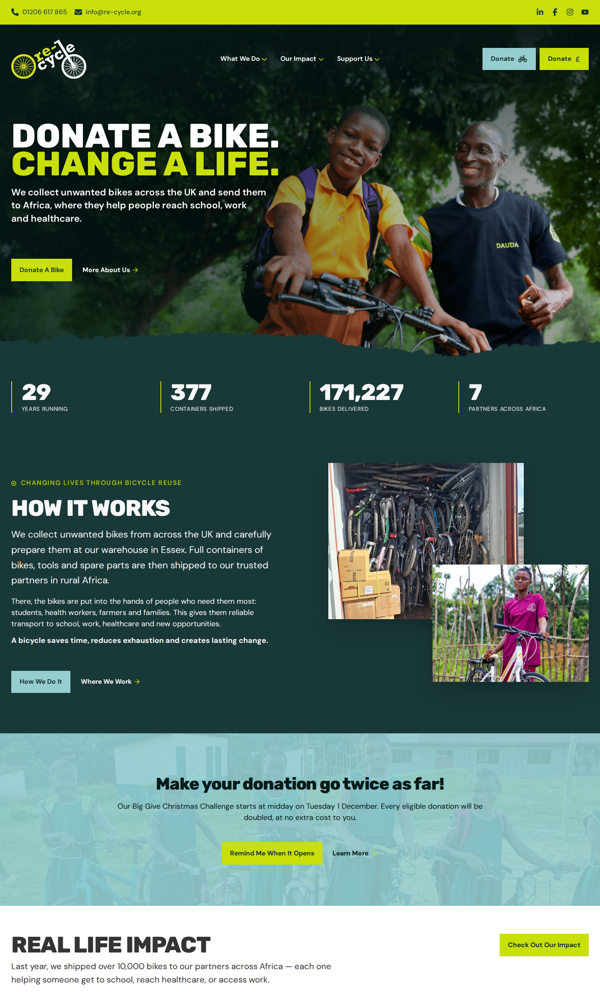
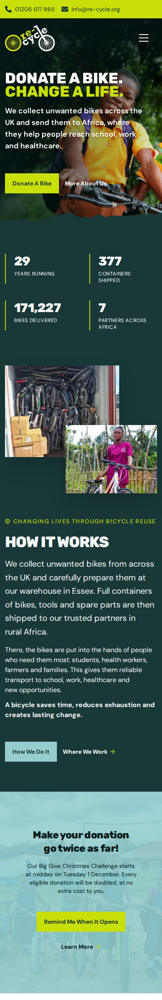

# UI Design System & Master Generation Blueprint: re-cycle-org

> **Re-Cycle · Changing Lives Through Bicycle Reuse** (https://re-cycle.org/) — We are Re-Cycle. We collect unwanted bikes from across the UK and ship them to trusted partners in Africa. Donate a bike, change a life.



---

## 1. Executive Visual Persona & Design Archetype

- **Brand Essence & Persona**: **Re-Cycle · Changing Lives Through Bicycle Reuse** (`https://re-cycle.org/`). We are Re-Cycle. We collect unwanted bikes from across the UK and ship them to trusted partners in Africa. Donate a bike, change a life.
- **Capture Provenance**: Live browser capture (`tier1_fast`, HTTP `200`, captured `2026-11-23`).
- **Visual Archetype**: **Light-Substrate Editorial & Modular Grid System (`#ffffff` canvas, `#193838` ink, `#ff0000` accent)**.
- **Anti-AI-Slop Differentiators**:
  - **Live-Computed Chromatic Polarity**: Anchors the viewport in `#ffffff` (live computed `body` `background-color` (`computed_styles.json`)) paired with `#193838` primary typography and `#ff0000` accents.
  - **Grounded Typographic Hierarchy**: Pairs `Rubik` for display copy (`DONATE A BIKE. CHANGE A LIFE.`) with `DM Sans` and `SFMono-Regular`.
  - **Calibrated Spatial Grid & Motion**: Combines `1440px` container bounds (`gap: 4px`, padding `6px`) with `cubic-bezier(.795,-.035,0,1)` easing and Swiper Touch Carousel Engine.

---

## 2. Spatial Architecture & Modular Grid Mathematics



### Viewport Allocation & Container Geometry
- **Captured Viewport Dimensions**: Desktop `1440×2400px` (`assets/desktop.png`, clamped at 2400px live multi-section capture), Mobile `390×2400px` (`assets/mobile.png`, clamped at 2400px live multi-section capture).
- **Master Container Bounds**: `1440px` (live computed `main` `max-width`).
- **Canvas Lateral Padding & Spacing**: `6px` lateral canvas padding with `4px` grid gap.
- **Border Radius Scale**: `4px`, `8px`, `3px`, `var(--wc-form-border-radius)`.

### Responsive Breakpoint Architecture
- **Desktop Layout**: Multi-column CSS Grid / Flexbox layout at `1440px` (`max-width: 1440px`, `gap: 4px`).
- **Mobile Layout**: Single-column vertical stack at `390px` viewport width with `6px` horizontal padding.
- **Extracted CSS Media Queries**: `@media screen and (min-width:673px)`, `@media screen and (min-width:1040px)`, `@media screen and (min-width:1110px)`, `@media screen and (min-width:1218px)`.

---

## 3. Color System, Materiality & Atmospheric Lighting

### Semantic Palette & Source Grounding
| Semantic Role | Ground-Truth Value | Extracted Live / CSS Source |
|---|---|---|
| **Primary Canvas Substrate** | `#ffffff` | live computed `body` `background-color` (`computed_styles.json`) |
| **Primary Typography Ink** | `#193838` | live computed `a` `color` (`computed_styles.json`) |
| **Elevated Surface / Card Substrate** | `#c8df0a` | live computed `button` `background-color` (`computed_styles.json`) |
| **Interactive Accent / Highlight** | `#ff0000` | `.woocommerce a.remove { color: red }` (`#ff0000`) |
| **Secondary / Muted Copy** | `#767676` | `var(--muted)` in `:root` |
| **Structural Hairline Border** | `#d6d6d6` | `var(--border)` in `:root` |
| **Variable Token (`--wp-block-synced-color`)** | `#7a00df` | `var(--wp-block-synced-color)` in `:root` |
| **Variable Token (`--wp-editor-canvas-background`)** | `#dddddd` | `var(--wp-editor-canvas-background)` in `:root` |
| **Variable Token (`--wp-admin-theme-color`)** | `#007cba` | `var(--wp-admin-theme-color)` in `:root` |
| **Variable Token (`--wp-admin-theme-color-darker-10`)** | `#006ba1` | `var(--wp-admin-theme-color-darker-10)` in `:root` |
| **Variable Token (`--wp-admin-theme-color-darker-20`)** | `#005a87` | `var(--wp-admin-theme-color-darker-20)` in `:root` |
| **Variable Token (`--woocommerce`)** | `#720eec` | `var(--woocommerce)` in `:root` |
| **Variable Token (`--wc-green`)** | `#007518` | `var(--wc-green)` in `:root` |

### Sanitized Root CSS Variables (`ui-ux.md` Ground Truth)
| Variable Name | Extracted Value | Semantic Role |
|---|---|---|
| `--wp-block-synced-color` | `#7a00df` | Brand / Palette Token |
| `--wp-block-synced-color--rgb` | `122,0,223` | Brand / Palette Token |
| `--wp-bound-block-color` | `var(--wp-block-synced-color)` | Brand / Palette Token |
| `--wp-editor-canvas-background` | `#ddd` | Canvas / Surface Token |
| `--wp-admin-theme-color` | `#007cba` | Brand / Palette Token |
| `--wp-admin-theme-color--rgb` | `0,124,186` | Brand / Palette Token |
| `--wp-admin-theme-color-darker-10` | `#006ba1` | Canvas / Surface Token |
| `--wp-admin-theme-color-darker-10--rgb` | `0,107,160.5` | Canvas / Surface Token |
| `--wp-admin-theme-color-darker-20` | `#005a87` | Canvas / Surface Token |
| `--wp-admin-theme-color-darker-20--rgb` | `0,90,135` | Canvas / Surface Token |
| `--wp-admin-border-width-focus` | `2px` | Layout / Spatial Grid Token |
| `--wp-admin--admin-bar--position-offset` | `var(--wp-admin--admin-bar--height,0px)` | Dimension / Scale Token |
| `--wp--style--global--content-size` | `70rem` | Layout / Spatial Grid Token |
| `--wp--style--global--wide-size` | `70rem` | Layout / Spatial Grid Token |
| `--woocommerce` | `#720eec` | Color / Atmospheric Token |
| `--wc-green` | `#007518` | Color / Atmospheric Token |

---

## 4. Typographic Scale & Editorial Hierarchy

### Font Family Stacks
- **Display Typography**: `Rubik`.
- **Primary Body Stack**: `DM Sans`.
- **Technical / Metadata Stack**: `SFMono-Regular`.

### Typographic Scale & Rules (Live Computed & Stylesheet Grounded)
- **Hero Display (`H1`)**: live computed `h1` (`font-size: 81px`, `line-height: 67.5px`, `font-weight: 700`); CSS variables `--font-display: "Rubik", sans-serif`, `--text-4xl: 2.25rem`, `--text-4xl--line-height: calc(2.5 / 2.25)`.
- **Section Heading (`H2`)**: live computed `h2` (`font-size: 54px`, `line-height: 54px`, `font-weight: 700`, `letter-spacing: -1.35px`); CSS variables `--text-2xl: 1.5rem`, `--text-2xl--line-height: calc(2 / 1.5)`, `--text-3xl: 1.875rem`.
- **Body Copy**: live computed `body` (`font-size: 18px`, `line-height: 27px`, `font-weight: 400`); CSS variables `--font-body: "DM Sans", ui-sans-serif, system-ui, sans-serif`, `--text-base: 1rem`, `--text-base--line-height: 1.5`; rule `p` (`font-size: var(--text-xl)`, `line-height: var(--leading-relaxed)`).
- **Metadata & Navigation Labels**: live computed `nav/a` (`font-size: 18px`, `line-height: 27px`, `font-weight: 400`); CSS variables `--text-xs: .75rem`, `--text-xs--line-height: calc(1 / .75)`, `--text-sm: .875rem`; rule `small` (`font-size: 15px`).

---

## 5. Choreographed Motion & Interaction Physics

### Primary Easing Curves
- **Extracted Timing Functions**: `cubic-bezier(.795,-.035,0,1)`, `cubic-bezier(.4,0,.2,1)`.

### Per-Element Transition & Choreography Rules
- **Selector `aceholder]:focus::-webkit-input-p...`**: `transition: opacity .5s .5s ease` extracted from `re-cycle-org` stylesheet.
- **Selector `mages .woocommerce-product-galler...`**: `transition: all cubic-bezier(.795,-.035,0,1) .5s` extracted from `re-cycle-org` stylesheet.
- **Selector `.apbct-check_email_exist-load`**: `transition: none!important` extracted from `re-cycle-org` stylesheet.
- **Extracted Easing Curve (`cubic-bezier(.795,-.035,0,1)`)**: Governs interactive state transitions across `<header.inset-x-0>` and `<section.relative>`.
- **Runtime Interaction Engine**: Integrates Swiper Touch Carousel Engine with `prefers-reduced-motion: reduce` fallback guards.

---

## 6. Component Wireframe & Structural DOM Map

### Visual Layout Schematic — Desktop (`1440px`, Grounded in `dom.html` & Landmark Bounding Boxes)
```
┌────────────────────────────────────────────────────────────────────────┐
│ DESKTOP VIEWPORT (1440px) — Re-Cycle · Changing Lives Through Bicycle  │
│ ====================================================================== │
│ [ <header.inset-x-0> (1440x207px)     | What We Do · How We Do It ·  ] │
│ ---------------------------------------------------------------------- │
│ | HERO STAGE: <section.footer-main> (w=1440px)                       | │
│ | H1: DONATE A BIKE. CHANGE A LIFE.                                  | │
│ | Substrate: #ffffff | Ink: #193838 | Accent: #ff0000                | │
│ ---------------------------------------------------------------------- │
│ | SHOWCASE GRID (<section.relative>) max-w: 1440px                   | │
│ | +------------------------------+  +------------------------------+ | │
│ | | HOW IT WORKS                 |  | Make your donation go twice  | | │
│ | +------------------------------+  +------------------------------+ | │
│ ---------------------------------------------------------------------- │
│ | DETAIL MODULE (<section.z-10>) — Real Life Impact                  | │
│ ---------------------------------------------------------------------- │
│ [ FOOTER (<footer.bg-dark>    ) | https://re-cycle.org/                │
└────────────────────────────────────────────────────────────────────────┘
```

### Visual Layout Schematic — Mobile Reflow (`390px`)
```
┌────────────────────────────────────────────────────────────────────────┐
│ MOBILE VIEWPORT REFLOW (390px) — Single-Column Stack (gap: 4px)        │
│ ====================================================================== │
│ [ HEADER BAR (<header.inset-x-0>      ) | Compact Menu (390px)         │
│ ---------------------------------------------------------------------- │
│ | HERO STAGE (<section.footer-main>) — 390px Vertical Lead           | │
│ | H1: DONATE A BIKE. CHANGE A LIFE.                                  | │
│ ---------------------------------------------------------------------- │
│ | SHOWCASE STACK (<section.relative>) — 1-Col Stack                  | │
│ | [ Item 1: HOW IT WORKS                                           ] | │
│ | [ Item 2: Make your donation go twice as far!                    ] | │
│ ---------------------------------------------------------------------- │
│ | DETAIL STACK (<section.z-10>) — 1-Col (Real Life Impact)           | │
│ ---------------------------------------------------------------------- │
│ [ FOOTER (<footer.bg-dark>    ) | Stacked 390px Colophon               │
└────────────────────────────────────────────────────────────────────────┘
```

### Granular DOM Region Breakdown
1. **Brand Header & Navigation Bar (<header.inset-x-0> — `re-cycle-org`)**:
   - Landmark `<header class="inset-x-0 w-full">` (`1440x207px`) hosting `Re-Cycle · Changing Lives Through Bi` navigation (`What We Do · How We Do It · Bikes to Africa · UK Community · Our Impact`), DOM attributes (`data-cfasync="false"`, `data-cookieconsent="ignore"`, `data-ezscrex="false"`, `data-no-defer="1"`), and stylesheet rule `.apbct-real-user-wrapper { display:inline-flex;color:000!important;flex-wrap:nowrap;justify-content... }`.
2. **Hero Stage & Focal Lead (<section.footer-main> — `DONATE A BIKE. CHANGE A LIFE.`)**:
   - Landmark `<section class="footer-main relative">` presenting display lead `DONATE A BIKE. CHANGE A LIFE.` and copy excerpt *"We collect unwanted bikes across the UK and send them to Africa, "* over `#ffffff` canvas and `#193838` ink.
3. **Primary Showcase & Content Grid (<section.relative> — `HOW IT WORKS`)**:
   - Landmark `<section class="footer-main relative">` rendering section `HOW IT WORKS` with copy *"Containers Shipped"*, asset references (`analytics.js`, `ct-bot-detector.min.js`, `gtm.js`, `543115586334417`), and grid rule `.apbct-real-user-wrapper-woo { display:inline;align-items:center;color:444!important;font-size:14px }`.
4. **Interactive Detail & Feature Matrix (<section.z-10> — `Make your donation go twice as far`)**:
   - Landmark `<section class="footer-main relative">` framing `Make your donation go twice as far!` and `Real Life Impact` (*"Partners Across Africa"*) with `#c8df0a` surface cards, `#ff0000` accents, and `.apbct-real-user-author-name { display:inline-flex }`.
5. **Colophon & Global Directory Footer (<footer.bg-dark> — `https://re-cycle.org/`)**:
   - Landmark `<footer class="bg-dark footer-mask">` anchoring `Re-Cycle · Changing Lives Throug` footer links (`What We Do · How We Do It · Bikes to Africa · UK Community · Our Impact`), copy *"Changing Lives through Bicycle reuse"*, and `#d6d6d6` structural dividers.

---

## 7. Master Zero-Shot AI Generation Prompt

```markdown
# Master Zero-Shot Frontend Generation Prompt: re-cycle-org (Re-Cycle · Changing Lives Through Bicycle Reuse)

You are a principal frontend architect and design systems engineer. Build a complete, production-ready web application replicating the exact design system, DOM landmarks, typographic hierarchy, color tokens, and motion physics of `re-cycle-org` (**Re-Cycle · Changing Lives Through Bicycle Reuse** — `https://re-cycle.org/`).

### 1. Visual Archetype & Anti-AI-Slop Mandates
- **Archetype**: Light-Substrate Editorial & Modular Grid System (`#ffffff` canvas, `#193838` ink, `#ff0000` accent).
- **Identity & Domain Context**: We are Re-Cycle. We collect unwanted bikes from across the UK and ship them to trusted partners in Africa. Donate a bike, change a life.
- **Primary Substrate**: `#ffffff` (live computed `body` `background-color` (`computed_styles.json`)), **Primary Ink**: `#193838`, **Accent / Highlight**: `#ff0000`.
- **Site-Specific Differentiators**:
  - **Live-Computed Chromatic Polarity**: Anchors the viewport in `#ffffff` (live computed `body` `background-color` (`computed_styles.json`)) paired with `#193838` primary typography and `#ff0000` accents.
  - **Grounded Typographic Hierarchy**: Pairs `Rubik` for display copy (`DONATE A BIKE. CHANGE A LIFE.`) with `DM Sans` and `SFMono-Regular`.
  - **Calibrated Spatial Grid & Motion**: Combines `1440px` container bounds (`gap: 4px`, padding `6px`) with `cubic-bezier(.795,-.035,0,1)` easing and Swiper Touch Carousel Engine.

### 2. Ground-Truth CSS Variables (`:root` Token Contract)
Declare and consume these exact custom properties extracted from `re-cycle-org` in your global stylesheet:

:root {
  /* Re-Cycle · Changing Lives Through Bicycle Reuse (re-cycle-org) — Live-Grounded CSS Variables */
  --wp-block-synced-color: #7a00df; /* Brand / Palette Token (re-cycle-org) */
  --wp-block-synced-color--rgb: 122,0,223; /* Brand / Palette Token (re-cycle-org) */
  --wp-bound-block-color: var(--wp-block-synced-color); /* Brand / Palette Token (re-cycle-org) */
  --wp-editor-canvas-background: #ddd; /* Canvas / Surface Token (re-cycle-org) */
  --wp-admin-theme-color: #007cba; /* Brand / Palette Token (re-cycle-org) */
  --wp-admin-theme-color--rgb: 0,124,186; /* Brand / Palette Token (re-cycle-org) */
  --wp-admin-theme-color-darker-10: #006ba1; /* Canvas / Surface Token (re-cycle-org) */
  --wp-admin-theme-color-darker-10--rgb: 0,107,160.5; /* Canvas / Surface Token (re-cycle-org) */
  --wp-admin-theme-color-darker-20: #005a87; /* Canvas / Surface Token (re-cycle-org) */
  --wp-admin-theme-color-darker-20--rgb: 0,90,135; /* Canvas / Surface Token (re-cycle-org) */
  --wp-admin-border-width-focus: 2px; /* Layout / Spatial Grid Token (re-cycle-org) */
  --wp-admin--admin-bar--position-offset: var(--wp-admin--admin-bar--height,0px); /* Dimension / Scale Token (re-cycle-org) */
  --wp--style--global--content-size: 70rem; /* Layout / Spatial Grid Token (re-cycle-org) */
  --wp--style--global--wide-size: 70rem; /* Layout / Spatial Grid Token (re-cycle-org) */
  --woocommerce: #720eec; /* Color / Atmospheric Token (re-cycle-org) */
  --wc-green: #007518; /* Color / Atmospheric Token (re-cycle-org) */
}

### 3. Semantic Color & Materiality Contract
Map every surface, ink, and border strictly to these source-grounded tokens:
- **Primary Canvas Substrate**: `#ffffff` — grounded in live computed `body` `background-color` (`computed_styles.json`)
- **Primary Typography Ink**: `#193838` — grounded in live computed `a` `color` (`computed_styles.json`)
- **Elevated Surface / Card Substrate**: `#c8df0a` — grounded in live computed `button` `background-color` (`computed_styles.json`)
- **Interactive Accent / Highlight**: `#ff0000` — grounded in `.woocommerce a.remove { color: red }` (`#ff0000`)
- **Secondary / Muted Copy**: `#767676` — grounded in `var(--muted)` in `:root`
- **Structural Hairline Border**: `#d6d6d6` — grounded in `var(--border)` in `:root`
- **Variable Token (`--wp-block-synced-color`)**: `#7a00df` — grounded in `var(--wp-block-synced-color)` in `:root`
- **Variable Token (`--wp-editor-canvas-background`)**: `#dddddd` — grounded in `var(--wp-editor-canvas-background)` in `:root`
- **Variable Token (`--wp-admin-theme-color`)**: `#007cba` — grounded in `var(--wp-admin-theme-color)` in `:root`
- **Variable Token (`--wp-admin-theme-color-darker-10`)**: `#006ba1` — grounded in `var(--wp-admin-theme-color-darker-10)` in `:root`
- **Variable Token (`--wp-admin-theme-color-darker-20`)**: `#005a87` — grounded in `var(--wp-admin-theme-color-darker-20)` in `:root`
- **Variable Token (`--woocommerce`)**: `#720eec` — grounded in `var(--woocommerce)` in `:root`
- **Variable Token (`--wc-green`)**: `#007518` — grounded in `var(--wc-green)` in `:root`

### 4. Spatial Grid, Container Bounds & Responsive Breakpoints
- **Desktop Viewport Reference**: `1440×2400px` (clamped at 2400px live multi-section capture, `1440px` standard desktop width).
- **Mobile Viewport Reference**: `390×2400px` (clamped at 2400px live multi-section capture, `390px` standard mobile width).
- **Container Max-Width**: `1440px` (live computed `main` `max-width`)
- **Padding & Gutters**: `6px` lateral canvas padding with `4px` grid gap
- **Desktop Grid**: Multi-column CSS Grid / Flexbox layout at `1440px` (`max-width: 1440px`, `gap: 4px`)
- **Mobile Adaptation**: Single-column vertical stack at `390px` viewport width with `6px` horizontal padding
- **Media Queries**: `@media screen and (min-width:673px)`, `@media screen and (min-width:1040px)`, `@media screen and (min-width:1110px)`, `@media screen and (min-width:1218px)`
- **Corner Radii**: `4px`, `8px`, `3px`, `var(--wc-form-border-radius)`

### 5. Typography & Editorial Scale Contract
- **Display Font Stack**: `Rubik`
- **Body Font Stack**: `DM Sans`
- **Monospace / Technical Font Stack**: `SFMono-Regular`
- **H1 Display Rule**: live computed `h1` (`font-size: 81px`, `line-height: 67.5px`, `font-weight: 700`); CSS variables `--font-display: "Rubik", sans-serif`, `--text-4xl: 2.25rem`, `--text-4xl--line-height: calc(2.5 / 2.25)`
- **H2 Section Rule**: live computed `h2` (`font-size: 54px`, `line-height: 54px`, `font-weight: 700`, `letter-spacing: -1.35px`); CSS variables `--text-2xl: 1.5rem`, `--text-2xl--line-height: calc(2 / 1.5)`, `--text-3xl: 1.875rem`
- **Body Copy Rule**: live computed `body` (`font-size: 18px`, `line-height: 27px`, `font-weight: 400`); CSS variables `--font-body: "DM Sans", ui-sans-serif, system-ui, sans-serif`, `--text-base: 1rem`, `--text-base--line-height: 1.5`; rule `p` (`font-size: var(--text-xl)`, `line-height: var(--leading-relaxed)`)
- **Metadata & Index Rule**: live computed `nav/a` (`font-size: 18px`, `line-height: 27px`, `font-weight: 400`); CSS variables `--text-xs: .75rem`, `--text-xs--line-height: calc(1 / .75)`, `--text-sm: .875rem`; rule `small` (`font-size: 15px`)

### 6. Component Hierarchy, Verbatim Copy & Real DOM Landmarks
Scaffold `re-cycle-org` (`Re-Cycle · Changing Lives Through Bicycle Reuse`) with these exact structural regions, extracted copy, and CSS rules from `dom.html`:
1. **Brand Header & Navigation Bar (<header.inset-x-0> — `re-cycle-org`)**:
   - DOM & Selectors: Landmark `<header class="inset-x-0 w-full">` (`1440x207px`) hosting `Re-Cycle · Changing Lives Through Bi` navigation (`What We Do · How We Do It · Bikes to Africa · UK Community · Our Impact`), DOM attributes (`data-cfasync="false"`, `data-cookieconsent="ignore"`, `data-ezscrex="false"`, `data-no-defer="1"`), and stylesheet rule `.apbct-real-user-wrapper { display:inline-flex;color:000!important;flex-wrap:nowrap;justify-content... }`.
   - Responsive Contract: Header `Brand Header & Navigation Bar (<header.inset-x-0> — `re-cycle-org`)` (`re-cycle-org`) adapts across `@media screen and (min-width:673px)`, `@media screen and (min-width:1040px)`, `@media screen and (min-width:1110px)`, `@media screen and (min-width:1218px)` with `cubic-bezier(.795,-.035,0,1)`, `cubic-bezier(.4,0,.2,1)` transitions and links `What We Do · How We Do It · Bikes to Africa · UK Community · Our Impact`.
2. **Hero Stage & Focal Lead (<section.footer-main> — `DONATE A BIKE. CHANGE A LIFE.`)**:
   - DOM & Selectors: Landmark `<section class="footer-main relative">` presenting display lead `DONATE A BIKE. CHANGE A LIFE.` and copy excerpt *"We collect unwanted bikes across the UK and send them to Africa, "* over `#ffffff` canvas and `#193838` ink.
   - Responsive Contract: Hero stage (`1440×2400px` desktop / `390×2400px` mobile) sets `#ffffff` background with `#193838` headline `DONATE A BIKE. CHANGE A LIFE.`.
3. **Primary Showcase & Content Grid (<section.relative> — `HOW IT WORKS`)**:
   - DOM & Selectors: Landmark `<section class="footer-main relative">` rendering section `HOW IT WORKS` with copy *"Containers Shipped"*, asset references (`analytics.js`, `ct-bot-detector.min.js`, `gtm.js`, `543115586334417`), and grid rule `.apbct-real-user-wrapper-woo { display:inline;align-items:center;color:444!important;font-size:14px }`.
   - Responsive Contract: Showcase grid `Primary Showcase & Content Grid (<section.relative> — `HOW IT WORKS`)` applies Multi-column CSS Grid / Flexbox layout at `1440px` (`max-width: 1440px`, `gap: 4px`) on desktop and Single-column vertical stack at `390px` viewport width with `6px` horizontal padding on mobile.
4. **Interactive Detail & Feature Matrix (<section.z-10> — `Make your donation go twice as far`)**:
   - DOM & Selectors: Landmark `<section class="footer-main relative">` framing `Make your donation go twice as far!` and `Real Life Impact` (*"Partners Across Africa"*) with `#c8df0a` surface cards, `#ff0000` accents, and `.apbct-real-user-author-name { display:inline-flex }`.
   - Responsive Contract: Detail module `Interactive Detail & Feature Matrix (<section.z-10> — `Make your donation go twice as far`)` uses `4px`, `8px`, `3px`, `var(--wc-form-border-radius)` radii, `#ff0000` highlights, and assets (analytics.js, ct-bot-detector.min.js, gtm.js).
5. **Colophon & Global Directory Footer (<footer.bg-dark> — `https://re-cycle.org/`)**:
   - DOM & Selectors: Landmark `<footer class="bg-dark footer-mask">` anchoring `Re-Cycle · Changing Lives Throug` footer links (`What We Do · How We Do It · Bikes to Africa · UK Community · Our Impact`), copy *"Changing Lives through Bicycle reuse"*, and `#d6d6d6` structural dividers.
   - Responsive Contract: Footer `Colophon & Global Directory Footer (<footer.bg-dark> — `https://re-cycle.org/`)` aligns to `1440px` (live computed `main` `max-width`) with `6px` lateral canvas padding with `4px` grid gap and attributes (data-cfasync="false", data-cookieconsent="ignore", data-ezscrex="false").

#### Verbatim DOM Copy Excerpts (`dom.html`)
- Copy Excerpt 1: *"We collect unwanted bikes across the UK and send them to Africa, where they help p..."*
- Copy Excerpt 2: *"Containers Shipped"*
- Copy Excerpt 3: *"Partners Across Africa"*
- Copy Excerpt 4: *"Changing Lives through Bicycle reuse"*

### 7. Motion, Extracted Stylesheet Rules & Interaction Choreography
- **Primary Easing Functions**: `cubic-bezier(.795,-.035,0,1)`, `cubic-bezier(.4,0,.2,1)`
- **Extracted Stylesheet Rules (`re-cycle-org`)**:
- `.apbct-real-user-wrapper { display:inline-flex;color:000!important;flex-wrap:nowrap;justify-content... }`
- `.apbct-real-user-wrapper-woo { display:inline;align-items:center;color:444!important;font-size:14px }`
- `.apbct-real-user-author-name { display:inline-flex }`
- `.apbct-real-user-badge { display:inline-flex;padding-left:6px;cursor:pointer;position:relative }`
- `.apbct-real-user-popup.visible { z-index:1;opacity:1 }`
- **Per-Selector Transition Rules**:
- **Selector `aceholder]:focus::-webkit-input-p...`**: `transition: opacity .5s .5s ease` extracted from `re-cycle-org` stylesheet.
- **Selector `mages .woocommerce-product-galler...`**: `transition: all cubic-bezier(.795,-.035,0,1) .5s` extracted from `re-cycle-org` stylesheet.
- **Selector `.apbct-check_email_exist-load`**: `transition: none!important` extracted from `re-cycle-org` stylesheet.
- **Extracted Easing Curve (`cubic-bezier(.795,-.035,0,1)`)**: Governs interactive state transitions across `<header.inset-x-0>` and `<section.relative>`.
- **Runtime Interaction Engine**: Integrates Swiper Touch Carousel Engine with `prefers-reduced-motion: reduce` fallback guards.

### 8. Technical Deliverables
- Implement in Next.js (App Router) with TypeScript and Tailwind CSS consuming the `:root` custom properties defined above for `re-cycle-org`.
- Reproduce both the `1440px` desktop architecture and `390px` mobile breakpoint transitions, preserving semantic HTML5 landmarks (`<header>`, `<nav>`, `<main>`, `<section>`, `<footer>`) and `prefers-reduced-motion` accessibility guards.
```
