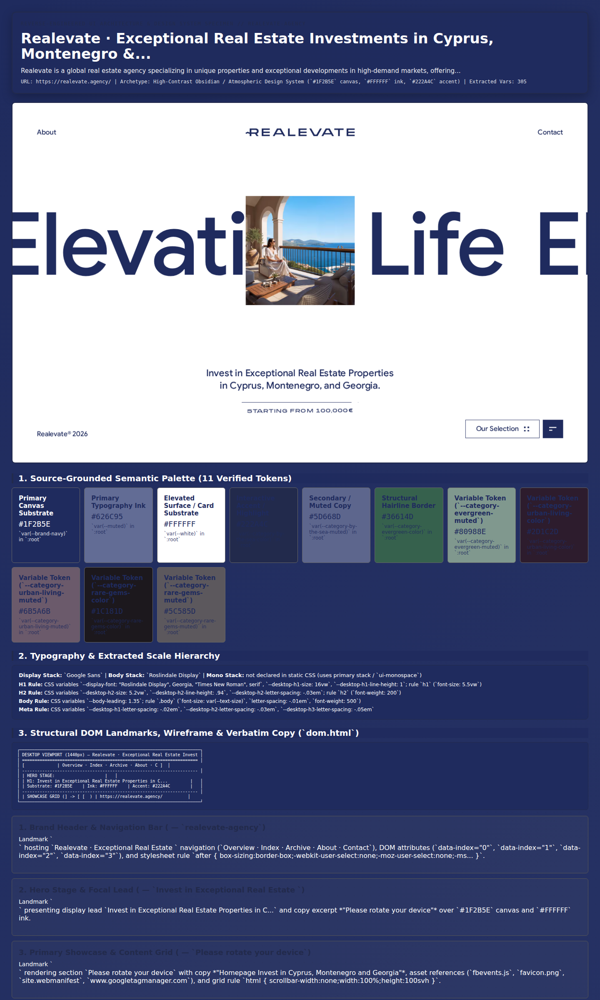
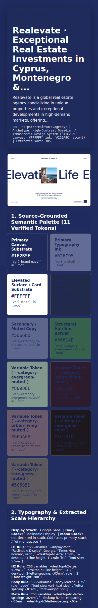

# UI Design System & Master Generation Blueprint: realevate-agency

> **Realevate · Exceptional Real Estate Investments in Cyprus, Montenegro &...** (https://realevate.agency/) — Realevate is a global real estate agency specializing in unique properties and exceptional developments in high-demand markets, offering...



---

## 1. Executive Visual Persona & Design Archetype

- **Brand Essence & Persona**: **Realevate · Exceptional Real Estate Investments in Cyprus, Montenegro &...** (`https://realevate.agency/`). Realevate is a global real estate agency specializing in unique properties and exceptional developments in high-demand markets, offering...
- **Visual Archetype**: **High-Contrast Obsidian / Atmospheric Design System (`#1F2B5E` canvas, `#FFFFFF` ink, `#222A4C` accent)**.
- **Anti-AI-Slop Differentiators**:
  - **Source-Grounded Chromatic Polarity**: Anchors the viewport in `#1F2B5E` (`var(--brand-navy)` in `:root`) paired with `#FFFFFF` primary typography and `#222A4C` accents.
  - **Extracted Typographic Hierarchy**: Pairs `Google Sans` for display copy (`Invest in Exceptional Real Estate Pr`) with `Roslindale Display` and not declared in static CSS (uses primary stack / `ui-monospace`).
  - **Calibrated Spatial Grid & Motion**: Combines `35vw` container bounds (`gap: 2.601vw`, padding `4.5vw`) with `cubic-bezier(.7,.6,0,1)` easing and GSAP Timeline & ScrollTrigger.

---

## 2. Spatial Architecture & Modular Grid Mathematics



### Viewport Allocation & Container Geometry
- **Captured Viewport Dimensions**: Desktop `1440×2400px` (`assets/desktop.png`, capped at 2400px multi-section capture), Mobile `390×2400px` (`assets/mobile.png`, capped at 2400px multi-section capture).
- **Master Container Bounds**: `35vw` extracted from `realevate-agency` stylesheet.
- **Canvas Lateral Padding & Spacing**: `4.5vw` lateral canvas padding with `2.601vw` grid gap.
- **Border Radius Scale**: `5px`, `50%`, `999px`.

### Responsive Breakpoint Architecture
- **Desktop Layout**: Multi-column CSS Grid / Flexbox layout at `1440px` (`max-width: 35vw`, `gap: 2.601vw`).
- **Mobile Layout**: Single-column vertical stack at `390px` viewport width with `4.5vw` horizontal padding.
- **Extracted CSS Media Queries**: `@media (max-width:650px)and (orientation:portrait)`, `@media (hover:none),(max-width:650px)and (orientation:portrait)`, `@media (min-width:651px)`, `@media (prefers-reduced-motion:reduce)`.

---

## 3. Color System, Materiality & Atmospheric Lighting

### Semantic Palette & Source Grounding
| Semantic Role | Ground-Truth Value | Extracted CSS Source / Selector |
|---|---|---|
| **Primary Canvas Substrate** | `#1F2B5E` | `var(--brand-navy)` in `:root` |
| **Primary Typography Ink** | `#626C95` | `var(--muted)` in `:root` |
| **Elevated Surface / Card Substrate** | `#FFFFFF` | `var(--white)` in `:root` |
| **Interactive Accent / Highlight** | `#222A4C` | `var(--category-by-the-sea-color)` in `:root` |
| **Secondary / Muted Copy** | `#5D668D` | `var(--category-by-the-sea-muted)` in `:root` |
| **Structural Hairline Border** | `#36614D` | `var(--category-evergreen-color)` in `:root` |
| **Variable Token (`--category-evergreen-muted`)** | `#80988E` | `var(--category-evergreen-muted)` in `:root` |
| **Variable Token (`--category-urban-living-color`)** | `#2D1C2D` | `var(--category-urban-living-color)` in `:root` |
| **Variable Token (`--category-urban-living-muted`)** | `#6B5A6B` | `var(--category-urban-living-muted)` in `:root` |
| **Variable Token (`--category-rare-gems-color`)** | `#1C181D` | `var(--category-rare-gems-color)` in `:root` |
| **Variable Token (`--category-rare-gems-muted`)** | `#5C585D` | `var(--category-rare-gems-muted)` in `:root` |

### Sanitized Root CSS Variables (`ui-ux.md` Ground Truth)
| Variable Name | Extracted Value | Semantic Role |
|---|---|---|
| `--brand-navy` | `#1F2B5E` | Brand / Palette Token |
| `--navy` | `var(--brand-navy)` | Layout / Spatial Grid Token |
| `--muted` | `#626C95` | Color / Atmospheric Token |
| `--white` | `#FFFFFF` | Canvas / Surface Token |
| `--category-color-light` | `var(--white)` | Canvas / Surface Token |
| `--category-by-the-sea-color` | `#222A4C` | Brand / Palette Token |
| `--category-by-the-sea-muted` | `#5D668D` | Color / Atmospheric Token |
| `--category-evergreen-color` | `#36614D` | Brand / Palette Token |
| `--category-evergreen-muted` | `#80988E` | Color / Atmospheric Token |
| `--category-urban-living-color` | `#2D1C2D` | Brand / Palette Token |
| `--category-urban-living-muted` | `#6B5A6B` | Color / Atmospheric Token |
| `--category-rare-gems-color` | `#1C181D` | Brand / Palette Token |
| `--category-rare-gems-muted` | `#5C585D` | Color / Atmospheric Token |
| `--custom-scrollbar-thumb-color` | `var(--muted)` | Brand / Palette Token |
| `--sans-font` | `"Google Sans", Arial, Helvetica, sans-serif` | Typography / Scale Token |
| `--display-font` | `"Roslindale Display", Georgia, "Times New Roman", serif` | Typography / Scale Token |

---

## 4. Typographic Scale & Editorial Hierarchy

### Font Family Stacks
- **Display Typography**: `Google Sans`.
- **Primary Body Stack**: `Roslindale Display`.
- **Technical / Metadata Stack**: not declared in static CSS (uses primary stack / `ui-monospace`).

### Typographic Scale & Rules (Extracted from Stylesheet & Variables)
- **Hero Display (`H1`)**: CSS variables `--display-font: "Roslindale Display", Georgia, "Times New Roman", serif`, `--desktop-h1-size: 16vw`, `--desktop-h1-line-height: 1`; rule `h1` (`font-size: 5.5vw`).
- **Section Heading (`H2`)**: CSS variables `--desktop-h2-size: 5.2vw`, `--desktop-h2-line-height: .94`, `--desktop-h2-letter-spacing: -.03em`; rule `h2` (`font-weight: 200`).
- **Body Copy**: CSS variables `--body-leading: 1.35`; rule `,body` (`font-size: var(--text-size)`, `letter-spacing: -.01em`, `font-weight: 500`).
- **Metadata & Navigation Labels**: CSS variables `--desktop-h1-letter-spacing: -.02em`, `--desktop-h2-letter-spacing: -.03em`, `--desktop-h3-letter-spacing: -.05em`.

---

## 5. Choreographed Motion & Interaction Physics

### Primary Easing Curves
- **Extracted Timing Functions**: `cubic-bezier(.7,.6,0,1)`, `cubic-bezier(.18,.13,0,.99)`, `cubic-bezier(.16,1,.3,1)`.

### Per-Element Transition & Choreography Rules
- **Selector `.custom-scrollbar`**: `transition: opacity .35s ease` extracted from `realevate-agency` stylesheet.
- **Selector `.custom-scrollbar .custom-scrollb...`**: `transition: background .15s ease` extracted from `realevate-agency` stylesheet.
- **Selector `.selection-card`**: `transition: filter var(--selection-hover-duration) var(--selection-hover-e...` extracted from `realevate-agency` stylesheet.
- **Extracted Easing Curve (`cubic-bezier(.7,.6,0,1)`)**: Governs interactive state transitions across `<header.logo>` and `<main.spa-transition-scroll-locked>`.
- **Runtime Interaction Engine**: Integrates GSAP Timeline & ScrollTrigger with `prefers-reduced-motion: reduce` fallback guards.

---

## 6. Component Wireframe & Structural DOM Map

### Visual Layout Schematic (Grounded in `dom.html` — `1440px` Desktop & `390px` Mobile Reflow)
```
┌────────────────────────────────────────────────────────────────────────┐
│ DESKTOP VIEWPORT (1440px) — Realevate · Exceptional Real Estate Invest │
│ ====================================================================== │
│ [ <header.logo>            | Overview · Index · Archive · About · C ]  │
│ ---------------------------------------------------------------------- │
│ | HERO STAGE: <main.site-preloader-counter-init>                   |   │
│ | H1: Invest in Exceptional Real Estate Properties in C...         |   │
│ | Substrate: #1F2B5E    | Ink: #FFFFFF    | Accent: #222A4C        |   │
│ ---------------------------------------------------------------------- │
│ | SHOWCASE GRID (<main.spa-transition-scrol) max-w: 35vw           |   │
│ | +------------------------------+  +------------------------------+ | │
│ | | Please rotate your device    |  | Homepage Invest in Cyprus, M | | │
│ | +------------------------------+  +------------------------------+ | │
│ ---------------------------------------------------------------------- │
│ | MOBILE VIEWPORT REFLOW (390px) — Single-Column Stack (gap: 2.601v) | │
│ | [<header.logo>] -> [<main.site-preload] -> [<main.spa-transiti] |    │
│ ---------------------------------------------------------------------- │
│ [ FOOTER (<footer.site-footer>  ) | https://realevate.agency/          │
└────────────────────────────────────────────────────────────────────────┘
```

### Granular DOM Region Breakdown
1. **Brand Header & Navigation Bar (<header.logo> — `realevate-agency`)**:
   - Landmark `<header class="logo">` hosting `Realevate · Exceptional Real Estate ` navigation (`Overview · Index · Archive · About · Contact`), DOM attributes (`data-index="0"`, `data-index="1"`, `data-index="2"`, `data-index="3"`), and stylesheet rule `after { box-sizing:border-box;-webkit-user-select:none;-moz-user-select:none;-ms... }`.
2. **Hero Stage & Focal Lead (<main.site-preloader-counter-init> — `Invest in Exceptional Real Estate `)**:
   - Landmark `<main class="site-preloader-counter-init">` presenting display lead `Invest in Exceptional Real Estate Properties in C...` and copy excerpt *"Please rotate your device"* over `#1F2B5E` canvas and `#FFFFFF` ink.
3. **Primary Showcase & Content Grid (<main.spa-transition-scroll-locked> — `Please rotate your device`)**:
   - Landmark `<main class="spa-transition-scroll-locked">` rendering section `Please rotate your device` with copy *"Homepage Invest in Cyprus, Montenegro and Georgia"*, asset references (`fbevents.js`, `favicon.png`, `site.webmanifest`, `www.googletagmanager.com`), and grid rule `html { scrollbar-width:none;width:100%;height:100svh }`.
4. **Interactive Detail & Feature Matrix (<main.site-preloader-exit> — `Homepage Invest in Cyprus, Montene`)**:
   - Landmark `<main class="site-preloader-exit">` framing `Homepage Invest in Cyprus, Montenegro and Georgi` and `Invest in Cyprus, Montenegro and Georgia` (*"Invest in Cyprus, Montenegro and Georgia"*) with `#FFFFFF` surface cards, `#222A4C` accents, and `body::-webkit-scrollbar { display:none }`.
5. **Colophon & Global Directory Footer (<footer.site-footer> — `https://realevate.agency/`)**:
   - Landmark `<footer class="site-footer">` anchoring `Realevate · Exceptional Real Est` footer links (`Overview · Index · Archive · About · Contact`), copy *"By The Sea Coastal, Marina & Seafront properties"*, and `#36614D` structural dividers.

---

## 7. Master Zero-Shot AI Generation Prompt

```markdown
# Master Zero-Shot Frontend Generation Prompt: realevate-agency (Realevate · Exceptional Real Estate Investments in Cyprus, Montenegro &...)

You are a principal frontend architect and design systems engineer. Build a complete, production-ready web application replicating the exact design system, DOM landmarks, typographic hierarchy, color tokens, and motion physics of `realevate-agency` (**Realevate · Exceptional Real Estate Investments in Cyprus, Montenegro &...** — `https://realevate.agency/`).

### 1. Visual Archetype & Anti-AI-Slop Mandates
- **Archetype**: High-Contrast Obsidian / Atmospheric Design System (`#1F2B5E` canvas, `#FFFFFF` ink, `#222A4C` accent).
- **Identity & Domain Context**: Realevate is a global real estate agency specializing in unique properties and exceptional developments in high-demand markets, offering...
- **Primary Substrate**: `#1F2B5E` (`var(--brand-navy)` in `:root`), **Primary Ink**: `#FFFFFF`, **Accent / Highlight**: `#222A4C`.
- **Site-Specific Differentiators**:
  - **Source-Grounded Chromatic Polarity**: Anchors the viewport in `#1F2B5E` (`var(--brand-navy)` in `:root`) paired with `#FFFFFF` primary typography and `#222A4C` accents.
  - **Extracted Typographic Hierarchy**: Pairs `Google Sans` for display copy (`Invest in Exceptional Real Estate Pr`) with `Roslindale Display` and not declared in static CSS (uses primary stack / `ui-monospace`).
  - **Calibrated Spatial Grid & Motion**: Combines `35vw` container bounds (`gap: 2.601vw`, padding `4.5vw`) with `cubic-bezier(.7,.6,0,1)` easing and GSAP Timeline & ScrollTrigger.

### 2. Ground-Truth CSS Variables (`:root` Token Contract)
Declare and consume these exact custom properties extracted from `realevate-agency` in your global stylesheet:

:root {
  /* Realevate · Exceptional Real Estate Investments in Cyprus, Montenegro &... (realevate-agency) — Ground-Truth Extracted CSS Variables */
  --brand-navy: #1F2B5E; /* Brand / Palette Token (realevate-agency) */
  --navy: var(--brand-navy); /* Layout / Spatial Grid Token (realevate-agency) */
  --muted: #626C95; /* Color / Atmospheric Token (realevate-agency) */
  --white: #FFFFFF; /* Canvas / Surface Token (realevate-agency) */
  --category-color-light: var(--white); /* Canvas / Surface Token (realevate-agency) */
  --category-by-the-sea-color: #222A4C; /* Brand / Palette Token (realevate-agency) */
  --category-by-the-sea-muted: #5D668D; /* Color / Atmospheric Token (realevate-agency) */
  --category-evergreen-color: #36614D; /* Brand / Palette Token (realevate-agency) */
  --category-evergreen-muted: #80988E; /* Color / Atmospheric Token (realevate-agency) */
  --category-urban-living-color: #2D1C2D; /* Brand / Palette Token (realevate-agency) */
  --category-urban-living-muted: #6B5A6B; /* Color / Atmospheric Token (realevate-agency) */
  --category-rare-gems-color: #1C181D; /* Brand / Palette Token (realevate-agency) */
  --category-rare-gems-muted: #5C585D; /* Color / Atmospheric Token (realevate-agency) */
  --custom-scrollbar-thumb-color: var(--muted); /* Brand / Palette Token (realevate-agency) */
  --sans-font: "Google Sans", Arial, Helvetica, sans-serif; /* Typography / Scale Token (realevate-agency) */
  --display-font: "Roslindale Display", Georgia, "Times New Roman", serif; /* Typography / Scale Token (realevate-agency) */
}

### 3. Semantic Color & Materiality Contract
Map every surface, ink, and border strictly to these source-grounded tokens:
- **Primary Canvas Substrate**: `#1F2B5E` — grounded in `var(--brand-navy)` in `:root`
- **Primary Typography Ink**: `#626C95` — grounded in `var(--muted)` in `:root`
- **Elevated Surface / Card Substrate**: `#FFFFFF` — grounded in `var(--white)` in `:root`
- **Interactive Accent / Highlight**: `#222A4C` — grounded in `var(--category-by-the-sea-color)` in `:root`
- **Secondary / Muted Copy**: `#5D668D` — grounded in `var(--category-by-the-sea-muted)` in `:root`
- **Structural Hairline Border**: `#36614D` — grounded in `var(--category-evergreen-color)` in `:root`
- **Variable Token (`--category-evergreen-muted`)**: `#80988E` — grounded in `var(--category-evergreen-muted)` in `:root`
- **Variable Token (`--category-urban-living-color`)**: `#2D1C2D` — grounded in `var(--category-urban-living-color)` in `:root`
- **Variable Token (`--category-urban-living-muted`)**: `#6B5A6B` — grounded in `var(--category-urban-living-muted)` in `:root`
- **Variable Token (`--category-rare-gems-color`)**: `#1C181D` — grounded in `var(--category-rare-gems-color)` in `:root`
- **Variable Token (`--category-rare-gems-muted`)**: `#5C585D` — grounded in `var(--category-rare-gems-muted)` in `:root`

### 4. Spatial Grid, Container Bounds & Responsive Breakpoints
- **Desktop Viewport Reference**: `1440×2400px` (capped at 2400px multi-section capture, `1440px` standard desktop width).
- **Mobile Viewport Reference**: `390×2400px` (capped at 2400px multi-section capture, `390px` standard mobile width).
- **Container Max-Width**: `35vw` extracted from `realevate-agency` stylesheet
- **Padding & Gutters**: `4.5vw` lateral canvas padding with `2.601vw` grid gap
- **Desktop Grid**: Multi-column CSS Grid / Flexbox layout at `1440px` (`max-width: 35vw`, `gap: 2.601vw`)
- **Mobile Adaptation**: Single-column vertical stack at `390px` viewport width with `4.5vw` horizontal padding
- **Media Queries**: `@media (max-width:650px)and (orientation:portrait)`, `@media (hover:none),(max-width:650px)and (orientation:portrait)`, `@media (min-width:651px)`, `@media (prefers-reduced-motion:reduce)`
- **Corner Radii**: `5px`, `50%`, `999px`

### 5. Typography & Editorial Scale Contract
- **Display Font Stack**: `Google Sans`
- **Body Font Stack**: `Roslindale Display`
- **Monospace / Technical Font Stack**: not declared in static CSS (uses primary stack / `ui-monospace`)
- **H1 Display Rule**: CSS variables `--display-font: "Roslindale Display", Georgia, "Times New Roman", serif`, `--desktop-h1-size: 16vw`, `--desktop-h1-line-height: 1`; rule `h1` (`font-size: 5.5vw`)
- **H2 Section Rule**: CSS variables `--desktop-h2-size: 5.2vw`, `--desktop-h2-line-height: .94`, `--desktop-h2-letter-spacing: -.03em`; rule `h2` (`font-weight: 200`)
- **Body Copy Rule**: CSS variables `--body-leading: 1.35`; rule `,body` (`font-size: var(--text-size)`, `letter-spacing: -.01em`, `font-weight: 500`)
- **Metadata & Index Rule**: CSS variables `--desktop-h1-letter-spacing: -.02em`, `--desktop-h2-letter-spacing: -.03em`, `--desktop-h3-letter-spacing: -.05em`

### 6. Component Hierarchy, Verbatim Copy & Real DOM Landmarks
Scaffold `realevate-agency` (`Realevate · Exceptional Real Estate Investments in Cyprus, Montenegro &...`) with these exact structural regions, extracted copy, and CSS rules from `dom.html`:
1. **Brand Header & Navigation Bar (<header.logo> — `realevate-agency`)**:
   - DOM & Selectors: Landmark `<header class="logo">` hosting `Realevate · Exceptional Real Estate ` navigation (`Overview · Index · Archive · About · Contact`), DOM attributes (`data-index="0"`, `data-index="1"`, `data-index="2"`, `data-index="3"`), and stylesheet rule `after { box-sizing:border-box;-webkit-user-select:none;-moz-user-select:none;-ms... }`.
   - Responsive Contract: Header `Brand Header & Navigation Bar (<header.logo> — `realevate-agency`)` (`realevate-agency`) adapts across `@media (max-width:650px)and (orientation:portrait)`, `@media (hover:none),(max-width:650px)and (orientation:portrait)`, `@media (min-width:651px)`, `@media (prefers-reduced-motion:reduce)` with `cubic-bezier(.7,.6,0,1)`, `cubic-bezier(.18,.13,0,.99)`, `cubic-bezier(.16,1,.3,1)` transitions and links `Overview · Index · Archive · About · Contact`.
2. **Hero Stage & Focal Lead (<main.site-preloader-counter-init> — `Invest in Exceptional Real Estate `)**:
   - DOM & Selectors: Landmark `<main class="site-preloader-counter-init">` presenting display lead `Invest in Exceptional Real Estate Properties in C...` and copy excerpt *"Please rotate your device"* over `#1F2B5E` canvas and `#FFFFFF` ink.
   - Responsive Contract: Hero stage (`1440×2400px` desktop / `390×2400px` mobile) sets `#1F2B5E` background with `#FFFFFF` headline `Invest in Exceptional Real Estate Properties in C...`.
3. **Primary Showcase & Content Grid (<main.spa-transition-scroll-locked> — `Please rotate your device`)**:
   - DOM & Selectors: Landmark `<main class="spa-transition-scroll-locked">` rendering section `Please rotate your device` with copy *"Homepage Invest in Cyprus, Montenegro and Georgia"*, asset references (`fbevents.js`, `favicon.png`, `site.webmanifest`, `www.googletagmanager.com`), and grid rule `html { scrollbar-width:none;width:100%;height:100svh }`.
   - Responsive Contract: Showcase grid `Primary Showcase & Content Grid (<main.spa-transition-scroll-locked> — `Please rotate your device`)` applies Multi-column CSS Grid / Flexbox layout at `1440px` (`max-width: 35vw`, `gap: 2.601vw`) on desktop and Single-column vertical stack at `390px` viewport width with `4.5vw` horizontal padding on mobile.
4. **Interactive Detail & Feature Matrix (<main.site-preloader-exit> — `Homepage Invest in Cyprus, Montene`)**:
   - DOM & Selectors: Landmark `<main class="site-preloader-exit">` framing `Homepage Invest in Cyprus, Montenegro and Georgi` and `Invest in Cyprus, Montenegro and Georgia` (*"Invest in Cyprus, Montenegro and Georgia"*) with `#FFFFFF` surface cards, `#222A4C` accents, and `body::-webkit-scrollbar { display:none }`.
   - Responsive Contract: Detail module `Interactive Detail & Feature Matrix (<main.site-preloader-exit> — `Homepage Invest in Cyprus, Montene`)` uses `5px`, `50%`, `999px` radii, `#222A4C` highlights, and assets (fbevents.js, favicon.png, site.webmanifest).
5. **Colophon & Global Directory Footer (<footer.site-footer> — `https://realevate.agency/`)**:
   - DOM & Selectors: Landmark `<footer class="site-footer">` anchoring `Realevate · Exceptional Real Est` footer links (`Overview · Index · Archive · About · Contact`), copy *"By The Sea Coastal, Marina & Seafront properties"*, and `#36614D` structural dividers.
   - Responsive Contract: Footer `Colophon & Global Directory Footer (<footer.site-footer> — `https://realevate.agency/`)` aligns to `35vw` extracted from `realevate-agency` stylesheet with `4.5vw` lateral canvas padding with `2.601vw` grid gap and attributes (data-index="0", data-index="1", data-index="2").

#### Verbatim DOM Copy Excerpts (`dom.html`)
- Copy Excerpt 1: *"Please rotate your device"*
- Copy Excerpt 2: *"Homepage Invest in Cyprus, Montenegro and Georgia"*
- Copy Excerpt 3: *"Invest in Cyprus, Montenegro and Georgia"*
- Copy Excerpt 4: *"By The Sea Coastal, Marina & Seafront properties"*

### 7. Motion, Extracted Stylesheet Rules & Interaction Choreography
- **Primary Easing Functions**: `cubic-bezier(.7,.6,0,1)`, `cubic-bezier(.18,.13,0,.99)`, `cubic-bezier(.16,1,.3,1)`
- **Extracted Stylesheet Rules (`realevate-agency`)**:
- `after { box-sizing:border-box;-webkit-user-select:none;-moz-user-select:none;-ms... }`
- `html { scrollbar-width:none;width:100%;height:100svh }`
- `body::-webkit-scrollbar { display:none }`
- `body { -ms-overflow-style:none }`
- `.custom-scrollbar { position:fixed;top:0;right:0;bottom:0;width:11px;z-index:9999;pointer-ev... }`
- **Per-Selector Transition Rules**:
- **Selector `.custom-scrollbar`**: `transition: opacity .35s ease` extracted from `realevate-agency` stylesheet.
- **Selector `.custom-scrollbar .custom-scrollb...`**: `transition: background .15s ease` extracted from `realevate-agency` stylesheet.
- **Selector `.selection-card`**: `transition: filter var(--selection-hover-duration) var(--selection-hover-e...` extracted from `realevate-agency` stylesheet.
- **Extracted Easing Curve (`cubic-bezier(.7,.6,0,1)`)**: Governs interactive state transitions across `<header.logo>` and `<main.spa-transition-scroll-locked>`.
- **Runtime Interaction Engine**: Integrates GSAP Timeline & ScrollTrigger with `prefers-reduced-motion: reduce` fallback guards.

### 8. Technical Deliverables
- Implement in Next.js (App Router) with TypeScript and Tailwind CSS consuming the `:root` custom properties defined above for `realevate-agency`.
- Reproduce both the `1440px` desktop architecture and `390px` mobile breakpoint transitions, preserving semantic HTML5 landmarks (`<header>`, `<nav>`, `<main>`, `<section>`, `<footer>`) and `prefers-reduced-motion` accessibility guards.
```
