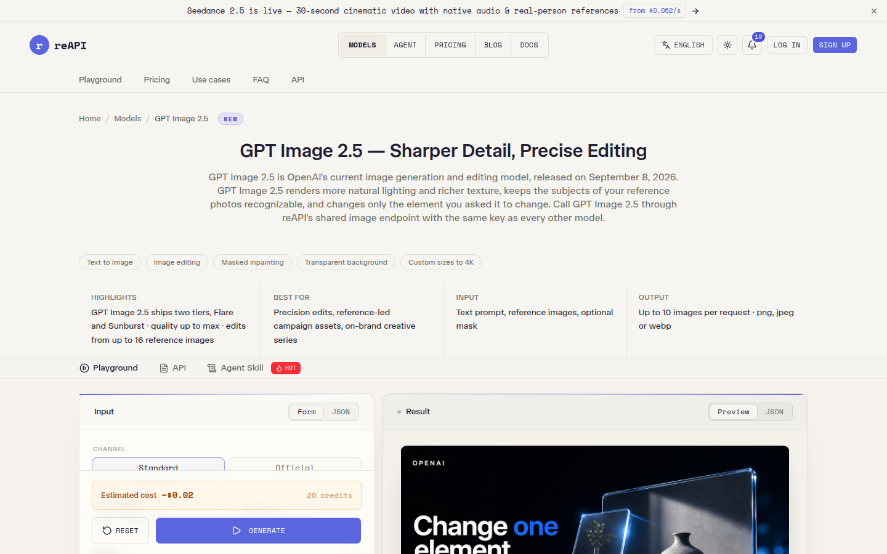
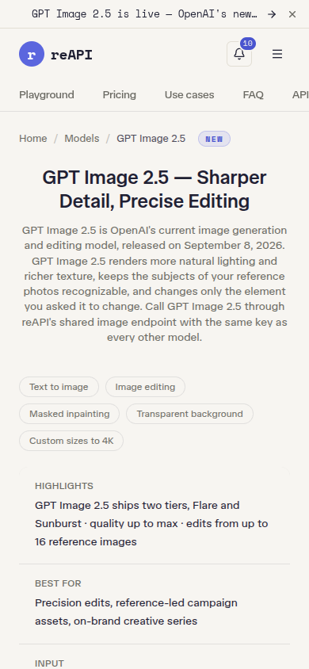

# UI Design System & Master Generation Blueprint: reapi-ai_models-gpt-image-2-5

> **GPT Image 2.5 — Sharper Detail, Precise Editing** (https://reapi.ai/models/gpt-image-2-5) — GPT Image 2.5 is OpenAI's image generation and editing model with precision edits, reference fidelity and two speed tiers. Pay per image...



---

## 1. Executive Visual Persona & Design Archetype

- **Brand Essence & Persona**: **GPT Image 2.5 — Sharper Detail, Precise Editing** (`https://reapi.ai/models/gpt-image-2-5`). GPT Image 2.5 is OpenAI's image generation and editing model with precision edits, reference fidelity and two speed tiers. Pay per image...
- **Capture Provenance**: Live browser capture (`tier2_webgl`, HTTP `200`, captured `2026-11-23`).
- **Visual Archetype**: **Light-Gallery WebGL / Canvas Interactive Experience (`#f7f5f1` / `#4a55cf`)**.
- **Anti-AI-Slop Differentiators**:
  - **Live-Computed Chromatic Polarity**: Anchors the viewport in `#f7f5f1` (live computed `body` `background-color` (`computed_styles.json`)) paired with `#1f2033` primary typography and `#4a55cf` accents.
  - **Grounded Typographic Hierarchy**: Pairs `TASA Orbiter` for display copy (`GPT Image 2.5 — Sharper Detail, Prec`) with `TASA Orbiter` and `Space Mono`.
  - **Calibrated Spatial Grid & Motion**: Combines `1280px` container bounds (`gap: 16px`, padding `3px`) with `cubic-bezier(0,0,.2,1)` easing and Three.js / WebGL Canvas Pipeline.

---

## 2. Spatial Architecture & Modular Grid Mathematics



### Viewport Allocation & Container Geometry
- **Captured Viewport Dimensions**: Desktop `1440×900px` (`assets/desktop.png`, single-viewport 100vh live capture (900px)), Mobile `390×844px` (`assets/mobile.png`, single-viewport 100vh live capture (844px)).
- **Master Container Bounds**: `1280px` (measured widest bounded `<section>` landmark width on `1440px` desktop).
- **Canvas Lateral Padding & Spacing**: `3px` lateral canvas padding with `16px` grid gap.
- **Border Radius Scale**: `4px`, `var(--radius)`, `.25rem`, `var(--cell-radius)`.

### Responsive Breakpoint Architecture
- **Desktop Layout**: Multi-column CSS Grid / Flexbox layout at `1440px` (`max-width: 1280px`, `gap: 16px`).
- **Mobile Layout**: Single-column vertical stack at `390px` viewport width with `3px` horizontal padding.
- **Extracted CSS Media Queries**: `@media (min-width:40rem)`, `@media (min-width:48rem)`, `@media (min-width:64rem)`, `@media (min-width:80rem)`.

---

## 3. Color System, Materiality & Atmospheric Lighting

### Semantic Palette & Source Grounding
| Semantic Role | Ground-Truth Value | Extracted Live / CSS Source |
|---|---|---|
| **Primary Canvas Substrate** | `#f7f5f1` | live computed `body` `background-color` (`computed_styles.json`) |
| **Primary Typography Ink** | `#1f2033` | live computed `h1` `color` (`computed_styles.json`) |
| **Elevated Surface / Card Substrate** | `#fffdf8` | `var(--card)` in `:root` |
| **Interactive Accent / Highlight** | `#4a55cf` | `var(--brand-ink)` in `:root` |
| **Secondary / Muted Copy** | `#6b6a63` | live computed `p` `color` (`computed_styles.json`) |
| **Structural Hairline Border** | `#e2ded4` | `var(--border)` in `:root` |
| **Variable Token (`--primary`)** | `#5b66de` | `var(--primary)` in `:root` |
| **Variable Token (`--primary-foreground`)** | `#ffffff` | `var(--primary-foreground)` in `:root` |
| **Variable Token (`--secondary`)** | `#f0ede6` | `var(--secondary)` in `:root` |
| **Variable Token (`--accent`)** | `#ece8df` | `var(--accent)` in `:root` |
| **Variable Token (`--destructive`)** | `#e5484d` | `var(--destructive)` in `:root` |

### Sanitized Root CSS Variables (`ui-ux.md` Ground Truth)
| Variable Name | Extracted Value | Semantic Role |
|---|---|---|
| `--background` | `#f7f5f1` | Canvas / Surface Token |
| `--foreground` | `#1f2033` | Typography Ink Token |
| `--card` | `#fffdf8` | Color / Atmospheric Token |
| `--card-foreground` | `#1f2033` | Typography Ink Token |
| `--popover` | `#fffdf8` | Color / Atmospheric Token |
| `--popover-foreground` | `#1f2033` | Typography Ink Token |
| `--primary` | `#5b66de` | Brand / Palette Token |
| `--primary-foreground` | `#fff` | Typography Ink Token |
| `--brand-ink` | `#4a55cf` | Typography Ink Token |
| `--secondary` | `#f0ede6` | Brand / Palette Token |
| `--secondary-foreground` | `#1f2033` | Typography Ink Token |
| `--muted` | `#f0ede6` | Color / Atmospheric Token |
| `--muted-foreground` | `#6b6a63` | Typography Ink Token |
| `--accent` | `#ece8df` | Brand / Palette Token |
| `--accent-foreground` | `#1f2033` | Typography Ink Token |
| `--destructive` | `#e5484d` | Color / Atmospheric Token |

---

## 4. Typographic Scale & Editorial Hierarchy

### Font Family Stacks
- **Display Typography**: `TASA Orbiter`.
- **Primary Body Stack**: `TASA Orbiter`.
- **Technical / Metadata Stack**: `Space Mono`.

### Typographic Scale & Rules (Live Computed & Stylesheet Grounded)
- **Hero Display (`H1`)**: live computed `h1` (`font-size: 30px`, `line-height: 37.5px`, `font-weight: 600`); CSS variables `--font-display-family: "Source Serif 4",Georgia,Times New Roman,serif`, `--text-4xl: 2.25rem`, `--text-4xl--line-height: calc(2.5/2.25)`.
- **Section Heading (`H2`)**: live computed `h2` (`font-size: 38px`, `line-height: 39.9px`, `font-weight: 600`, `letter-spacing: -0.95px`); CSS variables `--text-2xl: 1.5rem`, `--text-2xl--line-height: calc(2/1.5)`, `--text-3xl: 1.875rem`.
- **Body Copy**: live computed `body` (`font-size: 16px`, `line-height: 24px`, `font-weight: 400`); CSS variables `--text-base: 1rem`, `--text-base--line-height: calc(1.5/1)`, `--cpk-text-base: 1rem`.
- **Metadata & Navigation Labels**: live computed `nav/a` (`font-size: 16px`, `line-height: 24px`, `font-weight: 400`); CSS variables `--font-mono-family: "Space Mono",ui-monospace,Menlo,monospace`, `--text-xs: .75rem`, `--text-xs--line-height: calc(1/.75)`.

---

## 5. Choreographed Motion & Interaction Physics

### Primary Easing Curves
- **Extracted Timing Functions**: `cubic-bezier(0,0,.2,1)`, `cubic-bezier(.4,0,.2,1)`, `cubic-bezier(.22,1,.36,1)`.

### Per-Element Transition & Choreography Rules
- **Selector `layer theme`**: `transition: .15s` extracted from `reapi-ai_models-gpt-image-2-5` stylesheet.
- **Selector `.transition`**: `transition: var(--tw-ease,var(--default-transition-timing-function))` extracted from `reapi-ai_models-gpt-image-2-5` stylesheet.
- **Selector `box-shadow\]`**: `transition: var(--tw-ease,var(--default-transition-timing-function))` extracted from `reapi-ai_models-gpt-image-2-5` stylesheet.
- **Extracted Easing Curve (`cubic-bezier(0,0,.2,1)`)**: Governs interactive state transitions across `<header.inset-x-0>` and `<section.max-w-7xl>`.
- **Runtime Interaction Engine**: Integrates Three.js / WebGL Canvas Pipeline with `prefers-reduced-motion: reduce` fallback guards.

---

## 6. Component Wireframe & Structural DOM Map

### Visual Layout Schematic — Desktop (`1440px`, Grounded in `dom.html` & Landmark Bounding Boxes)
```
┌────────────────────────────────────────────────────────────────────────┐
│ DESKTOP VIEWPORT (1440px) — GPT Image 2.5 — Sharper Detail, Precise Ed │
│ ====================================================================== │
│ [ <header.inset-x-0> (1440x74px)      | r reAPI · Models · Agent · P ] │
│ ---------------------------------------------------------------------- │
│ | HERO STAGE: <section.bg-background> (w=1440px)                     | │
│ | H1: GPT Image 2.5 — Sharper Detail, Precise Editing                | │
│ | Substrate: #f7f5f1 | Ink: #1f2033 | Accent: #4a55cf                | │
│ ---------------------------------------------------------------------- │
│ | SHOWCASE GRID (<section.max-w-7xl>) max-w: 1280px                  | │
│ | +------------------------------+  +------------------------------+ | │
│ | | See what it generates        |  | What is GPT Image 2.5?       | | │
│ | +------------------------------+  +------------------------------+ | │
│ ---------------------------------------------------------------------- │
│ | DETAIL MODULE (<section.border-b>) — 3 generation modes on         | │
│ ---------------------------------------------------------------------- │
│ [ FOOTER (<footer.border-t>   ) | https://reapi.ai/models/gpt-image-2  │
└────────────────────────────────────────────────────────────────────────┘
```

### Visual Layout Schematic — Mobile Reflow (`390px`)
```
┌────────────────────────────────────────────────────────────────────────┐
│ MOBILE VIEWPORT REFLOW (390px) — Single-Column Stack (gap: 16px)       │
│ ====================================================================== │
│ [ HEADER BAR (<header.inset-x-0>      ) | Compact Menu (390px)         │
│ ---------------------------------------------------------------------- │
│ | HERO STAGE (<section.bg-background>) — 390px Vertical Lead         | │
│ | H1: GPT Image 2.5 — Sharper Detail, Precise Editing                | │
│ ---------------------------------------------------------------------- │
│ | SHOWCASE STACK (<section.max-w-7xl>) — 1-Col Stack                 | │
│ | [ Item 1: See what it generates                                  ] | │
│ | [ Item 2: What is GPT Image 2.5?                                 ] | │
│ ---------------------------------------------------------------------- │
│ | DETAIL STACK (<section.border-b>) — 1-Col (3 generation modes)     | │
│ ---------------------------------------------------------------------- │
│ [ FOOTER (<footer.border-t>   ) | Stacked 390px Colophon               │
└────────────────────────────────────────────────────────────────────────┘
```

### Granular DOM Region Breakdown
1. **Brand Header & Navigation Bar (<header.inset-x-0> — `reapi-ai_models-gpt-image-2-5`)**:
   - Landmark `<header class="inset-x-0 top-0">` (`1440x74px`) hosting `GPT Image 2.5 — Sharper Detail, Prec` navigation (`r reAPI · Models · Agent · Pricing · Blog`), DOM attributes (`data-precedence="next"`, `data-precedence="next"`, `data-site-id="7398c367fb45"`, `data-orientation="horizontal"`), and stylesheet rule `.typeface-sans { --font-sans-family:"TASA Orbiter",-apple-system,PingFang SC,Microsoft Ya... }`.
2. **Hero Stage & Focal Lead (<section.bg-background> — `GPT Image 2.5 — Sharper Detail, Pr`)**:
   - Landmark `<section class="bg-background relative">` presenting display lead `GPT Image 2.5 — Sharper Detail, Precise Editing` and copy excerpt *"GPT Image 2.5 is OpenAI's current image generation and editing mo"* over `#f7f5f1` canvas and `#1f2033` ink.
3. **Primary Showcase & Content Grid (<section.max-w-7xl> — `See what it generates`)**:
   - Landmark `<section class="max-w-7xl pt-2">` rendering section `See what it generates` with copy *"Transparent background"*, asset references (`2d53b00a79aaa16a.css`, `677a55ff8491e63d.css`, `b0188cb2d6a2b515.js`, `28b987a7ce424c5b.js`), and grid rule `.typeface-mono { --font-mono-family:"Space Mono",ui-monospace,Menlo,monospace }`.
4. **Interactive Detail & Feature Matrix (<section.border-b> — `What is GPT Image 2.5?`)**:
   - Landmark `<section class="border-b">` framing `What is GPT Image 2.5?` and `3 generation modes on one endpoint` (*"Custom sizes to 4K"*) with `#fffdf8` surface cards, `#4a55cf` accents, and `.typeface-display { --font-display-family:"Source Serif 4",Georgia,Times New Roman,serif }`.
5. **Colophon & Global Directory Footer (<footer.border-t> — `https://reapi.ai/models/gpt-image-2-5`)**:
   - Landmark `<footer class="border-t">` anchoring `GPT Image 2.5 — Sharper Detail, ` footer links (`r reAPI · Models · Agent · Pricing · Blog`), copy *"$0.02 - 0.02 per image"*, and `#e2ded4` structural dividers.

---

## 7. Master Zero-Shot AI Generation Prompt

```markdown
# Master Zero-Shot Frontend Generation Prompt: reapi-ai_models-gpt-image-2-5 (GPT Image 2.5 — Sharper Detail, Precise Editing)

You are a principal frontend architect and design systems engineer. Build a complete, production-ready web application replicating the exact design system, DOM landmarks, typographic hierarchy, color tokens, and motion physics of `reapi-ai_models-gpt-image-2-5` (**GPT Image 2.5 — Sharper Detail, Precise Editing** — `https://reapi.ai/models/gpt-image-2-5`).

### 1. Visual Archetype & Anti-AI-Slop Mandates
- **Archetype**: Light-Gallery WebGL / Canvas Interactive Experience (`#f7f5f1` / `#4a55cf`).
- **Identity & Domain Context**: GPT Image 2.5 is OpenAI's image generation and editing model with precision edits, reference fidelity and two speed tiers. Pay per image...
- **Primary Substrate**: `#f7f5f1` (live computed `body` `background-color` (`computed_styles.json`)), **Primary Ink**: `#1f2033`, **Accent / Highlight**: `#4a55cf`.
- **Site-Specific Differentiators**:
  - **Live-Computed Chromatic Polarity**: Anchors the viewport in `#f7f5f1` (live computed `body` `background-color` (`computed_styles.json`)) paired with `#1f2033` primary typography and `#4a55cf` accents.
  - **Grounded Typographic Hierarchy**: Pairs `TASA Orbiter` for display copy (`GPT Image 2.5 — Sharper Detail, Prec`) with `TASA Orbiter` and `Space Mono`.
  - **Calibrated Spatial Grid & Motion**: Combines `1280px` container bounds (`gap: 16px`, padding `3px`) with `cubic-bezier(0,0,.2,1)` easing and Three.js / WebGL Canvas Pipeline.

### 2. Ground-Truth CSS Variables (`:root` Token Contract)
Declare and consume these exact custom properties extracted from `reapi-ai_models-gpt-image-2-5` in your global stylesheet:

:root {
  /* GPT Image 2.5 — Sharper Detail, Precise Editing (reapi-ai_models-gpt-image-2-5) — Live-Grounded CSS Variables */
  --background: #f7f5f1; /* Canvas / Surface Token (reapi-ai_models-gpt-image-2-5) */
  --foreground: #1f2033; /* Typography Ink Token (reapi-ai_models-gpt-image-2-5) */
  --card: #fffdf8; /* Color / Atmospheric Token (reapi-ai_models-gpt-image-2-5) */
  --card-foreground: #1f2033; /* Typography Ink Token (reapi-ai_models-gpt-image-2-5) */
  --popover: #fffdf8; /* Color / Atmospheric Token (reapi-ai_models-gpt-image-2-5) */
  --popover-foreground: #1f2033; /* Typography Ink Token (reapi-ai_models-gpt-image-2-5) */
  --primary: #5b66de; /* Brand / Palette Token (reapi-ai_models-gpt-image-2-5) */
  --primary-foreground: #fff; /* Typography Ink Token (reapi-ai_models-gpt-image-2-5) */
  --brand-ink: #4a55cf; /* Typography Ink Token (reapi-ai_models-gpt-image-2-5) */
  --secondary: #f0ede6; /* Brand / Palette Token (reapi-ai_models-gpt-image-2-5) */
  --secondary-foreground: #1f2033; /* Typography Ink Token (reapi-ai_models-gpt-image-2-5) */
  --muted: #f0ede6; /* Color / Atmospheric Token (reapi-ai_models-gpt-image-2-5) */
  --muted-foreground: #6b6a63; /* Typography Ink Token (reapi-ai_models-gpt-image-2-5) */
  --accent: #ece8df; /* Brand / Palette Token (reapi-ai_models-gpt-image-2-5) */
  --accent-foreground: #1f2033; /* Typography Ink Token (reapi-ai_models-gpt-image-2-5) */
  --destructive: #e5484d; /* Color / Atmospheric Token (reapi-ai_models-gpt-image-2-5) */
}

### 3. Semantic Color & Materiality Contract
Map every surface, ink, and border strictly to these source-grounded tokens:
- **Primary Canvas Substrate**: `#f7f5f1` — grounded in live computed `body` `background-color` (`computed_styles.json`)
- **Primary Typography Ink**: `#1f2033` — grounded in live computed `h1` `color` (`computed_styles.json`)
- **Elevated Surface / Card Substrate**: `#fffdf8` — grounded in `var(--card)` in `:root`
- **Interactive Accent / Highlight**: `#4a55cf` — grounded in `var(--brand-ink)` in `:root`
- **Secondary / Muted Copy**: `#6b6a63` — grounded in live computed `p` `color` (`computed_styles.json`)
- **Structural Hairline Border**: `#e2ded4` — grounded in `var(--border)` in `:root`
- **Variable Token (`--primary`)**: `#5b66de` — grounded in `var(--primary)` in `:root`
- **Variable Token (`--primary-foreground`)**: `#ffffff` — grounded in `var(--primary-foreground)` in `:root`
- **Variable Token (`--secondary`)**: `#f0ede6` — grounded in `var(--secondary)` in `:root`
- **Variable Token (`--accent`)**: `#ece8df` — grounded in `var(--accent)` in `:root`
- **Variable Token (`--destructive`)**: `#e5484d` — grounded in `var(--destructive)` in `:root`

### 4. Spatial Grid, Container Bounds & Responsive Breakpoints
- **Desktop Viewport Reference**: `1440×900px` (single-viewport 100vh live capture (900px), `1440px` standard desktop width).
- **Mobile Viewport Reference**: `390×844px` (single-viewport 100vh live capture (844px), `390px` standard mobile width).
- **Container Max-Width**: `1280px` (measured widest bounded `<section>` landmark width on `1440px` desktop)
- **Padding & Gutters**: `3px` lateral canvas padding with `16px` grid gap
- **Desktop Grid**: Multi-column CSS Grid / Flexbox layout at `1440px` (`max-width: 1280px`, `gap: 16px`)
- **Mobile Adaptation**: Single-column vertical stack at `390px` viewport width with `3px` horizontal padding
- **Media Queries**: `@media (min-width:40rem)`, `@media (min-width:48rem)`, `@media (min-width:64rem)`, `@media (min-width:80rem)`
- **Corner Radii**: `4px`, `var(--radius)`, `.25rem`, `var(--cell-radius)`

### 5. Typography & Editorial Scale Contract
- **Display Font Stack**: `TASA Orbiter`
- **Body Font Stack**: `TASA Orbiter`
- **Monospace / Technical Font Stack**: `Space Mono`
- **H1 Display Rule**: live computed `h1` (`font-size: 30px`, `line-height: 37.5px`, `font-weight: 600`); CSS variables `--font-display-family: "Source Serif 4",Georgia,Times New Roman,serif`, `--text-4xl: 2.25rem`, `--text-4xl--line-height: calc(2.5/2.25)`
- **H2 Section Rule**: live computed `h2` (`font-size: 38px`, `line-height: 39.9px`, `font-weight: 600`, `letter-spacing: -0.95px`); CSS variables `--text-2xl: 1.5rem`, `--text-2xl--line-height: calc(2/1.5)`, `--text-3xl: 1.875rem`
- **Body Copy Rule**: live computed `body` (`font-size: 16px`, `line-height: 24px`, `font-weight: 400`); CSS variables `--text-base: 1rem`, `--text-base--line-height: calc(1.5/1)`, `--cpk-text-base: 1rem`
- **Metadata & Index Rule**: live computed `nav/a` (`font-size: 16px`, `line-height: 24px`, `font-weight: 400`); CSS variables `--font-mono-family: "Space Mono",ui-monospace,Menlo,monospace`, `--text-xs: .75rem`, `--text-xs--line-height: calc(1/.75)`

### 6. Component Hierarchy, Verbatim Copy & Real DOM Landmarks
Scaffold `reapi-ai_models-gpt-image-2-5` (`GPT Image 2.5 — Sharper Detail, Precise Editing`) with these exact structural regions, extracted copy, and CSS rules from `dom.html`:
1. **Brand Header & Navigation Bar (<header.inset-x-0> — `reapi-ai_models-gpt-image-2-5`)**:
   - DOM & Selectors: Landmark `<header class="inset-x-0 top-0">` (`1440x74px`) hosting `GPT Image 2.5 — Sharper Detail, Prec` navigation (`r reAPI · Models · Agent · Pricing · Blog`), DOM attributes (`data-precedence="next"`, `data-precedence="next"`, `data-site-id="7398c367fb45"`, `data-orientation="horizontal"`), and stylesheet rule `.typeface-sans { --font-sans-family:"TASA Orbiter",-apple-system,PingFang SC,Microsoft Ya... }`.
   - Responsive Contract: Header `Brand Header & Navigation Bar (<header.inset-x-0> — `reapi-ai_models-gpt-image-2-5`)` (`reapi-ai_models-gpt-image-2-5`) adapts across `@media (min-width:40rem)`, `@media (min-width:48rem)`, `@media (min-width:64rem)`, `@media (min-width:80rem)` with `cubic-bezier(0,0,.2,1)`, `cubic-bezier(.4,0,.2,1)`, `cubic-bezier(.22,1,.36,1)` transitions and links `r reAPI · Models · Agent · Pricing · Blog`.
2. **Hero Stage & Focal Lead (<section.bg-background> — `GPT Image 2.5 — Sharper Detail, Pr`)**:
   - DOM & Selectors: Landmark `<section class="bg-background relative">` presenting display lead `GPT Image 2.5 — Sharper Detail, Precise Editing` and copy excerpt *"GPT Image 2.5 is OpenAI's current image generation and editing mo"* over `#f7f5f1` canvas and `#1f2033` ink.
   - Responsive Contract: Hero stage (`1440×900px` desktop / `390×844px` mobile) sets `#f7f5f1` background with `#1f2033` headline `GPT Image 2.5 — Sharper Detail, Precise Editing`.
3. **Primary Showcase & Content Grid (<section.max-w-7xl> — `See what it generates`)**:
   - DOM & Selectors: Landmark `<section class="max-w-7xl pt-2">` rendering section `See what it generates` with copy *"Transparent background"*, asset references (`2d53b00a79aaa16a.css`, `677a55ff8491e63d.css`, `b0188cb2d6a2b515.js`, `28b987a7ce424c5b.js`), and grid rule `.typeface-mono { --font-mono-family:"Space Mono",ui-monospace,Menlo,monospace }`.
   - Responsive Contract: Showcase grid `Primary Showcase & Content Grid (<section.max-w-7xl> — `See what it generates`)` applies Multi-column CSS Grid / Flexbox layout at `1440px` (`max-width: 1280px`, `gap: 16px`) on desktop and Single-column vertical stack at `390px` viewport width with `3px` horizontal padding on mobile.
4. **Interactive Detail & Feature Matrix (<section.border-b> — `What is GPT Image 2.5?`)**:
   - DOM & Selectors: Landmark `<section class="border-b">` framing `What is GPT Image 2.5?` and `3 generation modes on one endpoint` (*"Custom sizes to 4K"*) with `#fffdf8` surface cards, `#4a55cf` accents, and `.typeface-display { --font-display-family:"Source Serif 4",Georgia,Times New Roman,serif }`.
   - Responsive Contract: Detail module `Interactive Detail & Feature Matrix (<section.border-b> — `What is GPT Image 2.5?`)` uses `4px`, `var(--radius)`, `.25rem`, `var(--cell-radius)` radii, `#4a55cf` highlights, and assets (2d53b00a79aaa16a.css, 677a55ff8491e63d.css, b0188cb2d6a2b515.js).
5. **Colophon & Global Directory Footer (<footer.border-t> — `https://reapi.ai/models/gpt-image-2-5`)**:
   - DOM & Selectors: Landmark `<footer class="border-t">` anchoring `GPT Image 2.5 — Sharper Detail, ` footer links (`r reAPI · Models · Agent · Pricing · Blog`), copy *"$0.02 - 0.02 per image"*, and `#e2ded4` structural dividers.
   - Responsive Contract: Footer `Colophon & Global Directory Footer (<footer.border-t> — `https://reapi.ai/models/gpt-image-2-5`)` aligns to `1280px` (measured widest bounded `<section>` landmark width on `1440px` desktop) with `3px` lateral canvas padding with `16px` grid gap and attributes (data-precedence="next", data-precedence="next", data-site-id="7398c367fb45").

#### Verbatim DOM Copy Excerpts (`dom.html`)
- Copy Excerpt 1: *"GPT Image 2.5 is OpenAI's current image generation and editing model, released on..."*
- Copy Excerpt 2: *"Transparent background"*
- Copy Excerpt 3: *"Custom sizes to 4K"*
- Copy Excerpt 4: *"$0.02 - 0.02 per image"*

### 7. Motion, Extracted Stylesheet Rules & Interaction Choreography
- **Primary Easing Functions**: `cubic-bezier(0,0,.2,1)`, `cubic-bezier(.4,0,.2,1)`, `cubic-bezier(.22,1,.36,1)`
- **Extracted Stylesheet Rules (`reapi-ai_models-gpt-image-2-5`)**:
- `.typeface-sans { --font-sans-family:"TASA Orbiter",-apple-system,PingFang SC,Microsoft Ya... }`
- `.typeface-mono { --font-mono-family:"Space Mono",ui-monospace,Menlo,monospace }`
- `.typeface-display { --font-display-family:"Source Serif 4",Georgia,Times New Roman,serif }`
- `backdrop { box-sizing:border-box;border:0 solid;margin:0;padding:0 }`
- `file-selector-button { box-sizing:border-box;border:0 solid;margin:0;padding:0 }`
- **Per-Selector Transition Rules**:
- **Selector `layer theme`**: `transition: .15s` extracted from `reapi-ai_models-gpt-image-2-5` stylesheet.
- **Selector `.transition`**: `transition: var(--tw-ease,var(--default-transition-timing-function))` extracted from `reapi-ai_models-gpt-image-2-5` stylesheet.
- **Selector `box-shadow\]`**: `transition: var(--tw-ease,var(--default-transition-timing-function))` extracted from `reapi-ai_models-gpt-image-2-5` stylesheet.
- **Extracted Easing Curve (`cubic-bezier(0,0,.2,1)`)**: Governs interactive state transitions across `<header.inset-x-0>` and `<section.max-w-7xl>`.
- **Runtime Interaction Engine**: Integrates Three.js / WebGL Canvas Pipeline with `prefers-reduced-motion: reduce` fallback guards.

### 8. Technical Deliverables
- Implement in Next.js (App Router) with TypeScript and Tailwind CSS consuming the `:root` custom properties defined above for `reapi-ai_models-gpt-image-2-5`.
- Reproduce both the `1440px` desktop architecture and `390px` mobile breakpoint transitions, preserving semantic HTML5 landmarks (`<header>`, `<nav>`, `<main>`, `<section>`, `<footer>`) and `prefers-reduced-motion` accessibility guards.
```
