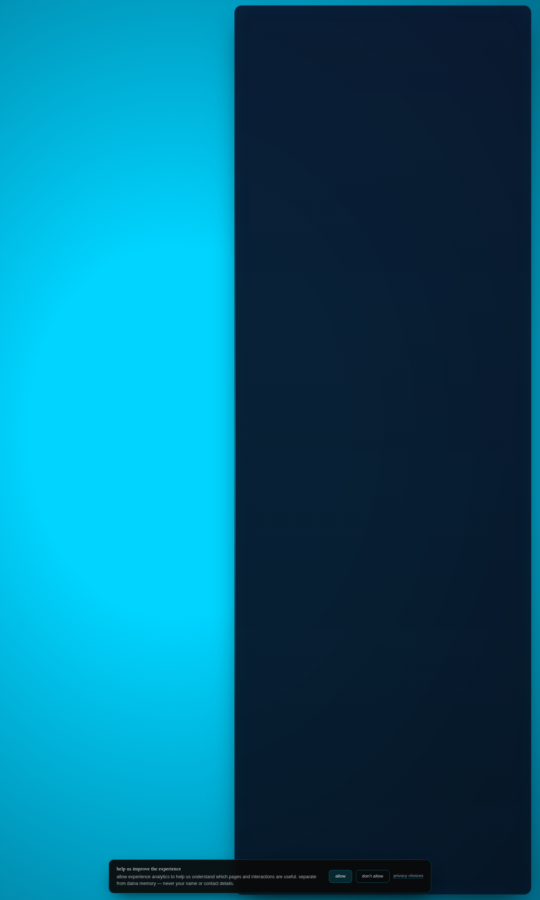
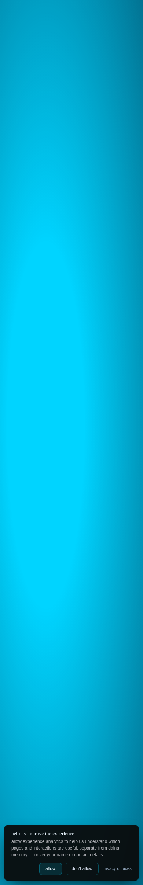

# UI Design System & Master Generation Blueprint: recurziv-com

> **Recurziv — Web & App Development Studio in Goa** (https://recurziv.com) — A digital studio in Panaji, Goa building websites, e-commerce, and mobile apps since 2014 — designed and built in-house, iterated until t...



---

## 1. Executive Visual Persona & Design Archetype

- **Brand Essence & Persona**: **Recurziv — Web & App Development Studio in Goa** (`https://recurziv.com`). A digital studio in Panaji, Goa building websites, e-commerce, and mobile apps since 2014 — designed and built in-house, iterated until t...
- **Visual Archetype**: **Light-Gallery WebGL / Canvas Interactive Experience (`#00d4ff` / `#fff`)**.
- **Anti-AI-Slop Differentiators**:
  - **Source-Grounded Chromatic Polarity**: Anchors the viewport in `#00d4ff` (`var(--accent)` in `:root`) paired with `#000` primary typography and `#fff` accents.
  - **Extracted Typographic Hierarchy**: Pairs `Gothic` for display copy (`before we begin — what should I call`) with `GothicBold` and not declared in static CSS (uses primary stack / `ui-monospace`).
  - **Calibrated Spatial Grid & Motion**: Combines `540px` container bounds (`gap: 30px`, padding `20px`) with `cubic-bezier(0.16,1,0.3,1)` easing and GSAP Timeline & ScrollTrigger, Three.js / WebGL Canvas Pipeline.

---

## 2. Spatial Architecture & Modular Grid Mathematics



### Viewport Allocation & Container Geometry
- **Captured Viewport Dimensions**: Desktop `1440×2400px` (`assets/desktop.png`, capped at 2400px multi-section capture), Mobile `390×2400px` (`assets/mobile.png`, capped at 2400px multi-section capture).
- **Master Container Bounds**: `540px` extracted from `recurziv-com` stylesheet.
- **Canvas Lateral Padding & Spacing**: `20px` lateral canvas padding with `30px` grid gap.
- **Border Radius Scale**: `20px`, `2px`, `50%`, `16px`.

### Responsive Breakpoint Architecture
- **Desktop Layout**: Multi-column CSS Grid / Flexbox layout at `1440px` (`max-width: 540px`, `gap: 30px`).
- **Mobile Layout**: Single-column vertical stack at `390px` viewport width with `20px` horizontal padding.
- **Extracted CSS Media Queries**: `@media (min-width: 576px)`, `@media (min-width: 768px)`, `@media (min-width: 992px)`, `@media (min-width: 1200px)`.

---

## 3. Color System, Materiality & Atmospheric Lighting

### Semantic Palette & Source Grounding
| Semantic Role | Ground-Truth Value | Extracted CSS Source / Selector |
|---|---|---|
| **Primary Canvas Substrate** | `#00d4ff` | `var(--accent)` in `:root` |
| **Primary Typography Ink** | `#04081a` | `var(--bg)` in `:root` |
| **Elevated Surface / Card Substrate** | `#000` | `.recursion { border-bottom: #000 }` |
| **Interactive Accent / Highlight** | `#fff` | `.recursion .recursion_wrapper h... { color: #fff }` |
| **Secondary / Muted Copy** | `#ffffff` | `ecursion .recursion_wrapper mai... { background: white }` (`#ffffff`) |
| **Structural Hairline Border** | `#ff48c4` | `.recursion.recursion_1 ul { background-color: #ff48c4 }` |

### Sanitized Root CSS Variables (`ui-ux.md` Ground Truth)
| Variable Name | Extracted Value | Semantic Role |
|---|---|---|
| `--accent` | `#00d4ff` | Brand / Palette Token |
| `--accent-dim` | `rgba(0, 212, 255, 0.18)` | Brand / Palette Token |
| `--accent-faint` | `rgba(0, 212, 255, 0.06)` | Brand / Palette Token |
| `--bg` | `#04081a` | Canvas / Surface Token |
| `--border` | `rgba(0, 212, 255, 0.13)` | Elevation / Border Token |
| `--panel-w` | `55vw` | Dimension / Scale Token |
| `--rz-l1-h` | `108px` | Elevation / Border Token |
| `--wp--preset--aspect-ratio--square` | `1` | Design System Custom Token |
| `--wp--preset--aspect-ratio--4-3` | `4/3` | Design System Custom Token |
| `--wp--preset--aspect-ratio--3-4` | `3/4` | Design System Custom Token |
| `--wp--preset--aspect-ratio--3-2` | `3/2` | Design System Custom Token |
| `--wp--preset--aspect-ratio--2-3` | `2/3` | Design System Custom Token |
| `--wp--preset--aspect-ratio--16-9` | `16/9` | Design System Custom Token |
| `--wp--preset--aspect-ratio--9-16` | `9/16` | Design System Custom Token |
| `--recurziv-com-bg` | `#00d4ff` | Canvas Substrate (from `var(--accent)` in `:root`) |
| `--recurziv-com-ink` | `#000` | Primary Typography Ink (stylesheet-derived) |

---

## 4. Typographic Scale & Editorial Hierarchy

### Font Family Stacks
- **Display Typography**: `Gothic`.
- **Primary Body Stack**: `GothicBold`.
- **Technical / Metadata Stack**: not declared in static CSS (uses primary stack / `ui-monospace`).

### Typographic Scale & Rules (Extracted from Stylesheet & Variables)
- **Hero Display (`H1`)**: rule `h1` (`font-size: 2rem`).
- **Section Heading (`H2`)**: rule `h2` (`font-size: clamp(1.02rem,1.5vw,1.22rem)`, `letter-spacing: .01em`).
- **Body Copy**: rule `p` (`font-size: 1rem`, `line-height: 1.6`, `letter-spacing: 1px`).
- **Metadata & Navigation Labels**: not explicitly declared on tag in static CSS (stylesheet font-size ladder: `100%`, `1.5rem`, `2rem`, `1.8rem`, `1rem`).

---

## 5. Choreographed Motion & Interaction Physics

### Primary Easing Curves
- **Extracted Timing Functions**: `cubic-bezier(0.16,1,0.3,1)`, `cubic-bezier(0.77,0,0.175,1)`, `cubic-bezier(0.2,0.7,0.2,1)`.

### Per-Element Transition & Choreography Rules
- **Selector `.scramble-char`**: `transition: opacity .1s` extracted from `recurziv-com` stylesheet.
- **Selector `.rz-rec-manifesto`**: `transition: opacity .8s ease,transform .8s cubic-bezier(0.16,1,0.3,1)` extracted from `recurziv-com` stylesheet.
- **Selector `body[data-rz-panel=mix] #chat-area`**: `transition: opacity .8s ease` extracted from `recurziv-com` stylesheet.
- **Extracted Easing Curve (`cubic-bezier(0.16,1,0.3,1)`)**: Governs interactive state transitions across `<header.rzd-head>` and `<main.rz-pre-choice>`.
- **Runtime Interaction Engine**: Integrates GSAP Timeline & ScrollTrigger, Three.js / WebGL Canvas Pipeline, Lottie Vector Animation Player, Barba.js Page Transition Router with `prefers-reduced-motion: reduce` fallback guards.

---

## 6. Component Wireframe & Structural DOM Map

### Visual Layout Schematic (Grounded in `dom.html` — `1440px` Desktop & `390px` Mobile Reflow)
```
┌────────────────────────────────────────────────────────────────────────┐
│ DESKTOP VIEWPORT (1440px) — Recurziv — Web & App Development Studio in │
│ ====================================================================== │
│ [ <header.rzd-head>        | Recurziv · About Us · Services · Proje ]  │
│ ---------------------------------------------------------------------- │
│ | HERO STAGE: <main.rz-consent-pending>                            |   │
│ | H1: before we begin — what should I call you?                    |   │
│ | Substrate: #00d4ff    | Ink: #000       | Accent: #fff           |   │
│ ---------------------------------------------------------------------- │
│ | SHOWCASE GRID (<main.rz-pre-choice>      ) max-w: 540px          |   │
│ | +------------------------------+  +------------------------------+ | │
│ | | what we'd design for you     |  | welcome to recurziv          | | │
│ | +------------------------------+  +------------------------------+ | │
│ ---------------------------------------------------------------------- │
│ | MOBILE VIEWPORT REFLOW (390px) — Single-Column Stack (gap: 30px  ) | │
│ | [<header.rzd-head>] -> [<main.rz-consent-p] -> [<main.rz-pre-choic]  │
│ ---------------------------------------------------------------------- │
│ [ FOOTER (<footer.rz-side-footer) | https://recurziv.com               │
└────────────────────────────────────────────────────────────────────────┘
```

### Granular DOM Region Breakdown
1. **Brand Header & Navigation Bar (<header.rzd-head> — `recurziv-com`)**:
   - Landmark `<header class="rzd-head">` hosting `Recurziv — Web & App Development Stu` navigation (`Recurziv · About Us · Services · Projects · Contact Us`), DOM attributes (`data-barba="wrapper"`, `data-rz-panel="mix"`, `data-layer1-consent-surface`, `data-rz-pulse-shown="1"`), and stylesheet rule `video { margin:0;padding:0;border:0;font-size:100%;font:inherit;text-decoration:... }`.
2. **Hero Stage & Focal Lead (<main.rz-consent-pending> — `before we begin — what should I ca`)**:
   - Landmark `<main class="rz-consent-pending">` presenting display lead `before we begin — what should I call you?` and copy excerpt *"allow experience analytics to help us understand which pages and "* over `#00d4ff` canvas and `#000` ink.
3. **Primary Showcase & Content Grid (<main.rz-pre-choice> — `what we'd design for you`)**:
   - Landmark `<main class="rz-pre-choice">` rendering section `what we'd design for you` with copy *"please rotate your device"*, asset references (`favicon.ico`, `apple-touch-icon.png`, `favicon-32x32.png`, `favicon-16x16.png`), and grid rule `section { display:block }`.
4. **Interactive Detail & Feature Matrix (<main.rz-l1-bar> — `welcome to recurziv`)**:
   - Landmark `<main class="rz-l1-bar">` framing `welcome to recurziv` and `recurziv /rɪˈkəːrsɪv/` (*"this experience is designed for portrait."*) with `#000` surface cards, `#fff` accents, and `body { line-height:1 }`.
5. **Colophon & Global Directory Footer (<footer.rz-side-footer> — `https://recurziv.com`)**:
   - Landmark `<footer class="rz-side-footer">` anchoring `Recurziv — Web & App Development` footer links (`Recurziv · About Us · Services · Projects · Contact Us`), copy *"· design studies, not delivered projects"*, and `#ff48c4` structural dividers.

---

## 7. Master Zero-Shot AI Generation Prompt

```markdown
# Master Zero-Shot Frontend Generation Prompt: recurziv-com (Recurziv — Web & App Development Studio in Goa)

You are a principal frontend architect and design systems engineer. Build a complete, production-ready web application replicating the exact design system, DOM landmarks, typographic hierarchy, color tokens, and motion physics of `recurziv-com` (**Recurziv — Web & App Development Studio in Goa** — `https://recurziv.com`).

### 1. Visual Archetype & Anti-AI-Slop Mandates
- **Archetype**: Light-Gallery WebGL / Canvas Interactive Experience (`#00d4ff` / `#fff`).
- **Identity & Domain Context**: A digital studio in Panaji, Goa building websites, e-commerce, and mobile apps since 2014 — designed and built in-house, iterated until t...
- **Primary Substrate**: `#00d4ff` (`var(--accent)` in `:root`), **Primary Ink**: `#000`, **Accent / Highlight**: `#fff`.
- **Site-Specific Differentiators**:
  - **Source-Grounded Chromatic Polarity**: Anchors the viewport in `#00d4ff` (`var(--accent)` in `:root`) paired with `#000` primary typography and `#fff` accents.
  - **Extracted Typographic Hierarchy**: Pairs `Gothic` for display copy (`before we begin — what should I call`) with `GothicBold` and not declared in static CSS (uses primary stack / `ui-monospace`).
  - **Calibrated Spatial Grid & Motion**: Combines `540px` container bounds (`gap: 30px`, padding `20px`) with `cubic-bezier(0.16,1,0.3,1)` easing and GSAP Timeline & ScrollTrigger, Three.js / WebGL Canvas Pipeline.

### 2. Ground-Truth CSS Variables (`:root` Token Contract)
Declare and consume these exact custom properties extracted from `recurziv-com` in your global stylesheet:

:root {
  /* Recurziv — Web & App Development Studio in Goa (recurziv-com) — Ground-Truth Extracted CSS Variables */
  --accent: #00d4ff; /* Brand / Palette Token (recurziv-com) */
  --accent-dim: rgba(0, 212, 255, 0.18); /* Brand / Palette Token (recurziv-com) */
  --accent-faint: rgba(0, 212, 255, 0.06); /* Brand / Palette Token (recurziv-com) */
  --bg: #04081a; /* Canvas / Surface Token (recurziv-com) */
  --border: rgba(0, 212, 255, 0.13); /* Elevation / Border Token (recurziv-com) */
  --panel-w: 55vw; /* Dimension / Scale Token (recurziv-com) */
  --rz-l1-h: 108px; /* Elevation / Border Token (recurziv-com) */
  --wp--preset--aspect-ratio--square: 1; /* Design System Custom Token (recurziv-com) */
  --wp--preset--aspect-ratio--4-3: 4/3; /* Design System Custom Token (recurziv-com) */
  --wp--preset--aspect-ratio--3-4: 3/4; /* Design System Custom Token (recurziv-com) */
  --wp--preset--aspect-ratio--3-2: 3/2; /* Design System Custom Token (recurziv-com) */
  --wp--preset--aspect-ratio--2-3: 2/3; /* Design System Custom Token (recurziv-com) */
  --wp--preset--aspect-ratio--16-9: 16/9; /* Design System Custom Token (recurziv-com) */
  --wp--preset--aspect-ratio--9-16: 9/16; /* Design System Custom Token (recurziv-com) */
  --recurziv-com-bg: #00d4ff; /* Canvas Substrate (from `var(--accent)` in `:root`) (recurziv-com) */
  --recurziv-com-ink: #000; /* Primary Typography Ink (stylesheet-derived) (recurziv-com) */
}

### 3. Semantic Color & Materiality Contract
Map every surface, ink, and border strictly to these source-grounded tokens:
- **Primary Canvas Substrate**: `#00d4ff` — grounded in `var(--accent)` in `:root`
- **Primary Typography Ink**: `#04081a` — grounded in `var(--bg)` in `:root`
- **Elevated Surface / Card Substrate**: `#000` — grounded in `.recursion { border-bottom: #000 }`
- **Interactive Accent / Highlight**: `#fff` — grounded in `.recursion .recursion_wrapper h... { color: #fff }`
- **Secondary / Muted Copy**: `#ffffff` — grounded in `ecursion .recursion_wrapper mai... { background: white }` (`#ffffff`)
- **Structural Hairline Border**: `#ff48c4` — grounded in `.recursion.recursion_1 ul { background-color: #ff48c4 }`

### 4. Spatial Grid, Container Bounds & Responsive Breakpoints
- **Desktop Viewport Reference**: `1440×2400px` (capped at 2400px multi-section capture, `1440px` standard desktop width).
- **Mobile Viewport Reference**: `390×2400px` (capped at 2400px multi-section capture, `390px` standard mobile width).
- **Container Max-Width**: `540px` extracted from `recurziv-com` stylesheet
- **Padding & Gutters**: `20px` lateral canvas padding with `30px` grid gap
- **Desktop Grid**: Multi-column CSS Grid / Flexbox layout at `1440px` (`max-width: 540px`, `gap: 30px`)
- **Mobile Adaptation**: Single-column vertical stack at `390px` viewport width with `20px` horizontal padding
- **Media Queries**: `@media (min-width: 576px)`, `@media (min-width: 768px)`, `@media (min-width: 992px)`, `@media (min-width: 1200px)`
- **Corner Radii**: `20px`, `2px`, `50%`, `16px`

### 5. Typography & Editorial Scale Contract
- **Display Font Stack**: `Gothic`
- **Body Font Stack**: `GothicBold`
- **Monospace / Technical Font Stack**: not declared in static CSS (uses primary stack / `ui-monospace`)
- **H1 Display Rule**: rule `h1` (`font-size: 2rem`)
- **H2 Section Rule**: rule `h2` (`font-size: clamp(1.02rem,1.5vw,1.22rem)`, `letter-spacing: .01em`)
- **Body Copy Rule**: rule `p` (`font-size: 1rem`, `line-height: 1.6`, `letter-spacing: 1px`)
- **Metadata & Index Rule**: not explicitly declared on tag in static CSS (stylesheet font-size ladder: `100%`, `1.5rem`, `2rem`, `1.8rem`, `1rem`)

### 6. Component Hierarchy, Verbatim Copy & Real DOM Landmarks
Scaffold `recurziv-com` (`Recurziv — Web & App Development Studio in Goa`) with these exact structural regions, extracted copy, and CSS rules from `dom.html`:
1. **Brand Header & Navigation Bar (<header.rzd-head> — `recurziv-com`)**:
   - DOM & Selectors: Landmark `<header class="rzd-head">` hosting `Recurziv — Web & App Development Stu` navigation (`Recurziv · About Us · Services · Projects · Contact Us`), DOM attributes (`data-barba="wrapper"`, `data-rz-panel="mix"`, `data-layer1-consent-surface`, `data-rz-pulse-shown="1"`), and stylesheet rule `video { margin:0;padding:0;border:0;font-size:100%;font:inherit;text-decoration:... }`.
   - Responsive Contract: Header `Brand Header & Navigation Bar (<header.rzd-head> — `recurziv-com`)` (`recurziv-com`) adapts across `@media (min-width: 576px)`, `@media (min-width: 768px)`, `@media (min-width: 992px)`, `@media (min-width: 1200px)` with `cubic-bezier(0.16,1,0.3,1)`, `cubic-bezier(0.77,0,0.175,1)`, `cubic-bezier(0.2,0.7,0.2,1)` transitions and links `Recurziv · About Us · Services · Projects · Contact Us`.
2. **Hero Stage & Focal Lead (<main.rz-consent-pending> — `before we begin — what should I ca`)**:
   - DOM & Selectors: Landmark `<main class="rz-consent-pending">` presenting display lead `before we begin — what should I call you?` and copy excerpt *"allow experience analytics to help us understand which pages and "* over `#00d4ff` canvas and `#000` ink.
   - Responsive Contract: Hero stage (`1440×2400px` desktop / `390×2400px` mobile) sets `#00d4ff` background with `#000` headline `before we begin — what should I call you?`.
3. **Primary Showcase & Content Grid (<main.rz-pre-choice> — `what we'd design for you`)**:
   - DOM & Selectors: Landmark `<main class="rz-pre-choice">` rendering section `what we'd design for you` with copy *"please rotate your device"*, asset references (`favicon.ico`, `apple-touch-icon.png`, `favicon-32x32.png`, `favicon-16x16.png`), and grid rule `section { display:block }`.
   - Responsive Contract: Showcase grid `Primary Showcase & Content Grid (<main.rz-pre-choice> — `what we'd design for you`)` applies Multi-column CSS Grid / Flexbox layout at `1440px` (`max-width: 540px`, `gap: 30px`) on desktop and Single-column vertical stack at `390px` viewport width with `20px` horizontal padding on mobile.
4. **Interactive Detail & Feature Matrix (<main.rz-l1-bar> — `welcome to recurziv`)**:
   - DOM & Selectors: Landmark `<main class="rz-l1-bar">` framing `welcome to recurziv` and `recurziv /rɪˈkəːrsɪv/` (*"this experience is designed for portrait."*) with `#000` surface cards, `#fff` accents, and `body { line-height:1 }`.
   - Responsive Contract: Detail module `Interactive Detail & Feature Matrix (<main.rz-l1-bar> — `welcome to recurziv`)` uses `20px`, `2px`, `50%`, `16px` radii, `#fff` highlights, and assets (favicon.ico, apple-touch-icon.png, favicon-32x32.png).
5. **Colophon & Global Directory Footer (<footer.rz-side-footer> — `https://recurziv.com`)**:
   - DOM & Selectors: Landmark `<footer class="rz-side-footer">` anchoring `Recurziv — Web & App Development` footer links (`Recurziv · About Us · Services · Projects · Contact Us`), copy *"· design studies, not delivered projects"*, and `#ff48c4` structural dividers.
   - Responsive Contract: Footer `Colophon & Global Directory Footer (<footer.rz-side-footer> — `https://recurziv.com`)` aligns to `540px` extracted from `recurziv-com` stylesheet with `20px` lateral canvas padding with `30px` grid gap and attributes (data-barba="wrapper", data-rz-panel="mix", data-layer1-consent-surface).

#### Verbatim DOM Copy Excerpts (`dom.html`)
- Copy Excerpt 1: *"allow experience analytics to help us understand which pages and interactions are..."*
- Copy Excerpt 2: *"please rotate your device"*
- Copy Excerpt 3: *"this experience is designed for portrait."*
- Copy Excerpt 4: *"· design studies, not delivered projects"*

### 7. Motion, Extracted Stylesheet Rules & Interaction Choreography
- **Primary Easing Functions**: `cubic-bezier(0.16,1,0.3,1)`, `cubic-bezier(0.77,0,0.175,1)`, `cubic-bezier(0.2,0.7,0.2,1)`
- **Extracted Stylesheet Rules (`recurziv-com`)**:
- `video { margin:0;padding:0;border:0;font-size:100%;font:inherit;text-decoration:... }`
- `section { display:block }`
- `body { line-height:1 }`
- `blockquote:after { content:"";content:none }`
- `q:after { content:"";content:none }`
- **Per-Selector Transition Rules**:
- **Selector `.scramble-char`**: `transition: opacity .1s` extracted from `recurziv-com` stylesheet.
- **Selector `.rz-rec-manifesto`**: `transition: opacity .8s ease,transform .8s cubic-bezier(0.16,1,0.3,1)` extracted from `recurziv-com` stylesheet.
- **Selector `body[data-rz-panel=mix] #chat-area`**: `transition: opacity .8s ease` extracted from `recurziv-com` stylesheet.
- **Extracted Easing Curve (`cubic-bezier(0.16,1,0.3,1)`)**: Governs interactive state transitions across `<header.rzd-head>` and `<main.rz-pre-choice>`.
- **Runtime Interaction Engine**: Integrates GSAP Timeline & ScrollTrigger, Three.js / WebGL Canvas Pipeline, Lottie Vector Animation Player, Barba.js Page Transition Router with `prefers-reduced-motion: reduce` fallback guards.

### 8. Technical Deliverables
- Implement in Next.js (App Router) with TypeScript and Tailwind CSS consuming the `:root` custom properties defined above for `recurziv-com`.
- Reproduce both the `1440px` desktop architecture and `390px` mobile breakpoint transitions, preserving semantic HTML5 landmarks (`<header>`, `<nav>`, `<main>`, `<section>`, `<footer>`) and `prefers-reduced-motion` accessibility guards.
```
