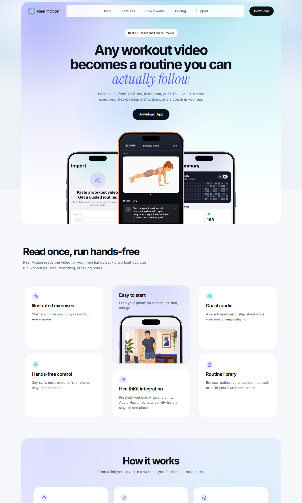

# UI Design System & Master Generation Blueprint: reelmotion-fit

> **Reel Motion: Turn Workout Videos Into Exercise Routines** (https://reelmotion.fit/) — Paste a link from YouTube, Instagram, or TikTok and Reel Motion creates an illustrated, step-by-step workout you can follow on iPhone and...



---

## 1. Executive Visual Persona & Design Archetype

- **Brand Essence & Persona**: **Reel Motion: Turn Workout Videos Into Exercise Routines** (`https://reelmotion.fit/`). Paste a link from YouTube, Instagram, or TikTok and Reel Motion creates an illustrated, step-by-step workout you can follow on iPhone and...
- **Capture Provenance**: Live browser capture (`tier1_fast`, HTTP `200`, captured `2026-11-23`).
- **Visual Archetype**: **Light-Substrate Editorial & Modular Grid System (`#f5f7fb` canvas, `#0e1116` ink, `#0d95e8` accent)**.
- **Anti-AI-Slop Differentiators**:
  - **Live-Computed Chromatic Polarity**: Anchors the viewport in `#f5f7fb` (live computed `body` `background-color` (`computed_styles.json`)) paired with `#0e1116` primary typography and `#0d95e8` accents.
  - **Grounded Typographic Hierarchy**: Pairs `Inter Tight` for display copy (`Any workout video becomes a routine `) with `Inter` and not declared in live computed styles (uses primary stack / `ui-monospace`).
  - **Calibrated Spatial Grid & Motion**: Combines `1304px` container bounds (`gap: 8px`, padding `44px`) with `cubic-bezier(.47,0,.74,.71)` easing and GSAP Timeline & ScrollTrigger, Three.js / WebGL Canvas Pipeline.

---

## 2. Spatial Architecture & Modular Grid Mathematics


### Viewport Allocation & Container Geometry
- **Captured Viewport Dimensions**: Desktop `1440×2400px` (`assets/desktop.png`, clamped at 2400px live multi-section capture), Mobile `390×2400px` (`assets/mobile.png`, clamped at 2400px live multi-section capture).
- **Master Container Bounds**: `1304px` (measured widest bounded `<section>` landmark width on `1440px` desktop).
- **Canvas Lateral Padding & Spacing**: `44px` lateral canvas padding with `8px` grid gap.
- **Border Radius Scale**: `999px`, `100%`, `3px`, `10px`.

### Responsive Breakpoint Architecture
- **Desktop Layout**: Multi-column CSS Grid / Flexbox layout at `1440px` (`max-width: 1304px`, `gap: 8px`).
- **Mobile Layout**: Single-column vertical stack at `390px` viewport width with `44px` horizontal padding.
- **Extracted CSS Media Queries**: `@media (max-width:800px)`, `@media only screen and (max-width:976px)`, `@media only screen and (max-width:767px)`, `@media screen and (max-width:1024px)`.

---

## 3. Color System, Materiality & Atmospheric Lighting

### Semantic Palette & Source Grounding
| Semantic Role | Ground-Truth Value | Extracted Live / CSS Source |
|---|---|---|
| **Primary Canvas Substrate** | `#f5f7fb` | live computed `body` `background-color` (`computed_styles.json`) |
| **Primary Typography Ink** | `#0e1116` | live computed `h1` `color` (`computed_styles.json`) |
| **Elevated Surface / Card Substrate** | `#ffffff` | live computed `button` `background-color` (`computed_styles.json`) |
| **Interactive Accent / Highlight** | `#0d95e8` | `.fancybox-share__button--tw:hover { background: #0d95e8 }` |
| **Secondary / Muted Copy** | `#8a93a3` | `var(--Muted)` in `:root` |
| **Structural Hairline Border** | `#d7d7d7` | `.fancybox-share__input { border-bottom: #d7d7d7 }` |
| **Variable Token (`--e-gv-d8119ec`)** | `#934cff` | `var(--e-gv-d8119ec)` in `:root` |
| **Variable Token (`--e-gv-22831a4`)** | `#7a32f0` | `var(--e-gv-22831a4)` in `:root` |
| **Variable Token (`--e-gv-c75aa4e`)** | `#2f7cf8` | `var(--e-gv-c75aa4e)` in `:root` |
| **Variable Token (`--e-gv-ac48b9b`)** | `#78aafa` | `var(--e-gv-ac48b9b)` in `:root` |
| **Variable Token (`--e-gv-399bfaa`)** | `#975af4` | `var(--e-gv-399bfaa)` in `:root` |
| **Variable Token (`--e-gv-cd3db67`)** | `#f5f4fb` | `var(--e-gv-cd3db67)` in `:root` |
| **Variable Token (`--e-gv-0105447`)** | `#161a20` | `var(--e-gv-0105447)` in `:root` |
| **Variable Token (`--e-gv-80cc8b6`)** | `#6b6f7b` | `var(--e-gv-80cc8b6)` in `:root` |
| **Variable Token (`--e-gv-d4944d5`)** | `#e6e4f0` | `var(--e-gv-d4944d5)` in `:root` |

### Sanitized Root CSS Variables (`ui-ux.md` Ground Truth)
| Variable Name | Extracted Value | Semantic Role |
|---|---|---|
| `--wp--style--global--content-size` | `800px` | Layout / Spatial Grid Token |
| `--wp--style--global--wide-size` | `1200px` | Layout / Spatial Grid Token |
| `--wp--style--block-gap` | `24px` | Layout / Spatial Grid Token |
| `--direction-multiplier` | `1` | Design System Custom Token |
| `--page-title-display` | `block` | Design System Custom Token |
| `--e-gv-d8119ec` | `#934cff` | Color / Atmospheric Token |
| `--e-gv-22831a4` | `#7a32f0` | Color / Atmospheric Token |
| `--e-gv-c75aa4e` | `#2f7cf8` | Color / Atmospheric Token |
| `--e-gv-ac48b9b` | `#78aafa` | Color / Atmospheric Token |
| `--e-gv-399bfaa` | `#975af4` | Color / Atmospheric Token |
| `--e-gv-1036c6e` | `#ffffff` | Color / Atmospheric Token |
| `--e-gv-cd3db67` | `#f5f4fb` | Color / Atmospheric Token |
| `--e-gv-0105447` | `#161a20` | Color / Atmospheric Token |
| `--e-gv-9d9c176` | `#161a20` | Color / Atmospheric Token |
| `--e-gv-80cc8b6` | `#6b6f7b` | Color / Atmospheric Token |
| `--e-gv-d4944d5` | `#e6e4f0` | Color / Atmospheric Token |

---

## 4. Typographic Scale & Editorial Hierarchy

### Font Family Stacks
- **Display Typography**: `Inter Tight`.
- **Primary Body Stack**: `Inter`.
- **Technical / Metadata Stack**: not declared in live computed styles (uses primary stack / `ui-monospace`).

### Typographic Scale & Rules (Live Computed & Stylesheet Grounded)
- **Hero Display (`H1`)**: live computed `h1` (`font-size: 66px`, `line-height: 68.64px`, `font-weight: 700`, `letter-spacing: -1.65px`); CSS variables `--page-title-display: block`, `--Display: Inter Tight`, `--TextDisplay: clamp(32px, 5.4vw, 66px)`; rule `h1` (`font-size: 35px`, `font-weight: 700`).
- **Section Heading (`H2`)**: live computed `h2` (`font-size: 48px`, `line-height: 50.88px`, `font-weight: 700`, `letter-spacing: -1.2px`); CSS variables `--TextH2: clamp(30px, 3.9vw, 48px)`; rule `h2` (`font-size: var( --e-global-typography-se...`, `line-height: var( --e-global-typog...`, `letter-spacing: var( --e-global-typog...`, `font-weight: var( --e-glob...`).
- **Body Copy**: live computed `body` (`font-size: 16px`, `line-height: 24.8px`, `font-weight: 400`); CSS variables `--Body: Inter`, `--TextBody: 16px`; rule `p` (`font-size: 16px`, `line-height: 20px`).
- **Metadata & Navigation Labels**: live computed `nav/a` (`font-size: 16px`, `line-height: 24.8px`, `font-weight: 400`); CSS variables `--TextSmall: 15px`, `--e-global-typography-primary-letter-spacing: -0.025em`, `--e-global-typography-secondary-letter-spacing: -0.025em`.

---

## 5. Choreographed Motion & Interaction Physics

### Primary Easing Curves
- **Extracted Timing Functions**: `cubic-bezier(.47,0,.74,.71)`, `cubic-bezier(.22,.61,.36,1)`, `cubic-bezier(.5,0,.14,1)`.

### Per-Element Transition & Choreography Rules
- **Selector `.fancybox-bg`**: `transition: inherit` extracted from `reelmotion-fit` stylesheet.
- **Selector `.fancybox-is-open .fancybox-bg`**: `transition: cubic-bezier(.47,0,.74,.71)` extracted from `reelmotion-fit` stylesheet.
- **Selector `.fancybox-toolbar`**: `transition: opacity .25s,visibility 0s linear .25s` extracted from `reelmotion-fit` stylesheet.
- **Extracted Easing Curve (`cubic-bezier(.47,0,.74,.71)`)**: Governs interactive state transitions across `<nav.elementor>` and `<section.elementor-element-rmhowsec>`.
- **Runtime Interaction Engine**: Integrates GSAP Timeline & ScrollTrigger, Three.js / WebGL Canvas Pipeline, Swiper Touch Carousel Engine, Lottie Vector Animation Player with `prefers-reduced-motion: reduce` fallback guards.

---

## 6. Component Wireframe & Structural DOM Map

### Visual Layout Schematic — Desktop (`1440px`, Grounded in `dom.html` & Landmark Bounding Boxes)
```
┌────────────────────────────────────────────────────────────────────────┐
│ DESKTOP VIEWPORT (1440px) — Reel Motion: Turn Workout Videos Into Exer │
│ ====================================================================== │
│ [ <nav.elementor> (1440x0px)          | Reel Motion · Home · Feature ] │
│ ---------------------------------------------------------------------- │
│ | HERO STAGE: <section.elementor-element> (w=1440px)                 | │
│ | H1: Any workout video becomes a routine you can                    | │
│ | Substrate: #f5f7fb | Ink: #0e1116 | Accent: #0d95e8                | │
│ ---------------------------------------------------------------------- │
│ | SHOWCASE GRID (<section.elementor-element) max-w: 1304px           | │
│ | +------------------------------+  +------------------------------+ | │
│ | | Read once, run hands-free    |  | Illustrated exercises        | | │
│ | +------------------------------+  +------------------------------+ | │
│ ---------------------------------------------------------------------- │
│ | DETAIL MODULE (<section.elementor-element) — Hands-free control    | │
│ ---------------------------------------------------------------------- │
│ [ FOOTER (<footer.elementor>  ) | https://reelmotion.fit/              │
└────────────────────────────────────────────────────────────────────────┘
```

### Visual Layout Schematic — Mobile Reflow (`390px`)
```
┌────────────────────────────────────────────────────────────────────────┐
│ MOBILE VIEWPORT REFLOW (390px) — Single-Column Stack (gap: 8px)        │
│ ====================================================================== │
│ [ HEADER BAR (<nav.elementor>         ) | Compact Menu (390px)         │
│ ---------------------------------------------------------------------- │
│ | HERO STAGE (<section.elementor-eleme) — 390px Vertical Lead        | │
│ | H1: Any workout video becomes a routine you can                    | │
│ ---------------------------------------------------------------------- │
│ | SHOWCASE STACK (<section.elementor-ele) — 1-Col Stack              | │
│ | [ Item 1: Read once, run hands-free                              ] | │
│ | [ Item 2: Illustrated exercises                                  ] | │
│ ---------------------------------------------------------------------- │
│ | DETAIL STACK (<section.elementor-eleme) — 1-Col (Hands-free control) │
│ ---------------------------------------------------------------------- │
│ [ FOOTER (<footer.elementor>  ) | Stacked 390px Colophon               │
└────────────────────────────────────────────────────────────────────────┘
```

### Granular DOM Region Breakdown
1. **Brand Header & Navigation Bar (<nav.elementor> — `reelmotion-fit`)**:
   - Landmark `<nav class="elementor elementor-15">` (`1440x0px`) hosting `Reel Motion: Turn Workout Videos Int` navigation (`Reel Motion · Home · Features · How it works · Pricing`), DOM attributes (`data-wp-strategy="defer"`, `data-wp-strategy="defer"`, `data-wp-strategy="defer"`, `data-elementor-device-mode="desktop"`), and stylesheet rule `.uael-ins-target { position:relative }`.
2. **Hero Stage & Focal Lead (<section.elementor-element> — `Any workout video becomes a routin`)**:
   - Landmark `<section class="elementor-element elementor-element-rmfeatsec">` presenting display lead `Any workout video becomes a routine you can` and copy excerpt *"Paste a link from YouTube, Instagram, or TikTok. Get illustrated "* over `#f5f7fb` canvas and `#0e1116` ink.
3. **Primary Showcase & Content Grid (<section.elementor-element-rmhowsec> — `Read once, run hands-free`)**:
   - Landmark `<section class="elementor-element elementor-element-rmhowsec">` rendering section `Read once, run hands-free` with copy *"Reel Motion reads the video for you, then hands back a workout yo"*, asset references (`fonts.googleapis.com`, `embed`, `reset.css`, `theme.css`), and grid rule `.uael-ins-target::before { display:block;height:100%;left:0;position:absolute;top:0;width:100%;z-in... }`.
4. **Interactive Detail & Feature Matrix (<section.elementor-element-rmpricesec> — `Illustrated exercises`)**:
   - Landmark `<section class="elementor-element elementor-element-rmpricesec">` framing `Illustrated exercises` and `Hands-free control` (*"Start and finish positions, drawn for every move."*) with `#ffffff` surface cards, `#0d95e8` accents, and `.uael-ins-normal .uael-ins-target { -webkit-filter:unset;filter:unset }`.
5. **Colophon & Global Directory Footer (<footer.elementor> — `https://reelmotion.fit/`)**:
   - Landmark `<footer class="elementor elementor-68">` anchoring `Reel Motion: Turn Workout Videos` footer links (`Reel Motion · Home · Features · How it works · Pricing`), copy *"Say start, next, or done. Your phone stays on the floor."*, and `#d7d7d7` structural dividers.

---

## 7. Master Zero-Shot AI Generation Prompt

```markdown
# Master Zero-Shot Frontend Generation Prompt: reelmotion-fit (Reel Motion: Turn Workout Videos Into Exercise Routines)

You are a principal frontend architect and design systems engineer. Build a complete, production-ready web application replicating the exact design system, DOM landmarks, typographic hierarchy, color tokens, and motion physics of `reelmotion-fit` (**Reel Motion: Turn Workout Videos Into Exercise Routines** — `https://reelmotion.fit/`).

### 1. Visual Archetype & Anti-AI-Slop Mandates
- **Archetype**: Light-Substrate Editorial & Modular Grid System (`#f5f7fb` canvas, `#0e1116` ink, `#0d95e8` accent).
- **Identity & Domain Context**: Paste a link from YouTube, Instagram, or TikTok and Reel Motion creates an illustrated, step-by-step workout you can follow on iPhone and...
- **Primary Substrate**: `#f5f7fb` (live computed `body` `background-color` (`computed_styles.json`)), **Primary Ink**: `#0e1116`, **Accent / Highlight**: `#0d95e8`.
- **Site-Specific Differentiators**:
  - **Live-Computed Chromatic Polarity**: Anchors the viewport in `#f5f7fb` (live computed `body` `background-color` (`computed_styles.json`)) paired with `#0e1116` primary typography and `#0d95e8` accents.
  - **Grounded Typographic Hierarchy**: Pairs `Inter Tight` for display copy (`Any workout video becomes a routine `) with `Inter` and not declared in live computed styles (uses primary stack / `ui-monospace`).
  - **Calibrated Spatial Grid & Motion**: Combines `1304px` container bounds (`gap: 8px`, padding `44px`) with `cubic-bezier(.47,0,.74,.71)` easing and GSAP Timeline & ScrollTrigger, Three.js / WebGL Canvas Pipeline.

### 2. Ground-Truth CSS Variables (`:root` Token Contract)
Declare and consume these exact custom properties extracted from `reelmotion-fit` in your global stylesheet:

:root {
  /* Reel Motion: Turn Workout Videos Into Exercise Routines (reelmotion-fit) — Live-Grounded CSS Variables */
  --wp--style--global--content-size: 800px; /* Layout / Spatial Grid Token (reelmotion-fit) */
  --wp--style--global--wide-size: 1200px; /* Layout / Spatial Grid Token (reelmotion-fit) */
  --wp--style--block-gap: 24px; /* Layout / Spatial Grid Token (reelmotion-fit) */
  --direction-multiplier: 1; /* Design System Custom Token (reelmotion-fit) */
  --page-title-display: block; /* Design System Custom Token (reelmotion-fit) */
  --e-gv-d8119ec: #934cff; /* Color / Atmospheric Token (reelmotion-fit) */
  --e-gv-22831a4: #7a32f0; /* Color / Atmospheric Token (reelmotion-fit) */
  --e-gv-c75aa4e: #2f7cf8; /* Color / Atmospheric Token (reelmotion-fit) */
  --e-gv-ac48b9b: #78aafa; /* Color / Atmospheric Token (reelmotion-fit) */
  --e-gv-399bfaa: #975af4; /* Color / Atmospheric Token (reelmotion-fit) */
  --e-gv-1036c6e: #ffffff; /* Color / Atmospheric Token (reelmotion-fit) */
  --e-gv-cd3db67: #f5f4fb; /* Color / Atmospheric Token (reelmotion-fit) */
  --e-gv-0105447: #161a20; /* Color / Atmospheric Token (reelmotion-fit) */
  --e-gv-9d9c176: #161a20; /* Color / Atmospheric Token (reelmotion-fit) */
  --e-gv-80cc8b6: #6b6f7b; /* Color / Atmospheric Token (reelmotion-fit) */
  --e-gv-d4944d5: #e6e4f0; /* Color / Atmospheric Token (reelmotion-fit) */
}

### 3. Semantic Color & Materiality Contract
Map every surface, ink, and border strictly to these source-grounded tokens:
- **Primary Canvas Substrate**: `#f5f7fb` — grounded in live computed `body` `background-color` (`computed_styles.json`)
- **Primary Typography Ink**: `#0e1116` — grounded in live computed `h1` `color` (`computed_styles.json`)
- **Elevated Surface / Card Substrate**: `#ffffff` — grounded in live computed `button` `background-color` (`computed_styles.json`)
- **Interactive Accent / Highlight**: `#0d95e8` — grounded in `.fancybox-share__button--tw:hover { background: #0d95e8 }`
- **Secondary / Muted Copy**: `#8a93a3` — grounded in `var(--Muted)` in `:root`
- **Structural Hairline Border**: `#d7d7d7` — grounded in `.fancybox-share__input { border-bottom: #d7d7d7 }`
- **Variable Token (`--e-gv-d8119ec`)**: `#934cff` — grounded in `var(--e-gv-d8119ec)` in `:root`
- **Variable Token (`--e-gv-22831a4`)**: `#7a32f0` — grounded in `var(--e-gv-22831a4)` in `:root`
- **Variable Token (`--e-gv-c75aa4e`)**: `#2f7cf8` — grounded in `var(--e-gv-c75aa4e)` in `:root`
- **Variable Token (`--e-gv-ac48b9b`)**: `#78aafa` — grounded in `var(--e-gv-ac48b9b)` in `:root`
- **Variable Token (`--e-gv-399bfaa`)**: `#975af4` — grounded in `var(--e-gv-399bfaa)` in `:root`
- **Variable Token (`--e-gv-cd3db67`)**: `#f5f4fb` — grounded in `var(--e-gv-cd3db67)` in `:root`
- **Variable Token (`--e-gv-0105447`)**: `#161a20` — grounded in `var(--e-gv-0105447)` in `:root`
- **Variable Token (`--e-gv-80cc8b6`)**: `#6b6f7b` — grounded in `var(--e-gv-80cc8b6)` in `:root`
- **Variable Token (`--e-gv-d4944d5`)**: `#e6e4f0` — grounded in `var(--e-gv-d4944d5)` in `:root`

### 4. Spatial Grid, Container Bounds & Responsive Breakpoints
- **Desktop Viewport Reference**: `1440×2400px` (clamped at 2400px live multi-section capture, `1440px` standard desktop width).
- **Mobile Viewport Reference**: `390×2400px` (clamped at 2400px live multi-section capture, `390px` standard mobile width).
- **Container Max-Width**: `1304px` (measured widest bounded `<section>` landmark width on `1440px` desktop)
- **Padding & Gutters**: `44px` lateral canvas padding with `8px` grid gap
- **Desktop Grid**: Multi-column CSS Grid / Flexbox layout at `1440px` (`max-width: 1304px`, `gap: 8px`)
- **Mobile Adaptation**: Single-column vertical stack at `390px` viewport width with `44px` horizontal padding
- **Media Queries**: `@media (max-width:800px)`, `@media only screen and (max-width:976px)`, `@media only screen and (max-width:767px)`, `@media screen and (max-width:1024px)`
- **Corner Radii**: `999px`, `100%`, `3px`, `10px`

### 5. Typography & Editorial Scale Contract
- **Display Font Stack**: `Inter Tight`
- **Body Font Stack**: `Inter`
- **Monospace / Technical Font Stack**: not declared in live computed styles (uses primary stack / `ui-monospace`)
- **H1 Display Rule**: live computed `h1` (`font-size: 66px`, `line-height: 68.64px`, `font-weight: 700`, `letter-spacing: -1.65px`); CSS variables `--page-title-display: block`, `--Display: Inter Tight`, `--TextDisplay: clamp(32px, 5.4vw, 66px)`; rule `h1` (`font-size: 35px`, `font-weight: 700`)
- **H2 Section Rule**: live computed `h2` (`font-size: 48px`, `line-height: 50.88px`, `font-weight: 700`, `letter-spacing: -1.2px`); CSS variables `--TextH2: clamp(30px, 3.9vw, 48px)`; rule `h2` (`font-size: var( --e-global-typography-se...`, `line-height: var( --e-global-typog...`, `letter-spacing: var( --e-global-typog...`, `font-weight: var( --e-glob...`)
- **Body Copy Rule**: live computed `body` (`font-size: 16px`, `line-height: 24.8px`, `font-weight: 400`); CSS variables `--Body: Inter`, `--TextBody: 16px`; rule `p` (`font-size: 16px`, `line-height: 20px`)
- **Metadata & Index Rule**: live computed `nav/a` (`font-size: 16px`, `line-height: 24.8px`, `font-weight: 400`); CSS variables `--TextSmall: 15px`, `--e-global-typography-primary-letter-spacing: -0.025em`, `--e-global-typography-secondary-letter-spacing: -0.025em`

### 6. Component Hierarchy, Verbatim Copy & Real DOM Landmarks
Scaffold `reelmotion-fit` (`Reel Motion: Turn Workout Videos Into Exercise Routines`) with these exact structural regions, extracted copy, and CSS rules from `dom.html`:
1. **Brand Header & Navigation Bar (<nav.elementor> — `reelmotion-fit`)**:
   - DOM & Selectors: Landmark `<nav class="elementor elementor-15">` (`1440x0px`) hosting `Reel Motion: Turn Workout Videos Int` navigation (`Reel Motion · Home · Features · How it works · Pricing`), DOM attributes (`data-wp-strategy="defer"`, `data-wp-strategy="defer"`, `data-wp-strategy="defer"`, `data-elementor-device-mode="desktop"`), and stylesheet rule `.uael-ins-target { position:relative }`.
   - Responsive Contract: Header `Brand Header & Navigation Bar (<nav.elementor> — `reelmotion-fit`)` (`reelmotion-fit`) adapts across `@media (max-width:800px)`, `@media only screen and (max-width:976px)`, `@media only screen and (max-width:767px)`, `@media screen and (max-width:1024px)` with `cubic-bezier(.47,0,.74,.71)`, `cubic-bezier(.22,.61,.36,1)`, `cubic-bezier(.5,0,.14,1)` transitions and links `Reel Motion · Home · Features · How it works · Pricing`.
2. **Hero Stage & Focal Lead (<section.elementor-element> — `Any workout video becomes a routin`)**:
   - DOM & Selectors: Landmark `<section class="elementor-element elementor-element-rmfeatsec">` presenting display lead `Any workout video becomes a routine you can` and copy excerpt *"Paste a link from YouTube, Instagram, or TikTok. Get illustrated "* over `#f5f7fb` canvas and `#0e1116` ink.
   - Responsive Contract: Hero stage (`1440×2400px` desktop / `390×2400px` mobile) sets `#f5f7fb` background with `#0e1116` headline `Any workout video becomes a routine you can`.
3. **Primary Showcase & Content Grid (<section.elementor-element-rmhowsec> — `Read once, run hands-free`)**:
   - DOM & Selectors: Landmark `<section class="elementor-element elementor-element-rmhowsec">` rendering section `Read once, run hands-free` with copy *"Reel Motion reads the video for you, then hands back a workout yo"*, asset references (`fonts.googleapis.com`, `embed`, `reset.css`, `theme.css`), and grid rule `.uael-ins-target::before { display:block;height:100%;left:0;position:absolute;top:0;width:100%;z-in... }`.
   - Responsive Contract: Showcase grid `Primary Showcase & Content Grid (<section.elementor-element-rmhowsec> — `Read once, run hands-free`)` applies Multi-column CSS Grid / Flexbox layout at `1440px` (`max-width: 1304px`, `gap: 8px`) on desktop and Single-column vertical stack at `390px` viewport width with `44px` horizontal padding on mobile.
4. **Interactive Detail & Feature Matrix (<section.elementor-element-rmpricesec> — `Illustrated exercises`)**:
   - DOM & Selectors: Landmark `<section class="elementor-element elementor-element-rmpricesec">` framing `Illustrated exercises` and `Hands-free control` (*"Start and finish positions, drawn for every move."*) with `#ffffff` surface cards, `#0d95e8` accents, and `.uael-ins-normal .uael-ins-target { -webkit-filter:unset;filter:unset }`.
   - Responsive Contract: Detail module `Interactive Detail & Feature Matrix (<section.elementor-element-rmpricesec> — `Illustrated exercises`)` uses `999px`, `100%`, `3px`, `10px` radii, `#0d95e8` highlights, and assets (fonts.googleapis.com, embed, reset.css).
5. **Colophon & Global Directory Footer (<footer.elementor> — `https://reelmotion.fit/`)**:
   - DOM & Selectors: Landmark `<footer class="elementor elementor-68">` anchoring `Reel Motion: Turn Workout Videos` footer links (`Reel Motion · Home · Features · How it works · Pricing`), copy *"Say start, next, or done. Your phone stays on the floor."*, and `#d7d7d7` structural dividers.
   - Responsive Contract: Footer `Colophon & Global Directory Footer (<footer.elementor> — `https://reelmotion.fit/`)` aligns to `1304px` (measured widest bounded `<section>` landmark width on `1440px` desktop) with `44px` lateral canvas padding with `8px` grid gap and attributes (data-wp-strategy="defer", data-wp-strategy="defer", data-wp-strategy="defer").

#### Verbatim DOM Copy Excerpts (`dom.html`)
- Copy Excerpt 1: *"Paste a link from YouTube, Instagram, or TikTok. Get illustrated exercises, step-b..."*
- Copy Excerpt 2: *"Reel Motion reads the video for you, then hands back a workout you can run without..."*
- Copy Excerpt 3: *"Start and finish positions, drawn for every move."*
- Copy Excerpt 4: *"Say start, next, or done. Your phone stays on the floor."*

### 7. Motion, Extracted Stylesheet Rules & Interaction Choreography
- **Primary Easing Functions**: `cubic-bezier(.47,0,.74,.71)`, `cubic-bezier(.22,.61,.36,1)`, `cubic-bezier(.5,0,.14,1)`
- **Extracted Stylesheet Rules (`reelmotion-fit`)**:
- `.uael-ins-target { position:relative }`
- `.uael-ins-target::before { display:block;height:100%;left:0;position:absolute;top:0;width:100%;z-in... }`
- `.uael-ins-normal .uael-ins-target { -webkit-filter:unset;filter:unset }`
- `ns-hover:hover .uael-ins-target::... { background:unset;mix-blend-mode:unset }`
- `.uael-ins-hover:hover .uael-ins-t... { -webkit-filter:sepia(.5) hue-rotate(-30deg) saturate(1.4);filter:sepia(.... }`
- **Per-Selector Transition Rules**:
- **Selector `.fancybox-bg`**: `transition: inherit` extracted from `reelmotion-fit` stylesheet.
- **Selector `.fancybox-is-open .fancybox-bg`**: `transition: cubic-bezier(.47,0,.74,.71)` extracted from `reelmotion-fit` stylesheet.
- **Selector `.fancybox-toolbar`**: `transition: opacity .25s,visibility 0s linear .25s` extracted from `reelmotion-fit` stylesheet.
- **Extracted Easing Curve (`cubic-bezier(.47,0,.74,.71)`)**: Governs interactive state transitions across `<nav.elementor>` and `<section.elementor-element-rmhowsec>`.
- **Runtime Interaction Engine**: Integrates GSAP Timeline & ScrollTrigger, Three.js / WebGL Canvas Pipeline, Swiper Touch Carousel Engine, Lottie Vector Animation Player with `prefers-reduced-motion: reduce` fallback guards.

### 8. Technical Deliverables
- Implement in Next.js (App Router) with TypeScript and Tailwind CSS consuming the `:root` custom properties defined above for `reelmotion-fit`.
- Reproduce both the `1440px` desktop architecture and `390px` mobile breakpoint transitions, preserving semantic HTML5 landmarks (`<header>`, `<nav>`, `<main>`, `<section>`, `<footer>`) and `prefers-reduced-motion` accessibility guards.
```
