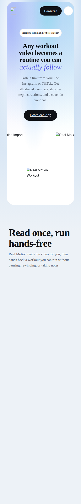

# UI Design System & Master Generation Blueprint: reelmotion-fit

> **Reel Motion: Turn Workout Videos Into Exercise Routines** (https://reelmotion.fit/) — Paste a link from YouTube, Instagram, or TikTok and Reel Motion creates an illustrated, step-by-step workout you can follow on iPhone and...


---

## 1. Executive Visual Persona & Design Archetype

- **Brand Essence & Persona**: **Reel Motion: Turn Workout Videos Into Exercise Routines** (`https://reelmotion.fit/`). Paste a link from YouTube, Instagram, or TikTok and Reel Motion creates an illustrated, step-by-step workout you can follow on iPhone and...
- **Visual Archetype**: **High-Contrast Obsidian / Atmospheric Design System (`#4A52DE` canvas, `#FFFFFF` ink, `#787FF6` accent)**.
- **Anti-AI-Slop Differentiators**:
  - **Source-Grounded Chromatic Polarity**: Anchors the viewport in `#4A52DE` (`var(--e-global-color-primary)` in `:root`) paired with `#FFFFFF` primary typography and `#787FF6` accents.
  - **Extracted Typographic Hierarchy**: Pairs `Instrument Serif` for display copy (`Any workout video becomes a routine `) with `Inter` and not declared in static CSS (uses primary stack / `ui-monospace`).
  - **Calibrated Spatial Grid & Motion**: Combines `100vw` container bounds (`gap: 20px`, padding `10px`) with `cubic-bezier(.47,0,.74,.71)` easing and GSAP Timeline & ScrollTrigger, Three.js / WebGL Canvas Pipeline.

---

## 2. Spatial Architecture & Modular Grid Mathematics



### Viewport Allocation & Container Geometry
- **Captured Viewport Dimensions**: Desktop `1440×4938px` (`assets/desktop.png`, full-page scroll capture), Mobile `390×2400px` (`assets/mobile.png`, capped at 2400px multi-section capture).
- **Master Container Bounds**: `100vw` extracted from `reelmotion-fit` stylesheet.
- **Canvas Lateral Padding & Spacing**: `10px` lateral canvas padding with `20px` grid gap.
- **Border Radius Scale**: `50%`, `4px`, `2px`, `0px`.

### Responsive Breakpoint Architecture
- **Desktop Layout**: Multi-column CSS Grid / Flexbox layout at `1440px` (`max-width: 100vw`, `gap: 20px`).
- **Mobile Layout**: Single-column vertical stack at `390px` viewport width with `10px` horizontal padding.
- **Extracted CSS Media Queries**: `@media (max-width:1024px)`, `@media (max-width:767px)`, `@media (min-width:-1)`, `@media (max-width:-1)`.

---

## 3. Color System, Materiality & Atmospheric Lighting

### Semantic Palette & Source Grounding
| Semantic Role | Ground-Truth Value | Extracted CSS Source / Selector |
|---|---|---|
| **Primary Canvas Substrate** | `#4A52DE` | `var(--e-global-color-primary)` in `:root` |
| **Primary Typography Ink** | `#0E1116` | `var(--e-global-color-secondary)` in `:root` |
| **Elevated Surface / Card Substrate** | `#5B6472` | `var(--e-global-color-text)` in `:root` |
| **Interactive Accent / Highlight** | `#787FF6` | `var(--e-global-color-accent)` in `:root` |
| **Secondary / Muted Copy** | `#FFFFFF` | `var(--e-global-color-e0a4856)` in `:root` |
| **Structural Hairline Border** | `#F5F7FB` | `var(--e-global-color-40c312a)` in `:root` |

### Sanitized Root CSS Variables (`ui-ux.md` Ground Truth)
| Variable Name | Extracted Value | Semantic Role |
|---|---|---|
| `--direction-multiplier` | `1` | Design System Custom Token |
| `--flex-direction` | `initial` | Design System Custom Token |
| `--flex-wrap` | `initial` | Layout / Spatial Grid Token |
| `--justify-content` | `initial` | Design System Custom Token |
| `--align-items` | `initial` | Design System Custom Token |
| `--align-content` | `initial` | Design System Custom Token |
| `--gap` | `initial` | Layout / Spatial Grid Token |
| `--flex-basis` | `initial` | Design System Custom Token |
| `--flex-grow` | `initial` | Design System Custom Token |
| `--flex-shrink` | `initial` | Typography Ink Token |
| `--order` | `initial` | Design System Custom Token |
| `--align-self` | `initial` | Design System Custom Token |
| `--page-title-display` | `block` | Design System Custom Token |
| `--border-radius` | `0` | Elevation / Border Token |
| `--border-top-width` | `0px` | Layout / Spatial Grid Token |
| `--border-right-width` | `0px` | Layout / Spatial Grid Token |

---

## 4. Typographic Scale & Editorial Hierarchy

### Font Family Stacks
- **Display Typography**: `Instrument Serif`.
- **Primary Body Stack**: `Inter`.
- **Technical / Metadata Stack**: not declared in static CSS (uses primary stack / `ui-monospace`).

### Typographic Scale & Rules (Extracted from Stylesheet & Variables)
- **Hero Display (`H1`)**: CSS variables `--page-title-display: block`, `--Display: Inter Tight`, `--TextDisplay: clamp(32px, 5.4vw, 66px)`; rule `h1` (`font-size: var( --e-global-typography-pr...`, `line-height: var( --e-global-typog...`, `letter-spacing: var( --e-global-typog...`, `font-weight: var( --e-glob...`).
- **Section Heading (`H2`)**: CSS variables `--TextH2: clamp(30px, 3.9vw, 48px)`; rule `h2` (`font-size: var( --e-global-typography-se...`, `line-height: var( --e-global-typog...`, `letter-spacing: var( --e-global-typog...`, `font-weight: var( --e-glob...`).
- **Body Copy**: CSS variables `--Body: Inter`, `--TextBody: 16px`; rule `p` (`line-height: 1.7`).
- **Metadata & Navigation Labels**: CSS variables `--e-global-typography-primary-letter-spacing: -0.025em`, `--e-global-typography-secondary-letter-spacing: -0.025em`, `--TextSmall: 15px`.

---

## 5. Choreographed Motion & Interaction Physics

### Primary Easing Curves
- **Extracted Timing Functions**: `cubic-bezier(.47,0,.74,.71)`, `cubic-bezier(.22,.61,.36,1)`, `cubic-bezier(.5,0,.14,1)`.

### Per-Element Transition & Choreography Rules
- **Selector `.elementor .e-form-checkbox-base`**: `transition: background-color 200ms` extracted from `reelmotion-fit` stylesheet.
- **Selector `.elementor .e-form-checkbox-base:...`**: `transition: opacity 200ms` extracted from `reelmotion-fit` stylesheet.
- **Selector `elementor .e-form-radio-button-ba...`**: `transition: opacity 200ms` extracted from `reelmotion-fit` stylesheet.
- **Extracted Easing Curve (`cubic-bezier(.47,0,.74,.71)`)**: Governs interactive state transitions across `<nav.elementor>` and `<section.elementor-element>`.
- **Runtime Interaction Engine**: Integrates GSAP Timeline & ScrollTrigger, Three.js / WebGL Canvas Pipeline, Swiper Touch Carousel Engine, Lottie Vector Animation Player with `prefers-reduced-motion: reduce` fallback guards.

---

## 6. Component Wireframe & Structural DOM Map

### Visual Layout Schematic (Grounded in `dom.html` — `1440px` Desktop & `390px` Mobile Reflow)
```
┌────────────────────────────────────────────────────────────────────────┐
│ DESKTOP VIEWPORT (1440px) — Reel Motion: Turn Workout Videos Into Exer │
│ ====================================================================== │
│ [ <nav.elementor>          | Reel Motion · Home · Features · How it ]  │
│ ---------------------------------------------------------------------- │
│ | HERO STAGE: <section.elementor-element>                          |   │
│ | H1: Any workout video becomes a routine you can                  |   │
│ | Substrate: #4A52DE    | Ink: #FFFFFF    | Accent: #787FF6        |   │
│ ---------------------------------------------------------------------- │
│ | SHOWCASE GRID (<section.elementor-element) max-w: 100vw          |   │
│ | +------------------------------+  +------------------------------+ | │
│ | | Read once, run hands-free    |  | Illustrated exercises        | | │
│ | +------------------------------+  +------------------------------+ | │
│ ---------------------------------------------------------------------- │
│ | MOBILE VIEWPORT REFLOW (390px) — Single-Column Stack (gap: 20px  ) | │
│ | [<nav.elementor>] -> [<section.elementor] -> [<section.elementor] |  │
│ ---------------------------------------------------------------------- │
│ [ FOOTER (<footer.elementor>    ) | https://reelmotion.fit/            │
└────────────────────────────────────────────────────────────────────────┘
```

### Granular DOM Region Breakdown
1. **Brand Header & Navigation Bar (<nav.elementor> — `reelmotion-fit`)**:
   - Landmark `<nav class="elementor elementor-15">` hosting `Reel Motion: Turn Workout Videos Int` navigation (`Reel Motion · Home · Features · How it works · Pricing`), DOM attributes (`data-wp-strategy="defer"`, `data-wp-strategy="defer"`, `data-wp-strategy="defer"`, `data-elementor-device-mode="desktop"`), and stylesheet rule `.elementor .e-div-block-base { min-width:30px;padding:10px;display:block; }`.
2. **Hero Stage & Focal Lead (<section.elementor-element> — `Any workout video becomes a routin`)**:
   - Landmark `<section class="elementor-element elementor-element-rmfeatsec">` presenting display lead `Any workout video becomes a routine you can` and copy excerpt *"Paste a link from YouTube, Instagram, or TikTok. Get illustrated "* over `#4A52DE` canvas and `#FFFFFF` ink.
3. **Primary Showcase & Content Grid (<section.elementor-element> — `Read once, run hands-free`)**:
   - Landmark `<section class="elementor-element elementor-element-rmhowsec">` rendering section `Read once, run hands-free` with copy *"Reel Motion reads the video for you, then hands back a workout yo"*, asset references (`fonts.googleapis.com`, `embed`, `reset.css`, `theme.css`), and grid rule `.elementor .e-flexbox-base { padding:10px;display:flex;flex-direction:row; }`.
4. **Interactive Detail & Feature Matrix (<section.elementor-element> — `Illustrated exercises`)**:
   - Landmark `<section class="elementor-element elementor-element-rmpricesec">` framing `Illustrated exercises` and `Hands-free control` (*"Start and finish positions, drawn for every move."*) with `#5B6472` surface cards, `#787FF6` accents, and `.elementor .e-tabs-base { padding-block-start:0px;display:flex;flex-direction:column;gap:30px; }`.
5. **Colophon & Global Directory Footer (<footer.elementor> — `https://reelmotion.fit/`)**:
   - Landmark `<footer class="elementor elementor-68">` anchoring `Reel Motion: Turn Workout Videos` footer links (`Reel Motion · Home · Features · How it works · Pricing`), copy *"Say start, next, or done. Your phone stays on the floor."*, and `#F5F7FB` structural dividers.

---

## 7. Master Zero-Shot AI Generation Prompt

```markdown
# Master Zero-Shot Frontend Generation Prompt: reelmotion-fit (Reel Motion: Turn Workout Videos Into Exercise Routines)

You are a principal frontend architect and design systems engineer. Build a complete, production-ready web application replicating the exact design system, DOM landmarks, typographic hierarchy, color tokens, and motion physics of `reelmotion-fit` (**Reel Motion: Turn Workout Videos Into Exercise Routines** — `https://reelmotion.fit/`).

### 1. Visual Archetype & Anti-AI-Slop Mandates
- **Archetype**: High-Contrast Obsidian / Atmospheric Design System (`#4A52DE` canvas, `#FFFFFF` ink, `#787FF6` accent).
- **Identity & Domain Context**: Paste a link from YouTube, Instagram, or TikTok and Reel Motion creates an illustrated, step-by-step workout you can follow on iPhone and...
- **Primary Substrate**: `#4A52DE` (`var(--e-global-color-primary)` in `:root`), **Primary Ink**: `#FFFFFF`, **Accent / Highlight**: `#787FF6`.
- **Site-Specific Differentiators**:
  - **Source-Grounded Chromatic Polarity**: Anchors the viewport in `#4A52DE` (`var(--e-global-color-primary)` in `:root`) paired with `#FFFFFF` primary typography and `#787FF6` accents.
  - **Extracted Typographic Hierarchy**: Pairs `Instrument Serif` for display copy (`Any workout video becomes a routine `) with `Inter` and not declared in static CSS (uses primary stack / `ui-monospace`).
  - **Calibrated Spatial Grid & Motion**: Combines `100vw` container bounds (`gap: 20px`, padding `10px`) with `cubic-bezier(.47,0,.74,.71)` easing and GSAP Timeline & ScrollTrigger, Three.js / WebGL Canvas Pipeline.

### 2. Ground-Truth CSS Variables (`:root` Token Contract)
Declare and consume these exact custom properties extracted from `reelmotion-fit` in your global stylesheet:

:root {
  /* Reel Motion: Turn Workout Videos Into Exercise Routines (reelmotion-fit) — Ground-Truth Extracted CSS Variables */
  --direction-multiplier: 1; /* Design System Custom Token (reelmotion-fit) */
  --flex-direction: initial; /* Design System Custom Token (reelmotion-fit) */
  --flex-wrap: initial; /* Layout / Spatial Grid Token (reelmotion-fit) */
  --justify-content: initial; /* Design System Custom Token (reelmotion-fit) */
  --align-items: initial; /* Design System Custom Token (reelmotion-fit) */
  --align-content: initial; /* Design System Custom Token (reelmotion-fit) */
  --gap: initial; /* Layout / Spatial Grid Token (reelmotion-fit) */
  --flex-basis: initial; /* Design System Custom Token (reelmotion-fit) */
  --flex-grow: initial; /* Design System Custom Token (reelmotion-fit) */
  --flex-shrink: initial; /* Typography Ink Token (reelmotion-fit) */
  --order: initial; /* Design System Custom Token (reelmotion-fit) */
  --align-self: initial; /* Design System Custom Token (reelmotion-fit) */
  --page-title-display: block; /* Design System Custom Token (reelmotion-fit) */
  --border-radius: 0; /* Elevation / Border Token (reelmotion-fit) */
  --border-top-width: 0px; /* Layout / Spatial Grid Token (reelmotion-fit) */
  --border-right-width: 0px; /* Layout / Spatial Grid Token (reelmotion-fit) */
}

### 3. Semantic Color & Materiality Contract
Map every surface, ink, and border strictly to these source-grounded tokens:
- **Primary Canvas Substrate**: `#4A52DE` — grounded in `var(--e-global-color-primary)` in `:root`
- **Primary Typography Ink**: `#0E1116` — grounded in `var(--e-global-color-secondary)` in `:root`
- **Elevated Surface / Card Substrate**: `#5B6472` — grounded in `var(--e-global-color-text)` in `:root`
- **Interactive Accent / Highlight**: `#787FF6` — grounded in `var(--e-global-color-accent)` in `:root`
- **Secondary / Muted Copy**: `#FFFFFF` — grounded in `var(--e-global-color-e0a4856)` in `:root`
- **Structural Hairline Border**: `#F5F7FB` — grounded in `var(--e-global-color-40c312a)` in `:root`

### 4. Spatial Grid, Container Bounds & Responsive Breakpoints
- **Desktop Viewport Reference**: `1440×4938px` (full-page scroll capture, `1440px` standard desktop width).
- **Mobile Viewport Reference**: `390×2400px` (capped at 2400px multi-section capture, `390px` standard mobile width).
- **Container Max-Width**: `100vw` extracted from `reelmotion-fit` stylesheet
- **Padding & Gutters**: `10px` lateral canvas padding with `20px` grid gap
- **Desktop Grid**: Multi-column CSS Grid / Flexbox layout at `1440px` (`max-width: 100vw`, `gap: 20px`)
- **Mobile Adaptation**: Single-column vertical stack at `390px` viewport width with `10px` horizontal padding
- **Media Queries**: `@media (max-width:1024px)`, `@media (max-width:767px)`, `@media (min-width:-1)`, `@media (max-width:-1)`
- **Corner Radii**: `50%`, `4px`, `2px`, `0px`

### 5. Typography & Editorial Scale Contract
- **Display Font Stack**: `Instrument Serif`
- **Body Font Stack**: `Inter`
- **Monospace / Technical Font Stack**: not declared in static CSS (uses primary stack / `ui-monospace`)
- **H1 Display Rule**: CSS variables `--page-title-display: block`, `--Display: Inter Tight`, `--TextDisplay: clamp(32px, 5.4vw, 66px)`; rule `h1` (`font-size: var( --e-global-typography-pr...`, `line-height: var( --e-global-typog...`, `letter-spacing: var( --e-global-typog...`, `font-weight: var( --e-glob...`)
- **H2 Section Rule**: CSS variables `--TextH2: clamp(30px, 3.9vw, 48px)`; rule `h2` (`font-size: var( --e-global-typography-se...`, `line-height: var( --e-global-typog...`, `letter-spacing: var( --e-global-typog...`, `font-weight: var( --e-glob...`)
- **Body Copy Rule**: CSS variables `--Body: Inter`, `--TextBody: 16px`; rule `p` (`line-height: 1.7`)
- **Metadata & Index Rule**: CSS variables `--e-global-typography-primary-letter-spacing: -0.025em`, `--e-global-typography-secondary-letter-spacing: -0.025em`, `--TextSmall: 15px`

### 6. Component Hierarchy, Verbatim Copy & Real DOM Landmarks
Scaffold `reelmotion-fit` (`Reel Motion: Turn Workout Videos Into Exercise Routines`) with these exact structural regions, extracted copy, and CSS rules from `dom.html`:
1. **Brand Header & Navigation Bar (<nav.elementor> — `reelmotion-fit`)**:
   - DOM & Selectors: Landmark `<nav class="elementor elementor-15">` hosting `Reel Motion: Turn Workout Videos Int` navigation (`Reel Motion · Home · Features · How it works · Pricing`), DOM attributes (`data-wp-strategy="defer"`, `data-wp-strategy="defer"`, `data-wp-strategy="defer"`, `data-elementor-device-mode="desktop"`), and stylesheet rule `.elementor .e-div-block-base { min-width:30px;padding:10px;display:block; }`.
   - Responsive Contract: Header `Brand Header & Navigation Bar (<nav.elementor> — `reelmotion-fit`)` (`reelmotion-fit`) adapts across `@media (max-width:1024px)`, `@media (max-width:767px)`, `@media (min-width:-1)`, `@media (max-width:-1)` with `cubic-bezier(.47,0,.74,.71)`, `cubic-bezier(.22,.61,.36,1)`, `cubic-bezier(.5,0,.14,1)` transitions and links `Reel Motion · Home · Features · How it works · Pricing`.
2. **Hero Stage & Focal Lead (<section.elementor-element> — `Any workout video becomes a routin`)**:
   - DOM & Selectors: Landmark `<section class="elementor-element elementor-element-rmfeatsec">` presenting display lead `Any workout video becomes a routine you can` and copy excerpt *"Paste a link from YouTube, Instagram, or TikTok. Get illustrated "* over `#4A52DE` canvas and `#FFFFFF` ink.
   - Responsive Contract: Hero stage (`1440×4938px` desktop / `390×2400px` mobile) sets `#4A52DE` background with `#FFFFFF` headline `Any workout video becomes a routine you can`.
3. **Primary Showcase & Content Grid (<section.elementor-element> — `Read once, run hands-free`)**:
   - DOM & Selectors: Landmark `<section class="elementor-element elementor-element-rmhowsec">` rendering section `Read once, run hands-free` with copy *"Reel Motion reads the video for you, then hands back a workout yo"*, asset references (`fonts.googleapis.com`, `embed`, `reset.css`, `theme.css`), and grid rule `.elementor .e-flexbox-base { padding:10px;display:flex;flex-direction:row; }`.
   - Responsive Contract: Showcase grid `Primary Showcase & Content Grid (<section.elementor-element> — `Read once, run hands-free`)` applies Multi-column CSS Grid / Flexbox layout at `1440px` (`max-width: 100vw`, `gap: 20px`) on desktop and Single-column vertical stack at `390px` viewport width with `10px` horizontal padding on mobile.
4. **Interactive Detail & Feature Matrix (<section.elementor-element> — `Illustrated exercises`)**:
   - DOM & Selectors: Landmark `<section class="elementor-element elementor-element-rmpricesec">` framing `Illustrated exercises` and `Hands-free control` (*"Start and finish positions, drawn for every move."*) with `#5B6472` surface cards, `#787FF6` accents, and `.elementor .e-tabs-base { padding-block-start:0px;display:flex;flex-direction:column;gap:30px; }`.
   - Responsive Contract: Detail module `Interactive Detail & Feature Matrix (<section.elementor-element> — `Illustrated exercises`)` uses `50%`, `4px`, `2px`, `0px` radii, `#787FF6` highlights, and assets (fonts.googleapis.com, embed, reset.css).
5. **Colophon & Global Directory Footer (<footer.elementor> — `https://reelmotion.fit/`)**:
   - DOM & Selectors: Landmark `<footer class="elementor elementor-68">` anchoring `Reel Motion: Turn Workout Videos` footer links (`Reel Motion · Home · Features · How it works · Pricing`), copy *"Say start, next, or done. Your phone stays on the floor."*, and `#F5F7FB` structural dividers.
   - Responsive Contract: Footer `Colophon & Global Directory Footer (<footer.elementor> — `https://reelmotion.fit/`)` aligns to `100vw` extracted from `reelmotion-fit` stylesheet with `10px` lateral canvas padding with `20px` grid gap and attributes (data-wp-strategy="defer", data-wp-strategy="defer", data-wp-strategy="defer").

#### Verbatim DOM Copy Excerpts (`dom.html`)
- Copy Excerpt 1: *"Paste a link from YouTube, Instagram, or TikTok. Get illustrated exercises, step-b..."*
- Copy Excerpt 2: *"Reel Motion reads the video for you, then hands back a workout you can run without..."*
- Copy Excerpt 3: *"Start and finish positions, drawn for every move."*
- Copy Excerpt 4: *"Say start, next, or done. Your phone stays on the floor."*

### 7. Motion, Extracted Stylesheet Rules & Interaction Choreography
- **Primary Easing Functions**: `cubic-bezier(.47,0,.74,.71)`, `cubic-bezier(.22,.61,.36,1)`, `cubic-bezier(.5,0,.14,1)`
- **Extracted Stylesheet Rules (`reelmotion-fit`)**:
- `.elementor .e-div-block-base { min-width:30px;padding:10px;display:block; }`
- `.elementor .e-flexbox-base { padding:10px;display:flex;flex-direction:row; }`
- `.elementor .e-tabs-base { padding-block-start:0px;display:flex;flex-direction:column;gap:30px; }`
- `.elementor .e-tabs-menu-base { display:flex;justify-content:center; }`
- `.elementor .e-tab-base.e--selected { border-color:0C0D0E;outline-width:0px; }`
- **Per-Selector Transition Rules**:
- **Selector `.elementor .e-form-checkbox-base`**: `transition: background-color 200ms` extracted from `reelmotion-fit` stylesheet.
- **Selector `.elementor .e-form-checkbox-base:...`**: `transition: opacity 200ms` extracted from `reelmotion-fit` stylesheet.
- **Selector `elementor .e-form-radio-button-ba...`**: `transition: opacity 200ms` extracted from `reelmotion-fit` stylesheet.
- **Extracted Easing Curve (`cubic-bezier(.47,0,.74,.71)`)**: Governs interactive state transitions across `<nav.elementor>` and `<section.elementor-element>`.
- **Runtime Interaction Engine**: Integrates GSAP Timeline & ScrollTrigger, Three.js / WebGL Canvas Pipeline, Swiper Touch Carousel Engine, Lottie Vector Animation Player with `prefers-reduced-motion: reduce` fallback guards.

### 8. Technical Deliverables
- Implement in Next.js (App Router) with TypeScript and Tailwind CSS consuming the `:root` custom properties defined above for `reelmotion-fit`.
- Reproduce both the `1440px` desktop architecture and `390px` mobile breakpoint transitions, preserving semantic HTML5 landmarks (`<header>`, `<nav>`, `<main>`, `<section>`, `<footer>`) and `prefers-reduced-motion` accessibility guards.
```
