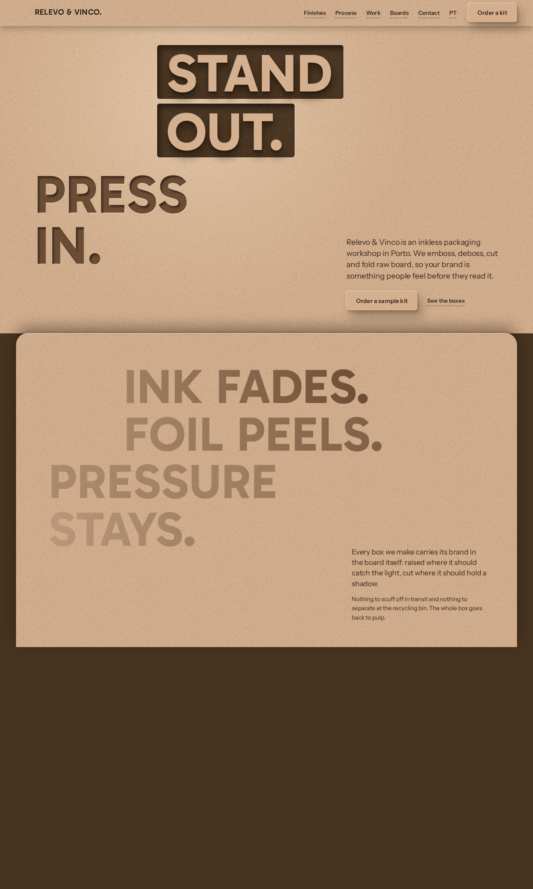

# UI Design System & Master Generation Blueprint: relevovinco-com

> **Relevo & Vinco — inkless packaging, pressed into the board** (https://relevovinco.com/) — Relevo & Vinco is an inkless packaging workshop in Porto. We emboss, deboss, die-cut and fold raw board so a brand is something people fe...



---

## 1. Executive Visual Persona & Design Archetype

- **Brand Essence & Persona**: **Relevo & Vinco — inkless packaging, pressed into the board** (`https://relevovinco.com/`). Relevo & Vinco is an inkless packaging workshop in Porto. We emboss, deboss, die-cut and fold raw board so a brand is something people fe...
- **Capture Provenance**: Live browser capture (`tier1_fast`, HTTP `200`, captured `2026-11-23`).
- **Visual Archetype**: **Light-Substrate Editorial & Modular Grid System (`#d4b08f` canvas, `#36261a` ink, `#6b4c34` accent)**.
- **Anti-AI-Slop Differentiators**:
  - **Live-Computed Chromatic Polarity**: Anchors the viewport in `#d4b08f` (live computed `body` `background-color` (`computed_styles.json`)) paired with `#36261a` primary typography and `#6b4c34` accents.
  - **Grounded Typographic Hierarchy**: Pairs `Instrument Sans` for display copy (`STAND OUT. PRESS IN.`) with `Instrument Sans` and not declared in live computed styles (uses primary stack / `ui-monospace`).
  - **Calibrated Spatial Grid & Motion**: Combines `1440px` container bounds (`gap: 8px`, padding `4px`) with `cubic-bezier(.3,.7,.2,1)` easing and Lenis Smooth Scroll (`data-lenis`), GSAP Timeline & ScrollTrigger.

---

## 2. Spatial Architecture & Modular Grid Mathematics


### Viewport Allocation & Container Geometry
- **Captured Viewport Dimensions**: Desktop `1440×2400px` (`assets/desktop.png`, clamped at 2400px live multi-section capture), Mobile `390×2400px` (`assets/mobile.png`, clamped at 2400px live multi-section capture).
- **Master Container Bounds**: `1440px` (full-bleed `100%` desktop stage measured on `1440px` viewport).
- **Canvas Lateral Padding & Spacing**: `4px` lateral canvas padding with `8px` grid gap.
- **Border Radius Scale**: `6px`, `var(--radius-1)`, `var(--radius-2)`, `var(--radius-3)`.

### Responsive Breakpoint Architecture
- **Desktop Layout**: Multi-column CSS Grid / Flexbox layout at `1440px` (`max-width: 1440px`, `gap: 8px`).
- **Mobile Layout**: Single-column vertical stack at `390px` viewport width with `4px` horizontal padding.
- **Extracted CSS Media Queries**: `@media (max-width:900px)`, `@media (prefers-reduced-motion:no-preference)`, `@media (max-width:767px)`, `@media (prefers-reduced-motion:no-preference)and (max-width:767px)`.

---

## 3. Color System, Materiality & Atmospheric Lighting

### Semantic Palette & Source Grounding
| Semantic Role | Ground-Truth Value | Extracted Live / CSS Source |
|---|---|---|
| **Primary Canvas Substrate** | `#d4b08f` | live computed `body` `background-color` (`computed_styles.json`) |
| **Primary Typography Ink** | `#36261a` | live computed `h1` `color` (`computed_styles.json`) |
| **Elevated Surface / Card Substrate** | `#d4b08f` | transparent/inherited card surface over live computed `body` `background-color` (`computed_styles.json`) |
| **Interactive Accent / Highlight** | `#6b4c34` | `var(--color-4)` in `:root` |
| **Secondary / Muted Copy** | `#36261a` | secondary opacity step of live computed `h1` `color` (`computed_styles.json`) |
| **Structural Hairline Border** | `#36261a` | hairline divider derived from secondary opacity step of live computed `h1` `color` (`computed_styles.json`) |
| **Variable Token (`--color-3`)** | `#f7e8d2` | `var(--color-3)` in `:root` |
| **Variable Token (`--color-5`)** | `#47331f` | `var(--color-5)` in `:root` |
| **Variable Token (`--color-6`)** | `#1f140b` | `var(--color-6)` in `:root` |

### Sanitized Root CSS Variables (`ui-ux.md` Ground Truth)
| Variable Name | Extracted Value | Semantic Role |
|---|---|---|
| `--color-1` | `#d4b08f` | Brand / Palette Token |
| `--color-2` | `#36261a` | Brand / Palette Token |
| `--color-3` | `#f7e8d2` | Brand / Palette Token |
| `--color-4` | `#6b4c34` | Brand / Palette Token |
| `--color-5` | `#47331f` | Brand / Palette Token |
| `--color-6` | `#1f140b` | Brand / Palette Token |
| `--font-1` | `"Gabarito", "Gabarito Fallback", "Arial", sans-serif` | Typography / Scale Token |
| `--font-2` | `"Instrument Sans", "Instrument Sans Fallback", "Arial", sans-serif` | Typography / Scale Token |
| `--radius-1` | `6px` | Elevation / Border Token |
| `--radius-2` | `50%` | Elevation / Border Token |
| `--radius-3` | `clamp(18px, 2.4vw, 34px)` | Elevation / Border Token |
| `--shadow-7` | `1px 1px 0 color-mix(in srgb, var(--color-3) 75%, transparent)` | Elevation / Border Token |
| `--shadow-14` | `10px 16px 18px color-mix(in srgb, var(--color-6) 32%, transparent)` | Elevation / Border Token |
| `--space-1` | `clamp(20px, 6.5vw, 96px)` | Layout / Spatial Grid Token |
| `--space-2` | `clamp(96px, 15vh, 180px)` | Layout / Spatial Grid Token |
| `--hero-cap` | `min(16vh, 11.2vw)` | Dimension / Scale Token |

---

## 4. Typographic Scale & Editorial Hierarchy

### Font Family Stacks
- **Display Typography**: `Instrument Sans`.
- **Primary Body Stack**: `Instrument Sans`.
- **Technical / Metadata Stack**: not declared in live computed styles (uses primary stack / `ui-monospace`).

### Typographic Scale & Rules (Live Computed & Stylesheet Grounded)
- **Hero Display (`H1`)**: live computed `h1` (`font-size: 34px`, `line-height: 52.7px`, `font-weight: 700`).
- **Section Heading (`H2`)**: live computed `h2` (`font-size: 25.5px`, `line-height: 39.525px`, `font-weight: 700`).
- **Body Copy**: live computed `body` (`font-size: 17px`, `line-height: 26.35px`, `font-weight: 400`); rule `p` (`font-size: clamp(26px,2.8vw,42px)`, `line-height: 1.12`).
- **Metadata & Navigation Labels**: live computed `nav/a` (`font-size: 17px`, `line-height: 26.35px`, `font-weight: 400`).

---

## 5. Choreographed Motion & Interaction Physics

### Primary Easing Curves
- **Extracted Timing Functions**: `cubic-bezier(.3,.7,.2,1)`, `cubic-bezier(.2,.7,.2,1)`, `cubic-bezier(.2,.75,.15,1)`.

### Per-Element Transition & Choreography Rules
- **Selector `.lenis.lenis-autoToggle`**: `transition: 1ms` extracted from `relevovinco-com` stylesheet.
- **Selector `.m-btn`**: `transition: box-shadow .22s cubic-bezier(.3,.7,.2,1),transform .22s cubic-...` extracted from `relevovinco-com` stylesheet.
- **Selector `.m-btn::after`**: `transition: opacity .22s` extracted from `relevovinco-com` stylesheet.
- **Extracted Easing Curve (`cubic-bezier(.3,.7,.2,1)`)**: Governs interactive state transitions across `<header.lenis>` and `<section.relief-defs__shade>`.
- **Runtime Interaction Engine**: Integrates Lenis Smooth Scroll (`data-lenis`), GSAP Timeline & ScrollTrigger, Three.js / WebGL Canvas Pipeline with `prefers-reduced-motion: reduce` fallback guards.

---

## 6. Component Wireframe & Structural DOM Map

### Visual Layout Schematic — Desktop (`1440px`, Grounded in `dom.html` & Landmark Bounding Boxes)
```
┌────────────────────────────────────────────────────────────────────────┐
│ DESKTOP VIEWPORT (1440px) — Relevo & Vinco — inkless packaging, presse │
│ ====================================================================== │
│ [ <header.lenis> (1440x68px)          | Finishes · Process · Work ·  ] │
│ ---------------------------------------------------------------------- │
│ | HERO STAGE: <section.relief-defs> (w=1440px)                       | │
│ | H1: STAND OUT. PRESS IN.                                           | │
│ | Substrate: #d4b08f | Ink: #36261a | Accent: #6b4c34                | │
│ ---------------------------------------------------------------------- │
│ | SHOWCASE GRID (<section.relief-defs__shad) max-w: 1440px           | │
│ | +------------------------------+  +------------------------------+ | │
│ | | Stand out. Press in.         |  | Ink fades. Foil peels. Press | | │
│ | +------------------------------+  +------------------------------+ | │
│ ---------------------------------------------------------------------- │
│ | DETAIL MODULE (<section.nav__bar>) — Six ways to say it wi         | │
│ ---------------------------------------------------------------------- │
│ [ FOOTER (<footer.m-text-3>   ) | https://relevovinco.com/             │
└────────────────────────────────────────────────────────────────────────┘
```

### Visual Layout Schematic — Mobile Reflow (`390px`)
```
┌────────────────────────────────────────────────────────────────────────┐
│ MOBILE VIEWPORT REFLOW (390px) — Single-Column Stack (gap: 8px)        │
│ ====================================================================== │
│ [ HEADER BAR (<header.lenis>          ) | Compact Menu (390px)         │
│ ---------------------------------------------------------------------- │
│ | HERO STAGE (<section.relief-defs>) — 390px Vertical Lead           | │
│ | H1: STAND OUT. PRESS IN.                                           | │
│ ---------------------------------------------------------------------- │
│ | SHOWCASE STACK (<section.relief-defs__) — 1-Col Stack              | │
│ | [ Item 1: Stand out. Press in.                                   ] | │
│ | [ Item 2: Ink fades. Foil peels. Pressure stays.                 ] | │
│ ---------------------------------------------------------------------- │
│ | DETAIL STACK (<section.nav__bar>) — 1-Col (Six ways to say it)     | │
│ ---------------------------------------------------------------------- │
│ [ FOOTER (<footer.m-text-3>   ) | Stacked 390px Colophon               │
└────────────────────────────────────────────────────────────────────────┘
```

### Granular DOM Region Breakdown
1. **Brand Header & Navigation Bar (<header.lenis> — `relevovinco-com`)**:
   - Landmark `<header class="lenis">` (`1440x68px`) hosting `Relevo & Vinco — inkless packaging, ` navigation (`Finishes · Process · Work · Boards · Contact`), DOM attributes (`data-fonts`, `data-part="layers"`, `data-part="tokens"`, `data-part="base"`), and stylesheet rule `after { box-sizing:border-box }`.
2. **Hero Stage & Focal Lead (<section.relief-defs> — `STAND OUT. PRESS IN.`)**:
   - Landmark `<section class="relief-defs">` presenting display lead `STAND OUT. PRESS IN.` and copy excerpt *"Relevo & Vinco is an inkless packaging workshop in Porto. We embo"* over `#d4b08f` canvas and `#36261a` ink.
3. **Primary Showcase & Content Grid (<section.relief-defs__shade> — `Stand out. Press in.`)**:
   - Landmark `<section class="relief-defs__shade">` rendering section `Stand out. Press in.` with copy *"Order a sample kit"*, asset references (`favicon.ico`, `favicon.svg`, `apple-touch-icon.png`, `gabarito-a94f9001.woff2`), and grid rule `html { -webkit-text-size-adjust:100%;text-size-adjust:100% }`.
4. **Interactive Detail & Feature Matrix (<section.nav__bar> — `Ink fades. Foil peels. Pressure st`)**:
   - Landmark `<section class="nav__bar">` framing `Ink fades. Foil peels. Pressure stays.` and `Six ways to say it without ink` (*"Every box we make carries its brand in the board itself: raised w"*) with `#d4b08f` surface cards, `#6b4c34` accents, and `img { display:block;max-width:100%;height:auto }`.
5. **Colophon & Global Directory Footer (<footer.m-text-3> — `https://relevovinco.com/`)**:
   - Landmark `<footer class="m-text-3">` anchoring `Relevo & Vinco — inkless packagi` footer links (`Finishes · Process · Work · Boards · Contact`), copy *"Nothing to scuff off in transit and nothing to separate at t"*, and `#36261a` structural dividers.

---

## 7. Master Zero-Shot AI Generation Prompt

```markdown
# Master Zero-Shot Frontend Generation Prompt: relevovinco-com (Relevo & Vinco — inkless packaging, pressed into the board)

You are a principal frontend architect and design systems engineer. Build a complete, production-ready web application replicating the exact design system, DOM landmarks, typographic hierarchy, color tokens, and motion physics of `relevovinco-com` (**Relevo & Vinco — inkless packaging, pressed into the board** — `https://relevovinco.com/`).

### 1. Visual Archetype & Anti-AI-Slop Mandates
- **Archetype**: Light-Substrate Editorial & Modular Grid System (`#d4b08f` canvas, `#36261a` ink, `#6b4c34` accent).
- **Identity & Domain Context**: Relevo & Vinco is an inkless packaging workshop in Porto. We emboss, deboss, die-cut and fold raw board so a brand is something people fe...
- **Primary Substrate**: `#d4b08f` (live computed `body` `background-color` (`computed_styles.json`)), **Primary Ink**: `#36261a`, **Accent / Highlight**: `#6b4c34`.
- **Site-Specific Differentiators**:
  - **Live-Computed Chromatic Polarity**: Anchors the viewport in `#d4b08f` (live computed `body` `background-color` (`computed_styles.json`)) paired with `#36261a` primary typography and `#6b4c34` accents.
  - **Grounded Typographic Hierarchy**: Pairs `Instrument Sans` for display copy (`STAND OUT. PRESS IN.`) with `Instrument Sans` and not declared in live computed styles (uses primary stack / `ui-monospace`).
  - **Calibrated Spatial Grid & Motion**: Combines `1440px` container bounds (`gap: 8px`, padding `4px`) with `cubic-bezier(.3,.7,.2,1)` easing and Lenis Smooth Scroll (`data-lenis`), GSAP Timeline & ScrollTrigger.

### 2. Ground-Truth CSS Variables (`:root` Token Contract)
Declare and consume these exact custom properties extracted from `relevovinco-com` in your global stylesheet:

:root {
  /* Relevo & Vinco — inkless packaging, pressed into the board (relevovinco-com) — Live-Grounded CSS Variables */
  --color-1: #d4b08f; /* Brand / Palette Token (relevovinco-com) */
  --color-2: #36261a; /* Brand / Palette Token (relevovinco-com) */
  --color-3: #f7e8d2; /* Brand / Palette Token (relevovinco-com) */
  --color-4: #6b4c34; /* Brand / Palette Token (relevovinco-com) */
  --color-5: #47331f; /* Brand / Palette Token (relevovinco-com) */
  --color-6: #1f140b; /* Brand / Palette Token (relevovinco-com) */
  --font-1: "Gabarito", "Gabarito Fallback", "Arial", sans-serif; /* Typography / Scale Token (relevovinco-com) */
  --font-2: "Instrument Sans", "Instrument Sans Fallback", "Arial", sans-serif; /* Typography / Scale Token (relevovinco-com) */
  --radius-1: 6px; /* Elevation / Border Token (relevovinco-com) */
  --radius-2: 50%; /* Elevation / Border Token (relevovinco-com) */
  --radius-3: clamp(18px, 2.4vw, 34px); /* Elevation / Border Token (relevovinco-com) */
  --shadow-7: 1px 1px 0 color-mix(in srgb, var(--color-3) 75%, transparent); /* Elevation / Border Token (relevovinco-com) */
  --shadow-14: 10px 16px 18px color-mix(in srgb, var(--color-6) 32%, transparent); /* Elevation / Border Token (relevovinco-com) */
  --space-1: clamp(20px, 6.5vw, 96px); /* Layout / Spatial Grid Token (relevovinco-com) */
  --space-2: clamp(96px, 15vh, 180px); /* Layout / Spatial Grid Token (relevovinco-com) */
  --hero-cap: min(16vh, 11.2vw); /* Dimension / Scale Token (relevovinco-com) */
}

### 3. Semantic Color & Materiality Contract
Map every surface, ink, and border strictly to these source-grounded tokens:
- **Primary Canvas Substrate**: `#d4b08f` — grounded in live computed `body` `background-color` (`computed_styles.json`)
- **Primary Typography Ink**: `#36261a` — grounded in live computed `h1` `color` (`computed_styles.json`)
- **Elevated Surface / Card Substrate**: `#d4b08f` — grounded in transparent/inherited card surface over live computed `body` `background-color` (`computed_styles.json`)
- **Interactive Accent / Highlight**: `#6b4c34` — grounded in `var(--color-4)` in `:root`
- **Secondary / Muted Copy**: `#36261a` — grounded in secondary opacity step of live computed `h1` `color` (`computed_styles.json`)
- **Structural Hairline Border**: `#36261a` — grounded in hairline divider derived from secondary opacity step of live computed `h1` `color` (`computed_styles.json`)
- **Variable Token (`--color-3`)**: `#f7e8d2` — grounded in `var(--color-3)` in `:root`
- **Variable Token (`--color-5`)**: `#47331f` — grounded in `var(--color-5)` in `:root`
- **Variable Token (`--color-6`)**: `#1f140b` — grounded in `var(--color-6)` in `:root`

### 4. Spatial Grid, Container Bounds & Responsive Breakpoints
- **Desktop Viewport Reference**: `1440×2400px` (clamped at 2400px live multi-section capture, `1440px` standard desktop width).
- **Mobile Viewport Reference**: `390×2400px` (clamped at 2400px live multi-section capture, `390px` standard mobile width).
- **Container Max-Width**: `1440px` (full-bleed `100%` desktop stage measured on `1440px` viewport)
- **Padding & Gutters**: `4px` lateral canvas padding with `8px` grid gap
- **Desktop Grid**: Multi-column CSS Grid / Flexbox layout at `1440px` (`max-width: 1440px`, `gap: 8px`)
- **Mobile Adaptation**: Single-column vertical stack at `390px` viewport width with `4px` horizontal padding
- **Media Queries**: `@media (max-width:900px)`, `@media (prefers-reduced-motion:no-preference)`, `@media (max-width:767px)`, `@media (prefers-reduced-motion:no-preference)and (max-width:767px)`
- **Corner Radii**: `6px`, `var(--radius-1)`, `var(--radius-2)`, `var(--radius-3)`

### 5. Typography & Editorial Scale Contract
- **Display Font Stack**: `Instrument Sans`
- **Body Font Stack**: `Instrument Sans`
- **Monospace / Technical Font Stack**: not declared in live computed styles (uses primary stack / `ui-monospace`)
- **H1 Display Rule**: live computed `h1` (`font-size: 34px`, `line-height: 52.7px`, `font-weight: 700`)
- **H2 Section Rule**: live computed `h2` (`font-size: 25.5px`, `line-height: 39.525px`, `font-weight: 700`)
- **Body Copy Rule**: live computed `body` (`font-size: 17px`, `line-height: 26.35px`, `font-weight: 400`); rule `p` (`font-size: clamp(26px,2.8vw,42px)`, `line-height: 1.12`)
- **Metadata & Index Rule**: live computed `nav/a` (`font-size: 17px`, `line-height: 26.35px`, `font-weight: 400`)

### 6. Component Hierarchy, Verbatim Copy & Real DOM Landmarks
Scaffold `relevovinco-com` (`Relevo & Vinco — inkless packaging, pressed into the board`) with these exact structural regions, extracted copy, and CSS rules from `dom.html`:
1. **Brand Header & Navigation Bar (<header.lenis> — `relevovinco-com`)**:
   - DOM & Selectors: Landmark `<header class="lenis">` (`1440x68px`) hosting `Relevo & Vinco — inkless packaging, ` navigation (`Finishes · Process · Work · Boards · Contact`), DOM attributes (`data-fonts`, `data-part="layers"`, `data-part="tokens"`, `data-part="base"`), and stylesheet rule `after { box-sizing:border-box }`.
   - Responsive Contract: Header `Brand Header & Navigation Bar (<header.lenis> — `relevovinco-com`)` (`relevovinco-com`) adapts across `@media (max-width:900px)`, `@media (prefers-reduced-motion:no-preference)`, `@media (max-width:767px)`, `@media (prefers-reduced-motion:no-preference)and (max-width:767px)` with `cubic-bezier(.3,.7,.2,1)`, `cubic-bezier(.2,.7,.2,1)`, `cubic-bezier(.2,.75,.15,1)` transitions and links `Finishes · Process · Work · Boards · Contact`.
2. **Hero Stage & Focal Lead (<section.relief-defs> — `STAND OUT. PRESS IN.`)**:
   - DOM & Selectors: Landmark `<section class="relief-defs">` presenting display lead `STAND OUT. PRESS IN.` and copy excerpt *"Relevo & Vinco is an inkless packaging workshop in Porto. We embo"* over `#d4b08f` canvas and `#36261a` ink.
   - Responsive Contract: Hero stage (`1440×2400px` desktop / `390×2400px` mobile) sets `#d4b08f` background with `#36261a` headline `STAND OUT. PRESS IN.`.
3. **Primary Showcase & Content Grid (<section.relief-defs__shade> — `Stand out. Press in.`)**:
   - DOM & Selectors: Landmark `<section class="relief-defs__shade">` rendering section `Stand out. Press in.` with copy *"Order a sample kit"*, asset references (`favicon.ico`, `favicon.svg`, `apple-touch-icon.png`, `gabarito-a94f9001.woff2`), and grid rule `html { -webkit-text-size-adjust:100%;text-size-adjust:100% }`.
   - Responsive Contract: Showcase grid `Primary Showcase & Content Grid (<section.relief-defs__shade> — `Stand out. Press in.`)` applies Multi-column CSS Grid / Flexbox layout at `1440px` (`max-width: 1440px`, `gap: 8px`) on desktop and Single-column vertical stack at `390px` viewport width with `4px` horizontal padding on mobile.
4. **Interactive Detail & Feature Matrix (<section.nav__bar> — `Ink fades. Foil peels. Pressure st`)**:
   - DOM & Selectors: Landmark `<section class="nav__bar">` framing `Ink fades. Foil peels. Pressure stays.` and `Six ways to say it without ink` (*"Every box we make carries its brand in the board itself: raised w"*) with `#d4b08f` surface cards, `#6b4c34` accents, and `img { display:block;max-width:100%;height:auto }`.
   - Responsive Contract: Detail module `Interactive Detail & Feature Matrix (<section.nav__bar> — `Ink fades. Foil peels. Pressure st`)` uses `6px`, `var(--radius-1)`, `var(--radius-2)`, `var(--radius-3)` radii, `#6b4c34` highlights, and assets (favicon.ico, favicon.svg, apple-touch-icon.png).
5. **Colophon & Global Directory Footer (<footer.m-text-3> — `https://relevovinco.com/`)**:
   - DOM & Selectors: Landmark `<footer class="m-text-3">` anchoring `Relevo & Vinco — inkless packagi` footer links (`Finishes · Process · Work · Boards · Contact`), copy *"Nothing to scuff off in transit and nothing to separate at t"*, and `#36261a` structural dividers.
   - Responsive Contract: Footer `Colophon & Global Directory Footer (<footer.m-text-3> — `https://relevovinco.com/`)` aligns to `1440px` (full-bleed `100%` desktop stage measured on `1440px` viewport) with `4px` lateral canvas padding with `8px` grid gap and attributes (data-fonts, data-part="layers", data-part="tokens").

#### Verbatim DOM Copy Excerpts (`dom.html`)
- Copy Excerpt 1: *"Relevo & Vinco is an inkless packaging workshop in Porto. We emboss, deboss, cut a..."*
- Copy Excerpt 2: *"Order a sample kit"*
- Copy Excerpt 3: *"Every box we make carries its brand in the board itself: raised where it should ca..."*
- Copy Excerpt 4: *"Nothing to scuff off in transit and nothing to separate at the recycling bin. The..."*

### 7. Motion, Extracted Stylesheet Rules & Interaction Choreography
- **Primary Easing Functions**: `cubic-bezier(.3,.7,.2,1)`, `cubic-bezier(.2,.7,.2,1)`, `cubic-bezier(.2,.75,.15,1)`
- **Extracted Stylesheet Rules (`relevovinco-com`)**:
- `after { box-sizing:border-box }`
- `html { -webkit-text-size-adjust:100%;text-size-adjust:100% }`
- `img { display:block;max-width:100%;height:auto }`
- `select { font:inherit;color:inherit }`
- `focus-visible { outline:3px solid var(--color-2);outline-offset:3px }`
- **Per-Selector Transition Rules**:
- **Selector `.lenis.lenis-autoToggle`**: `transition: 1ms` extracted from `relevovinco-com` stylesheet.
- **Selector `.m-btn`**: `transition: box-shadow .22s cubic-bezier(.3,.7,.2,1),transform .22s cubic-...` extracted from `relevovinco-com` stylesheet.
- **Selector `.m-btn::after`**: `transition: opacity .22s` extracted from `relevovinco-com` stylesheet.
- **Extracted Easing Curve (`cubic-bezier(.3,.7,.2,1)`)**: Governs interactive state transitions across `<header.lenis>` and `<section.relief-defs__shade>`.
- **Runtime Interaction Engine**: Integrates Lenis Smooth Scroll (`data-lenis`), GSAP Timeline & ScrollTrigger, Three.js / WebGL Canvas Pipeline with `prefers-reduced-motion: reduce` fallback guards.

### 8. Technical Deliverables
- Implement in Next.js (App Router) with TypeScript and Tailwind CSS consuming the `:root` custom properties defined above for `relevovinco-com`.
- Reproduce both the `1440px` desktop architecture and `390px` mobile breakpoint transitions, preserving semantic HTML5 landmarks (`<header>`, `<nav>`, `<main>`, `<section>`, `<footer>`) and `prefers-reduced-motion` accessibility guards.
```
