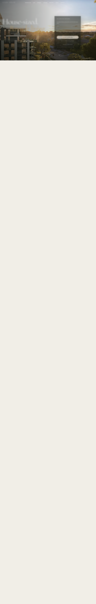

# UI Design System & Master Generation Blueprint: residences-loamhouse-com-au

> **Loam House — Sandringham** (https://residences.loamhouse.com.au) — Loam House — house-sized residences in Sandringham. Final release now selling.



---

## 1. Executive Visual Persona & Design Archetype

- **Brand Essence & Persona**: **Loam House — Sandringham** (`https://residences.loamhouse.com.au`). Loam House — house-sized residences in Sandringham. Final release now selling.
- **Visual Archetype**: **High-Contrast Obsidian / Atmospheric Design System (`#1e211d` canvas, `#fbfaf6` ink, `#8d4f36` accent)**.
- **Anti-AI-Slop Differentiators**:
  - **Source-Grounded Chromatic Polarity**: Anchors the viewport in `#1e211d` (`var(--ink)` in `:root`) paired with `#fbfaf6` primary typography and `#8d4f36` accents.
  - **Extracted Typographic Hierarchy**: Pairs `Cormorant Garamond` for display copy (`House-sized. Bayside living.`) with `DM Sans` and not declared in static CSS (uses primary stack / `ui-monospace`).
  - **Calibrated Spatial Grid & Motion**: Combines `640px` container bounds (`gap: 10px`, padding `9px`) with `cubic-bezier(.3,1.4,.4,1)` easing and GSAP Timeline & ScrollTrigger, Three.js / WebGL Canvas Pipeline.

---

## 2. Spatial Architecture & Modular Grid Mathematics


### Viewport Allocation & Container Geometry
- **Captured Viewport Dimensions**: Desktop `1440×9000px` (`assets/desktop.png`, full-page scroll capture), Mobile `390×2400px` (`assets/mobile.png`, capped at 2400px multi-section capture).
- **Master Container Bounds**: `640px` extracted from `residences-loamhouse-com-au` stylesheet.
- **Canvas Lateral Padding & Spacing**: `9px` lateral canvas padding with `10px` grid gap.
- **Border Radius Scale**: `999px`, `2px`, `50%`.

### Responsive Breakpoint Architecture
- **Desktop Layout**: Multi-column CSS Grid / Flexbox layout at `1440px` (`max-width: 640px`, `gap: 10px`).
- **Mobile Layout**: Single-column vertical stack at `390px` viewport width with `9px` horizontal padding.
- **Extracted CSS Media Queries**: `@media (prefers-reduced-motion:reduce)`, `@media (max-width:800px)`, `@media (min-width:801px)`, `@media (max-width:1050px)`.

---

## 3. Color System, Materiality & Atmospheric Lighting

### Semantic Palette & Source Grounding
| Semantic Role | Ground-Truth Value | Extracted CSS Source / Selector |
|---|---|---|
| **Primary Canvas Substrate** | `#1e211d` | `var(--ink)` in `:root` |
| **Primary Typography Ink** | `#f1eee7` | `var(--paper)` in `:root` |
| **Elevated Surface / Card Substrate** | `#fbfaf6` | `var(--chalk)` in `:root` |
| **Interactive Accent / Highlight** | `#8d4f36` | `var(--clay)` in `:root` |
| **Secondary / Muted Copy** | `#626852` | `var(--olive)` in `:root` |
| **Structural Hairline Border** | `#2c3128` | `.blabel { fill: #2c3128 }` |

### Sanitized Root CSS Variables (`ui-ux.md` Ground Truth)
| Variable Name | Extracted Value | Semantic Role |
|---|---|---|
| `--ink` | `#1e211d` | Typography Ink Token |
| `--paper` | `#f1eee7` | Canvas / Surface Token |
| `--chalk` | `#fbfaf6` | Color / Atmospheric Token |
| `--clay` | `#8d4f36` | Color / Atmospheric Token |
| `--olive` | `#626852` | Color / Atmospheric Token |
| `--line` | `rgba(30,33,29,.18)` | Color / Atmospheric Token |
| `--serif` | `"Cormorant Garamond",Georgia,serif` | Typography / Scale Token |
| `--hero-serif` | `"Cormorant Garamond",Georgia,serif` | Typography / Scale Token |
| `--sans` | `"DM Sans",Arial,sans-serif` | Typography / Scale Token |
| `--hgut` | `6vw` | Dimension / Scale Token |
| `--scan` | `.2` | Design System Custom Token |
| `--mob-pos` | `36% center` | Dimension / Scale Token |
| `--pulse-period` | `4.1s` | Motion / Timing Token |
| `--ping-scale` | `4.2` | Design System Custom Token |
| `--ping-op` | `0.36` | Design System Custom Token |
| `--num-op` | `1` | Design System Custom Token |

---

## 4. Typographic Scale & Editorial Hierarchy

### Font Family Stacks
- **Display Typography**: `Cormorant Garamond`.
- **Primary Body Stack**: `DM Sans`.
- **Technical / Metadata Stack**: not declared in static CSS (uses primary stack / `ui-monospace`).

### Typographic Scale & Rules (Extracted from Stylesheet & Variables)
- **Hero Display (`H1`)**: rule `h1` (`font-size: clamp(76px,8.5vw,138px)`, `line-height: .74`, `letter-spacing: -.045em`, `font-weight: 300`).
- **Section Heading (`H2`)**: rule `h2` (`font-size: clamp(52px,8vw,120px)`, `line-height: .9`, `letter-spacing: -.02em`, `font-weight: 400`).
- **Body Copy**: rule `p` (`font-size: clamp(15px,1.3vw,19px)`, `line-height: 1.6`, `font-weight: 300`).
- **Metadata & Navigation Labels**: not explicitly declared on tag in static CSS (stylesheet font-size ladder: `13px`, `9.5px`, `11px`, `6.5px`, `5.5px`).

---

## 5. Choreographed Motion & Interaction Physics

### Primary Easing Curves
- **Extracted Timing Functions**: `cubic-bezier(.3,1.4,.4,1)`, `cubic-bezier(.4,0,.2,1)`, `cubic-bezier(.65,0,.35,1)`.

### Per-Element Transition & Choreography Rules
- **Selector `.busstop`**: `transition: opacity .7s ease` extracted from `residences-loamhouse-com-au` stylesheet.
- **Selector `.dot .core`**: `transition: transform .4s cubic-bezier(.3,1.4,.4,1)` extracted from `residences-loamhouse-com-au` stylesheet.
- **Selector `.dot .halo`**: `transition: opacity .45s` extracted from `residences-loamhouse-com-au` stylesheet.
- **Extracted Easing Curve (`cubic-bezier(.3,1.4,.4,1)`)**: Governs interactive state transitions across `<header.site-header>` and `<section.form-chapter>`.
- **Runtime Interaction Engine**: Integrates GSAP Timeline & ScrollTrigger, Three.js / WebGL Canvas Pipeline with `prefers-reduced-motion: reduce` fallback guards.

---

## 6. Component Wireframe & Structural DOM Map

### Visual Layout Schematic (Grounded in `dom.html` — `1440px` Desktop & `390px` Mobile Reflow)
```
┌────────────────────────────────────────────────────────────────────────┐
│ DESKTOP VIEWPORT (1440px) — Loam House — Sandringham                   │
│ ====================================================================== │
│ [ <header.site-header>     | Proposition · Size · Storage · Finishe ]  │
│ ---------------------------------------------------------------------- │
│ | HERO STAGE: <section.hero>                                       |   │
│ | H1: House-sized. Bayside living.                                 |   │
│ | Substrate: #1e211d    | Ink: #fbfaf6    | Accent: #8d4f36        |   │
│ ---------------------------------------------------------------------- │
│ | SHOWCASE GRID (<section.form-chapter>    ) max-w: 640px          |   │
│ | +------------------------------+  +------------------------------+ | │
│ | | Leave the upkeep. Keep the l |  | A backyard oasis, without th | | │
│ | +------------------------------+  +------------------------------+ | │
│ ---------------------------------------------------------------------- │
│ | MOBILE VIEWPORT REFLOW (390px) — Single-Column Stack (gap: 10px  ) | │
│ | [<header.site-heade] -> [<section.hero>] -> [<section.form-chap] |   │
│ ---------------------------------------------------------------------- │
│ [ FOOTER (<footer.pl-panels>    ) | https://residences.loamhouse.com.a │
└────────────────────────────────────────────────────────────────────────┘
```

### Granular DOM Region Breakdown
1. **Brand Header & Navigation Bar (<header.site-header> — `residences-loamhouse-com-au`)**:
   - Landmark `<header class="site-header">` hosting `Loam House — Sandringham` navigation (`Proposition · Size · Storage · Finishes · Precinct`), DOM attributes (`data-preloader`, `data-pl-pct`, `data-header`, `data-open-calendly`), and stylesheet rule `stage { position:absolute;inset:0;overflow:hidden }`.
2. **Hero Stage & Focal Lead (<section.hero> — `House-sized. Bayside living.`)**:
   - Landmark `<section class="hero chapter">` presenting display lead `House-sized. Bayside living.` and copy excerpt *"Download the brochure Brochure"* over `#1e211d` canvas and `#fbfaf6` ink.
3. **Primary Showcase & Content Grid (<section.form-chapter> — `Leave the upkeep. Keep the life.`)**:
   - Landmark `<section class="form-chapter chapter">` rendering section `Leave the upkeep. Keep the life.` with copy *"Download the brochure"*, asset references (`clientParamBuilder.bundle.js`, `clarity.js`, `yed6eroa3m`, `1440095636442948`), and grid rule `map { position:absolute;inset:0;width:100%;height:100%;display:block;touch-act... }`.
4. **Interactive Detail & Feature Matrix (<section.cine> — `A backyard oasis, without the mowi`)**:
   - Landmark `<section class="cine chapter">` framing `A backyard oasis, without the mowing.` and `Everything you need. Nothing you don’t.` (*"Book an appointment Appointment"*) with `#fbfaf6` surface cards, `#8d4f36` accents, and `.station circle { fill:fff;stroke:40453b;stroke-width:1;pointer-events:none }`.
5. **Colophon & Global Directory Footer (<footer.pl-panels> — `https://residences.loamhouse.com.au`)**:
   - Landmark `<footer class="pl-panels">` anchoring `Loam House — Sandringham` footer links (`Proposition · Size · Storage · Finishes · Precinct`), copy *"Book an appointment"*, and `#2c3128` structural dividers.

---

## 7. Master Zero-Shot AI Generation Prompt

```markdown
# Master Zero-Shot Frontend Generation Prompt: residences-loamhouse-com-au (Loam House — Sandringham)

You are a principal frontend architect and design systems engineer. Build a complete, production-ready web application replicating the exact design system, DOM landmarks, typographic hierarchy, color tokens, and motion physics of `residences-loamhouse-com-au` (**Loam House — Sandringham** — `https://residences.loamhouse.com.au`).

### 1. Visual Archetype & Anti-AI-Slop Mandates
- **Archetype**: High-Contrast Obsidian / Atmospheric Design System (`#1e211d` canvas, `#fbfaf6` ink, `#8d4f36` accent).
- **Identity & Domain Context**: Loam House — house-sized residences in Sandringham. Final release now selling.
- **Primary Substrate**: `#1e211d` (`var(--ink)` in `:root`), **Primary Ink**: `#fbfaf6`, **Accent / Highlight**: `#8d4f36`.
- **Site-Specific Differentiators**:
  - **Source-Grounded Chromatic Polarity**: Anchors the viewport in `#1e211d` (`var(--ink)` in `:root`) paired with `#fbfaf6` primary typography and `#8d4f36` accents.
  - **Extracted Typographic Hierarchy**: Pairs `Cormorant Garamond` for display copy (`House-sized. Bayside living.`) with `DM Sans` and not declared in static CSS (uses primary stack / `ui-monospace`).
  - **Calibrated Spatial Grid & Motion**: Combines `640px` container bounds (`gap: 10px`, padding `9px`) with `cubic-bezier(.3,1.4,.4,1)` easing and GSAP Timeline & ScrollTrigger, Three.js / WebGL Canvas Pipeline.

### 2. Ground-Truth CSS Variables (`:root` Token Contract)
Declare and consume these exact custom properties extracted from `residences-loamhouse-com-au` in your global stylesheet:

:root {
  /* Loam House — Sandringham (residences-loamhouse-com-au) — Ground-Truth Extracted CSS Variables */
  --ink: #1e211d; /* Typography Ink Token (residences-loamhouse-com-au) */
  --paper: #f1eee7; /* Canvas / Surface Token (residences-loamhouse-com-au) */
  --chalk: #fbfaf6; /* Color / Atmospheric Token (residences-loamhouse-com-au) */
  --clay: #8d4f36; /* Color / Atmospheric Token (residences-loamhouse-com-au) */
  --olive: #626852; /* Color / Atmospheric Token (residences-loamhouse-com-au) */
  --line: rgba(30,33,29,.18); /* Color / Atmospheric Token (residences-loamhouse-com-au) */
  --serif: "Cormorant Garamond",Georgia,serif; /* Typography / Scale Token (residences-loamhouse-com-au) */
  --hero-serif: "Cormorant Garamond",Georgia,serif; /* Typography / Scale Token (residences-loamhouse-com-au) */
  --sans: "DM Sans",Arial,sans-serif; /* Typography / Scale Token (residences-loamhouse-com-au) */
  --hgut: 6vw; /* Dimension / Scale Token (residences-loamhouse-com-au) */
  --scan: .2; /* Design System Custom Token (residences-loamhouse-com-au) */
  --mob-pos: 36% center; /* Dimension / Scale Token (residences-loamhouse-com-au) */
  --pulse-period: 4.1s; /* Motion / Timing Token (residences-loamhouse-com-au) */
  --ping-scale: 4.2; /* Design System Custom Token (residences-loamhouse-com-au) */
  --ping-op: 0.36; /* Design System Custom Token (residences-loamhouse-com-au) */
  --num-op: 1; /* Design System Custom Token (residences-loamhouse-com-au) */
}

### 3. Semantic Color & Materiality Contract
Map every surface, ink, and border strictly to these source-grounded tokens:
- **Primary Canvas Substrate**: `#1e211d` — grounded in `var(--ink)` in `:root`
- **Primary Typography Ink**: `#f1eee7` — grounded in `var(--paper)` in `:root`
- **Elevated Surface / Card Substrate**: `#fbfaf6` — grounded in `var(--chalk)` in `:root`
- **Interactive Accent / Highlight**: `#8d4f36` — grounded in `var(--clay)` in `:root`
- **Secondary / Muted Copy**: `#626852` — grounded in `var(--olive)` in `:root`
- **Structural Hairline Border**: `#2c3128` — grounded in `.blabel { fill: #2c3128 }`

### 4. Spatial Grid, Container Bounds & Responsive Breakpoints
- **Desktop Viewport Reference**: `1440×9000px` (full-page scroll capture, `1440px` standard desktop width).
- **Mobile Viewport Reference**: `390×2400px` (capped at 2400px multi-section capture, `390px` standard mobile width).
- **Container Max-Width**: `640px` extracted from `residences-loamhouse-com-au` stylesheet
- **Padding & Gutters**: `9px` lateral canvas padding with `10px` grid gap
- **Desktop Grid**: Multi-column CSS Grid / Flexbox layout at `1440px` (`max-width: 640px`, `gap: 10px`)
- **Mobile Adaptation**: Single-column vertical stack at `390px` viewport width with `9px` horizontal padding
- **Media Queries**: `@media (prefers-reduced-motion:reduce)`, `@media (max-width:800px)`, `@media (min-width:801px)`, `@media (max-width:1050px)`
- **Corner Radii**: `999px`, `2px`, `50%`

### 5. Typography & Editorial Scale Contract
- **Display Font Stack**: `Cormorant Garamond`
- **Body Font Stack**: `DM Sans`
- **Monospace / Technical Font Stack**: not declared in static CSS (uses primary stack / `ui-monospace`)
- **H1 Display Rule**: rule `h1` (`font-size: clamp(76px,8.5vw,138px)`, `line-height: .74`, `letter-spacing: -.045em`, `font-weight: 300`)
- **H2 Section Rule**: rule `h2` (`font-size: clamp(52px,8vw,120px)`, `line-height: .9`, `letter-spacing: -.02em`, `font-weight: 400`)
- **Body Copy Rule**: rule `p` (`font-size: clamp(15px,1.3vw,19px)`, `line-height: 1.6`, `font-weight: 300`)
- **Metadata & Index Rule**: not explicitly declared on tag in static CSS (stylesheet font-size ladder: `13px`, `9.5px`, `11px`, `6.5px`, `5.5px`)

### 6. Component Hierarchy, Verbatim Copy & Real DOM Landmarks
Scaffold `residences-loamhouse-com-au` (`Loam House — Sandringham`) with these exact structural regions, extracted copy, and CSS rules from `dom.html`:
1. **Brand Header & Navigation Bar (<header.site-header> — `residences-loamhouse-com-au`)**:
   - DOM & Selectors: Landmark `<header class="site-header">` hosting `Loam House — Sandringham` navigation (`Proposition · Size · Storage · Finishes · Precinct`), DOM attributes (`data-preloader`, `data-pl-pct`, `data-header`, `data-open-calendly`), and stylesheet rule `stage { position:absolute;inset:0;overflow:hidden }`.
   - Responsive Contract: Header `Brand Header & Navigation Bar (<header.site-header> — `residences-loamhouse-com-au`)` (`residences-loamhouse-com-au`) adapts across `@media (prefers-reduced-motion:reduce)`, `@media (max-width:800px)`, `@media (min-width:801px)`, `@media (max-width:1050px)` with `cubic-bezier(.3,1.4,.4,1)`, `cubic-bezier(.4,0,.2,1)`, `cubic-bezier(.65,0,.35,1)` transitions and links `Proposition · Size · Storage · Finishes · Precinct`.
2. **Hero Stage & Focal Lead (<section.hero> — `House-sized. Bayside living.`)**:
   - DOM & Selectors: Landmark `<section class="hero chapter">` presenting display lead `House-sized. Bayside living.` and copy excerpt *"Download the brochure Brochure"* over `#1e211d` canvas and `#fbfaf6` ink.
   - Responsive Contract: Hero stage (`1440×9000px` desktop / `390×2400px` mobile) sets `#1e211d` background with `#fbfaf6` headline `House-sized. Bayside living.`.
3. **Primary Showcase & Content Grid (<section.form-chapter> — `Leave the upkeep. Keep the life.`)**:
   - DOM & Selectors: Landmark `<section class="form-chapter chapter">` rendering section `Leave the upkeep. Keep the life.` with copy *"Download the brochure"*, asset references (`clientParamBuilder.bundle.js`, `clarity.js`, `yed6eroa3m`, `1440095636442948`), and grid rule `map { position:absolute;inset:0;width:100%;height:100%;display:block;touch-act... }`.
   - Responsive Contract: Showcase grid `Primary Showcase & Content Grid (<section.form-chapter> — `Leave the upkeep. Keep the life.`)` applies Multi-column CSS Grid / Flexbox layout at `1440px` (`max-width: 640px`, `gap: 10px`) on desktop and Single-column vertical stack at `390px` viewport width with `9px` horizontal padding on mobile.
4. **Interactive Detail & Feature Matrix (<section.cine> — `A backyard oasis, without the mowi`)**:
   - DOM & Selectors: Landmark `<section class="cine chapter">` framing `A backyard oasis, without the mowing.` and `Everything you need. Nothing you don’t.` (*"Book an appointment Appointment"*) with `#fbfaf6` surface cards, `#8d4f36` accents, and `.station circle { fill:fff;stroke:40453b;stroke-width:1;pointer-events:none }`.
   - Responsive Contract: Detail module `Interactive Detail & Feature Matrix (<section.cine> — `A backyard oasis, without the mowi`)` uses `999px`, `2px`, `50%` radii, `#8d4f36` highlights, and assets (clientParamBuilder.bundle.js, clarity.js, yed6eroa3m).
5. **Colophon & Global Directory Footer (<footer.pl-panels> — `https://residences.loamhouse.com.au`)**:
   - DOM & Selectors: Landmark `<footer class="pl-panels">` anchoring `Loam House — Sandringham` footer links (`Proposition · Size · Storage · Finishes · Precinct`), copy *"Book an appointment"*, and `#2c3128` structural dividers.
   - Responsive Contract: Footer `Colophon & Global Directory Footer (<footer.pl-panels> — `https://residences.loamhouse.com.au`)` aligns to `640px` extracted from `residences-loamhouse-com-au` stylesheet with `9px` lateral canvas padding with `10px` grid gap and attributes (data-preloader, data-pl-pct, data-header).

#### Verbatim DOM Copy Excerpts (`dom.html`)
- Copy Excerpt 1: *"Download the brochure Brochure"*
- Copy Excerpt 2: *"Download the brochure"*
- Copy Excerpt 3: *"Book an appointment Appointment"*
- Copy Excerpt 4: *"Book an appointment"*

### 7. Motion, Extracted Stylesheet Rules & Interaction Choreography
- **Primary Easing Functions**: `cubic-bezier(.3,1.4,.4,1)`, `cubic-bezier(.4,0,.2,1)`, `cubic-bezier(.65,0,.35,1)`
- **Extracted Stylesheet Rules (`residences-loamhouse-com-au`)**:
- `stage { position:absolute;inset:0;overflow:hidden }`
- `map { position:absolute;inset:0;width:100%;height:100%;display:block;touch-act... }`
- `.station circle { fill:fff;stroke:40453b;stroke-width:1;pointer-events:none }`
- `.stlabel { font-family:"DM Sans",sans-serif;font-weight:500;font-size:9.5px;fill:33... }`
- `.marker-halo { transform-box:fill-box;transform-origin:center;opacity:0;pointer-events:... }`
- **Per-Selector Transition Rules**:
- **Selector `.busstop`**: `transition: opacity .7s ease` extracted from `residences-loamhouse-com-au` stylesheet.
- **Selector `.dot .core`**: `transition: transform .4s cubic-bezier(.3,1.4,.4,1)` extracted from `residences-loamhouse-com-au` stylesheet.
- **Selector `.dot .halo`**: `transition: opacity .45s` extracted from `residences-loamhouse-com-au` stylesheet.
- **Extracted Easing Curve (`cubic-bezier(.3,1.4,.4,1)`)**: Governs interactive state transitions across `<header.site-header>` and `<section.form-chapter>`.
- **Runtime Interaction Engine**: Integrates GSAP Timeline & ScrollTrigger, Three.js / WebGL Canvas Pipeline with `prefers-reduced-motion: reduce` fallback guards.

### 8. Technical Deliverables
- Implement in Next.js (App Router) with TypeScript and Tailwind CSS consuming the `:root` custom properties defined above for `residences-loamhouse-com-au`.
- Reproduce both the `1440px` desktop architecture and `390px` mobile breakpoint transitions, preserving semantic HTML5 landmarks (`<header>`, `<nav>`, `<main>`, `<section>`, `<footer>`) and `prefers-reduced-motion` accessibility guards.
```
