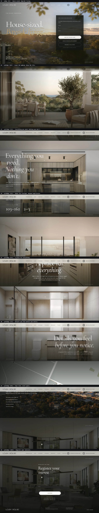
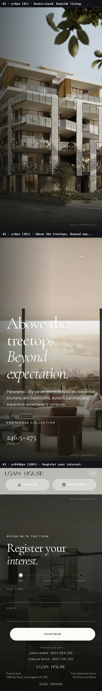

# UI Design System & Master Generation Blueprint: residences-loamhouse-com-au

> **Loam House — Sandringham** (https://residences.loamhouse.com.au) — Loam House — house-sized residences in Sandringham. Final release now selling.





---

## 1. Executive Visual Persona & Design Archetype

- **Brand Essence & Persona**: **Loam House — Sandringham** (`https://residences.loamhouse.com.au`). Loam House — house-sized residences in Sandringham. Final release now selling.
- **Capture Provenance**: Live browser capture (`tier1_fast`, HTTP `200`, captured `2026-11-24`).
- **Visual Archetype**: **Light-Substrate Editorial & Modular Grid System (`#f1eee7` canvas, `#1e211d` ink, `#512616` accent)**.
- **Anti-AI-Slop Differentiators**:
  - **Live-Computed Chromatic Polarity**: Anchors the viewport in `#f1eee7` (live computed `body` `background-color` (`computed_styles.json`)) paired with `#1e211d` primary typography and `#512616` accents.
  - **Grounded Typographic Hierarchy**: Pairs `Cormorant Garamond` for display copy (`House-sized. Bayside living.`) with `DM Sans`.
  - **Calibrated Spatial Grid & Motion**: Combines `1440px` container bounds (`gap: 32px`, padding `43.2px`) with `cubic-bezier(.65,0,.35,1)` easing and GSAP Timeline & ScrollTrigger, Three.js / WebGL Canvas Pipeline.

---

## 2. Spatial Architecture & Modular Grid Mathematics

### Viewport Allocation & Container Geometry
- **Captured Journey Filmstrips**: Desktop `1280×6624px` (`assets/desktop-journey.webp`, `8` keyframes up to `y=8100px` / doc `9000px`), Mobile `390×2616px` (`assets/mobile-journey.webp`, `3` keyframes).
- **Master Container Bounds**: `1440px` (full-bleed `100%` desktop stage measured on `1440px` viewport).
- **Canvas Lateral Padding & Spacing**: `43.2px` lateral canvas padding with `32px` grid gap.
- **Border Radius Scale**: `999px`, `2px`, `50%`.

### Responsive Breakpoint Architecture
- **Desktop Layout**: Multi-column CSS Grid / Flexbox layout at `1440px` (`max-width: 1440px`, `gap: 32px`).
- **Mobile Layout**: Single-column vertical stack at `390px` viewport width with `43.2px` horizontal padding.
- **Extracted CSS Media Queries**: `@media (max-width:800px)`, `@media (prefers-reduced-motion:reduce)`, `@media (min-width:801px)`, `@media (max-width:1050px)`.

---

## 3. Color System, Materiality & Atmospheric Lighting

### Semantic Palette & Source Grounding
| Semantic Role | Ground-Truth Value | Extracted Live / CSS Source |
|---|---|---|
| **Primary Canvas Substrate** | `#f1eee7` | live computed `body` `background-color` (`computed_styles.json`) |
| **Primary Typography Ink** | `#1e211d` | live computed `main` `color` (`computed_styles.json`) |
| **Elevated Surface / Card Substrate** | `#ffffff` | `.fmc-caret { background: #ffffff }` |
| **Interactive Accent / Highlight** | `#512616` | `.mbtn-text { color: #512616 }` |
| **Secondary / Muted Copy** | `#ffffff` | live computed `p` `color` (`computed_styles.json`) |
| **Structural Hairline Border** | `#cbc9c3` | `var(--line)` in `:root` (`rgba(30,33,29,.18)`) |
| **Variable Token (`--chalk`)** | `#fbfaf6` | `var(--chalk)` in `:root` |
| **Variable Token (`--clay`)** | `#8d4f36` | `var(--clay)` in `:root` |
| **Variable Token (`--olive`)** | `#626852` | `var(--olive)` in `:root` |

### Sanitized Root CSS Variables (`ui-ux.md` Ground Truth)
| Variable Name | Extracted Value | Semantic Role |
|---|---|---|
| `--ink` | `#1e211d` | Typography Ink Token |
| `--paper` | `#f1eee7` | Canvas / Surface Token |
| `--chalk` | `#fbfaf6` | Color / Atmospheric Token |
| `--clay` | `#8d4f36` | Color / Atmospheric Token |
| `--olive` | `#626852` | Color / Atmospheric Token |
| `--line` | `rgba(30,33,29,.18)` | Color / Atmospheric Token |
| `--serif` | `"Cormorant Garamond",Georgia,serif` | Typography / Scale Token |
| `--hero-serif` | `"Cormorant Garamond",Georgia,serif` | Typography / Scale Token |
| `--sans` | `"DM Sans",Arial,sans-serif` | Typography / Scale Token |
| `--hgut` | `6vw` | Dimension / Scale Token |
| `--scan` | `.2` | Design System Custom Token |
| `--mob-pos` | `36% center` | Dimension / Scale Token |
| `--pulse-period` | `4.1s` | Motion / Timing Token |
| `--ping-scale` | `4.2` | Design System Custom Token |
| `--ping-op` | `0.36` | Design System Custom Token |
| `--num-op` | `1` | Design System Custom Token |

---

## 4. Typographic Scale & Editorial Hierarchy

### Font Family Stacks
- **Display Typography**: `Cormorant Garamond`.
- **Primary Body Stack**: `DM Sans`.
- **Technical / Metadata Stack**: not declared in live computed styles (uses primary stack / `ui-monospace`).

### Typographic Scale & Rules (Live Computed & Stylesheet Grounded)
- **Hero Display (`H1`)**: live computed `h1` (`font-size: 122.4px`, `line-height: 90.576px`, `font-weight: 300`, `letter-spacing: -5.508px`); rule `h1` (`font-size: clamp(76px,8.5vw,138px)`, `line-height: .74`, `letter-spacing: -.045em`, `font-weight: 300`).
- **Section Heading (`H2`)**: live computed `h2` (`font-size: 115.2px`, `line-height: 103.68px`, `font-weight: 400`, `letter-spacing: -2.304px`); rule `h2` (`font-size: clamp(58px,7vw,112px)`, `line-height: .86`, `letter-spacing: -.04em`).
- **Body Copy**: live computed `body` (`font-size: 16px`, `line-height: normal`, `font-weight: 300`); rule `p` (`font-size: 16px`, `line-height: 1.5`).
- **Metadata & Navigation Labels**: live computed `nav/a` (`font-size: 16px`, `line-height: normal`, `font-weight: 300`).

---

## 5. Choreographed Motion & Interaction Physics

### Primary Easing Curves
- **Extracted Timing Functions**: `cubic-bezier(.65,0,.35,1)`, `cubic-bezier(.76,0,.24,1)`, `cubic-bezier(.22,1,.36,1)`.

### Per-Element Transition & Choreography Rules
- **Selector `.site-header`**: `transition: .4s` extracted from `residences-loamhouse-com-au` stylesheet.
- **Selector `.desktop-nav a`**: `transition: filter .35s ease` extracted from `residences-loamhouse-com-au` stylesheet.
- **Selector `.reveal`**: `transition: opacity .9s,transform .9s` extracted from `residences-loamhouse-com-au` stylesheet.
- **Extracted Easing Curve (`cubic-bezier(.65,0,.35,1)`)**: Governs interactive state transitions across `<header.site-header>` and `<section.form-chapter>`.
- **Runtime Interaction Engine**: Integrates GSAP Timeline & ScrollTrigger, Three.js / WebGL Canvas Pipeline with `prefers-reduced-motion: reduce` fallback guards.
### Measured Runtime Scroll & Interaction Telemetry (`behavioral_journey_v2`)
- **Scroll Driver Mode**: `native` (max document height `9000px`, deepest scrollY reached `8100px` across `8` desktop keyframes).
- **Detected Scroll / Motion Libraries**: `GSAP/ScrollTrigger`.
- **Hover Physics (`primary_cta` · `DOWNLOAD THE BROCHURE`)**: `color`: `rgb(30, 33, 29)` -> `rgb(255, 255, 255)` (`transition-duration: 0s`, `timing: ease`).
- **Route Transition Architecture**: First internal navigation (`/privacy-policy.html`) measured as `direct` in `435ms`.

---

## 6. Component Wireframe & Structural DOM Map

### Visual Layout Schematic — Desktop (`1440px`, Grounded in `dom.html` & Landmark Bounding Boxes)
```
┌────────────────────────────────────────────────────────────────────────┐
│ DESKTOP VIEWPORT (1440px) — Loam House — Sandringham                   │
│ ====================================================================== │
│ [ <header.site-header> (1440x82px)    | Proposition · Size · Storage ] │
│ ---------------------------------------------------------------------- │
│ | HERO STAGE: <section.hero> (w=1440px)                              | │
│ | H1: House-sized. Bayside living.                                   | │
│ | Substrate: #f1eee7 | Ink: #1e211d | Accent: #512616                | │
│ ---------------------------------------------------------------------- │
│ | SHOWCASE GRID (<section.form-chapter>) max-w: 1440px               | │
│ | +------------------------------+  +------------------------------+ | │
│ | | Leave the upkeep. Keep the l |  | A backyard oasis, without th | | │
│ | +------------------------------+  +------------------------------+ | │
│ ---------------------------------------------------------------------- │
│ | DETAIL MODULE (<section.cine>) — Everything you need.              | │
│ ---------------------------------------------------------------------- │
│ [ FOOTER (<footer.pl-panels>  ) | https://residences.loamhouse.com.au  │
└────────────────────────────────────────────────────────────────────────┘
```

### Visual Layout Schematic — Mobile Reflow (`390px`)
```
┌────────────────────────────────────────────────────────────────────────┐
│ MOBILE VIEWPORT REFLOW (390px) — Single-Column Stack (gap: 32px)       │
│ ====================================================================== │
│ [ HEADER BAR (<header.site-header>    ) | Compact Menu (390px)         │
│ ---------------------------------------------------------------------- │
│ | HERO STAGE (<section.hero>) — 390px Vertical Lead                  | │
│ | H1: House-sized. Bayside living.                                   | │
│ ---------------------------------------------------------------------- │
│ | SHOWCASE STACK (<section.form-chapter>) — 1-Col Stack              | │
│ | [ Item 1: Leave the upkeep. Keep the life.                       ] | │
│ | [ Item 2: A backyard oasis, without the mowing.                  ] | │
│ ---------------------------------------------------------------------- │
│ | DETAIL STACK (<section.cine>) — 1-Col (Everything you nee)         | │
│ ---------------------------------------------------------------------- │
│ [ FOOTER (<footer.pl-panels>  ) | Stacked 390px Colophon               │
└────────────────────────────────────────────────────────────────────────┘
```

### Granular DOM Region Breakdown
1. **Brand Header & Navigation Bar (<header.site-header> — `residences-loamhouse-com-au`)**:
   - Landmark `<header class="site-header">` (`1440x82px`) hosting `Loam House — Sandringham` navigation (`Proposition · Size · Storage · Finishes · Precinct`), DOM attributes (`data-preloader`, `data-pl-pct`, `data-header`, `data-open-calendly`), and stylesheet rule `html { scroll-behavior:auto;-webkit-tap-highlight-color:transparent }`.
2. **Hero Stage & Focal Lead (<section.hero> — `House-sized. Bayside living.`)**:
   - Landmark `<section class="hero chapter">` presenting display lead `House-sized. Bayside living.` and copy excerpt *"FINAL RELEASE · SANDRINGHAM"* over `#f1eee7` canvas and `#1e211d` ink.
3. **Primary Showcase & Content Grid (<section.form-chapter> — `Leave the upkeep. Keep the life.`)**:
   - Landmark `<section class="form-chapter chapter">` rendering section `Leave the upkeep. Keep the life.` with copy *"Final release · Sandringham"*, asset references (`clientParamBuilder.bundle.js`, `clarity.js`, `yed6eroa3m`, `1440095636442948`), and grid rule `body { margin:0;background:var(--paper);color:var(--ink);font-family:var(--sans... }`.
4. **Interactive Detail & Feature Matrix (<section.cine> — `A backyard oasis, without the mowi`)**:
   - Landmark `<section class="cine chapter">` framing `A backyard oasis, without the mowing.` and `Everything you need. Nothing you don’t.` (*"Bayside’s largest apartments. 86–275m² residences from $850,000."*) with `#ffffff` surface cards, `#512616` accents, and `img { display:block;width:100% }`.
5. **Colophon & Global Directory Footer (<footer.pl-panels> — `https://residences.loamhouse.com.au`)**:
   - Landmark `<footer class="pl-panels">` anchoring `Loam House — Sandringham` footer links (`Proposition · Size · Storage · Finishes · Precinct`), copy *"Artist’s impression"*, and `#cbc9c3` structural dividers.
### Full Vertical Scroll Sequence (Desktop `1440×900` Keyframes)
- **Step 01** (`y=0px`, `0%`): Active landmark `House-sized. Bayside living.` · sticky/fixed elements: `2`
- **Step 02** (`y=850px`, `10%`): Active landmark `Leave the upkeep. Keep the life.` · sticky/fixed elements: `2`
- **Step 03** (`y=2550px`, `31%`): Active landmark `Everything you need. Nothing you don’t.` · sticky/fixed elements: `2`
- **Step 04** (`y=3400px`, `42%`): Active landmark `Above the treetops. Beyond expectation.` · sticky/fixed elements: `2`
- **Step 05** (`y=5100px`, `63%`): Active landmark `A place for everything.` · sticky/fixed elements: `2`
- **Step 06** (`y=5950px`, `73%`): Active landmark `Details you feel before you notice.` · sticky/fixed elements: `2`
- **Step 07** (`y=7650px`, `94%`): Active landmark `Your life, still yours.` · sticky/fixed elements: `2`
- **Step 08** (`y=8100px`, `100%`): Active landmark `Register your interest.` · sticky/fixed elements: `2`

### Multi-Page Internal Route Map
- **Other Route (`/privacy-policy.html`)**: `https://residences.loamhouse.com.au/privacy-policy.html` — H1: `Privacy Policy`, scrollHeight `4969px`, transition `direct` (`435ms`)
- **Other Route (`/disclaimer.html`)**: `https://residences.loamhouse.com.au/disclaimer.html` — H1: `Disclaimer`, scrollHeight `900px`, transition `direct` (`289ms`)

---

## 7. Master Zero-Shot AI Generation Prompt

```markdown
# Master Zero-Shot Frontend Generation Prompt: residences-loamhouse-com-au (Loam House — Sandringham)

You are a principal frontend architect and design systems engineer. Build a complete, production-ready web application replicating the exact design system, DOM landmarks, typographic hierarchy, color tokens, and motion physics of `residences-loamhouse-com-au` (**Loam House — Sandringham** — `https://residences.loamhouse.com.au`).

### 1. Visual Archetype & Anti-AI-Slop Mandates
- **Archetype**: Light-Substrate Editorial & Modular Grid System (`#f1eee7` canvas, `#1e211d` ink, `#512616` accent).
- **Identity & Domain Context**: Loam House — house-sized residences in Sandringham. Final release now selling.
- **Primary Substrate**: `#f1eee7` (live computed `body` `background-color` (`computed_styles.json`)), **Primary Ink**: `#1e211d`, **Accent / Highlight**: `#512616`.
- **Site-Specific Differentiators**:
  - **Live-Computed Chromatic Polarity**: Anchors the viewport in `#f1eee7` (live computed `body` `background-color` (`computed_styles.json`)) paired with `#1e211d` primary typography and `#512616` accents.
  - **Grounded Typographic Hierarchy**: Pairs `Cormorant Garamond` for display copy (`House-sized. Bayside living.`) with `DM Sans`.
  - **Calibrated Spatial Grid & Motion**: Combines `1440px` container bounds (`gap: 32px`, padding `43.2px`) with `cubic-bezier(.65,0,.35,1)` easing and GSAP Timeline & ScrollTrigger, Three.js / WebGL Canvas Pipeline.

### 2. Ground-Truth CSS Variables (`:root` Token Contract)
Declare and consume these exact custom properties extracted from `residences-loamhouse-com-au` in your global stylesheet:

:root {
  /* Loam House — Sandringham (residences-loamhouse-com-au) — Live-Grounded CSS Variables */
  --ink: #1e211d; /* Typography Ink Token (residences-loamhouse-com-au) */
  --paper: #f1eee7; /* Canvas / Surface Token (residences-loamhouse-com-au) */
  --chalk: #fbfaf6; /* Color / Atmospheric Token (residences-loamhouse-com-au) */
  --clay: #8d4f36; /* Color / Atmospheric Token (residences-loamhouse-com-au) */
  --olive: #626852; /* Color / Atmospheric Token (residences-loamhouse-com-au) */
  --line: rgba(30,33,29,.18); /* Color / Atmospheric Token (residences-loamhouse-com-au) */
  --serif: "Cormorant Garamond",Georgia,serif; /* Typography / Scale Token (residences-loamhouse-com-au) */
  --hero-serif: "Cormorant Garamond",Georgia,serif; /* Typography / Scale Token (residences-loamhouse-com-au) */
  --sans: "DM Sans",Arial,sans-serif; /* Typography / Scale Token (residences-loamhouse-com-au) */
  --hgut: 6vw; /* Dimension / Scale Token (residences-loamhouse-com-au) */
  --scan: .2; /* Design System Custom Token (residences-loamhouse-com-au) */
  --mob-pos: 36% center; /* Dimension / Scale Token (residences-loamhouse-com-au) */
  --pulse-period: 4.1s; /* Motion / Timing Token (residences-loamhouse-com-au) */
  --ping-scale: 4.2; /* Design System Custom Token (residences-loamhouse-com-au) */
  --ping-op: 0.36; /* Design System Custom Token (residences-loamhouse-com-au) */
  --num-op: 1; /* Design System Custom Token (residences-loamhouse-com-au) */
}

### 3. Semantic Color & Materiality Contract
Map every surface, ink, and border strictly to these source-grounded tokens:
- **Primary Canvas Substrate**: `#f1eee7` — grounded in live computed `body` `background-color` (`computed_styles.json`)
- **Primary Typography Ink**: `#1e211d` — grounded in live computed `main` `color` (`computed_styles.json`)
- **Elevated Surface / Card Substrate**: `#ffffff` — grounded in `.fmc-caret { background: #ffffff }`
- **Interactive Accent / Highlight**: `#512616` — grounded in `.mbtn-text { color: #512616 }`
- **Secondary / Muted Copy**: `#ffffff` — grounded in live computed `p` `color` (`computed_styles.json`)
- **Structural Hairline Border**: `#cbc9c3` — grounded in `var(--line)` in `:root` (`rgba(30,33,29,.18)`)
- **Variable Token (`--chalk`)**: `#fbfaf6` — grounded in `var(--chalk)` in `:root`
- **Variable Token (`--clay`)**: `#8d4f36` — grounded in `var(--clay)` in `:root`
- **Variable Token (`--olive`)**: `#626852` — grounded in `var(--olive)` in `:root`

### 4. Spatial Grid, Container Bounds & Responsive Breakpoints
- **Desktop Viewport Reference**: `1280×6624px` (multi-frame vertical journey filmstrip (6624px), `1440px` standard desktop width).
- **Mobile Viewport Reference**: `390×2616px` (multi-frame vertical journey filmstrip (2616px), `390px` standard mobile width).
- **Container Max-Width**: `1440px` (full-bleed `100%` desktop stage measured on `1440px` viewport)
- **Padding & Gutters**: `43.2px` lateral canvas padding with `32px` grid gap
- **Desktop Grid**: Multi-column CSS Grid / Flexbox layout at `1440px` (`max-width: 1440px`, `gap: 32px`)
- **Mobile Adaptation**: Single-column vertical stack at `390px` viewport width with `43.2px` horizontal padding
- **Media Queries**: `@media (max-width:800px)`, `@media (prefers-reduced-motion:reduce)`, `@media (min-width:801px)`, `@media (max-width:1050px)`
- **Corner Radii**: `999px`, `2px`, `50%`

### 5. Typography & Editorial Scale Contract
- **Display Font Stack**: `Cormorant Garamond`
- **Body Font Stack**: `DM Sans`
- **Monospace / Technical Font Stack**: not declared in live computed styles (uses primary stack / `ui-monospace`)
- **H1 Display Rule**: live computed `h1` (`font-size: 122.4px`, `line-height: 90.576px`, `font-weight: 300`, `letter-spacing: -5.508px`); rule `h1` (`font-size: clamp(76px,8.5vw,138px)`, `line-height: .74`, `letter-spacing: -.045em`, `font-weight: 300`)
- **H2 Section Rule**: live computed `h2` (`font-size: 115.2px`, `line-height: 103.68px`, `font-weight: 400`, `letter-spacing: -2.304px`); rule `h2` (`font-size: clamp(58px,7vw,112px)`, `line-height: .86`, `letter-spacing: -.04em`)
- **Body Copy Rule**: live computed `body` (`font-size: 16px`, `line-height: normal`, `font-weight: 300`); rule `p` (`font-size: 16px`, `line-height: 1.5`)
- **Metadata & Index Rule**: live computed `nav/a` (`font-size: 16px`, `line-height: normal`, `font-weight: 300`)

### 6. Component Hierarchy, Verbatim Copy & Real DOM Landmarks
Scaffold `residences-loamhouse-com-au` (`Loam House — Sandringham`) with these exact structural regions, extracted copy, and CSS rules from `dom.html`:
1. **Brand Header & Navigation Bar (<header.site-header> — `residences-loamhouse-com-au`)**:
   - DOM & Selectors: Landmark `<header class="site-header">` (`1440x82px`) hosting `Loam House — Sandringham` navigation (`Proposition · Size · Storage · Finishes · Precinct`), DOM attributes (`data-preloader`, `data-pl-pct`, `data-header`, `data-open-calendly`), and stylesheet rule `html { scroll-behavior:auto;-webkit-tap-highlight-color:transparent }`.
   - Responsive Contract: Header `Brand Header & Navigation Bar (<header.site-header> — `residences-loamhouse-com-au`)` (`residences-loamhouse-com-au`) adapts across `@media (max-width:800px)`, `@media (prefers-reduced-motion:reduce)`, `@media (min-width:801px)`, `@media (max-width:1050px)` with `cubic-bezier(.65,0,.35,1)`, `cubic-bezier(.76,0,.24,1)`, `cubic-bezier(.22,1,.36,1)` transitions and links `Proposition · Size · Storage · Finishes · Precinct`.
2. **Hero Stage & Focal Lead (<section.hero> — `House-sized. Bayside living.`)**:
   - DOM & Selectors: Landmark `<section class="hero chapter">` presenting display lead `House-sized. Bayside living.` and copy excerpt *"FINAL RELEASE · SANDRINGHAM"* over `#f1eee7` canvas and `#1e211d` ink.
   - Responsive Contract: Hero stage (`1280×6624px` desktop / `390×2616px` mobile) sets `#f1eee7` background with `#1e211d` headline `House-sized. Bayside living.`.
3. **Primary Showcase & Content Grid (<section.form-chapter> — `Leave the upkeep. Keep the life.`)**:
   - DOM & Selectors: Landmark `<section class="form-chapter chapter">` rendering section `Leave the upkeep. Keep the life.` with copy *"Final release · Sandringham"*, asset references (`clientParamBuilder.bundle.js`, `clarity.js`, `yed6eroa3m`, `1440095636442948`), and grid rule `body { margin:0;background:var(--paper);color:var(--ink);font-family:var(--sans... }`.
   - Responsive Contract: Showcase grid `Primary Showcase & Content Grid (<section.form-chapter> — `Leave the upkeep. Keep the life.`)` applies Multi-column CSS Grid / Flexbox layout at `1440px` (`max-width: 1440px`, `gap: 32px`) on desktop and Single-column vertical stack at `390px` viewport width with `43.2px` horizontal padding on mobile.
4. **Interactive Detail & Feature Matrix (<section.cine> — `A backyard oasis, without the mowi`)**:
   - DOM & Selectors: Landmark `<section class="cine chapter">` framing `A backyard oasis, without the mowing.` and `Everything you need. Nothing you don’t.` (*"Bayside’s largest apartments. 86–275m² residences from $850,000."*) with `#ffffff` surface cards, `#512616` accents, and `img { display:block;width:100% }`.
   - Responsive Contract: Detail module `Interactive Detail & Feature Matrix (<section.cine> — `A backyard oasis, without the mowi`)` uses `999px`, `2px`, `50%` radii, `#512616` highlights, and assets (clientParamBuilder.bundle.js, clarity.js, yed6eroa3m).
5. **Colophon & Global Directory Footer (<footer.pl-panels> — `https://residences.loamhouse.com.au`)**:
   - DOM & Selectors: Landmark `<footer class="pl-panels">` anchoring `Loam House — Sandringham` footer links (`Proposition · Size · Storage · Finishes · Precinct`), copy *"Artist’s impression"*, and `#cbc9c3` structural dividers.
   - Responsive Contract: Footer `Colophon & Global Directory Footer (<footer.pl-panels> — `https://residences.loamhouse.com.au`)` aligns to `1440px` (full-bleed `100%` desktop stage measured on `1440px` viewport) with `43.2px` lateral canvas padding with `32px` grid gap and attributes (data-preloader, data-pl-pct, data-header).

#### Verbatim DOM Copy Excerpts (`dom.html`)
- Copy Excerpt 1: *"FINAL RELEASE · SANDRINGHAM"*
- Copy Excerpt 2: *"Final release · Sandringham"*
- Copy Excerpt 3: *"Bayside’s largest apartments. 86–275m² residences from $850,000."*
- Copy Excerpt 4: *"Artist’s impression"*

### 7. Motion, Extracted Stylesheet Rules & Interaction Choreography
- **Primary Easing Functions**: `cubic-bezier(.65,0,.35,1)`, `cubic-bezier(.76,0,.24,1)`, `cubic-bezier(.22,1,.36,1)`
- **Extracted Stylesheet Rules (`residences-loamhouse-com-au`)**:
- `html { scroll-behavior:auto;-webkit-tap-highlight-color:transparent }`
- `body { margin:0;background:var(--paper);color:var(--ink);font-family:var(--sans... }`
- `img { display:block;width:100% }`
- `.wordmark { font:400 18px/1 var(--serif);letter-spacing:.18em;text-decoration:none }`
- `.desktop-nav { display:flex;gap:32px }`
- **Per-Selector Transition Rules**:
- **Selector `.site-header`**: `transition: .4s` extracted from `residences-loamhouse-com-au` stylesheet.
- **Selector `.desktop-nav a`**: `transition: filter .35s ease` extracted from `residences-loamhouse-com-au` stylesheet.
- **Selector `.reveal`**: `transition: opacity .9s,transform .9s` extracted from `residences-loamhouse-com-au` stylesheet.
- **Extracted Easing Curve (`cubic-bezier(.65,0,.35,1)`)**: Governs interactive state transitions across `<header.site-header>` and `<section.form-chapter>`.
- **Runtime Interaction Engine**: Integrates GSAP Timeline & ScrollTrigger, Three.js / WebGL Canvas Pipeline with `prefers-reduced-motion: reduce` fallback guards.
### 7b. Full-Page Scroll Choreography, Interactive States & Multi-Page Routes
- **Scroll Mechanics**: Implement `native` vertical progression up to `9000px` across 8 distinct viewport chapters using GSAP/ScrollTrigger.
- **Vertical Chapter Sequence**: House-sized. Bayside living. (0%) -> Leave the upkeep. Keep the... (10%) -> Everything you need. Nothin... (31%) -> Above the treetops. Beyond... (42%) -> A place for everything. (63%) -> Details you feel before you... (73%) -> Your life, still yours. (94%) -> Register your interest. (100%).
- **Hover Micro-Interaction (`primary_cta`)**: Animate `color` with `0s ease`.
- **Multi-Page Routes**: Scaffold internal routes `/privacy-policy.html` (other, direct), `/disclaimer.html` (other, direct) sharing the global header/footer shell and design tokens.

### 8. Technical Deliverables
- Implement in Next.js (App Router) with TypeScript and Tailwind CSS consuming the `:root` custom properties defined above for `residences-loamhouse-com-au`.
- Reproduce both the `1440px` desktop architecture and `390px` mobile breakpoint transitions, preserving semantic HTML5 landmarks (`<header>`, `<nav>`, `<main>`, `<section>`, `<footer>`) and `prefers-reduced-motion` accessibility guards.
```
---

## 8. Full-Page Scroll Journey, Interactive States & Subpage Inventory

### Desktop Scroll Keyframes (`1440×900` WebP)
| Step | Scroll Y | Progress | Active Landmark / Section | Sticky/Fixed | Visual Asset |
| :---: | :---: | :---: | :--- | :---: | :--- |
| `#01` | `0px` | `0%` | House-sized. Bayside living. | `2` | [desktop-step-01.webp](assets/desktop-step-01.webp) |
| `#02` | `850px` | `10%` | Leave the upkeep. Keep the life. | `2` | [desktop-step-02.webp](assets/desktop-step-02.webp) |
| `#03` | `2550px` | `31%` | Everything you need. Nothing you don’t. | `2` | [desktop-step-03.webp](assets/desktop-step-03.webp) |
| `#04` | `3400px` | `42%` | Above the treetops. Beyond expectation. | `2` | [desktop-step-04.webp](assets/desktop-step-04.webp) |
| `#05` | `5100px` | `63%` | A place for everything. | `2` | [desktop-step-05.webp](assets/desktop-step-05.webp) |
| `#06` | `5950px` | `73%` | Details you feel before you notice. | `2` | [desktop-step-06.webp](assets/desktop-step-06.webp) |
| `#07` | `7650px` | `94%` | Your life, still yours. | `2` | [desktop-step-07.webp](assets/desktop-step-07.webp) |
| `#08` | `8100px` | `100%` | Register your interest. | `2` | [desktop-step-08.webp](assets/desktop-step-08.webp) |

### Mobile Condensed Keyframes (`390×844` WebP)
| Step | Scroll Y | Progress | Active Landmark | Visual Asset |
| :---: | :---: | :---: | :--- | :--- |
| `#01` | `0px` | `0%` | House-sized. Bayside living. | [mobile-step-01.webp](assets/mobile-step-01.webp) |
| `#02` | `0px` | `50%` | Above the treetops. Beyond expectation. | [mobile-step-02.webp](assets/mobile-step-02.webp) |
| `#03` | `8440px` | `100%` | Register your interest. | [mobile-step-03.webp](assets/mobile-step-03.webp) |

### Internal Subpage Filmstrips (`1080px` Wide WebP)
| # | Template | Route URL | H1 / Title | Scroll Height | Transition | Filmstrip Asset |
| :-: | :---: | :--- | :--- | :---: | :---: | :--- |
| `1` | `other` | `https://residences.loamhouse.com.au/privacy-policy.html` | Privacy Policy | `4969px` | `direct` (`435ms`) | [subpage-01-privacy-policy-html.webp](assets/subpage-01-privacy-policy-html.webp) |
| `2` | `other` | `https://residences.loamhouse.com.au/disclaimer.html` | Disclaimer | `900px` | `direct` (`289ms`) | [subpage-02-disclaimer-html.webp](assets/subpage-02-disclaimer-html.webp) |

