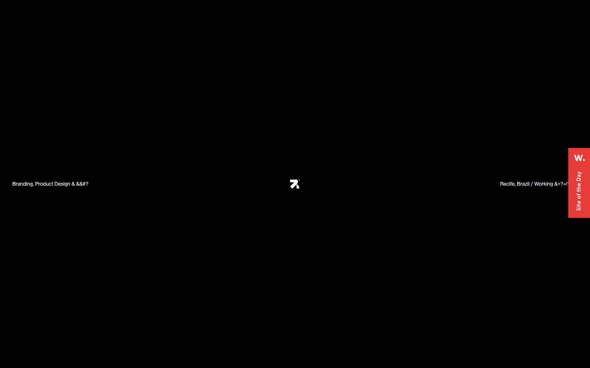
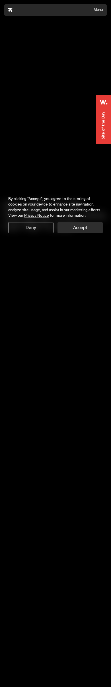

# UI Design System & Master Generation Blueprint: revelatio-studio

> **Revelatio · Branding, Product Design & Code** (https://revelatio.studio/) — Revelatio is an integrated studio for branding, product design, and code, building digital experiences and brand systems for ambitious co...



---

## 1. Executive Visual Persona & Design Archetype

- **Brand Essence & Persona**: **Revelatio · Branding, Product Design & Code** (`https://revelatio.studio/`). Revelatio is an integrated studio for branding, product design, and code, building digital experiences and brand systems for ambitious co...
- **Capture Provenance**: Live browser capture (`tier2_webgl`, HTTP `200`, captured `2026-11-23`).
- **Visual Archetype**: **Dark-Substrate WebGL / Canvas Interactive Experience (`#000000` / `#0082f3`)**.
- **Anti-AI-Slop Differentiators**:
  - **Live-Computed Chromatic Polarity**: Anchors the viewport in `#000000` (live computed `body` `background-color` (`computed_styles.json`)) paired with `#ffffff` primary typography and `#0082f3` accents.
  - **Grounded Typographic Hierarchy**: Pairs `Neue Haas Grotesk Text Pro 55 Roman` for display copy (`Branding, Product Design & Code. One`) with `Neue Haas Grotesk Text Pro 55 Roman` and `Inconsolata`.
  - **Calibrated Spatial Grid & Motion**: Combines `114.979em` container bounds (`gap: 16px`, padding `9px`) with `cubic-bezier(0.17,0,0.2,1)` easing and Lenis Smooth Scroll (`data-lenis`), GSAP Timeline & ScrollTrigger.

---

## 2. Spatial Architecture & Modular Grid Mathematics



### Viewport Allocation & Container Geometry
- **Captured Viewport Dimensions**: Desktop `1440×900px` (`assets/desktop.png`, single-viewport 100vh live capture (900px)), Mobile `390×2400px` (`assets/mobile.png`, clamped at 2400px live multi-section capture).
- **Master Container Bounds**: `114.979em` (non-`@media` desktop container stylesheet rule).
- **Canvas Lateral Padding & Spacing**: `9px` lateral canvas padding with `16px` grid gap.
- **Border Radius Scale**: `3px`, `100%`, `50%`, `2px`.

### Responsive Breakpoint Architecture
- **Desktop Layout**: Multi-column CSS Grid / Flexbox layout at `1440px` (`max-width: 114.979em`, `gap: 16px`).
- **Mobile Layout**: Single-column vertical stack at `390px` viewport width with `9px` horizontal padding.
- **Extracted CSS Media Queries**: `@media screen and (max-width: 991px)`, `@media screen and (max-width: 767px)`, `@media screen and (max-width: 479px)`, `@media (min-width: 768px)`.

---

## 3. Color System, Materiality & Atmospheric Lighting

### Semantic Palette & Source Grounding
| Semantic Role | Ground-Truth Value | Extracted Live / CSS Source |
|---|---|---|
| **Primary Canvas Substrate** | `#000000` | live computed `body` `background-color` (`computed_styles.json`) |
| **Primary Typography Ink** | `#ffffff` | live computed `h1` `color` (`computed_styles.json`) |
| **Elevated Surface / Card Substrate** | `#222222` | `.w-slider-nav-invert > div.w-ac... { background-color: #222222 }` |
| **Interactive Accent / Highlight** | `#0082f3` | `.w-dropdown-link.w--current { color: #0082f3 }` |
| **Secondary / Muted Copy** | `#7e8894` | `GateOverlay_module_dismissButto... { color: #7e8894 }` |
| **Structural Hairline Border** | `#3898ec` | `.w-select:focus { border-color: #3898ec }` |

### Sanitized Root CSS Variables (`ui-ux.md` Ground Truth)
| Variable Name | Extracted Value | Semantic Role |
|---|---|---|
| `--color--neutral--light` | `white` | Canvas / Surface Token |
| `--color--neutral--dark` | `black` | Canvas / Surface Token |
| `--color--neutral--900` | `#ffffff52` | Brand / Palette Token |
| `--color--neutral--200` | `#00000014` | Brand / Palette Token |
| `--color--neutral--800` | `#ffffff29` | Brand / Palette Token |
| `--color--neutral--300` | `#00000029` | Brand / Palette Token |
| `--color--neutral--400` | `#00000052` | Brand / Palette Token |
| `--color--neutral--500` | `#000000a3` | Brand / Palette Token |
| `--color--neutral--600` | `#ffffff0a` | Brand / Palette Token |
| `--color--neutral--700` | `#ffffff14` | Brand / Palette Token |
| `--color--neutral--1000` | `#ffffffa3` | Brand / Palette Token |
| `--color--neutral--100` | `#0000000a` | Brand / Palette Token |
| `--tbg` | `#fff` | Canvas / Surface Token |
| `--tfg` | `#000` | Typography Ink Token |
| `--tt` | `hsla(0, 0%, 0%, .08)` | Color / Atmospheric Token |
| `--tline` | `hsla(0, 0%, 0%, .85)` | Color / Atmospheric Token |

---

## 4. Typographic Scale & Editorial Hierarchy

### Font Family Stacks
- **Display Typography**: `Neue Haas Grotesk Text Pro 55 Roman`.
- **Primary Body Stack**: `Neue Haas Grotesk Text Pro 55 Roman`.
- **Technical / Metadata Stack**: `Inconsolata`.

### Typographic Scale & Rules (Live Computed & Stylesheet Grounded)
- **Hero Display (`H1`)**: live computed `h1` (`font-size: 35.9856px`, `line-height: 39.5842px`, `font-weight: 400`, `letter-spacing: -1.07957px`); rule `h1` (`font-size: 2em`).
- **Section Heading (`H2`)**: live computed `h2` (`font-size: 35.9856px`, `line-height: 39.5842px`, `font-weight: 400`, `letter-spacing: -1.07957px`); rule `h2` (`font-size: 32px`, `line-height: 36px`).
- **Body Copy**: live computed `body` (`font-size: 11.9952px`, `line-height: 17.9928px`, `font-weight: 400`); rule `body` (`font-size: 14px`, `line-height: 20px`).
- **Metadata & Navigation Labels**: live computed `nav/a` (`font-size: 11.9952px`, `line-height: 17.9928px`, `font-weight: 400`); rule `small` (`font-size: 80%`).

---

## 5. Choreographed Motion & Interaction Physics

### Primary Easing Curves
- **Extracted Timing Functions**: `cubic-bezier(0.17,0,0.2,1)`, `cubic-bezier(0.5,0,0.83,1)`, `cubic-bezier(0.18,0.89,0.32,1.2)`.

### Per-Element Transition & Choreography Rules
- **Selector `.w-webflow-badge > img`**: `transition: unset` extracted from `revelatio-studio` stylesheet.
- **Selector `.w-slider-dot`**: `transition: background-color .1s, color .1s` extracted from `revelatio-studio` stylesheet.
- **Selector `.w-lightbox-control`**: `transition: all .3s` extracted from `revelatio-studio` stylesheet.
- **Extracted Easing Curve (`cubic-bezier(0.17,0,0.2,1)`)**: Governs interactive state transitions across `<nav.navbar>` and `<div.is-preloading>`.
- **Runtime Interaction Engine**: Integrates Lenis Smooth Scroll (`data-lenis`), GSAP Timeline & ScrollTrigger, Three.js / WebGL Canvas Pipeline, Swiper Touch Carousel Engine with `prefers-reduced-motion: reduce` fallback guards.

---

## 6. Component Wireframe & Structural DOM Map

### Visual Layout Schematic — Desktop (`1440px`, Grounded in `dom.html` & Landmark Bounding Boxes)
```
┌────────────────────────────────────────────────────────────────────────┐
│ DESKTOP VIEWPORT (1440px) — Revelatio · Branding, Product Design & Cod │
│ ====================================================================== │
│ [ <nav.navbar> (1440x63px)            | Work · Approach · About · Ca ] │
│ ---------------------------------------------------------------------- │
│ | HERO STAGE: <div.w-mod-ix> (w=1440px)                              | │
│ | H1: Branding, Product Design & Code. One integrated v...           | │
│ | Substrate: #000000 | Ink: #ffffff | Accent: #0082f3                | │
│ ---------------------------------------------------------------------- │
│ | SHOWCASE GRID (<div.is-preloading>) max-w: 114.979em               | │
│ | +------------------------------+  +------------------------------+ | │
│ | | Fractional Brand Leadership  |  | Fractional Brand Leadership  | | │
│ | +------------------------------+  +------------------------------+ | │
│ ---------------------------------------------------------------------- │
│ | DETAIL MODULE (<div.lenis>) — Innovation Advisory                  | │
│ ---------------------------------------------------------------------- │
│ [ FOOTER (<footer.footer>     ) | https://revelatio.studio/            │
└────────────────────────────────────────────────────────────────────────┘
```

### Visual Layout Schematic — Mobile Reflow (`390px`)
```
┌────────────────────────────────────────────────────────────────────────┐
│ MOBILE VIEWPORT REFLOW (390px) — Single-Column Stack (gap: 16px)       │
│ ====================================================================== │
│ [ HEADER BAR (<nav.navbar>            ) | Compact Menu (390px)         │
│ ---------------------------------------------------------------------- │
│ | HERO STAGE (<div.w-mod-ix>) — 390px Vertical Lead                  | │
│ | H1: Branding, Product Design & Code. One integrated v...           | │
│ ---------------------------------------------------------------------- │
│ | SHOWCASE STACK (<div.is-preloading>) — 1-Col Stack                 | │
│ | [ Item 1: Fractional Brand Leadership Innovation Advisory        ] | │
│ | [ Item 2: Fractional Brand Leadership                            ] | │
│ ---------------------------------------------------------------------- │
│ | DETAIL STACK (<div.lenis>) — 1-Col (Innovation Advisor)            | │
│ ---------------------------------------------------------------------- │
│ [ FOOTER (<footer.footer>     ) | Stacked 390px Colophon               │
└────────────────────────────────────────────────────────────────────────┘
```

### Granular DOM Region Breakdown
1. **Brand Header & Navigation Bar (<nav.navbar> — `revelatio-studio`)**:
   - Landmark `<nav class="navbar">` (`1440x63px`) hosting `Revelatio · Branding, Product Design` navigation (`Work · Approach · About · Careers · EN`), DOM attributes (`data-wf-domain="revelatio.studio"`, `data-wf-page="6a1dba8694fc8f455cf55833"`, `data-wf-site="6a1dba8694fc8f455cf5585d"`, `data-scale-hover-bound="1"`), and stylesheet rule `html { -webkit-text-size-adjust: 100%; -ms-text-size-adjust: 100%; font-family:... }`.
2. **Hero Stage & Focal Lead (<div.w-mod-ix> — `Branding, Product Design & Code. O`)**:
   - Landmark `<div class="w-mod-ix">` presenting display lead `Branding, Product Design & Code. One integrated v...` and copy excerpt *"Fractional Brand Leadership Innovation Advisory Dedicated Brand S"* over `#000000` canvas and `#ffffff` ink.
3. **Primary Showcase & Content Grid (<div.is-preloading> — `Fractional Brand Leadership Innova`)**:
   - Landmark `<div class="is-preloading">` rendering section `Fractional Brand Leadership Innovation Advisory ` with copy *"Fractional Brand Leadership"*, asset references (`cdn.prod.website-files.com`, `pt-br`, `revelatio-studio.webflow.shared.6...`, `6a1adb7b38c8bf5b0bcefe1c_revelati...`), and grid rule `body { margin: 0; }`.
4. **Interactive Detail & Feature Matrix (<div.lenis> — `Fractional Brand Leadership`)**:
   - Landmark `<div class="lenis">` framing `Fractional Brand Leadership` and `Innovation Advisory` (*"Innovation Advisory"*) with `#222222` surface cards, `#0082f3` accents, and `summary { display: block; }`.
5. **Colophon & Global Directory Footer (<footer.footer> — `https://revelatio.studio/`)**:
   - Landmark `<footer class="footer">` anchoring `Revelatio · Branding, Product De` footer links (`Work · Approach · About · Careers · EN`), copy *"Dedicated Brand Squads"*, and `#3898ec` structural dividers.

---

## 7. Master Zero-Shot AI Generation Prompt

```markdown
# Master Zero-Shot Frontend Generation Prompt: revelatio-studio (Revelatio · Branding, Product Design & Code)

You are a principal frontend architect and design systems engineer. Build a complete, production-ready web application replicating the exact design system, DOM landmarks, typographic hierarchy, color tokens, and motion physics of `revelatio-studio` (**Revelatio · Branding, Product Design & Code** — `https://revelatio.studio/`).

### 1. Visual Archetype & Anti-AI-Slop Mandates
- **Archetype**: Dark-Substrate WebGL / Canvas Interactive Experience (`#000000` / `#0082f3`).
- **Identity & Domain Context**: Revelatio is an integrated studio for branding, product design, and code, building digital experiences and brand systems for ambitious co...
- **Primary Substrate**: `#000000` (live computed `body` `background-color` (`computed_styles.json`)), **Primary Ink**: `#ffffff`, **Accent / Highlight**: `#0082f3`.
- **Site-Specific Differentiators**:
  - **Live-Computed Chromatic Polarity**: Anchors the viewport in `#000000` (live computed `body` `background-color` (`computed_styles.json`)) paired with `#ffffff` primary typography and `#0082f3` accents.
  - **Grounded Typographic Hierarchy**: Pairs `Neue Haas Grotesk Text Pro 55 Roman` for display copy (`Branding, Product Design & Code. One`) with `Neue Haas Grotesk Text Pro 55 Roman` and `Inconsolata`.
  - **Calibrated Spatial Grid & Motion**: Combines `114.979em` container bounds (`gap: 16px`, padding `9px`) with `cubic-bezier(0.17,0,0.2,1)` easing and Lenis Smooth Scroll (`data-lenis`), GSAP Timeline & ScrollTrigger.

### 2. Ground-Truth CSS Variables (`:root` Token Contract)
Declare and consume these exact custom properties extracted from `revelatio-studio` in your global stylesheet:

:root {
  /* Revelatio · Branding, Product Design & Code (revelatio-studio) — Live-Grounded CSS Variables */
  --color--neutral--light: white; /* Canvas / Surface Token (revelatio-studio) */
  --color--neutral--dark: black; /* Canvas / Surface Token (revelatio-studio) */
  --color--neutral--900: #ffffff52; /* Brand / Palette Token (revelatio-studio) */
  --color--neutral--200: #00000014; /* Brand / Palette Token (revelatio-studio) */
  --color--neutral--800: #ffffff29; /* Brand / Palette Token (revelatio-studio) */
  --color--neutral--300: #00000029; /* Brand / Palette Token (revelatio-studio) */
  --color--neutral--400: #00000052; /* Brand / Palette Token (revelatio-studio) */
  --color--neutral--500: #000000a3; /* Brand / Palette Token (revelatio-studio) */
  --color--neutral--600: #ffffff0a; /* Brand / Palette Token (revelatio-studio) */
  --color--neutral--700: #ffffff14; /* Brand / Palette Token (revelatio-studio) */
  --color--neutral--1000: #ffffffa3; /* Brand / Palette Token (revelatio-studio) */
  --color--neutral--100: #0000000a; /* Brand / Palette Token (revelatio-studio) */
  --tbg: #fff; /* Canvas / Surface Token (revelatio-studio) */
  --tfg: #000; /* Typography Ink Token (revelatio-studio) */
  --tt: hsla(0, 0%, 0%, .08); /* Color / Atmospheric Token (revelatio-studio) */
  --tline: hsla(0, 0%, 0%, .85); /* Color / Atmospheric Token (revelatio-studio) */
}

### 3. Semantic Color & Materiality Contract
Map every surface, ink, and border strictly to these source-grounded tokens:
- **Primary Canvas Substrate**: `#000000` — grounded in live computed `body` `background-color` (`computed_styles.json`)
- **Primary Typography Ink**: `#ffffff` — grounded in live computed `h1` `color` (`computed_styles.json`)
- **Elevated Surface / Card Substrate**: `#222222` — grounded in `.w-slider-nav-invert > div.w-ac... { background-color: #222222 }`
- **Interactive Accent / Highlight**: `#0082f3` — grounded in `.w-dropdown-link.w--current { color: #0082f3 }`
- **Secondary / Muted Copy**: `#7e8894` — grounded in `GateOverlay_module_dismissButto... { color: #7e8894 }`
- **Structural Hairline Border**: `#3898ec` — grounded in `.w-select:focus { border-color: #3898ec }`

### 4. Spatial Grid, Container Bounds & Responsive Breakpoints
- **Desktop Viewport Reference**: `1440×900px` (single-viewport 100vh live capture (900px), `1440px` standard desktop width).
- **Mobile Viewport Reference**: `390×2400px` (clamped at 2400px live multi-section capture, `390px` standard mobile width).
- **Container Max-Width**: `114.979em` (non-`@media` desktop container stylesheet rule)
- **Padding & Gutters**: `9px` lateral canvas padding with `16px` grid gap
- **Desktop Grid**: Multi-column CSS Grid / Flexbox layout at `1440px` (`max-width: 114.979em`, `gap: 16px`)
- **Mobile Adaptation**: Single-column vertical stack at `390px` viewport width with `9px` horizontal padding
- **Media Queries**: `@media screen and (max-width: 991px)`, `@media screen and (max-width: 767px)`, `@media screen and (max-width: 479px)`, `@media (min-width: 768px)`
- **Corner Radii**: `3px`, `100%`, `50%`, `2px`

### 5. Typography & Editorial Scale Contract
- **Display Font Stack**: `Neue Haas Grotesk Text Pro 55 Roman`
- **Body Font Stack**: `Neue Haas Grotesk Text Pro 55 Roman`
- **Monospace / Technical Font Stack**: `Inconsolata`
- **H1 Display Rule**: live computed `h1` (`font-size: 35.9856px`, `line-height: 39.5842px`, `font-weight: 400`, `letter-spacing: -1.07957px`); rule `h1` (`font-size: 2em`)
- **H2 Section Rule**: live computed `h2` (`font-size: 35.9856px`, `line-height: 39.5842px`, `font-weight: 400`, `letter-spacing: -1.07957px`); rule `h2` (`font-size: 32px`, `line-height: 36px`)
- **Body Copy Rule**: live computed `body` (`font-size: 11.9952px`, `line-height: 17.9928px`, `font-weight: 400`); rule `body` (`font-size: 14px`, `line-height: 20px`)
- **Metadata & Index Rule**: live computed `nav/a` (`font-size: 11.9952px`, `line-height: 17.9928px`, `font-weight: 400`); rule `small` (`font-size: 80%`)

### 6. Component Hierarchy, Verbatim Copy & Real DOM Landmarks
Scaffold `revelatio-studio` (`Revelatio · Branding, Product Design & Code`) with these exact structural regions, extracted copy, and CSS rules from `dom.html`:
1. **Brand Header & Navigation Bar (<nav.navbar> — `revelatio-studio`)**:
   - DOM & Selectors: Landmark `<nav class="navbar">` (`1440x63px`) hosting `Revelatio · Branding, Product Design` navigation (`Work · Approach · About · Careers · EN`), DOM attributes (`data-wf-domain="revelatio.studio"`, `data-wf-page="6a1dba8694fc8f455cf55833"`, `data-wf-site="6a1dba8694fc8f455cf5585d"`, `data-scale-hover-bound="1"`), and stylesheet rule `html { -webkit-text-size-adjust: 100%; -ms-text-size-adjust: 100%; font-family:... }`.
   - Responsive Contract: Header `Brand Header & Navigation Bar (<nav.navbar> — `revelatio-studio`)` (`revelatio-studio`) adapts across `@media screen and (max-width: 991px)`, `@media screen and (max-width: 767px)`, `@media screen and (max-width: 479px)`, `@media (min-width: 768px)` with `cubic-bezier(0.17,0,0.2,1)`, `cubic-bezier(0.5,0,0.83,1)`, `cubic-bezier(0.18,0.89,0.32,1.2)` transitions and links `Work · Approach · About · Careers · EN`.
2. **Hero Stage & Focal Lead (<div.w-mod-ix> — `Branding, Product Design & Code. O`)**:
   - DOM & Selectors: Landmark `<div class="w-mod-ix">` presenting display lead `Branding, Product Design & Code. One integrated v...` and copy excerpt *"Fractional Brand Leadership Innovation Advisory Dedicated Brand S"* over `#000000` canvas and `#ffffff` ink.
   - Responsive Contract: Hero stage (`1440×900px` desktop / `390×2400px` mobile) sets `#000000` background with `#ffffff` headline `Branding, Product Design & Code. One integrated v...`.
3. **Primary Showcase & Content Grid (<div.is-preloading> — `Fractional Brand Leadership Innova`)**:
   - DOM & Selectors: Landmark `<div class="is-preloading">` rendering section `Fractional Brand Leadership Innovation Advisory ` with copy *"Fractional Brand Leadership"*, asset references (`cdn.prod.website-files.com`, `pt-br`, `revelatio-studio.webflow.shared.6...`, `6a1adb7b38c8bf5b0bcefe1c_revelati...`), and grid rule `body { margin: 0; }`.
   - Responsive Contract: Showcase grid `Primary Showcase & Content Grid (<div.is-preloading> — `Fractional Brand Leadership Innova`)` applies Multi-column CSS Grid / Flexbox layout at `1440px` (`max-width: 114.979em`, `gap: 16px`) on desktop and Single-column vertical stack at `390px` viewport width with `9px` horizontal padding on mobile.
4. **Interactive Detail & Feature Matrix (<div.lenis> — `Fractional Brand Leadership`)**:
   - DOM & Selectors: Landmark `<div class="lenis">` framing `Fractional Brand Leadership` and `Innovation Advisory` (*"Innovation Advisory"*) with `#222222` surface cards, `#0082f3` accents, and `summary { display: block; }`.
   - Responsive Contract: Detail module `Interactive Detail & Feature Matrix (<div.lenis> — `Fractional Brand Leadership`)` uses `3px`, `100%`, `50%`, `2px` radii, `#0082f3` highlights, and assets (cdn.prod.website-files.com, pt-br, revelatio-studio.webflow.shared.6...).
5. **Colophon & Global Directory Footer (<footer.footer> — `https://revelatio.studio/`)**:
   - DOM & Selectors: Landmark `<footer class="footer">` anchoring `Revelatio · Branding, Product De` footer links (`Work · Approach · About · Careers · EN`), copy *"Dedicated Brand Squads"*, and `#3898ec` structural dividers.
   - Responsive Contract: Footer `Colophon & Global Directory Footer (<footer.footer> — `https://revelatio.studio/`)` aligns to `114.979em` (non-`@media` desktop container stylesheet rule) with `9px` lateral canvas padding with `16px` grid gap and attributes (data-wf-domain="revelatio.studio", data-wf-page="6a1dba8694fc8f455cf55833", data-wf-site="6a1dba8694fc8f455cf5585d").

#### Verbatim DOM Copy Excerpts (`dom.html`)
- Copy Excerpt 1: *"Fractional Brand Leadership Innovation Advisory Dedicated Brand Squads Embedded Pr..."*
- Copy Excerpt 2: *"Fractional Brand Leadership"*
- Copy Excerpt 3: *"Innovation Advisory"*
- Copy Excerpt 4: *"Dedicated Brand Squads"*

### 7. Motion, Extracted Stylesheet Rules & Interaction Choreography
- **Primary Easing Functions**: `cubic-bezier(0.17,0,0.2,1)`, `cubic-bezier(0.5,0,0.83,1)`, `cubic-bezier(0.18,0.89,0.32,1.2)`
- **Extracted Stylesheet Rules (`revelatio-studio`)**:
- `html { -webkit-text-size-adjust: 100%; -ms-text-size-adjust: 100%; font-family:... }`
- `body { margin: 0; }`
- `summary { display: block; }`
- `video { vertical-align: baseline; display: inline-block; }`
- `template { display: none; }`
- **Per-Selector Transition Rules**:
- **Selector `.w-webflow-badge > img`**: `transition: unset` extracted from `revelatio-studio` stylesheet.
- **Selector `.w-slider-dot`**: `transition: background-color .1s, color .1s` extracted from `revelatio-studio` stylesheet.
- **Selector `.w-lightbox-control`**: `transition: all .3s` extracted from `revelatio-studio` stylesheet.
- **Extracted Easing Curve (`cubic-bezier(0.17,0,0.2,1)`)**: Governs interactive state transitions across `<nav.navbar>` and `<div.is-preloading>`.
- **Runtime Interaction Engine**: Integrates Lenis Smooth Scroll (`data-lenis`), GSAP Timeline & ScrollTrigger, Three.js / WebGL Canvas Pipeline, Swiper Touch Carousel Engine with `prefers-reduced-motion: reduce` fallback guards.

### 8. Technical Deliverables
- Implement in Next.js (App Router) with TypeScript and Tailwind CSS consuming the `:root` custom properties defined above for `revelatio-studio`.
- Reproduce both the `1440px` desktop architecture and `390px` mobile breakpoint transitions, preserving semantic HTML5 landmarks (`<header>`, `<nav>`, `<main>`, `<section>`, `<footer>`) and `prefers-reduced-motion` accessibility guards.
```
