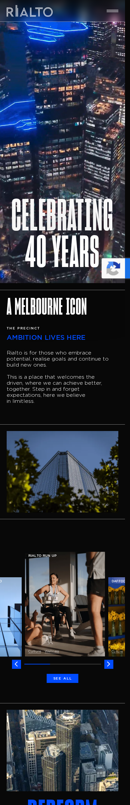

# UI Design System & Master Generation Blueprint: rialto-com-au

> **Rialto · The icon of Melbourne's skyline** (https://rialto.com.au/) — With the prestige of Melbourne's Collins Street address. Rialto hosts world-class amenity, dining and retail, offering unique experiences.


---

## 1. Executive Visual Persona & Design Archetype

- **Brand Essence & Persona**: **Rialto · The icon of Melbourne's skyline** (`https://rialto.com.au/`). With the prestige of Melbourne's Collins Street address. Rialto hosts world-class amenity, dining and retail, offering unique experiences.
- **Visual Archetype**: **Light-Substrate Editorial & Modular Grid System (`#fff` canvas, `#000` ink, `#3d3d3b` accent)**.
- **Anti-AI-Slop Differentiators**:
  - **Source-Grounded Chromatic Polarity**: Anchors the viewport in `#fff` (`var(--color-white)` in `:root`) paired with `#000` primary typography and `#3d3d3b` accents.
  - **Extracted Typographic Hierarchy**: Pairs `Sharp Grotesk` for display copy (`CELEBRATING 40 YEARS`) with `Gotham` and not declared in static CSS (uses primary stack / `ui-monospace`).
  - **Calibrated Spatial Grid & Motion**: Combines `767px` container bounds (`gap: 1.5rem`, padding `3rem`) with `cubic-bezier(.165,.84,.44,1)` easing and Three.js / WebGL Canvas Pipeline, Swiper Touch Carousel Engine.

---

## 2. Spatial Architecture & Modular Grid Mathematics



### Viewport Allocation & Container Geometry
- **Captured Viewport Dimensions**: Desktop `1440×13052px` (`assets/desktop.png`, full-page scroll capture), Mobile `390×2400px` (`assets/mobile.png`, capped at 2400px multi-section capture).
- **Master Container Bounds**: `767px` extracted from `rialto-com-au` stylesheet.
- **Canvas Lateral Padding & Spacing**: `3rem` lateral canvas padding with `1.5rem` grid gap.
- **Border Radius Scale**: `.5rem`, `100%`, `2rem`, `6px`.

### Responsive Breakpoint Architecture
- **Desktop Layout**: Multi-column CSS Grid / Flexbox layout at `1440px` (`max-width: 767px`, `gap: 1.5rem`).
- **Mobile Layout**: Single-column vertical stack at `390px` viewport width with `3rem` horizontal padding.
- **Extracted CSS Media Queries**: `@media (max-width:767px)`, `@media (max-width:1199px)`, `@media (max-width:1023px)`, `@media (max-width:640px)`.

---

## 3. Color System, Materiality & Atmospheric Lighting

### Semantic Palette & Source Grounding
| Semantic Role | Ground-Truth Value | Extracted CSS Source / Selector |
|---|---|---|
| **Primary Canvas Substrate** | `#fff` | `var(--color-white)` in `:root` |
| **Primary Typography Ink** | `#000` | `var(--color-black)` in `:root` |
| **Elevated Surface / Card Substrate** | `#d1d4d6` | `var(--color-gray-300)` in `:root` |
| **Interactive Accent / Highlight** | `#3d3d3b` | `var(--color-gray-700)` in `:root` |
| **Secondary / Muted Copy** | `#231f20` | `var(--color-gray-800)` in `:root` |
| **Structural Hairline Border** | `#080808` | `var(--color-gray-900)` in `:root` |
| **Variable Token (`--color-blue-700`)** | `#004bff` | `var(--color-blue-700)` in `:root` |
| **Variable Token (`--color-pink-400`)** | `#ffc8ff` | `var(--color-pink-400)` in `:root` |

### Sanitized Root CSS Variables (`ui-ux.md` Ground Truth)
| Variable Name | Extracted Value | Semantic Role |
|---|---|---|
| `--color-white` | `#fff` | Canvas / Surface Token |
| `--color-white-thin` | `rgba(255, 255, 255, 0.5)` | Canvas / Surface Token |
| `--color-black` | `#000` | Canvas / Surface Token |
| `--color-current-thin` | `color-mix(in srgb, currentColor 50%, transparent 50%)` | Brand / Palette Token |
| `--color-current-thin-md` | `color-mix(in srgb, currentColor 75%, transparent 25%)` | Brand / Palette Token |
| `--color-gray-300` | `#d1d4d6` | Brand / Palette Token |
| `--color-gray-700` | `#3d3d3b` | Brand / Palette Token |
| `--color-gray-800` | `#231f20` | Brand / Palette Token |
| `--color-gray-900` | `#080808` | Brand / Palette Token |
| `--color-blue-700` | `#004bff` | Brand / Palette Token |
| `--color-pink-400` | `#ffc8ff` | Typography Ink Token |
| `--color-body-bg` | `#080808` | Canvas / Surface Token |
| `--color-body-color` | `#fff` | Typography Ink Token |
| `--color-accent` | `var(--color-blue-700)` | Brand / Palette Token |
| `--color-secondary` | `var(--color-gray-900)` | Brand / Palette Token |
| `--color-light` | `var(--color-white)` | Canvas / Surface Token |

---

## 4. Typographic Scale & Editorial Hierarchy

### Font Family Stacks
- **Display Typography**: `Sharp Grotesk`.
- **Primary Body Stack**: `Gotham`.
- **Technical / Metadata Stack**: not declared in static CSS (uses primary stack / `ui-monospace`).

### Typographic Scale & Rules (Extracted from Stylesheet & Variables)
- **Hero Display (`H1`)**: rule `,.h1` (`font-size: 20rem`, `line-height: .84`, `letter-spacing: .015em`, `font-weight: 700`).
- **Section Heading (`H2`)**: rule `,.h2` (`font-size: 10rem`, `line-height: .84`, `letter-spacing: .015em`, `font-weight: 700`).
- **Body Copy**: CSS variables `--color-body-bg: #080808`, `--color-body-color: #fff`, `--tile-body-opacity: 0`; rule `p` (`line-height: 1.2`).
- **Metadata & Navigation Labels**: CSS variables `--button-letter-spacing: 0.185em`.

---

## 5. Choreographed Motion & Interaction Physics

### Primary Easing Curves
- **Extracted Timing Functions**: `cubic-bezier(.165,.84,.44,1)`, `cubic-bezier(.49,.78,.46,1.34)`, `cubic-bezier(0.25,0.1,0.25,1)`.

### Per-Element Transition & Choreography Rules
- **Selector `.gfield .gfield_label`**: `transition: var(--t-duration)` extracted from `rialto-com-au` stylesheet.
- **Selector `gfield--type-list .gfield_list_ic...`**: `transition: opacity .5s ease-out` extracted from `rialto-com-au` stylesheet.
- **Selector `#sb_instagram.sbi_masonry #sbi_im...`**: `transition: height .5s ease` extracted from `rialto-com-au` stylesheet.
- **Extracted Easing Curve (`cubic-bezier(.165,.84,.44,1)`)**: Governs interactive state transitions across `<header.header>` and `<section.module>`.
- **Runtime Interaction Engine**: Integrates Three.js / WebGL Canvas Pipeline, Swiper Touch Carousel Engine, Barba.js Page Transition Router with `prefers-reduced-motion: reduce` fallback guards.

---

## 6. Component Wireframe & Structural DOM Map

### Visual Layout Schematic (Grounded in `dom.html` — `1440px` Desktop & `390px` Mobile Reflow)
```
┌────────────────────────────────────────────────────────────────────────┐
│ DESKTOP VIEWPORT (1440px) — Rialto · The icon of Melbourne's skyline   │
│ ====================================================================== │
│ [ <header.header>          | Discover · What's On · Experience      ]  │
│ ---------------------------------------------------------------------- │
│ | HERO STAGE: <section.module>                                     |   │
│ | H1: CELEBRATING 40 YEARS                                         |   │
│ | Substrate: #fff       | Ink: #000       | Accent: #3d3d3b        |   │
│ ---------------------------------------------------------------------- │
│ | SHOWCASE GRID (<section.module>          ) max-w: 767px          |   │
│ | +------------------------------+  +------------------------------+ | │
│ | | A MELBOURNE ICON             |  | AMBITION LIVES HERE          | | │
│ | +------------------------------+  +------------------------------+ | │
│ ---------------------------------------------------------------------- │
│ | MOBILE VIEWPORT REFLOW (390px) — Single-Column Stack (gap: 1.5rem) | │
│ | [<header.header>] -> [<section.module>] -> [<section.module>] |      │
│ ---------------------------------------------------------------------- │
│ [ FOOTER (<footer.footer>       ) | https://rialto.com.au/             │
└────────────────────────────────────────────────────────────────────────┘
```

### Granular DOM Region Breakdown
1. **Brand Header & Navigation Bar (<header.header> — `rialto-com-au`)**:
   - Landmark `<header class="header borders">` hosting `Rialto · The icon of Melbourne's sky` navigation (`Discover · What's On · Experience`), DOM attributes (`data-rocket-prefetch`, `data-rocket-preload`, `data-minify="1"`, `data-minify="1"`), and stylesheet rule `.gfield .chosen-container-multi { font-size:1.6rem }`.
2. **Hero Stage & Focal Lead (<section.module> — `CELEBRATING 40 YEARS`)**:
   - Landmark `<section class="module module--landing_animation">` presenting display lead `CELEBRATING 40 YEARS` and copy excerpt *"AMBITION LIVES HERE"* over `#fff` canvas and `#000` ink.
3. **Primary Showcase & Content Grid (<section.module> — `A MELBOURNE ICON`)**:
   - Landmark `<section class="module module--hero">` rendering section `A MELBOURNE ICON` with copy *"Rialto is for those who embrace potential, realise goals and cont"*, asset references (`recaptcha__en.js`, `gtm.js`, `google-analytics.com`, `ajax.googleapis.com`), and grid rule `.gfield .gfield_label:last-child { margin-block-end:0 }`.
4. **Interactive Detail & Feature Matrix (<section.module> — `AMBITION LIVES HERE`)**:
   - Landmark `<section class="module module--image_text">` framing `AMBITION LIVES HERE` and `WHAT’S ON AT RIALTO` (*"This is a place that welcomes the driven, where we can achieve be"*) with `#d1d4d6` surface cards, `#3d3d3b` accents, and `last-child { margin-block-end:0 }`.
5. **Colophon & Global Directory Footer (<footer.footer> — `https://rialto.com.au/`)**:
   - Landmark `<footer class="footer">` anchoring `Rialto · The icon of Melbourne's` footer links (`Discover · What's On · Experience`), copy *"WHAT’S ON AT RIALTO"*, and `#080808` structural dividers.

---

## 7. Master Zero-Shot AI Generation Prompt

```markdown
# Master Zero-Shot Frontend Generation Prompt: rialto-com-au (Rialto · The icon of Melbourne's skyline)

You are a principal frontend architect and design systems engineer. Build a complete, production-ready web application replicating the exact design system, DOM landmarks, typographic hierarchy, color tokens, and motion physics of `rialto-com-au` (**Rialto · The icon of Melbourne's skyline** — `https://rialto.com.au/`).

### 1. Visual Archetype & Anti-AI-Slop Mandates
- **Archetype**: Light-Substrate Editorial & Modular Grid System (`#fff` canvas, `#000` ink, `#3d3d3b` accent).
- **Identity & Domain Context**: With the prestige of Melbourne's Collins Street address. Rialto hosts world-class amenity, dining and retail, offering unique experiences.
- **Primary Substrate**: `#fff` (`var(--color-white)` in `:root`), **Primary Ink**: `#000`, **Accent / Highlight**: `#3d3d3b`.
- **Site-Specific Differentiators**:
  - **Source-Grounded Chromatic Polarity**: Anchors the viewport in `#fff` (`var(--color-white)` in `:root`) paired with `#000` primary typography and `#3d3d3b` accents.
  - **Extracted Typographic Hierarchy**: Pairs `Sharp Grotesk` for display copy (`CELEBRATING 40 YEARS`) with `Gotham` and not declared in static CSS (uses primary stack / `ui-monospace`).
  - **Calibrated Spatial Grid & Motion**: Combines `767px` container bounds (`gap: 1.5rem`, padding `3rem`) with `cubic-bezier(.165,.84,.44,1)` easing and Three.js / WebGL Canvas Pipeline, Swiper Touch Carousel Engine.

### 2. Ground-Truth CSS Variables (`:root` Token Contract)
Declare and consume these exact custom properties extracted from `rialto-com-au` in your global stylesheet:

:root {
  /* Rialto · The icon of Melbourne's skyline (rialto-com-au) — Ground-Truth Extracted CSS Variables */
  --color-white: #fff; /* Canvas / Surface Token (rialto-com-au) */
  --color-white-thin: rgba(255, 255, 255, 0.5); /* Canvas / Surface Token (rialto-com-au) */
  --color-black: #000; /* Canvas / Surface Token (rialto-com-au) */
  --color-current-thin: color-mix(in srgb, currentColor 50%, transparent 50%); /* Brand / Palette Token (rialto-com-au) */
  --color-current-thin-md: color-mix(in srgb, currentColor 75%, transparent 25%); /* Brand / Palette Token (rialto-com-au) */
  --color-gray-300: #d1d4d6; /* Brand / Palette Token (rialto-com-au) */
  --color-gray-700: #3d3d3b; /* Brand / Palette Token (rialto-com-au) */
  --color-gray-800: #231f20; /* Brand / Palette Token (rialto-com-au) */
  --color-gray-900: #080808; /* Brand / Palette Token (rialto-com-au) */
  --color-blue-700: #004bff; /* Brand / Palette Token (rialto-com-au) */
  --color-pink-400: #ffc8ff; /* Typography Ink Token (rialto-com-au) */
  --color-body-bg: #080808; /* Canvas / Surface Token (rialto-com-au) */
  --color-body-color: #fff; /* Typography Ink Token (rialto-com-au) */
  --color-accent: var(--color-blue-700); /* Brand / Palette Token (rialto-com-au) */
  --color-secondary: var(--color-gray-900); /* Brand / Palette Token (rialto-com-au) */
  --color-light: var(--color-white); /* Canvas / Surface Token (rialto-com-au) */
}

### 3. Semantic Color & Materiality Contract
Map every surface, ink, and border strictly to these source-grounded tokens:
- **Primary Canvas Substrate**: `#fff` — grounded in `var(--color-white)` in `:root`
- **Primary Typography Ink**: `#000` — grounded in `var(--color-black)` in `:root`
- **Elevated Surface / Card Substrate**: `#d1d4d6` — grounded in `var(--color-gray-300)` in `:root`
- **Interactive Accent / Highlight**: `#3d3d3b` — grounded in `var(--color-gray-700)` in `:root`
- **Secondary / Muted Copy**: `#231f20` — grounded in `var(--color-gray-800)` in `:root`
- **Structural Hairline Border**: `#080808` — grounded in `var(--color-gray-900)` in `:root`
- **Variable Token (`--color-blue-700`)**: `#004bff` — grounded in `var(--color-blue-700)` in `:root`
- **Variable Token (`--color-pink-400`)**: `#ffc8ff` — grounded in `var(--color-pink-400)` in `:root`

### 4. Spatial Grid, Container Bounds & Responsive Breakpoints
- **Desktop Viewport Reference**: `1440×13052px` (full-page scroll capture, `1440px` standard desktop width).
- **Mobile Viewport Reference**: `390×2400px` (capped at 2400px multi-section capture, `390px` standard mobile width).
- **Container Max-Width**: `767px` extracted from `rialto-com-au` stylesheet
- **Padding & Gutters**: `3rem` lateral canvas padding with `1.5rem` grid gap
- **Desktop Grid**: Multi-column CSS Grid / Flexbox layout at `1440px` (`max-width: 767px`, `gap: 1.5rem`)
- **Mobile Adaptation**: Single-column vertical stack at `390px` viewport width with `3rem` horizontal padding
- **Media Queries**: `@media (max-width:767px)`, `@media (max-width:1199px)`, `@media (max-width:1023px)`, `@media (max-width:640px)`
- **Corner Radii**: `.5rem`, `100%`, `2rem`, `6px`

### 5. Typography & Editorial Scale Contract
- **Display Font Stack**: `Sharp Grotesk`
- **Body Font Stack**: `Gotham`
- **Monospace / Technical Font Stack**: not declared in static CSS (uses primary stack / `ui-monospace`)
- **H1 Display Rule**: rule `,.h1` (`font-size: 20rem`, `line-height: .84`, `letter-spacing: .015em`, `font-weight: 700`)
- **H2 Section Rule**: rule `,.h2` (`font-size: 10rem`, `line-height: .84`, `letter-spacing: .015em`, `font-weight: 700`)
- **Body Copy Rule**: CSS variables `--color-body-bg: #080808`, `--color-body-color: #fff`, `--tile-body-opacity: 0`; rule `p` (`line-height: 1.2`)
- **Metadata & Index Rule**: CSS variables `--button-letter-spacing: 0.185em`

### 6. Component Hierarchy, Verbatim Copy & Real DOM Landmarks
Scaffold `rialto-com-au` (`Rialto · The icon of Melbourne's skyline`) with these exact structural regions, extracted copy, and CSS rules from `dom.html`:
1. **Brand Header & Navigation Bar (<header.header> — `rialto-com-au`)**:
   - DOM & Selectors: Landmark `<header class="header borders">` hosting `Rialto · The icon of Melbourne's sky` navigation (`Discover · What's On · Experience`), DOM attributes (`data-rocket-prefetch`, `data-rocket-preload`, `data-minify="1"`, `data-minify="1"`), and stylesheet rule `.gfield .chosen-container-multi { font-size:1.6rem }`.
   - Responsive Contract: Header `Brand Header & Navigation Bar (<header.header> — `rialto-com-au`)` (`rialto-com-au`) adapts across `@media (max-width:767px)`, `@media (max-width:1199px)`, `@media (max-width:1023px)`, `@media (max-width:640px)` with `cubic-bezier(.165,.84,.44,1)`, `cubic-bezier(.49,.78,.46,1.34)`, `cubic-bezier(0.25,0.1,0.25,1)` transitions and links `Discover · What's On · Experience`.
2. **Hero Stage & Focal Lead (<section.module> — `CELEBRATING 40 YEARS`)**:
   - DOM & Selectors: Landmark `<section class="module module--landing_animation">` presenting display lead `CELEBRATING 40 YEARS` and copy excerpt *"AMBITION LIVES HERE"* over `#fff` canvas and `#000` ink.
   - Responsive Contract: Hero stage (`1440×13052px` desktop / `390×2400px` mobile) sets `#fff` background with `#000` headline `CELEBRATING 40 YEARS`.
3. **Primary Showcase & Content Grid (<section.module> — `A MELBOURNE ICON`)**:
   - DOM & Selectors: Landmark `<section class="module module--hero">` rendering section `A MELBOURNE ICON` with copy *"Rialto is for those who embrace potential, realise goals and cont"*, asset references (`recaptcha__en.js`, `gtm.js`, `google-analytics.com`, `ajax.googleapis.com`), and grid rule `.gfield .gfield_label:last-child { margin-block-end:0 }`.
   - Responsive Contract: Showcase grid `Primary Showcase & Content Grid (<section.module> — `A MELBOURNE ICON`)` applies Multi-column CSS Grid / Flexbox layout at `1440px` (`max-width: 767px`, `gap: 1.5rem`) on desktop and Single-column vertical stack at `390px` viewport width with `3rem` horizontal padding on mobile.
4. **Interactive Detail & Feature Matrix (<section.module> — `AMBITION LIVES HERE`)**:
   - DOM & Selectors: Landmark `<section class="module module--image_text">` framing `AMBITION LIVES HERE` and `WHAT’S ON AT RIALTO` (*"This is a place that welcomes the driven, where we can achieve be"*) with `#d1d4d6` surface cards, `#3d3d3b` accents, and `last-child { margin-block-end:0 }`.
   - Responsive Contract: Detail module `Interactive Detail & Feature Matrix (<section.module> — `AMBITION LIVES HERE`)` uses `.5rem`, `100%`, `2rem`, `6px` radii, `#3d3d3b` highlights, and assets (recaptcha__en.js, gtm.js, google-analytics.com).
5. **Colophon & Global Directory Footer (<footer.footer> — `https://rialto.com.au/`)**:
   - DOM & Selectors: Landmark `<footer class="footer">` anchoring `Rialto · The icon of Melbourne's` footer links (`Discover · What's On · Experience`), copy *"WHAT’S ON AT RIALTO"*, and `#080808` structural dividers.
   - Responsive Contract: Footer `Colophon & Global Directory Footer (<footer.footer> — `https://rialto.com.au/`)` aligns to `767px` extracted from `rialto-com-au` stylesheet with `3rem` lateral canvas padding with `1.5rem` grid gap and attributes (data-rocket-prefetch, data-rocket-preload, data-minify="1").

#### Verbatim DOM Copy Excerpts (`dom.html`)
- Copy Excerpt 1: *"AMBITION LIVES HERE"*
- Copy Excerpt 2: *"Rialto is for those who embrace potential, realise goals and continue to build new..."*
- Copy Excerpt 3: *"This is a place that welcomes the driven, where we can achieve better, together. S..."*
- Copy Excerpt 4: *"WHAT’S ON AT RIALTO"*

### 7. Motion, Extracted Stylesheet Rules & Interaction Choreography
- **Primary Easing Functions**: `cubic-bezier(.165,.84,.44,1)`, `cubic-bezier(.49,.78,.46,1.34)`, `cubic-bezier(0.25,0.1,0.25,1)`
- **Extracted Stylesheet Rules (`rialto-com-au`)**:
- `.gfield .chosen-container-multi { font-size:1.6rem }`
- `.gfield .gfield_label:last-child { margin-block-end:0 }`
- `last-child { margin-block-end:0 }`
- `after { content:"*" }`
- `.gfield .gfield_label .gfield_req... { display:none }`
- **Per-Selector Transition Rules**:
- **Selector `.gfield .gfield_label`**: `transition: var(--t-duration)` extracted from `rialto-com-au` stylesheet.
- **Selector `gfield--type-list .gfield_list_ic...`**: `transition: opacity .5s ease-out` extracted from `rialto-com-au` stylesheet.
- **Selector `#sb_instagram.sbi_masonry #sbi_im...`**: `transition: height .5s ease` extracted from `rialto-com-au` stylesheet.
- **Extracted Easing Curve (`cubic-bezier(.165,.84,.44,1)`)**: Governs interactive state transitions across `<header.header>` and `<section.module>`.
- **Runtime Interaction Engine**: Integrates Three.js / WebGL Canvas Pipeline, Swiper Touch Carousel Engine, Barba.js Page Transition Router with `prefers-reduced-motion: reduce` fallback guards.

### 8. Technical Deliverables
- Implement in Next.js (App Router) with TypeScript and Tailwind CSS consuming the `:root` custom properties defined above for `rialto-com-au`.
- Reproduce both the `1440px` desktop architecture and `390px` mobile breakpoint transitions, preserving semantic HTML5 landmarks (`<header>`, `<nav>`, `<main>`, `<section>`, `<footer>`) and `prefers-reduced-motion` accessibility guards.
```
