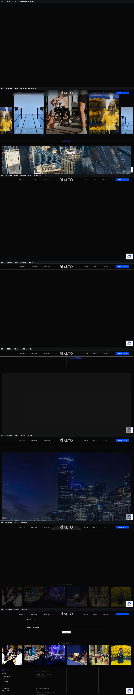
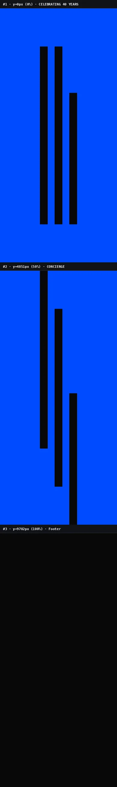

# UI Design System & Master Generation Blueprint: rialto-com-au

> **Rialto · The icon of Melbourne's skyline** (https://rialto.com.au/) — With the prestige of Melbourne's Collins Street address. Rialto hosts world-class amenity, dining and retail, offering unique experiences.





---

## 1. Executive Visual Persona & Design Archetype

- **Brand Essence & Persona**: **Rialto · The icon of Melbourne's skyline** (`https://rialto.com.au/`). With the prestige of Melbourne's Collins Street address. Rialto hosts world-class amenity, dining and retail, offering unique experiences.
- **Capture Provenance**: Live browser capture (`tier1_fast`, HTTP `200`, captured `2026-11-24`).
- **Visual Archetype**: **High-Contrast Obsidian / Atmospheric Design System (`#080808` canvas, `#ffffff` ink, `#004bff` accent)**.
- **Anti-AI-Slop Differentiators**:
  - **Live-Computed Chromatic Polarity**: Anchors the viewport in `#080808` (live computed `body` `background-color` (`computed_styles.json`)) paired with `#ffffff` primary typography and `#004bff` accents.
  - **Grounded Typographic Hierarchy**: Pairs `Sharp Grotesk` for display copy (`CELEBRATING 40 YEARS`) with `Gotham`.
  - **Calibrated Spatial Grid & Motion**: Combines `1440px` container bounds (`gap: 24px`, padding `20px`) with `cubic-bezier(.165,.84,.44,1)` easing and Three.js / WebGL Canvas Pipeline, Swiper Touch Carousel Engine.

---

## 2. Spatial Architecture & Modular Grid Mathematics

### Viewport Allocation & Container Geometry
- **Captured Journey Filmstrips**: Desktop `1280×6624px` (`assets/desktop-journey.webp`, `8` keyframes up to `y=12152px` / doc `13080px`), Mobile `390×2616px` (`assets/mobile-journey.webp`, `3` keyframes).
- **Master Container Bounds**: `1440px` (full-bleed `100%` desktop stage measured on `1440px` viewport).
- **Canvas Lateral Padding & Spacing**: `20px` lateral canvas padding with `24px` grid gap.
- **Border Radius Scale**: `4px`, `3px`, `40px`, `50%`.

### Responsive Breakpoint Architecture
- **Desktop Layout**: Multi-column CSS Grid / Flexbox layout at `1440px` (`max-width: 1440px`, `gap: 24px`).
- **Mobile Layout**: Single-column vertical stack at `390px` viewport width with `20px` horizontal padding.
- **Extracted CSS Media Queries**: `@media (max-width:640px)`, `@media (max-width:480px)`, `@media (min-width:800px)`, `@media (min-width:480px)`.

---

## 3. Color System, Materiality & Atmospheric Lighting

### Semantic Palette & Source Grounding
| Semantic Role | Ground-Truth Value | Extracted Live / CSS Source |
|---|---|---|
| **Primary Canvas Substrate** | `#080808` | live computed `body` `background-color` (`computed_styles.json`) |
| **Primary Typography Ink** | `#ffffff` | live computed `h1` `color` (`computed_styles.json`) |
| **Elevated Surface / Card Substrate** | `#004bff` | live computed `section` `background-color` (`computed_styles.json`) |
| **Interactive Accent / Highlight** | `#004bff` | live computed `button` `color` (`computed_styles.json`) |
| **Secondary / Muted Copy** | `#004bff` | live computed `button` `color` (`computed_styles.json`) |
| **Structural Hairline Border** | `#666666` | `#sbi_lightbox .sbi_lightbox_action { border-left: #666666 }` |
| **Variable Token (`--color-black`)** | `#000000` | `var(--color-black)` in `:root` |
| **Variable Token (`--color-gray-300`)** | `#d1d4d6` | `var(--color-gray-300)` in `:root` |
| **Variable Token (`--color-gray-700`)** | `#3d3d3b` | `var(--color-gray-700)` in `:root` |
| **Variable Token (`--color-gray-800`)** | `#231f20` | `var(--color-gray-800)` in `:root` |
| **Variable Token (`--color-pink-400`)** | `#ffc8ff` | `var(--color-pink-400)` in `:root` |

### Sanitized Root CSS Variables (`ui-ux.md` Ground Truth)
| Variable Name | Extracted Value | Semantic Role |
|---|---|---|
| `--color-white` | `#fff` | Canvas / Surface Token |
| `--color-white-thin` | `rgba(255, 255, 255, 0.5)` | Canvas / Surface Token |
| `--color-black` | `#000` | Canvas / Surface Token |
| `--color-current-thin` | `color-mix(in srgb, currentColor 50%, transparent 50%)` | Brand / Palette Token |
| `--color-current-thin-md` | `color-mix(in srgb, currentColor 75%, transparent 25%)` | Brand / Palette Token |
| `--color-gray-300` | `#d1d4d6` | Brand / Palette Token |
| `--color-gray-700` | `#3d3d3b` | Brand / Palette Token |
| `--color-gray-800` | `#231f20` | Brand / Palette Token |
| `--color-gray-900` | `#080808` | Brand / Palette Token |
| `--color-blue-700` | `#004bff` | Brand / Palette Token |
| `--color-pink-400` | `#ffc8ff` | Typography Ink Token |
| `--color-body-bg` | `#080808` | Canvas / Surface Token |
| `--color-body-color` | `#fff` | Typography Ink Token |
| `--color-accent` | `var(--color-blue-700)` | Brand / Palette Token |
| `--color-secondary` | `var(--color-gray-900)` | Brand / Palette Token |
| `--color-light` | `var(--color-white)` | Canvas / Surface Token |

---

## 4. Typographic Scale & Editorial Hierarchy

### Font Family Stacks
- **Display Typography**: `Sharp Grotesk`.
- **Primary Body Stack**: `Gotham`.
- **Technical / Metadata Stack**: not declared in live computed styles (uses primary stack / `ui-monospace`).

### Typographic Scale & Rules (Live Computed & Stylesheet Grounded)
- **Hero Display (`H1`)**: live computed `h1` (`font-size: 200px`, `line-height: 240px`, `font-weight: 700`, `letter-spacing: 3px`); rule `,.h1` (`font-size: 20rem`, `line-height: .84`, `letter-spacing: .015em`, `font-weight: 700`).
- **Section Heading (`H2`)**: live computed `h2` (`font-size: 100px`, `line-height: 84px`, `font-weight: 700`, `letter-spacing: 1.5px`); rule `,.h2` (`font-size: 10rem`, `line-height: .84`, `letter-spacing: .015em`, `font-weight: 700`).
- **Body Copy**: live computed `body` (`font-size: 24px`, `line-height: 27px`, `font-weight: 300`); CSS variables `--tile-body-opacity: 0`, `--tile-body-translate-y: 2rem`; rule `p` (`line-height: 1.2`).
- **Metadata & Navigation Labels**: live computed `nav/a` (`font-size: 14px`, `line-height: 17.0002px`, `font-weight: 300`); CSS variables `--button-letter-spacing: 0.185em`.

---

## 5. Choreographed Motion & Interaction Physics

### Primary Easing Curves
- **Extracted Timing Functions**: `cubic-bezier(.165,.84,.44,1)`, `cubic-bezier(.49,.78,.46,1.34)`, `cubic-bezier(0.25,0.1,0.25,1)`.

### Per-Element Transition & Choreography Rules
- **Selector `#sb_instagram.sbi_masonry #sbi_im...`**: `transition: height .5s ease` extracted from `rialto-com-au` stylesheet.
- **Selector `#sb_instagram #sbi_images .sbi_item`**: `transition: all .5s ease` extracted from `rialto-com-au` stylesheet.
- **Selector `instagram.sbi_masonry #sbi_images...`**: `transition: opacity .5s ease` extracted from `rialto-com-au` stylesheet.
- **Extracted Easing Curve (`cubic-bezier(.165,.84,.44,1)`)**: Governs interactive state transitions across `<header.header>` and `<section.module--hero>`.
- **Runtime Interaction Engine**: Integrates Three.js / WebGL Canvas Pipeline, Swiper Touch Carousel Engine, Barba.js Page Transition Router with `prefers-reduced-motion: reduce` fallback guards.
### Measured Runtime Scroll & Interaction Telemetry (`behavioral_journey_v2`)
- **Scroll Driver Mode**: `native` (max document height `13080px`, deepest scrollY reached `12152px` across `8` desktop keyframes).
- **Detected Scroll / Motion Libraries**: Native browser scroll / standard CSS transitions.
- **Interactive Control Probe (`carousel_next` · `Previous slide`)**: Triggered visual diff `35.871` (attr ` -> `, captured in `assets/state-interactive.webp`).
- **Route Transition Architecture**: First internal navigation (`/whats-on/rialto-run-up/`) measured as `direct` in `2416ms`.

---

## 6. Component Wireframe & Structural DOM Map

### Visual Layout Schematic — Desktop (`1440px`, Grounded in `dom.html` & Landmark Bounding Boxes)
```
┌────────────────────────────────────────────────────────────────────────┐
│ DESKTOP VIEWPORT (1440px) — Rialto · The icon of Melbourne's skyline   │
│ ====================================================================== │
│ [ <header.header> (1425x65px)         | Discover · What's On · Exper ] │
│ ---------------------------------------------------------------------- │
│ | HERO STAGE: <section.module> (w=1425px)                            | │
│ | H1: CELEBRATING 40 YEARS                                           | │
│ | Substrate: #080808 | Ink: #ffffff | Accent: #004bff                | │
│ ---------------------------------------------------------------------- │
│ | SHOWCASE GRID (<section.module--hero>) max-w: 1440px               | │
│ | +------------------------------+  +------------------------------+ | │
│ | | A MELBOURNE ICON             |  | AMBITION LIVES HERE          | | │
│ | +------------------------------+  +------------------------------+ | │
│ ---------------------------------------------------------------------- │
│ | DETAIL MODULE (<section.module--image_tex) — WHAT’S ON AT RIALTO   | │
│ ---------------------------------------------------------------------- │
│ [ FOOTER (<footer.footer>     ) | https://rialto.com.au/               │
└────────────────────────────────────────────────────────────────────────┘
```

### Visual Layout Schematic — Mobile Reflow (`390px`)
```
┌────────────────────────────────────────────────────────────────────────┐
│ MOBILE VIEWPORT REFLOW (390px) — Single-Column Stack (gap: 24px)       │
│ ====================================================================== │
│ [ HEADER BAR (<header.header>         ) | Compact Menu (390px)         │
│ ---------------------------------------------------------------------- │
│ | HERO STAGE (<section.module>) — 390px Vertical Lead                | │
│ | H1: CELEBRATING 40 YEARS                                           | │
│ ---------------------------------------------------------------------- │
│ | SHOWCASE STACK (<section.module--hero>) — 1-Col Stack              | │
│ | [ Item 1: A MELBOURNE ICON                                       ] | │
│ | [ Item 2: AMBITION LIVES HERE                                    ] | │
│ ---------------------------------------------------------------------- │
│ | DETAIL STACK (<section.module--image_t) — 1-Col (WHAT’S ON AT RIALT) │
│ ---------------------------------------------------------------------- │
│ [ FOOTER (<footer.footer>     ) | Stacked 390px Colophon               │
└────────────────────────────────────────────────────────────────────────┘
```

### Granular DOM Region Breakdown
1. **Brand Header & Navigation Bar (<header.header> — `rialto-com-au`)**:
   - Landmark `<header class="header borders">` (`1425x65px`) hosting `Rialto · The icon of Melbourne's sky` navigation (`Discover · What's On · Experience`), DOM attributes (`data-rocket-prefetch`, `data-rocket-preload`, `data-minify="1"`, `data-minify="1"`), and stylesheet rule `sb_instagram { -webkit-box-sizing:border-box;-moz-box-sizing:border-box;box-sizing:bord... }`.
2. **Hero Stage & Focal Lead (<section.module> — `CELEBRATING 40 YEARS`)**:
   - Landmark `<section class="module module--landing_animation">` presenting display lead `CELEBRATING 40 YEARS` and copy excerpt *"Rialto is for those who embrace potential, realise goals and cont"* over `#080808` canvas and `#ffffff` ink.
3. **Primary Showcase & Content Grid (<section.module--hero> — `A MELBOURNE ICON`)**:
   - Landmark `<section class="module module--hero">` rendering section `A MELBOURNE ICON` with copy *"AMBITION LIVES HERE"*, asset references (`recaptcha__en.js`, `gtm.js`, `google-analytics.com`, `ajax.googleapis.com`), and grid rule `sb_instagram:after { clear:both;content:"";display:table }`.
4. **Interactive Detail & Feature Matrix (<section.module--image_text> — `AMBITION LIVES HERE`)**:
   - Landmark `<section class="module module--image_text">` framing `AMBITION LIVES HERE` and `WHAT’S ON AT RIALTO` (*"This is a place that welcomes the driven, where we can achieve be"*) with `#004bff` surface cards, `#004bff` accents, and `sb_instagram.sbi_fixed_height { overflow:hidden;overflow-y:auto }`.
5. **Colophon & Global Directory Footer (<footer.footer> — `https://rialto.com.au/`)**:
   - Landmark `<footer class="footer">` anchoring `Rialto · The icon of Melbourne's` footer links (`Discover · What's On · Experience`), copy *"WHAT’S ON AT RIALTO"*, and `#666666` structural dividers.
### Full Vertical Scroll Sequence (Desktop `1440×900` Keyframes)
- **Step 01** (`y=0px`, `0%`): Active landmark `CELEBRATING 40 YEARS` · sticky/fixed elements: `5`
- **Step 02** (`y=1700px`, `14%`): Active landmark `40 YEARS OF RIALTO` · sticky/fixed elements: `4`
- **Step 03** (`y=3400px`, `28%`): Active landmark `HEALTH AND WELLBEING AMENITIES` · sticky/fixed elements: `4`
- **Step 04** (`y=5100px`, `42%`): Active landmark `DINING AT RIALTO` · sticky/fixed elements: `4`
- **Step 05** (`y=7650px`, `63%`): Active landmark `Section @ 63%` · sticky/fixed elements: `4`
- **Step 06** (`y=10200px`, `84%`): Active landmark `Section @ 84%` · sticky/fixed elements: `4`
- **Step 07** (`y=11900px`, `98%`): Active landmark `Footer` · sticky/fixed elements: `4`
- **Step 08** (`y=12152px`, `100%`): Active landmark `Footer` · sticky/fixed elements: `4`

### Multi-Page Internal Route Map
- **Detail Route (`/whats-on/rialto-run-up/`)**: `https://rialto.com.au/whats-on/rialto-run-up/` — H1: `RIALTO RUN UP`, scrollHeight `5843px`, transition `direct` (`2416ms`)
- **About Route (`/about/`)**: `https://rialto.com.au/about/` — H1: `LIFE AT RIALTO`, scrollHeight `4568px`, transition `direct` (`1391ms`)
- **Detail Route (`/whats-on/daffodil-day-at-rialto/`)**: `https://rialto.com.au/whats-on/daffodil-day-at-rialto/` — H1: `DAFFODIL DAY AT RIALTO`, scrollHeight `6351px`, transition `direct` (`1776ms`)

---

## 7. Master Zero-Shot AI Generation Prompt

```markdown
# Master Zero-Shot Frontend Generation Prompt: rialto-com-au (Rialto · The icon of Melbourne's skyline)

You are a principal frontend architect and design systems engineer. Build a complete, production-ready web application replicating the exact design system, DOM landmarks, typographic hierarchy, color tokens, and motion physics of `rialto-com-au` (**Rialto · The icon of Melbourne's skyline** — `https://rialto.com.au/`).

### 1. Visual Archetype & Anti-AI-Slop Mandates
- **Archetype**: High-Contrast Obsidian / Atmospheric Design System (`#080808` canvas, `#ffffff` ink, `#004bff` accent).
- **Identity & Domain Context**: With the prestige of Melbourne's Collins Street address. Rialto hosts world-class amenity, dining and retail, offering unique experiences.
- **Primary Substrate**: `#080808` (live computed `body` `background-color` (`computed_styles.json`)), **Primary Ink**: `#ffffff`, **Accent / Highlight**: `#004bff`.
- **Site-Specific Differentiators**:
  - **Live-Computed Chromatic Polarity**: Anchors the viewport in `#080808` (live computed `body` `background-color` (`computed_styles.json`)) paired with `#ffffff` primary typography and `#004bff` accents.
  - **Grounded Typographic Hierarchy**: Pairs `Sharp Grotesk` for display copy (`CELEBRATING 40 YEARS`) with `Gotham`.
  - **Calibrated Spatial Grid & Motion**: Combines `1440px` container bounds (`gap: 24px`, padding `20px`) with `cubic-bezier(.165,.84,.44,1)` easing and Three.js / WebGL Canvas Pipeline, Swiper Touch Carousel Engine.

### 2. Ground-Truth CSS Variables (`:root` Token Contract)
Declare and consume these exact custom properties extracted from `rialto-com-au` in your global stylesheet:

:root {
  /* Rialto · The icon of Melbourne's skyline (rialto-com-au) — Live-Grounded CSS Variables */
  --color-white: #fff; /* Canvas / Surface Token (rialto-com-au) */
  --color-white-thin: rgba(255, 255, 255, 0.5); /* Canvas / Surface Token (rialto-com-au) */
  --color-black: #000; /* Canvas / Surface Token (rialto-com-au) */
  --color-current-thin: color-mix(in srgb, currentColor 50%, transparent 50%); /* Brand / Palette Token (rialto-com-au) */
  --color-current-thin-md: color-mix(in srgb, currentColor 75%, transparent 25%); /* Brand / Palette Token (rialto-com-au) */
  --color-gray-300: #d1d4d6; /* Brand / Palette Token (rialto-com-au) */
  --color-gray-700: #3d3d3b; /* Brand / Palette Token (rialto-com-au) */
  --color-gray-800: #231f20; /* Brand / Palette Token (rialto-com-au) */
  --color-gray-900: #080808; /* Brand / Palette Token (rialto-com-au) */
  --color-blue-700: #004bff; /* Brand / Palette Token (rialto-com-au) */
  --color-pink-400: #ffc8ff; /* Typography Ink Token (rialto-com-au) */
  --color-body-bg: #080808; /* Canvas / Surface Token (rialto-com-au) */
  --color-body-color: #fff; /* Typography Ink Token (rialto-com-au) */
  --color-accent: var(--color-blue-700); /* Brand / Palette Token (rialto-com-au) */
  --color-secondary: var(--color-gray-900); /* Brand / Palette Token (rialto-com-au) */
  --color-light: var(--color-white); /* Canvas / Surface Token (rialto-com-au) */
}

### 3. Semantic Color & Materiality Contract
Map every surface, ink, and border strictly to these source-grounded tokens:
- **Primary Canvas Substrate**: `#080808` — grounded in live computed `body` `background-color` (`computed_styles.json`)
- **Primary Typography Ink**: `#ffffff` — grounded in live computed `h1` `color` (`computed_styles.json`)
- **Elevated Surface / Card Substrate**: `#004bff` — grounded in live computed `section` `background-color` (`computed_styles.json`)
- **Interactive Accent / Highlight**: `#004bff` — grounded in live computed `button` `color` (`computed_styles.json`)
- **Secondary / Muted Copy**: `#004bff` — grounded in live computed `button` `color` (`computed_styles.json`)
- **Structural Hairline Border**: `#666666` — grounded in `#sbi_lightbox .sbi_lightbox_action { border-left: #666666 }`
- **Variable Token (`--color-black`)**: `#000000` — grounded in `var(--color-black)` in `:root`
- **Variable Token (`--color-gray-300`)**: `#d1d4d6` — grounded in `var(--color-gray-300)` in `:root`
- **Variable Token (`--color-gray-700`)**: `#3d3d3b` — grounded in `var(--color-gray-700)` in `:root`
- **Variable Token (`--color-gray-800`)**: `#231f20` — grounded in `var(--color-gray-800)` in `:root`
- **Variable Token (`--color-pink-400`)**: `#ffc8ff` — grounded in `var(--color-pink-400)` in `:root`

### 4. Spatial Grid, Container Bounds & Responsive Breakpoints
- **Desktop Viewport Reference**: `1280×6624px` (multi-frame vertical journey filmstrip (6624px), `1440px` standard desktop width).
- **Mobile Viewport Reference**: `390×2616px` (multi-frame vertical journey filmstrip (2616px), `390px` standard mobile width).
- **Container Max-Width**: `1440px` (full-bleed `100%` desktop stage measured on `1440px` viewport)
- **Padding & Gutters**: `20px` lateral canvas padding with `24px` grid gap
- **Desktop Grid**: Multi-column CSS Grid / Flexbox layout at `1440px` (`max-width: 1440px`, `gap: 24px`)
- **Mobile Adaptation**: Single-column vertical stack at `390px` viewport width with `20px` horizontal padding
- **Media Queries**: `@media (max-width:640px)`, `@media (max-width:480px)`, `@media (min-width:800px)`, `@media (min-width:480px)`
- **Corner Radii**: `4px`, `3px`, `40px`, `50%`

### 5. Typography & Editorial Scale Contract
- **Display Font Stack**: `Sharp Grotesk`
- **Body Font Stack**: `Gotham`
- **Monospace / Technical Font Stack**: not declared in live computed styles (uses primary stack / `ui-monospace`)
- **H1 Display Rule**: live computed `h1` (`font-size: 200px`, `line-height: 240px`, `font-weight: 700`, `letter-spacing: 3px`); rule `,.h1` (`font-size: 20rem`, `line-height: .84`, `letter-spacing: .015em`, `font-weight: 700`)
- **H2 Section Rule**: live computed `h2` (`font-size: 100px`, `line-height: 84px`, `font-weight: 700`, `letter-spacing: 1.5px`); rule `,.h2` (`font-size: 10rem`, `line-height: .84`, `letter-spacing: .015em`, `font-weight: 700`)
- **Body Copy Rule**: live computed `body` (`font-size: 24px`, `line-height: 27px`, `font-weight: 300`); CSS variables `--tile-body-opacity: 0`, `--tile-body-translate-y: 2rem`; rule `p` (`line-height: 1.2`)
- **Metadata & Index Rule**: live computed `nav/a` (`font-size: 14px`, `line-height: 17.0002px`, `font-weight: 300`); CSS variables `--button-letter-spacing: 0.185em`

### 6. Component Hierarchy, Verbatim Copy & Real DOM Landmarks
Scaffold `rialto-com-au` (`Rialto · The icon of Melbourne's skyline`) with these exact structural regions, extracted copy, and CSS rules from `dom.html`:
1. **Brand Header & Navigation Bar (<header.header> — `rialto-com-au`)**:
   - DOM & Selectors: Landmark `<header class="header borders">` (`1425x65px`) hosting `Rialto · The icon of Melbourne's sky` navigation (`Discover · What's On · Experience`), DOM attributes (`data-rocket-prefetch`, `data-rocket-preload`, `data-minify="1"`, `data-minify="1"`), and stylesheet rule `sb_instagram { -webkit-box-sizing:border-box;-moz-box-sizing:border-box;box-sizing:bord... }`.
   - Responsive Contract: Header `Brand Header & Navigation Bar (<header.header> — `rialto-com-au`)` (`rialto-com-au`) adapts across `@media (max-width:640px)`, `@media (max-width:480px)`, `@media (min-width:800px)`, `@media (min-width:480px)` with `cubic-bezier(.165,.84,.44,1)`, `cubic-bezier(.49,.78,.46,1.34)`, `cubic-bezier(0.25,0.1,0.25,1)` transitions and links `Discover · What's On · Experience`.
2. **Hero Stage & Focal Lead (<section.module> — `CELEBRATING 40 YEARS`)**:
   - DOM & Selectors: Landmark `<section class="module module--landing_animation">` presenting display lead `CELEBRATING 40 YEARS` and copy excerpt *"Rialto is for those who embrace potential, realise goals and cont"* over `#080808` canvas and `#ffffff` ink.
   - Responsive Contract: Hero stage (`1280×6624px` desktop / `390×2616px` mobile) sets `#080808` background with `#ffffff` headline `CELEBRATING 40 YEARS`.
3. **Primary Showcase & Content Grid (<section.module--hero> — `A MELBOURNE ICON`)**:
   - DOM & Selectors: Landmark `<section class="module module--hero">` rendering section `A MELBOURNE ICON` with copy *"AMBITION LIVES HERE"*, asset references (`recaptcha__en.js`, `gtm.js`, `google-analytics.com`, `ajax.googleapis.com`), and grid rule `sb_instagram:after { clear:both;content:"";display:table }`.
   - Responsive Contract: Showcase grid `Primary Showcase & Content Grid (<section.module--hero> — `A MELBOURNE ICON`)` applies Multi-column CSS Grid / Flexbox layout at `1440px` (`max-width: 1440px`, `gap: 24px`) on desktop and Single-column vertical stack at `390px` viewport width with `20px` horizontal padding on mobile.
4. **Interactive Detail & Feature Matrix (<section.module--image_text> — `AMBITION LIVES HERE`)**:
   - DOM & Selectors: Landmark `<section class="module module--image_text">` framing `AMBITION LIVES HERE` and `WHAT’S ON AT RIALTO` (*"This is a place that welcomes the driven, where we can achieve be"*) with `#004bff` surface cards, `#004bff` accents, and `sb_instagram.sbi_fixed_height { overflow:hidden;overflow-y:auto }`.
   - Responsive Contract: Detail module `Interactive Detail & Feature Matrix (<section.module--image_text> — `AMBITION LIVES HERE`)` uses `4px`, `3px`, `40px`, `50%` radii, `#004bff` highlights, and assets (recaptcha__en.js, gtm.js, google-analytics.com).
5. **Colophon & Global Directory Footer (<footer.footer> — `https://rialto.com.au/`)**:
   - DOM & Selectors: Landmark `<footer class="footer">` anchoring `Rialto · The icon of Melbourne's` footer links (`Discover · What's On · Experience`), copy *"WHAT’S ON AT RIALTO"*, and `#666666` structural dividers.
   - Responsive Contract: Footer `Colophon & Global Directory Footer (<footer.footer> — `https://rialto.com.au/`)` aligns to `1440px` (full-bleed `100%` desktop stage measured on `1440px` viewport) with `20px` lateral canvas padding with `24px` grid gap and attributes (data-rocket-prefetch, data-rocket-preload, data-minify="1").

#### Verbatim DOM Copy Excerpts (`dom.html`)
- Copy Excerpt 1: *"Rialto is for those who embrace potential, realise goals and continue to build new..."*
- Copy Excerpt 2: *"AMBITION LIVES HERE"*
- Copy Excerpt 3: *"This is a place that welcomes the driven, where we can achieve better, together. S..."*
- Copy Excerpt 4: *"WHAT’S ON AT RIALTO"*

### 7. Motion, Extracted Stylesheet Rules & Interaction Choreography
- **Primary Easing Functions**: `cubic-bezier(.165,.84,.44,1)`, `cubic-bezier(.49,.78,.46,1.34)`, `cubic-bezier(0.25,0.1,0.25,1)`
- **Extracted Stylesheet Rules (`rialto-com-au`)**:
- `sb_instagram { -webkit-box-sizing:border-box;-moz-box-sizing:border-box;box-sizing:bord... }`
- `sb_instagram:after { clear:both;content:"";display:table }`
- `sb_instagram.sbi_fixed_height { overflow:hidden;overflow-y:auto }`
- `sb_instagram a { border-bottom:0!important }`
- `sbi_images .sbi_item.sbi_transition { max-height:0;opacity:0 }`
- **Per-Selector Transition Rules**:
- **Selector `#sb_instagram.sbi_masonry #sbi_im...`**: `transition: height .5s ease` extracted from `rialto-com-au` stylesheet.
- **Selector `#sb_instagram #sbi_images .sbi_item`**: `transition: all .5s ease` extracted from `rialto-com-au` stylesheet.
- **Selector `instagram.sbi_masonry #sbi_images...`**: `transition: opacity .5s ease` extracted from `rialto-com-au` stylesheet.
- **Extracted Easing Curve (`cubic-bezier(.165,.84,.44,1)`)**: Governs interactive state transitions across `<header.header>` and `<section.module--hero>`.
- **Runtime Interaction Engine**: Integrates Three.js / WebGL Canvas Pipeline, Swiper Touch Carousel Engine, Barba.js Page Transition Router with `prefers-reduced-motion: reduce` fallback guards.
### 7b. Full-Page Scroll Choreography, Interactive States & Multi-Page Routes
- **Scroll Mechanics**: Implement `native` vertical progression up to `13080px` across 8 distinct viewport chapters.
- **Vertical Chapter Sequence**: CELEBRATING 40 YEARS (0%) -> 40 YEARS OF RIALTO (14%) -> HEALTH AND WELLBEING AMENITIES (28%) -> DINING AT RIALTO (42%) -> Section @ 63% (63%) -> Section @ 84% (84%) -> Footer (98%) -> Footer (100%).
- **Multi-Page Routes**: Scaffold internal routes `/whats-on/rialto-run-up/` (detail, direct), `/about/` (about, direct), `/whats-on/daffodil-day-at-rialto/` (detail, direct) sharing the global header/footer shell and design tokens.

### 8. Technical Deliverables
- Implement in Next.js (App Router) with TypeScript and Tailwind CSS consuming the `:root` custom properties defined above for `rialto-com-au`.
- Reproduce both the `1440px` desktop architecture and `390px` mobile breakpoint transitions, preserving semantic HTML5 landmarks (`<header>`, `<nav>`, `<main>`, `<section>`, `<footer>`) and `prefers-reduced-motion` accessibility guards.
```
---

## 8. Full-Page Scroll Journey, Interactive States & Subpage Inventory

### Desktop Scroll Keyframes (`1440×900` WebP)
| Step | Scroll Y | Progress | Active Landmark / Section | Sticky/Fixed | Visual Asset |
| :---: | :---: | :---: | :--- | :---: | :--- |
| `#01` | `0px` | `0%` | CELEBRATING 40 YEARS | `5` | [desktop-step-01.webp](assets/desktop-step-01.webp) |
| `#02` | `1700px` | `14%` | 40 YEARS OF RIALTO | `4` | [desktop-step-02.webp](assets/desktop-step-02.webp) |
| `#03` | `3400px` | `28%` | HEALTH AND WELLBEING AMENITIES | `4` | [desktop-step-03.webp](assets/desktop-step-03.webp) |
| `#04` | `5100px` | `42%` | DINING AT RIALTO | `4` | [desktop-step-04.webp](assets/desktop-step-04.webp) |
| `#05` | `7650px` | `63%` | Section @ 63% | `4` | [desktop-step-05.webp](assets/desktop-step-05.webp) |
| `#06` | `10200px` | `84%` | Section @ 84% | `4` | [desktop-step-06.webp](assets/desktop-step-06.webp) |
| `#07` | `11900px` | `98%` | Footer | `4` | [desktop-step-07.webp](assets/desktop-step-07.webp) |
| `#08` | `12152px` | `100%` | Footer | `4` | [desktop-step-08.webp](assets/desktop-step-08.webp) |

### Mobile Condensed Keyframes (`390×844` WebP)
| Step | Scroll Y | Progress | Active Landmark | Visual Asset |
| :---: | :---: | :---: | :--- | :--- |
| `#01` | `0px` | `0%` | CELEBRATING 40 YEARS | [mobile-step-01.webp](assets/mobile-step-01.webp) |
| `#02` | `4851px` | `50%` | CONCIERGE | [mobile-step-02.webp](assets/mobile-step-02.webp) |
| `#03` | `9702px` | `100%` | Footer | [mobile-step-03.webp](assets/mobile-step-03.webp) |

### Interactive UI State Captures (`1440×900` WebP)
| State Type | Trigger / Observation | Visual Asset |
| :--- | :--- | :--- |
| `interactive_control` | Control `carousel_next` (`Previous slide`, diff `35.871`) | [state-interactive.webp](assets/state-interactive.webp) |

### Internal Subpage Filmstrips (`1080px` Wide WebP)
| # | Template | Route URL | H1 / Title | Scroll Height | Transition | Filmstrip Asset |
| :-: | :---: | :--- | :--- | :---: | :---: | :--- |
| `1` | `detail` | `https://rialto.com.au/whats-on/rialto-run-up/` | RIALTO RUN UP | `5843px` | `direct` (`2416ms`) | [subpage-01-whats-on-rialto-run-up.webp](assets/subpage-01-whats-on-rialto-run-up.webp) |
| `2` | `about` | `https://rialto.com.au/about/` | LIFE AT RIALTO | `4568px` | `direct` (`1391ms`) | [subpage-02-about.webp](assets/subpage-02-about.webp) |
| `3` | `detail` | `https://rialto.com.au/whats-on/daffodil-day-at-rialto/` | DAFFODIL DAY AT RIALTO | `6351px` | `direct` (`1776ms`) | [subpage-03-whats-on-daffodil-day-at-rialto.webp](assets/subpage-03-whats-on-daffodil-day-at-rialto.webp) |

