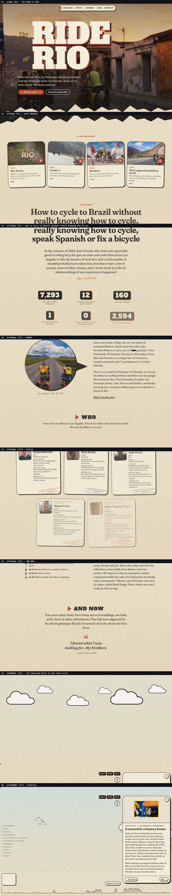
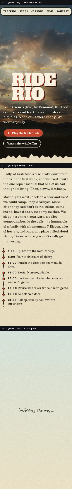

# UI Design System & Master Generation Blueprint: ridetorio-com

> **The Ride to Rio · Bicycle documentary, Los Angeles to Rio** (https://ridetorio.com/) — A documentary about five friends who cycled 10,000 miles from Los Angeles to Rio de Janeiro. Watch the trailers and full film, and follow...





---

## 1. Executive Visual Persona & Design Archetype

- **Brand Essence & Persona**: **The Ride to Rio · Bicycle documentary, Los Angeles to Rio** (`https://ridetorio.com/`). A documentary about five friends who cycled 10,000 miles from Los Angeles to Rio de Janeiro. Watch the trailers and full film, and follow...
- **Capture Provenance**: Live browser capture (`tier1_fast`, HTTP `200`, captured `2026-11-24`).
- **Visual Archetype**: **Light-Gallery WebGL / Canvas Interactive Experience (`#f4ead0` / `#ff0000`)**.
- **Anti-AI-Slop Differentiators**:
  - **Live-Computed Chromatic Polarity**: Anchors the viewport in `#f4ead0` (live computed `html` `background-color` (`computed_styles.json`)) paired with `#1e1b16` primary typography and `#ff0000` accents.
  - **Grounded Typographic Hierarchy**: Pairs `Alfa Slab One` for display copy (`The RIDE to RIO`) with `Fraunces`.
  - **Calibrated Spatial Grid & Motion**: Combines `1280px` container bounds (`gap: 4.8px`, padding `6.4px`) with `cubic-bezier(.2,.8,.2,1)` easing and Lenis Smooth Scroll (`data-lenis`), Three.js / WebGL Canvas Pipeline.

---

## 2. Spatial Architecture & Modular Grid Mathematics

### Viewport Allocation & Container Geometry
- **Captured Journey Filmstrips**: Desktop `1280×6624px` (`assets/desktop-journey.webp`, `8` keyframes up to `y=14400px` / doc `27072px`), Mobile `390×2616px` (`assets/mobile-journey.webp`, `3` keyframes).
- **Master Container Bounds**: `1280px` (measured widest bounded `<section>` landmark width on `1440px` desktop).
- **Canvas Lateral Padding & Spacing**: `6.4px` lateral canvas padding with `4.8px` grid gap.
- **Border Radius Scale**: `999px`, `6px`, `30%`, `50%`.

### Responsive Breakpoint Architecture
- **Desktop Layout**: Multi-column CSS Grid / Flexbox layout at `1440px` (`max-width: 1280px`, `gap: 4.8px`).
- **Mobile Layout**: Single-column vertical stack at `390px` viewport width with `6.4px` horizontal padding.
- **Extracted CSS Media Queries**: `@media (max-width: 48rem)`, `@media (prefers-reduced-motion: reduce)`, `@media (max-width: 30rem)`, `@media (max-width: 36rem)`.

---

## 3. Color System, Materiality & Atmospheric Lighting

### Semantic Palette & Source Grounding
| Semantic Role | Ground-Truth Value | Extracted Live / CSS Source |
|---|---|---|
| **Primary Canvas Substrate** | `#f4ead0` | live computed `html` `background-color` (`computed_styles.json`) |
| **Primary Typography Ink** | `#1e1b16` | live computed `main` `color` (`computed_styles.json`) |
| **Elevated Surface / Card Substrate** | `#fbf4df` | `var(--paper-2)` in `:root` |
| **Interactive Accent / Highlight** | `#ff0000` | `.btn--primary { background: red }` (`#ff0000`) |
| **Secondary / Muted Copy** | `#d9a93b` | live computed `p` `color` (`computed_styles.json`) |
| **Structural Hairline Border** | `#fff6e4` | `.btn--ghost { border-color: #fff6e4 }` |
| **Variable Token (`--ink-soft`)** | `#4a4337` | `var(--ink-soft)` in `:root` |
| **Variable Token (`--olive`)** | `#8c9a4a` | `var(--olive)` in `:root` |
| **Variable Token (`--forest`)** | `#2f4a2c` | `var(--forest)` in `:root` |
| **Variable Token (`--teal`)** | `#2f8f8b` | `var(--teal)` in `:root` |
| **Variable Token (`--red`)** | `#c8452c` | `var(--red)` in `:root` |
| **Variable Token (`--sky`)** | `#a9d3de` | `var(--sky)` in `:root` |
| **Variable Token (`--dusk`)** | `#f2a27c` | `var(--dusk)` in `:root` |
| **Variable Token (`--night`)** | `#16233a` | `var(--night)` in `:root` |

### Sanitized Root CSS Variables (`ui-ux.md` Ground Truth)
| Variable Name | Extracted Value | Semantic Role |
|---|---|---|
| `--paper` | `#F4EAD0` | Canvas / Surface Token |
| `--paper-2` | `#FBF4DF` | Canvas / Surface Token |
| `--ink` | `#1E1B16` | Typography Ink Token |
| `--ink-soft` | `#4A4337` | Typography Ink Token |
| `--olive` | `#8C9A4A` | Color / Atmospheric Token |
| `--forest` | `#2F4A2C` | Color / Atmospheric Token |
| `--mustard` | `#D9A93B` | Color / Atmospheric Token |
| `--teal` | `#2F8F8B` | Color / Atmospheric Token |
| `--red` | `#C8452C` | Color / Atmospheric Token |
| `--sky` | `#A9D3DE` | Color / Atmospheric Token |
| `--dusk` | `#F2A27C` | Color / Atmospheric Token |
| `--night` | `#16233A` | Color / Atmospheric Token |
| `--sky-top` | `var(--paper)` | Design System Custom Token |
| `--sky-bot` | `var(--paper)` | Design System Custom Token |
| `--stars` | `0` | Design System Custom Token |
| `--font-body` | `"Fraunces", "Iowan Old Style", Georgia, serif` | Typography / Scale Token |

---

## 4. Typographic Scale & Editorial Hierarchy

### Font Family Stacks
- **Display Typography**: `Alfa Slab One`.
- **Primary Body Stack**: `Fraunces`.
- **Technical / Metadata Stack**: not declared in live computed styles (uses primary stack / `ui-monospace`).

### Typographic Scale & Rules (Live Computed & Stylesheet Grounded)
- **Hero Display (`H1`)**: live computed `h1` (`font-size: 242.4px`, `line-height: 208.464px`, `font-weight: 400`, `letter-spacing: -2.424px`).
- **Section Heading (`H2`)**: live computed `h2` (`font-size: 70.4px`, `line-height: 71.808px`, `font-weight: 620`, `letter-spacing: -1.056px`).
- **Body Copy**: live computed `body` (`font-size: 20.48px`, `line-height: 31.744px`, `font-weight: 400`); CSS variables `--font-body: "Fraunces", "Iowan Old Style", Georgia, serif`; rule `body` (`font-size: clamp(1.06rem, 0.98rem + 0.34...`, `line-height: 1.55`).
- **Metadata & Navigation Labels**: live computed `nav/a` (`font-size: 20.48px`, `line-height: 31.744px`, `font-weight: 400`).

---

## 5. Choreographed Motion & Interaction Physics

### Primary Easing Curves
- **Extracted Timing Functions**: `cubic-bezier(.2,.8,.2,1)`.

### Per-Element Transition & Choreography Rules
- **Selector `.link-arrow::after`**: `transition: transform .3s var(--ease)` extracted from `ridetorio-com` stylesheet.
- **Selector `.btn`**: `transition: transform .18s var(--ease), box-shadow .18s var(--ease), backg...` extracted from `ridetorio-com` stylesheet.
- **Selector `.nav`**: `transition: translate .45s var(--ease), opacity .3s` extracted from `ridetorio-com` stylesheet.
- **Extracted Easing Curve (`cubic-bezier(.2,.8,.2,1)`)**: Governs interactive state transitions across `<header.nav>` and `<section.reel>`.
- **Runtime Interaction Engine**: Integrates Lenis Smooth Scroll (`data-lenis`), Three.js / WebGL Canvas Pipeline, Locomotive Scroll Parallax with `prefers-reduced-motion: reduce` fallback guards.
### Measured Runtime Scroll & Interaction Telemetry (`behavioral_journey_v2`)
- **Scroll Driver Mode**: `native` (max document height `27072px`, deepest scrollY reached `14400px` across `8` desktop keyframes).
- **Detected Scroll / Motion Libraries**: `Lenis`, `WebGL/Canvas`.
- **Hover Physics (`primary_cta` · `Watch the whole film`)**: `transform`: `none` -> `matrix(1, 0, 0, 1, 0, 0)` (`transition-duration: 0.18s, 0.18s, 0.2s`, `timing: cubic-bezier(0.2, 0.8, 0.2, 1), cubic-bezier(0.2, 0.8, 0.2, 1), ease`).

---

## 6. Component Wireframe & Structural DOM Map

### Visual Layout Schematic — Desktop (`1440px`, Grounded in `dom.html` & Landmark Bounding Boxes)
```
┌────────────────────────────────────────────────────────────────────────┐
│ DESKTOP VIEWPORT (1440px) — The Ride to Rio · Bicycle documentary, Los │
│ ====================================================================== │
│ [ <header.nav> (502x49px)             | Trailers · Story · Journey · ] │
│ ---------------------------------------------------------------------- │
│ | HERO STAGE: <section.hero> (w=1440px)                              | │
│ | H1: The RIDE to RIO                                                | │
│ | Substrate: #f4ead0 | Ink: #1e1b16 | Accent: #ff0000                | │
│ ---------------------------------------------------------------------- │
│ | SHOWCASE GRID (<section.reel>) max-w: 1280px                       | │
│ | +------------------------------+  +------------------------------+ | │
│ | | The Ride to Rio              |  | Also showing                 | | │
│ | +------------------------------+  +------------------------------+ | │
│ ---------------------------------------------------------------------- │
│ | DETAIL MODULE (<section.story>) — How to cycle to Brazi            | │
│ ---------------------------------------------------------------------- │
│ [ FOOTER (<footer.atmos__sky> ) | https://ridetorio.com/               │
└────────────────────────────────────────────────────────────────────────┘
```

### Visual Layout Schematic — Mobile Reflow (`390px`)
```
┌────────────────────────────────────────────────────────────────────────┐
│ MOBILE VIEWPORT REFLOW (390px) — Single-Column Stack (gap: 4.8px)      │
│ ====================================================================== │
│ [ HEADER BAR (<header.nav>            ) | Compact Menu (390px)         │
│ ---------------------------------------------------------------------- │
│ | HERO STAGE (<section.hero>) — 390px Vertical Lead                  | │
│ | H1: The RIDE to RIO                                                | │
│ ---------------------------------------------------------------------- │
│ | SHOWCASE STACK (<section.reel>) — 1-Col Stack                      | │
│ | [ Item 1: The Ride to Rio                                        ] | │
│ | [ Item 2: Also showing                                           ] | │
│ ---------------------------------------------------------------------- │
│ | DETAIL STACK (<section.story>) — 1-Col (How to cycle to Br)        | │
│ ---------------------------------------------------------------------- │
│ [ FOOTER (<footer.atmos__sky> ) | Stacked 390px Colophon               │
└────────────────────────────────────────────────────────────────────────┘
```

### Granular DOM Region Breakdown
1. **Brand Header & Navigation Bar (<header.nav> — `ridetorio-com`)**:
   - Landmark `<header class="nav">` (`502x49px`) hosting `The Ride to Rio · Bicycle documentar` navigation (`Trailers · Story · Journey · Film · Contact`), DOM attributes (`data-nav`, `data-hero-video`, `data-play="trailer-2"`, `data-reveal`), and stylesheet rule `after { box-sizing: border-box; }`.
2. **Hero Stage & Focal Lead (<section.hero> — `The RIDE to RIO`)**:
   - Landmark `<section class="hero">` presenting display lead `The RIDE to RIO` and copy excerpt *"LOS ANGELES → TO RIO DE JANEIRO · 2012–13"* over `#f4ead0` canvas and `#1e1b16` ink.
3. **Primary Showcase & Content Grid (<section.reel> — `The Ride to Rio`)**:
   - Landmark `<section class="reel">` rendering section `The Ride to Rio` with copy *"Los Angeles → to Rio de Janeiro · 2012–13"*, asset references (`favicon.svg`, `apple-touch-icon.png`, `site.webmanifest`, `fraunces-normal-latin.woff2`), and grid rule `html { background: var(--paper); -webkit-text-size-adjust: 100%; scroll-padding... }`.
4. **Interactive Detail & Feature Matrix (<section.story> — `Also showing`)**:
   - Landmark `<section class="story">` framing `Also showing` and `How to cycle to Brazil without really knowing how...` (*"Four friends (five, by Panama), thirteen countries and ten thousa"*) with `#fbf4df` surface cards, `#ff0000` accents, and `canvas { display: block; max-width: 100%; }`.
5. **Colophon & Global Directory Footer (<footer.atmos__sky> — `https://ridetorio.com/`)**:
   - Landmark `<footer class="atmos__sky">` anchoring `The Ride to Rio · Bicycle docume` footer links (`Trailers · Story · Journey · Film · Contact`), copy *"2012 The Teaser Made in Los Angeles four months before we le"*, and `#fff6e4` structural dividers.
### Full Vertical Scroll Sequence (Desktop `1440×900` Keyframes)
- **Step 01** (`y=0px`, `0%`): Active landmark `The RIDE to RIO` · sticky/fixed elements: `2`
- **Step 02** (`y=850px`, `4%`): Active landmark `ALSO SHOWING` · sticky/fixed elements: `1`
- **Step 03** (`y=1700px`, `8%`): Active landmark `How to cycle to Brazil without really knowing how...` · sticky/fixed elements: `1`
- **Step 04** (`y=3400px`, `15%`): Active landmark `WHERE` · sticky/fixed elements: `1`
- **Step 05** (`y=4250px`, `19%`): Active landmark `#story` · sticky/fixed elements: `1`
- **Step 06** (`y=5950px`, `26%`): Active landmark `AND NOW` · sticky/fixed elements: `1`
- **Step 07** (`y=6800px`, `26%`): Active landmark `Ten thousand miles in one long scroll` · sticky/fixed elements: `2`
- **Step 08** (`y=14400px`, `55%`): Active landmark `#journey` · sticky/fixed elements: `2`

---

## 7. Master Zero-Shot AI Generation Prompt

```markdown
# Master Zero-Shot Frontend Generation Prompt: ridetorio-com (The Ride to Rio · Bicycle documentary, Los Angeles to Rio)

You are a principal frontend architect and design systems engineer. Build a complete, production-ready web application replicating the exact design system, DOM landmarks, typographic hierarchy, color tokens, and motion physics of `ridetorio-com` (**The Ride to Rio · Bicycle documentary, Los Angeles to Rio** — `https://ridetorio.com/`).

### 1. Visual Archetype & Anti-AI-Slop Mandates
- **Archetype**: Light-Gallery WebGL / Canvas Interactive Experience (`#f4ead0` / `#ff0000`).
- **Identity & Domain Context**: A documentary about five friends who cycled 10,000 miles from Los Angeles to Rio de Janeiro. Watch the trailers and full film, and follow...
- **Primary Substrate**: `#f4ead0` (live computed `html` `background-color` (`computed_styles.json`)), **Primary Ink**: `#1e1b16`, **Accent / Highlight**: `#ff0000`.
- **Site-Specific Differentiators**:
  - **Live-Computed Chromatic Polarity**: Anchors the viewport in `#f4ead0` (live computed `html` `background-color` (`computed_styles.json`)) paired with `#1e1b16` primary typography and `#ff0000` accents.
  - **Grounded Typographic Hierarchy**: Pairs `Alfa Slab One` for display copy (`The RIDE to RIO`) with `Fraunces`.
  - **Calibrated Spatial Grid & Motion**: Combines `1280px` container bounds (`gap: 4.8px`, padding `6.4px`) with `cubic-bezier(.2,.8,.2,1)` easing and Lenis Smooth Scroll (`data-lenis`), Three.js / WebGL Canvas Pipeline.

### 2. Ground-Truth CSS Variables (`:root` Token Contract)
Declare and consume these exact custom properties extracted from `ridetorio-com` in your global stylesheet:

:root {
  /* The Ride to Rio · Bicycle documentary, Los Angeles to Rio (ridetorio-com) — Live-Grounded CSS Variables */
  --paper: #F4EAD0; /* Canvas / Surface Token (ridetorio-com) */
  --paper-2: #FBF4DF; /* Canvas / Surface Token (ridetorio-com) */
  --ink: #1E1B16; /* Typography Ink Token (ridetorio-com) */
  --ink-soft: #4A4337; /* Typography Ink Token (ridetorio-com) */
  --olive: #8C9A4A; /* Color / Atmospheric Token (ridetorio-com) */
  --forest: #2F4A2C; /* Color / Atmospheric Token (ridetorio-com) */
  --mustard: #D9A93B; /* Color / Atmospheric Token (ridetorio-com) */
  --teal: #2F8F8B; /* Color / Atmospheric Token (ridetorio-com) */
  --red: #C8452C; /* Color / Atmospheric Token (ridetorio-com) */
  --sky: #A9D3DE; /* Color / Atmospheric Token (ridetorio-com) */
  --dusk: #F2A27C; /* Color / Atmospheric Token (ridetorio-com) */
  --night: #16233A; /* Color / Atmospheric Token (ridetorio-com) */
  --sky-top: var(--paper); /* Design System Custom Token (ridetorio-com) */
  --sky-bot: var(--paper); /* Design System Custom Token (ridetorio-com) */
  --stars: 0; /* Design System Custom Token (ridetorio-com) */
  --font-body: "Fraunces", "Iowan Old Style", Georgia, serif; /* Typography / Scale Token (ridetorio-com) */
}

### 3. Semantic Color & Materiality Contract
Map every surface, ink, and border strictly to these source-grounded tokens:
- **Primary Canvas Substrate**: `#f4ead0` — grounded in live computed `html` `background-color` (`computed_styles.json`)
- **Primary Typography Ink**: `#1e1b16` — grounded in live computed `main` `color` (`computed_styles.json`)
- **Elevated Surface / Card Substrate**: `#fbf4df` — grounded in `var(--paper-2)` in `:root`
- **Interactive Accent / Highlight**: `#ff0000` — grounded in `.btn--primary { background: red }` (`#ff0000`)
- **Secondary / Muted Copy**: `#d9a93b` — grounded in live computed `p` `color` (`computed_styles.json`)
- **Structural Hairline Border**: `#fff6e4` — grounded in `.btn--ghost { border-color: #fff6e4 }`
- **Variable Token (`--ink-soft`)**: `#4a4337` — grounded in `var(--ink-soft)` in `:root`
- **Variable Token (`--olive`)**: `#8c9a4a` — grounded in `var(--olive)` in `:root`
- **Variable Token (`--forest`)**: `#2f4a2c` — grounded in `var(--forest)` in `:root`
- **Variable Token (`--teal`)**: `#2f8f8b` — grounded in `var(--teal)` in `:root`
- **Variable Token (`--red`)**: `#c8452c` — grounded in `var(--red)` in `:root`
- **Variable Token (`--sky`)**: `#a9d3de` — grounded in `var(--sky)` in `:root`
- **Variable Token (`--dusk`)**: `#f2a27c` — grounded in `var(--dusk)` in `:root`
- **Variable Token (`--night`)**: `#16233a` — grounded in `var(--night)` in `:root`

### 4. Spatial Grid, Container Bounds & Responsive Breakpoints
- **Desktop Viewport Reference**: `1280×6624px` (multi-frame vertical journey filmstrip (6624px), `1440px` standard desktop width).
- **Mobile Viewport Reference**: `390×2616px` (multi-frame vertical journey filmstrip (2616px), `390px` standard mobile width).
- **Container Max-Width**: `1280px` (measured widest bounded `<section>` landmark width on `1440px` desktop)
- **Padding & Gutters**: `6.4px` lateral canvas padding with `4.8px` grid gap
- **Desktop Grid**: Multi-column CSS Grid / Flexbox layout at `1440px` (`max-width: 1280px`, `gap: 4.8px`)
- **Mobile Adaptation**: Single-column vertical stack at `390px` viewport width with `6.4px` horizontal padding
- **Media Queries**: `@media (max-width: 48rem)`, `@media (prefers-reduced-motion: reduce)`, `@media (max-width: 30rem)`, `@media (max-width: 36rem)`
- **Corner Radii**: `999px`, `6px`, `30%`, `50%`

### 5. Typography & Editorial Scale Contract
- **Display Font Stack**: `Alfa Slab One`
- **Body Font Stack**: `Fraunces`
- **Monospace / Technical Font Stack**: not declared in live computed styles (uses primary stack / `ui-monospace`)
- **H1 Display Rule**: live computed `h1` (`font-size: 242.4px`, `line-height: 208.464px`, `font-weight: 400`, `letter-spacing: -2.424px`)
- **H2 Section Rule**: live computed `h2` (`font-size: 70.4px`, `line-height: 71.808px`, `font-weight: 620`, `letter-spacing: -1.056px`)
- **Body Copy Rule**: live computed `body` (`font-size: 20.48px`, `line-height: 31.744px`, `font-weight: 400`); CSS variables `--font-body: "Fraunces", "Iowan Old Style", Georgia, serif`; rule `body` (`font-size: clamp(1.06rem, 0.98rem + 0.34...`, `line-height: 1.55`)
- **Metadata & Index Rule**: live computed `nav/a` (`font-size: 20.48px`, `line-height: 31.744px`, `font-weight: 400`)

### 6. Component Hierarchy, Verbatim Copy & Real DOM Landmarks
Scaffold `ridetorio-com` (`The Ride to Rio · Bicycle documentary, Los Angeles to Rio`) with these exact structural regions, extracted copy, and CSS rules from `dom.html`:
1. **Brand Header & Navigation Bar (<header.nav> — `ridetorio-com`)**:
   - DOM & Selectors: Landmark `<header class="nav">` (`502x49px`) hosting `The Ride to Rio · Bicycle documentar` navigation (`Trailers · Story · Journey · Film · Contact`), DOM attributes (`data-nav`, `data-hero-video`, `data-play="trailer-2"`, `data-reveal`), and stylesheet rule `after { box-sizing: border-box; }`.
   - Responsive Contract: Header `Brand Header & Navigation Bar (<header.nav> — `ridetorio-com`)` (`ridetorio-com`) adapts across `@media (max-width: 48rem)`, `@media (prefers-reduced-motion: reduce)`, `@media (max-width: 30rem)`, `@media (max-width: 36rem)` with `cubic-bezier(.2,.8,.2,1)` transitions and links `Trailers · Story · Journey · Film · Contact`.
2. **Hero Stage & Focal Lead (<section.hero> — `The RIDE to RIO`)**:
   - DOM & Selectors: Landmark `<section class="hero">` presenting display lead `The RIDE to RIO` and copy excerpt *"LOS ANGELES → TO RIO DE JANEIRO · 2012–13"* over `#f4ead0` canvas and `#1e1b16` ink.
   - Responsive Contract: Hero stage (`1280×6624px` desktop / `390×2616px` mobile) sets `#f4ead0` background with `#1e1b16` headline `The RIDE to RIO`.
3. **Primary Showcase & Content Grid (<section.reel> — `The Ride to Rio`)**:
   - DOM & Selectors: Landmark `<section class="reel">` rendering section `The Ride to Rio` with copy *"Los Angeles → to Rio de Janeiro · 2012–13"*, asset references (`favicon.svg`, `apple-touch-icon.png`, `site.webmanifest`, `fraunces-normal-latin.woff2`), and grid rule `html { background: var(--paper); -webkit-text-size-adjust: 100%; scroll-padding... }`.
   - Responsive Contract: Showcase grid `Primary Showcase & Content Grid (<section.reel> — `The Ride to Rio`)` applies Multi-column CSS Grid / Flexbox layout at `1440px` (`max-width: 1280px`, `gap: 4.8px`) on desktop and Single-column vertical stack at `390px` viewport width with `6.4px` horizontal padding on mobile.
4. **Interactive Detail & Feature Matrix (<section.story> — `Also showing`)**:
   - DOM & Selectors: Landmark `<section class="story">` framing `Also showing` and `How to cycle to Brazil without really knowing how...` (*"Four friends (five, by Panama), thirteen countries and ten thousa"*) with `#fbf4df` surface cards, `#ff0000` accents, and `canvas { display: block; max-width: 100%; }`.
   - Responsive Contract: Detail module `Interactive Detail & Feature Matrix (<section.story> — `Also showing`)` uses `999px`, `6px`, `30%`, `50%` radii, `#ff0000` highlights, and assets (favicon.svg, apple-touch-icon.png, site.webmanifest).
5. **Colophon & Global Directory Footer (<footer.atmos__sky> — `https://ridetorio.com/`)**:
   - DOM & Selectors: Landmark `<footer class="atmos__sky">` anchoring `The Ride to Rio · Bicycle docume` footer links (`Trailers · Story · Journey · Film · Contact`), copy *"2012 The Teaser Made in Los Angeles four months before we le"*, and `#fff6e4` structural dividers.
   - Responsive Contract: Footer `Colophon & Global Directory Footer (<footer.atmos__sky> — `https://ridetorio.com/`)` aligns to `1280px` (measured widest bounded `<section>` landmark width on `1440px` desktop) with `6.4px` lateral canvas padding with `4.8px` grid gap and attributes (data-nav, data-hero-video, data-play="trailer-2").

#### Verbatim DOM Copy Excerpts (`dom.html`)
- Copy Excerpt 1: *"LOS ANGELES → TO RIO DE JANEIRO · 2012–13"*
- Copy Excerpt 2: *"Los Angeles → to Rio de Janeiro · 2012–13"*
- Copy Excerpt 3: *"Four friends (five, by Panama), thirteen countries and ten thousand miles on bicyc..."*
- Copy Excerpt 4: *"2012 The Teaser Made in Los Angeles four months before we left, by people with no..."*

### 7. Motion, Extracted Stylesheet Rules & Interaction Choreography
- **Primary Easing Functions**: `cubic-bezier(.2,.8,.2,1)`
- **Extracted Stylesheet Rules (`ridetorio-com`)**:
- `after { box-sizing: border-box; }`
- `html { background: var(--paper); -webkit-text-size-adjust: 100%; scroll-padding... }`
- `canvas { display: block; max-width: 100%; }`
- `img { height: auto; }`
- `blockquote { margin: 0; padding: 0; }`
- **Per-Selector Transition Rules**:
- **Selector `.link-arrow::after`**: `transition: transform .3s var(--ease)` extracted from `ridetorio-com` stylesheet.
- **Selector `.btn`**: `transition: transform .18s var(--ease), box-shadow .18s var(--ease), backg...` extracted from `ridetorio-com` stylesheet.
- **Selector `.nav`**: `transition: translate .45s var(--ease), opacity .3s` extracted from `ridetorio-com` stylesheet.
- **Extracted Easing Curve (`cubic-bezier(.2,.8,.2,1)`)**: Governs interactive state transitions across `<header.nav>` and `<section.reel>`.
- **Runtime Interaction Engine**: Integrates Lenis Smooth Scroll (`data-lenis`), Three.js / WebGL Canvas Pipeline, Locomotive Scroll Parallax with `prefers-reduced-motion: reduce` fallback guards.
### 7b. Full-Page Scroll Choreography, Interactive States & Multi-Page Routes
- **Scroll Mechanics**: Implement `native` vertical progression up to `27072px` across 8 distinct viewport chapters using Lenis, WebGL/Canvas.
- **Vertical Chapter Sequence**: The RIDE to RIO (0%) -> ALSO SHOWING (4%) -> How to cycle to Brazil with... (8%) -> WHERE (15%) -> #story (19%) -> AND NOW (26%) -> Ten thousand miles in one l... (26%) -> #journey (55%).
- **Hover Micro-Interaction (`primary_cta`)**: Animate `transform` with `0.18s, 0.18s, 0.2s cubic-bezier(0.2, 0.8, 0.2, 1), cubic-bezier(0.2, 0.8, 0.2, 1), ease`.

### 8. Technical Deliverables
- Implement in Next.js (App Router) with TypeScript and Tailwind CSS consuming the `:root` custom properties defined above for `ridetorio-com`.
- Reproduce both the `1440px` desktop architecture and `390px` mobile breakpoint transitions, preserving semantic HTML5 landmarks (`<header>`, `<nav>`, `<main>`, `<section>`, `<footer>`) and `prefers-reduced-motion` accessibility guards.
```
---

## 8. Full-Page Scroll Journey, Interactive States & Subpage Inventory

### Desktop Scroll Keyframes (`1440×900` WebP)
| Step | Scroll Y | Progress | Active Landmark / Section | Sticky/Fixed | Visual Asset |
| :---: | :---: | :---: | :--- | :---: | :--- |
| `#01` | `0px` | `0%` | The RIDE to RIO | `2` | [desktop-step-01.webp](assets/desktop-step-01.webp) |
| `#02` | `850px` | `4%` | ALSO SHOWING | `1` | [desktop-step-02.webp](assets/desktop-step-02.webp) |
| `#03` | `1700px` | `8%` | How to cycle to Brazil without really knowing... | `1` | [desktop-step-03.webp](assets/desktop-step-03.webp) |
| `#04` | `3400px` | `15%` | WHERE | `1` | [desktop-step-04.webp](assets/desktop-step-04.webp) |
| `#05` | `4250px` | `19%` | #story | `1` | [desktop-step-05.webp](assets/desktop-step-05.webp) |
| `#06` | `5950px` | `26%` | AND NOW | `1` | [desktop-step-06.webp](assets/desktop-step-06.webp) |
| `#07` | `6800px` | `26%` | Ten thousand miles in one long scroll | `2` | [desktop-step-07.webp](assets/desktop-step-07.webp) |
| `#08` | `14400px` | `55%` | #journey | `2` | [desktop-step-08.webp](assets/desktop-step-08.webp) |

### Mobile Condensed Keyframes (`390×844` WebP)
| Step | Scroll Y | Progress | Active Landmark | Visual Asset |
| :---: | :---: | :---: | :--- | :--- |
| `#01` | `0px` | `0%` | The RIDE to RIO | [mobile-step-01.webp](assets/mobile-step-01.webp) |
| `#02` | `7200px` | `50%` | HOW | [mobile-step-02.webp](assets/mobile-step-02.webp) |
| `#03` | `0px` | `100%` | Viewport | [mobile-step-03.webp](assets/mobile-step-03.webp) |

