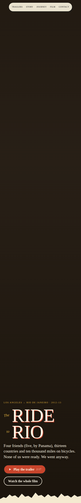

# UI Design System & Master Generation Blueprint: ridetorio-com

> **The Ride to Rio · Bicycle documentary, Los Angeles to Rio** (https://ridetorio.com/) — A documentary about five friends who cycled 10,000 miles from Los Angeles to Rio de Janeiro. Watch the trailers and full film, and follow...


---

## 1. Executive Visual Persona & Design Archetype

- **Brand Essence & Persona**: **The Ride to Rio · Bicycle documentary, Los Angeles to Rio** (`https://ridetorio.com/`). A documentary about five friends who cycled 10,000 miles from Los Angeles to Rio de Janeiro. Watch the trailers and full film, and follow...
- **Visual Archetype**: **Light-Gallery WebGL / Canvas Interactive Experience (`#F4EAD0` / `#4A4337`)**.
- **Anti-AI-Slop Differentiators**:
  - **Source-Grounded Chromatic Polarity**: Anchors the viewport in `#F4EAD0` (`var(--paper)` in `:root`) paired with `#1E1B16` primary typography and `#4A4337` accents.
  - **Extracted Typographic Hierarchy**: Pairs `Alfa Slab One` for display copy (`The Ride to Rio`) with `Caveat` and not declared in static CSS (uses primary stack / `ui-monospace`).
  - **Calibrated Spatial Grid & Motion**: Combines `48rem` container bounds (`gap: .3rem`, padding `.6rem`) with `cubic-bezier(.2,.8,.2,1)` easing and Lenis Smooth Scroll (`data-lenis`), Three.js / WebGL Canvas Pipeline.

---

## 2. Spatial Architecture & Modular Grid Mathematics



### Viewport Allocation & Container Geometry
- **Captured Viewport Dimensions**: Desktop `1440×23472px` (`assets/desktop.png`, full-page scroll capture), Mobile `390×2400px` (`assets/mobile.png`, capped at 2400px multi-section capture).
- **Master Container Bounds**: `48rem` extracted from `ridetorio-com` stylesheet.
- **Canvas Lateral Padding & Spacing**: `.6rem` lateral canvas padding with `.3rem` grid gap.
- **Border Radius Scale**: `6px`, `999px`, `30%`, `50%`.

### Responsive Breakpoint Architecture
- **Desktop Layout**: Multi-column CSS Grid / Flexbox layout at `1440px` (`max-width: 48rem`, `gap: .3rem`).
- **Mobile Layout**: Single-column vertical stack at `390px` viewport width with `.6rem` horizontal padding.
- **Extracted CSS Media Queries**: `@media (max-width: 48rem)`, `@media (prefers-reduced-motion: reduce)`, `@media (max-width: 30rem)`, `@media (max-width: 36rem)`.

---

## 3. Color System, Materiality & Atmospheric Lighting

### Semantic Palette & Source Grounding
| Semantic Role | Ground-Truth Value | Extracted CSS Source / Selector |
|---|---|---|
| **Primary Canvas Substrate** | `#F4EAD0` | `var(--paper)` in `:root` |
| **Primary Typography Ink** | `#FBF4DF` | `var(--paper-2)` in `:root` |
| **Elevated Surface / Card Substrate** | `#1E1B16` | `var(--ink)` in `:root` |
| **Interactive Accent / Highlight** | `#4A4337` | `var(--ink-soft)` in `:root` |
| **Secondary / Muted Copy** | `#8C9A4A` | `var(--olive)` in `:root` |
| **Structural Hairline Border** | `#2F4A2C` | `var(--forest)` in `:root` |
| **Variable Token (`--mustard`)** | `#D9A93B` | `var(--mustard)` in `:root` |
| **Variable Token (`--teal`)** | `#2F8F8B` | `var(--teal)` in `:root` |
| **Variable Token (`--red`)** | `#C8452C` | `var(--red)` in `:root` |
| **Variable Token (`--sky`)** | `#A9D3DE` | `var(--sky)` in `:root` |
| **Variable Token (`--dusk`)** | `#F2A27C` | `var(--dusk)` in `:root` |
| **Variable Token (`--night`)** | `#16233A` | `var(--night)` in `:root` |

### Sanitized Root CSS Variables (`ui-ux.md` Ground Truth)
| Variable Name | Extracted Value | Semantic Role |
|---|---|---|
| `--paper` | `#F4EAD0` | Canvas / Surface Token |
| `--paper-2` | `#FBF4DF` | Canvas / Surface Token |
| `--ink` | `#1E1B16` | Typography Ink Token |
| `--ink-soft` | `#4A4337` | Typography Ink Token |
| `--olive` | `#8C9A4A` | Color / Atmospheric Token |
| `--forest` | `#2F4A2C` | Color / Atmospheric Token |
| `--mustard` | `#D9A93B` | Color / Atmospheric Token |
| `--teal` | `#2F8F8B` | Color / Atmospheric Token |
| `--red` | `#C8452C` | Color / Atmospheric Token |
| `--sky` | `#A9D3DE` | Color / Atmospheric Token |
| `--dusk` | `#F2A27C` | Color / Atmospheric Token |
| `--night` | `#16233A` | Color / Atmospheric Token |
| `--sky-top` | `var(--paper)` | Design System Custom Token |
| `--sky-bot` | `var(--paper)` | Design System Custom Token |
| `--stars` | `0` | Design System Custom Token |
| `--font-body` | `"Fraunces", "Iowan Old Style", Georgia, serif` | Typography / Scale Token |

---

## 4. Typographic Scale & Editorial Hierarchy

### Font Family Stacks
- **Display Typography**: `Alfa Slab One`.
- **Primary Body Stack**: `Caveat`.
- **Technical / Metadata Stack**: not declared in static CSS (uses primary stack / `ui-monospace`).

### Typographic Scale & Rules (Extracted from Stylesheet & Variables)
- **Hero Display (`H1`)**: not explicitly declared on tag in static CSS (stylesheet font-size ladder: `clamp(1.06rem, 0.98rem + 0.34vw,...`, `.78rem`, `clamp(2rem, 1.2rem + 3.6vw, 4.4rem)`, `1.22em`, `1.5em`).
- **Section Heading (`H2`)**: not explicitly declared on tag in static CSS (stylesheet font-size ladder: `clamp(1.06rem, 0.98rem + 0.34vw,...`, `.78rem`, `clamp(2rem, 1.2rem + 3.6vw, 4.4rem)`, `1.22em`, `1.5em`).
- **Body Copy**: CSS variables `--font-body: "Fraunces", "Iowan Old Style", Georgia, serif`; rule `body` (`font-size: clamp(1.06rem, 0.98rem + 0.34...`, `line-height: 1.55`).
- **Metadata & Navigation Labels**: not explicitly declared on tag in static CSS (stylesheet font-size ladder: `clamp(1.06rem, 0.98rem + 0.34vw,...`, `.78rem`, `clamp(2rem, 1.2rem + 3.6vw, 4.4rem)`, `1.22em`, `1.5em`).

---

## 5. Choreographed Motion & Interaction Physics

### Primary Easing Curves
- **Extracted Timing Functions**: `cubic-bezier(.2,.8,.2,1)`.

### Per-Element Transition & Choreography Rules
- **Selector `.link-arrow::after`**: `transition: transform .3s var(--ease)` extracted from `ridetorio-com` stylesheet.
- **Selector `.btn`**: `transition: transform .18s var(--ease), box-shadow .18s var(--ease), backg...` extracted from `ridetorio-com` stylesheet.
- **Selector `.nav`**: `transition: translate .45s var(--ease), opacity .3s` extracted from `ridetorio-com` stylesheet.
- **Extracted Easing Curve (`cubic-bezier(.2,.8,.2,1)`)**: Governs interactive state transitions across `<header.nav>` and `<section.reel>`.
- **Runtime Interaction Engine**: Integrates Lenis Smooth Scroll (`data-lenis`), Three.js / WebGL Canvas Pipeline, Locomotive Scroll Parallax with `prefers-reduced-motion: reduce` fallback guards.

---

## 6. Component Wireframe & Structural DOM Map

### Visual Layout Schematic (Grounded in `dom.html` — `1440px` Desktop & `390px` Mobile Reflow)
```
┌────────────────────────────────────────────────────────────────────────┐
│ DESKTOP VIEWPORT (1440px) — The Ride to Rio · Bicycle documentary, Los │
│ ====================================================================== │
│ [ <header.nav>             | Trailers · Story · Journey · Film · Co ]  │
│ ---------------------------------------------------------------------- │
│ | HERO STAGE: <section.hero>                                       |   │
│ | H1: The Ride to Rio                                              |   │
│ | Substrate: #F4EAD0    | Ink: #1E1B16    | Accent: #4A4337        |   │
│ ---------------------------------------------------------------------- │
│ | SHOWCASE GRID (<section.reel>            ) max-w: 48rem          |   │
│ | +------------------------------+  +------------------------------+ | │
│ | | Also showing                 |  | How to cycle to Brazil witho | | │
│ | +------------------------------+  +------------------------------+ | │
│ ---------------------------------------------------------------------- │
│ | MOBILE VIEWPORT REFLOW (390px) — Single-Column Stack (gap: .3rem ) | │
│ | [<header.nav>] -> [<section.hero>] -> [<section.reel>] |             │
│ ---------------------------------------------------------------------- │
│ [ FOOTER (<footer.atmos__sky>   ) | https://ridetorio.com/             │
└────────────────────────────────────────────────────────────────────────┘
```

### Granular DOM Region Breakdown
1. **Brand Header & Navigation Bar (<header.nav> — `ridetorio-com`)**:
   - Landmark `<header class="nav">` hosting `The Ride to Rio · Bicycle documentar` navigation (`Trailers · Story · Journey · Film · Contact`), DOM attributes (`data-nav`, `data-hero-video`, `data-play="trailer-2"`, `data-reveal`), and stylesheet rule `after { box-sizing: border-box; }`.
2. **Hero Stage & Focal Lead (<section.hero> — `The Ride to Rio`)**:
   - Landmark `<section class="hero">` presenting display lead `The Ride to Rio` and copy excerpt *"Los Angeles → to Rio de Janeiro · 2012–13"* over `#F4EAD0` canvas and `#1E1B16` ink.
3. **Primary Showcase & Content Grid (<section.reel> — `Also showing`)**:
   - Landmark `<section class="reel">` rendering section `Also showing` with copy *"Four friends (five, by Panama), thirteen countries and ten thousa"*, asset references (`favicon.svg`, `apple-touch-icon.png`, `site.webmanifest`, `fraunces-normal-latin.woff2`), and grid rule `html { background: var(--paper); -webkit-text-size-adjust: 100%; scroll-padding... }`.
4. **Interactive Detail & Feature Matrix (<section.story> — `How to cycle to Brazil without rea`)**:
   - Landmark `<section class="story">` framing `How to cycle to Brazil without really knowing how...` and `What` (*"Play the trailer 2:17"*) with `#1E1B16` surface cards, `#4A4337` accents, and `canvas { display: block; max-width: 100%; }`.
5. **Colophon & Global Directory Footer (<footer.atmos__sky> — `https://ridetorio.com/`)**:
   - Landmark `<footer class="atmos__sky">` anchoring `The Ride to Rio · Bicycle docume` footer links (`Trailers · Story · Journey · Film · Contact`), copy *"Watch the whole film"*, and `#2F4A2C` structural dividers.

---

## 7. Master Zero-Shot AI Generation Prompt

```markdown
# Master Zero-Shot Frontend Generation Prompt: ridetorio-com (The Ride to Rio · Bicycle documentary, Los Angeles to Rio)

You are a principal frontend architect and design systems engineer. Build a complete, production-ready web application replicating the exact design system, DOM landmarks, typographic hierarchy, color tokens, and motion physics of `ridetorio-com` (**The Ride to Rio · Bicycle documentary, Los Angeles to Rio** — `https://ridetorio.com/`).

### 1. Visual Archetype & Anti-AI-Slop Mandates
- **Archetype**: Light-Gallery WebGL / Canvas Interactive Experience (`#F4EAD0` / `#4A4337`).
- **Identity & Domain Context**: A documentary about five friends who cycled 10,000 miles from Los Angeles to Rio de Janeiro. Watch the trailers and full film, and follow...
- **Primary Substrate**: `#F4EAD0` (`var(--paper)` in `:root`), **Primary Ink**: `#1E1B16`, **Accent / Highlight**: `#4A4337`.
- **Site-Specific Differentiators**:
  - **Source-Grounded Chromatic Polarity**: Anchors the viewport in `#F4EAD0` (`var(--paper)` in `:root`) paired with `#1E1B16` primary typography and `#4A4337` accents.
  - **Extracted Typographic Hierarchy**: Pairs `Alfa Slab One` for display copy (`The Ride to Rio`) with `Caveat` and not declared in static CSS (uses primary stack / `ui-monospace`).
  - **Calibrated Spatial Grid & Motion**: Combines `48rem` container bounds (`gap: .3rem`, padding `.6rem`) with `cubic-bezier(.2,.8,.2,1)` easing and Lenis Smooth Scroll (`data-lenis`), Three.js / WebGL Canvas Pipeline.

### 2. Ground-Truth CSS Variables (`:root` Token Contract)
Declare and consume these exact custom properties extracted from `ridetorio-com` in your global stylesheet:

:root {
  /* The Ride to Rio · Bicycle documentary, Los Angeles to Rio (ridetorio-com) — Ground-Truth Extracted CSS Variables */
  --paper: #F4EAD0; /* Canvas / Surface Token (ridetorio-com) */
  --paper-2: #FBF4DF; /* Canvas / Surface Token (ridetorio-com) */
  --ink: #1E1B16; /* Typography Ink Token (ridetorio-com) */
  --ink-soft: #4A4337; /* Typography Ink Token (ridetorio-com) */
  --olive: #8C9A4A; /* Color / Atmospheric Token (ridetorio-com) */
  --forest: #2F4A2C; /* Color / Atmospheric Token (ridetorio-com) */
  --mustard: #D9A93B; /* Color / Atmospheric Token (ridetorio-com) */
  --teal: #2F8F8B; /* Color / Atmospheric Token (ridetorio-com) */
  --red: #C8452C; /* Color / Atmospheric Token (ridetorio-com) */
  --sky: #A9D3DE; /* Color / Atmospheric Token (ridetorio-com) */
  --dusk: #F2A27C; /* Color / Atmospheric Token (ridetorio-com) */
  --night: #16233A; /* Color / Atmospheric Token (ridetorio-com) */
  --sky-top: var(--paper); /* Design System Custom Token (ridetorio-com) */
  --sky-bot: var(--paper); /* Design System Custom Token (ridetorio-com) */
  --stars: 0; /* Design System Custom Token (ridetorio-com) */
  --font-body: "Fraunces", "Iowan Old Style", Georgia, serif; /* Typography / Scale Token (ridetorio-com) */
}

### 3. Semantic Color & Materiality Contract
Map every surface, ink, and border strictly to these source-grounded tokens:
- **Primary Canvas Substrate**: `#F4EAD0` — grounded in `var(--paper)` in `:root`
- **Primary Typography Ink**: `#FBF4DF` — grounded in `var(--paper-2)` in `:root`
- **Elevated Surface / Card Substrate**: `#1E1B16` — grounded in `var(--ink)` in `:root`
- **Interactive Accent / Highlight**: `#4A4337` — grounded in `var(--ink-soft)` in `:root`
- **Secondary / Muted Copy**: `#8C9A4A` — grounded in `var(--olive)` in `:root`
- **Structural Hairline Border**: `#2F4A2C` — grounded in `var(--forest)` in `:root`
- **Variable Token (`--mustard`)**: `#D9A93B` — grounded in `var(--mustard)` in `:root`
- **Variable Token (`--teal`)**: `#2F8F8B` — grounded in `var(--teal)` in `:root`
- **Variable Token (`--red`)**: `#C8452C` — grounded in `var(--red)` in `:root`
- **Variable Token (`--sky`)**: `#A9D3DE` — grounded in `var(--sky)` in `:root`
- **Variable Token (`--dusk`)**: `#F2A27C` — grounded in `var(--dusk)` in `:root`
- **Variable Token (`--night`)**: `#16233A` — grounded in `var(--night)` in `:root`

### 4. Spatial Grid, Container Bounds & Responsive Breakpoints
- **Desktop Viewport Reference**: `1440×23472px` (full-page scroll capture, `1440px` standard desktop width).
- **Mobile Viewport Reference**: `390×2400px` (capped at 2400px multi-section capture, `390px` standard mobile width).
- **Container Max-Width**: `48rem` extracted from `ridetorio-com` stylesheet
- **Padding & Gutters**: `.6rem` lateral canvas padding with `.3rem` grid gap
- **Desktop Grid**: Multi-column CSS Grid / Flexbox layout at `1440px` (`max-width: 48rem`, `gap: .3rem`)
- **Mobile Adaptation**: Single-column vertical stack at `390px` viewport width with `.6rem` horizontal padding
- **Media Queries**: `@media (max-width: 48rem)`, `@media (prefers-reduced-motion: reduce)`, `@media (max-width: 30rem)`, `@media (max-width: 36rem)`
- **Corner Radii**: `6px`, `999px`, `30%`, `50%`

### 5. Typography & Editorial Scale Contract
- **Display Font Stack**: `Alfa Slab One`
- **Body Font Stack**: `Caveat`
- **Monospace / Technical Font Stack**: not declared in static CSS (uses primary stack / `ui-monospace`)
- **H1 Display Rule**: not explicitly declared on tag in static CSS (stylesheet font-size ladder: `clamp(1.06rem, 0.98rem + 0.34vw,...`, `.78rem`, `clamp(2rem, 1.2rem + 3.6vw, 4.4rem)`, `1.22em`, `1.5em`)
- **H2 Section Rule**: not explicitly declared on tag in static CSS (stylesheet font-size ladder: `clamp(1.06rem, 0.98rem + 0.34vw,...`, `.78rem`, `clamp(2rem, 1.2rem + 3.6vw, 4.4rem)`, `1.22em`, `1.5em`)
- **Body Copy Rule**: CSS variables `--font-body: "Fraunces", "Iowan Old Style", Georgia, serif`; rule `body` (`font-size: clamp(1.06rem, 0.98rem + 0.34...`, `line-height: 1.55`)
- **Metadata & Index Rule**: not explicitly declared on tag in static CSS (stylesheet font-size ladder: `clamp(1.06rem, 0.98rem + 0.34vw,...`, `.78rem`, `clamp(2rem, 1.2rem + 3.6vw, 4.4rem)`, `1.22em`, `1.5em`)

### 6. Component Hierarchy, Verbatim Copy & Real DOM Landmarks
Scaffold `ridetorio-com` (`The Ride to Rio · Bicycle documentary, Los Angeles to Rio`) with these exact structural regions, extracted copy, and CSS rules from `dom.html`:
1. **Brand Header & Navigation Bar (<header.nav> — `ridetorio-com`)**:
   - DOM & Selectors: Landmark `<header class="nav">` hosting `The Ride to Rio · Bicycle documentar` navigation (`Trailers · Story · Journey · Film · Contact`), DOM attributes (`data-nav`, `data-hero-video`, `data-play="trailer-2"`, `data-reveal`), and stylesheet rule `after { box-sizing: border-box; }`.
   - Responsive Contract: Header `Brand Header & Navigation Bar (<header.nav> — `ridetorio-com`)` (`ridetorio-com`) adapts across `@media (max-width: 48rem)`, `@media (prefers-reduced-motion: reduce)`, `@media (max-width: 30rem)`, `@media (max-width: 36rem)` with `cubic-bezier(.2,.8,.2,1)` transitions and links `Trailers · Story · Journey · Film · Contact`.
2. **Hero Stage & Focal Lead (<section.hero> — `The Ride to Rio`)**:
   - DOM & Selectors: Landmark `<section class="hero">` presenting display lead `The Ride to Rio` and copy excerpt *"Los Angeles → to Rio de Janeiro · 2012–13"* over `#F4EAD0` canvas and `#1E1B16` ink.
   - Responsive Contract: Hero stage (`1440×23472px` desktop / `390×2400px` mobile) sets `#F4EAD0` background with `#1E1B16` headline `The Ride to Rio`.
3. **Primary Showcase & Content Grid (<section.reel> — `Also showing`)**:
   - DOM & Selectors: Landmark `<section class="reel">` rendering section `Also showing` with copy *"Four friends (five, by Panama), thirteen countries and ten thousa"*, asset references (`favicon.svg`, `apple-touch-icon.png`, `site.webmanifest`, `fraunces-normal-latin.woff2`), and grid rule `html { background: var(--paper); -webkit-text-size-adjust: 100%; scroll-padding... }`.
   - Responsive Contract: Showcase grid `Primary Showcase & Content Grid (<section.reel> — `Also showing`)` applies Multi-column CSS Grid / Flexbox layout at `1440px` (`max-width: 48rem`, `gap: .3rem`) on desktop and Single-column vertical stack at `390px` viewport width with `.6rem` horizontal padding on mobile.
4. **Interactive Detail & Feature Matrix (<section.story> — `How to cycle to Brazil without rea`)**:
   - DOM & Selectors: Landmark `<section class="story">` framing `How to cycle to Brazil without really knowing how...` and `What` (*"Play the trailer 2:17"*) with `#1E1B16` surface cards, `#4A4337` accents, and `canvas { display: block; max-width: 100%; }`.
   - Responsive Contract: Detail module `Interactive Detail & Feature Matrix (<section.story> — `How to cycle to Brazil without rea`)` uses `6px`, `999px`, `30%`, `50%` radii, `#4A4337` highlights, and assets (favicon.svg, apple-touch-icon.png, site.webmanifest).
5. **Colophon & Global Directory Footer (<footer.atmos__sky> — `https://ridetorio.com/`)**:
   - DOM & Selectors: Landmark `<footer class="atmos__sky">` anchoring `The Ride to Rio · Bicycle docume` footer links (`Trailers · Story · Journey · Film · Contact`), copy *"Watch the whole film"*, and `#2F4A2C` structural dividers.
   - Responsive Contract: Footer `Colophon & Global Directory Footer (<footer.atmos__sky> — `https://ridetorio.com/`)` aligns to `48rem` extracted from `ridetorio-com` stylesheet with `.6rem` lateral canvas padding with `.3rem` grid gap and attributes (data-nav, data-hero-video, data-play="trailer-2").

#### Verbatim DOM Copy Excerpts (`dom.html`)
- Copy Excerpt 1: *"Los Angeles → to Rio de Janeiro · 2012–13"*
- Copy Excerpt 2: *"Four friends (five, by Panama), thirteen countries and ten thousand miles on bicyc..."*
- Copy Excerpt 3: *"Play the trailer 2:17"*
- Copy Excerpt 4: *"Watch the whole film"*

### 7. Motion, Extracted Stylesheet Rules & Interaction Choreography
- **Primary Easing Functions**: `cubic-bezier(.2,.8,.2,1)`
- **Extracted Stylesheet Rules (`ridetorio-com`)**:
- `after { box-sizing: border-box; }`
- `html { background: var(--paper); -webkit-text-size-adjust: 100%; scroll-padding... }`
- `canvas { display: block; max-width: 100%; }`
- `img { height: auto; }`
- `blockquote { margin: 0; padding: 0; }`
- **Per-Selector Transition Rules**:
- **Selector `.link-arrow::after`**: `transition: transform .3s var(--ease)` extracted from `ridetorio-com` stylesheet.
- **Selector `.btn`**: `transition: transform .18s var(--ease), box-shadow .18s var(--ease), backg...` extracted from `ridetorio-com` stylesheet.
- **Selector `.nav`**: `transition: translate .45s var(--ease), opacity .3s` extracted from `ridetorio-com` stylesheet.
- **Extracted Easing Curve (`cubic-bezier(.2,.8,.2,1)`)**: Governs interactive state transitions across `<header.nav>` and `<section.reel>`.
- **Runtime Interaction Engine**: Integrates Lenis Smooth Scroll (`data-lenis`), Three.js / WebGL Canvas Pipeline, Locomotive Scroll Parallax with `prefers-reduced-motion: reduce` fallback guards.

### 8. Technical Deliverables
- Implement in Next.js (App Router) with TypeScript and Tailwind CSS consuming the `:root` custom properties defined above for `ridetorio-com`.
- Reproduce both the `1440px` desktop architecture and `390px` mobile breakpoint transitions, preserving semantic HTML5 landmarks (`<header>`, `<nav>`, `<main>`, `<section>`, `<footer>`) and `prefers-reduced-motion` accessibility guards.
```
