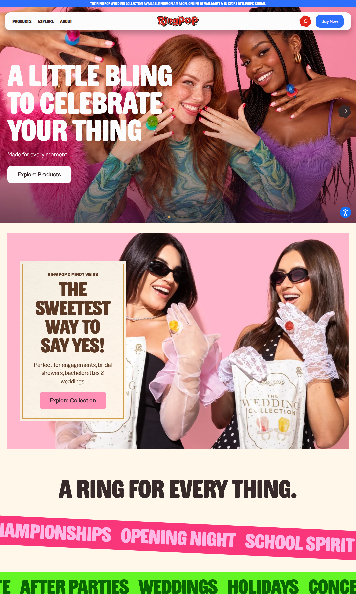
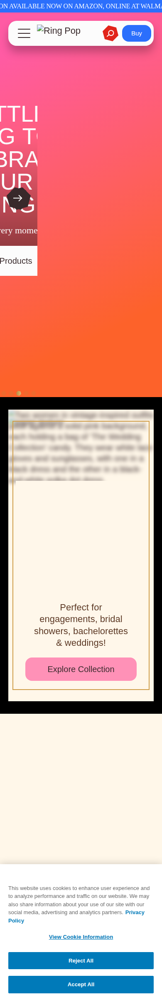

# UI Design System & Master Generation Blueprint: ringpopcandy-com

> **Ring Pop® — Candy for Every Celebration** (https://ringpopcandy.com/) — Ring Pop turns any occasion into a celebration: birthdays, weddings, game days, wins. Shop the collections and find Ring Pop at a store n...



---

## 1. Executive Visual Persona & Design Archetype

- **Brand Essence & Persona**: **Ring Pop® — Candy for Every Celebration** (`https://ringpopcandy.com/`). Ring Pop turns any occasion into a celebration: birthdays, weddings, game days, wins. Shop the collections and find Ring Pop at a store n...
- **Visual Archetype**: **High-Contrast Obsidian / Atmospheric Design System (`#000` canvas, `#fff` ink, `#2B3990` accent)**.
- **Anti-AI-Slop Differentiators**:
  - **Source-Grounded Chromatic Polarity**: Anchors the viewport in `#000` (`var(--color-black)` in `:root`) paired with `#fff` primary typography and `#2B3990` accents.
  - **Extracted Typographic Hierarchy**: Pairs `hwt-artz` for display copy (`Ring Pop`) with `area-normal` and not declared in static CSS (uses primary stack / `ui-monospace`).
  - **Calibrated Spatial Grid & Motion**: Combines `24.25rem` container bounds (`gap: 1.25rem`, padding `.28125rem`) with `cubic-bezier(.5,0,0,1)` easing and GSAP Timeline & ScrollTrigger, Three.js / WebGL Canvas Pipeline.

---

## 2. Spatial Architecture & Modular Grid Mathematics



### Viewport Allocation & Container Geometry
- **Captured Viewport Dimensions**: Desktop `1440×12266px` (`assets/desktop.png`, full-page scroll capture), Mobile `390×2400px` (`assets/mobile.png`, capped at 2400px multi-section capture).
- **Master Container Bounds**: `24.25rem` extracted from `ringpopcandy-com` stylesheet.
- **Canvas Lateral Padding & Spacing**: `.28125rem` lateral canvas padding with `1.25rem` grid gap.
- **Border Radius Scale**: `1.25rem`, `var(--header-border-radius-desktop)`, `.8125rem`, `var(--header-border-radius-sticky-mobile)`.

### Responsive Breakpoint Architecture
- **Desktop Layout**: Multi-column CSS Grid / Flexbox layout at `1440px` (`max-width: 24.25rem`, `gap: 1.25rem`).
- **Mobile Layout**: Single-column vertical stack at `390px` viewport width with `.28125rem` horizontal padding.
- **Extracted CSS Media Queries**: `@media print,screen and (min-width:64em)`, `@media screen and (pointer:fine)`, `@media print,screen and (max-width:63.99875em)`, `@media print,screen and (max-width:63.99875em)and (min-width:64em)`.

---

## 3. Color System, Materiality & Atmospheric Lighting

### Semantic Palette & Source Grounding
| Semantic Role | Ground-Truth Value | Extracted CSS Source / Selector |
|---|---|---|
| **Primary Canvas Substrate** | `#000` | `var(--color-black)` in `:root` |
| **Primary Typography Ink** | `#fff` | `var(--color-white)` in `:root` |
| **Elevated Surface / Card Substrate** | `#FFB925` | `var(--oke-stars-foregroundColor)` in `:root` |
| **Interactive Accent / Highlight** | `#2B3990` | `var(--oke-button-backgroundColor)` in `:root` |
| **Secondary / Muted Copy** | `#FF8300` | `var(--oke-text-secondaryColor)` in `:root` |
| **Structural Hairline Border** | `#FFFFFF` | `var(--oke-avatar-placeholderTextColor)` in `:root` |

### Sanitized Root CSS Variables (`ui-ux.md` Ground Truth)
| Variable Name | Extracted Value | Semantic Role |
|---|---|---|
| `--color-red-600` | `oklch(57.7% .245 27.325)` | Brand / Palette Token |
| `--color-gray-100` | `oklch(96.7% .003 264.542)` | Brand / Palette Token |
| `--color-black` | `#000` | Canvas / Surface Token |
| `--color-white` | `#fff` | Canvas / Surface Token |
| `--spacing` | `.25rem` | Layout / Spatial Grid Token |
| `--text-xs` | `.75rem` | Typography Ink Token |
| `--text-xs--line-height` | `calc(1 / .75)` | Typography Ink Token |
| `--text-sm` | `.875rem` | Typography Ink Token |
| `--text-sm--line-height` | `calc(1.25 / .875)` | Typography Ink Token |
| `--text-base` | `1rem` | Typography Ink Token |
| `--text-base--line-height` | `1.5` | Typography Ink Token |
| `--text-lg` | `1.125rem` | Typography Ink Token |
| `--text-lg--line-height` | `calc(1.75 / 1.125)` | Typography Ink Token |
| `--text-xl` | `1.25rem` | Typography Ink Token |
| `--text-xl--line-height` | `calc(1.75 / 1.25)` | Typography Ink Token |
| `--font-weight-light` | `300` | Canvas / Surface Token |

---

## 4. Typographic Scale & Editorial Hierarchy

### Font Family Stacks
- **Display Typography**: `hwt-artz`.
- **Primary Body Stack**: `area-normal`.
- **Technical / Metadata Stack**: not declared in static CSS (uses primary stack / `ui-monospace`).

### Typographic Scale & Rules (Extracted from Stylesheet & Variables)
- **Hero Display (`H1`)**: CSS variables `--x-shell-disclosure-display: block`, `--x-shell-order-summary-display: none`, `--x-shell-content-display: grid`; rule `h1` (`font-size: var(--text-lg)`, `line-height: var(--tw-leading, var...`).
- **Section Heading (`H2`)**: CSS variables `--font-heading-h2: 'Ringold', Helvetica, Arial, sans-serif`, `--font-heading-h2-weight: 400`, `--h2-font-case: uppercase`; rule `h2` (`font-size: var(--text-lg)`, `line-height: var(--tw-leading, var...`).
- **Body Copy**: CSS variables `--text-base: 1rem`, `--text-base--line-height: 1.5`, `--color-body-text: #141723`; rule `p` (`font-size: var(--font-body-size-large-mo...`).
- **Metadata & Navigation Labels**: CSS variables `--text-xs: .75rem`, `--text-xs--line-height: calc(1 / .75)`, `--text-sm: .875rem`; rule `.label` (`font-size: 1.5rem`, `line-height: 1.083em`, `letter-spacing: -.0225rem`, `font-weight: 600`).

---

## 5. Choreographed Motion & Interaction Physics

### Primary Easing Curves
- **Extracted Timing Functions**: `cubic-bezier(.5,0,0,1)`, `cubic-bezier(.4,0,1,1)`, `cubic-bezier(0,0,.2,1)`.

### Per-Element Transition & Choreography Rules
- **Selector `.footer`**: `transition: all .4s cubic-bezier(.5,0,0,1)` extracted from `ringpopcandy-com` stylesheet.
- **Selector `.footer__contents`**: `transition: all .4s cubic-bezier(.5,0,0,1)` extracted from `ringpopcandy-com` stylesheet.
- **Selector `.footer__main [data-inview]`**: `transition: all .4s cubic-bezier(.5,0,0,1)` extracted from `ringpopcandy-com` stylesheet.
- **Extracted Easing Curve (`cubic-bezier(.5,0,0,1)`)**: Governs interactive state transitions across `<header.header>` and `<section.mfr-core__banner-with-box>`.
- **Runtime Interaction Engine**: Integrates GSAP Timeline & ScrollTrigger, Three.js / WebGL Canvas Pipeline, Lottie Vector Animation Player with `prefers-reduced-motion: reduce` fallback guards.

---

## 6. Component Wireframe & Structural DOM Map

### Visual Layout Schematic (Grounded in `dom.html` — `1440px` Desktop & `390px` Mobile Reflow)
```
┌────────────────────────────────────────────────────────────────────────┐
│ DESKTOP VIEWPORT (1440px) — Ring Pop® — Candy for Every Celebration    │
│ ====================================================================== │
│ [ <header.header>          | Products · Explore · About             ]  │
│ ---------------------------------------------------------------------- │
│ | HERO STAGE: <section.mfr-core__hero-section>                     |   │
│ | H1: Ring Pop                                                     |   │
│ | Substrate: #000       | Ink: #fff       | Accent: #2B3990        |   │
│ ---------------------------------------------------------------------- │
│ | SHOWCASE GRID (<section.mfr-core__banner-) max-w: 24.25rem       |   │
│ | +------------------------------+  +------------------------------+ | │
│ | | A little Bling to Celebrate  |  | The Sweetest Way To Say Yes! | | │
│ | +------------------------------+  +------------------------------+ | │
│ ---------------------------------------------------------------------- │
│ | MOBILE VIEWPORT REFLOW (390px) — Single-Column Stack (gap: 1.25re) | │
│ | [<header.header>] -> [<section.mfr-core_] -> [<section.mfr-core_] |  │
│ ---------------------------------------------------------------------- │
│ [ FOOTER (<footer.footer>       ) | https://ringpopcandy.com/          │
└────────────────────────────────────────────────────────────────────────┘
```

### Granular DOM Region Breakdown
1. **Brand Header & Navigation Bar (<header.header> — `ringpopcandy-com`)**:
   - Landmark `<header class="header is-inview">` hosting `Ring Pop® — Candy for Every Celebrat` navigation (`Products · Explore · About`), DOM attributes (`data-toggler=".is-fixed"`, `data-id="CGMRQMBC77UCKR5263C0"`, `data-ot-ignore`, `data-source-attribution="shopify.exit_intersti..."`), and stylesheet rule `.footer__main { font-size:var(--footer-font-size);line-height:var(--footer-line-height);... }`.
2. **Hero Stage & Focal Lead (<section.mfr-core__hero-section> — `Ring Pop`)**:
   - Landmark `<section class="mfr-core__hero-section overflow-hidden">` presenting display lead `Ring Pop` and copy excerpt *"Press Option+1 for screen-reader mode, Option+0 to cancel"* over `#000` canvas and `#fff` ink.
3. **Primary Showcase & Content Grid (<section.mfr-core__banner-with-box> — `A little Bling to Celebrate Your T`)**:
   - Landmark `<section class="mfr-core__banner-with-box grid-gutter-mobile">` rendering section `A little Bling to Celebrate Your Thing` with copy *"Accessibility Screen-Reader Guide, Feedback, and Issue Reporting "*, asset references (`main.ea8e9e85.js`, `identify_7e562ea6.js`, `main.MTAyNjc1NzVmOQ.js`, `events.js`), and grid rule `.footer__big-menu-list li a { position:relative;line-height:1.679em;letter-spacing:-.1rem }`.
4. **Interactive Detail & Feature Matrix (<section.mfr-core__scrolling-bar> — `The Sweetest Way To Say Yes!`)**:
   - Landmark `<section class="mfr-core__scrolling-bar">` framing `The Sweetest Way To Say Yes!` and `A ring for every thing.` (*"Explore Collections"*) with `#FFB925` surface cards, `#2B3990` accents, and `.footer__big-menu-list li a:hover... { -moz-transform:unset;-o-transform:unset;-ms-transform:unset;-webkit-tran... }`.
5. **Colophon & Global Directory Footer (<footer.footer> — `https://ringpopcandy.com/`)**:
   - Landmark `<footer class="footer">` anchoring `Ring Pop® — Candy for Every Cele` footer links (`Products · Explore · About`), copy *"We respond within one business day. For press or wholesale, "*, and `#FFFFFF` structural dividers.

---

## 7. Master Zero-Shot AI Generation Prompt

```markdown
# Master Zero-Shot Frontend Generation Prompt: ringpopcandy-com (Ring Pop® — Candy for Every Celebration)

You are a principal frontend architect and design systems engineer. Build a complete, production-ready web application replicating the exact design system, DOM landmarks, typographic hierarchy, color tokens, and motion physics of `ringpopcandy-com` (**Ring Pop® — Candy for Every Celebration** — `https://ringpopcandy.com/`).

### 1. Visual Archetype & Anti-AI-Slop Mandates
- **Archetype**: High-Contrast Obsidian / Atmospheric Design System (`#000` canvas, `#fff` ink, `#2B3990` accent).
- **Identity & Domain Context**: Ring Pop turns any occasion into a celebration: birthdays, weddings, game days, wins. Shop the collections and find Ring Pop at a store n...
- **Primary Substrate**: `#000` (`var(--color-black)` in `:root`), **Primary Ink**: `#fff`, **Accent / Highlight**: `#2B3990`.
- **Site-Specific Differentiators**:
  - **Source-Grounded Chromatic Polarity**: Anchors the viewport in `#000` (`var(--color-black)` in `:root`) paired with `#fff` primary typography and `#2B3990` accents.
  - **Extracted Typographic Hierarchy**: Pairs `hwt-artz` for display copy (`Ring Pop`) with `area-normal` and not declared in static CSS (uses primary stack / `ui-monospace`).
  - **Calibrated Spatial Grid & Motion**: Combines `24.25rem` container bounds (`gap: 1.25rem`, padding `.28125rem`) with `cubic-bezier(.5,0,0,1)` easing and GSAP Timeline & ScrollTrigger, Three.js / WebGL Canvas Pipeline.

### 2. Ground-Truth CSS Variables (`:root` Token Contract)
Declare and consume these exact custom properties extracted from `ringpopcandy-com` in your global stylesheet:

:root {
  /* Ring Pop® — Candy for Every Celebration (ringpopcandy-com) — Ground-Truth Extracted CSS Variables */
  --color-red-600: oklch(57.7% .245 27.325); /* Brand / Palette Token (ringpopcandy-com) */
  --color-gray-100: oklch(96.7% .003 264.542); /* Brand / Palette Token (ringpopcandy-com) */
  --color-black: #000; /* Canvas / Surface Token (ringpopcandy-com) */
  --color-white: #fff; /* Canvas / Surface Token (ringpopcandy-com) */
  --spacing: .25rem; /* Layout / Spatial Grid Token (ringpopcandy-com) */
  --text-xs: .75rem; /* Typography Ink Token (ringpopcandy-com) */
  --text-xs--line-height: calc(1 / .75); /* Typography Ink Token (ringpopcandy-com) */
  --text-sm: .875rem; /* Typography Ink Token (ringpopcandy-com) */
  --text-sm--line-height: calc(1.25 / .875); /* Typography Ink Token (ringpopcandy-com) */
  --text-base: 1rem; /* Typography Ink Token (ringpopcandy-com) */
  --text-base--line-height: 1.5; /* Typography Ink Token (ringpopcandy-com) */
  --text-lg: 1.125rem; /* Typography Ink Token (ringpopcandy-com) */
  --text-lg--line-height: calc(1.75 / 1.125); /* Typography Ink Token (ringpopcandy-com) */
  --text-xl: 1.25rem; /* Typography Ink Token (ringpopcandy-com) */
  --text-xl--line-height: calc(1.75 / 1.25); /* Typography Ink Token (ringpopcandy-com) */
  --font-weight-light: 300; /* Canvas / Surface Token (ringpopcandy-com) */
}

### 3. Semantic Color & Materiality Contract
Map every surface, ink, and border strictly to these source-grounded tokens:
- **Primary Canvas Substrate**: `#000` — grounded in `var(--color-black)` in `:root`
- **Primary Typography Ink**: `#fff` — grounded in `var(--color-white)` in `:root`
- **Elevated Surface / Card Substrate**: `#FFB925` — grounded in `var(--oke-stars-foregroundColor)` in `:root`
- **Interactive Accent / Highlight**: `#2B3990` — grounded in `var(--oke-button-backgroundColor)` in `:root`
- **Secondary / Muted Copy**: `#FF8300` — grounded in `var(--oke-text-secondaryColor)` in `:root`
- **Structural Hairline Border**: `#FFFFFF` — grounded in `var(--oke-avatar-placeholderTextColor)` in `:root`

### 4. Spatial Grid, Container Bounds & Responsive Breakpoints
- **Desktop Viewport Reference**: `1440×12266px` (full-page scroll capture, `1440px` standard desktop width).
- **Mobile Viewport Reference**: `390×2400px` (capped at 2400px multi-section capture, `390px` standard mobile width).
- **Container Max-Width**: `24.25rem` extracted from `ringpopcandy-com` stylesheet
- **Padding & Gutters**: `.28125rem` lateral canvas padding with `1.25rem` grid gap
- **Desktop Grid**: Multi-column CSS Grid / Flexbox layout at `1440px` (`max-width: 24.25rem`, `gap: 1.25rem`)
- **Mobile Adaptation**: Single-column vertical stack at `390px` viewport width with `.28125rem` horizontal padding
- **Media Queries**: `@media print,screen and (min-width:64em)`, `@media screen and (pointer:fine)`, `@media print,screen and (max-width:63.99875em)`, `@media print,screen and (max-width:63.99875em)and (min-width:64em)`
- **Corner Radii**: `1.25rem`, `var(--header-border-radius-desktop)`, `.8125rem`, `var(--header-border-radius-sticky-mobile)`

### 5. Typography & Editorial Scale Contract
- **Display Font Stack**: `hwt-artz`
- **Body Font Stack**: `area-normal`
- **Monospace / Technical Font Stack**: not declared in static CSS (uses primary stack / `ui-monospace`)
- **H1 Display Rule**: CSS variables `--x-shell-disclosure-display: block`, `--x-shell-order-summary-display: none`, `--x-shell-content-display: grid`; rule `h1` (`font-size: var(--text-lg)`, `line-height: var(--tw-leading, var...`)
- **H2 Section Rule**: CSS variables `--font-heading-h2: 'Ringold', Helvetica, Arial, sans-serif`, `--font-heading-h2-weight: 400`, `--h2-font-case: uppercase`; rule `h2` (`font-size: var(--text-lg)`, `line-height: var(--tw-leading, var...`)
- **Body Copy Rule**: CSS variables `--text-base: 1rem`, `--text-base--line-height: 1.5`, `--color-body-text: #000`; rule `p` (`font-size: var(--font-body-size-large-mo...`)
- **Metadata & Index Rule**: CSS variables `--text-xs: .75rem`, `--text-xs--line-height: calc(1 / .75)`, `--text-sm: .875rem`; rule `.label` (`font-size: 1.5rem`, `line-height: 1.083em`, `letter-spacing: -.0225rem`, `font-weight: 600`)

### 6. Component Hierarchy, Verbatim Copy & Real DOM Landmarks
Scaffold `ringpopcandy-com` (`Ring Pop® — Candy for Every Celebration`) with these exact structural regions, extracted copy, and CSS rules from `dom.html`:
1. **Brand Header & Navigation Bar (<header.header> — `ringpopcandy-com`)**:
   - DOM & Selectors: Landmark `<header class="header is-inview">` hosting `Ring Pop® — Candy for Every Celebrat` navigation (`Products · Explore · About`), DOM attributes (`data-toggler=".is-fixed"`, `data-id="CGMRQMBC77UCKR5263C0"`, `data-ot-ignore`, `data-source-attribution="shopify.exit_intersti..."`), and stylesheet rule `.footer__main { font-size:var(--footer-font-size);line-height:var(--footer-line-height);... }`.
   - Responsive Contract: Header `Brand Header & Navigation Bar (<header.header> — `ringpopcandy-com`)` (`ringpopcandy-com`) adapts across `@media print,screen and (min-width:64em)`, `@media screen and (pointer:fine)`, `@media print,screen and (max-width:63.99875em)`, `@media print,screen and (max-width:63.99875em)and (min-width:64em)` with `cubic-bezier(.5,0,0,1)`, `cubic-bezier(.4,0,1,1)`, `cubic-bezier(0,0,.2,1)` transitions and links `Products · Explore · About`.
2. **Hero Stage & Focal Lead (<section.mfr-core__hero-section> — `Ring Pop`)**:
   - DOM & Selectors: Landmark `<section class="mfr-core__hero-section overflow-hidden">` presenting display lead `Ring Pop` and copy excerpt *"Press Option+1 for screen-reader mode, Option+0 to cancel"* over `#000` canvas and `#fff` ink.
   - Responsive Contract: Hero stage (`1440×12266px` desktop / `390×2400px` mobile) sets `#000` background with `#fff` headline `Ring Pop`.
3. **Primary Showcase & Content Grid (<section.mfr-core__banner-with-box> — `A little Bling to Celebrate Your T`)**:
   - DOM & Selectors: Landmark `<section class="mfr-core__banner-with-box grid-gutter-mobile">` rendering section `A little Bling to Celebrate Your Thing` with copy *"Accessibility Screen-Reader Guide, Feedback, and Issue Reporting "*, asset references (`main.ea8e9e85.js`, `identify_7e562ea6.js`, `main.MTAyNjc1NzVmOQ.js`, `events.js`), and grid rule `.footer__big-menu-list li a { position:relative;line-height:1.679em;letter-spacing:-.1rem }`.
   - Responsive Contract: Showcase grid `Primary Showcase & Content Grid (<section.mfr-core__banner-with-box> — `A little Bling to Celebrate Your T`)` applies Multi-column CSS Grid / Flexbox layout at `1440px` (`max-width: 24.25rem`, `gap: 1.25rem`) on desktop and Single-column vertical stack at `390px` viewport width with `.28125rem` horizontal padding on mobile.
4. **Interactive Detail & Feature Matrix (<section.mfr-core__scrolling-bar> — `The Sweetest Way To Say Yes!`)**:
   - DOM & Selectors: Landmark `<section class="mfr-core__scrolling-bar">` framing `The Sweetest Way To Say Yes!` and `A ring for every thing.` (*"Explore Collections"*) with `#FFB925` surface cards, `#2B3990` accents, and `.footer__big-menu-list li a:hover... { -moz-transform:unset;-o-transform:unset;-ms-transform:unset;-webkit-tran... }`.
   - Responsive Contract: Detail module `Interactive Detail & Feature Matrix (<section.mfr-core__scrolling-bar> — `The Sweetest Way To Say Yes!`)` uses `1.25rem`, `var(--header-border-radius-desktop)`, `.8125rem`, `var(--header-border-radius-sticky-mobile)` radii, `#2B3990` highlights, and assets (main.ea8e9e85.js, identify_7e562ea6.js, main.MTAyNjc1NzVmOQ.js).
5. **Colophon & Global Directory Footer (<footer.footer> — `https://ringpopcandy.com/`)**:
   - DOM & Selectors: Landmark `<footer class="footer">` anchoring `Ring Pop® — Candy for Every Cele` footer links (`Products · Explore · About`), copy *"We respond within one business day. For press or wholesale, "*, and `#FFFFFF` structural dividers.
   - Responsive Contract: Footer `Colophon & Global Directory Footer (<footer.footer> — `https://ringpopcandy.com/`)` aligns to `24.25rem` extracted from `ringpopcandy-com` stylesheet with `.28125rem` lateral canvas padding with `1.25rem` grid gap and attributes (data-toggler=".is-fixed", data-id="CGMRQMBC77UCKR5263C0", data-ot-ignore).

#### Verbatim DOM Copy Excerpts (`dom.html`)
- Copy Excerpt 1: *"Press Option+1 for screen-reader mode, Option+0 to cancel"*
- Copy Excerpt 2: *"Accessibility Screen-Reader Guide, Feedback, and Issue Reporting · New window"*
- Copy Excerpt 3: *"Explore Collections"*
- Copy Excerpt 4: *"We respond within one business day. For press or wholesale, include the relevant c..."*

### 7. Motion, Extracted Stylesheet Rules & Interaction Choreography
- **Primary Easing Functions**: `cubic-bezier(.5,0,0,1)`, `cubic-bezier(.4,0,1,1)`, `cubic-bezier(0,0,.2,1)`
- **Extracted Stylesheet Rules (`ringpopcandy-com`)**:
- `.footer__main { font-size:var(--footer-font-size);line-height:var(--footer-line-height);... }`
- `.footer__big-menu-list li a { position:relative;line-height:1.679em;letter-spacing:-.1rem }`
- `.footer__big-menu-list li a:hover... { -moz-transform:unset;-o-transform:unset;-ms-transform:unset;-webkit-tran... }`
- `big-menu-list li a:focus-visible:... { -moz-transform:unset;-o-transform:unset;-ms-transform:unset;-webkit-tran... }`
- `.footer__menu-label { margin-bottom:.1875rem;color:currentColor;opacity:.8 }`
- **Per-Selector Transition Rules**:
- **Selector `.footer`**: `transition: all .4s cubic-bezier(.5,0,0,1)` extracted from `ringpopcandy-com` stylesheet.
- **Selector `.footer__contents`**: `transition: all .4s cubic-bezier(.5,0,0,1)` extracted from `ringpopcandy-com` stylesheet.
- **Selector `.footer__main [data-inview]`**: `transition: all .4s cubic-bezier(.5,0,0,1)` extracted from `ringpopcandy-com` stylesheet.
- **Extracted Easing Curve (`cubic-bezier(.5,0,0,1)`)**: Governs interactive state transitions across `<header.header>` and `<section.mfr-core__banner-with-box>`.
- **Runtime Interaction Engine**: Integrates GSAP Timeline & ScrollTrigger, Three.js / WebGL Canvas Pipeline, Lottie Vector Animation Player with `prefers-reduced-motion: reduce` fallback guards.

### 8. Technical Deliverables
- Implement in Next.js (App Router) with TypeScript and Tailwind CSS consuming the `:root` custom properties defined above for `ringpopcandy-com`.
- Reproduce both the `1440px` desktop architecture and `390px` mobile breakpoint transitions, preserving semantic HTML5 landmarks (`<header>`, `<nav>`, `<main>`, `<section>`, `<footer>`) and `prefers-reduced-motion` accessibility guards.
```
