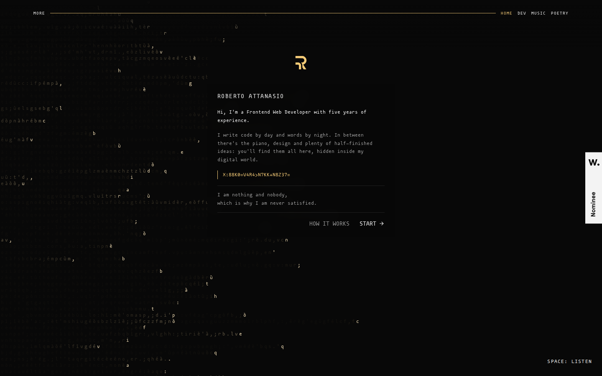
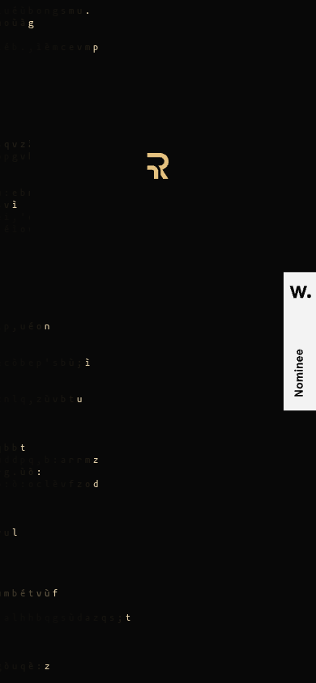

# UI Design System & Master Generation Blueprint: robertoattanasio-com_en

> **Roberto Attanasio** (https://robertoattanasio.com/en) — I write code by day and words by night. Projects, music and poems, all hidden in my digital world: drag the field and find them.



---

## 1. Executive Visual Persona & Design Archetype

- **Brand Essence & Persona**: **Roberto Attanasio** (`https://robertoattanasio.com/en`). I write code by day and words by night. Projects, music and poems, all hidden in my digital world: drag the field and find them.
- **Capture Provenance**: Live browser capture (`tier1_fast`, HTTP `200`, captured `2026-11-23`).
- **Visual Archetype**: **Dark-Substrate WebGL / Canvas Interactive Experience (`#080808` / `#9c0ea3`)**.
- **Anti-AI-Slop Differentiators**:
  - **Live-Computed Chromatic Polarity**: Anchors the viewport in `#080808` (live computed `body` `background-color` (`computed_styles.json`)) paired with `#f3f3f3` primary typography and `#9c0ea3` accents.
  - **Grounded Typographic Hierarchy**: Pairs `Mononoki` for display copy (`ROBERTO ATTANASIO`) with `Mononoki` and `Mononoki`.
  - **Calibrated Spatial Grid & Motion**: Combines `1440px` container bounds (`gap: var(--margo-button-gap)`, padding `1rem`) with `cubic-bezier(.4,0,.2,1)` easing and HTML5 `<canvas>` Interactive Viewport Surface.

---

## 2. Spatial Architecture & Modular Grid Mathematics



### Viewport Allocation & Container Geometry
- **Captured Viewport Dimensions**: Desktop `1440×900px` (`assets/desktop.png`, single-viewport 100vh live capture (900px)), Mobile `390×844px` (`assets/mobile.png`, single-viewport 100vh live capture (844px)).
- **Master Container Bounds**: `1440px` (full-bleed `100%` desktop stage measured on `1440px` viewport).
- **Canvas Lateral Padding & Spacing**: `1rem` lateral canvas padding with `var(--margo-button-gap)` grid gap.
- **Border Radius Scale**: `var(--margo-radius)`, `var(--margo-radius-sm)`, `var(--margo-radius-xs)`, `9999px`.

### Responsive Breakpoint Architecture
- **Desktop Layout**: Multi-column CSS Grid / Flexbox layout at `1440px` (`max-width: 1440px`, `gap: var(--margo-button-gap)`).
- **Mobile Layout**: Single-column vertical stack at `390px` viewport width with `1rem` horizontal padding.
- **Extracted CSS Media Queries**: `@media (prefers-reduced-motion:reduce)`.

---

## 3. Color System, Materiality & Atmospheric Lighting

### Semantic Palette & Source Grounding
| Semantic Role | Ground-Truth Value | Extracted Live / CSS Source |
|---|---|---|
| **Primary Canvas Substrate** | `#080808` | live computed `body` `background-color` (`computed_styles.json`) |
| **Primary Typography Ink** | `#f3f3f3` | live computed `h1` `color` (`computed_styles.json`) |
| **Elevated Surface / Card Substrate** | `#080808` | transparent/inherited card surface over live computed `body` `background-color` (`computed_styles.json`) |
| **Interactive Accent / Highlight** | `#9c0ea3` | `var(--margo-color-primary)` in `:root` |
| **Secondary / Muted Copy** | `#f5cb77` | live computed `a` `color` (`computed_styles.json`) |
| **Structural Hairline Border** | `#cecece` | `var(--margo-color-border)` in `:root` |
| **Variable Token (`--margo-color-neutral`)** | `#ffffff` | `var(--margo-color-neutral)` in `:root` |
| **Variable Token (`--margo-color-on-neutral`)** | `#000000` | `var(--margo-color-on-neutral)` in `:root` |
| **Variable Token (`--margo-color-main`)** | `#eceaea` | `var(--margo-color-main)` in `:root` |
| **Variable Token (`--margo-color-on-main`)** | `#222222` | `var(--margo-color-on-main)` in `:root` |
| **Variable Token (`--margo-color-primary-darken`)** | `#7d0b82` | `var(--margo-color-primary-darken)` in `:root` |
| **Variable Token (`--margo-color-medium`)** | `#787878` | `var(--margo-color-medium)` in `:root` |

### Sanitized Root CSS Variables (`ui-ux.md` Ground Truth)
| Variable Name | Extracted Value | Semantic Role |
|---|---|---|
| `--margo-radius` | `.5rem` | Elevation / Border Token |
| `--margo-radius-sm` | `calc(var(--margo-radius) * 3 / 4)` | Elevation / Border Token |
| `--margo-radius-xs` | `calc(var(--margo-radius) / 2)` | Elevation / Border Token |
| `--margo-radius-mc` | `calc(var(--margo-radius) / 4)` | Elevation / Border Token |
| `--margo-border` | `2px` | Elevation / Border Token |
| `--lightningcss-light` | `initial` | Canvas / Surface Token |
| `--margo-color-neutral` | `#fff` | Brand / Palette Token |
| `--margo-color-on-neutral` | `#000` | Brand / Palette Token |
| `--margo-color-main` | `#eceaea` | Brand / Palette Token |
| `--margo-color-on-main` | `#222` | Brand / Palette Token |
| `--margo-color-primary` | `#9c0ea3` | Brand / Palette Token |
| `--margo-color-primary-darken` | `#7d0b82` | Canvas / Surface Token |
| `--margo-color-low` | `var(--margo-color-on-main)` | Brand / Palette Token |
| `--margo-color-low-alpha` | `var(--margo-color-on-main)` | Brand / Palette Token |
| `--margo-color-medium` | `#787878` | Brand / Palette Token |
| `--margo-color-border` | `#cecece` | Brand / Palette Token |

---

## 4. Typographic Scale & Editorial Hierarchy

### Font Family Stacks
- **Display Typography**: `Mononoki`.
- **Primary Body Stack**: `Mononoki`.
- **Technical / Metadata Stack**: `Mononoki`.

### Typographic Scale & Rules (Live Computed & Stylesheet Grounded)
- **Hero Display (`H1`)**: live computed `h1` (`font-size: 14px`, `line-height: 22.75px`, `font-weight: 400`, `letter-spacing: 1.4px`).
- **Section Heading (`H2`)**: observed font-size ladder: `14px`, `16px`, `12px`, `10px`, `1em`.
- **Body Copy**: live computed `body` (`font-size: 16px`, `line-height: 24px`, `font-weight: 400`); CSS variables `--text-base: 1rem`; rule `,body` (`line-height: 1.5`).
- **Metadata & Navigation Labels**: live computed `nav/a` (`font-size: 10px`, `line-height: 15px`, `font-weight: 400`, `letter-spacing: 1px`); CSS variables `--text-xs: .75rem`, `--text-sm: .875rem`, `--default-mono-font-family: var(--font-mono)`.

---

## 5. Choreographed Motion & Interaction Physics

### Primary Easing Curves
- **Extracted Timing Functions**: `cubic-bezier(.4,0,.2,1)`, `cubic-bezier(0,0,.2,1)`, `cubic-bezier(.4,0,1,1)`.

### Per-Element Transition & Choreography Rules
- **Selector `layer theme`**: `transition: .15s` extracted from `robertoattanasio-com_en` stylesheet.
- **Selector `:where(.margo-button)`**: `transition: .16s` extracted from `robertoattanasio-com_en` stylesheet.
- **Selector `:where(.margo-button-icon-label)`**: `transition: .18s` extracted from `robertoattanasio-com_en` stylesheet.
- **Extracted Easing Curve (`cubic-bezier(.4,0,.2,1)`)**: Governs interactive state transitions across `<header.inset-x-0>` and `<article.box-content>`.
- **Runtime Interaction Engine**: Integrates HTML5 `<canvas>` Interactive Viewport Surface with `prefers-reduced-motion: reduce` fallback guards.

---

## 6. Component Wireframe & Structural DOM Map

### Visual Layout Schematic — Desktop (`1440px`, Grounded in `dom.html` & Landmark Bounding Boxes)
```
┌────────────────────────────────────────────────────────────────────────┐
│ DESKTOP VIEWPORT (1440px) — Roberto Attanasio                          │
│ ====================================================================== │
│ [ <header.inset-x-0> (1440x15px)      | Overview · Index · Archive · ] │
│ ---------------------------------------------------------------------- │
│ | HERO STAGE: <section.sr-only> (w=1440px)                           | │
│ | H1: ROBERTO ATTANASIO                                              | │
│ | Substrate: #080808 | Ink: #f3f3f3 | Accent: #9c0ea3                | │
│ ---------------------------------------------------------------------- │
│ | SHOWCASE GRID (<article.box-content>) max-w: 1440px                | │
│ | +------------------------------+  +------------------------------+ | │
│ | | Roberto Attanasio            |  | poetry poetry poetry         | | │
│ | +------------------------------+  +------------------------------+ | │
│ ---------------------------------------------------------------------- │
│ | DETAIL MODULE (<article.py-5>) — I write code by day a             | │
│ ---------------------------------------------------------------------- │
│ [ FOOTER (<footer.flex>       ) | https://robertoattanasio.com/en      │
└────────────────────────────────────────────────────────────────────────┘
```

### Visual Layout Schematic — Mobile Reflow (`390px`)
```
┌────────────────────────────────────────────────────────────────────────┐
│ MOBILE VIEWPORT REFLOW (390px) — Single-Column Stack (gap: var(--ma)   │
│ ====================================================================== │
│ [ HEADER BAR (<header.inset-x-0>      ) | Compact Menu (390px)         │
│ ---------------------------------------------------------------------- │
│ | HERO STAGE (<section.sr-only>) — 390px Vertical Lead               | │
│ | H1: ROBERTO ATTANASIO                                              | │
│ ---------------------------------------------------------------------- │
│ | SHOWCASE STACK (<article.box-content>) — 1-Col Stack               | │
│ | [ Item 1: Roberto Attanasio                                      ] | │
│ | [ Item 2: poetry poetry poetry                                   ] | │
│ ---------------------------------------------------------------------- │
│ | DETAIL STACK (<article.py-5>) — 1-Col (I write code by da)         | │
│ ---------------------------------------------------------------------- │
│ [ FOOTER (<footer.flex>       ) | Stacked 390px Colophon               │
└────────────────────────────────────────────────────────────────────────┘
```

### Granular DOM Region Breakdown
1. **Brand Header & Navigation Bar (<header.inset-x-0> — `robertoattanasio-com_en`)**:
   - Landmark `<header class="inset-x-0 top-6">` (`1440x15px`) hosting `Roberto Attanasio` navigation (`Overview · Index · Archive · About · Contact`), DOM attributes (`data-precedence="default"`, `data-root="true"`, `data-cursor="expand"`, `data-cursor-silent="true"`), and stylesheet rule `backdrop { box-sizing:border-box;border:0 solid;margin:0;padding:0 }`.
2. **Hero Stage & Focal Lead (<section.sr-only> — `ROBERTO ATTANASIO`)**:
   - Landmark `<section class="sr-only">` presenting display lead `ROBERTO ATTANASIO` and copy excerpt *"Hi, I'm a Frontend Web Developer with five years of experience."* over `#080808` canvas and `#f3f3f3` ink.
3. **Primary Showcase & Content Grid (<article.box-content> — `Roberto Attanasio`)**:
   - Landmark `<article class="box-content py-5">` rendering section `Roberto Attanasio` with copy *"poetry poetry poetry"*, asset references (`index-G4udTFpP.css`, `index-DUR-Fu7l.js`, `graft-DQAKSCm4.js`, `route-BfXHpA5q.js`), and grid rule `file-selector-button { box-sizing:border-box;border:0 solid;margin:0;padding:0 }`.
4. **Interactive Detail & Feature Matrix (<article.py-5> — `poetry poetry poetry`)**:
   - Landmark `<article class="box-content py-5">` framing `poetry poetry poetry` and `I write code by day and words by night. In betwe` (*"I write code by day and words by night. In between there's the pi"*) with `#080808` surface cards, `#9c0ea3` accents, and `strong { font-weight:bolder }`.
5. **Colophon & Global Directory Footer (<footer.flex> — `https://robertoattanasio.com/en`)**:
   - Landmark `<footer class="flex">` anchoring `Roberto Attanasio` footer links (`Overview · Index · Archive · About · Contact`), copy *"r.attanasio90@gmail.com r.attanasio90@gmail.com 1753ZT0X-=X="*, and `#cecece` structural dividers.

---

## 7. Master Zero-Shot AI Generation Prompt

```markdown
# Master Zero-Shot Frontend Generation Prompt: robertoattanasio-com_en (Roberto Attanasio)

You are a principal frontend architect and design systems engineer. Build a complete, production-ready web application replicating the exact design system, DOM landmarks, typographic hierarchy, color tokens, and motion physics of `robertoattanasio-com_en` (**Roberto Attanasio** — `https://robertoattanasio.com/en`).

### 1. Visual Archetype & Anti-AI-Slop Mandates
- **Archetype**: Dark-Substrate WebGL / Canvas Interactive Experience (`#080808` / `#9c0ea3`).
- **Identity & Domain Context**: I write code by day and words by night. Projects, music and poems, all hidden in my digital world: drag the field and find them.
- **Primary Substrate**: `#080808` (live computed `body` `background-color` (`computed_styles.json`)), **Primary Ink**: `#f3f3f3`, **Accent / Highlight**: `#9c0ea3`.
- **Site-Specific Differentiators**:
  - **Live-Computed Chromatic Polarity**: Anchors the viewport in `#080808` (live computed `body` `background-color` (`computed_styles.json`)) paired with `#f3f3f3` primary typography and `#9c0ea3` accents.
  - **Grounded Typographic Hierarchy**: Pairs `Mononoki` for display copy (`ROBERTO ATTANASIO`) with `Mononoki` and `Mononoki`.
  - **Calibrated Spatial Grid & Motion**: Combines `1440px` container bounds (`gap: var(--margo-button-gap)`, padding `1rem`) with `cubic-bezier(.4,0,.2,1)` easing and HTML5 `<canvas>` Interactive Viewport Surface.

### 2. Ground-Truth CSS Variables (`:root` Token Contract)
Declare and consume these exact custom properties extracted from `robertoattanasio-com_en` in your global stylesheet:

:root {
  /* Roberto Attanasio (robertoattanasio-com_en) — Live-Grounded CSS Variables */
  --margo-radius: .5rem; /* Elevation / Border Token (robertoattanasio-com_en) */
  --margo-radius-sm: calc(var(--margo-radius) * 3 / 4); /* Elevation / Border Token (robertoattanasio-com_en) */
  --margo-radius-xs: calc(var(--margo-radius) / 2); /* Elevation / Border Token (robertoattanasio-com_en) */
  --margo-radius-mc: calc(var(--margo-radius) / 4); /* Elevation / Border Token (robertoattanasio-com_en) */
  --margo-border: 2px; /* Elevation / Border Token (robertoattanasio-com_en) */
  --lightningcss-light: initial; /* Canvas / Surface Token (robertoattanasio-com_en) */
  --margo-color-neutral: #fff; /* Brand / Palette Token (robertoattanasio-com_en) */
  --margo-color-on-neutral: #000; /* Brand / Palette Token (robertoattanasio-com_en) */
  --margo-color-main: #eceaea; /* Brand / Palette Token (robertoattanasio-com_en) */
  --margo-color-on-main: #222; /* Brand / Palette Token (robertoattanasio-com_en) */
  --margo-color-primary: #9c0ea3; /* Brand / Palette Token (robertoattanasio-com_en) */
  --margo-color-primary-darken: #7d0b82; /* Canvas / Surface Token (robertoattanasio-com_en) */
  --margo-color-low: var(--margo-color-on-main); /* Brand / Palette Token (robertoattanasio-com_en) */
  --margo-color-low-alpha: var(--margo-color-on-main); /* Brand / Palette Token (robertoattanasio-com_en) */
  --margo-color-medium: #787878; /* Brand / Palette Token (robertoattanasio-com_en) */
  --margo-color-border: #cecece; /* Brand / Palette Token (robertoattanasio-com_en) */
}

### 3. Semantic Color & Materiality Contract
Map every surface, ink, and border strictly to these source-grounded tokens:
- **Primary Canvas Substrate**: `#080808` — grounded in live computed `body` `background-color` (`computed_styles.json`)
- **Primary Typography Ink**: `#f3f3f3` — grounded in live computed `h1` `color` (`computed_styles.json`)
- **Elevated Surface / Card Substrate**: `#080808` — grounded in transparent/inherited card surface over live computed `body` `background-color` (`computed_styles.json`)
- **Interactive Accent / Highlight**: `#9c0ea3` — grounded in `var(--margo-color-primary)` in `:root`
- **Secondary / Muted Copy**: `#f5cb77` — grounded in live computed `a` `color` (`computed_styles.json`)
- **Structural Hairline Border**: `#cecece` — grounded in `var(--margo-color-border)` in `:root`
- **Variable Token (`--margo-color-neutral`)**: `#ffffff` — grounded in `var(--margo-color-neutral)` in `:root`
- **Variable Token (`--margo-color-on-neutral`)**: `#000000` — grounded in `var(--margo-color-on-neutral)` in `:root`
- **Variable Token (`--margo-color-main`)**: `#eceaea` — grounded in `var(--margo-color-main)` in `:root`
- **Variable Token (`--margo-color-on-main`)**: `#222222` — grounded in `var(--margo-color-on-main)` in `:root`
- **Variable Token (`--margo-color-primary-darken`)**: `#7d0b82` — grounded in `var(--margo-color-primary-darken)` in `:root`
- **Variable Token (`--margo-color-medium`)**: `#787878` — grounded in `var(--margo-color-medium)` in `:root`

### 4. Spatial Grid, Container Bounds & Responsive Breakpoints
- **Desktop Viewport Reference**: `1440×900px` (single-viewport 100vh live capture (900px), `1440px` standard desktop width).
- **Mobile Viewport Reference**: `390×844px` (single-viewport 100vh live capture (844px), `390px` standard mobile width).
- **Container Max-Width**: `1440px` (full-bleed `100%` desktop stage measured on `1440px` viewport)
- **Padding & Gutters**: `1rem` lateral canvas padding with `var(--margo-button-gap)` grid gap
- **Desktop Grid**: Multi-column CSS Grid / Flexbox layout at `1440px` (`max-width: 1440px`, `gap: var(--margo-button-gap)`)
- **Mobile Adaptation**: Single-column vertical stack at `390px` viewport width with `1rem` horizontal padding
- **Media Queries**: `@media (prefers-reduced-motion:reduce)`
- **Corner Radii**: `var(--margo-radius)`, `var(--margo-radius-sm)`, `var(--margo-radius-xs)`, `9999px`

### 5. Typography & Editorial Scale Contract
- **Display Font Stack**: `Mononoki`
- **Body Font Stack**: `Mononoki`
- **Monospace / Technical Font Stack**: `Mononoki`
- **H1 Display Rule**: live computed `h1` (`font-size: 14px`, `line-height: 22.75px`, `font-weight: 400`, `letter-spacing: 1.4px`)
- **H2 Section Rule**: observed font-size ladder: `14px`, `16px`, `12px`, `10px`, `1em`
- **Body Copy Rule**: live computed `body` (`font-size: 16px`, `line-height: 24px`, `font-weight: 400`); CSS variables `--text-base: 1rem`; rule `,body` (`line-height: 1.5`)
- **Metadata & Index Rule**: live computed `nav/a` (`font-size: 10px`, `line-height: 15px`, `font-weight: 400`, `letter-spacing: 1px`); CSS variables `--text-xs: .75rem`, `--text-sm: .875rem`, `--default-mono-font-family: var(--font-mono)`

### 6. Component Hierarchy, Verbatim Copy & Real DOM Landmarks
Scaffold `robertoattanasio-com_en` (`Roberto Attanasio`) with these exact structural regions, extracted copy, and CSS rules from `dom.html`:
1. **Brand Header & Navigation Bar (<header.inset-x-0> — `robertoattanasio-com_en`)**:
   - DOM & Selectors: Landmark `<header class="inset-x-0 top-6">` (`1440x15px`) hosting `Roberto Attanasio` navigation (`Overview · Index · Archive · About · Contact`), DOM attributes (`data-precedence="default"`, `data-root="true"`, `data-cursor="expand"`, `data-cursor-silent="true"`), and stylesheet rule `backdrop { box-sizing:border-box;border:0 solid;margin:0;padding:0 }`.
   - Responsive Contract: Header `Brand Header & Navigation Bar (<header.inset-x-0> — `robertoattanasio-com_en`)` (`robertoattanasio-com_en`) adapts across `@media (prefers-reduced-motion:reduce)` with `cubic-bezier(.4,0,.2,1)`, `cubic-bezier(0,0,.2,1)`, `cubic-bezier(.4,0,1,1)` transitions and links `Overview · Index · Archive · About · Contact`.
2. **Hero Stage & Focal Lead (<section.sr-only> — `ROBERTO ATTANASIO`)**:
   - DOM & Selectors: Landmark `<section class="sr-only">` presenting display lead `ROBERTO ATTANASIO` and copy excerpt *"Hi, I'm a Frontend Web Developer with five years of experience."* over `#080808` canvas and `#f3f3f3` ink.
   - Responsive Contract: Hero stage (`1440×900px` desktop / `390×844px` mobile) sets `#080808` background with `#f3f3f3` headline `ROBERTO ATTANASIO`.
3. **Primary Showcase & Content Grid (<article.box-content> — `Roberto Attanasio`)**:
   - DOM & Selectors: Landmark `<article class="box-content py-5">` rendering section `Roberto Attanasio` with copy *"poetry poetry poetry"*, asset references (`index-G4udTFpP.css`, `index-DUR-Fu7l.js`, `graft-DQAKSCm4.js`, `route-BfXHpA5q.js`), and grid rule `file-selector-button { box-sizing:border-box;border:0 solid;margin:0;padding:0 }`.
   - Responsive Contract: Showcase grid `Primary Showcase & Content Grid (<article.box-content> — `Roberto Attanasio`)` applies Multi-column CSS Grid / Flexbox layout at `1440px` (`max-width: 1440px`, `gap: var(--margo-button-gap)`) on desktop and Single-column vertical stack at `390px` viewport width with `1rem` horizontal padding on mobile.
4. **Interactive Detail & Feature Matrix (<article.py-5> — `poetry poetry poetry`)**:
   - DOM & Selectors: Landmark `<article class="box-content py-5">` framing `poetry poetry poetry` and `I write code by day and words by night. In betwe` (*"I write code by day and words by night. In between there's the pi"*) with `#080808` surface cards, `#9c0ea3` accents, and `strong { font-weight:bolder }`.
   - Responsive Contract: Detail module `Interactive Detail & Feature Matrix (<article.py-5> — `poetry poetry poetry`)` uses `var(--margo-radius)`, `var(--margo-radius-sm)`, `var(--margo-radius-xs)`, `9999px` radii, `#9c0ea3` highlights, and assets (index-G4udTFpP.css, index-DUR-Fu7l.js, graft-DQAKSCm4.js).
5. **Colophon & Global Directory Footer (<footer.flex> — `https://robertoattanasio.com/en`)**:
   - DOM & Selectors: Landmark `<footer class="flex">` anchoring `Roberto Attanasio` footer links (`Overview · Index · Archive · About · Contact`), copy *"r.attanasio90@gmail.com r.attanasio90@gmail.com 1753ZT0X-=X="*, and `#cecece` structural dividers.
   - Responsive Contract: Footer `Colophon & Global Directory Footer (<footer.flex> — `https://robertoattanasio.com/en`)` aligns to `1440px` (full-bleed `100%` desktop stage measured on `1440px` viewport) with `1rem` lateral canvas padding with `var(--margo-button-gap)` grid gap and attributes (data-precedence="default", data-root="true", data-cursor="expand").

#### Verbatim DOM Copy Excerpts (`dom.html`)
- Copy Excerpt 1: *"Hi, I'm a Frontend Web Developer with five years of experience."*
- Copy Excerpt 2: *"poetry poetry poetry"*
- Copy Excerpt 3: *"I write code by day and words by night. In between there's the piano, design and p..."*
- Copy Excerpt 4: *"r.attanasio90@gmail.com r.attanasio90@gmail.com 1753ZT0X-=X=1TV:Z1>K=7·"*

### 7. Motion, Extracted Stylesheet Rules & Interaction Choreography
- **Primary Easing Functions**: `cubic-bezier(.4,0,.2,1)`, `cubic-bezier(0,0,.2,1)`, `cubic-bezier(.4,0,1,1)`
- **Extracted Stylesheet Rules (`robertoattanasio-com_en`)**:
- `backdrop { box-sizing:border-box;border:0 solid;margin:0;padding:0 }`
- `file-selector-button { box-sizing:border-box;border:0 solid;margin:0;padding:0 }`
- `strong { font-weight:bolder }`
- `small { font-size:80% }`
- `sup { vertical-align:baseline;font-size:75%;line-height:0;position:relative }`
- **Per-Selector Transition Rules**:
- **Selector `layer theme`**: `transition: .15s` extracted from `robertoattanasio-com_en` stylesheet.
- **Selector `:where(.margo-button)`**: `transition: .16s` extracted from `robertoattanasio-com_en` stylesheet.
- **Selector `:where(.margo-button-icon-label)`**: `transition: .18s` extracted from `robertoattanasio-com_en` stylesheet.
- **Extracted Easing Curve (`cubic-bezier(.4,0,.2,1)`)**: Governs interactive state transitions across `<header.inset-x-0>` and `<article.box-content>`.
- **Runtime Interaction Engine**: Integrates HTML5 `<canvas>` Interactive Viewport Surface with `prefers-reduced-motion: reduce` fallback guards.

### 8. Technical Deliverables
- Implement in Next.js (App Router) with TypeScript and Tailwind CSS consuming the `:root` custom properties defined above for `robertoattanasio-com_en`.
- Reproduce both the `1440px` desktop architecture and `390px` mobile breakpoint transitions, preserving semantic HTML5 landmarks (`<header>`, `<nav>`, `<main>`, `<section>`, `<footer>`) and `prefers-reduced-motion` accessibility guards.
```
