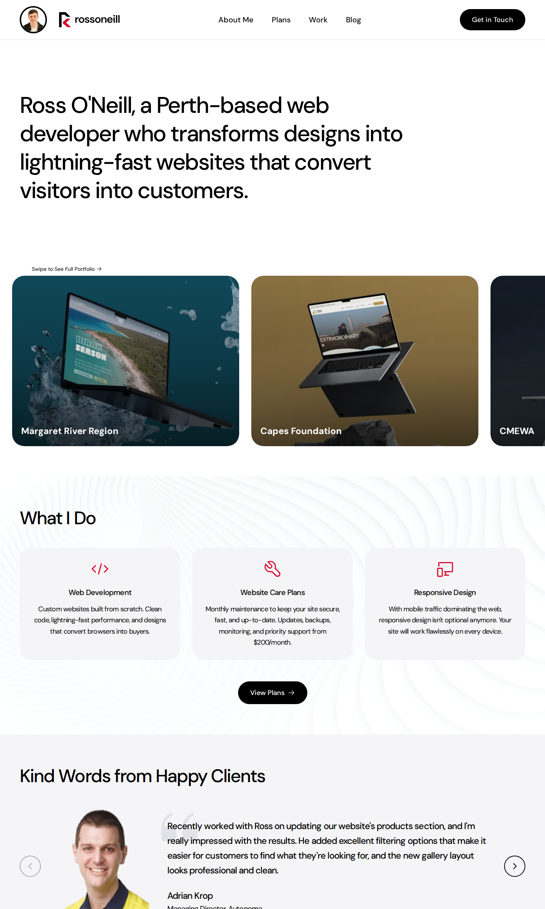
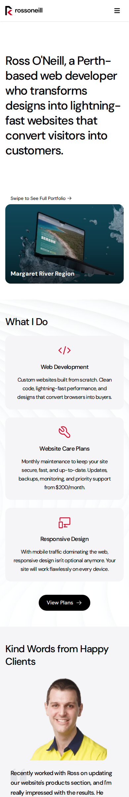

# UI Design System & Master Generation Blueprint: ross-oneill-com

> **Ross O'Neill · Freelance Web Developer and Designer in Perth** (https://ross-oneill.com/) — Freelance web developer and designer in North Beach, Perth. Fast custom websites for WA businesses, built and looked after by the person...



---

## 1. Executive Visual Persona & Design Archetype

- **Brand Essence & Persona**: **Ross O'Neill · Freelance Web Developer and Designer in Perth** (`https://ross-oneill.com/`). Freelance web developer and designer in North Beach, Perth. Fast custom websites for WA businesses, built and looked after by the person...
- **Capture Provenance**: Live browser capture (`tier1_fast`, HTTP `200`, captured `2026-11-23`).
- **Visual Archetype**: **Light-Substrate Editorial & Modular Grid System (`#ffffff` canvas, `#000000` ink, `#da0a2c` accent)**.
- **Anti-AI-Slop Differentiators**:
  - **Live-Computed Chromatic Polarity**: Anchors the viewport in `#ffffff` (live computed `section` `background-color` (`computed_styles.json`)) paired with `#000000` primary typography and `#da0a2c` accents.
  - **Grounded Typographic Hierarchy**: Pairs `DM Sans` for display copy (`Ross O'Neill, a Perth-based web deve`) with `DM Sans` and `SFMono-Regular`.
  - **Calibrated Spatial Grid & Motion**: Combines `96rem` container bounds (`gap: 1rem`, padding `.5rem`) with `cubic-bezier(.4,0,1,1)` easing and Three.js / WebGL Canvas Pipeline, Swiper Touch Carousel Engine.

---

## 2. Spatial Architecture & Modular Grid Mathematics



### Viewport Allocation & Container Geometry
- **Captured Viewport Dimensions**: Desktop `1440×2400px` (`assets/desktop.png`, clamped at 2400px live multi-section capture), Mobile `390×2400px` (`assets/mobile.png`, clamped at 2400px live multi-section capture).
- **Master Container Bounds**: `96rem` (non-`@media` desktop container stylesheet rule).
- **Canvas Lateral Padding & Spacing**: `.5rem` lateral canvas padding with `1rem` grid gap.
- **Border Radius Scale**: `3.35544e+07px`, `50%`, `100%`, `9999px`.

### Responsive Breakpoint Architecture
- **Desktop Layout**: Multi-column CSS Grid / Flexbox layout at `1440px` (`max-width: 96rem`, `gap: 1rem`).
- **Mobile Layout**: Single-column vertical stack at `390px` viewport width with `.5rem` horizontal padding.
- **Extracted CSS Media Queries**: `@media (width>=640px)`, `@media (width>=40rem)`, `@media (width>=48rem)`, `@media (width>=64rem)`.

---

## 3. Color System, Materiality & Atmospheric Lighting

### Semantic Palette & Source Grounding
| Semantic Role | Ground-Truth Value | Extracted Live / CSS Source |
|---|---|---|
| **Primary Canvas Substrate** | `#ffffff` | live computed `section` `background-color` (`computed_styles.json`) |
| **Primary Typography Ink** | `#000000` | live computed `h1` `color` (`computed_styles.json`) |
| **Elevated Surface / Card Substrate** | `#ffff00` | `.bg-yellow-100 { background-color: yellow }` (`#ffff00`) |
| **Interactive Accent / Highlight** | `#da0a2c` | `var(--color-accent)` in `:root` |
| **Secondary / Muted Copy** | `#808080` | `.text-gray-400 { color: gray }` (`#808080`) |
| **Structural Hairline Border** | `#f2f2f2` | `5 { border-color: #f2f2f2 }` |

### Sanitized Root CSS Variables (`ui-ux.md` Ground Truth)
| Variable Name | Extracted Value | Semantic Role |
|---|---|---|
| `--color-red-50` | `oklch(97.1% .013 17.38)` | Brand / Palette Token |
| `--color-red-100` | `oklch(93.6% .032 17.717)` | Brand / Palette Token |
| `--color-red-200` | `oklch(88.5% .062 18.334)` | Brand / Palette Token |
| `--color-red-300` | `oklch(80.8% .114 19.571)` | Brand / Palette Token |
| `--color-red-400` | `oklch(70.4% .191 22.216)` | Brand / Palette Token |
| `--color-red-500` | `oklch(63.7% .237 25.331)` | Brand / Palette Token |
| `--color-red-600` | `oklch(57.7% .245 27.325)` | Brand / Palette Token |
| `--color-red-700` | `oklch(50.5% .213 27.518)` | Brand / Palette Token |
| `--color-red-800` | `oklch(44.4% .177 26.899)` | Brand / Palette Token |
| `--color-red-900` | `oklch(39.6% .141 25.723)` | Brand / Palette Token |
| `--color-red-950` | `oklch(25.8% .092 26.042)` | Brand / Palette Token |
| `--color-orange-50` | `oklch(98% .016 73.684)` | Brand / Palette Token |
| `--color-orange-100` | `oklch(95.4% .038 75.164)` | Brand / Palette Token |
| `--color-orange-200` | `oklch(90.1% .076 70.697)` | Brand / Palette Token |
| `--color-orange-300` | `oklch(83.7% .128 66.29)` | Brand / Palette Token |
| `--color-orange-400` | `oklch(75% .183 55.934)` | Brand / Palette Token |

---

## 4. Typographic Scale & Editorial Hierarchy

### Font Family Stacks
- **Display Typography**: `DM Sans`.
- **Primary Body Stack**: `DM Sans`.
- **Technical / Metadata Stack**: `SFMono-Regular`.

### Typographic Scale & Rules (Live Computed & Stylesheet Grounded)
- **Hero Display (`H1`)**: live computed `h1` (`font-size: 16px`, `line-height: 24px`, `font-weight: 400`); CSS variables `--text-4xl: 2.25rem`, `--text-4xl--line-height: calc(2.5 / 2.25)`, `--text-5xl: 3rem`.
- **Section Heading (`H2`)**: live computed `h2` (`font-size: 24px`, `line-height: 32px`, `font-weight: 700`); CSS variables `--text-2xl: 1.5rem`, `--text-2xl--line-height: calc(2 / 1.5)`, `--text-3xl: 1.875rem`.
- **Body Copy**: live computed `body` (`font-size: 16px`, `line-height: 24px`, `font-weight: 400`); CSS variables `--text-base: 1rem`, `--text-base--line-height: calc(1.5 / 1)`.
- **Metadata & Navigation Labels**: live computed `nav/a` (`font-size: 16px`, `line-height: 24px`, `font-weight: 400`); CSS variables `--text-xs: .75rem`, `--text-xs--line-height: calc(1 / .75)`, `--text-sm: .875rem`.

---

## 5. Choreographed Motion & Interaction Physics

### Primary Easing Curves
- **Extracted Timing Functions**: `cubic-bezier(.4,0,1,1)`, `cubic-bezier(0,0,.2,1)`, `cubic-bezier(.4,0,.2,1)`.

### Per-Element Transition & Choreography Rules
- **Selector `.swiper-wrapper`**: `transition: var(--swiper-wrapper-transition-timing-function,initial)` extracted from `ross-oneill-com` stylesheet.
- **Selector `.swiper-free-mode>.swiper-wrapper`**: `transition: ease-out` extracted from `ross-oneill-com` stylesheet.
- **Selector `layer theme`**: `transition: .15s` extracted from `ross-oneill-com` stylesheet.
- **Extracted Easing Curve (`cubic-bezier(.4,0,1,1)`)**: Governs interactive state transitions across `<header.header-content>` and `<section.pb-12>`.
- **Runtime Interaction Engine**: Integrates Three.js / WebGL Canvas Pipeline, Swiper Touch Carousel Engine with `prefers-reduced-motion: reduce` fallback guards.

---

## 6. Component Wireframe & Structural DOM Map

### Visual Layout Schematic — Desktop (`1440px`, Grounded in `dom.html` & Landmark Bounding Boxes)
```
┌────────────────────────────────────────────────────────────────────────┐
│ DESKTOP VIEWPORT (1440px) — Ross O'Neill · Freelance Web Developer and │
│ ====================================================================== │
│ [ <header.header-content (1440x104px) | About Me · Plans · Work · Bl ] │
│ ---------------------------------------------------------------------- │
│ | HERO STAGE: <section.py-28> (w=1440px)                             | │
│ | H1: Ross O'Neill, a Perth-based web developer who tra...           | │
│ | Substrate: #ffffff | Ink: #000000 | Accent: #da0a2c                | │
│ ---------------------------------------------------------------------- │
│ | SHOWCASE GRID (<section.pb-12>) max-w: 96rem                       | │
│ | +------------------------------+  +------------------------------+ | │
│ | | Margaret River Region        |  | Capes Foundation             | | │
│ | +------------------------------+  +------------------------------+ | │
│ ---------------------------------------------------------------------- │
│ | DETAIL MODULE (<section.relative>) — Westmec Services              | │
│ ---------------------------------------------------------------------- │
│ [ FOOTER (<footer.rounded-2xl>) | https://ross-oneill.com/             │
└────────────────────────────────────────────────────────────────────────┘
```

### Visual Layout Schematic — Mobile Reflow (`390px`)
```
┌────────────────────────────────────────────────────────────────────────┐
│ MOBILE VIEWPORT REFLOW (390px) — Single-Column Stack (gap: 1rem)       │
│ ====================================================================== │
│ [ HEADER BAR (<header.header-content> ) | Compact Menu (390px)         │
│ ---------------------------------------------------------------------- │
│ | HERO STAGE (<section.py-28>) — 390px Vertical Lead                 | │
│ | H1: Ross O'Neill, a Perth-based web developer who tra...           | │
│ ---------------------------------------------------------------------- │
│ | SHOWCASE STACK (<section.pb-12>) — 1-Col Stack                     | │
│ | [ Item 1: Margaret River Region                                  ] | │
│ | [ Item 2: Capes Foundation                                       ] | │
│ ---------------------------------------------------------------------- │
│ | DETAIL STACK (<section.relative>) — 1-Col (Westmec Services)       | │
│ ---------------------------------------------------------------------- │
│ [ FOOTER (<footer.rounded-2xl>) | Stacked 390px Colophon               │
└────────────────────────────────────────────────────────────────────────┘
```

### Granular DOM Region Breakdown
1. **Brand Header & Navigation Bar (<header.header-content> — `ross-oneill-com`)**:
   - Landmark `<header class="header-content top-0">` (`1440x104px`) hosting `Ross O'Neill · Freelance Web Develop` navigation (`About Me · Plans · Work · Blog · Get in Touch`), DOM attributes (`data-astro-exec`, `data-cfasync="false"`, `data-icon="carbon:arrow-right"`, `data-icon="carbon:arrow-right"`), and stylesheet rule `root { --swiper-theme-color:007aff }`.
2. **Hero Stage & Focal Lead (<section.py-28> — `Ross O'Neill, a Perth-based web de`)**:
   - Landmark `<section class="py-28 bg-white">` presenting display lead `Ross O'Neill, a Perth-based web developer who tra...` and copy excerpt *"Custom websites built from scratch. Clean code, lightning-fast pe"* over `#ffffff` canvas and `#000000` ink.
3. **Primary Showcase & Content Grid (<section.pb-12> — `Margaret River Region`)**:
   - Landmark `<section class="pb-12 bg-white">` rendering section `Margaret River Region` with copy *"Ross O'Neill, a Perth-based web developer who transforms designs "*, asset references (`favicon.ico`, `favicon.svg`, `sitemap-index.xml`, `static.cloudflareinsights.com`), and grid rule `host { z-index:1;margin-left:auto;margin-right:auto;display:block;position:rela... }`.
4. **Interactive Detail & Feature Matrix (<section.relative> — `Capes Foundation`)**:
   - Landmark `<section class="relative py-12">` framing `Capes Foundation` and `Westmec Services` (*"Swipe to See Full Portfolio"*) with `#ffff00` surface cards, `#da0a2c` accents, and `.swiper { z-index:1;margin-left:auto;margin-right:auto;padding:0;list-style:none;d... }`.
5. **Colophon & Global Directory Footer (<footer.rounded-2xl> — `https://ross-oneill.com/`)**:
   - Landmark `<footer class="rounded-2xl m-4">` anchoring `Ross O'Neill · Freelance Web Dev` footer links (`About Me · Plans · Work · Blog · Get in Touch`), copy *"Monthly maintenance to keep your site secure, fast, and up-t"*, and `#f2f2f2` structural dividers.

---

## 7. Master Zero-Shot AI Generation Prompt

```markdown
# Master Zero-Shot Frontend Generation Prompt: ross-oneill-com (Ross O'Neill · Freelance Web Developer and Designer in Perth)

You are a principal frontend architect and design systems engineer. Build a complete, production-ready web application replicating the exact design system, DOM landmarks, typographic hierarchy, color tokens, and motion physics of `ross-oneill-com` (**Ross O'Neill · Freelance Web Developer and Designer in Perth** — `https://ross-oneill.com/`).

### 1. Visual Archetype & Anti-AI-Slop Mandates
- **Archetype**: Light-Substrate Editorial & Modular Grid System (`#ffffff` canvas, `#000000` ink, `#da0a2c` accent).
- **Identity & Domain Context**: Freelance web developer and designer in North Beach, Perth. Fast custom websites for WA businesses, built and looked after by the person...
- **Primary Substrate**: `#ffffff` (live computed `section` `background-color` (`computed_styles.json`)), **Primary Ink**: `#000000`, **Accent / Highlight**: `#da0a2c`.
- **Site-Specific Differentiators**:
  - **Live-Computed Chromatic Polarity**: Anchors the viewport in `#ffffff` (live computed `section` `background-color` (`computed_styles.json`)) paired with `#000000` primary typography and `#da0a2c` accents.
  - **Grounded Typographic Hierarchy**: Pairs `DM Sans` for display copy (`Ross O'Neill, a Perth-based web deve`) with `DM Sans` and `SFMono-Regular`.
  - **Calibrated Spatial Grid & Motion**: Combines `96rem` container bounds (`gap: 1rem`, padding `.5rem`) with `cubic-bezier(.4,0,1,1)` easing and Three.js / WebGL Canvas Pipeline, Swiper Touch Carousel Engine.

### 2. Ground-Truth CSS Variables (`:root` Token Contract)
Declare and consume these exact custom properties extracted from `ross-oneill-com` in your global stylesheet:

:root {
  /* Ross O'Neill · Freelance Web Developer and Designer in Perth (ross-oneill-com) — Live-Grounded CSS Variables */
  --color-red-50: oklch(97.1% .013 17.38); /* Brand / Palette Token (ross-oneill-com) */
  --color-red-100: oklch(93.6% .032 17.717); /* Brand / Palette Token (ross-oneill-com) */
  --color-red-200: oklch(88.5% .062 18.334); /* Brand / Palette Token (ross-oneill-com) */
  --color-red-300: oklch(80.8% .114 19.571); /* Brand / Palette Token (ross-oneill-com) */
  --color-red-400: oklch(70.4% .191 22.216); /* Brand / Palette Token (ross-oneill-com) */
  --color-red-500: oklch(63.7% .237 25.331); /* Brand / Palette Token (ross-oneill-com) */
  --color-red-600: oklch(57.7% .245 27.325); /* Brand / Palette Token (ross-oneill-com) */
  --color-red-700: oklch(50.5% .213 27.518); /* Brand / Palette Token (ross-oneill-com) */
  --color-red-800: oklch(44.4% .177 26.899); /* Brand / Palette Token (ross-oneill-com) */
  --color-red-900: oklch(39.6% .141 25.723); /* Brand / Palette Token (ross-oneill-com) */
  --color-red-950: oklch(25.8% .092 26.042); /* Brand / Palette Token (ross-oneill-com) */
  --color-orange-50: oklch(98% .016 73.684); /* Brand / Palette Token (ross-oneill-com) */
  --color-orange-100: oklch(95.4% .038 75.164); /* Brand / Palette Token (ross-oneill-com) */
  --color-orange-200: oklch(90.1% .076 70.697); /* Brand / Palette Token (ross-oneill-com) */
  --color-orange-300: oklch(83.7% .128 66.29); /* Brand / Palette Token (ross-oneill-com) */
  --color-orange-400: oklch(75% .183 55.934); /* Brand / Palette Token (ross-oneill-com) */
}

### 3. Semantic Color & Materiality Contract
Map every surface, ink, and border strictly to these source-grounded tokens:
- **Primary Canvas Substrate**: `#ffffff` — grounded in live computed `section` `background-color` (`computed_styles.json`)
- **Primary Typography Ink**: `#000000` — grounded in live computed `h1` `color` (`computed_styles.json`)
- **Elevated Surface / Card Substrate**: `#ffff00` — grounded in `.bg-yellow-100 { background-color: yellow }` (`#ffff00`)
- **Interactive Accent / Highlight**: `#da0a2c` — grounded in `var(--color-accent)` in `:root`
- **Secondary / Muted Copy**: `#808080` — grounded in `.text-gray-400 { color: gray }` (`#808080`)
- **Structural Hairline Border**: `#f2f2f2` — grounded in `5 { border-color: #f2f2f2 }`

### 4. Spatial Grid, Container Bounds & Responsive Breakpoints
- **Desktop Viewport Reference**: `1440×2400px` (clamped at 2400px live multi-section capture, `1440px` standard desktop width).
- **Mobile Viewport Reference**: `390×2400px` (clamped at 2400px live multi-section capture, `390px` standard mobile width).
- **Container Max-Width**: `96rem` (non-`@media` desktop container stylesheet rule)
- **Padding & Gutters**: `.5rem` lateral canvas padding with `1rem` grid gap
- **Desktop Grid**: Multi-column CSS Grid / Flexbox layout at `1440px` (`max-width: 96rem`, `gap: 1rem`)
- **Mobile Adaptation**: Single-column vertical stack at `390px` viewport width with `.5rem` horizontal padding
- **Media Queries**: `@media (width>=640px)`, `@media (width>=40rem)`, `@media (width>=48rem)`, `@media (width>=64rem)`
- **Corner Radii**: `3.35544e+07px`, `50%`, `100%`, `9999px`

### 5. Typography & Editorial Scale Contract
- **Display Font Stack**: `DM Sans`
- **Body Font Stack**: `DM Sans`
- **Monospace / Technical Font Stack**: `SFMono-Regular`
- **H1 Display Rule**: live computed `h1` (`font-size: 16px`, `line-height: 24px`, `font-weight: 400`); CSS variables `--text-4xl: 2.25rem`, `--text-4xl--line-height: calc(2.5 / 2.25)`, `--text-5xl: 3rem`
- **H2 Section Rule**: live computed `h2` (`font-size: 24px`, `line-height: 32px`, `font-weight: 700`); CSS variables `--text-2xl: 1.5rem`, `--text-2xl--line-height: calc(2 / 1.5)`, `--text-3xl: 1.875rem`
- **Body Copy Rule**: live computed `body` (`font-size: 16px`, `line-height: 24px`, `font-weight: 400`); CSS variables `--text-base: 1rem`, `--text-base--line-height: calc(1.5 / 1)`
- **Metadata & Index Rule**: live computed `nav/a` (`font-size: 16px`, `line-height: 24px`, `font-weight: 400`); CSS variables `--text-xs: .75rem`, `--text-xs--line-height: calc(1 / .75)`, `--text-sm: .875rem`

### 6. Component Hierarchy, Verbatim Copy & Real DOM Landmarks
Scaffold `ross-oneill-com` (`Ross O'Neill · Freelance Web Developer and Designer in Perth`) with these exact structural regions, extracted copy, and CSS rules from `dom.html`:
1. **Brand Header & Navigation Bar (<header.header-content> — `ross-oneill-com`)**:
   - DOM & Selectors: Landmark `<header class="header-content top-0">` (`1440x104px`) hosting `Ross O'Neill · Freelance Web Develop` navigation (`About Me · Plans · Work · Blog · Get in Touch`), DOM attributes (`data-astro-exec`, `data-cfasync="false"`, `data-icon="carbon:arrow-right"`, `data-icon="carbon:arrow-right"`), and stylesheet rule `root { --swiper-theme-color:007aff }`.
   - Responsive Contract: Header `Brand Header & Navigation Bar (<header.header-content> — `ross-oneill-com`)` (`ross-oneill-com`) adapts across `@media (width>=640px)`, `@media (width>=40rem)`, `@media (width>=48rem)`, `@media (width>=64rem)` with `cubic-bezier(.4,0,1,1)`, `cubic-bezier(0,0,.2,1)`, `cubic-bezier(.4,0,.2,1)` transitions and links `About Me · Plans · Work · Blog · Get in Touch`.
2. **Hero Stage & Focal Lead (<section.py-28> — `Ross O'Neill, a Perth-based web de`)**:
   - DOM & Selectors: Landmark `<section class="py-28 bg-white">` presenting display lead `Ross O'Neill, a Perth-based web developer who tra...` and copy excerpt *"Custom websites built from scratch. Clean code, lightning-fast pe"* over `#ffffff` canvas and `#000000` ink.
   - Responsive Contract: Hero stage (`1440×2400px` desktop / `390×2400px` mobile) sets `#ffffff` background with `#000000` headline `Ross O'Neill, a Perth-based web developer who tra...`.
3. **Primary Showcase & Content Grid (<section.pb-12> — `Margaret River Region`)**:
   - DOM & Selectors: Landmark `<section class="pb-12 bg-white">` rendering section `Margaret River Region` with copy *"Ross O'Neill, a Perth-based web developer who transforms designs "*, asset references (`favicon.ico`, `favicon.svg`, `sitemap-index.xml`, `static.cloudflareinsights.com`), and grid rule `host { z-index:1;margin-left:auto;margin-right:auto;display:block;position:rela... }`.
   - Responsive Contract: Showcase grid `Primary Showcase & Content Grid (<section.pb-12> — `Margaret River Region`)` applies Multi-column CSS Grid / Flexbox layout at `1440px` (`max-width: 96rem`, `gap: 1rem`) on desktop and Single-column vertical stack at `390px` viewport width with `.5rem` horizontal padding on mobile.
4. **Interactive Detail & Feature Matrix (<section.relative> — `Capes Foundation`)**:
   - DOM & Selectors: Landmark `<section class="relative py-12">` framing `Capes Foundation` and `Westmec Services` (*"Swipe to See Full Portfolio"*) with `#ffff00` surface cards, `#da0a2c` accents, and `.swiper { z-index:1;margin-left:auto;margin-right:auto;padding:0;list-style:none;d... }`.
   - Responsive Contract: Detail module `Interactive Detail & Feature Matrix (<section.relative> — `Capes Foundation`)` uses `3.35544e+07px`, `50%`, `100%`, `9999px` radii, `#da0a2c` highlights, and assets (favicon.ico, favicon.svg, sitemap-index.xml).
5. **Colophon & Global Directory Footer (<footer.rounded-2xl> — `https://ross-oneill.com/`)**:
   - DOM & Selectors: Landmark `<footer class="rounded-2xl m-4">` anchoring `Ross O'Neill · Freelance Web Dev` footer links (`About Me · Plans · Work · Blog · Get in Touch`), copy *"Monthly maintenance to keep your site secure, fast, and up-t"*, and `#f2f2f2` structural dividers.
   - Responsive Contract: Footer `Colophon & Global Directory Footer (<footer.rounded-2xl> — `https://ross-oneill.com/`)` aligns to `96rem` (non-`@media` desktop container stylesheet rule) with `.5rem` lateral canvas padding with `1rem` grid gap and attributes (data-astro-exec, data-cfasync="false", data-icon="carbon:arrow-right").

#### Verbatim DOM Copy Excerpts (`dom.html`)
- Copy Excerpt 1: *"Custom websites built from scratch. Clean code, lightning-fast performance, and de..."*
- Copy Excerpt 2: *"Ross O'Neill, a Perth-based web developer who transforms designs into lightning-fa..."*
- Copy Excerpt 3: *"Swipe to See Full Portfolio"*
- Copy Excerpt 4: *"Monthly maintenance to keep your site secure, fast, and up-to-date. Updates, backu..."*

### 7. Motion, Extracted Stylesheet Rules & Interaction Choreography
- **Primary Easing Functions**: `cubic-bezier(.4,0,1,1)`, `cubic-bezier(0,0,.2,1)`, `cubic-bezier(.4,0,.2,1)`
- **Extracted Stylesheet Rules (`ross-oneill-com`)**:
- `root { --swiper-theme-color:007aff }`
- `host { z-index:1;margin-left:auto;margin-right:auto;display:block;position:rela... }`
- `.swiper { z-index:1;margin-left:auto;margin-right:auto;padding:0;list-style:none;d... }`
- `.swiper-vertical>.swiper-wrapper { flex-direction:column }`
- `.swiper-wrapper { transform:translate(0,0) }`
- **Per-Selector Transition Rules**:
- **Selector `.swiper-wrapper`**: `transition: var(--swiper-wrapper-transition-timing-function,initial)` extracted from `ross-oneill-com` stylesheet.
- **Selector `.swiper-free-mode>.swiper-wrapper`**: `transition: ease-out` extracted from `ross-oneill-com` stylesheet.
- **Selector `layer theme`**: `transition: .15s` extracted from `ross-oneill-com` stylesheet.
- **Extracted Easing Curve (`cubic-bezier(.4,0,1,1)`)**: Governs interactive state transitions across `<header.header-content>` and `<section.pb-12>`.
- **Runtime Interaction Engine**: Integrates Three.js / WebGL Canvas Pipeline, Swiper Touch Carousel Engine with `prefers-reduced-motion: reduce` fallback guards.

### 8. Technical Deliverables
- Implement in Next.js (App Router) with TypeScript and Tailwind CSS consuming the `:root` custom properties defined above for `ross-oneill-com`.
- Reproduce both the `1440px` desktop architecture and `390px` mobile breakpoint transitions, preserving semantic HTML5 landmarks (`<header>`, `<nav>`, `<main>`, `<section>`, `<footer>`) and `prefers-reduced-motion` accessibility guards.
```
