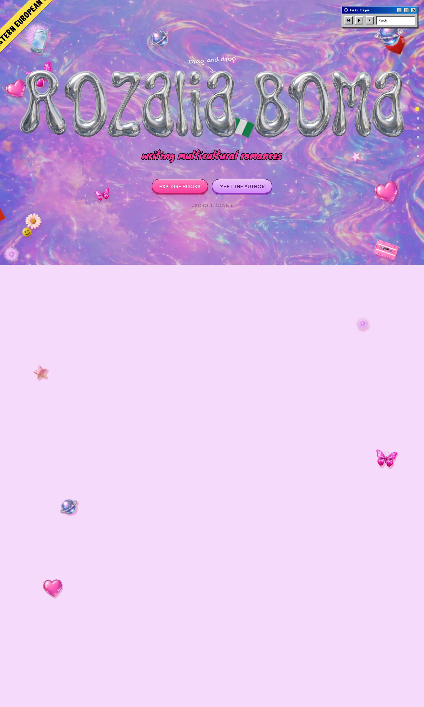
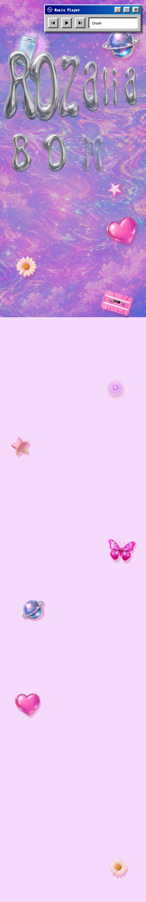

# UI Design System & Master Generation Blueprint: rozaliabomawrites-com

> **Rozalia Boma — Multicultural Romance Author** (https://rozaliabomawrites.com/) — Official site of Rozalia Boma, author of multicultural YA romance. Books, diary entries, guestbook and newsletter.



---

## 1. Executive Visual Persona & Design Archetype

- **Brand Essence & Persona**: **Rozalia Boma — Multicultural Romance Author** (`https://rozaliabomawrites.com/`). Official site of Rozalia Boma, author of multicultural YA romance. Books, diary entries, guestbook and newsletter.
- **Capture Provenance**: Live browser capture (`tier1_fast`, HTTP `200`, captured `2026-11-23`).
- **Visual Archetype**: **Light-Gallery WebGL / Canvas Interactive Experience (`#f5dafb` / `#ffcc00`)**.
- **Anti-AI-Slop Differentiators**:
  - **Live-Computed Chromatic Polarity**: Anchors the viewport in `#f5dafb` (live computed `body` `background-color` (`computed_styles.json`)) paired with `#491237` primary typography and `#ffcc00` accents.
  - **Grounded Typographic Hierarchy**: Pairs `Knewave` for display copy (`Rozalia Boma — writing multicultural`) with `Plus Jakarta Sans` and not declared in live computed styles (uses primary stack / `ui-monospace`).
  - **Calibrated Spatial Grid & Motion**: Combines `1368px` container bounds (`gap: .5rem`, padding `2rem`) with `cubic-bezier(.4,0,.6,1)` easing and Lenis Smooth Scroll (`data-lenis`), HTML5 `<canvas>` Interactive Viewport Surface.

---

## 2. Spatial Architecture & Modular Grid Mathematics



### Viewport Allocation & Container Geometry
- **Captured Viewport Dimensions**: Desktop `1440×2400px` (`assets/desktop.png`, clamped at 2400px live multi-section capture), Mobile `390×2400px` (`assets/mobile.png`, clamped at 2400px live multi-section capture).
- **Master Container Bounds**: `1368px` (measured widest bounded `<section>` landmark width on `1440px` desktop).
- **Canvas Lateral Padding & Spacing**: `2rem` lateral canvas padding with `.5rem` grid gap.
- **Border Radius Scale**: `var(--radius)`, `999px`, `14px`, `8px`.

### Responsive Breakpoint Architecture
- **Desktop Layout**: Multi-column CSS Grid / Flexbox layout at `1440px` (`max-width: 1368px`, `gap: .5rem`).
- **Mobile Layout**: Single-column vertical stack at `390px` viewport width with `2rem` horizontal padding.
- **Extracted CSS Media Queries**: `@media (max-width: 640px)`, `@media (min-width: 1400px)`, `@media (min-width: 640px)`, `@media (min-width: 768px)`.

---

## 3. Color System, Materiality & Atmospheric Lighting

### Semantic Palette & Source Grounding
| Semantic Role | Ground-Truth Value | Extracted Live / CSS Source |
|---|---|---|
| **Primary Canvas Substrate** | `#f5dafb` | live computed `body` `background-color` (`computed_styles.json`) |
| **Primary Typography Ink** | `#491237` | live computed `h1` `color` (`computed_styles.json`) |
| **Elevated Surface / Card Substrate** | `#ffffff` | `var(--normal-bg)` in `:root` |
| **Interactive Accent / Highlight** | `#ffcc00` | `crubber-button.ytp-swatch-backg... { background-color: #ffcc00 }` |
| **Secondary / Muted Copy** | `#fa3899` | live computed `h2` `color` (`computed_styles.json`) |
| **Structural Hairline Border** | `#e5e7eb` | `:after { border-color: #e5e7eb }` |

### Sanitized Root CSS Variables (`ui-ux.md` Ground Truth)
| Variable Name | Extracted Value | Semantic Role |
|---|---|---|
| `--background` | `290 80% 92%` | Canvas / Surface Token |
| `--foreground` | `320 60% 18%` | Typography Ink Token |
| `--card` | `0 0% 100%` | Dimension / Scale Token |
| `--card-foreground` | `320 60% 18%` | Typography Ink Token |
| `--popover` | `0 0% 100%` | Dimension / Scale Token |
| `--popover-foreground` | `320 60% 18%` | Typography Ink Token |
| `--primary` | `330 95% 60%` | Brand / Palette Token |
| `--primary-foreground` | `0 0% 100%` | Typography Ink Token |
| `--secondary` | `280 85% 78%` | Brand / Palette Token |
| `--secondary-foreground` | `320 60% 18%` | Typography Ink Token |
| `--muted` | `320 60% 95%` | Dimension / Scale Token |
| `--muted-foreground` | `320 25% 45%` | Typography Ink Token |
| `--accent` | `195 90% 75%` | Brand / Palette Token |
| `--accent-foreground` | `320 60% 18%` | Typography Ink Token |
| `--destructive` | `0 84% 60%` | Dimension / Scale Token |
| `--destructive-foreground` | `0 0% 100%` | Typography Ink Token |

---

## 4. Typographic Scale & Editorial Hierarchy

### Font Family Stacks
- **Display Typography**: `Knewave`.
- **Primary Body Stack**: `Plus Jakarta Sans`.
- **Technical / Metadata Stack**: not declared in live computed styles (uses primary stack / `ui-monospace`).

### Typographic Scale & Rules (Live Computed & Stylesheet Grounded)
- **Hero Display (`H1`)**: live computed `h1` (`font-size: 96px`, `line-height: 96px`, `font-weight: 400`, `letter-spacing: -1.92px`).
- **Section Heading (`H2`)**: live computed `h2` (`font-size: 93.9404px`, `line-height: 89.2434px`, `font-weight: 400`, `letter-spacing: 0.939404px`); rule `h2` (`letter-spacing: -.02em`, `font-weight: 400`).
- **Body Copy**: live computed `body` (`font-size: 16px`, `line-height: 24px`, `font-weight: 400`); rule `p` (`line-height: 1.65`).
- **Metadata & Navigation Labels**: live computed `nav/a` (`font-size: 16px`, `line-height: 24px`, `font-weight: 400`).

---

## 5. Choreographed Motion & Interaction Physics

### Primary Easing Curves
- **Extracted Timing Functions**: `cubic-bezier(.4,0,.6,1)`, `cubic-bezier(.4,0,.2,1)`, `cubic-bezier(0,0,.2,1)`.

### Per-Element Transition & Choreography Rules
- **Selector `.btn-bubble`**: `transition: transform .12s ease,box-shadow .12s ease` extracted from `rozaliabomawrites-com` stylesheet.
- **Selector `.win98-btn`**: `transition: none` extracted from `rozaliabomawrites-com` stylesheet.
- **Selector `.y2k-textbox`**: `transition: transform .35s ease,box-shadow .35s ease` extracted from `rozaliabomawrites-com` stylesheet.
- **Extracted Easing Curve (`cubic-bezier(.4,0,.6,1)`)**: Governs interactive state transitions across `<nav.top-0>` and `<section.overflow-x-clip>`.
- **Runtime Interaction Engine**: Integrates Lenis Smooth Scroll (`data-lenis`), HTML5 `<canvas>` Interactive Viewport Surface with `prefers-reduced-motion: reduce` fallback guards.

---

## 6. Component Wireframe & Structural DOM Map

### Visual Layout Schematic — Desktop (`1440px`, Grounded in `dom.html` & Landmark Bounding Boxes)
```
┌────────────────────────────────────────────────────────────────────────┐
│ DESKTOP VIEWPORT (1440px) — Rozalia Boma — Multicultural Romance Autho │
│ ====================================================================== │
│ [ <nav.top-0> (1440x68px)             | Home · Author · Books · Blog ] │
│ ---------------------------------------------------------------------- │
│ | HERO STAGE: <section.fixed> (w=1440px)                             | │
│ | H1: Rozalia Boma — writing multicultural romances                  | │
│ | Substrate: #f5dafb | Ink: #491237 | Accent: #ffcc00                | │
│ ---------------------------------------------------------------------- │
│ | SHOWCASE GRID (<section.overflow-x-clip>) max-w: 1368px            | │
│ | +------------------------------+  +------------------------------+ | │
│ | | I'm Polish Nigerian, soon mo |  | Beware! Black Eastern Europe | | │
│ | +------------------------------+  +------------------------------+ | │
│ ---------------------------------------------------------------------- │
│ | DETAIL MODULE (<section.py-24>) — w r i t i n g m u l t            | │
│ ---------------------------------------------------------------------- │
│ [ FOOTER (<footer.mt-8>       ) | https://rozaliabomawrites.com/       │
└────────────────────────────────────────────────────────────────────────┘
```

### Visual Layout Schematic — Mobile Reflow (`390px`)
```
┌────────────────────────────────────────────────────────────────────────┐
│ MOBILE VIEWPORT REFLOW (390px) — Single-Column Stack (gap: .5rem)      │
│ ====================================================================== │
│ [ HEADER BAR (<nav.top-0>             ) | Compact Menu (390px)         │
│ ---------------------------------------------------------------------- │
│ | HERO STAGE (<section.fixed>) — 390px Vertical Lead                 | │
│ | H1: Rozalia Boma — writing multicultural romances                  | │
│ ---------------------------------------------------------------------- │
│ | SHOWCASE STACK (<section.overflow-x-cl) — 1-Col Stack              | │
│ | [ Item 1: I'm Polish Nigerian, soon moving out of Hong Kon       ] | │
│ | [ Item 2: Beware! Black Eastern European baddies on the ri       ] | │
│ ---------------------------------------------------------------------- │
│ | DETAIL STACK (<section.py-24>) — 1-Col (w r i t i n g m u )        | │
│ ---------------------------------------------------------------------- │
│ [ FOOTER (<footer.mt-8>       ) | Stacked 390px Colophon               │
└────────────────────────────────────────────────────────────────────────┘
```

### Granular DOM Region Breakdown
1. **Brand Header & Navigation Bar (<nav.top-0> — `rozaliabomawrites-com`)**:
   - Landmark `<nav class="top-0 left-0">` (`1440x68px`) hosting `Rozalia Boma — Multicultural Romance` navigation (`Home · Author · Books · Blog · Guestbook`), DOM attributes (`data-artifact-kind="dwl_content_hash"`, `data-artifact-id="db5c4db312500dfaed9e3..."`, `data-commit-sha="37366776bd44c18a989e4..."`, `data-context-token="v1.eyJwcm9qZWN0X2lkIj..."`), and stylesheet rule `after { box-sizing:border-box;border-width:0;border-style:solid;border-color:e5e7eb }`.
2. **Hero Stage & Focal Lead (<section.fixed> — `Rozalia Boma — writing multicultur`)**:
   - Landmark `<section class="fixed">` presenting display lead `Rozalia Boma — writing multicultural romances` and copy excerpt *"I'm Polish Nigerian, soon moving out of Hong Kong to go back to L"* over `#f5dafb` canvas and `#491237` ink.
3. **Primary Showcase & Content Grid (<section.overflow-x-clip> — `I'm Polish Nigerian, soon moving o`)**:
   - Landmark `<section class="overflow-x-clip overflow-y-visible">` rendering section `I'm Polish Nigerian, soon moving out of Hong Kon` with copy *"Beware! Black Eastern European baddies on the rise!"*, asset references (`holo-sky-bg-C4iYYOxV.webp`, `fonts.googleapis.com`, `fonts.gstatic.com`, `sykz-yx0lLcxQaSIhS23-w.woff2`), and grid rule `body { margin:0;line-height:inherit }`.
4. **Interactive Detail & Feature Matrix (<section.py-24> — `Beware! Black Eastern European bad`)**:
   - Landmark `<section class="py-24 relative">` framing `Beware! Black Eastern European baddies on the ri` and `w r i t i n g m u l t i c u l t u r a l` (*"w r i t i n g m u l t i c u l t u r a l"*) with `#ffffff` surface cards, `#ffcc00` accents, and `strong { font-weight:bolder }`.
5. **Colophon & Global Directory Footer (<footer.mt-8> — `https://rozaliabomawrites.com/`)**:
   - Landmark `<footer class="mt-8 relative">` anchoring `Rozalia Boma — Multicultural Rom` footer links (`Home · Author · Books · Blog · Guestbook`), copy *"m u l t i c u l t u r a l"*, and `#e5e7eb` structural dividers.

---

## 7. Master Zero-Shot AI Generation Prompt

```markdown
# Master Zero-Shot Frontend Generation Prompt: rozaliabomawrites-com (Rozalia Boma — Multicultural Romance Author)

You are a principal frontend architect and design systems engineer. Build a complete, production-ready web application replicating the exact design system, DOM landmarks, typographic hierarchy, color tokens, and motion physics of `rozaliabomawrites-com` (**Rozalia Boma — Multicultural Romance Author** — `https://rozaliabomawrites.com/`).

### 1. Visual Archetype & Anti-AI-Slop Mandates
- **Archetype**: Light-Gallery WebGL / Canvas Interactive Experience (`#f5dafb` / `#ffcc00`).
- **Identity & Domain Context**: Official site of Rozalia Boma, author of multicultural YA romance. Books, diary entries, guestbook and newsletter.
- **Primary Substrate**: `#f5dafb` (live computed `body` `background-color` (`computed_styles.json`)), **Primary Ink**: `#491237`, **Accent / Highlight**: `#ffcc00`.
- **Site-Specific Differentiators**:
  - **Live-Computed Chromatic Polarity**: Anchors the viewport in `#f5dafb` (live computed `body` `background-color` (`computed_styles.json`)) paired with `#491237` primary typography and `#ffcc00` accents.
  - **Grounded Typographic Hierarchy**: Pairs `Knewave` for display copy (`Rozalia Boma — writing multicultural`) with `Plus Jakarta Sans` and not declared in live computed styles (uses primary stack / `ui-monospace`).
  - **Calibrated Spatial Grid & Motion**: Combines `1368px` container bounds (`gap: .5rem`, padding `2rem`) with `cubic-bezier(.4,0,.6,1)` easing and Lenis Smooth Scroll (`data-lenis`), HTML5 `<canvas>` Interactive Viewport Surface.

### 2. Ground-Truth CSS Variables (`:root` Token Contract)
Declare and consume these exact custom properties extracted from `rozaliabomawrites-com` in your global stylesheet:

:root {
  /* Rozalia Boma — Multicultural Romance Author (rozaliabomawrites-com) — Live-Grounded CSS Variables */
  --background: 290 80% 92%; /* Canvas / Surface Token (rozaliabomawrites-com) */
  --foreground: 320 60% 18%; /* Typography Ink Token (rozaliabomawrites-com) */
  --card: 0 0% 100%; /* Dimension / Scale Token (rozaliabomawrites-com) */
  --card-foreground: 320 60% 18%; /* Typography Ink Token (rozaliabomawrites-com) */
  --popover: 0 0% 100%; /* Dimension / Scale Token (rozaliabomawrites-com) */
  --popover-foreground: 320 60% 18%; /* Typography Ink Token (rozaliabomawrites-com) */
  --primary: 330 95% 60%; /* Brand / Palette Token (rozaliabomawrites-com) */
  --primary-foreground: 0 0% 100%; /* Typography Ink Token (rozaliabomawrites-com) */
  --secondary: 280 85% 78%; /* Brand / Palette Token (rozaliabomawrites-com) */
  --secondary-foreground: 320 60% 18%; /* Typography Ink Token (rozaliabomawrites-com) */
  --muted: 320 60% 95%; /* Dimension / Scale Token (rozaliabomawrites-com) */
  --muted-foreground: 320 25% 45%; /* Typography Ink Token (rozaliabomawrites-com) */
  --accent: 195 90% 75%; /* Brand / Palette Token (rozaliabomawrites-com) */
  --accent-foreground: 320 60% 18%; /* Typography Ink Token (rozaliabomawrites-com) */
  --destructive: 0 84% 60%; /* Dimension / Scale Token (rozaliabomawrites-com) */
  --destructive-foreground: 0 0% 100%; /* Typography Ink Token (rozaliabomawrites-com) */
}

### 3. Semantic Color & Materiality Contract
Map every surface, ink, and border strictly to these source-grounded tokens:
- **Primary Canvas Substrate**: `#f5dafb` — grounded in live computed `body` `background-color` (`computed_styles.json`)
- **Primary Typography Ink**: `#491237` — grounded in live computed `h1` `color` (`computed_styles.json`)
- **Elevated Surface / Card Substrate**: `#ffffff` — grounded in `var(--normal-bg)` in `:root`
- **Interactive Accent / Highlight**: `#ffcc00` — grounded in `crubber-button.ytp-swatch-backg... { background-color: #ffcc00 }`
- **Secondary / Muted Copy**: `#fa3899` — grounded in live computed `h2` `color` (`computed_styles.json`)
- **Structural Hairline Border**: `#e5e7eb` — grounded in `:after { border-color: #e5e7eb }`

### 4. Spatial Grid, Container Bounds & Responsive Breakpoints
- **Desktop Viewport Reference**: `1440×2400px` (clamped at 2400px live multi-section capture, `1440px` standard desktop width).
- **Mobile Viewport Reference**: `390×2400px` (clamped at 2400px live multi-section capture, `390px` standard mobile width).
- **Container Max-Width**: `1368px` (measured widest bounded `<section>` landmark width on `1440px` desktop)
- **Padding & Gutters**: `2rem` lateral canvas padding with `.5rem` grid gap
- **Desktop Grid**: Multi-column CSS Grid / Flexbox layout at `1440px` (`max-width: 1368px`, `gap: .5rem`)
- **Mobile Adaptation**: Single-column vertical stack at `390px` viewport width with `2rem` horizontal padding
- **Media Queries**: `@media (max-width: 640px)`, `@media (min-width: 1400px)`, `@media (min-width: 640px)`, `@media (min-width: 768px)`
- **Corner Radii**: `var(--radius)`, `999px`, `14px`, `8px`

### 5. Typography & Editorial Scale Contract
- **Display Font Stack**: `Knewave`
- **Body Font Stack**: `Plus Jakarta Sans`
- **Monospace / Technical Font Stack**: not declared in live computed styles (uses primary stack / `ui-monospace`)
- **H1 Display Rule**: live computed `h1` (`font-size: 96px`, `line-height: 96px`, `font-weight: 400`, `letter-spacing: -1.92px`)
- **H2 Section Rule**: live computed `h2` (`font-size: 93.9404px`, `line-height: 89.2434px`, `font-weight: 400`, `letter-spacing: 0.939404px`); rule `h2` (`letter-spacing: -.02em`, `font-weight: 400`)
- **Body Copy Rule**: live computed `body` (`font-size: 16px`, `line-height: 24px`, `font-weight: 400`); rule `p` (`line-height: 1.65`)
- **Metadata & Index Rule**: live computed `nav/a` (`font-size: 16px`, `line-height: 24px`, `font-weight: 400`)

### 6. Component Hierarchy, Verbatim Copy & Real DOM Landmarks
Scaffold `rozaliabomawrites-com` (`Rozalia Boma — Multicultural Romance Author`) with these exact structural regions, extracted copy, and CSS rules from `dom.html`:
1. **Brand Header & Navigation Bar (<nav.top-0> — `rozaliabomawrites-com`)**:
   - DOM & Selectors: Landmark `<nav class="top-0 left-0">` (`1440x68px`) hosting `Rozalia Boma — Multicultural Romance` navigation (`Home · Author · Books · Blog · Guestbook`), DOM attributes (`data-artifact-kind="dwl_content_hash"`, `data-artifact-id="db5c4db312500dfaed9e3..."`, `data-commit-sha="37366776bd44c18a989e4..."`, `data-context-token="v1.eyJwcm9qZWN0X2lkIj..."`), and stylesheet rule `after { box-sizing:border-box;border-width:0;border-style:solid;border-color:e5e7eb }`.
   - Responsive Contract: Header `Brand Header & Navigation Bar (<nav.top-0> — `rozaliabomawrites-com`)` (`rozaliabomawrites-com`) adapts across `@media (max-width: 640px)`, `@media (min-width: 1400px)`, `@media (min-width: 640px)`, `@media (min-width: 768px)` with `cubic-bezier(.4,0,.6,1)`, `cubic-bezier(.4,0,.2,1)`, `cubic-bezier(0,0,.2,1)` transitions and links `Home · Author · Books · Blog · Guestbook`.
2. **Hero Stage & Focal Lead (<section.fixed> — `Rozalia Boma — writing multicultur`)**:
   - DOM & Selectors: Landmark `<section class="fixed">` presenting display lead `Rozalia Boma — writing multicultural romances` and copy excerpt *"I'm Polish Nigerian, soon moving out of Hong Kong to go back to L"* over `#f5dafb` canvas and `#491237` ink.
   - Responsive Contract: Hero stage (`1440×2400px` desktop / `390×2400px` mobile) sets `#f5dafb` background with `#491237` headline `Rozalia Boma — writing multicultural romances`.
3. **Primary Showcase & Content Grid (<section.overflow-x-clip> — `I'm Polish Nigerian, soon moving o`)**:
   - DOM & Selectors: Landmark `<section class="overflow-x-clip overflow-y-visible">` rendering section `I'm Polish Nigerian, soon moving out of Hong Kon` with copy *"Beware! Black Eastern European baddies on the rise!"*, asset references (`holo-sky-bg-C4iYYOxV.webp`, `fonts.googleapis.com`, `fonts.gstatic.com`, `sykz-yx0lLcxQaSIhS23-w.woff2`), and grid rule `body { margin:0;line-height:inherit }`.
   - Responsive Contract: Showcase grid `Primary Showcase & Content Grid (<section.overflow-x-clip> — `I'm Polish Nigerian, soon moving o`)` applies Multi-column CSS Grid / Flexbox layout at `1440px` (`max-width: 1368px`, `gap: .5rem`) on desktop and Single-column vertical stack at `390px` viewport width with `2rem` horizontal padding on mobile.
4. **Interactive Detail & Feature Matrix (<section.py-24> — `Beware! Black Eastern European bad`)**:
   - DOM & Selectors: Landmark `<section class="py-24 relative">` framing `Beware! Black Eastern European baddies on the ri` and `w r i t i n g m u l t i c u l t u r a l` (*"w r i t i n g m u l t i c u l t u r a l"*) with `#ffffff` surface cards, `#ffcc00` accents, and `strong { font-weight:bolder }`.
   - Responsive Contract: Detail module `Interactive Detail & Feature Matrix (<section.py-24> — `Beware! Black Eastern European bad`)` uses `var(--radius)`, `999px`, `14px`, `8px` radii, `#ffcc00` highlights, and assets (holo-sky-bg-C4iYYOxV.webp, fonts.googleapis.com, fonts.gstatic.com).
5. **Colophon & Global Directory Footer (<footer.mt-8> — `https://rozaliabomawrites.com/`)**:
   - DOM & Selectors: Landmark `<footer class="mt-8 relative">` anchoring `Rozalia Boma — Multicultural Rom` footer links (`Home · Author · Books · Blog · Guestbook`), copy *"m u l t i c u l t u r a l"*, and `#e5e7eb` structural dividers.
   - Responsive Contract: Footer `Colophon & Global Directory Footer (<footer.mt-8> — `https://rozaliabomawrites.com/`)` aligns to `1368px` (measured widest bounded `<section>` landmark width on `1440px` desktop) with `2rem` lateral canvas padding with `.5rem` grid gap and attributes (data-artifact-kind="dwl_content_hash", data-artifact-id="db5c4db312500dfaed9e3...", data-commit-sha="37366776bd44c18a989e4...").

#### Verbatim DOM Copy Excerpts (`dom.html`)
- Copy Excerpt 1: *"I'm Polish Nigerian, soon moving out of Hong Kong to go back to London"*
- Copy Excerpt 2: *"Beware! Black Eastern European baddies on the rise!"*
- Copy Excerpt 3: *"w r i t i n g m u l t i c u l t u r a l"*
- Copy Excerpt 4: *"m u l t i c u l t u r a l"*

### 7. Motion, Extracted Stylesheet Rules & Interaction Choreography
- **Primary Easing Functions**: `cubic-bezier(.4,0,.6,1)`, `cubic-bezier(.4,0,.2,1)`, `cubic-bezier(0,0,.2,1)`
- **Extracted Stylesheet Rules (`rozaliabomawrites-com`)**:
- `after { box-sizing:border-box;border-width:0;border-style:solid;border-color:e5e7eb }`
- `body { margin:0;line-height:inherit }`
- `strong { font-weight:bolder }`
- `small { font-size:80% }`
- `sup { font-size:75%;line-height:0;position:relative;vertical-align:baseline }`
- **Per-Selector Transition Rules**:
- **Selector `.btn-bubble`**: `transition: transform .12s ease,box-shadow .12s ease` extracted from `rozaliabomawrites-com` stylesheet.
- **Selector `.win98-btn`**: `transition: none` extracted from `rozaliabomawrites-com` stylesheet.
- **Selector `.y2k-textbox`**: `transition: transform .35s ease,box-shadow .35s ease` extracted from `rozaliabomawrites-com` stylesheet.
- **Extracted Easing Curve (`cubic-bezier(.4,0,.6,1)`)**: Governs interactive state transitions across `<nav.top-0>` and `<section.overflow-x-clip>`.
- **Runtime Interaction Engine**: Integrates Lenis Smooth Scroll (`data-lenis`), HTML5 `<canvas>` Interactive Viewport Surface with `prefers-reduced-motion: reduce` fallback guards.

### 8. Technical Deliverables
- Implement in Next.js (App Router) with TypeScript and Tailwind CSS consuming the `:root` custom properties defined above for `rozaliabomawrites-com`.
- Reproduce both the `1440px` desktop architecture and `390px` mobile breakpoint transitions, preserving semantic HTML5 landmarks (`<header>`, `<nav>`, `<main>`, `<section>`, `<footer>`) and `prefers-reduced-motion` accessibility guards.
```
