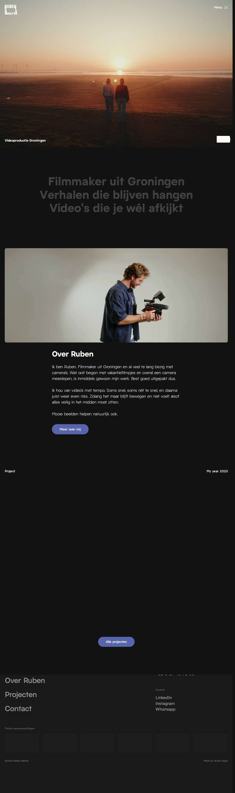
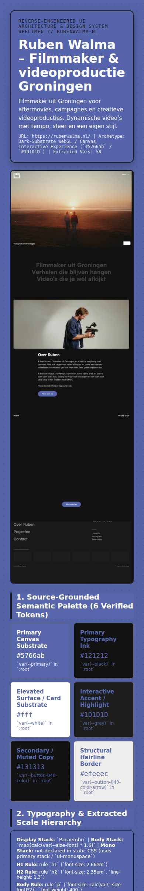

# UI Design System & Master Generation Blueprint: rubenwalma-nl

> **Ruben Walma – Filmmaker & videoproductie Groningen** (https://rubenwalma.nl/) — Filmmaker uit Groningen voor aftermovies, campagnes en creatieve videoproducties. Dynamische video’s met tempo, sfeer en een eigen stijl.



---

## 1. Executive Visual Persona & Design Archetype

- **Brand Essence & Persona**: **Ruben Walma – Filmmaker & videoproductie Groningen** (`https://rubenwalma.nl/`). Filmmaker uit Groningen voor aftermovies, campagnes en creatieve videoproducties. Dynamische video’s met tempo, sfeer en een eigen stijl.
- **Visual Archetype**: **Dark-Substrate WebGL / Canvas Interactive Experience (`#5766ab` / `#1D1D1D`)**.
- **Anti-AI-Slop Differentiators**:
  - **Source-Grounded Chromatic Polarity**: Anchors the viewport in `#5766ab` (`var(--primary)` in `:root`) paired with `#fff` primary typography and `#1D1D1D` accents.
  - **Extracted Typographic Hierarchy**: Pairs `Pacaembu` for display copy (`Videoproductie Groningen`) with `max(calc(var(--size-font) * 1.6)` and not declared in static CSS (uses primary stack / `ui-monospace`).
  - **Calibrated Spatial Grid & Motion**: Combines `var(--size-container)` container bounds (`gap: var(--grid-gap)`, padding `var(--container-padding)`) with `cubic-bezier(.33,1,.68,1)` easing and Lenis Smooth Scroll (`data-lenis`), Barba.js Page Transition Router.

---

## 2. Spatial Architecture & Modular Grid Mathematics



### Viewport Allocation & Container Geometry
- **Captured Viewport Dimensions**: Desktop `1440×4844px` (`assets/desktop.png`, full-page scroll capture), Mobile `390×2400px` (`assets/mobile.png`, capped at 2400px multi-section capture).
- **Master Container Bounds**: `var(--size-container)` extracted from `rubenwalma-nl` stylesheet.
- **Canvas Lateral Padding & Spacing**: `var(--container-padding)` lateral canvas padding with `var(--grid-gap)` grid gap.
- **Border Radius Scale**: `50%`, `2px`, `100px`, `var(--button-040-border-radius)`.

### Responsive Breakpoint Architecture
- **Desktop Layout**: Multi-column CSS Grid / Flexbox layout at `1440px` (`max-width: var(--size-container)`, `gap: var(--grid-gap)`).
- **Mobile Layout**: Single-column vertical stack at `390px` viewport width with `var(--container-padding)` horizontal padding.
- **Extracted CSS Media Queries**: `@media screen and (min-width:480px)`, `@media screen and (min-width:768px)`, `@media screen and (min-width:992px)`, `@media screen and (min-width:1920px)`.

---

## 3. Color System, Materiality & Atmospheric Lighting

### Semantic Palette & Source Grounding
| Semantic Role | Ground-Truth Value | Extracted CSS Source / Selector |
|---|---|---|
| **Primary Canvas Substrate** | `#5766ab` | `var(--primary)` in `:root` |
| **Primary Typography Ink** | `#121212` | `var(--black)` in `:root` |
| **Elevated Surface / Card Substrate** | `#fff` | `var(--white)` in `:root` |
| **Interactive Accent / Highlight** | `#1D1D1D` | `var(--grey)` in `:root` |
| **Secondary / Muted Copy** | `#131313` | `var(--button-040-color)` in `:root` |
| **Structural Hairline Border** | `#efeeec` | `var(--button-040-color-arrow)` in `:root` |

### Sanitized Root CSS Variables (`ui-ux.md` Ground Truth)
| Variable Name | Extracted Value | Semantic Role |
|---|---|---|
| `--primary` | `#5766ab` | Brand / Palette Token |
| `--black` | `#121212` | Canvas / Surface Token |
| `--white` | `#fff` | Canvas / Surface Token |
| `--grey` | `#1D1D1D` | Color / Atmospheric Token |
| `--size-container-ideal` | `390` | Layout / Spatial Grid Token |
| `--size-container-min` | `320px` | Layout / Spatial Grid Token |
| `--size-container-max` | `479px` | Layout / Spatial Grid Token |
| `--size-container` | `clamp(var(--size-container-min), 100vw, var(--size-container-max))` | Layout / Spatial Grid Token |
| `--size-unit` | `10` | Layout / Spatial Grid Token |
| `--grid-columns` | `4` | Layout / Spatial Grid Token |
| `--grid-gap` | `1em` | Layout / Spatial Grid Token |
| `--container-padding` | `2em` | Layout / Spatial Grid Token |
| `--roll-line` | `1.45` | Design System Custom Token |
| `--roll-trim` | `.225em` | Dimension / Scale Token |
| `--nav-contact-gap` | `calc(var(--size-font) * 1.2)` | Layout / Spatial Grid Token |
| `--nav-contact-font` | `max(calc(var(--size-font) * 1.6), calc(24px - var(--nav-contact-gap)))` | Typography / Scale Token |

---

## 4. Typographic Scale & Editorial Hierarchy

### Font Family Stacks
- **Display Typography**: `Pacaembu`.
- **Primary Body Stack**: `max(calc(var(--size-font) * 1.6)`.
- **Technical / Metadata Stack**: not declared in static CSS (uses primary stack / `ui-monospace`).

### Typographic Scale & Rules (Extracted from Stylesheet & Variables)
- **Hero Display (`H1`)**: rule `h1` (`font-size: 2.66em`).
- **Section Heading (`H2`)**: rule `h2` (`font-size: 2.35em`, `line-height: 1.3`).
- **Body Copy**: rule `p` (`font-size: calc(var(--size-font)*2)`, `font-weight: 400`).
- **Metadata & Navigation Labels**: not explicitly declared on tag in static CSS (stylesheet font-size ladder: `var(--size-font)`, `3.3em`, `2.5em`, `1.6em`, `4em`).

---

## 5. Choreographed Motion & Interaction Physics

### Primary Easing Curves
- **Extracted Timing Functions**: `cubic-bezier(.33,1,.68,1)`, `cubic-bezier(.32,0,.67,0)`, `cubic-bezier(.625,.05,0,1)`.

### Per-Element Transition & Choreography Rules
- **Selector `nav .logo`**: `transition: opacity .3s ease` extracted from `rubenwalma-nl` stylesheet.
- **Selector `header`**: `transition: transform .5s cubic-bezier(.33,1,.68,1),opacity .25s` extracted from `rubenwalma-nl` stylesheet.
- **Selector `body.nav-hidden header`**: `transition: transform .5s cubic-bezier(.33,1,.68,1),opacity 1s` extracted from `rubenwalma-nl` stylesheet.
- **Extracted Easing Curve (`cubic-bezier(.33,1,.68,1)`)**: Governs interactive state transitions across `<header.lenis>` and `<main.menu-toggle>`.
- **Runtime Interaction Engine**: Integrates Lenis Smooth Scroll (`data-lenis`), Barba.js Page Transition Router, HTML5 `<canvas>` Interactive Viewport Surface with `prefers-reduced-motion: reduce` fallback guards.

---

## 6. Component Wireframe & Structural DOM Map

### Visual Layout Schematic (Grounded in `dom.html` — `1440px` Desktop & `390px` Mobile Reflow)
```
┌────────────────────────────────────────────────────────────────────────┐
│ DESKTOP VIEWPORT (1440px) — Ruben Walma – Filmmaker & videoproductie G │
│ ====================================================================== │
│ [ <header.lenis>           | Overview · Index · Archive · About · C ]  │
│ ---------------------------------------------------------------------- │
│ | HERO STAGE: <main.logo>                                          |   │
│ | H1: Videoproductie Groningen                                     |   │
│ | Substrate: #5766ab    | Ink: #fff       | Accent: #1D1D1D        |   │
│ ---------------------------------------------------------------------- │
│ | SHOWCASE GRID (<main.menu-toggle>        ) max-w: var(--size-con |   │
│ | +------------------------------+  +------------------------------+ | │
│ | | F i l m m a k e r u i t G r  |  | Over Ruben                   | | │
│ | +------------------------------+  +------------------------------+ | │
│ ---------------------------------------------------------------------- │
│ | MOBILE VIEWPORT REFLOW (390px) — Single-Column Stack (gap: var(--) | │
│ | [<header.lenis>] -> [<main.logo>] -> [<main.menu-toggle>] |          │
│ ---------------------------------------------------------------------- │
│ [ FOOTER (<footer.hamburger>    ) | https://rubenwalma.nl/             │
└────────────────────────────────────────────────────────────────────────┘
```

### Granular DOM Region Breakdown
1. **Brand Header & Navigation Bar (<header.lenis> — `rubenwalma-nl`)**:
   - Landmark `<header class="lenis">` hosting `Ruben Walma – Filmmaker & videoprodu` navigation (`Overview · Index · Archive · About · Contact`), DOM attributes (`data-barba="wrapper"`, `data-scrolling-started="false"`, `data-scrolling-direction="up"`, `data-page-theme="light"`), and stylesheet rule `root { --size-container-ideal:550;--size-container-min:480px;--size-container-m... }`.
2. **Hero Stage & Focal Lead (<main.logo> — `Videoproductie Groningen`)**:
   - Landmark `<main class="logo">` presenting display lead `Videoproductie Groningen` and copy excerpt *"Over Ruben Over Ruben"* over `#5766ab` canvas and `#fff` ink.
3. **Primary Showcase & Content Grid (<main.menu-toggle> — `F i l m m a k e r u i t G r o n i `)**:
   - Landmark `<main class="menu-toggle">` rendering section `F i l m m a k e r u i t G r o n i n g e n u u t G...` with copy *"Projecten Projecten"*, asset references (`favicon-dark2.png`, `favicon-white.png`, `sitemap.xml`, `stream.mux.com`), and grid rule `selection { background-color:var(--primary);color:fff }`.
4. **Interactive Detail & Feature Matrix (<main.menu-toggle__label> — `Over Ruben`)**:
   - Landmark `<main class="menu-toggle__label">` framing `Over Ruben` and `info@rubenwalma.nl Klik om te kopiëren Gekopieer` (*"info@rubenwalma.nl Klik om te kopiëren Gekopieerd!"*) with `#fff` surface cards, `#1D1D1D` accents, and `html { background-color:var(--black);color:var(--white);scrollbar-gutter:stable... }`.
5. **Colophon & Global Directory Footer (<footer.hamburger> — `https://rubenwalma.nl/`)**:
   - Landmark `<footer class="hamburger">` anchoring `Ruben Walma – Filmmaker & videop` footer links (`Overview · Index · Archive · About · Contact`), copy *"info@rubenwalma.nl"*, and `#efeeec` structural dividers.

---

## 7. Master Zero-Shot AI Generation Prompt

```markdown
# Master Zero-Shot Frontend Generation Prompt: rubenwalma-nl (Ruben Walma – Filmmaker & videoproductie Groningen)

You are a principal frontend architect and design systems engineer. Build a complete, production-ready web application replicating the exact design system, DOM landmarks, typographic hierarchy, color tokens, and motion physics of `rubenwalma-nl` (**Ruben Walma – Filmmaker & videoproductie Groningen** — `https://rubenwalma.nl/`).

### 1. Visual Archetype & Anti-AI-Slop Mandates
- **Archetype**: Dark-Substrate WebGL / Canvas Interactive Experience (`#5766ab` / `#1D1D1D`).
- **Identity & Domain Context**: Filmmaker uit Groningen voor aftermovies, campagnes en creatieve videoproducties. Dynamische video’s met tempo, sfeer en een eigen stijl.
- **Primary Substrate**: `#5766ab` (`var(--primary)` in `:root`), **Primary Ink**: `#fff`, **Accent / Highlight**: `#1D1D1D`.
- **Site-Specific Differentiators**:
  - **Source-Grounded Chromatic Polarity**: Anchors the viewport in `#5766ab` (`var(--primary)` in `:root`) paired with `#fff` primary typography and `#1D1D1D` accents.
  - **Extracted Typographic Hierarchy**: Pairs `Pacaembu` for display copy (`Videoproductie Groningen`) with `max(calc(var(--size-font) * 1.6)` and not declared in static CSS (uses primary stack / `ui-monospace`).
  - **Calibrated Spatial Grid & Motion**: Combines `var(--size-container)` container bounds (`gap: var(--grid-gap)`, padding `var(--container-padding)`) with `cubic-bezier(.33,1,.68,1)` easing and Lenis Smooth Scroll (`data-lenis`), Barba.js Page Transition Router.

### 2. Ground-Truth CSS Variables (`:root` Token Contract)
Declare and consume these exact custom properties extracted from `rubenwalma-nl` in your global stylesheet:

:root {
  /* Ruben Walma – Filmmaker & videoproductie Groningen (rubenwalma-nl) — Ground-Truth Extracted CSS Variables */
  --primary: #5766ab; /* Brand / Palette Token (rubenwalma-nl) */
  --black: #121212; /* Canvas / Surface Token (rubenwalma-nl) */
  --white: #fff; /* Canvas / Surface Token (rubenwalma-nl) */
  --grey: #1D1D1D; /* Color / Atmospheric Token (rubenwalma-nl) */
  --size-container-ideal: 390; /* Layout / Spatial Grid Token (rubenwalma-nl) */
  --size-container-min: 320px; /* Layout / Spatial Grid Token (rubenwalma-nl) */
  --size-container-max: 479px; /* Layout / Spatial Grid Token (rubenwalma-nl) */
  --size-container: clamp(var(--size-container-min), 100vw, var(--size-container-max)); /* Layout / Spatial Grid Token (rubenwalma-nl) */
  --size-unit: 10; /* Layout / Spatial Grid Token (rubenwalma-nl) */
  --grid-columns: 4; /* Layout / Spatial Grid Token (rubenwalma-nl) */
  --grid-gap: 1em; /* Layout / Spatial Grid Token (rubenwalma-nl) */
  --container-padding: 2em; /* Layout / Spatial Grid Token (rubenwalma-nl) */
  --roll-line: 1.45; /* Design System Custom Token (rubenwalma-nl) */
  --roll-trim: .225em; /* Dimension / Scale Token (rubenwalma-nl) */
  --nav-contact-gap: calc(var(--size-font) * 1.2); /* Layout / Spatial Grid Token (rubenwalma-nl) */
  --nav-contact-font: max(calc(var(--size-font) * 1.6), calc(24px - var(--nav-contact-gap))); /* Typography / Scale Token (rubenwalma-nl) */
}

### 3. Semantic Color & Materiality Contract
Map every surface, ink, and border strictly to these source-grounded tokens:
- **Primary Canvas Substrate**: `#5766ab` — grounded in `var(--primary)` in `:root`
- **Primary Typography Ink**: `#121212` — grounded in `var(--black)` in `:root`
- **Elevated Surface / Card Substrate**: `#fff` — grounded in `var(--white)` in `:root`
- **Interactive Accent / Highlight**: `#1D1D1D` — grounded in `var(--grey)` in `:root`
- **Secondary / Muted Copy**: `#131313` — grounded in `var(--button-040-color)` in `:root`
- **Structural Hairline Border**: `#efeeec` — grounded in `var(--button-040-color-arrow)` in `:root`

### 4. Spatial Grid, Container Bounds & Responsive Breakpoints
- **Desktop Viewport Reference**: `1440×4844px` (full-page scroll capture, `1440px` standard desktop width).
- **Mobile Viewport Reference**: `390×2400px` (capped at 2400px multi-section capture, `390px` standard mobile width).
- **Container Max-Width**: `var(--size-container)` extracted from `rubenwalma-nl` stylesheet
- **Padding & Gutters**: `var(--container-padding)` lateral canvas padding with `var(--grid-gap)` grid gap
- **Desktop Grid**: Multi-column CSS Grid / Flexbox layout at `1440px` (`max-width: var(--size-container)`, `gap: var(--grid-gap)`)
- **Mobile Adaptation**: Single-column vertical stack at `390px` viewport width with `var(--container-padding)` horizontal padding
- **Media Queries**: `@media screen and (min-width:480px)`, `@media screen and (min-width:768px)`, `@media screen and (min-width:992px)`, `@media screen and (min-width:1920px)`
- **Corner Radii**: `50%`, `2px`, `100px`, `var(--button-040-border-radius)`

### 5. Typography & Editorial Scale Contract
- **Display Font Stack**: `Pacaembu`
- **Body Font Stack**: `max(calc(var(--size-font) * 1.6)`
- **Monospace / Technical Font Stack**: not declared in static CSS (uses primary stack / `ui-monospace`)
- **H1 Display Rule**: rule `h1` (`font-size: 2.66em`)
- **H2 Section Rule**: rule `h2` (`font-size: 2.35em`, `line-height: 1.3`)
- **Body Copy Rule**: rule `p` (`font-size: calc(var(--size-font)*2)`, `font-weight: 400`)
- **Metadata & Index Rule**: not explicitly declared on tag in static CSS (stylesheet font-size ladder: `var(--size-font)`, `3.3em`, `2.5em`, `1.6em`, `4em`)

### 6. Component Hierarchy, Verbatim Copy & Real DOM Landmarks
Scaffold `rubenwalma-nl` (`Ruben Walma – Filmmaker & videoproductie Groningen`) with these exact structural regions, extracted copy, and CSS rules from `dom.html`:
1. **Brand Header & Navigation Bar (<header.lenis> — `rubenwalma-nl`)**:
   - DOM & Selectors: Landmark `<header class="lenis">` hosting `Ruben Walma – Filmmaker & videoprodu` navigation (`Overview · Index · Archive · About · Contact`), DOM attributes (`data-barba="wrapper"`, `data-scrolling-started="false"`, `data-scrolling-direction="up"`, `data-page-theme="light"`), and stylesheet rule `root { --size-container-ideal:550;--size-container-min:480px;--size-container-m... }`.
   - Responsive Contract: Header `Brand Header & Navigation Bar (<header.lenis> — `rubenwalma-nl`)` (`rubenwalma-nl`) adapts across `@media screen and (min-width:480px)`, `@media screen and (min-width:768px)`, `@media screen and (min-width:992px)`, `@media screen and (min-width:1920px)` with `cubic-bezier(.33,1,.68,1)`, `cubic-bezier(.32,0,.67,0)`, `cubic-bezier(.625,.05,0,1)` transitions and links `Overview · Index · Archive · About · Contact`.
2. **Hero Stage & Focal Lead (<main.logo> — `Videoproductie Groningen`)**:
   - DOM & Selectors: Landmark `<main class="logo">` presenting display lead `Videoproductie Groningen` and copy excerpt *"Over Ruben Over Ruben"* over `#5766ab` canvas and `#fff` ink.
   - Responsive Contract: Hero stage (`1440×4844px` desktop / `390×2400px` mobile) sets `#5766ab` background with `#fff` headline `Videoproductie Groningen`.
3. **Primary Showcase & Content Grid (<main.menu-toggle> — `F i l m m a k e r u i t G r o n i `)**:
   - DOM & Selectors: Landmark `<main class="menu-toggle">` rendering section `F i l m m a k e r u i t G r o n i n g e n u u t G...` with copy *"Projecten Projecten"*, asset references (`favicon-dark2.png`, `favicon-white.png`, `sitemap.xml`, `stream.mux.com`), and grid rule `selection { background-color:var(--primary);color:fff }`.
   - Responsive Contract: Showcase grid `Primary Showcase & Content Grid (<main.menu-toggle> — `F i l m m a k e r u i t G r o n i `)` applies Multi-column CSS Grid / Flexbox layout at `1440px` (`max-width: var(--size-container)`, `gap: var(--grid-gap)`) on desktop and Single-column vertical stack at `390px` viewport width with `var(--container-padding)` horizontal padding on mobile.
4. **Interactive Detail & Feature Matrix (<main.menu-toggle__label> — `Over Ruben`)**:
   - DOM & Selectors: Landmark `<main class="menu-toggle__label">` framing `Over Ruben` and `info@rubenwalma.nl Klik om te kopiëren Gekopieer` (*"info@rubenwalma.nl Klik om te kopiëren Gekopieerd!"*) with `#fff` surface cards, `#1D1D1D` accents, and `html { background-color:var(--black);color:var(--white);scrollbar-gutter:stable... }`.
   - Responsive Contract: Detail module `Interactive Detail & Feature Matrix (<main.menu-toggle__label> — `Over Ruben`)` uses `50%`, `2px`, `100px`, `var(--button-040-border-radius)` radii, `#1D1D1D` highlights, and assets (favicon-dark2.png, favicon-white.png, sitemap.xml).
5. **Colophon & Global Directory Footer (<footer.hamburger> — `https://rubenwalma.nl/`)**:
   - DOM & Selectors: Landmark `<footer class="hamburger">` anchoring `Ruben Walma – Filmmaker & videop` footer links (`Overview · Index · Archive · About · Contact`), copy *"info@rubenwalma.nl"*, and `#efeeec` structural dividers.
   - Responsive Contract: Footer `Colophon & Global Directory Footer (<footer.hamburger> — `https://rubenwalma.nl/`)` aligns to `var(--size-container)` extracted from `rubenwalma-nl` stylesheet with `var(--container-padding)` lateral canvas padding with `var(--grid-gap)` grid gap and attributes (data-barba="wrapper", data-scrolling-started="false", data-scrolling-direction="up").

#### Verbatim DOM Copy Excerpts (`dom.html`)
- Copy Excerpt 1: *"Over Ruben Over Ruben"*
- Copy Excerpt 2: *"Projecten Projecten"*
- Copy Excerpt 3: *"info@rubenwalma.nl Klik om te kopiëren Gekopieerd!"*
- Copy Excerpt 4: *"info@rubenwalma.nl"*

### 7. Motion, Extracted Stylesheet Rules & Interaction Choreography
- **Primary Easing Functions**: `cubic-bezier(.33,1,.68,1)`, `cubic-bezier(.32,0,.67,0)`, `cubic-bezier(.625,.05,0,1)`
- **Extracted Stylesheet Rules (`rubenwalma-nl`)**:
- `root { --size-container-ideal:550;--size-container-min:480px;--size-container-m... }`
- `selection { background-color:var(--primary);color:fff }`
- `html { background-color:var(--black);color:var(--white);scrollbar-gutter:stable... }`
- `main { min-height:100vh }`
- `main>.page-bg { background-color:var(--black);min-height:100vh }`
- **Per-Selector Transition Rules**:
- **Selector `nav .logo`**: `transition: opacity .3s ease` extracted from `rubenwalma-nl` stylesheet.
- **Selector `header`**: `transition: transform .5s cubic-bezier(.33,1,.68,1),opacity .25s` extracted from `rubenwalma-nl` stylesheet.
- **Selector `body.nav-hidden header`**: `transition: transform .5s cubic-bezier(.33,1,.68,1),opacity 1s` extracted from `rubenwalma-nl` stylesheet.
- **Extracted Easing Curve (`cubic-bezier(.33,1,.68,1)`)**: Governs interactive state transitions across `<header.lenis>` and `<main.menu-toggle>`.
- **Runtime Interaction Engine**: Integrates Lenis Smooth Scroll (`data-lenis`), Barba.js Page Transition Router, HTML5 `<canvas>` Interactive Viewport Surface with `prefers-reduced-motion: reduce` fallback guards.

### 8. Technical Deliverables
- Implement in Next.js (App Router) with TypeScript and Tailwind CSS consuming the `:root` custom properties defined above for `rubenwalma-nl`.
- Reproduce both the `1440px` desktop architecture and `390px` mobile breakpoint transitions, preserving semantic HTML5 landmarks (`<header>`, `<nav>`, `<main>`, `<section>`, `<footer>`) and `prefers-reduced-motion` accessibility guards.
```
