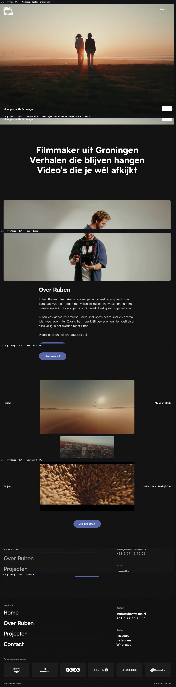
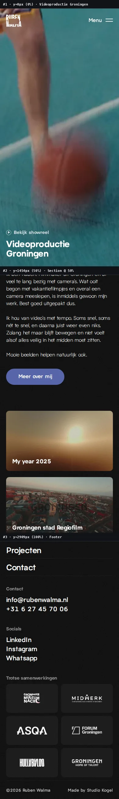

# UI Design System & Master Generation Blueprint: rubenwalma-nl

> **Ruben Walma – Filmmaker & videoproductie Groningen** (https://rubenwalma.nl/) — Filmmaker uit Groningen voor aftermovies, campagnes en creatieve videoproducties. Dynamische video’s met tempo, sfeer en een eigen stijl.





---

## 1. Executive Visual Persona & Design Archetype

- **Brand Essence & Persona**: **Ruben Walma – Filmmaker & videoproductie Groningen** (`https://rubenwalma.nl/`). Filmmaker uit Groningen voor aftermovies, campagnes en creatieve videoproducties. Dynamische video’s met tempo, sfeer en een eigen stijl.
- **Capture Provenance**: Live browser capture (`tier1_fast`, HTTP `200`, captured `2026-11-24`).
- **Visual Archetype**: **Dark-Substrate WebGL / Canvas Interactive Experience (`#121212` / `#0000ee`)**.
- **Anti-AI-Slop Differentiators**:
  - **Live-Computed Chromatic Polarity**: Anchors the viewport in `#121212` (live computed `html` `background-color` (`computed_styles.json`)) paired with `#ffffff` primary typography and `#0000ee` accents.
  - **Grounded Typographic Hierarchy**: Uses `Pacaembu` across display (`Videoproductie Groningen`) and body copy.
  - **Calibrated Spatial Grid & Motion**: Combines `1440px` container bounds (`gap: var(--grid-gap)`, padding `var(--container-padding)`) with `cubic-bezier(.33,1,.68,1)` easing and Lenis Smooth Scroll (`data-lenis`), Barba.js Page Transition Router.

---

## 2. Spatial Architecture & Modular Grid Mathematics

### Viewport Allocation & Container Geometry
- **Captured Journey Filmstrips**: Desktop `1280×4968px` (`assets/desktop-journey.webp`, `6` keyframes up to `y=3936px` / doc `4844px`), Mobile `390×2616px` (`assets/mobile-journey.webp`, `3` keyframes).
- **Master Container Bounds**: `1440px` (full-bleed `100%` desktop stage measured on `1440px` viewport).
- **Canvas Lateral Padding & Spacing**: `var(--container-padding)` lateral canvas padding with `var(--grid-gap)` grid gap.
- **Border Radius Scale**: `50%`, `2px`, `100px`, `var(--button-040-border-radius)`.

### Responsive Breakpoint Architecture
- **Desktop Layout**: Multi-column CSS Grid / Flexbox layout at `1440px` (`max-width: 1440px`, `gap: var(--grid-gap)`).
- **Mobile Layout**: Single-column vertical stack at `390px` viewport width with `var(--container-padding)` horizontal padding.
- **Extracted CSS Media Queries**: `@media screen and (min-width:480px)`, `@media screen and (min-width:768px)`, `@media screen and (min-width:992px)`, `@media screen and (min-width:1920px)`.

---

## 3. Color System, Materiality & Atmospheric Lighting

### Semantic Palette & Source Grounding
| Semantic Role | Ground-Truth Value | Extracted Live / CSS Source |
|---|---|---|
| **Primary Canvas Substrate** | `#121212` | live computed `html` `background-color` (`computed_styles.json`) |
| **Primary Typography Ink** | `#ffffff` | live computed `h1` `color` (`computed_styles.json`) |
| **Elevated Surface / Card Substrate** | `#202623` | `var(--button-040-color-arrow-background)` in `:root` |
| **Interactive Accent / Highlight** | `#0000ee` | live computed `a` `color` (`computed_styles.json`) |
| **Secondary / Muted Copy** | `#0000ee` | live computed `a` `color` (`computed_styles.json`) |
| **Structural Hairline Border** | `#ffffff` | `media-play-button path { stroke: #ffffff }` |
| **Variable Token (`--primary`)** | `#5766ab` | `var(--primary)` in `:root` |
| **Variable Token (`--grey`)** | `#1d1d1d` | `var(--grey)` in `:root` |
| **Variable Token (`--button-040-color`)** | `#131313` | `var(--button-040-color)` in `:root` |
| **Variable Token (`--button-040-color-arrow`)** | `#efeeec` | `var(--button-040-color-arrow)` in `:root` |

### Sanitized Root CSS Variables (`ui-ux.md` Ground Truth)
| Variable Name | Extracted Value | Semantic Role |
|---|---|---|
| `--primary` | `#5766ab` | Brand / Palette Token |
| `--black` | `#121212` | Canvas / Surface Token |
| `--white` | `#fff` | Canvas / Surface Token |
| `--grey` | `#1D1D1D` | Color / Atmospheric Token |
| `--size-container-ideal` | `390` | Layout / Spatial Grid Token |
| `--size-container-min` | `320px` | Layout / Spatial Grid Token |
| `--size-container-max` | `479px` | Layout / Spatial Grid Token |
| `--size-container` | `clamp(var(--size-container-min), 100vw, var(--size-container-max))` | Layout / Spatial Grid Token |
| `--size-unit` | `10` | Layout / Spatial Grid Token |
| `--grid-columns` | `4` | Layout / Spatial Grid Token |
| `--grid-gap` | `1em` | Layout / Spatial Grid Token |
| `--container-padding` | `2em` | Layout / Spatial Grid Token |
| `--button-040-color` | `#131313` | Brand / Palette Token |
| `--button-040-color-background` | `#fff` | Canvas / Surface Token |
| `--button-040-color-arrow` | `#efeeec` | Brand / Palette Token |
| `--button-040-color-arrow-background` | `#202623` | Canvas / Surface Token |

---

## 4. Typographic Scale & Editorial Hierarchy

### Font Family Stacks
- **Display Typography**: `Pacaembu`.
- **Primary Body Stack**: `Pacaembu`.
- **Technical / Metadata Stack**: not declared in live computed styles (uses primary stack / `ui-monospace`).

### Typographic Scale & Rules (Live Computed & Stylesheet Grounded)
- **Hero Display (`H1`)**: live computed `h1` (`font-size: 19.0476px`, `line-height: 20.9524px`, `font-weight: 600`, `letter-spacing: -2%`); rule `h1` (`font-size: 2.66em`).
- **Section Heading (`H2`)**: live computed `h2` (`font-size: 65.2952px`, `line-height: 81.619px`, `font-weight: 600`, `letter-spacing: -2%`); rule `h2` (`font-size: 2.35em`, `line-height: 1.3`).
- **Body Copy**: live computed `body` (`font-size: 9.52381px`, `line-height: normal`, `font-weight: 400`); rule `p` (`font-size: calc(var(--size-font)*2)`, `font-weight: 400`).
- **Metadata & Navigation Labels**: live computed `nav/a` (`font-size: 9.52381px`, `line-height: normal`, `font-weight: 400`).

---

## 5. Choreographed Motion & Interaction Physics

### Primary Easing Curves
- **Extracted Timing Functions**: `cubic-bezier(.33,1,.68,1)`, `cubic-bezier(.32,0,.67,0)`, `cubic-bezier(.625,.05,0,1)`.

### Per-Element Transition & Choreography Rules
- **Selector `nav .logo`**: `transition: opacity .3s ease` extracted from `rubenwalma-nl` stylesheet.
- **Selector `header`**: `transition: transform .5s cubic-bezier(.33,1,.68,1),opacity .25s` extracted from `rubenwalma-nl` stylesheet.
- **Selector `body.nav-hidden header`**: `transition: transform .5s cubic-bezier(.33,1,.68,1),opacity 1s` extracted from `rubenwalma-nl` stylesheet.
- **Extracted Easing Curve (`cubic-bezier(.33,1,.68,1)`)**: Governs interactive state transitions across `<header.lenis>` and `<main.menu-toggle>`.
- **Runtime Interaction Engine**: Integrates Lenis Smooth Scroll (`data-lenis`), Barba.js Page Transition Router, HTML5 `<canvas>` Interactive Viewport Surface with `prefers-reduced-motion: reduce` fallback guards.
### Measured Runtime Scroll & Interaction Telemetry (`behavioral_journey_v2`)
- **Scroll Driver Mode**: `native` (max document height `4844px`, deepest scrollY reached `3936px` across `6` desktop keyframes).
- **Detected Scroll / Motion Libraries**: `Lenis`, `WebGL/Canvas`.
- **Route Transition Architecture**: First internal navigation (`/projecten/my-year-2025`) measured as `direct` in `1040ms`.

---

## 6. Component Wireframe & Structural DOM Map

### Visual Layout Schematic — Desktop (`1440px`, Grounded in `dom.html` & Landmark Bounding Boxes)
```
┌────────────────────────────────────────────────────────────────────────┐
│ DESKTOP VIEWPORT (1440px) — Ruben Walma – Filmmaker & videoproductie G │
│ ====================================================================== │
│ [ <header.lenis> (1425x121px)         | Overview · Index · Archive · ] │
│ ---------------------------------------------------------------------- │
│ | HERO STAGE: <main.logo> (w=1425px)                                 | │
│ | H1: Videoproductie Groningen                                       | │
│ | Substrate: #121212 | Ink: #ffffff | Accent: #0000ee                | │
│ ---------------------------------------------------------------------- │
│ | SHOWCASE GRID (<main.menu-toggle>) max-w: 1440px                   | │
│ | +------------------------------+  +------------------------------+ | │
│ | | F i l m m a k e r u i t G r  |  | Over Ruben                   | | │
│ | +------------------------------+  +------------------------------+ | │
│ ---------------------------------------------------------------------- │
│ | DETAIL MODULE (<main.menu-toggle__label>) — u i t G r o n i n g e  | │
│ ---------------------------------------------------------------------- │
│ [ FOOTER (<footer.hamburger>  ) | https://rubenwalma.nl/               │
└────────────────────────────────────────────────────────────────────────┘
```

### Visual Layout Schematic — Mobile Reflow (`390px`)
```
┌────────────────────────────────────────────────────────────────────────┐
│ MOBILE VIEWPORT REFLOW (390px) — Single-Column Stack (gap: var(--gr)   │
│ ====================================================================== │
│ [ HEADER BAR (<header.lenis>          ) | Compact Menu (390px)         │
│ ---------------------------------------------------------------------- │
│ | HERO STAGE (<main.logo>) — 390px Vertical Lead                     | │
│ | H1: Videoproductie Groningen                                       | │
│ ---------------------------------------------------------------------- │
│ | SHOWCASE STACK (<main.menu-toggle>) — 1-Col Stack                  | │
│ | [ Item 1: F i l m m a k e r u i t G r o n i n g e n u u t G...   ] | │
│ | [ Item 2: Over Ruben                                             ] | │
│ ---------------------------------------------------------------------- │
│ | DETAIL STACK (<main.menu-toggle__label) — 1-Col (u i t G r o n i n ) │
│ ---------------------------------------------------------------------- │
│ [ FOOTER (<footer.hamburger>  ) | Stacked 390px Colophon               │
└────────────────────────────────────────────────────────────────────────┘
```

### Granular DOM Region Breakdown
1. **Brand Header & Navigation Bar (<header.lenis> — `rubenwalma-nl`)**:
   - Landmark `<header class="lenis">` (`1425x121px`) hosting `Ruben Walma – Filmmaker & videoprodu` navigation (`Overview · Index · Archive · About · Contact`), DOM attributes (`data-barba="wrapper"`, `data-scrolling-started="false"`, `data-scrolling-direction="up"`, `data-page-theme="light"`), and stylesheet rule `root { --size-container-ideal:550;--size-container-min:480px;--size-container-m... }`.
2. **Hero Stage & Focal Lead (<main.logo> — `Videoproductie Groningen`)**:
   - Landmark `<main class="logo">` presenting display lead `Videoproductie Groningen` and copy excerpt *"Ik ben Ruben. Filmmaker uit Groningen en al veel te lang bezig me"* over `#121212` canvas and `#ffffff` ink.
3. **Primary Showcase & Content Grid (<main.menu-toggle> — `F i l m m a k e r u i t G r o n i `)**:
   - Landmark `<main class="menu-toggle">` rendering section `F i l m m a k e r u i t G r o n i n g e n u u t G...` with copy *"u i t G r o n i n g e n u u t G r u n n V e r h a l e n d i e b l"*, asset references (`favicon-dark2.png`, `favicon-white.png`, `sitemap.xml`, `stream.mux.com`), and grid rule `selection { background-color:var(--primary);color:fff }`.
4. **Interactive Detail & Feature Matrix (<main.menu-toggle__label> — `Over Ruben`)**:
   - Landmark `<main class="menu-toggle__label">` framing `Over Ruben` and `u i t G r o n i n g e n` (*"u i t G r o n i n g e n"*) with `#202623` surface cards, `#0000ee` accents, and `html { background-color:var(--black);color:var(--white);scrollbar-gutter:stable... }`.
5. **Colophon & Global Directory Footer (<footer.hamburger> — `https://rubenwalma.nl/`)**:
   - Landmark `<footer class="hamburger">` anchoring `Ruben Walma – Filmmaker & videop` footer links (`Overview · Index · Archive · About · Contact`), copy *"Groningen stad Regiofilm"*, and `#ffffff` structural dividers.
### Full Vertical Scroll Sequence (Desktop `1440×900` Keyframes)
- **Step 01** (`y=0px`, `0%`): Active landmark `Videoproductie Groningen` · sticky/fixed elements: `3`
- **Step 02** (`y=850px`, `22%`): Active landmark `Filmmaker uit Groningen uut Grunn Verhalen die bl...` · sticky/fixed elements: `3`
- **Step 03** (`y=1700px`, `43%`): Active landmark `Over Ruben` · sticky/fixed elements: `2`
- **Step 04** (`y=2550px`, `65%`): Active landmark `Section @ 65%` · sticky/fixed elements: `3`
- **Step 05** (`y=3408px`, `87%`): Active landmark `Section @ 87%` · sticky/fixed elements: `3`
- **Step 06** (`y=3936px`, `100%`): Active landmark `Footer` · sticky/fixed elements: `2`

### Multi-Page Internal Route Map
- **Detail Route (`/projecten/my-year-2025`)**: `https://rubenwalma.nl/projecten/my-year-2025` — H1: `My year 2025`, scrollHeight `3767px`, transition `direct` (`1040ms`)
- **About Route (`/contact`)**: `https://rubenwalma.nl/contact` — H1: `Heb je een vraag of idee? Hit me up!`, scrollHeight `4564px`, transition `direct` (`882ms`)
- **Detail Route (`/projecten/groningen-stad-regiofilm`)**: `https://rubenwalma.nl/projecten/groningen-stad-regiofilm` — H1: `Groningen stad Regiofilm`, scrollHeight `3340px`, transition `direct` (`1007ms`)

---

## 7. Master Zero-Shot AI Generation Prompt

```markdown
# Master Zero-Shot Frontend Generation Prompt: rubenwalma-nl (Ruben Walma – Filmmaker & videoproductie Groningen)

You are a principal frontend architect and design systems engineer. Build a complete, production-ready web application replicating the exact design system, DOM landmarks, typographic hierarchy, color tokens, and motion physics of `rubenwalma-nl` (**Ruben Walma – Filmmaker & videoproductie Groningen** — `https://rubenwalma.nl/`).

### 1. Visual Archetype & Anti-AI-Slop Mandates
- **Archetype**: Dark-Substrate WebGL / Canvas Interactive Experience (`#121212` / `#0000ee`).
- **Identity & Domain Context**: Filmmaker uit Groningen voor aftermovies, campagnes en creatieve videoproducties. Dynamische video’s met tempo, sfeer en een eigen stijl.
- **Primary Substrate**: `#121212` (live computed `html` `background-color` (`computed_styles.json`)), **Primary Ink**: `#ffffff`, **Accent / Highlight**: `#0000ee`.
- **Site-Specific Differentiators**:
  - **Live-Computed Chromatic Polarity**: Anchors the viewport in `#121212` (live computed `html` `background-color` (`computed_styles.json`)) paired with `#ffffff` primary typography and `#0000ee` accents.
  - **Grounded Typographic Hierarchy**: Uses `Pacaembu` across display (`Videoproductie Groningen`) and body copy.
  - **Calibrated Spatial Grid & Motion**: Combines `1440px` container bounds (`gap: var(--grid-gap)`, padding `var(--container-padding)`) with `cubic-bezier(.33,1,.68,1)` easing and Lenis Smooth Scroll (`data-lenis`), Barba.js Page Transition Router.

### 2. Ground-Truth CSS Variables (`:root` Token Contract)
Declare and consume these exact custom properties extracted from `rubenwalma-nl` in your global stylesheet:

:root {
  /* Ruben Walma – Filmmaker & videoproductie Groningen (rubenwalma-nl) — Live-Grounded CSS Variables */
  --primary: #5766ab; /* Brand / Palette Token (rubenwalma-nl) */
  --black: #121212; /* Canvas / Surface Token (rubenwalma-nl) */
  --white: #fff; /* Canvas / Surface Token (rubenwalma-nl) */
  --grey: #1D1D1D; /* Color / Atmospheric Token (rubenwalma-nl) */
  --size-container-ideal: 390; /* Layout / Spatial Grid Token (rubenwalma-nl) */
  --size-container-min: 320px; /* Layout / Spatial Grid Token (rubenwalma-nl) */
  --size-container-max: 479px; /* Layout / Spatial Grid Token (rubenwalma-nl) */
  --size-container: clamp(var(--size-container-min), 100vw, var(--size-container-max)); /* Layout / Spatial Grid Token (rubenwalma-nl) */
  --size-unit: 10; /* Layout / Spatial Grid Token (rubenwalma-nl) */
  --grid-columns: 4; /* Layout / Spatial Grid Token (rubenwalma-nl) */
  --grid-gap: 1em; /* Layout / Spatial Grid Token (rubenwalma-nl) */
  --container-padding: 2em; /* Layout / Spatial Grid Token (rubenwalma-nl) */
  --button-040-color: #131313; /* Brand / Palette Token (rubenwalma-nl) */
  --button-040-color-background: #fff; /* Canvas / Surface Token (rubenwalma-nl) */
  --button-040-color-arrow: #efeeec; /* Brand / Palette Token (rubenwalma-nl) */
  --button-040-color-arrow-background: #202623; /* Canvas / Surface Token (rubenwalma-nl) */
}

### 3. Semantic Color & Materiality Contract
Map every surface, ink, and border strictly to these source-grounded tokens:
- **Primary Canvas Substrate**: `#121212` — grounded in live computed `html` `background-color` (`computed_styles.json`)
- **Primary Typography Ink**: `#ffffff` — grounded in live computed `h1` `color` (`computed_styles.json`)
- **Elevated Surface / Card Substrate**: `#202623` — grounded in `var(--button-040-color-arrow-background)` in `:root`
- **Interactive Accent / Highlight**: `#0000ee` — grounded in live computed `a` `color` (`computed_styles.json`)
- **Secondary / Muted Copy**: `#0000ee` — grounded in live computed `a` `color` (`computed_styles.json`)
- **Structural Hairline Border**: `#ffffff` — grounded in `media-play-button path { stroke: #ffffff }`
- **Variable Token (`--primary`)**: `#5766ab` — grounded in `var(--primary)` in `:root`
- **Variable Token (`--grey`)**: `#1d1d1d` — grounded in `var(--grey)` in `:root`
- **Variable Token (`--button-040-color`)**: `#131313` — grounded in `var(--button-040-color)` in `:root`
- **Variable Token (`--button-040-color-arrow`)**: `#efeeec` — grounded in `var(--button-040-color-arrow)` in `:root`

### 4. Spatial Grid, Container Bounds & Responsive Breakpoints
- **Desktop Viewport Reference**: `1280×4968px` (multi-frame vertical journey filmstrip (4968px), `1440px` standard desktop width).
- **Mobile Viewport Reference**: `390×2616px` (multi-frame vertical journey filmstrip (2616px), `390px` standard mobile width).
- **Container Max-Width**: `1440px` (full-bleed `100%` desktop stage measured on `1440px` viewport)
- **Padding & Gutters**: `var(--container-padding)` lateral canvas padding with `var(--grid-gap)` grid gap
- **Desktop Grid**: Multi-column CSS Grid / Flexbox layout at `1440px` (`max-width: 1440px`, `gap: var(--grid-gap)`)
- **Mobile Adaptation**: Single-column vertical stack at `390px` viewport width with `var(--container-padding)` horizontal padding
- **Media Queries**: `@media screen and (min-width:480px)`, `@media screen and (min-width:768px)`, `@media screen and (min-width:992px)`, `@media screen and (min-width:1920px)`
- **Corner Radii**: `50%`, `2px`, `100px`, `var(--button-040-border-radius)`

### 5. Typography & Editorial Scale Contract
- **Display Font Stack**: `Pacaembu`
- **Body Font Stack**: `Pacaembu`
- **Monospace / Technical Font Stack**: not declared in live computed styles (uses primary stack / `ui-monospace`)
- **H1 Display Rule**: live computed `h1` (`font-size: 19.0476px`, `line-height: 20.9524px`, `font-weight: 600`, `letter-spacing: -2%`); rule `h1` (`font-size: 2.66em`)
- **H2 Section Rule**: live computed `h2` (`font-size: 65.2952px`, `line-height: 81.619px`, `font-weight: 600`, `letter-spacing: -2%`); rule `h2` (`font-size: 2.35em`, `line-height: 1.3`)
- **Body Copy Rule**: live computed `body` (`font-size: 9.52381px`, `line-height: normal`, `font-weight: 400`); rule `p` (`font-size: calc(var(--size-font)*2)`, `font-weight: 400`)
- **Metadata & Index Rule**: live computed `nav/a` (`font-size: 9.52381px`, `line-height: normal`, `font-weight: 400`)

### 6. Component Hierarchy, Verbatim Copy & Real DOM Landmarks
Scaffold `rubenwalma-nl` (`Ruben Walma – Filmmaker & videoproductie Groningen`) with these exact structural regions, extracted copy, and CSS rules from `dom.html`:
1. **Brand Header & Navigation Bar (<header.lenis> — `rubenwalma-nl`)**:
   - DOM & Selectors: Landmark `<header class="lenis">` (`1425x121px`) hosting `Ruben Walma – Filmmaker & videoprodu` navigation (`Overview · Index · Archive · About · Contact`), DOM attributes (`data-barba="wrapper"`, `data-scrolling-started="false"`, `data-scrolling-direction="up"`, `data-page-theme="light"`), and stylesheet rule `root { --size-container-ideal:550;--size-container-min:480px;--size-container-m... }`.
   - Responsive Contract: Header `Brand Header & Navigation Bar (<header.lenis> — `rubenwalma-nl`)` (`rubenwalma-nl`) adapts across `@media screen and (min-width:480px)`, `@media screen and (min-width:768px)`, `@media screen and (min-width:992px)`, `@media screen and (min-width:1920px)` with `cubic-bezier(.33,1,.68,1)`, `cubic-bezier(.32,0,.67,0)`, `cubic-bezier(.625,.05,0,1)` transitions and links `Overview · Index · Archive · About · Contact`.
2. **Hero Stage & Focal Lead (<main.logo> — `Videoproductie Groningen`)**:
   - DOM & Selectors: Landmark `<main class="logo">` presenting display lead `Videoproductie Groningen` and copy excerpt *"Ik ben Ruben. Filmmaker uit Groningen en al veel te lang bezig me"* over `#121212` canvas and `#ffffff` ink.
   - Responsive Contract: Hero stage (`1280×4968px` desktop / `390×2616px` mobile) sets `#121212` background with `#ffffff` headline `Videoproductie Groningen`.
3. **Primary Showcase & Content Grid (<main.menu-toggle> — `F i l m m a k e r u i t G r o n i `)**:
   - DOM & Selectors: Landmark `<main class="menu-toggle">` rendering section `F i l m m a k e r u i t G r o n i n g e n u u t G...` with copy *"u i t G r o n i n g e n u u t G r u n n V e r h a l e n d i e b l"*, asset references (`favicon-dark2.png`, `favicon-white.png`, `sitemap.xml`, `stream.mux.com`), and grid rule `selection { background-color:var(--primary);color:fff }`.
   - Responsive Contract: Showcase grid `Primary Showcase & Content Grid (<main.menu-toggle> — `F i l m m a k e r u i t G r o n i `)` applies Multi-column CSS Grid / Flexbox layout at `1440px` (`max-width: 1440px`, `gap: var(--grid-gap)`) on desktop and Single-column vertical stack at `390px` viewport width with `var(--container-padding)` horizontal padding on mobile.
4. **Interactive Detail & Feature Matrix (<main.menu-toggle__label> — `Over Ruben`)**:
   - DOM & Selectors: Landmark `<main class="menu-toggle__label">` framing `Over Ruben` and `u i t G r o n i n g e n` (*"u i t G r o n i n g e n"*) with `#202623` surface cards, `#0000ee` accents, and `html { background-color:var(--black);color:var(--white);scrollbar-gutter:stable... }`.
   - Responsive Contract: Detail module `Interactive Detail & Feature Matrix (<main.menu-toggle__label> — `Over Ruben`)` uses `50%`, `2px`, `100px`, `var(--button-040-border-radius)` radii, `#0000ee` highlights, and assets (favicon-dark2.png, favicon-white.png, sitemap.xml).
5. **Colophon & Global Directory Footer (<footer.hamburger> — `https://rubenwalma.nl/`)**:
   - DOM & Selectors: Landmark `<footer class="hamburger">` anchoring `Ruben Walma – Filmmaker & videop` footer links (`Overview · Index · Archive · About · Contact`), copy *"Groningen stad Regiofilm"*, and `#ffffff` structural dividers.
   - Responsive Contract: Footer `Colophon & Global Directory Footer (<footer.hamburger> — `https://rubenwalma.nl/`)` aligns to `1440px` (full-bleed `100%` desktop stage measured on `1440px` viewport) with `var(--container-padding)` lateral canvas padding with `var(--grid-gap)` grid gap and attributes (data-barba="wrapper", data-scrolling-started="false", data-scrolling-direction="up").

#### Verbatim DOM Copy Excerpts (`dom.html`)
- Copy Excerpt 1: *"Ik ben Ruben. Filmmaker uit Groningen en al veel te lang bezig met camera’s. Wat o..."*
- Copy Excerpt 2: *"u i t G r o n i n g e n u u t G r u n n V e r h a l e n d i e b l i j v e n h a n..."*
- Copy Excerpt 3: *"u i t G r o n i n g e n"*
- Copy Excerpt 4: *"Groningen stad Regiofilm"*

### 7. Motion, Extracted Stylesheet Rules & Interaction Choreography
- **Primary Easing Functions**: `cubic-bezier(.33,1,.68,1)`, `cubic-bezier(.32,0,.67,0)`, `cubic-bezier(.625,.05,0,1)`
- **Extracted Stylesheet Rules (`rubenwalma-nl`)**:
- `root { --size-container-ideal:550;--size-container-min:480px;--size-container-m... }`
- `selection { background-color:var(--primary);color:fff }`
- `html { background-color:var(--black);color:var(--white);scrollbar-gutter:stable... }`
- `main { min-height:100vh }`
- `main>.page-bg { background-color:var(--black);min-height:100vh }`
- **Per-Selector Transition Rules**:
- **Selector `nav .logo`**: `transition: opacity .3s ease` extracted from `rubenwalma-nl` stylesheet.
- **Selector `header`**: `transition: transform .5s cubic-bezier(.33,1,.68,1),opacity .25s` extracted from `rubenwalma-nl` stylesheet.
- **Selector `body.nav-hidden header`**: `transition: transform .5s cubic-bezier(.33,1,.68,1),opacity 1s` extracted from `rubenwalma-nl` stylesheet.
- **Extracted Easing Curve (`cubic-bezier(.33,1,.68,1)`)**: Governs interactive state transitions across `<header.lenis>` and `<main.menu-toggle>`.
- **Runtime Interaction Engine**: Integrates Lenis Smooth Scroll (`data-lenis`), Barba.js Page Transition Router, HTML5 `<canvas>` Interactive Viewport Surface with `prefers-reduced-motion: reduce` fallback guards.
### 7b. Full-Page Scroll Choreography, Interactive States & Multi-Page Routes
- **Scroll Mechanics**: Implement `native` vertical progression up to `4844px` across 6 distinct viewport chapters using Lenis, WebGL/Canvas.
- **Vertical Chapter Sequence**: Videoproductie Groningen (0%) -> Filmmaker uit Groningen uut... (22%) -> Over Ruben (43%) -> Section @ 65% (65%) -> Section @ 87% (87%) -> Footer (100%).
- **Multi-Page Routes**: Scaffold internal routes `/projecten/my-year-2025` (detail, direct), `/contact` (about, direct), `/projecten/groningen-stad-regiofilm` (detail, direct) sharing the global header/footer shell and design tokens.

### 8. Technical Deliverables
- Implement in Next.js (App Router) with TypeScript and Tailwind CSS consuming the `:root` custom properties defined above for `rubenwalma-nl`.
- Reproduce both the `1440px` desktop architecture and `390px` mobile breakpoint transitions, preserving semantic HTML5 landmarks (`<header>`, `<nav>`, `<main>`, `<section>`, `<footer>`) and `prefers-reduced-motion` accessibility guards.
```
---

## 8. Full-Page Scroll Journey, Interactive States & Subpage Inventory

### Desktop Scroll Keyframes (`1440×900` WebP)
| Step | Scroll Y | Progress | Active Landmark / Section | Sticky/Fixed | Visual Asset |
| :---: | :---: | :---: | :--- | :---: | :--- |
| `#01` | `0px` | `0%` | Videoproductie Groningen | `3` | [desktop-step-01.webp](assets/desktop-step-01.webp) |
| `#02` | `850px` | `22%` | Filmmaker uit Groningen uut Grunn Verhalen di... | `3` | [desktop-step-02.webp](assets/desktop-step-02.webp) |
| `#03` | `1700px` | `43%` | Over Ruben | `2` | [desktop-step-03.webp](assets/desktop-step-03.webp) |
| `#04` | `2550px` | `65%` | Section @ 65% | `3` | [desktop-step-04.webp](assets/desktop-step-04.webp) |
| `#05` | `3408px` | `87%` | Section @ 87% | `3` | [desktop-step-05.webp](assets/desktop-step-05.webp) |
| `#06` | `3936px` | `100%` | Footer | `2` | [desktop-step-06.webp](assets/desktop-step-06.webp) |

### Mobile Condensed Keyframes (`390×844` WebP)
| Step | Scroll Y | Progress | Active Landmark | Visual Asset |
| :---: | :---: | :---: | :--- | :--- |
| `#01` | `0px` | `0%` | Videoproductie Groningen | [mobile-step-01.webp](assets/mobile-step-01.webp) |
| `#02` | `1454px` | `50%` | Section @ 50% | [mobile-step-02.webp](assets/mobile-step-02.webp) |
| `#03` | `2909px` | `100%` | Footer | [mobile-step-03.webp](assets/mobile-step-03.webp) |

### Internal Subpage Filmstrips (`1080px` Wide WebP)
| # | Template | Route URL | H1 / Title | Scroll Height | Transition | Filmstrip Asset |
| :-: | :---: | :--- | :--- | :---: | :---: | :--- |
| `1` | `detail` | `https://rubenwalma.nl/projecten/my-year-2025` | My year 2025 | `3767px` | `direct` (`1040ms`) | [subpage-01-projecten-my-year-2025.webp](assets/subpage-01-projecten-my-year-2025.webp) |
| `2` | `about` | `https://rubenwalma.nl/contact` | Heb je een vraag of idee? Hit me up! | `4564px` | `direct` (`882ms`) | [subpage-02-contact.webp](assets/subpage-02-contact.webp) |
| `3` | `detail` | `https://rubenwalma.nl/projecten/groningen-stad-regiofilm` | Groningen stad Regiofilm | `3340px` | `direct` (`1007ms`) | [subpage-03-projecten-groningen-stad-regiofilm.webp](assets/subpage-03-projecten-groningen-stad-regiofilm.webp) |

