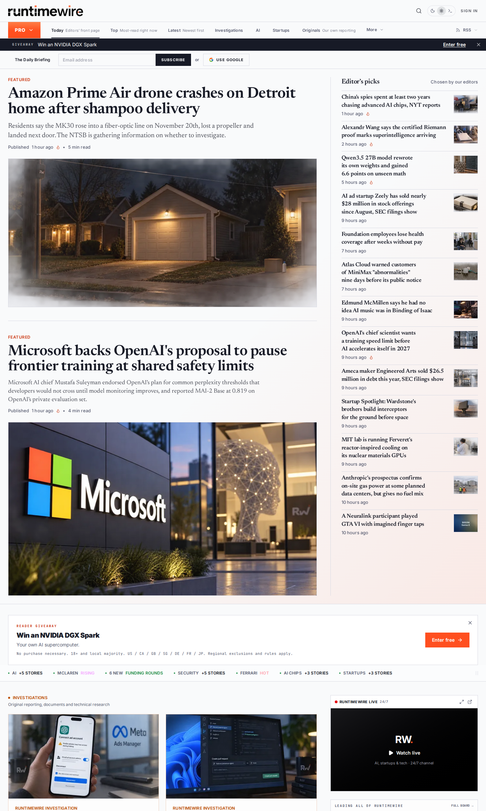

# UI Design System & Master Generation Blueprint: runtimewire-com

> **RuntimeWire: Breaking tech news. Before everyone else.** (https://runtimewire.com) — Breaking tech news. Before everyone else. Independent investigations, original reporting and a continuous news feed covering startups and...



---

## 1. Executive Visual Persona & Design Archetype

- **Brand Essence & Persona**: **RuntimeWire: Breaking tech news. Before everyone else.** (`https://runtimewire.com`). Breaking tech news. Before everyone else. Independent investigations, original reporting and a continuous news feed covering startups and...
- **Visual Archetype**: **High-Contrast Obsidian / Atmospheric Design System (`#000` canvas, `#fff` ink, `#000000` accent)**.
- **Anti-AI-Slop Differentiators**:
  - **Source-Grounded Chromatic Polarity**: Anchors the viewport in `#000` (`var(--color-black)` in `:root`) paired with `#fff` primary typography and `#000000` accents.
  - **Extracted Typographic Hierarchy**: Pairs `Inter` for display copy (`Startup Spotlight: Sweatpals sells r`) with `JetBrains Mono` and `JetBrains Mono`.
  - **Calibrated Spatial Grid & Motion**: Combines `40rem` container bounds (`gap: 1.5%`, padding `1px`) with `cubic-bezier(0,0,.2,1)` easing and Three.js / WebGL Canvas Pipeline.

---

## 2. Spatial Architecture & Modular Grid Mathematics


### Viewport Allocation & Container Geometry
- **Captured Viewport Dimensions**: Desktop `1440×12010px` (`assets/desktop.png`, full-page scroll capture), Mobile `390×2400px` (`assets/mobile.png`, capped at 2400px multi-section capture).
- **Master Container Bounds**: `40rem` extracted from `runtimewire-com` stylesheet.
- **Canvas Lateral Padding & Spacing**: `1px` lateral canvas padding with `1.5%` grid gap.
- **Border Radius Scale**: `.3125rem`, `.375rem`, `.25rem`, `var(--radius-2xl)`.

### Responsive Breakpoint Architecture
- **Desktop Layout**: Multi-column CSS Grid / Flexbox layout at `1440px` (`max-width: 40rem`, `gap: 1.5%`).
- **Mobile Layout**: Single-column vertical stack at `390px` viewport width with `1px` horizontal padding.
- **Extracted CSS Media Queries**: `@media (min-width:40rem)`, `@media (min-width:48rem)`, `@media (min-width:64rem)`, `@media (min-width:80rem)`.

---

## 3. Color System, Materiality & Atmospheric Lighting

### Semantic Palette & Source Grounding
| Semantic Role | Ground-Truth Value | Extracted CSS Source / Selector |
|---|---|---|
| **Primary Canvas Substrate** | `#000` | `var(--color-black)` in `:root` |
| **Primary Typography Ink** | `#fff` | `var(--color-white)` in `:root` |
| **Elevated Surface / Card Substrate** | `#0000` | `textarea { background-color: #0000 }` |
| **Interactive Accent / Highlight** | `#000000` | `.border-black { border-color: black }` (`#000000`) |
| **Secondary / Muted Copy** | `#0003` | `20 { border-color: #0003 }` |
| **Structural Hairline Border** | `#0000ff` | `20 { border-color: blue }` (`#0000ff`) |

### Sanitized Root CSS Variables (`ui-ux.md` Ground Truth)
| Variable Name | Extracted Value | Semantic Role |
|---|---|---|
| `--pro-ring-angle` | `0deg` | Elevation / Border Token |
| `--font-mono` | `var(--app-font-mono)` | Typography / Scale Token |
| `--color-red-50` | `oklch(97.1% .013 17.38)` | Brand / Palette Token |
| `--color-red-300` | `oklch(80.8% .114 19.571)` | Brand / Palette Token |
| `--color-red-400` | `oklch(70.4% .191 22.216)` | Brand / Palette Token |
| `--color-red-500` | `oklch(63.7% .237 25.331)` | Brand / Palette Token |
| `--color-red-600` | `oklch(57.7% .245 27.325)` | Brand / Palette Token |
| `--color-red-700` | `oklch(50.5% .213 27.518)` | Brand / Palette Token |
| `--color-orange-200` | `oklch(90.1% .076 70.697)` | Brand / Palette Token |
| `--color-orange-300` | `oklch(83.7% .128 66.29)` | Brand / Palette Token |
| `--color-orange-400` | `oklch(75% .183 55.934)` | Brand / Palette Token |
| `--color-orange-500` | `oklch(70.5% .213 47.604)` | Brand / Palette Token |
| `--color-orange-600` | `oklch(64.6% .222 41.116)` | Brand / Palette Token |
| `--color-amber-50` | `oklch(98.7% .022 95.277)` | Brand / Palette Token |
| `--color-amber-100` | `oklch(96.2% .059 95.617)` | Brand / Palette Token |
| `--color-amber-200` | `oklch(92.4% .12 95.746)` | Brand / Palette Token |

---

## 4. Typographic Scale & Editorial Hierarchy

### Font Family Stacks
- **Display Typography**: `Inter`.
- **Primary Body Stack**: `JetBrains Mono`.
- **Technical / Metadata Stack**: `JetBrains Mono`.

### Typographic Scale & Rules (Extracted from Stylesheet & Variables)
- **Hero Display (`H1`)**: CSS variables `--text-4xl: 2.25rem`, `--text-4xl--line-height: calc(2.5 / 2.25)`, `--text-5xl: 3rem`; rule `h1` (`letter-spacing: -.028em!important`).
- **Section Heading (`H2`)**: CSS variables `--text-2xl: 1.5rem`, `--text-2xl--line-height: calc(2 / 1.5)`, `--text-3xl: 1.875rem`; rule `h2` (`letter-spacing: .09em`).
- **Body Copy**: CSS variables `--text-base: 1rem`, `--text-base--line-height: 1.5`; rule `p` (`line-height: var(--leading-relaxed)`).
- **Metadata & Navigation Labels**: CSS variables `--font-mono: var(--app-font-mono)`, `--text-xs: .75rem`, `--text-xs--line-height: calc(1 / .75)`; rule `small` (`font-size: 12px`, `line-height: 1.45`).

---

## 5. Choreographed Motion & Interaction Physics

### Primary Easing Curves
- **Extracted Timing Functions**: `cubic-bezier(0,0,.2,1)`, `cubic-bezier(.4,0,.2,1)`, `cubic-bezier(.4,0,.6,1)`.

### Per-Element Transition & Choreography Rules
- **Selector `layer theme`**: `transition: .15s` extracted from `runtimewire-com` stylesheet.
- **Selector `.\!transition`**: `transition: var(--tw-ease,var(--default-transition-timing-function))!impor...` extracted from `runtimewire-com` stylesheet.
- **Selector `.transition`**: `transition: var(--tw-ease,var(--default-transition-timing-function))` extracted from `runtimewire-com` stylesheet.
- **Extracted Easing Curve (`cubic-bezier(0,0,.2,1)`)**: Governs interactive state transitions across `<header.public-site-header>` and `<article.flex>`.
- **Runtime Interaction Engine**: Integrates Three.js / WebGL Canvas Pipeline with `prefers-reduced-motion: reduce` fallback guards.

---

## 6. Component Wireframe & Structural DOM Map

### Visual Layout Schematic (Grounded in `dom.html` — `1440px` Desktop & `390px` Mobile Reflow)
```
┌────────────────────────────────────────────────────────────────────────┐
│ DESKTOP VIEWPORT (1440px) — RuntimeWire: Breaking tech news. Before ev │
│ ====================================================================== │
│ [ <header.public-site-head | Investigations · Stories · AI · Startu ]  │
│ ---------------------------------------------------------------------- │
│ | HERO STAGE: <section.relative>                                   |   │
│ | H1: Startup Spotlight: Sweatpals sells run clubs the...          |   │
│ | Substrate: #000       | Ink: #fff       | Accent: #000000        |   │
│ ---------------------------------------------------------------------- │
│ | SHOWCASE GRID (<article.flex>            ) max-w: 40rem          |   │
│ | +------------------------------+  +------------------------------+ | │
│ | | Kalshi in talks at $65B valu |  | Editor’s picks               | | │
│ | +------------------------------+  +------------------------------+ | │
│ ---------------------------------------------------------------------- │
│ | MOBILE VIEWPORT REFLOW (390px) — Single-Column Stack (gap: 1.5%  ) | │
│ | [<header.public-sit] -> [<section.relative>] -> [<article.flex>] |   │
│ ---------------------------------------------------------------------- │
│ [ FOOTER (<footer.border-t>     ) | https://runtimewire.com            │
└────────────────────────────────────────────────────────────────────────┘
```

### Granular DOM Region Breakdown
1. **Brand Header & Navigation Bar (<header.public-site-header> — `runtimewire-com`)**:
   - Landmark `<header class="public-site-header flex">` hosting `RuntimeWire: Breaking tech news. Bef` navigation (`Investigations · Stories · AI · Startups · Venture`), DOM attributes (`data-testid="skip-to-content"`, `data-anim="static"`, `data-testid="header-search-button"`, `data-testid="theme-switch"`), and stylesheet rule `backdrop { box-sizing:border-box;border:0 solid;margin:0;padding:0 }`.
2. **Hero Stage & Focal Lead (<section.relative> — `Startup Spotlight: Sweatpals sells`)**:
   - Landmark `<section class="relative overflow-hidden">` presenting display lead `Startup Spotlight: Sweatpals sells run clubs the...` and copy excerpt *"You're browsing RuntimeWire with JavaScript disabled. Articles an"* over `#000` canvas and `#fff` ink.
3. **Primary Showcase & Content Grid (<article.flex> — `Kalshi in talks at $65B valuation `)**:
   - Landmark `<article class="flex flex-col">` rendering section `Kalshi in talks at $65B valuation days after clos...` with copy *"Win an NVIDIA DGX Spark"*, asset references (`investigations.xml`, `stories.xml`, `featured`, `favicon.ico`), and grid rule `file-selector-button { box-sizing:border-box;border:0 solid;margin:0;padding:0 }`.
4. **Interactive Detail & Feature Matrix (<article.flex> — `Editor’s picks`)**:
   - Landmark `<article class="flex flex-col">` framing `Editor’s picks` and `Win an NVIDIA DGX Spark` (*"The Daily Briefing"*) with `#0000` surface cards, `#000000` accents, and `strong { font-weight:bolder }`.
5. **Colophon & Global Directory Footer (<footer.border-t> — `https://runtimewire.com`)**:
   - Landmark `<footer class="border-t border-border">` anchoring `RuntimeWire: Breaking tech news.` footer links (`Investigations · Stories · AI · Startups · Venture`), copy *"The Daily Briefing Subscribe →"*, and `#0000ff` structural dividers.

---

## 7. Master Zero-Shot AI Generation Prompt

```markdown
# Master Zero-Shot Frontend Generation Prompt: runtimewire-com (RuntimeWire: Breaking tech news. Before everyone else.)

You are a principal frontend architect and design systems engineer. Build a complete, production-ready web application replicating the exact design system, DOM landmarks, typographic hierarchy, color tokens, and motion physics of `runtimewire-com` (**RuntimeWire: Breaking tech news. Before everyone else.** — `https://runtimewire.com`).

### 1. Visual Archetype & Anti-AI-Slop Mandates
- **Archetype**: High-Contrast Obsidian / Atmospheric Design System (`#000` canvas, `#fff` ink, `#000000` accent).
- **Identity & Domain Context**: Breaking tech news. Before everyone else. Independent investigations, original reporting and a continuous news feed covering startups and...
- **Primary Substrate**: `#000` (`var(--color-black)` in `:root`), **Primary Ink**: `#fff`, **Accent / Highlight**: `#000000`.
- **Site-Specific Differentiators**:
  - **Source-Grounded Chromatic Polarity**: Anchors the viewport in `#000` (`var(--color-black)` in `:root`) paired with `#fff` primary typography and `#000000` accents.
  - **Extracted Typographic Hierarchy**: Pairs `Inter` for display copy (`Startup Spotlight: Sweatpals sells r`) with `JetBrains Mono` and `JetBrains Mono`.
  - **Calibrated Spatial Grid & Motion**: Combines `40rem` container bounds (`gap: 1.5%`, padding `1px`) with `cubic-bezier(0,0,.2,1)` easing and Three.js / WebGL Canvas Pipeline.

### 2. Ground-Truth CSS Variables (`:root` Token Contract)
Declare and consume these exact custom properties extracted from `runtimewire-com` in your global stylesheet:

:root {
  /* RuntimeWire: Breaking tech news. Before everyone else. (runtimewire-com) — Ground-Truth Extracted CSS Variables */
  --pro-ring-angle: 0deg; /* Elevation / Border Token (runtimewire-com) */
  --font-mono: var(--app-font-mono); /* Typography / Scale Token (runtimewire-com) */
  --color-red-50: oklch(97.1% .013 17.38); /* Brand / Palette Token (runtimewire-com) */
  --color-red-300: oklch(80.8% .114 19.571); /* Brand / Palette Token (runtimewire-com) */
  --color-red-400: oklch(70.4% .191 22.216); /* Brand / Palette Token (runtimewire-com) */
  --color-red-500: oklch(63.7% .237 25.331); /* Brand / Palette Token (runtimewire-com) */
  --color-red-600: oklch(57.7% .245 27.325); /* Brand / Palette Token (runtimewire-com) */
  --color-red-700: oklch(50.5% .213 27.518); /* Brand / Palette Token (runtimewire-com) */
  --color-orange-200: oklch(90.1% .076 70.697); /* Brand / Palette Token (runtimewire-com) */
  --color-orange-300: oklch(83.7% .128 66.29); /* Brand / Palette Token (runtimewire-com) */
  --color-orange-400: oklch(75% .183 55.934); /* Brand / Palette Token (runtimewire-com) */
  --color-orange-500: oklch(70.5% .213 47.604); /* Brand / Palette Token (runtimewire-com) */
  --color-orange-600: oklch(64.6% .222 41.116); /* Brand / Palette Token (runtimewire-com) */
  --color-amber-50: oklch(98.7% .022 95.277); /* Brand / Palette Token (runtimewire-com) */
  --color-amber-100: oklch(96.2% .059 95.617); /* Brand / Palette Token (runtimewire-com) */
  --color-amber-200: oklch(92.4% .12 95.746); /* Brand / Palette Token (runtimewire-com) */
}

### 3. Semantic Color & Materiality Contract
Map every surface, ink, and border strictly to these source-grounded tokens:
- **Primary Canvas Substrate**: `#000` — grounded in `var(--color-black)` in `:root`
- **Primary Typography Ink**: `#fff` — grounded in `var(--color-white)` in `:root`
- **Elevated Surface / Card Substrate**: `#0000` — grounded in `textarea { background-color: #0000 }`
- **Interactive Accent / Highlight**: `#000000` — grounded in `.border-black { border-color: black }` (`#000000`)
- **Secondary / Muted Copy**: `#0003` — grounded in `20 { border-color: #0003 }`
- **Structural Hairline Border**: `#0000ff` — grounded in `20 { border-color: blue }` (`#0000ff`)

### 4. Spatial Grid, Container Bounds & Responsive Breakpoints
- **Desktop Viewport Reference**: `1440×12010px` (full-page scroll capture, `1440px` standard desktop width).
- **Mobile Viewport Reference**: `390×2400px` (capped at 2400px multi-section capture, `390px` standard mobile width).
- **Container Max-Width**: `40rem` extracted from `runtimewire-com` stylesheet
- **Padding & Gutters**: `1px` lateral canvas padding with `1.5%` grid gap
- **Desktop Grid**: Multi-column CSS Grid / Flexbox layout at `1440px` (`max-width: 40rem`, `gap: 1.5%`)
- **Mobile Adaptation**: Single-column vertical stack at `390px` viewport width with `1px` horizontal padding
- **Media Queries**: `@media (min-width:40rem)`, `@media (min-width:48rem)`, `@media (min-width:64rem)`, `@media (min-width:80rem)`
- **Corner Radii**: `.3125rem`, `.375rem`, `.25rem`, `var(--radius-2xl)`

### 5. Typography & Editorial Scale Contract
- **Display Font Stack**: `Inter`
- **Body Font Stack**: `JetBrains Mono`
- **Monospace / Technical Font Stack**: `JetBrains Mono`
- **H1 Display Rule**: CSS variables `--text-4xl: 2.25rem`, `--text-4xl--line-height: calc(2.5 / 2.25)`, `--text-5xl: 3rem`; rule `h1` (`letter-spacing: -.028em!important`)
- **H2 Section Rule**: CSS variables `--text-2xl: 1.5rem`, `--text-2xl--line-height: calc(2 / 1.5)`, `--text-3xl: 1.875rem`; rule `h2` (`letter-spacing: .09em`)
- **Body Copy Rule**: CSS variables `--text-base: 1rem`, `--text-base--line-height: 1.5`; rule `p` (`line-height: var(--leading-relaxed)`)
- **Metadata & Index Rule**: CSS variables `--font-mono: var(--app-font-mono)`, `--text-xs: .75rem`, `--text-xs--line-height: calc(1 / .75)`; rule `small` (`font-size: 12px`, `line-height: 1.45`)

### 6. Component Hierarchy, Verbatim Copy & Real DOM Landmarks
Scaffold `runtimewire-com` (`RuntimeWire: Breaking tech news. Before everyone else.`) with these exact structural regions, extracted copy, and CSS rules from `dom.html`:
1. **Brand Header & Navigation Bar (<header.public-site-header> — `runtimewire-com`)**:
   - DOM & Selectors: Landmark `<header class="public-site-header flex">` hosting `RuntimeWire: Breaking tech news. Bef` navigation (`Investigations · Stories · AI · Startups · Venture`), DOM attributes (`data-testid="skip-to-content"`, `data-anim="static"`, `data-testid="header-search-button"`, `data-testid="theme-switch"`), and stylesheet rule `backdrop { box-sizing:border-box;border:0 solid;margin:0;padding:0 }`.
   - Responsive Contract: Header `Brand Header & Navigation Bar (<header.public-site-header> — `runtimewire-com`)` (`runtimewire-com`) adapts across `@media (min-width:40rem)`, `@media (min-width:48rem)`, `@media (min-width:64rem)`, `@media (min-width:80rem)` with `cubic-bezier(0,0,.2,1)`, `cubic-bezier(.4,0,.2,1)`, `cubic-bezier(.4,0,.6,1)` transitions and links `Investigations · Stories · AI · Startups · Venture`.
2. **Hero Stage & Focal Lead (<section.relative> — `Startup Spotlight: Sweatpals sells`)**:
   - DOM & Selectors: Landmark `<section class="relative overflow-hidden">` presenting display lead `Startup Spotlight: Sweatpals sells run clubs the...` and copy excerpt *"You're browsing RuntimeWire with JavaScript disabled. Articles an"* over `#000` canvas and `#fff` ink.
   - Responsive Contract: Hero stage (`1440×12010px` desktop / `390×2400px` mobile) sets `#000` background with `#fff` headline `Startup Spotlight: Sweatpals sells run clubs the...`.
3. **Primary Showcase & Content Grid (<article.flex> — `Kalshi in talks at $65B valuation `)**:
   - DOM & Selectors: Landmark `<article class="flex flex-col">` rendering section `Kalshi in talks at $65B valuation days after clos...` with copy *"Win an NVIDIA DGX Spark"*, asset references (`investigations.xml`, `stories.xml`, `featured`, `favicon.ico`), and grid rule `file-selector-button { box-sizing:border-box;border:0 solid;margin:0;padding:0 }`.
   - Responsive Contract: Showcase grid `Primary Showcase & Content Grid (<article.flex> — `Kalshi in talks at $65B valuation `)` applies Multi-column CSS Grid / Flexbox layout at `1440px` (`max-width: 40rem`, `gap: 1.5%`) on desktop and Single-column vertical stack at `390px` viewport width with `1px` horizontal padding on mobile.
4. **Interactive Detail & Feature Matrix (<article.flex> — `Editor’s picks`)**:
   - DOM & Selectors: Landmark `<article class="flex flex-col">` framing `Editor’s picks` and `Win an NVIDIA DGX Spark` (*"The Daily Briefing"*) with `#0000` surface cards, `#000000` accents, and `strong { font-weight:bolder }`.
   - Responsive Contract: Detail module `Interactive Detail & Feature Matrix (<article.flex> — `Editor’s picks`)` uses `.3125rem`, `.375rem`, `.25rem`, `var(--radius-2xl)` radii, `#000000` highlights, and assets (investigations.xml, stories.xml, featured).
5. **Colophon & Global Directory Footer (<footer.border-t> — `https://runtimewire.com`)**:
   - DOM & Selectors: Landmark `<footer class="border-t border-border">` anchoring `RuntimeWire: Breaking tech news.` footer links (`Investigations · Stories · AI · Startups · Venture`), copy *"The Daily Briefing Subscribe →"*, and `#0000ff` structural dividers.
   - Responsive Contract: Footer `Colophon & Global Directory Footer (<footer.border-t> — `https://runtimewire.com`)` aligns to `40rem` extracted from `runtimewire-com` stylesheet with `1px` lateral canvas padding with `1.5%` grid gap and attributes (data-testid="skip-to-content", data-anim="static", data-testid="header-search-button").

#### Verbatim DOM Copy Excerpts (`dom.html`)
- Copy Excerpt 1: *"You're browsing RuntimeWire with JavaScript disabled. Articles and navigation work..."*
- Copy Excerpt 2: *"Win an NVIDIA DGX Spark"*
- Copy Excerpt 3: *"The Daily Briefing"*
- Copy Excerpt 4: *"The Daily Briefing Subscribe →"*

### 7. Motion, Extracted Stylesheet Rules & Interaction Choreography
- **Primary Easing Functions**: `cubic-bezier(0,0,.2,1)`, `cubic-bezier(.4,0,.2,1)`, `cubic-bezier(.4,0,.6,1)`
- **Extracted Stylesheet Rules (`runtimewire-com`)**:
- `backdrop { box-sizing:border-box;border:0 solid;margin:0;padding:0 }`
- `file-selector-button { box-sizing:border-box;border:0 solid;margin:0;padding:0 }`
- `strong { font-weight:bolder }`
- `small { font-size:80% }`
- `sup { vertical-align:baseline;font-size:75%;line-height:0;position:relative }`
- **Per-Selector Transition Rules**:
- **Selector `layer theme`**: `transition: .15s` extracted from `runtimewire-com` stylesheet.
- **Selector `.\!transition`**: `transition: var(--tw-ease,var(--default-transition-timing-function))!impor...` extracted from `runtimewire-com` stylesheet.
- **Selector `.transition`**: `transition: var(--tw-ease,var(--default-transition-timing-function))` extracted from `runtimewire-com` stylesheet.
- **Extracted Easing Curve (`cubic-bezier(0,0,.2,1)`)**: Governs interactive state transitions across `<header.public-site-header>` and `<article.flex>`.
- **Runtime Interaction Engine**: Integrates Three.js / WebGL Canvas Pipeline with `prefers-reduced-motion: reduce` fallback guards.

### 8. Technical Deliverables
- Implement in Next.js (App Router) with TypeScript and Tailwind CSS consuming the `:root` custom properties defined above for `runtimewire-com`.
- Reproduce both the `1440px` desktop architecture and `390px` mobile breakpoint transitions, preserving semantic HTML5 landmarks (`<header>`, `<nav>`, `<main>`, `<section>`, `<footer>`) and `prefers-reduced-motion` accessibility guards.
```
