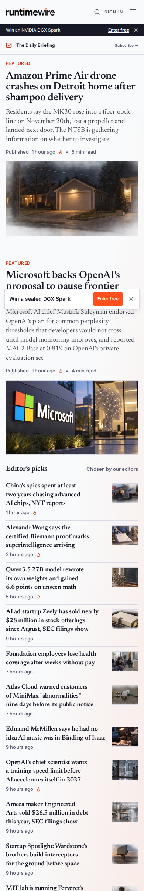

# UI Design System & Master Generation Blueprint: runtimewire-com

> **RuntimeWire: Breaking tech news. Before everyone else.** (https://runtimewire.com) — Breaking tech news. Before everyone else. Independent investigations, original reporting and a continuous news feed covering startups and...


---

## 1. Executive Visual Persona & Design Archetype

- **Brand Essence & Persona**: **RuntimeWire: Breaking tech news. Before everyone else.** (`https://runtimewire.com`). Breaking tech news. Before everyone else. Independent investigations, original reporting and a continuous news feed covering startups and...
- **Capture Provenance**: Live browser capture (`tier1_fast`, HTTP `200`, captured `2026-11-23`).
- **Visual Archetype**: **Light-Substrate Editorial & Modular Grid System (`#f9fafb` canvas, `#171a26` ink, `#cb3610` accent)**.
- **Anti-AI-Slop Differentiators**:
  - **Live-Computed Chromatic Polarity**: Anchors the viewport in `#f9fafb` (live computed `body` `background-color` (`computed_styles.json`)) paired with `#171a26` primary typography and `#cb3610` accents.
  - **Grounded Typographic Hierarchy**: Pairs `Newsreader` for display copy (`Amazon Prime Air drone crashes on De`) with `Inter` and `JetBrains Mono`.
  - **Calibrated Spatial Grid & Motion**: Combines `96rem` container bounds (`gap: 32px`, padding `1px`) with `cubic-bezier(0,0,.2,1)` easing and Three.js / WebGL Canvas Pipeline.

---

## 2. Spatial Architecture & Modular Grid Mathematics



### Viewport Allocation & Container Geometry
- **Captured Viewport Dimensions**: Desktop `1440×2400px` (`assets/desktop.png`, clamped at 2400px live multi-section capture), Mobile `390×2400px` (`assets/mobile.png`, clamped at 2400px live multi-section capture).
- **Master Container Bounds**: `96rem` (non-`@media` desktop container stylesheet rule).
- **Canvas Lateral Padding & Spacing**: `1px` lateral canvas padding with `32px` grid gap.
- **Border Radius Scale**: `.3125rem`, `.375rem`, `.25rem`, `var(--radius-2xl)`.

### Responsive Breakpoint Architecture
- **Desktop Layout**: Multi-column CSS Grid / Flexbox layout at `1440px` (`max-width: 96rem`, `gap: 32px`).
- **Mobile Layout**: Single-column vertical stack at `390px` viewport width with `1px` horizontal padding.
- **Extracted CSS Media Queries**: `@media (min-width:40rem)`, `@media (min-width:48rem)`, `@media (min-width:64rem)`, `@media (min-width:80rem)`.

---

## 3. Color System, Materiality & Atmospheric Lighting

### Semantic Palette & Source Grounding
| Semantic Role | Ground-Truth Value | Extracted Live / CSS Source |
|---|---|---|
| **Primary Canvas Substrate** | `#f9fafb` | live computed `body` `background-color` (`computed_styles.json`) |
| **Primary Typography Ink** | `#171a26` | live computed `h1` `color` (`computed_styles.json`) |
| **Elevated Surface / Card Substrate** | `#ffa500` | `.bg-orange-500 { background-color: orange }` (`#ffa500`) |
| **Interactive Accent / Highlight** | `#cb3610` | `.a11y-signup .bg-primary { background-color: #cb3610 }` |
| **Secondary / Muted Copy** | `#8a93a6` | `.rw-nojs-footer { color: #8a93a6 }` |
| **Structural Hairline Border** | `#7fe0a8` | `50 { border-color: #7fe0a8 }` |

### Sanitized Root CSS Variables (`ui-ux.md` Ground Truth)
| Variable Name | Extracted Value | Semantic Role |
|---|---|---|
| `--rw-static-asset-revision` | `20260900` | Design System Custom Token |
| `--background` | `230 18% 6%` | Canvas / Surface Token |
| `--foreground` | `210 20% 96%` | Typography Ink Token |
| `--border` | `230 14% 14%` | Elevation / Border Token |
| `--input` | `230 14% 14%` | Dimension / Scale Token |
| `--ring` | `13 100% 56%` | Elevation / Border Token |
| `--card` | `230 18% 8%` | Dimension / Scale Token |
| `--card-foreground` | `210 20% 96%` | Typography Ink Token |
| `--card-border` | `230 14% 14%` | Elevation / Border Token |
| `--popover` | `230 18% 8%` | Dimension / Scale Token |
| `--popover-foreground` | `210 20% 96%` | Typography Ink Token |
| `--popover-border` | `230 14% 14%` | Elevation / Border Token |
| `--primary` | `13 100% 56%` | Brand / Palette Token |
| `--primary-foreground` | `0 0% 100%` | Typography Ink Token |
| `--primary-readable` | `13 100% 56%` | Brand / Palette Token |
| `--secondary` | `230 14% 12%` | Brand / Palette Token |

---

## 4. Typographic Scale & Editorial Hierarchy

### Font Family Stacks
- **Display Typography**: `Newsreader`.
- **Primary Body Stack**: `Inter`.
- **Technical / Metadata Stack**: `JetBrains Mono`.

### Typographic Scale & Rules (Live Computed & Stylesheet Grounded)
- **Hero Display (`H1`)**: live computed `h1` (`font-size: 44.64px`, `line-height: 46.4256px`, `font-weight: 600`, `letter-spacing: -0.53568px`); CSS variables `--text-4xl: 2.25rem`, `--text-4xl--line-height: calc(2.5 / 2.25)`, `--text-5xl: 3rem`; rule `h1` (`letter-spacing: -.028em`).
- **Section Heading (`H2`)**: live computed `h2` (`font-size: 43.2px`, `line-height: 45.792px`, `font-weight: 600`, `letter-spacing: -0.5184px`); CSS variables `--text-2xl: 1.5rem`, `--text-2xl--line-height: calc(2 / 1.5)`, `--text-3xl: 1.875rem`; rule `h2` (`letter-spacing: .09em`).
- **Body Copy**: live computed `body` (`font-size: 16px`, `line-height: 24px`, `font-weight: 400`); CSS variables `--text-base: 1rem`, `--text-base--line-height: 1.5`; rule `p` (`line-height: var(--leading-relaxed)`).
- **Metadata & Navigation Labels**: live computed `nav/a` (`font-size: 12px`, `line-height: 15.6px`, `font-weight: 600`, `letter-spacing: 0.12px`); CSS variables `--app-font-mono: "JetBrains Mono", ui-monospace, SFMono-Regular, Menlo, monospace`, `--font-mono: var(--app-font-mono)`, `--text-xs: .75rem`; rule `small` (`font-size: 12px`, `line-height: 1.45`).

---

## 5. Choreographed Motion & Interaction Physics

### Primary Easing Curves
- **Extracted Timing Functions**: `cubic-bezier(0,0,.2,1)`, `cubic-bezier(.4,0,.2,1)`, `cubic-bezier(.4,0,.6,1)`.

### Per-Element Transition & Choreography Rules
- **Selector `layer theme`**: `transition: .15s` extracted from `runtimewire-com` stylesheet.
- **Selector `.\!transition`**: `transition: var(--tw-ease,var(--default-transition-timing-function))!impor...` extracted from `runtimewire-com` stylesheet.
- **Selector `.transition`**: `transition: var(--tw-ease,var(--default-transition-timing-function))` extracted from `runtimewire-com` stylesheet.
- **Extracted Easing Curve (`cubic-bezier(0,0,.2,1)`)**: Governs interactive state transitions across `<header.public-site-header>` and `<article.gap-4>`.
- **Runtime Interaction Engine**: Integrates Three.js / WebGL Canvas Pipeline with `prefers-reduced-motion: reduce` fallback guards.

---

## 6. Component Wireframe & Structural DOM Map

### Visual Layout Schematic — Desktop (`1440px`, Grounded in `dom.html` & Landmark Bounding Boxes)
```
┌────────────────────────────────────────────────────────────────────────┐
│ DESKTOP VIEWPORT (1440px) — RuntimeWire: Breaking tech news. Before ev │
│ ====================================================================== │
│ [ <header.public-site-he (1440x114px) | Investigations · Stories · A ] │
│ ---------------------------------------------------------------------- │
│ | HERO STAGE: <section.border-border> (w=1440px)                     | │
│ | H1: Amazon Prime Air drone crashes on Detroit home af...           | │
│ | Substrate: #f9fafb | Ink: #171a26 | Accent: #cb3610                | │
│ ---------------------------------------------------------------------- │
│ | SHOWCASE GRID (<article.gap-4>) max-w: 96rem                       | │
│ | +------------------------------+  +------------------------------+ | │
│ | | Microsoft backs OpenAI's pro |  | Editor’s picks               | | │
│ | +------------------------------+  +------------------------------+ | │
│ ---------------------------------------------------------------------- │
│ | DETAIL MODULE (<article.border-border>) — Win an NVIDIA DGX Spa    | │
│ ---------------------------------------------------------------------- │
│ [ FOOTER (<footer.border-borde) | https://runtimewire.com              │
└────────────────────────────────────────────────────────────────────────┘
```

### Visual Layout Schematic — Mobile Reflow (`390px`)
```
┌────────────────────────────────────────────────────────────────────────┐
│ MOBILE VIEWPORT REFLOW (390px) — Single-Column Stack (gap: 32px)       │
│ ====================================================================== │
│ [ HEADER BAR (<header.public-site-head) | Compact Menu (390px)         │
│ ---------------------------------------------------------------------- │
│ | HERO STAGE (<section.border-border>) — 390px Vertical Lead         | │
│ | H1: Amazon Prime Air drone crashes on Detroit home af...           | │
│ ---------------------------------------------------------------------- │
│ | SHOWCASE STACK (<article.gap-4>) — 1-Col Stack                     | │
│ | [ Item 1: Microsoft backs OpenAI's proposal to pause fronti...   ] | │
│ | [ Item 2: Editor’s picks                                         ] | │
│ ---------------------------------------------------------------------- │
│ | DETAIL STACK (<article.border-border>) — 1-Col (Win an NVIDIA DGX )  │
│ ---------------------------------------------------------------------- │
│ [ FOOTER (<footer.border-borde) | Stacked 390px Colophon               │
└────────────────────────────────────────────────────────────────────────┘
```

### Granular DOM Region Breakdown
1. **Brand Header & Navigation Bar (<header.public-site-header> — `runtimewire-com`)**:
   - Landmark `<header class="public-site-header backdrop-blur-md">` (`1440x114px`) hosting `RuntimeWire: Breaking tech news. Bef` navigation (`Investigations · Stories · AI · Startups · Venture`), DOM attributes (`data-testid="skip-to-content"`, `data-anim="static"`, `data-testid="header-search-button"`, `data-testid="theme-switch"`), and stylesheet rule `backdrop { box-sizing:border-box;border:0 solid;margin:0;padding:0 }`.
2. **Hero Stage & Focal Lead (<section.border-border> — `Amazon Prime Air drone crashes on `)**:
   - Landmark `<section class="border-border relative">` presenting display lead `Amazon Prime Air drone crashes on Detroit home af...` and copy excerpt *"Residents say the MK30 rose into a fiber-optic line on November 2"* over `#f9fafb` canvas and `#171a26` ink.
3. **Primary Showcase & Content Grid (<article.gap-4> — `Microsoft backs OpenAI's proposal `)**:
   - Landmark `<article class="gap-4 flex">` rendering section `Microsoft backs OpenAI's proposal to pause fronti...` with copy *"The Daily Briefing"*, asset references (`investigations.xml`, `stories.xml`, `featured`, `favicon.ico`), and grid rule `file-selector-button { box-sizing:border-box;border:0 solid;margin:0;padding:0 }`.
4. **Interactive Detail & Feature Matrix (<article.border-border> — `Editor’s picks`)**:
   - Landmark `<article class="gap-4 border-border">` framing `Editor’s picks` and `Win an NVIDIA DGX Spark` (*"Published 1 hour ago"*) with `#ffa500` surface cards, `#cb3610` accents, and `strong { font-weight:bolder }`.
5. **Colophon & Global Directory Footer (<footer.border-border> — `https://runtimewire.com`)**:
   - Landmark `<footer class="border-border mt-20">` anchoring `RuntimeWire: Breaking tech news.` footer links (`Investigations · Stories · AI · Startups · Venture`), copy *"Microsoft AI chief Mustafa Suleyman endorsed OpenAI's plan f"*, and `#7fe0a8` structural dividers.

---

## 7. Master Zero-Shot AI Generation Prompt

```markdown
# Master Zero-Shot Frontend Generation Prompt: runtimewire-com (RuntimeWire: Breaking tech news. Before everyone else.)

You are a principal frontend architect and design systems engineer. Build a complete, production-ready web application replicating the exact design system, DOM landmarks, typographic hierarchy, color tokens, and motion physics of `runtimewire-com` (**RuntimeWire: Breaking tech news. Before everyone else.** — `https://runtimewire.com`).

### 1. Visual Archetype & Anti-AI-Slop Mandates
- **Archetype**: Light-Substrate Editorial & Modular Grid System (`#f9fafb` canvas, `#171a26` ink, `#cb3610` accent).
- **Identity & Domain Context**: Breaking tech news. Before everyone else. Independent investigations, original reporting and a continuous news feed covering startups and...
- **Primary Substrate**: `#f9fafb` (live computed `body` `background-color` (`computed_styles.json`)), **Primary Ink**: `#171a26`, **Accent / Highlight**: `#cb3610`.
- **Site-Specific Differentiators**:
  - **Live-Computed Chromatic Polarity**: Anchors the viewport in `#f9fafb` (live computed `body` `background-color` (`computed_styles.json`)) paired with `#171a26` primary typography and `#cb3610` accents.
  - **Grounded Typographic Hierarchy**: Pairs `Newsreader` for display copy (`Amazon Prime Air drone crashes on De`) with `Inter` and `JetBrains Mono`.
  - **Calibrated Spatial Grid & Motion**: Combines `96rem` container bounds (`gap: 32px`, padding `1px`) with `cubic-bezier(0,0,.2,1)` easing and Three.js / WebGL Canvas Pipeline.

### 2. Ground-Truth CSS Variables (`:root` Token Contract)
Declare and consume these exact custom properties extracted from `runtimewire-com` in your global stylesheet:

:root {
  /* RuntimeWire: Breaking tech news. Before everyone else. (runtimewire-com) — Live-Grounded CSS Variables */
  --rw-static-asset-revision: 20260900; /* Design System Custom Token (runtimewire-com) */
  --background: 230 18% 6%; /* Canvas / Surface Token (runtimewire-com) */
  --foreground: 210 20% 96%; /* Typography Ink Token (runtimewire-com) */
  --border: 230 14% 14%; /* Elevation / Border Token (runtimewire-com) */
  --input: 230 14% 14%; /* Dimension / Scale Token (runtimewire-com) */
  --ring: 13 100% 56%; /* Elevation / Border Token (runtimewire-com) */
  --card: 230 18% 8%; /* Dimension / Scale Token (runtimewire-com) */
  --card-foreground: 210 20% 96%; /* Typography Ink Token (runtimewire-com) */
  --card-border: 230 14% 14%; /* Elevation / Border Token (runtimewire-com) */
  --popover: 230 18% 8%; /* Dimension / Scale Token (runtimewire-com) */
  --popover-foreground: 210 20% 96%; /* Typography Ink Token (runtimewire-com) */
  --popover-border: 230 14% 14%; /* Elevation / Border Token (runtimewire-com) */
  --primary: 13 100% 56%; /* Brand / Palette Token (runtimewire-com) */
  --primary-foreground: 0 0% 100%; /* Typography Ink Token (runtimewire-com) */
  --primary-readable: 13 100% 56%; /* Brand / Palette Token (runtimewire-com) */
  --secondary: 230 14% 12%; /* Brand / Palette Token (runtimewire-com) */
}

### 3. Semantic Color & Materiality Contract
Map every surface, ink, and border strictly to these source-grounded tokens:
- **Primary Canvas Substrate**: `#f9fafb` — grounded in live computed `body` `background-color` (`computed_styles.json`)
- **Primary Typography Ink**: `#171a26` — grounded in live computed `h1` `color` (`computed_styles.json`)
- **Elevated Surface / Card Substrate**: `#ffa500` — grounded in `.bg-orange-500 { background-color: orange }` (`#ffa500`)
- **Interactive Accent / Highlight**: `#cb3610` — grounded in `.a11y-signup .bg-primary { background-color: #cb3610 }`
- **Secondary / Muted Copy**: `#8a93a6` — grounded in `.rw-nojs-footer { color: #8a93a6 }`
- **Structural Hairline Border**: `#7fe0a8` — grounded in `50 { border-color: #7fe0a8 }`

### 4. Spatial Grid, Container Bounds & Responsive Breakpoints
- **Desktop Viewport Reference**: `1440×2400px` (clamped at 2400px live multi-section capture, `1440px` standard desktop width).
- **Mobile Viewport Reference**: `390×2400px` (clamped at 2400px live multi-section capture, `390px` standard mobile width).
- **Container Max-Width**: `96rem` (non-`@media` desktop container stylesheet rule)
- **Padding & Gutters**: `1px` lateral canvas padding with `32px` grid gap
- **Desktop Grid**: Multi-column CSS Grid / Flexbox layout at `1440px` (`max-width: 96rem`, `gap: 32px`)
- **Mobile Adaptation**: Single-column vertical stack at `390px` viewport width with `1px` horizontal padding
- **Media Queries**: `@media (min-width:40rem)`, `@media (min-width:48rem)`, `@media (min-width:64rem)`, `@media (min-width:80rem)`
- **Corner Radii**: `.3125rem`, `.375rem`, `.25rem`, `var(--radius-2xl)`

### 5. Typography & Editorial Scale Contract
- **Display Font Stack**: `Newsreader`
- **Body Font Stack**: `Inter`
- **Monospace / Technical Font Stack**: `JetBrains Mono`
- **H1 Display Rule**: live computed `h1` (`font-size: 44.64px`, `line-height: 46.4256px`, `font-weight: 600`, `letter-spacing: -0.53568px`); CSS variables `--text-4xl: 2.25rem`, `--text-4xl--line-height: calc(2.5 / 2.25)`, `--text-5xl: 3rem`; rule `h1` (`letter-spacing: -.028em`)
- **H2 Section Rule**: live computed `h2` (`font-size: 43.2px`, `line-height: 45.792px`, `font-weight: 600`, `letter-spacing: -0.5184px`); CSS variables `--text-2xl: 1.5rem`, `--text-2xl--line-height: calc(2 / 1.5)`, `--text-3xl: 1.875rem`; rule `h2` (`letter-spacing: .09em`)
- **Body Copy Rule**: live computed `body` (`font-size: 16px`, `line-height: 24px`, `font-weight: 400`); CSS variables `--text-base: 1rem`, `--text-base--line-height: 1.5`; rule `p` (`line-height: var(--leading-relaxed)`)
- **Metadata & Index Rule**: live computed `nav/a` (`font-size: 12px`, `line-height: 15.6px`, `font-weight: 600`, `letter-spacing: 0.12px`); CSS variables `--app-font-mono: "JetBrains Mono", ui-monospace, SFMono-Regular, Menlo, monospace`, `--font-mono: var(--app-font-mono)`, `--text-xs: .75rem`; rule `small` (`font-size: 12px`, `line-height: 1.45`)

### 6. Component Hierarchy, Verbatim Copy & Real DOM Landmarks
Scaffold `runtimewire-com` (`RuntimeWire: Breaking tech news. Before everyone else.`) with these exact structural regions, extracted copy, and CSS rules from `dom.html`:
1. **Brand Header & Navigation Bar (<header.public-site-header> — `runtimewire-com`)**:
   - DOM & Selectors: Landmark `<header class="public-site-header backdrop-blur-md">` (`1440x114px`) hosting `RuntimeWire: Breaking tech news. Bef` navigation (`Investigations · Stories · AI · Startups · Venture`), DOM attributes (`data-testid="skip-to-content"`, `data-anim="static"`, `data-testid="header-search-button"`, `data-testid="theme-switch"`), and stylesheet rule `backdrop { box-sizing:border-box;border:0 solid;margin:0;padding:0 }`.
   - Responsive Contract: Header `Brand Header & Navigation Bar (<header.public-site-header> — `runtimewire-com`)` (`runtimewire-com`) adapts across `@media (min-width:40rem)`, `@media (min-width:48rem)`, `@media (min-width:64rem)`, `@media (min-width:80rem)` with `cubic-bezier(0,0,.2,1)`, `cubic-bezier(.4,0,.2,1)`, `cubic-bezier(.4,0,.6,1)` transitions and links `Investigations · Stories · AI · Startups · Venture`.
2. **Hero Stage & Focal Lead (<section.border-border> — `Amazon Prime Air drone crashes on `)**:
   - DOM & Selectors: Landmark `<section class="border-border relative">` presenting display lead `Amazon Prime Air drone crashes on Detroit home af...` and copy excerpt *"Residents say the MK30 rose into a fiber-optic line on November 2"* over `#f9fafb` canvas and `#171a26` ink.
   - Responsive Contract: Hero stage (`1440×2400px` desktop / `390×2400px` mobile) sets `#f9fafb` background with `#171a26` headline `Amazon Prime Air drone crashes on Detroit home af...`.
3. **Primary Showcase & Content Grid (<article.gap-4> — `Microsoft backs OpenAI's proposal `)**:
   - DOM & Selectors: Landmark `<article class="gap-4 flex">` rendering section `Microsoft backs OpenAI's proposal to pause fronti...` with copy *"The Daily Briefing"*, asset references (`investigations.xml`, `stories.xml`, `featured`, `favicon.ico`), and grid rule `file-selector-button { box-sizing:border-box;border:0 solid;margin:0;padding:0 }`.
   - Responsive Contract: Showcase grid `Primary Showcase & Content Grid (<article.gap-4> — `Microsoft backs OpenAI's proposal `)` applies Multi-column CSS Grid / Flexbox layout at `1440px` (`max-width: 96rem`, `gap: 32px`) on desktop and Single-column vertical stack at `390px` viewport width with `1px` horizontal padding on mobile.
4. **Interactive Detail & Feature Matrix (<article.border-border> — `Editor’s picks`)**:
   - DOM & Selectors: Landmark `<article class="gap-4 border-border">` framing `Editor’s picks` and `Win an NVIDIA DGX Spark` (*"Published 1 hour ago"*) with `#ffa500` surface cards, `#cb3610` accents, and `strong { font-weight:bolder }`.
   - Responsive Contract: Detail module `Interactive Detail & Feature Matrix (<article.border-border> — `Editor’s picks`)` uses `.3125rem`, `.375rem`, `.25rem`, `var(--radius-2xl)` radii, `#cb3610` highlights, and assets (investigations.xml, stories.xml, featured).
5. **Colophon & Global Directory Footer (<footer.border-border> — `https://runtimewire.com`)**:
   - DOM & Selectors: Landmark `<footer class="border-border mt-20">` anchoring `RuntimeWire: Breaking tech news.` footer links (`Investigations · Stories · AI · Startups · Venture`), copy *"Microsoft AI chief Mustafa Suleyman endorsed OpenAI's plan f"*, and `#7fe0a8` structural dividers.
   - Responsive Contract: Footer `Colophon & Global Directory Footer (<footer.border-border> — `https://runtimewire.com`)` aligns to `96rem` (non-`@media` desktop container stylesheet rule) with `1px` lateral canvas padding with `32px` grid gap and attributes (data-testid="skip-to-content", data-anim="static", data-testid="header-search-button").

#### Verbatim DOM Copy Excerpts (`dom.html`)
- Copy Excerpt 1: *"Residents say the MK30 rose into a fiber-optic line on November 20th, lost a prope..."*
- Copy Excerpt 2: *"The Daily Briefing"*
- Copy Excerpt 3: *"Published 1 hour ago"*
- Copy Excerpt 4: *"Microsoft AI chief Mustafa Suleyman endorsed OpenAI's plan for common perplexity t..."*

### 7. Motion, Extracted Stylesheet Rules & Interaction Choreography
- **Primary Easing Functions**: `cubic-bezier(0,0,.2,1)`, `cubic-bezier(.4,0,.2,1)`, `cubic-bezier(.4,0,.6,1)`
- **Extracted Stylesheet Rules (`runtimewire-com`)**:
- `backdrop { box-sizing:border-box;border:0 solid;margin:0;padding:0 }`
- `file-selector-button { box-sizing:border-box;border:0 solid;margin:0;padding:0 }`
- `strong { font-weight:bolder }`
- `small { font-size:80% }`
- `sup { vertical-align:baseline;font-size:75%;line-height:0;position:relative }`
- **Per-Selector Transition Rules**:
- **Selector `layer theme`**: `transition: .15s` extracted from `runtimewire-com` stylesheet.
- **Selector `.\!transition`**: `transition: var(--tw-ease,var(--default-transition-timing-function))!impor...` extracted from `runtimewire-com` stylesheet.
- **Selector `.transition`**: `transition: var(--tw-ease,var(--default-transition-timing-function))` extracted from `runtimewire-com` stylesheet.
- **Extracted Easing Curve (`cubic-bezier(0,0,.2,1)`)**: Governs interactive state transitions across `<header.public-site-header>` and `<article.gap-4>`.
- **Runtime Interaction Engine**: Integrates Three.js / WebGL Canvas Pipeline with `prefers-reduced-motion: reduce` fallback guards.

### 8. Technical Deliverables
- Implement in Next.js (App Router) with TypeScript and Tailwind CSS consuming the `:root` custom properties defined above for `runtimewire-com`.
- Reproduce both the `1440px` desktop architecture and `390px` mobile breakpoint transitions, preserving semantic HTML5 landmarks (`<header>`, `<nav>`, `<main>`, `<section>`, `<footer>`) and `prefers-reduced-motion` accessibility guards.
```
