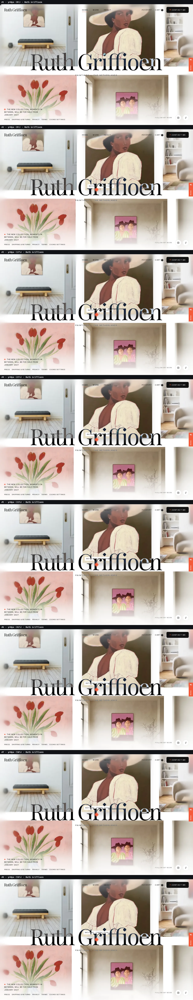
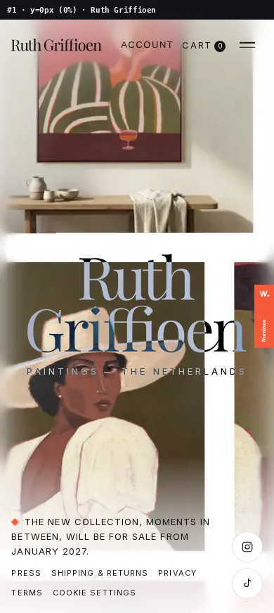

# UI Design System & Master Generation Blueprint: ruthgriffioen-art

> **Ruth Griffioen – Colourful paintings & art prints** (https://ruthgriffioen.art/) — Discover colourful paintings by Dutch artist Ruth Griffioen, from portraits of women to still lifes and landscapes. Art prints coming Jan...





---

## 1. Executive Visual Persona & Design Archetype

- **Brand Essence & Persona**: **Ruth Griffioen – Colourful paintings & art prints** (`https://ruthgriffioen.art/`). Discover colourful paintings by Dutch artist Ruth Griffioen, from portraits of women to still lifes and landscapes. Art prints coming Jan...
- **Capture Provenance**: Live browser capture (`tier1_fast`, HTTP `200`, captured `2026-11-24`).
- **Visual Archetype**: **Light-Gallery WebGL / Canvas Interactive Experience (`#ffffff` / `#c42000`)**.
- **Anti-AI-Slop Differentiators**:
  - **Live-Computed Chromatic Polarity**: Anchors the viewport in `#ffffff` (live computed `body` `background-color` (`computed_styles.json`)) paired with `#111111` primary typography and `#c42000` accents.
  - **Grounded Typographic Hierarchy**: Pairs `Playfair Display` for display copy (`Ruth Griffioen`) with `Inter` and `SFMono-Regular`.
  - **Calibrated Spatial Grid & Motion**: Combines `1536px` container bounds (`gap: normal 31.9984px`, padding `31.9936px`) with `cubic-bezier(.22,1,.36,1)` easing and Lenis Smooth Scroll (`data-lenis`), HTML5 `<canvas>` Interactive Viewport Surface.

---

## 2. Spatial Architecture & Modular Grid Mathematics

### Viewport Allocation & Container Geometry
- **Captured Journey Filmstrips**: Desktop `1280×6624px` (`assets/desktop-journey.webp`, `8` keyframes up to `y=0px` / doc `900px`), Mobile `390×872px` (`assets/mobile-journey.webp`, `1` keyframes).
- **Master Container Bounds**: `1536px` (non-`@media` desktop container stylesheet rule).
- **Canvas Lateral Padding & Spacing**: `31.9936px` lateral canvas padding with `normal 31.9984px` grid gap.
- **Border Radius Scale**: `2px`, `var(--radius)`, `var(--diamond-round)`, `999px`.

### Responsive Breakpoint Architecture
- **Desktop Layout**: Multi-column CSS Grid / Flexbox layout at `1440px` (`max-width: 1536px`, `gap: normal 31.9984px`).
- **Mobile Layout**: Single-column vertical stack at `390px` viewport width with `31.9936px` horizontal padding.
- **Extracted CSS Media Queries**: `@media (max-width:46.875em)`, `@media (max-width:46.875em)and (prefers-reduced-motion:reduce)`, `@media (max-width:46.875em),(max-aspect-ratio:4/5)`, `@media (prefers-reduced-motion:reduce)`.

---

## 3. Color System, Materiality & Atmospheric Lighting

### Semantic Palette & Source Grounding
| Semantic Role | Ground-Truth Value | Extracted Live / CSS Source |
|---|---|---|
| **Primary Canvas Substrate** | `#ffffff` | live computed `body` `background-color` (`computed_styles.json`) |
| **Primary Typography Ink** | `#111111` | live computed `main` `color` (`computed_styles.json`) |
| **Elevated Surface / Card Substrate** | `#f2f4f5` | `to { background-color: #f2f4f5 }` |
| **Interactive Accent / Highlight** | `#c42000` | `var(--highlight-strong)` in `:root` |
| **Secondary / Muted Copy** | `#6f6f6f` | `var(--muted)` in `:root` |
| **Structural Hairline Border** | `#e2e2e2` | `var(--line)` in `:root` (`rgba(17, 17, 17, .12)`) |
| **Variable Token (`--soft`)** | `#f8f1eb` | `var(--soft)` in `:root` |
| **Variable Token (`--accent`)** | `#4d1224` | `var(--accent)` in `:root` |
| **Variable Token (`--accent-light`)** | `#c77b8c` | `var(--accent-light)` in `:root` |
| **Variable Token (`--highlight`)** | `#f55a3a` | `var(--highlight)` in `:root` |

### Sanitized Root CSS Variables (`ui-ux.md` Ground Truth)
| Variable Name | Extracted Value | Semantic Role |
|---|---|---|
| `--ink` | `#111111` | Typography Ink Token |
| `--paper` | `#ffffff` | Canvas / Surface Token |
| `--muted` | `#6f6f6f` | Color / Atmospheric Token |
| `--line` | `rgba(17, 17, 17, .12)` | Color / Atmospheric Token |
| `--soft` | `#f8f1eb` | Color / Atmospheric Token |
| `--accent` | `#4d1224` | Brand / Palette Token |
| `--accent-ink` | `#ffffff` | Typography Ink Token |
| `--accent-light` | `#c77b8c` | Canvas / Surface Token |
| `--highlight` | `#f55a3a` | Canvas / Surface Token |
| `--highlight-strong` | `#c42000` | Canvas / Surface Token |
| `--font-display` | `"Playfair Display", Georgia, "Times New Roman", serif` | Typography / Scale Token |
| `--font-body` | `"Inter", system-ui, -apple-system, "Segoe UI", sans-serif` | Typography / Scale Token |
| `--step--2` | `.6875rem` | Dimension / Scale Token |
| `--step--1` | `.8125rem` | Dimension / Scale Token |
| `--step-0` | `1rem` | Dimension / Scale Token |
| `--step-1` | `clamp(1.125rem, 1.042rem + .3704vw, 1.375rem)` | Dimension / Scale Token |

---

## 4. Typographic Scale & Editorial Hierarchy

### Font Family Stacks
- **Display Typography**: `Playfair Display`.
- **Primary Body Stack**: `Inter`.
- **Technical / Metadata Stack**: `SFMono-Regular`.

### Typographic Scale & Rules (Live Computed & Stylesheet Grounded)
- **Hero Display (`H1`)**: live computed `h1` (`font-size: 160px`, `line-height: 0px`, `font-weight: 400`, `letter-spacing: -4.8px`); CSS variables `--font-display: "Playfair Display", Georgia, "Times New Roman", serif`; rule `h1` (`font-size: var(--step-7)`, `line-height: .95`, `letter-spacing: -.03em`, `font-weight: 400`).
- **Section Heading (`H2`)**: live computed `h2` (`font-size: 19.2px`, `line-height: 29.76px`, `font-weight: 700`); rule `h2` (`font-size: var(--step-2)`, `font-weight: 400`).
- **Body Copy**: live computed `body` (`font-size: 16px`, `line-height: 24.8px`, `font-weight: 400`); CSS variables `--font-body: "Inter", system-ui, -apple-system, "Segoe UI", sans-serif`; rule `p` (`font-size: var(--step--1)`, `letter-spacing: .3em`).
- **Metadata & Navigation Labels**: live computed `nav/a` (`font-size: 16px`, `line-height: 24.8px`, `font-weight: 400`).

---

## 5. Choreographed Motion & Interaction Physics

### Primary Easing Curves
- **Extracted Timing Functions**: `cubic-bezier(.22,1,.36,1)`, `cubic-bezier(.625,.05,0,1)`, `cubic-bezier(.8,0,.4,1)`.

### Per-Element Transition & Choreography Rules
- **Selector `.btn`**: `transition: background .3s var(--ease),color .3s var(--ease),border-color...` extracted from `ruthgriffioen-art` stylesheet.
- **Selector `.btn .dot`**: `transition: background .3s` extracted from `ruthgriffioen-art` stylesheet.
- **Selector `shopify-account::part(dialog)`**: `transition: opacity .45s var(--ease-line),transform .6s var(--ease-line)` extracted from `ruthgriffioen-art` stylesheet.
- **Extracted Easing Curve (`cubic-bezier(.22,1,.36,1)`)**: Governs interactive state transitions across `<header.site-header>` and `<section.artwall>`.
- **Runtime Interaction Engine**: Integrates Lenis Smooth Scroll (`data-lenis`), HTML5 `<canvas>` Interactive Viewport Surface with `prefers-reduced-motion: reduce` fallback guards.
### Measured Runtime Scroll & Interaction Telemetry (`behavioral_journey_v2`)
- **Scroll Driver Mode**: `wheel` (max document height `900px`, deepest scrollY reached `0px` across `8` desktop keyframes).
- **Detected Scroll / Motion Libraries**: `Lenis`, `WebGL/Canvas`.
- **Hover Physics (`primary_cta` · `ABOUT A B O U T`)**: Computed transition `0s` / `ease` (no static color/transform shift captured at rest).
- **Route Transition Architecture**: First internal navigation (`/collections`) measured as `MPA` in `2615ms`.

---

## 6. Component Wireframe & Structural DOM Map

### Visual Layout Schematic — Desktop (`1440px`, Grounded in `dom.html` & Landmark Bounding Boxes)
```
┌────────────────────────────────────────────────────────────────────────┐
│ DESKTOP VIEWPORT (1440px) — Ruth Griffioen – Colourful paintings & art │
│ ====================================================================== │
│ [ <header.site-header> (1440x84px)    | Home H o m e · Work W o r k  ] │
│ ---------------------------------------------------------------------- │
│ | HERO STAGE: <section.shopify-pc__banner__dialog> (w=1440px)        | │
│ | H1: Ruth Griffioen                                                 | │
│ | Substrate: #ffffff | Ink: #111111 | Accent: #c42000                | │
│ ---------------------------------------------------------------------- │
│ | SHOWCASE GRID (<section.artwall>) max-w: 1536px                    | │
│ | +------------------------------+  +------------------------------+ | │
│ | | PAINTINGS — THE NETHERLANDS  |  | Contemplating · Coming soon  | | │
│ | +------------------------------+  +------------------------------+ | │
│ ---------------------------------------------------------------------- │
│ | DETAIL MODULE (<section.is-ready>) — From Holland with lov         | │
│ ---------------------------------------------------------------------- │
│ [ FOOTER (<footer.site-footer>) | https://ruthgriffioen.art/           │
└────────────────────────────────────────────────────────────────────────┘
```

### Visual Layout Schematic — Mobile Reflow (`390px`)
```
┌────────────────────────────────────────────────────────────────────────┐
│ MOBILE VIEWPORT REFLOW (390px) — Single-Column Stack (gap: normal 3)   │
│ ====================================================================== │
│ [ HEADER BAR (<header.site-header>    ) | Compact Menu (390px)         │
│ ---------------------------------------------------------------------- │
│ | HERO STAGE (<section.shopify-pc__ban) — 390px Vertical Lead        | │
│ | H1: Ruth Griffioen                                                 | │
│ ---------------------------------------------------------------------- │
│ | SHOWCASE STACK (<section.artwall>) — 1-Col Stack                   | │
│ | [ Item 1: PAINTINGS — THE NETHERLANDS                            ] | │
│ | [ Item 2: Contemplating · Coming soon                            ] | │
│ ---------------------------------------------------------------------- │
│ | DETAIL STACK (<section.is-ready>) — 1-Col (From Holland with )     | │
│ ---------------------------------------------------------------------- │
│ [ FOOTER (<footer.site-footer>) | Stacked 390px Colophon               │
└────────────────────────────────────────────────────────────────────────┘
```

### Granular DOM Region Breakdown
1. **Brand Header & Navigation Bar (<header.site-header> — `ruthgriffioen-art`)**:
   - Landmark `<header class="site-header">` (`1440x84px`) hosting `Ruth Griffioen – Colourful paintings` navigation (`Home H o m e · Work W o r k · About A b o u t`), DOM attributes (`data-cookie-preferences-ready="true"`, `data-source-attribution="shopify.exit_intersti..."`, `data-shop-id="109163413834"`, `data-venmo-supported="false"`), and stylesheet rule `font-face { font-family:Inter;font-style:normal;font-weight:400 500;font-display:swa... }`.
2. **Hero Stage & Focal Lead (<section.shopify-pc__banner__dialog> — `Ruth Griffioen`)**:
   - Landmark `<section class="shopify-pc__banner__dialog">` presenting display lead `Ruth Griffioen` and copy excerpt *"PAINTINGS — THE NETHERLANDS"* over `#ffffff` canvas and `#111111` ink.
3. **Primary Showcase & Content Grid (<section.artwall> — `PAINTINGS — THE NETHERLANDS`)**:
   - Landmark `<section class="artwall is-ready">` rendering section `PAINTINGS — THE NETHERLANDS` with copy *"Contemplating · Coming soon"*, asset references (`favicon.svg`, `favicon-32.png`, `apple-touch-icon.png`, `playfair-display.woff2`), and grid rule `root { --header-h: 4.5rem }`.
4. **Interactive Detail & Feature Matrix (<section.is-ready> — `Contemplating · Coming soon`)**:
   - Landmark `<section class="artwall is-ready">` framing `Contemplating · Coming soon` and `From Holland with love · Coming soon` (*"From Holland with love · Coming soon"*) with `#f2f4f5` surface cards, `#c42000` accents, and `after { box-sizing:border-box }`.
5. **Colophon & Global Directory Footer (<footer.site-footer> — `https://ruthgriffioen.art/`)**:
   - Landmark `<footer class="site-footer site-footer--overlay">` anchoring `Ruth Griffioen – Colourful paint` footer links (`Home H o m e · Work W o r k · About A b o u t`), copy *"Her Sunday Best · Coming soon"*, and `#e2e2e2` structural dividers.
### Full Vertical Scroll Sequence (Desktop `1440×900` Keyframes)
- **Step 01** (`y=0px`, `0%`): Active landmark `Ruth Griffioen` · sticky/fixed elements: `6`
- **Step 02** (`y=0px`, `8%`): Active landmark `Ruth Griffioen` · sticky/fixed elements: `6`
- **Step 03** (`y=0px`, `17%`): Active landmark `Ruth Griffioen` · sticky/fixed elements: `6`
- **Step 04** (`y=0px`, `25%`): Active landmark `Ruth Griffioen` · sticky/fixed elements: `6`
- **Step 05** (`y=0px`, `33%`): Active landmark `Ruth Griffioen` · sticky/fixed elements: `6`
- **Step 06** (`y=0px`, `42%`): Active landmark `Ruth Griffioen` · sticky/fixed elements: `6`
- **Step 07** (`y=0px`, `50%`): Active landmark `Ruth Griffioen` · sticky/fixed elements: `6`
- **Step 08** (`y=0px`, `58%`): Active landmark `Ruth Griffioen` · sticky/fixed elements: `6`

### Multi-Page Internal Route Map
- **Listing Route (`/collections`)**: `https://ruthgriffioen.art/collections` — H1: `Work`, scrollHeight `1315px`, transition `MPA` (`2615ms`)
- **Detail Route (`/pages/about`)**: `https://ruthgriffioen.art/pages/about` — H1: `Ruth Griffioen`, scrollHeight `9912px`, transition `direct` (`1478ms`)
- **Detail Route (`/pages/contact`)**: `https://ruthgriffioen.art/pages/contact` — H1: `Let's talk`, scrollHeight `923px`, transition `direct` (`1054ms`)

---

## 7. Master Zero-Shot AI Generation Prompt

```markdown
# Master Zero-Shot Frontend Generation Prompt: ruthgriffioen-art (Ruth Griffioen – Colourful paintings & art prints)

You are a principal frontend architect and design systems engineer. Build a complete, production-ready web application replicating the exact design system, DOM landmarks, typographic hierarchy, color tokens, and motion physics of `ruthgriffioen-art` (**Ruth Griffioen – Colourful paintings & art prints** — `https://ruthgriffioen.art/`).

### 1. Visual Archetype & Anti-AI-Slop Mandates
- **Archetype**: Light-Gallery WebGL / Canvas Interactive Experience (`#ffffff` / `#c42000`).
- **Identity & Domain Context**: Discover colourful paintings by Dutch artist Ruth Griffioen, from portraits of women to still lifes and landscapes. Art prints coming Jan...
- **Primary Substrate**: `#ffffff` (live computed `body` `background-color` (`computed_styles.json`)), **Primary Ink**: `#111111`, **Accent / Highlight**: `#c42000`.
- **Site-Specific Differentiators**:
  - **Live-Computed Chromatic Polarity**: Anchors the viewport in `#ffffff` (live computed `body` `background-color` (`computed_styles.json`)) paired with `#111111` primary typography and `#c42000` accents.
  - **Grounded Typographic Hierarchy**: Pairs `Playfair Display` for display copy (`Ruth Griffioen`) with `Inter` and `SFMono-Regular`.
  - **Calibrated Spatial Grid & Motion**: Combines `1536px` container bounds (`gap: normal 31.9984px`, padding `31.9936px`) with `cubic-bezier(.22,1,.36,1)` easing and Lenis Smooth Scroll (`data-lenis`), HTML5 `<canvas>` Interactive Viewport Surface.

### 2. Ground-Truth CSS Variables (`:root` Token Contract)
Declare and consume these exact custom properties extracted from `ruthgriffioen-art` in your global stylesheet:

:root {
  /* Ruth Griffioen – Colourful paintings & art prints (ruthgriffioen-art) — Live-Grounded CSS Variables */
  --ink: #111111; /* Typography Ink Token (ruthgriffioen-art) */
  --paper: #ffffff; /* Canvas / Surface Token (ruthgriffioen-art) */
  --muted: #6f6f6f; /* Color / Atmospheric Token (ruthgriffioen-art) */
  --line: rgba(17, 17, 17, .12); /* Color / Atmospheric Token (ruthgriffioen-art) */
  --soft: #f8f1eb; /* Color / Atmospheric Token (ruthgriffioen-art) */
  --accent: #4d1224; /* Brand / Palette Token (ruthgriffioen-art) */
  --accent-ink: #ffffff; /* Typography Ink Token (ruthgriffioen-art) */
  --accent-light: #c77b8c; /* Canvas / Surface Token (ruthgriffioen-art) */
  --highlight: #f55a3a; /* Canvas / Surface Token (ruthgriffioen-art) */
  --highlight-strong: #c42000; /* Canvas / Surface Token (ruthgriffioen-art) */
  --font-display: "Playfair Display", Georgia, "Times New Roman", serif; /* Typography / Scale Token (ruthgriffioen-art) */
  --font-body: "Inter", system-ui, -apple-system, "Segoe UI", sans-serif; /* Typography / Scale Token (ruthgriffioen-art) */
  --step--2: .6875rem; /* Dimension / Scale Token (ruthgriffioen-art) */
  --step--1: .8125rem; /* Dimension / Scale Token (ruthgriffioen-art) */
  --step-0: 1rem; /* Dimension / Scale Token (ruthgriffioen-art) */
  --step-1: clamp(1.125rem, 1.042rem + .3704vw, 1.375rem); /* Dimension / Scale Token (ruthgriffioen-art) */
}

### 3. Semantic Color & Materiality Contract
Map every surface, ink, and border strictly to these source-grounded tokens:
- **Primary Canvas Substrate**: `#ffffff` — grounded in live computed `body` `background-color` (`computed_styles.json`)
- **Primary Typography Ink**: `#111111` — grounded in live computed `main` `color` (`computed_styles.json`)
- **Elevated Surface / Card Substrate**: `#f2f4f5` — grounded in `to { background-color: #f2f4f5 }`
- **Interactive Accent / Highlight**: `#c42000` — grounded in `var(--highlight-strong)` in `:root`
- **Secondary / Muted Copy**: `#6f6f6f` — grounded in `var(--muted)` in `:root`
- **Structural Hairline Border**: `#e2e2e2` — grounded in `var(--line)` in `:root` (`rgba(17, 17, 17, .12)`)
- **Variable Token (`--soft`)**: `#f8f1eb` — grounded in `var(--soft)` in `:root`
- **Variable Token (`--accent`)**: `#4d1224` — grounded in `var(--accent)` in `:root`
- **Variable Token (`--accent-light`)**: `#c77b8c` — grounded in `var(--accent-light)` in `:root`
- **Variable Token (`--highlight`)**: `#f55a3a` — grounded in `var(--highlight)` in `:root`

### 4. Spatial Grid, Container Bounds & Responsive Breakpoints
- **Desktop Viewport Reference**: `1280×6624px` (multi-frame vertical journey filmstrip (6624px), `1440px` standard desktop width).
- **Mobile Viewport Reference**: `390×872px` (full-page live capture (872px), `390px` standard mobile width).
- **Container Max-Width**: `1536px` (non-`@media` desktop container stylesheet rule)
- **Padding & Gutters**: `31.9936px` lateral canvas padding with `normal 31.9984px` grid gap
- **Desktop Grid**: Multi-column CSS Grid / Flexbox layout at `1440px` (`max-width: 1536px`, `gap: normal 31.9984px`)
- **Mobile Adaptation**: Single-column vertical stack at `390px` viewport width with `31.9936px` horizontal padding
- **Media Queries**: `@media (max-width:46.875em)`, `@media (max-width:46.875em)and (prefers-reduced-motion:reduce)`, `@media (max-width:46.875em),(max-aspect-ratio:4/5)`, `@media (prefers-reduced-motion:reduce)`
- **Corner Radii**: `2px`, `var(--radius)`, `var(--diamond-round)`, `999px`

### 5. Typography & Editorial Scale Contract
- **Display Font Stack**: `Playfair Display`
- **Body Font Stack**: `Inter`
- **Monospace / Technical Font Stack**: `SFMono-Regular`
- **H1 Display Rule**: live computed `h1` (`font-size: 160px`, `line-height: 0px`, `font-weight: 400`, `letter-spacing: -4.8px`); CSS variables `--font-display: "Playfair Display", Georgia, "Times New Roman", serif`; rule `h1` (`font-size: var(--step-7)`, `line-height: .95`, `letter-spacing: -.03em`, `font-weight: 400`)
- **H2 Section Rule**: live computed `h2` (`font-size: 19.2px`, `line-height: 29.76px`, `font-weight: 700`); rule `h2` (`font-size: var(--step-2)`, `font-weight: 400`)
- **Body Copy Rule**: live computed `body` (`font-size: 16px`, `line-height: 24.8px`, `font-weight: 400`); CSS variables `--font-body: "Inter", system-ui, -apple-system, "Segoe UI", sans-serif`; rule `p` (`font-size: var(--step--1)`, `letter-spacing: .3em`)
- **Metadata & Index Rule**: live computed `nav/a` (`font-size: 16px`, `line-height: 24.8px`, `font-weight: 400`)

### 6. Component Hierarchy, Verbatim Copy & Real DOM Landmarks
Scaffold `ruthgriffioen-art` (`Ruth Griffioen – Colourful paintings & art prints`) with these exact structural regions, extracted copy, and CSS rules from `dom.html`:
1. **Brand Header & Navigation Bar (<header.site-header> — `ruthgriffioen-art`)**:
   - DOM & Selectors: Landmark `<header class="site-header">` (`1440x84px`) hosting `Ruth Griffioen – Colourful paintings` navigation (`Home H o m e · Work W o r k · About A b o u t`), DOM attributes (`data-cookie-preferences-ready="true"`, `data-source-attribution="shopify.exit_intersti..."`, `data-shop-id="109163413834"`, `data-venmo-supported="false"`), and stylesheet rule `font-face { font-family:Inter;font-style:normal;font-weight:400 500;font-display:swa... }`.
   - Responsive Contract: Header `Brand Header & Navigation Bar (<header.site-header> — `ruthgriffioen-art`)` (`ruthgriffioen-art`) adapts across `@media (max-width:46.875em)`, `@media (max-width:46.875em)and (prefers-reduced-motion:reduce)`, `@media (max-width:46.875em),(max-aspect-ratio:4/5)`, `@media (prefers-reduced-motion:reduce)` with `cubic-bezier(.22,1,.36,1)`, `cubic-bezier(.625,.05,0,1)`, `cubic-bezier(.8,0,.4,1)` transitions and links `Home H o m e · Work W o r k · About A b o u t`.
2. **Hero Stage & Focal Lead (<section.shopify-pc__banner__dialog> — `Ruth Griffioen`)**:
   - DOM & Selectors: Landmark `<section class="shopify-pc__banner__dialog">` presenting display lead `Ruth Griffioen` and copy excerpt *"PAINTINGS — THE NETHERLANDS"* over `#ffffff` canvas and `#111111` ink.
   - Responsive Contract: Hero stage (`1280×6624px` desktop / `390×872px` mobile) sets `#ffffff` background with `#111111` headline `Ruth Griffioen`.
3. **Primary Showcase & Content Grid (<section.artwall> — `PAINTINGS — THE NETHERLANDS`)**:
   - DOM & Selectors: Landmark `<section class="artwall is-ready">` rendering section `PAINTINGS — THE NETHERLANDS` with copy *"Contemplating · Coming soon"*, asset references (`favicon.svg`, `favicon-32.png`, `apple-touch-icon.png`, `playfair-display.woff2`), and grid rule `root { --header-h: 4.5rem }`.
   - Responsive Contract: Showcase grid `Primary Showcase & Content Grid (<section.artwall> — `PAINTINGS — THE NETHERLANDS`)` applies Multi-column CSS Grid / Flexbox layout at `1440px` (`max-width: 1536px`, `gap: normal 31.9984px`) on desktop and Single-column vertical stack at `390px` viewport width with `31.9936px` horizontal padding on mobile.
4. **Interactive Detail & Feature Matrix (<section.is-ready> — `Contemplating · Coming soon`)**:
   - DOM & Selectors: Landmark `<section class="artwall is-ready">` framing `Contemplating · Coming soon` and `From Holland with love · Coming soon` (*"From Holland with love · Coming soon"*) with `#f2f4f5` surface cards, `#c42000` accents, and `after { box-sizing:border-box }`.
   - Responsive Contract: Detail module `Interactive Detail & Feature Matrix (<section.is-ready> — `Contemplating · Coming soon`)` uses `2px`, `var(--radius)`, `var(--diamond-round)`, `999px` radii, `#c42000` highlights, and assets (favicon.svg, favicon-32.png, apple-touch-icon.png).
5. **Colophon & Global Directory Footer (<footer.site-footer> — `https://ruthgriffioen.art/`)**:
   - DOM & Selectors: Landmark `<footer class="site-footer site-footer--overlay">` anchoring `Ruth Griffioen – Colourful paint` footer links (`Home H o m e · Work W o r k · About A b o u t`), copy *"Her Sunday Best · Coming soon"*, and `#e2e2e2` structural dividers.
   - Responsive Contract: Footer `Colophon & Global Directory Footer (<footer.site-footer> — `https://ruthgriffioen.art/`)` aligns to `1536px` (non-`@media` desktop container stylesheet rule) with `31.9936px` lateral canvas padding with `normal 31.9984px` grid gap and attributes (data-cookie-preferences-ready="true", data-source-attribution="shopify.exit_intersti...", data-shop-id="109163413834").

#### Verbatim DOM Copy Excerpts (`dom.html`)
- Copy Excerpt 1: *"PAINTINGS — THE NETHERLANDS"*
- Copy Excerpt 2: *"Contemplating · Coming soon"*
- Copy Excerpt 3: *"From Holland with love · Coming soon"*
- Copy Excerpt 4: *"Her Sunday Best · Coming soon"*

### 7. Motion, Extracted Stylesheet Rules & Interaction Choreography
- **Primary Easing Functions**: `cubic-bezier(.22,1,.36,1)`, `cubic-bezier(.625,.05,0,1)`, `cubic-bezier(.8,0,.4,1)`
- **Extracted Stylesheet Rules (`ruthgriffioen-art`)**:
- `font-face { font-family:Inter;font-style:normal;font-weight:400 500;font-display:swa... }`
- `root { --header-h: 4.5rem }`
- `after { box-sizing:border-box }`
- `html.lenis body { height:auto }`
- `.lenis.lenis-smooth { scroll-behavior:auto!important }`
- **Per-Selector Transition Rules**:
- **Selector `.btn`**: `transition: background .3s var(--ease),color .3s var(--ease),border-color...` extracted from `ruthgriffioen-art` stylesheet.
- **Selector `.btn .dot`**: `transition: background .3s` extracted from `ruthgriffioen-art` stylesheet.
- **Selector `shopify-account::part(dialog)`**: `transition: opacity .45s var(--ease-line),transform .6s var(--ease-line)` extracted from `ruthgriffioen-art` stylesheet.
- **Extracted Easing Curve (`cubic-bezier(.22,1,.36,1)`)**: Governs interactive state transitions across `<header.site-header>` and `<section.artwall>`.
- **Runtime Interaction Engine**: Integrates Lenis Smooth Scroll (`data-lenis`), HTML5 `<canvas>` Interactive Viewport Surface with `prefers-reduced-motion: reduce` fallback guards.
### 7b. Full-Page Scroll Choreography, Interactive States & Multi-Page Routes
- **Scroll Mechanics**: Implement `wheel` vertical progression up to `900px` across 8 distinct viewport chapters using Lenis, WebGL/Canvas.
- **Vertical Chapter Sequence**: Ruth Griffioen (0%) -> Ruth Griffioen (8%) -> Ruth Griffioen (17%) -> Ruth Griffioen (25%) -> Ruth Griffioen (33%) -> Ruth Griffioen (42%) -> Ruth Griffioen (50%) -> Ruth Griffioen (58%).
- **Multi-Page Routes**: Scaffold internal routes `/collections` (listing, MPA), `/pages/about` (detail, direct), `/pages/contact` (detail, direct) sharing the global header/footer shell and design tokens.

### 8. Technical Deliverables
- Implement in Next.js (App Router) with TypeScript and Tailwind CSS consuming the `:root` custom properties defined above for `ruthgriffioen-art`.
- Reproduce both the `1440px` desktop architecture and `390px` mobile breakpoint transitions, preserving semantic HTML5 landmarks (`<header>`, `<nav>`, `<main>`, `<section>`, `<footer>`) and `prefers-reduced-motion` accessibility guards.
```
---

## 8. Full-Page Scroll Journey, Interactive States & Subpage Inventory

### Desktop Scroll Keyframes (`1440×900` WebP)
| Step | Scroll Y | Progress | Active Landmark / Section | Sticky/Fixed | Visual Asset |
| :---: | :---: | :---: | :--- | :---: | :--- |
| `#01` | `0px` | `0%` | Ruth Griffioen | `6` | [desktop-step-01.webp](assets/desktop-step-01.webp) |
| `#02` | `0px` | `8%` | Ruth Griffioen | `6` | [desktop-step-02.webp](assets/desktop-step-02.webp) |
| `#03` | `0px` | `17%` | Ruth Griffioen | `6` | [desktop-step-03.webp](assets/desktop-step-03.webp) |
| `#04` | `0px` | `25%` | Ruth Griffioen | `6` | [desktop-step-04.webp](assets/desktop-step-04.webp) |
| `#05` | `0px` | `33%` | Ruth Griffioen | `6` | [desktop-step-05.webp](assets/desktop-step-05.webp) |
| `#06` | `0px` | `42%` | Ruth Griffioen | `6` | [desktop-step-06.webp](assets/desktop-step-06.webp) |
| `#07` | `0px` | `50%` | Ruth Griffioen | `6` | [desktop-step-07.webp](assets/desktop-step-07.webp) |
| `#08` | `0px` | `58%` | Ruth Griffioen | `6` | [desktop-step-08.webp](assets/desktop-step-08.webp) |

### Mobile Condensed Keyframes (`390×844` WebP)
| Step | Scroll Y | Progress | Active Landmark | Visual Asset |
| :---: | :---: | :---: | :--- | :--- |
| `#01` | `0px` | `0%` | Ruth Griffioen | [mobile-step-01.webp](assets/mobile-step-01.webp) |

### Internal Subpage Filmstrips (`1080px` Wide WebP)
| # | Template | Route URL | H1 / Title | Scroll Height | Transition | Filmstrip Asset |
| :-: | :---: | :--- | :--- | :---: | :---: | :--- |
| `1` | `listing` | `https://ruthgriffioen.art/collections` | Work | `1315px` | `MPA` (`2615ms`) | [subpage-01-collections.webp](assets/subpage-01-collections.webp) |
| `2` | `detail` | `https://ruthgriffioen.art/pages/about` | Ruth Griffioen | `9912px` | `direct` (`1478ms`) | [subpage-02-pages-about.webp](assets/subpage-02-pages-about.webp) |
| `3` | `detail` | `https://ruthgriffioen.art/pages/contact` | Let's talk | `923px` | `direct` (`1054ms`) | [subpage-03-pages-contact.webp](assets/subpage-03-pages-contact.webp) |

