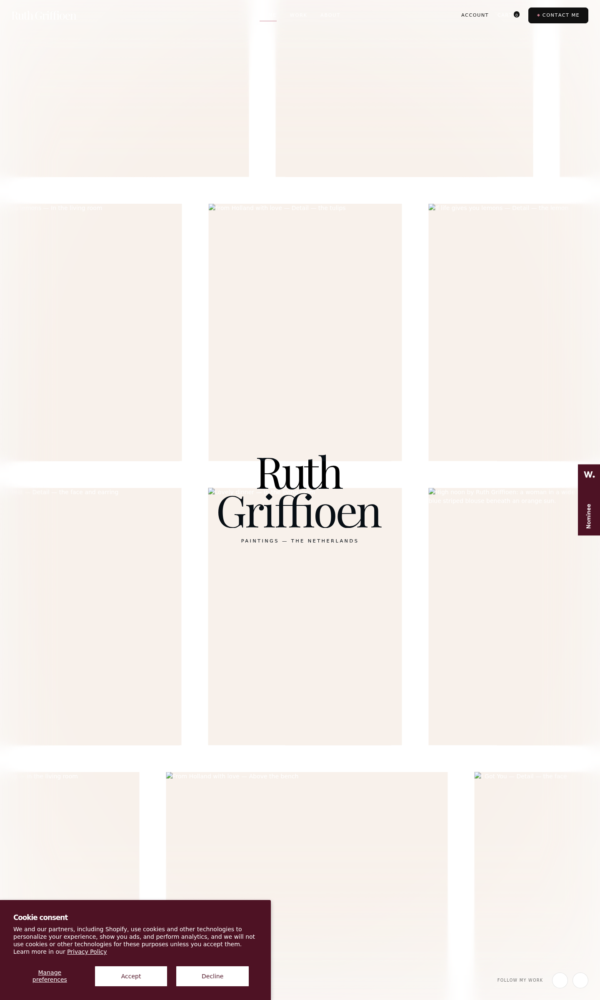
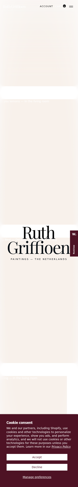

# UI Design System & Master Generation Blueprint: ruthgriffioen-art

> **Ruth Griffioen – Colourful paintings & art prints** (https://ruthgriffioen.art/) — Discover colourful paintings by Dutch artist Ruth Griffioen, from portraits of women to still lifes and landscapes. Art prints coming Jan...



---

## 1. Executive Visual Persona & Design Archetype

- **Brand Essence & Persona**: **Ruth Griffioen – Colourful paintings & art prints** (`https://ruthgriffioen.art/`). Discover colourful paintings by Dutch artist Ruth Griffioen, from portraits of women to still lifes and landscapes. Art prints coming Jan...
- **Visual Archetype**: **High-Contrast Obsidian / Atmospheric Design System (`#111111` canvas, `#ffffff` ink, `#f8f1eb` accent)**.
- **Anti-AI-Slop Differentiators**:
  - **Source-Grounded Chromatic Polarity**: Anchors the viewport in `#111111` (`var(--ink)` in `:root`) paired with `#ffffff` primary typography and `#f8f1eb` accents.
  - **Extracted Typographic Hierarchy**: Pairs `Playfair Display` for display copy (`Cookie consent`) with `Inter` and `SFMono-Regular`.
  - **Calibrated Spatial Grid & Motion**: Combines `36rem` container bounds (`gap: var(--space-l)`, padding `var(--space-l)`) with `cubic-bezier(.22,1,.36,1)` easing and Lenis Smooth Scroll (`data-lenis`).

---

## 2. Spatial Architecture & Modular Grid Mathematics



### Viewport Allocation & Container Geometry
- **Captured Viewport Dimensions**: Desktop `1440×2400px` (`assets/desktop.png`, capped at 2400px multi-section capture), Mobile `390×2400px` (`assets/mobile.png`, capped at 2400px multi-section capture).
- **Master Container Bounds**: `36rem` extracted from `ruthgriffioen-art` stylesheet.
- **Canvas Lateral Padding & Spacing**: `var(--space-l)` lateral canvas padding with `var(--space-l)` grid gap.
- **Border Radius Scale**: `var(--radius)`, `var(--diamond-round)`, `999px`, `1.375rem`.

### Responsive Breakpoint Architecture
- **Desktop Layout**: Multi-column CSS Grid / Flexbox layout at `1440px` (`max-width: 36rem`, `gap: var(--space-l)`).
- **Mobile Layout**: Single-column vertical stack at `390px` viewport width with `var(--space-l)` horizontal padding.
- **Extracted CSS Media Queries**: `@media (max-width:46.875em)`, `@media (max-width:46.875em)and (prefers-reduced-motion:reduce)`, `@media (max-width:46.875em),(max-aspect-ratio:4/5)`, `@media (prefers-reduced-motion:reduce)`.

---

## 3. Color System, Materiality & Atmospheric Lighting

### Semantic Palette & Source Grounding
| Semantic Role | Ground-Truth Value | Extracted CSS Source / Selector |
|---|---|---|
| **Primary Canvas Substrate** | `#111111` | `var(--ink)` in `:root` |
| **Primary Typography Ink** | `#ffffff` | `var(--paper)` in `:root` |
| **Elevated Surface / Card Substrate** | `#6f6f6f` | `var(--muted)` in `:root` |
| **Interactive Accent / Highlight** | `#f8f1eb` | `var(--soft)` in `:root` |
| **Secondary / Muted Copy** | `#4d1224` | `var(--accent)` in `:root` |
| **Structural Hairline Border** | `#c77b8c` | `var(--accent-light)` in `:root` |

### Sanitized Root CSS Variables (`ui-ux.md` Ground Truth)
| Variable Name | Extracted Value | Semantic Role |
|---|---|---|
| `--ink` | `#111111` | Typography Ink Token |
| `--paper` | `#ffffff` | Canvas / Surface Token |
| `--muted` | `#6f6f6f` | Color / Atmospheric Token |
| `--line` | `rgba(17, 17, 17, .12)` | Color / Atmospheric Token |
| `--soft` | `#f8f1eb` | Color / Atmospheric Token |
| `--accent` | `#4d1224` | Brand / Palette Token |
| `--accent-ink` | `#ffffff` | Typography Ink Token |
| `--accent-light` | `#c77b8c` | Canvas / Surface Token |
| `--font-display` | `"Playfair Display", Georgia, "Times New Roman", serif` | Typography / Scale Token |
| `--font-body` | `"Inter", system-ui, -apple-system, "Segoe UI", sans-serif` | Typography / Scale Token |
| `--step--2` | `.6875rem` | Dimension / Scale Token |
| `--step--1` | `.8125rem` | Dimension / Scale Token |
| `--step-0` | `1rem` | Dimension / Scale Token |
| `--step-1` | `clamp(1.125rem, 1.042rem + .3704vw, 1.375rem)` | Dimension / Scale Token |
| `--step-2` | `clamp(1.312rem, 1.125rem + .8333vw, 1.875rem)` | Dimension / Scale Token |
| `--step-3` | `clamp(1.75rem, 1.417rem + 1.481vw, 2.75rem)` | Dimension / Scale Token |

---

## 4. Typographic Scale & Editorial Hierarchy

### Font Family Stacks
- **Display Typography**: `Playfair Display`.
- **Primary Body Stack**: `Inter`.
- **Technical / Metadata Stack**: `SFMono-Regular`.

### Typographic Scale & Rules (Extracted from Stylesheet & Variables)
- **Hero Display (`H1`)**: CSS variables `--font-display: "Playfair Display", Georgia, "Times New Roman", serif`; rule `h1` (`font-size: var(--step-7)`, `line-height: .95`, `letter-spacing: -.03em`, `font-weight: 400`).
- **Section Heading (`H2`)**: rule `h2` (`font-size: var(--step-2)`, `font-weight: 400`).
- **Body Copy**: CSS variables `--font-body: "Inter", system-ui, -apple-system, "Segoe UI", sans-serif`; rule `p` (`font-size: var(--step--1)`, `letter-spacing: .3em`).
- **Metadata & Navigation Labels**: not explicitly declared on tag in static CSS (stylesheet font-size ladder: `var(--step-0)`, `var(--step--2)`, `var(--step--1)`, `.8em`, `var(--step-4)`).

---

## 5. Choreographed Motion & Interaction Physics

### Primary Easing Curves
- **Extracted Timing Functions**: `cubic-bezier(.22,1,.36,1)`, `cubic-bezier(.625,.05,0,1)`, `cubic-bezier(.8,0,.4,1)`.

### Per-Element Transition & Choreography Rules
- **Selector `.btn`**: `transition: background .3s var(--ease),color .3s var(--ease),border-color...` extracted from `ruthgriffioen-art` stylesheet.
- **Selector `.btn .dot`**: `transition: background .3s` extracted from `ruthgriffioen-art` stylesheet.
- **Selector `shopify-account::part(dialog)`**: `transition: opacity .45s var(--ease-line),transform .6s var(--ease-line)` extracted from `ruthgriffioen-art` stylesheet.
- **Extracted Easing Curve (`cubic-bezier(.22,1,.36,1)`)**: Governs interactive state transitions across `<header.site-header>` and `<section.artwall>`.
- **Runtime Interaction Engine**: Integrates Lenis Smooth Scroll (`data-lenis`) with `prefers-reduced-motion: reduce` fallback guards.

---

## 6. Component Wireframe & Structural DOM Map

### Visual Layout Schematic (Grounded in `dom.html` — `1440px` Desktop & `390px` Mobile Reflow)
```
┌────────────────────────────────────────────────────────────────────────┐
│ DESKTOP VIEWPORT (1440px) — Ruth Griffioen – Colourful paintings & art │
│ ====================================================================== │
│ [ <header.site-header>     | Home H o m e · Work W o r k · About A  ]  │
│ ---------------------------------------------------------------------- │
│ | HERO STAGE: <section.shopify-pc__banner__dialog>                 |   │
│ | H1: Cookie consent                                               |   │
│ | Substrate: #111111    | Ink: #ffffff    | Accent: #f8f1eb        |   │
│ ---------------------------------------------------------------------- │
│ | SHOWCASE GRID (<section.artwall>         ) max-w: 36rem          |   │
│ | +------------------------------+  +------------------------------+ | │
│ | | Ruth Griffioen               |  | Cart 0                       | | │
│ | +------------------------------+  +------------------------------+ | │
│ ---------------------------------------------------------------------- │
│ | MOBILE VIEWPORT REFLOW (390px) — Single-Column Stack (gap: var(--) | │
│ | [<header.site-heade] -> [<section.shopify-p] -> [<section.artwall>]  │
│ ---------------------------------------------------------------------- │
│ [ FOOTER (<footer.site-footer>  ) | https://ruthgriffioen.art/         │
└────────────────────────────────────────────────────────────────────────┘
```

### Granular DOM Region Breakdown
1. **Brand Header & Navigation Bar (<header.site-header> — `ruthgriffioen-art`)**:
   - Landmark `<header class="site-header">` hosting `Ruth Griffioen – Colourful paintings` navigation (`Home H o m e · Work W o r k · About A b o u t`), DOM attributes (`data-cookie-preferences-ready="true"`, `data-source-attribution="shopify.exit_intersti..."`, `data-shop-id="109163413834"`, `data-venmo-supported="false"`), and stylesheet rule `font-face { font-family:Inter;font-style:normal;font-weight:400 500;font-display:swa... }`.
2. **Hero Stage & Focal Lead (<section.shopify-pc__banner__dialog> — `Cookie consent`)**:
   - Landmark `<section class="shopify-pc__banner__dialog">` presenting display lead `Cookie consent` and copy excerpt *"We and our partners, including Shopify, use cookies and other tec"* over `#111111` canvas and `#ffffff` ink.
3. **Primary Showcase & Content Grid (<section.artwall> — `Ruth Griffioen`)**:
   - Landmark `<section class="artwall is-ready">` rendering section `Ruth Griffioen` with copy *"Manage preferences"*, asset references (`favicon.svg`, `favicon-32.png`, `apple-touch-icon.png`, `playfair-display.woff2`), and grid rule `root { --header-h: 4.5rem }`.
4. **Interactive Detail & Feature Matrix (<section.artwall> — `Cart 0`)**:
   - Landmark `<section class="artwall is-ready">` framing `Cart 0` and `Account A c c o u n t` (*"Account A c c o u n t"*) with `#6f6f6f` surface cards, `#f8f1eb` accents, and `after { box-sizing:border-box }`.
5. **Colophon & Global Directory Footer (<footer.site-footer> — `https://ruthgriffioen.art/`)**:
   - Landmark `<footer class="site-footer site-footer--overlay">` anchoring `Ruth Griffioen – Colourful paint` footer links (`Home H o m e · Work W o r k · About A b o u t`), copy *"Contact me C o n t a c t m e"*, and `#c77b8c` structural dividers.

---

## 7. Master Zero-Shot AI Generation Prompt

```markdown
# Master Zero-Shot Frontend Generation Prompt: ruthgriffioen-art (Ruth Griffioen – Colourful paintings & art prints)

You are a principal frontend architect and design systems engineer. Build a complete, production-ready web application replicating the exact design system, DOM landmarks, typographic hierarchy, color tokens, and motion physics of `ruthgriffioen-art` (**Ruth Griffioen – Colourful paintings & art prints** — `https://ruthgriffioen.art/`).

### 1. Visual Archetype & Anti-AI-Slop Mandates
- **Archetype**: High-Contrast Obsidian / Atmospheric Design System (`#111111` canvas, `#ffffff` ink, `#f8f1eb` accent).
- **Identity & Domain Context**: Discover colourful paintings by Dutch artist Ruth Griffioen, from portraits of women to still lifes and landscapes. Art prints coming Jan...
- **Primary Substrate**: `#111111` (`var(--ink)` in `:root`), **Primary Ink**: `#ffffff`, **Accent / Highlight**: `#f8f1eb`.
- **Site-Specific Differentiators**:
  - **Source-Grounded Chromatic Polarity**: Anchors the viewport in `#111111` (`var(--ink)` in `:root`) paired with `#ffffff` primary typography and `#f8f1eb` accents.
  - **Extracted Typographic Hierarchy**: Pairs `Playfair Display` for display copy (`Cookie consent`) with `Inter` and `SFMono-Regular`.
  - **Calibrated Spatial Grid & Motion**: Combines `36rem` container bounds (`gap: var(--space-l)`, padding `var(--space-l)`) with `cubic-bezier(.22,1,.36,1)` easing and Lenis Smooth Scroll (`data-lenis`).

### 2. Ground-Truth CSS Variables (`:root` Token Contract)
Declare and consume these exact custom properties extracted from `ruthgriffioen-art` in your global stylesheet:

:root {
  /* Ruth Griffioen – Colourful paintings & art prints (ruthgriffioen-art) — Ground-Truth Extracted CSS Variables */
  --ink: #111111; /* Typography Ink Token (ruthgriffioen-art) */
  --paper: #ffffff; /* Canvas / Surface Token (ruthgriffioen-art) */
  --muted: #6f6f6f; /* Color / Atmospheric Token (ruthgriffioen-art) */
  --line: rgba(17, 17, 17, .12); /* Color / Atmospheric Token (ruthgriffioen-art) */
  --soft: #f8f1eb; /* Color / Atmospheric Token (ruthgriffioen-art) */
  --accent: #4d1224; /* Brand / Palette Token (ruthgriffioen-art) */
  --accent-ink: #ffffff; /* Typography Ink Token (ruthgriffioen-art) */
  --accent-light: #c77b8c; /* Canvas / Surface Token (ruthgriffioen-art) */
  --font-display: "Playfair Display", Georgia, "Times New Roman", serif; /* Typography / Scale Token (ruthgriffioen-art) */
  --font-body: "Inter", system-ui, -apple-system, "Segoe UI", sans-serif; /* Typography / Scale Token (ruthgriffioen-art) */
  --step--2: .6875rem; /* Dimension / Scale Token (ruthgriffioen-art) */
  --step--1: .8125rem; /* Dimension / Scale Token (ruthgriffioen-art) */
  --step-0: 1rem; /* Dimension / Scale Token (ruthgriffioen-art) */
  --step-1: clamp(1.125rem, 1.042rem + .3704vw, 1.375rem); /* Dimension / Scale Token (ruthgriffioen-art) */
  --step-2: clamp(1.312rem, 1.125rem + .8333vw, 1.875rem); /* Dimension / Scale Token (ruthgriffioen-art) */
  --step-3: clamp(1.75rem, 1.417rem + 1.481vw, 2.75rem); /* Dimension / Scale Token (ruthgriffioen-art) */
}

### 3. Semantic Color & Materiality Contract
Map every surface, ink, and border strictly to these source-grounded tokens:
- **Primary Canvas Substrate**: `#111111` — grounded in `var(--ink)` in `:root`
- **Primary Typography Ink**: `#ffffff` — grounded in `var(--paper)` in `:root`
- **Elevated Surface / Card Substrate**: `#6f6f6f` — grounded in `var(--muted)` in `:root`
- **Interactive Accent / Highlight**: `#f8f1eb` — grounded in `var(--soft)` in `:root`
- **Secondary / Muted Copy**: `#4d1224` — grounded in `var(--accent)` in `:root`
- **Structural Hairline Border**: `#c77b8c` — grounded in `var(--accent-light)` in `:root`

### 4. Spatial Grid, Container Bounds & Responsive Breakpoints
- **Desktop Viewport Reference**: `1440×2400px` (capped at 2400px multi-section capture, `1440px` standard desktop width).
- **Mobile Viewport Reference**: `390×2400px` (capped at 2400px multi-section capture, `390px` standard mobile width).
- **Container Max-Width**: `36rem` extracted from `ruthgriffioen-art` stylesheet
- **Padding & Gutters**: `var(--space-l)` lateral canvas padding with `var(--space-l)` grid gap
- **Desktop Grid**: Multi-column CSS Grid / Flexbox layout at `1440px` (`max-width: 36rem`, `gap: var(--space-l)`)
- **Mobile Adaptation**: Single-column vertical stack at `390px` viewport width with `var(--space-l)` horizontal padding
- **Media Queries**: `@media (max-width:46.875em)`, `@media (max-width:46.875em)and (prefers-reduced-motion:reduce)`, `@media (max-width:46.875em),(max-aspect-ratio:4/5)`, `@media (prefers-reduced-motion:reduce)`
- **Corner Radii**: `var(--radius)`, `var(--diamond-round)`, `999px`, `1.375rem`

### 5. Typography & Editorial Scale Contract
- **Display Font Stack**: `Playfair Display`
- **Body Font Stack**: `Inter`
- **Monospace / Technical Font Stack**: `SFMono-Regular`
- **H1 Display Rule**: CSS variables `--font-display: "Playfair Display", Georgia, "Times New Roman", serif`; rule `h1` (`font-size: var(--step-7)`, `line-height: .95`, `letter-spacing: -.03em`, `font-weight: 400`)
- **H2 Section Rule**: rule `h2` (`font-size: var(--step-2)`, `font-weight: 400`)
- **Body Copy Rule**: CSS variables `--font-body: "Inter", system-ui, -apple-system, "Segoe UI", sans-serif`; rule `p` (`font-size: var(--step--1)`, `letter-spacing: .3em`)
- **Metadata & Index Rule**: not explicitly declared on tag in static CSS (stylesheet font-size ladder: `var(--step-0)`, `var(--step--2)`, `var(--step--1)`, `.8em`, `var(--step-4)`)

### 6. Component Hierarchy, Verbatim Copy & Real DOM Landmarks
Scaffold `ruthgriffioen-art` (`Ruth Griffioen – Colourful paintings & art prints`) with these exact structural regions, extracted copy, and CSS rules from `dom.html`:
1. **Brand Header & Navigation Bar (<header.site-header> — `ruthgriffioen-art`)**:
   - DOM & Selectors: Landmark `<header class="site-header">` hosting `Ruth Griffioen – Colourful paintings` navigation (`Home H o m e · Work W o r k · About A b o u t`), DOM attributes (`data-cookie-preferences-ready="true"`, `data-source-attribution="shopify.exit_intersti..."`, `data-shop-id="109163413834"`, `data-venmo-supported="false"`), and stylesheet rule `font-face { font-family:Inter;font-style:normal;font-weight:400 500;font-display:swa... }`.
   - Responsive Contract: Header `Brand Header & Navigation Bar (<header.site-header> — `ruthgriffioen-art`)` (`ruthgriffioen-art`) adapts across `@media (max-width:46.875em)`, `@media (max-width:46.875em)and (prefers-reduced-motion:reduce)`, `@media (max-width:46.875em),(max-aspect-ratio:4/5)`, `@media (prefers-reduced-motion:reduce)` with `cubic-bezier(.22,1,.36,1)`, `cubic-bezier(.625,.05,0,1)`, `cubic-bezier(.8,0,.4,1)` transitions and links `Home H o m e · Work W o r k · About A b o u t`.
2. **Hero Stage & Focal Lead (<section.shopify-pc__banner__dialog> — `Cookie consent`)**:
   - DOM & Selectors: Landmark `<section class="shopify-pc__banner__dialog">` presenting display lead `Cookie consent` and copy excerpt *"We and our partners, including Shopify, use cookies and other tec"* over `#111111` canvas and `#ffffff` ink.
   - Responsive Contract: Hero stage (`1440×2400px` desktop / `390×2400px` mobile) sets `#111111` background with `#ffffff` headline `Cookie consent`.
3. **Primary Showcase & Content Grid (<section.artwall> — `Ruth Griffioen`)**:
   - DOM & Selectors: Landmark `<section class="artwall is-ready">` rendering section `Ruth Griffioen` with copy *"Manage preferences"*, asset references (`favicon.svg`, `favicon-32.png`, `apple-touch-icon.png`, `playfair-display.woff2`), and grid rule `root { --header-h: 4.5rem }`.
   - Responsive Contract: Showcase grid `Primary Showcase & Content Grid (<section.artwall> — `Ruth Griffioen`)` applies Multi-column CSS Grid / Flexbox layout at `1440px` (`max-width: 36rem`, `gap: var(--space-l)`) on desktop and Single-column vertical stack at `390px` viewport width with `var(--space-l)` horizontal padding on mobile.
4. **Interactive Detail & Feature Matrix (<section.artwall> — `Cart 0`)**:
   - DOM & Selectors: Landmark `<section class="artwall is-ready">` framing `Cart 0` and `Account A c c o u n t` (*"Account A c c o u n t"*) with `#6f6f6f` surface cards, `#f8f1eb` accents, and `after { box-sizing:border-box }`.
   - Responsive Contract: Detail module `Interactive Detail & Feature Matrix (<section.artwall> — `Cart 0`)` uses `var(--radius)`, `var(--diamond-round)`, `999px`, `1.375rem` radii, `#f8f1eb` highlights, and assets (favicon.svg, favicon-32.png, apple-touch-icon.png).
5. **Colophon & Global Directory Footer (<footer.site-footer> — `https://ruthgriffioen.art/`)**:
   - DOM & Selectors: Landmark `<footer class="site-footer site-footer--overlay">` anchoring `Ruth Griffioen – Colourful paint` footer links (`Home H o m e · Work W o r k · About A b o u t`), copy *"Contact me C o n t a c t m e"*, and `#c77b8c` structural dividers.
   - Responsive Contract: Footer `Colophon & Global Directory Footer (<footer.site-footer> — `https://ruthgriffioen.art/`)` aligns to `36rem` extracted from `ruthgriffioen-art` stylesheet with `var(--space-l)` lateral canvas padding with `var(--space-l)` grid gap and attributes (data-cookie-preferences-ready="true", data-source-attribution="shopify.exit_intersti...", data-shop-id="109163413834").

#### Verbatim DOM Copy Excerpts (`dom.html`)
- Copy Excerpt 1: *"We and our partners, including Shopify, use cookies and other technologies to pers..."*
- Copy Excerpt 2: *"Manage preferences"*
- Copy Excerpt 3: *"Account A c c o u n t"*
- Copy Excerpt 4: *"Contact me C o n t a c t m e"*

### 7. Motion, Extracted Stylesheet Rules & Interaction Choreography
- **Primary Easing Functions**: `cubic-bezier(.22,1,.36,1)`, `cubic-bezier(.625,.05,0,1)`, `cubic-bezier(.8,0,.4,1)`
- **Extracted Stylesheet Rules (`ruthgriffioen-art`)**:
- `font-face { font-family:Inter;font-style:normal;font-weight:400 500;font-display:swa... }`
- `root { --header-h: 4.5rem }`
- `after { box-sizing:border-box }`
- `html.lenis body { height:auto }`
- `.lenis.lenis-smooth { scroll-behavior:auto!important }`
- **Per-Selector Transition Rules**:
- **Selector `.btn`**: `transition: background .3s var(--ease),color .3s var(--ease),border-color...` extracted from `ruthgriffioen-art` stylesheet.
- **Selector `.btn .dot`**: `transition: background .3s` extracted from `ruthgriffioen-art` stylesheet.
- **Selector `shopify-account::part(dialog)`**: `transition: opacity .45s var(--ease-line),transform .6s var(--ease-line)` extracted from `ruthgriffioen-art` stylesheet.
- **Extracted Easing Curve (`cubic-bezier(.22,1,.36,1)`)**: Governs interactive state transitions across `<header.site-header>` and `<section.artwall>`.
- **Runtime Interaction Engine**: Integrates Lenis Smooth Scroll (`data-lenis`) with `prefers-reduced-motion: reduce` fallback guards.

### 8. Technical Deliverables
- Implement in Next.js (App Router) with TypeScript and Tailwind CSS consuming the `:root` custom properties defined above for `ruthgriffioen-art`.
- Reproduce both the `1440px` desktop architecture and `390px` mobile breakpoint transitions, preserving semantic HTML5 landmarks (`<header>`, `<nav>`, `<main>`, `<section>`, `<footer>`) and `prefers-reduced-motion` accessibility guards.
```
