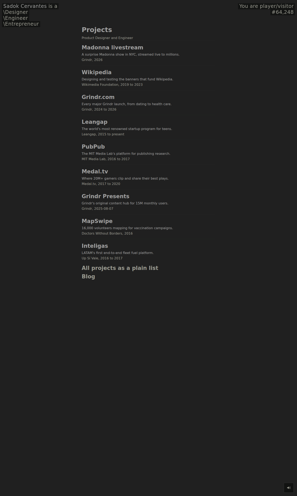
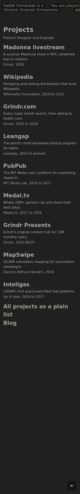

# UI Design System & Master Generation Blueprint: sadok-mx

> **Sadok Cervantes · \Designer \Engineer \Entrepreneur** (https://sadok.mx/) — Sadok Cervantes designs and builds products that have reached over 100 million people. He is one of Fast Company’s Most Innovative People.



---

## 1. Executive Visual Persona & Design Archetype

- **Brand Essence & Persona**: **Sadok Cervantes · \Designer \Engineer \Entrepreneur** (`https://sadok.mx/`). Sadok Cervantes designs and builds products that have reached over 100 million people. He is one of Fast Company’s Most Innovative People.
- **Visual Archetype**: **Dark-Substrate WebGL / Canvas Interactive Experience (`#202020` / `#3890f8`)**.
- **Anti-AI-Slop Differentiators**:
  - **Source-Grounded Chromatic Polarity**: Anchors the viewport in `#202020` (`var(--box-ink)` in `:root`) paired with `#f8f8f8` primary typography and `#3890f8` accents.
  - **Extracted Typographic Hierarchy**: Pairs `Emerald Bold` for display copy (`Sadok Cervantes, Product Designer an`) with `Handjet` and `SFMono-Regular`.
  - **Calibrated Spatial Grid & Motion**: Combines `var(--wide)` container bounds (`gap: 40px`, padding `56px`) with `cubic-bezier(0.25,0.1,0.25,1)` easing and Three.js / WebGL Canvas Pipeline.

---

## 2. Spatial Architecture & Modular Grid Mathematics



### Viewport Allocation & Container Geometry
- **Captured Viewport Dimensions**: Desktop `1440×2400px` (`assets/desktop.png`, capped at 2400px multi-section capture), Mobile `390×2400px` (`assets/mobile.png`, capped at 2400px multi-section capture).
- **Master Container Bounds**: `var(--wide)` extracted from `sadok-mx` stylesheet.
- **Canvas Lateral Padding & Spacing**: `56px` lateral canvas padding with `40px` grid gap.
- **Border Radius Scale**: `0px` (sharp unrounded corners).

### Responsive Breakpoint Architecture
- **Desktop Layout**: Multi-column CSS Grid / Flexbox layout at `1440px` (`max-width: var(--wide)`, `gap: 40px`).
- **Mobile Layout**: Single-column vertical stack at `390px` viewport width with `56px` horizontal padding.
- **Extracted CSS Media Queries**: `@media (width>=560px)`, `@media (width<=359px)`, `@media (width>=900px)`, `@media (width>=900px) and (width<=1099px)`.

---

## 3. Color System, Materiality & Atmospheric Lighting

### Semantic Palette & Source Grounding
| Semantic Role | Ground-Truth Value | Extracted CSS Source / Selector |
|---|---|---|
| **Primary Canvas Substrate** | `#202020` | `var(--box-ink)` in `:root` |
| **Primary Typography Ink** | `#a0a0a0` | `var(--box-gap)` in `:root` |
| **Elevated Surface / Card Substrate** | `#f8f8f8` | `var(--box-fill)` in `:root` |
| **Interactive Accent / Highlight** | `#3890f8` | `var(--exp)` in `:root` |
| **Secondary / Muted Copy** | `#b8d8f8` | `var(--exp-flash)` in `:root` |
| **Structural Hairline Border** | `#0f1110` | `var(--bg-0)` in `:root` |
| **Variable Token (`--bg-1`)** | `#171a18` | `var(--bg-1)` in `:root` |
| **Variable Token (`--bg-2`)** | `#232724` | `var(--bg-2)` in `:root` |

### Sanitized Root CSS Variables (`ui-ux.md` Ground Truth)
| Variable Name | Extracted Value | Semantic Role |
|---|---|---|
| `--box-ink` | `#202020` | Typography Ink Token |
| `--box-gap` | `#a0a0a0` | Layout / Spatial Grid Token |
| `--box-fill` | `#f8f8f8` | Color / Atmospheric Token |
| `--pad` | `calc(2 * var(--u) + 28px)` | Layout / Spatial Grid Token |
| `--ratio` | `2725 / 4368` | Design System Custom Token |
| `--exp` | `#3890f8` | Color / Atmospheric Token |
| `--exp-flash` | `#b8d8f8` | Color / Atmospheric Token |
| `--delay` | `calc(var(--i) * .2s)` | Motion / Easing Token |
| `--fill` | `calc(var(--n) * 32ms)` | Design System Custom Token |
| `--slot` | `36px` | Dimension / Scale Token |
| `--back-bottom` | `calc(2 * (var(--gutter) + env(safe-area-inset-top)) + 46px)` | Dimension / Scale Token |
| `--px` | `2px` | Dimension / Scale Token |
| `--sep` | `2.8em` | Dimension / Scale Token |
| `--bg-0` | `#0f1110` | Canvas / Surface Token |
| `--bg-1` | `#171a18` | Canvas / Surface Token |
| `--bg-2` | `#232724` | Canvas / Surface Token |

---

## 4. Typographic Scale & Editorial Hierarchy

### Font Family Stacks
- **Display Typography**: `Emerald Bold`.
- **Primary Body Stack**: `Handjet`.
- **Technical / Metadata Stack**: `SFMono-Regular`.

### Typographic Scale & Rules (Extracted from Stylesheet & Variables)
- **Hero Display (`H1`)**: CSS variables `--font-display: Handjet, system-ui, sans-serif`, `--kh-display: contents`; rule `h1` (`font-size: 32px`).
- **Section Heading (`H2`)**: rule `h2` (`font-size: 32px`).
- **Body Copy**: rule `p` (`font-size: 16px`).
- **Metadata & Navigation Labels**: not explicitly declared on tag in static CSS (stylesheet font-size ladder: `clamp(18px,4.4vw + 4px,44px)`, `clamp(17px,15px + .4vw,20px)`, `10px`, `clamp(13px,2.6vw + 4px,22px)`, `15px`).

---

## 5. Choreographed Motion & Interaction Physics

### Primary Easing Curves
- **Extracted Timing Functions**: `cubic-bezier(0.25,0.1,0.25,1)`.

### Per-Element Transition & Choreography Rules
- **Selector `.toggles)`**: `transition: opacity .6s linear` extracted from `sadok-mx` stylesheet.
- **Selector `.preloader`**: `transition: opacity .24s linear` extracted from `sadok-mx` stylesheet.
- **Selector `.gate`**: `transition: opacity .2s linear` extracted from `sadok-mx` stylesheet.
- **Standard CSS Easing (`cubic-bezier(0.25,0.1,0.25,1)`)**: Default timing curve (no custom `cubic-bezier()` declared in static CSS).
- **Runtime Interaction Engine**: Integrates Three.js / WebGL Canvas Pipeline with `prefers-reduced-motion: reduce` fallback guards.

---

## 6. Component Wireframe & Structural DOM Map

### Visual Layout Schematic (Grounded in `dom.html` — `1440px` Desktop & `390px` Mobile Reflow)
```
┌────────────────────────────────────────────────────────────────────────┐
│ DESKTOP VIEWPORT (1440px) — Sadok Cervantes · \Designer \Engineer \Ent │
│ ====================================================================== │
│ [ <header.meta>            | BACK                                   ]  │
│ ---------------------------------------------------------------------- │
│ | HERO STAGE: <section.landing-list>                               |   │
│ | H1: Sadok Cervantes, Product Designer and Engineer               |   │
│ | Substrate: #202020    | Ink: #f8f8f8    | Accent: #3890f8        |   │
│ ---------------------------------------------------------------------- │
│ | SHOWCASE GRID (<section.landing-list>    ) max-w: var(--wide)    |   │
│ | +------------------------------+  +------------------------------+ | │
│ | | Projects                     |  | \Designer \Engineer \Entrepr | | │
│ | +------------------------------+  +------------------------------+ | │
│ ---------------------------------------------------------------------- │
│ | MOBILE VIEWPORT REFLOW (390px) — Single-Column Stack (gap: 40px  ) | │
│ | [<header.meta>] -> [<section.landing-l] -> [<section.landing-l] |    │
│ ---------------------------------------------------------------------- │
│ [ FOOTER (<footer.meta__is>     ) | https://sadok.mx/                  │
└────────────────────────────────────────────────────────────────────────┘
```

### Granular DOM Region Breakdown
1. **Brand Header & Navigation Bar (<header.meta> — `sadok-mx`)**:
   - Landmark `<header class="meta">` hosting `Sadok Cervantes · \Designer \Enginee` navigation (`BACK`), DOM attributes (`data-island="ready"`, `data-gb-state="loading"`, `data-gb-load="background"`, `data-gb-view="device"`), and stylesheet rule `.ab-footer { animation:.2s ease-out backwards ab-in }`.
2. **Hero Stage & Focal Lead (<section.landing-list> — `Sadok Cervantes, Product Designer `)**:
   - Landmark `<section class="landing-list">` presenting display lead `Sadok Cervantes, Product Designer and Engineer` and copy excerpt *"Sadok Cervantes is a"* over `#202020` canvas and `#f8f8f8` ink.
3. **Primary Showcase & Content Grid (<section.landing-list> — `Projects`)**:
   - Landmark `<section class="landing-list">` rendering section `Projects` with copy *"\Designer \Engineer \Entrepreneur"*, asset references (`fonts.googleapis.com`, `fonts.gstatic.com`, `css2`, `sitemap-index.xml`), and grid rule `.ab { --box-ink:202020;--box-gap:a0a0a0;--box-fill:f8f8f8;--u:4px;font-family:... }`.
4. **Interactive Detail & Feature Matrix (<section.landing-list> — `\Designer \Engineer \Entrepreneur`)**:
   - Landmark `<section class="landing-list">` framing `\Designer \Engineer \Entrepreneur` and `You are player/visitor # 64,248` (*"You are player/visitor # 64,248"*) with `#f8f8f8` surface cards, `#3890f8` accents, and `.ab-footer :focus-visible { outline-color:currentColor }`.
5. **Colophon & Global Directory Footer (<footer.meta__is> — `https://sadok.mx/`)**:
   - Landmark `<footer class="meta__is">` anchoring `Sadok Cervantes · \Designer \Eng` footer links (`BACK`), copy *"You are player/visitor"*, and `#0f1110` structural dividers.

---

## 7. Master Zero-Shot AI Generation Prompt

```markdown
# Master Zero-Shot Frontend Generation Prompt: sadok-mx (Sadok Cervantes · \Designer \Engineer \Entrepreneur)

You are a principal frontend architect and design systems engineer. Build a complete, production-ready web application replicating the exact design system, DOM landmarks, typographic hierarchy, color tokens, and motion physics of `sadok-mx` (**Sadok Cervantes · \Designer \Engineer \Entrepreneur** — `https://sadok.mx/`).

### 1. Visual Archetype & Anti-AI-Slop Mandates
- **Archetype**: Dark-Substrate WebGL / Canvas Interactive Experience (`#202020` / `#3890f8`).
- **Identity & Domain Context**: Sadok Cervantes designs and builds products that have reached over 100 million people. He is one of Fast Company’s Most Innovative People.
- **Primary Substrate**: `#202020` (`var(--box-ink)` in `:root`), **Primary Ink**: `#f8f8f8`, **Accent / Highlight**: `#3890f8`.
- **Site-Specific Differentiators**:
  - **Source-Grounded Chromatic Polarity**: Anchors the viewport in `#202020` (`var(--box-ink)` in `:root`) paired with `#f8f8f8` primary typography and `#3890f8` accents.
  - **Extracted Typographic Hierarchy**: Pairs `Emerald Bold` for display copy (`Sadok Cervantes, Product Designer an`) with `Handjet` and `SFMono-Regular`.
  - **Calibrated Spatial Grid & Motion**: Combines `var(--wide)` container bounds (`gap: 40px`, padding `56px`) with `cubic-bezier(0.25,0.1,0.25,1)` easing and Three.js / WebGL Canvas Pipeline.

### 2. Ground-Truth CSS Variables (`:root` Token Contract)
Declare and consume these exact custom properties extracted from `sadok-mx` in your global stylesheet:

:root {
  /* Sadok Cervantes · \Designer \Engineer \Entrepreneur (sadok-mx) — Ground-Truth Extracted CSS Variables */
  --box-ink: #202020; /* Typography Ink Token (sadok-mx) */
  --box-gap: #a0a0a0; /* Layout / Spatial Grid Token (sadok-mx) */
  --box-fill: #f8f8f8; /* Color / Atmospheric Token (sadok-mx) */
  --pad: calc(2 * var(--u) + 28px); /* Layout / Spatial Grid Token (sadok-mx) */
  --ratio: 2725 / 4368; /* Design System Custom Token (sadok-mx) */
  --exp: #3890f8; /* Color / Atmospheric Token (sadok-mx) */
  --exp-flash: #b8d8f8; /* Color / Atmospheric Token (sadok-mx) */
  --delay: calc(var(--i) * .2s); /* Motion / Easing Token (sadok-mx) */
  --fill: calc(var(--n) * 32ms); /* Design System Custom Token (sadok-mx) */
  --slot: 36px; /* Dimension / Scale Token (sadok-mx) */
  --back-bottom: calc(2 * (var(--gutter) + env(safe-area-inset-top)) + 46px); /* Dimension / Scale Token (sadok-mx) */
  --px: 2px; /* Dimension / Scale Token (sadok-mx) */
  --sep: 2.8em; /* Dimension / Scale Token (sadok-mx) */
  --bg-0: #0f1110; /* Canvas / Surface Token (sadok-mx) */
  --bg-1: #171a18; /* Canvas / Surface Token (sadok-mx) */
  --bg-2: #232724; /* Canvas / Surface Token (sadok-mx) */
}

### 3. Semantic Color & Materiality Contract
Map every surface, ink, and border strictly to these source-grounded tokens:
- **Primary Canvas Substrate**: `#202020` — grounded in `var(--box-ink)` in `:root`
- **Primary Typography Ink**: `#a0a0a0` — grounded in `var(--box-gap)` in `:root`
- **Elevated Surface / Card Substrate**: `#f8f8f8` — grounded in `var(--box-fill)` in `:root`
- **Interactive Accent / Highlight**: `#3890f8` — grounded in `var(--exp)` in `:root`
- **Secondary / Muted Copy**: `#b8d8f8` — grounded in `var(--exp-flash)` in `:root`
- **Structural Hairline Border**: `#0f1110` — grounded in `var(--bg-0)` in `:root`
- **Variable Token (`--bg-1`)**: `#171a18` — grounded in `var(--bg-1)` in `:root`
- **Variable Token (`--bg-2`)**: `#232724` — grounded in `var(--bg-2)` in `:root`

### 4. Spatial Grid, Container Bounds & Responsive Breakpoints
- **Desktop Viewport Reference**: `1440×2400px` (capped at 2400px multi-section capture, `1440px` standard desktop width).
- **Mobile Viewport Reference**: `390×2400px` (capped at 2400px multi-section capture, `390px` standard mobile width).
- **Container Max-Width**: `var(--wide)` extracted from `sadok-mx` stylesheet
- **Padding & Gutters**: `56px` lateral canvas padding with `40px` grid gap
- **Desktop Grid**: Multi-column CSS Grid / Flexbox layout at `1440px` (`max-width: var(--wide)`, `gap: 40px`)
- **Mobile Adaptation**: Single-column vertical stack at `390px` viewport width with `56px` horizontal padding
- **Media Queries**: `@media (width>=560px)`, `@media (width<=359px)`, `@media (width>=900px)`, `@media (width>=900px) and (width<=1099px)`
- **Corner Radii**: `0px` (sharp unrounded corners)

### 5. Typography & Editorial Scale Contract
- **Display Font Stack**: `Emerald Bold`
- **Body Font Stack**: `Handjet`
- **Monospace / Technical Font Stack**: `SFMono-Regular`
- **H1 Display Rule**: CSS variables `--font-display: Handjet, system-ui, sans-serif`, `--kh-display: contents`; rule `h1` (`font-size: 32px`)
- **H2 Section Rule**: rule `h2` (`font-size: 32px`)
- **Body Copy Rule**: rule `p` (`font-size: 16px`)
- **Metadata & Index Rule**: not explicitly declared on tag in static CSS (stylesheet font-size ladder: `clamp(18px,4.4vw + 4px,44px)`, `clamp(17px,15px + .4vw,20px)`, `10px`, `clamp(13px,2.6vw + 4px,22px)`, `15px`)

### 6. Component Hierarchy, Verbatim Copy & Real DOM Landmarks
Scaffold `sadok-mx` (`Sadok Cervantes · \Designer \Engineer \Entrepreneur`) with these exact structural regions, extracted copy, and CSS rules from `dom.html`:
1. **Brand Header & Navigation Bar (<header.meta> — `sadok-mx`)**:
   - DOM & Selectors: Landmark `<header class="meta">` hosting `Sadok Cervantes · \Designer \Enginee` navigation (`BACK`), DOM attributes (`data-island="ready"`, `data-gb-state="loading"`, `data-gb-load="background"`, `data-gb-view="device"`), and stylesheet rule `.ab-footer { animation:.2s ease-out backwards ab-in }`.
   - Responsive Contract: Header `Brand Header & Navigation Bar (<header.meta> — `sadok-mx`)` (`sadok-mx`) adapts across `@media (width>=560px)`, `@media (width<=359px)`, `@media (width>=900px)`, `@media (width>=900px) and (width<=1099px)` with `cubic-bezier(0.25,0.1,0.25,1)` transitions and links `BACK`.
2. **Hero Stage & Focal Lead (<section.landing-list> — `Sadok Cervantes, Product Designer `)**:
   - DOM & Selectors: Landmark `<section class="landing-list">` presenting display lead `Sadok Cervantes, Product Designer and Engineer` and copy excerpt *"Sadok Cervantes is a"* over `#202020` canvas and `#f8f8f8` ink.
   - Responsive Contract: Hero stage (`1440×2400px` desktop / `390×2400px` mobile) sets `#202020` background with `#f8f8f8` headline `Sadok Cervantes, Product Designer and Engineer`.
3. **Primary Showcase & Content Grid (<section.landing-list> — `Projects`)**:
   - DOM & Selectors: Landmark `<section class="landing-list">` rendering section `Projects` with copy *"\Designer \Engineer \Entrepreneur"*, asset references (`fonts.googleapis.com`, `fonts.gstatic.com`, `css2`, `sitemap-index.xml`), and grid rule `.ab { --box-ink:202020;--box-gap:a0a0a0;--box-fill:f8f8f8;--u:4px;font-family:... }`.
   - Responsive Contract: Showcase grid `Primary Showcase & Content Grid (<section.landing-list> — `Projects`)` applies Multi-column CSS Grid / Flexbox layout at `1440px` (`max-width: var(--wide)`, `gap: 40px`) on desktop and Single-column vertical stack at `390px` viewport width with `56px` horizontal padding on mobile.
4. **Interactive Detail & Feature Matrix (<section.landing-list> — `\Designer \Engineer \Entrepreneur`)**:
   - DOM & Selectors: Landmark `<section class="landing-list">` framing `\Designer \Engineer \Entrepreneur` and `You are player/visitor # 64,248` (*"You are player/visitor # 64,248"*) with `#f8f8f8` surface cards, `#3890f8` accents, and `.ab-footer :focus-visible { outline-color:currentColor }`.
   - Responsive Contract: Detail module `Interactive Detail & Feature Matrix (<section.landing-list> — `\Designer \Engineer \Entrepreneur`)` uses `0px` (sharp unrounded corners) radii, `#3890f8` highlights, and assets (fonts.googleapis.com, fonts.gstatic.com, css2).
5. **Colophon & Global Directory Footer (<footer.meta__is> — `https://sadok.mx/`)**:
   - DOM & Selectors: Landmark `<footer class="meta__is">` anchoring `Sadok Cervantes · \Designer \Eng` footer links (`BACK`), copy *"You are player/visitor"*, and `#0f1110` structural dividers.
   - Responsive Contract: Footer `Colophon & Global Directory Footer (<footer.meta__is> — `https://sadok.mx/`)` aligns to `var(--wide)` extracted from `sadok-mx` stylesheet with `56px` lateral canvas padding with `40px` grid gap and attributes (data-island="ready", data-gb-state="loading", data-gb-load="background").

#### Verbatim DOM Copy Excerpts (`dom.html`)
- Copy Excerpt 1: *"Sadok Cervantes is a"*
- Copy Excerpt 2: *"\Designer \Engineer \Entrepreneur"*
- Copy Excerpt 3: *"You are player/visitor # 64,248"*
- Copy Excerpt 4: *"You are player/visitor"*

### 7. Motion, Extracted Stylesheet Rules & Interaction Choreography
- **Primary Easing Functions**: `cubic-bezier(0.25,0.1,0.25,1)`
- **Extracted Stylesheet Rules (`sadok-mx`)**:
- `.ab-footer { animation:.2s ease-out backwards ab-in }`
- `.ab { --box-ink:202020;--box-gap:a0a0a0;--box-fill:f8f8f8;--u:4px;font-family:... }`
- `.ab-footer :focus-visible { outline-color:currentColor }`
- `.ab-page { overflow-x:clip }`
- `.ab-media__caption { font-family:var(--font-pixel);letter-spacing:.04em;text-transform:upperc... }`
- **Per-Selector Transition Rules**:
- **Selector `.toggles)`**: `transition: opacity .6s linear` extracted from `sadok-mx` stylesheet.
- **Selector `.preloader`**: `transition: opacity .24s linear` extracted from `sadok-mx` stylesheet.
- **Selector `.gate`**: `transition: opacity .2s linear` extracted from `sadok-mx` stylesheet.
- **Standard CSS Easing (`cubic-bezier(0.25,0.1,0.25,1)`)**: Default timing curve (no custom `cubic-bezier()` declared in static CSS).
- **Runtime Interaction Engine**: Integrates Three.js / WebGL Canvas Pipeline with `prefers-reduced-motion: reduce` fallback guards.

### 8. Technical Deliverables
- Implement in Next.js (App Router) with TypeScript and Tailwind CSS consuming the `:root` custom properties defined above for `sadok-mx`.
- Reproduce both the `1440px` desktop architecture and `390px` mobile breakpoint transitions, preserving semantic HTML5 landmarks (`<header>`, `<nav>`, `<main>`, `<section>`, `<footer>`) and `prefers-reduced-motion` accessibility guards.
```
