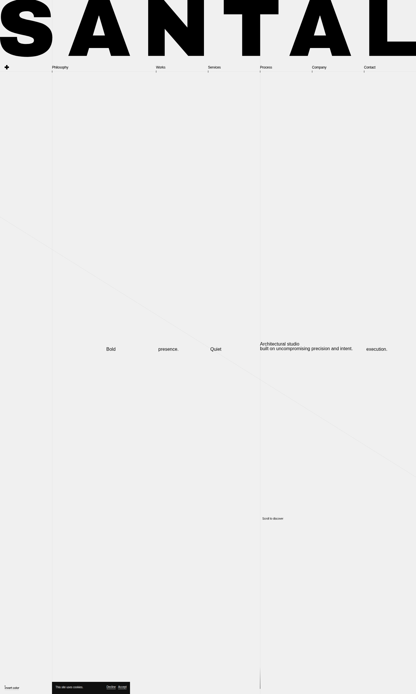

# UI Design System & Master Generation Blueprint: santalarch-com

> **Santalarch** (https://santalarch.com) — Architectural studio built on uncompromising precision and intent.



---

## 1. Executive Visual Persona & Design Archetype

- **Brand Essence & Persona**: **Santalarch** (`https://santalarch.com`). Architectural studio built on uncompromising precision and intent.
- **Visual Archetype**: **Light-Gallery WebGL / Canvas Interactive Experience (`#f0f0f0` / `#0f0f0f`)**.
- **Anti-AI-Slop Differentiators**:
  - **Source-Grounded Chromatic Polarity**: Anchors the viewport in `#f0f0f0` (`var(--c-base-light-primary)` in `:root`) paired with `#000` primary typography and `#0f0f0f` accents.
  - **Extracted Typographic Hierarchy**: Pairs `Helvetica` for display copy (`Bold`) with `lil-gui` and not declared in static CSS (uses primary stack / `ui-monospace`).
  - **Calibrated Spatial Grid & Motion**: Combines `1023px` container bounds (`gap: 1rem`, padding `1rem`) with `cubic-bezier(.25,1,.5,1)` easing and Lenis Smooth Scroll (`data-lenis`), Three.js / WebGL Canvas Pipeline.

---

## 2. Spatial Architecture & Modular Grid Mathematics


### Viewport Allocation & Container Geometry
- **Captured Viewport Dimensions**: Desktop `1440×2400px` (`assets/desktop.png`, capped at 2400px multi-section capture), Mobile `390×2400px` (`assets/mobile.png`, capped at 2400px multi-section capture).
- **Master Container Bounds**: `1023px` extracted from `santalarch-com` stylesheet.
- **Canvas Lateral Padding & Spacing**: `1rem` lateral canvas padding with `1rem` grid gap.
- **Border Radius Scale**: `50%`, `2px`, `var(--scrollbar-width)`, `var(--widget-border-radius)`.

### Responsive Breakpoint Architecture
- **Desktop Layout**: Multi-column CSS Grid / Flexbox layout at `1440px` (`max-width: 1023px`, `gap: 1rem`).
- **Mobile Layout**: Single-column vertical stack at `390px` viewport width with `1rem` horizontal padding.
- **Extracted CSS Media Queries**: `@media (max-width:1023px)`, `@media screen and (max-width:1023px)and (orientation:landscape)`, `@media (min-width:1024px)`.

---

## 3. Color System, Materiality & Atmospheric Lighting

### Semantic Palette & Source Grounding
| Semantic Role | Ground-Truth Value | Extracted CSS Source / Selector |
|---|---|---|
| **Primary Canvas Substrate** | `#f0f0f0` | `var(--c-base-light-primary)` in `:root` |
| **Primary Typography Ink** | `#000` | `var(--c-pure-black)` in `:root` |
| **Elevated Surface / Card Substrate** | `#fff` | `var(--c-pure-white)` in `:root` |
| **Interactive Accent / Highlight** | `#0f0f0f` | `var(--c-base-dark-primary)` in `:root` |
| **Secondary / Muted Copy** | `#8f2424` | `var(--c-error)` in `:root` |
| **Structural Hairline Border** | `#1f1f1f` | `var(--background-color)` in `:root` |
| **Variable Token (`--c-base-line-highlight`)** | `#f2f0f033` | `var(--c-base-line-highlight)` in `:root` |
| **Variable Token (`--c-base-line-dark-bg`)** | `#f2f0f00d` | `var(--c-base-line-dark-bg)` in `:root` |
| **Variable Token (`--c-light-secondary`)** | `#f2f0f066` | `var(--c-light-secondary)` in `:root` |

### Sanitized Root CSS Variables (`ui-ux.md` Ground Truth)
| Variable Name | Extracted Value | Semantic Role |
|---|---|---|
| `--viewport-width` | `1440` | Layout / Spatial Grid Token |
| `--viewport-height` | `800` | Layout / Spatial Grid Token |
| `--font-helvetica` | `"Helvetica",sans-serif` | Typography / Scale Token |
| `--ease-out` | `cubic-bezier(.25,1,.5,1)` | Motion / Easing Token |
| `--transition` | `.5s var(--ease-out)` | Motion / Easing Token |
| `--transition-fast` | `.3s var(--ease-out)` | Motion / Easing Token |
| `--transition-slow` | `.8s var(--ease-out)` | Motion / Easing Token |
| `--c-base-light-primary` | `#f0f0f0` | Canvas / Surface Token |
| `--c-base-line-highlight` | `#f2f0f033` | Canvas / Surface Token |
| `--c-base-line-dark-bg` | `#f2f0f00d` | Canvas / Surface Token |
| `--c-pure-black` | `#000` | Canvas / Surface Token |
| `--c-pure-white` | `#fff` | Canvas / Surface Token |
| `--c-pure-black-rgb` | `0,0,0` | Canvas / Surface Token |
| `--c-pure-black-0` | `rgba(var(--c-pure-black-rgb),0)` | Canvas / Surface Token |
| `--c-light-primary` | `var(--c-base-light-primary)` | Canvas / Surface Token |
| `--c-light-secondary` | `#f2f0f066` | Canvas / Surface Token |

---

## 4. Typographic Scale & Editorial Hierarchy

### Font Family Stacks
- **Display Typography**: `Helvetica`.
- **Primary Body Stack**: `lil-gui`.
- **Technical / Metadata Stack**: not declared in static CSS (uses primary stack / `ui-monospace`).

### Typographic Scale & Rules (Extracted from Stylesheet & Variables)
- **Hero Display (`H1`)**: rule `.title` (`line-height: calc(var(--title-heig...`, `font-weight: 600`).
- **Section Heading (`H2`)**: not explicitly declared on tag in static CSS (stylesheet font-size ladder: `100%`, `14.625rem`, `7.875rem`, `6.125rem`, `4rem`).
- **Body Copy**: not explicitly declared on tag in static CSS (stylesheet font-size ladder: `100%`, `14.625rem`, `7.875rem`, `6.125rem`, `4rem`).
- **Metadata & Navigation Labels**: CSS variables `--font-family-mono: Menlo, Monaco, Consolas, "Droid Sans Mono", monospace`.

---

## 5. Choreographed Motion & Interaction Physics

### Primary Easing Curves
- **Extracted Timing Functions**: `cubic-bezier(.25,1,.5,1)`, `cubic-bezier(0.2,0.6,0.35,1)`.

### Per-Element Transition & Choreography Rules
- **Selector `input:-webkit-autofill:hover`**: `transition: background-color 5000s ease-in-out 0s` extracted from `santalarch-com` stylesheet.
- **Selector `:root`**: `transition: .5s var(--ease-out)` extracted from `santalarch-com` stylesheet.
- **Selector `html`**: `transition: --c-light-primary var(--transition),--c-light-secondary var(--...` extracted from `santalarch-com` stylesheet.
- **Extracted Easing Curve (`cubic-bezier(.25,1,.5,1)`)**: Governs interactive state transitions across `<header.header>` and `<section.cubes-wrap>`.
- **Runtime Interaction Engine**: Integrates Lenis Smooth Scroll (`data-lenis`), Three.js / WebGL Canvas Pipeline, Swiper Touch Carousel Engine with `prefers-reduced-motion: reduce` fallback guards.

---

## 6. Component Wireframe & Structural DOM Map

### Visual Layout Schematic (Grounded in `dom.html` — `1440px` Desktop & `390px` Mobile Reflow)
```
┌────────────────────────────────────────────────────────────────────────┐
│ DESKTOP VIEWPORT (1440px) — Santalarch                                 │
│ ====================================================================== │
│ [ <header.header>          | Works Works · Services Services · Proc ]  │
│ ---------------------------------------------------------------------- │
│ | HERO STAGE: <section.hero>                                       |   │
│ | H1: Bold                                                         |   │
│ | Substrate: #f0f0f0    | Ink: #000       | Accent: #0f0f0f        |   │
│ ---------------------------------------------------------------------- │
│ | SHOWCASE GRID (<section.cubes-wrap>      ) max-w: 1023px         |   │
│ | +------------------------------+  +------------------------------+ | │
│ | | Confident                    |  | Quiet                        | | │
│ | +------------------------------+  +------------------------------+ | │
│ ---------------------------------------------------------------------- │
│ | MOBILE VIEWPORT REFLOW (390px) — Single-Column Stack (gap: 1rem  ) | │
│ | [<header.header>] -> [<section.hero>] -> [<section.cubes-wra] |      │
│ ---------------------------------------------------------------------- │
│ [ FOOTER (<footer.cookies-action) | https://santalarch.com             │
└────────────────────────────────────────────────────────────────────────┘
```

### Granular DOM Region Breakdown
1. **Brand Header & Navigation Bar (<header.header> — `santalarch-com`)**:
   - Landmark `<header class="header difference">` hosting `Santalarch` navigation (`Works Works · Services Services · Process Process · Company Company · Contact Contact`), DOM attributes (`data-theme="light"`, `data-v-fd5224ce`, `data-v-211bdc1c`, `data-v-52d76f34`), and stylesheet rule `before { box-sizing:border-box;margin:0;padding:0 }`.
2. **Hero Stage & Focal Lead (<section.hero> — `Bold`)**:
   - Landmark `<section class="hero">` presenting display lead `Bold` and copy excerpt *"This site uses cookies."* over `#f0f0f0` canvas and `#000` ink.
3. **Primary Showcase & Content Grid (<section.cubes-wrap> — `Confident`)**:
   - Landmark `<section class="cubes-wrap">` rendering section `Confident` with copy *"Philosophy Philosophy"*, asset references (`entry.D7X7o5bn.css`, `DrgmgFce.js`, `08bc0b24-806f-4d88-b7d6-f5aecb73d...`, `ad.B18i8NGa.svg`), and grid rule `video { border:0;font-size:100%;font:inherit;margin:0;padding:0;vertical-align:b... }`.
4. **Interactive Detail & Feature Matrix (<section.approach> — `Quiet`)**:
   - Landmark `<section class="approach grid-container">` framing `Quiet` and `Intent Before Image` (*"Architectural studio built on uncompromising precision and intent"*) with `#fff` surface cards, `#0f0f0f` accents, and `svg { display:block }`.
5. **Colophon & Global Directory Footer (<footer.cookies-actions> — `https://santalarch.com`)**:
   - Landmark `<footer class="cookies-actions">` anchoring `Santalarch` footer links (`Works Works · Services Services · Process Process · Company Company · Contact Contact`), copy *"Architecture Shapes Perception"*, and `#1f1f1f` structural dividers.

---

## 7. Master Zero-Shot AI Generation Prompt

```markdown
# Master Zero-Shot Frontend Generation Prompt: santalarch-com (Santalarch)

You are a principal frontend architect and design systems engineer. Build a complete, production-ready web application replicating the exact design system, DOM landmarks, typographic hierarchy, color tokens, and motion physics of `santalarch-com` (**Santalarch** — `https://santalarch.com`).

### 1. Visual Archetype & Anti-AI-Slop Mandates
- **Archetype**: Light-Gallery WebGL / Canvas Interactive Experience (`#f0f0f0` / `#0f0f0f`).
- **Identity & Domain Context**: Architectural studio built on uncompromising precision and intent.
- **Primary Substrate**: `#f0f0f0` (`var(--c-base-light-primary)` in `:root`), **Primary Ink**: `#000`, **Accent / Highlight**: `#0f0f0f`.
- **Site-Specific Differentiators**:
  - **Source-Grounded Chromatic Polarity**: Anchors the viewport in `#f0f0f0` (`var(--c-base-light-primary)` in `:root`) paired with `#000` primary typography and `#0f0f0f` accents.
  - **Extracted Typographic Hierarchy**: Pairs `Helvetica` for display copy (`Bold`) with `lil-gui` and not declared in static CSS (uses primary stack / `ui-monospace`).
  - **Calibrated Spatial Grid & Motion**: Combines `1023px` container bounds (`gap: 1rem`, padding `1rem`) with `cubic-bezier(.25,1,.5,1)` easing and Lenis Smooth Scroll (`data-lenis`), Three.js / WebGL Canvas Pipeline.

### 2. Ground-Truth CSS Variables (`:root` Token Contract)
Declare and consume these exact custom properties extracted from `santalarch-com` in your global stylesheet:

:root {
  /* Santalarch (santalarch-com) — Ground-Truth Extracted CSS Variables */
  --viewport-width: 1440; /* Layout / Spatial Grid Token (santalarch-com) */
  --viewport-height: 800; /* Layout / Spatial Grid Token (santalarch-com) */
  --font-helvetica: "Helvetica",sans-serif; /* Typography / Scale Token (santalarch-com) */
  --ease-out: cubic-bezier(.25,1,.5,1); /* Motion / Easing Token (santalarch-com) */
  --transition: .5s var(--ease-out); /* Motion / Easing Token (santalarch-com) */
  --transition-fast: .3s var(--ease-out); /* Motion / Easing Token (santalarch-com) */
  --transition-slow: .8s var(--ease-out); /* Motion / Easing Token (santalarch-com) */
  --c-base-light-primary: #f0f0f0; /* Canvas / Surface Token (santalarch-com) */
  --c-base-line-highlight: #f2f0f033; /* Canvas / Surface Token (santalarch-com) */
  --c-base-line-dark-bg: #f2f0f00d; /* Canvas / Surface Token (santalarch-com) */
  --c-pure-black: #000; /* Canvas / Surface Token (santalarch-com) */
  --c-pure-white: #fff; /* Canvas / Surface Token (santalarch-com) */
  --c-pure-black-rgb: 0,0,0; /* Canvas / Surface Token (santalarch-com) */
  --c-pure-black-0: rgba(var(--c-pure-black-rgb),0); /* Canvas / Surface Token (santalarch-com) */
  --c-light-primary: var(--c-base-light-primary); /* Canvas / Surface Token (santalarch-com) */
  --c-light-secondary: #f2f0f066; /* Canvas / Surface Token (santalarch-com) */
}

### 3. Semantic Color & Materiality Contract
Map every surface, ink, and border strictly to these source-grounded tokens:
- **Primary Canvas Substrate**: `#f0f0f0` — grounded in `var(--c-base-light-primary)` in `:root`
- **Primary Typography Ink**: `#000` — grounded in `var(--c-pure-black)` in `:root`
- **Elevated Surface / Card Substrate**: `#fff` — grounded in `var(--c-pure-white)` in `:root`
- **Interactive Accent / Highlight**: `#0f0f0f` — grounded in `var(--c-base-dark-primary)` in `:root`
- **Secondary / Muted Copy**: `#8f2424` — grounded in `var(--c-error)` in `:root`
- **Structural Hairline Border**: `#1f1f1f` — grounded in `var(--background-color)` in `:root`
- **Variable Token (`--c-base-line-highlight`)**: `#f2f0f033` — grounded in `var(--c-base-line-highlight)` in `:root`
- **Variable Token (`--c-base-line-dark-bg`)**: `#f2f0f00d` — grounded in `var(--c-base-line-dark-bg)` in `:root`
- **Variable Token (`--c-light-secondary`)**: `#f2f0f066` — grounded in `var(--c-light-secondary)` in `:root`

### 4. Spatial Grid, Container Bounds & Responsive Breakpoints
- **Desktop Viewport Reference**: `1440×2400px` (capped at 2400px multi-section capture, `1440px` standard desktop width).
- **Mobile Viewport Reference**: `390×2400px` (capped at 2400px multi-section capture, `390px` standard mobile width).
- **Container Max-Width**: `1023px` extracted from `santalarch-com` stylesheet
- **Padding & Gutters**: `1rem` lateral canvas padding with `1rem` grid gap
- **Desktop Grid**: Multi-column CSS Grid / Flexbox layout at `1440px` (`max-width: 1023px`, `gap: 1rem`)
- **Mobile Adaptation**: Single-column vertical stack at `390px` viewport width with `1rem` horizontal padding
- **Media Queries**: `@media (max-width:1023px)`, `@media screen and (max-width:1023px)and (orientation:landscape)`, `@media (min-width:1024px)`
- **Corner Radii**: `50%`, `2px`, `var(--scrollbar-width)`, `var(--widget-border-radius)`

### 5. Typography & Editorial Scale Contract
- **Display Font Stack**: `Helvetica`
- **Body Font Stack**: `lil-gui`
- **Monospace / Technical Font Stack**: not declared in static CSS (uses primary stack / `ui-monospace`)
- **H1 Display Rule**: rule `.title` (`line-height: calc(var(--title-heig...`, `font-weight: 600`)
- **H2 Section Rule**: not explicitly declared on tag in static CSS (stylesheet font-size ladder: `100%`, `14.625rem`, `7.875rem`, `6.125rem`, `4rem`)
- **Body Copy Rule**: not explicitly declared on tag in static CSS (stylesheet font-size ladder: `100%`, `14.625rem`, `7.875rem`, `6.125rem`, `4rem`)
- **Metadata & Index Rule**: CSS variables `--font-family-mono: Menlo, Monaco, Consolas, "Droid Sans Mono", monospace`

### 6. Component Hierarchy, Verbatim Copy & Real DOM Landmarks
Scaffold `santalarch-com` (`Santalarch`) with these exact structural regions, extracted copy, and CSS rules from `dom.html`:
1. **Brand Header & Navigation Bar (<header.header> — `santalarch-com`)**:
   - DOM & Selectors: Landmark `<header class="header difference">` hosting `Santalarch` navigation (`Works Works · Services Services · Process Process · Company Company · Contact Contact`), DOM attributes (`data-theme="light"`, `data-v-fd5224ce`, `data-v-211bdc1c`, `data-v-52d76f34`), and stylesheet rule `before { box-sizing:border-box;margin:0;padding:0 }`.
   - Responsive Contract: Header `Brand Header & Navigation Bar (<header.header> — `santalarch-com`)` (`santalarch-com`) adapts across `@media (max-width:1023px)`, `@media screen and (max-width:1023px)and (orientation:landscape)`, `@media (min-width:1024px)` with `cubic-bezier(.25,1,.5,1)`, `cubic-bezier(0.2,0.6,0.35,1)` transitions and links `Works Works · Services Services · Process Process · Company Company · Contact Contact`.
2. **Hero Stage & Focal Lead (<section.hero> — `Bold`)**:
   - DOM & Selectors: Landmark `<section class="hero">` presenting display lead `Bold` and copy excerpt *"This site uses cookies."* over `#f0f0f0` canvas and `#000` ink.
   - Responsive Contract: Hero stage (`1440×2400px` desktop / `390×2400px` mobile) sets `#f0f0f0` background with `#000` headline `Bold`.
3. **Primary Showcase & Content Grid (<section.cubes-wrap> — `Confident`)**:
   - DOM & Selectors: Landmark `<section class="cubes-wrap">` rendering section `Confident` with copy *"Philosophy Philosophy"*, asset references (`entry.D7X7o5bn.css`, `DrgmgFce.js`, `08bc0b24-806f-4d88-b7d6-f5aecb73d...`, `ad.B18i8NGa.svg`), and grid rule `video { border:0;font-size:100%;font:inherit;margin:0;padding:0;vertical-align:b... }`.
   - Responsive Contract: Showcase grid `Primary Showcase & Content Grid (<section.cubes-wrap> — `Confident`)` applies Multi-column CSS Grid / Flexbox layout at `1440px` (`max-width: 1023px`, `gap: 1rem`) on desktop and Single-column vertical stack at `390px` viewport width with `1rem` horizontal padding on mobile.
4. **Interactive Detail & Feature Matrix (<section.approach> — `Quiet`)**:
   - DOM & Selectors: Landmark `<section class="approach grid-container">` framing `Quiet` and `Intent Before Image` (*"Architectural studio built on uncompromising precision and intent"*) with `#fff` surface cards, `#0f0f0f` accents, and `svg { display:block }`.
   - Responsive Contract: Detail module `Interactive Detail & Feature Matrix (<section.approach> — `Quiet`)` uses `50%`, `2px`, `var(--scrollbar-width)`, `var(--widget-border-radius)` radii, `#0f0f0f` highlights, and assets (entry.D7X7o5bn.css, DrgmgFce.js, 08bc0b24-806f-4d88-b7d6-f5aecb73d...).
5. **Colophon & Global Directory Footer (<footer.cookies-actions> — `https://santalarch.com`)**:
   - DOM & Selectors: Landmark `<footer class="cookies-actions">` anchoring `Santalarch` footer links (`Works Works · Services Services · Process Process · Company Company · Contact Contact`), copy *"Architecture Shapes Perception"*, and `#1f1f1f` structural dividers.
   - Responsive Contract: Footer `Colophon & Global Directory Footer (<footer.cookies-actions> — `https://santalarch.com`)` aligns to `1023px` extracted from `santalarch-com` stylesheet with `1rem` lateral canvas padding with `1rem` grid gap and attributes (data-theme="light", data-v-fd5224ce, data-v-211bdc1c).

#### Verbatim DOM Copy Excerpts (`dom.html`)
- Copy Excerpt 1: *"This site uses cookies."*
- Copy Excerpt 2: *"Philosophy Philosophy"*
- Copy Excerpt 3: *"Architectural studio built on uncompromising precision and intent."*
- Copy Excerpt 4: *"Architecture Shapes Perception"*

### 7. Motion, Extracted Stylesheet Rules & Interaction Choreography
- **Primary Easing Functions**: `cubic-bezier(.25,1,.5,1)`, `cubic-bezier(0.2,0.6,0.35,1)`
- **Extracted Stylesheet Rules (`santalarch-com`)**:
- `before { box-sizing:border-box;margin:0;padding:0 }`
- `video { border:0;font-size:100%;font:inherit;margin:0;padding:0;vertical-align:b... }`
- `svg { display:block }`
- `body { line-height:1 }`
- `q:before { content:"";content:none }`
- **Per-Selector Transition Rules**:
- **Selector `input:-webkit-autofill:hover`**: `transition: background-color 5000s ease-in-out 0s` extracted from `santalarch-com` stylesheet.
- **Selector `:root`**: `transition: .5s var(--ease-out)` extracted from `santalarch-com` stylesheet.
- **Selector `html`**: `transition: --c-light-primary var(--transition),--c-light-secondary var(--...` extracted from `santalarch-com` stylesheet.
- **Extracted Easing Curve (`cubic-bezier(.25,1,.5,1)`)**: Governs interactive state transitions across `<header.header>` and `<section.cubes-wrap>`.
- **Runtime Interaction Engine**: Integrates Lenis Smooth Scroll (`data-lenis`), Three.js / WebGL Canvas Pipeline, Swiper Touch Carousel Engine with `prefers-reduced-motion: reduce` fallback guards.

### 8. Technical Deliverables
- Implement in Next.js (App Router) with TypeScript and Tailwind CSS consuming the `:root` custom properties defined above for `santalarch-com`.
- Reproduce both the `1440px` desktop architecture and `390px` mobile breakpoint transitions, preserving semantic HTML5 landmarks (`<header>`, `<nav>`, `<main>`, `<section>`, `<footer>`) and `prefers-reduced-motion` accessibility guards.
```
