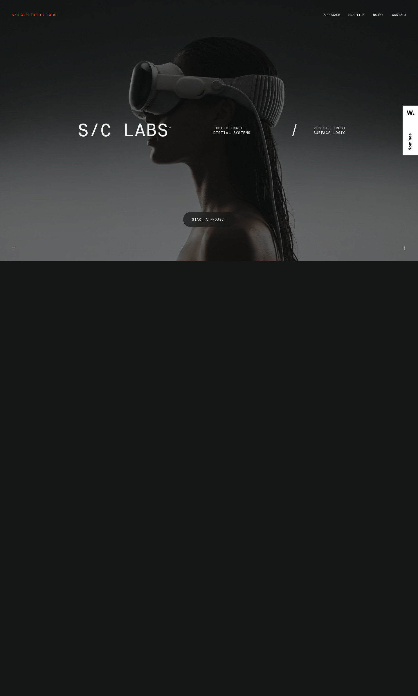
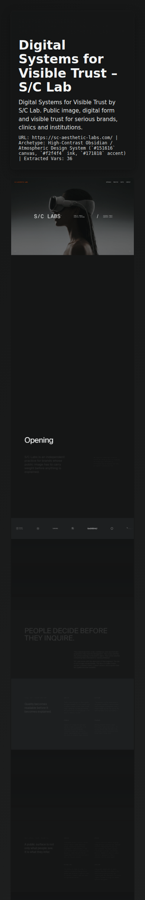

# UI Design System & Master Generation Blueprint: sc-aesthetic-labs-com

> **Digital Systems for Visible Trust – S/C Lab** (https://sc-aesthetic-labs.com/) — Digital Systems for Visible Trust by S/C Lab. Public image, digital form and visible trust for serious brands, clinics and institutions.



---

## 1. Executive Visual Persona & Design Archetype

- **Brand Essence & Persona**: **Digital Systems for Visible Trust – S/C Lab** (`https://sc-aesthetic-labs.com/`). Digital Systems for Visible Trust by S/C Lab. Public image, digital form and visible trust for serious brands, clinics and institutions.
- **Visual Archetype**: **High-Contrast Obsidian / Atmospheric Design System (`#151616` canvas, `#f2f4f4` ink, `#171818` accent)**.
- **Anti-AI-Slop Differentiators**:
  - **Source-Grounded Chromatic Polarity**: Anchors the viewport in `#151616` (`var(--paper)` in `:root`) paired with `#f2f4f4` primary typography and `#171818` accents.
  - **Extracted Typographic Hierarchy**: Pairs `AL Suisse` for display copy (`S/C Labs TM`) with `AL Mono` and `AL Mono`.
  - **Calibrated Spatial Grid & Motion**: Combines `var(--max)` container bounds (`gap: var(--gutter)`, padding `43px`) with `cubic-bezier(0.16,1,0.3,1)` easing.

---

## 2. Spatial Architecture & Modular Grid Mathematics



### Viewport Allocation & Container Geometry
- **Captured Viewport Dimensions**: Desktop `1440×15601px` (`assets/desktop.png`, full-page scroll capture), Mobile `390×2400px` (`assets/mobile.png`, capped at 2400px multi-section capture).
- **Master Container Bounds**: `var(--max)` extracted from `sc-aesthetic-labs-com` stylesheet.
- **Canvas Lateral Padding & Spacing**: `43px` lateral canvas padding with `var(--gutter)` grid gap.
- **Border Radius Scale**: `50%`.

### Responsive Breakpoint Architecture
- **Desktop Layout**: Multi-column CSS Grid / Flexbox layout at `1440px` (`max-width: var(--max)`, `gap: var(--gutter)`).
- **Mobile Layout**: Single-column vertical stack at `390px` viewport width with `43px` horizontal padding.
- **Extracted CSS Media Queries**: `@media (prefers-reduced-motion: reduce)`, `@media (max-width: 1100px)`, `@media (max-width: 720px)`, `@media (max-width: 767px)`.

---

## 3. Color System, Materiality & Atmospheric Lighting

### Semantic Palette & Source Grounding
| Semantic Role | Ground-Truth Value | Extracted CSS Source / Selector |
|---|---|---|
| **Primary Canvas Substrate** | `#151616` | `var(--paper)` in `:root` |
| **Primary Typography Ink** | `#f2f4f4` | `var(--white)` in `:root` |
| **Elevated Surface / Card Substrate** | `#1d1f1f` | `var(--off)` in `:root` |
| **Interactive Accent / Highlight** | `#171818` | `var(--soft)` in `:root` |
| **Secondary / Muted Copy** | `#1d1f20` | `var(--soft-2)` in `:root` |
| **Structural Hairline Border** | `#FF4D00` | `var(--accent)` in `:root` |

### Sanitized Root CSS Variables (`ui-ux.md` Ground Truth)
| Variable Name | Extracted Value | Semantic Role |
|---|---|---|
| `--paper` | `#151616` | Canvas / Surface Token |
| `--ink` | `#151616` | Typography Ink Token |
| `--white` | `#f2f4f4` | Canvas / Surface Token |
| `--off` | `#1d1f1f` | Color / Atmospheric Token |
| `--soft` | `#171818` | Color / Atmospheric Token |
| `--soft-2` | `#1d1f20` | Color / Atmospheric Token |
| `--line-dark` | `rgba(247, 248, 248, 0.18)` | Canvas / Surface Token |
| `--accent` | `#FF4D00` | Brand / Palette Token |
| `--edge` | `40px` | Dimension / Scale Token |
| `--gutter` | `30px` | Layout / Spatial Grid Token |
| `--max` | `1760px` | Dimension / Scale Token |
| `--font` | `"AL Suisse", "Helvetica Neue", Arial, sans-serif` | Typography / Scale Token |
| `--mono` | `"AL Mono", "SFMono-Regular", Consolas, monospace` | Typography / Scale Token |
| `--tight` | `-0.025em` | Dimension / Scale Token |
| `--image-matte-top` | `rgba(18, 19, 20, 0.18)` | Color / Atmospheric Token |
| `--image-matte-bottom` | `rgba(18, 19, 20, 0.42)` | Color / Atmospheric Token |

---

## 4. Typographic Scale & Editorial Hierarchy

### Font Family Stacks
- **Display Typography**: `AL Suisse`.
- **Primary Body Stack**: `AL Mono`.
- **Technical / Metadata Stack**: `AL Mono`.

### Typographic Scale & Rules (Extracted from Stylesheet & Variables)
- **Hero Display (`H1`)**: CSS variables `--hero-title-opacity: 0`, `--hero-title-y: 32px`, `--hero-title-blur: 0px`; rule `h1` (`font-size: clamp(48px, 5.6vw, 104px)`, `line-height: 1.02`, `letter-spacing: -0.02em`, `font-weight: 400`).
- **Section Heading (`H2`)**: rule `h2` (`font-size: clamp(30px, 2.45vw, 48px)`, `line-height: 1.12`, `font-weight: 400`).
- **Body Copy**: rule `body` (`font-weight: 400`).
- **Metadata & Navigation Labels**: CSS variables `--mono: "AL Mono", "SFMono-Regular", Consolas, monospace`, `--hero-label-y: 0px`, `--hero-label-opacity: 1`; rule `.mono` (`font-size: 12px`, `line-height: 16px`, `letter-spacing: 0`, `font-weight: 400`).

---

## 5. Choreographed Motion & Interaction Physics

### Primary Easing Curves
- **Extracted Timing Functions**: `cubic-bezier(0.16,1,0.3,1)`, `cubic-bezier(0.19,1,0.22,1)`.

### Per-Element Transition & Choreography Rules
- **Selector `.poster-mark`**: `transition: opacity 260ms ease, transform 260ms ease` extracted from `sc-aesthetic-labs-com` stylesheet.
- **Selector `.scroll-video-hero .hero-sticky::...`**: `transition: opacity 80ms linear` extracted from `sc-aesthetic-labs-com` stylesheet.
- **Selector `eo-hero .page-hero-media .hero-fr...`**: `transition: opacity 120ms linear` extracted from `sc-aesthetic-labs-com` stylesheet.
- **Extracted Easing Curve (`cubic-bezier(0.16,1,0.3,1)`)**: Governs interactive state transitions across `<header.page-hero>` and `<article.what-col>`.
- **State & Hover Choreography**: Opacity and transform transitions on `<section.what-grid>` and `<article.what-col>` interactive targets.

---

## 6. Component Wireframe & Structural DOM Map

### Visual Layout Schematic (Grounded in `dom.html` — `1440px` Desktop & `390px` Mobile Reflow)
```
┌────────────────────────────────────────────────────────────────────────┐
│ DESKTOP VIEWPORT (1440px) — Digital Systems for Visible Trust – S/C La │
│ ====================================================================== │
│ [ <header.page-hero>       | S/C Aesthetic Labs · Approach · Practi ]  │
│ ---------------------------------------------------------------------- │
│ | HERO STAGE: <section.what-grid>                                  |   │
│ | H1: S/C Labs TM                                                  |   │
│ | Substrate: #151616    | Ink: #f2f4f4    | Accent: #171818        |   │
│ ---------------------------------------------------------------------- │
│ | SHOWCASE GRID (<article.what-col>        ) max-w: var(--max)     |   │
│ | +------------------------------+  +------------------------------+ | │
│ | | Opening                      |  | Public Image                 | | │
│ | +------------------------------+  +------------------------------+ | │
│ ---------------------------------------------------------------------- │
│ | MOBILE VIEWPORT REFLOW (390px) — Single-Column Stack (gap: var(--) | │
│ | [<header.page-hero>] -> [<section.what-grid] -> [<article.what-col>] │
│ ---------------------------------------------------------------------- │
│ [ FOOTER (<footer.footer>       ) | https://sc-aesthetic-labs.com/     │
└────────────────────────────────────────────────────────────────────────┘
```

### Granular DOM Region Breakdown
1. **Brand Header & Navigation Bar (<header.page-hero> — `sc-aesthetic-labs-com`)**:
   - Landmark `<header class="page-hero poster-hero">` hosting `Digital Systems for Visible Trust – ` navigation (`S/C Aesthetic Labs · Approach · Practice · Notes · Contact`), DOM attributes (`data-final-text="S/C Aesthetic Labs"`, `data-final-text="Approach"`, `data-final-text="Practice"`, `data-final-text="Notes"`), and stylesheet rule `body { margin: 0; background: var(--paper); color: var(--white); font-weight: 4... }`.
2. **Hero Stage & Focal Lead (<section.what-grid> — `S/C Labs TM`)**:
   - Landmark `<section class="what-grid tone-graphite">` presenting display lead `S/C Labs TM` and copy excerpt *"S/C Aesthetic Labs"* over `#151616` canvas and `#f2f4f4` ink.
3. **Primary Showcase & Content Grid (<article.what-col> — `Opening`)**:
   - Landmark `<article class="what-col">` rendering section `Opening` with copy *"Public Image Digital Systems"*, asset references (`favicon.svg`, `favicon.ico`, `apple-touch-icon.png`, `site.css`), and grid rule `textarea { font-weight: 400; }`.
4. **Interactive Detail & Feature Matrix (<article.what-col> — `Public Image`)**:
   - Landmark `<article class="what-col">` framing `Public Image` and `Digital Form` (*"Visible Trust Surface Logic"*) with `#1d1f1f` surface cards, `#171818` accents, and `img { display: block; width: 100%; height: 100%; object-fit: cover; }`.
5. **Colophon & Global Directory Footer (<footer.footer> — `https://sc-aesthetic-labs.com/`)**:
   - Landmark `<footer class="footer">` anchoring `Digital Systems for Visible Trus` footer links (`S/C Aesthetic Labs · Approach · Practice · Notes · Contact`), copy *"S/C Labs is an independent practice for brands whose public "*, and `#FF4D00` structural dividers.

---

## 7. Master Zero-Shot AI Generation Prompt

```markdown
# Master Zero-Shot Frontend Generation Prompt: sc-aesthetic-labs-com (Digital Systems for Visible Trust – S/C Lab)

You are a principal frontend architect and design systems engineer. Build a complete, production-ready web application replicating the exact design system, DOM landmarks, typographic hierarchy, color tokens, and motion physics of `sc-aesthetic-labs-com` (**Digital Systems for Visible Trust – S/C Lab** — `https://sc-aesthetic-labs.com/`).

### 1. Visual Archetype & Anti-AI-Slop Mandates
- **Archetype**: High-Contrast Obsidian / Atmospheric Design System (`#151616` canvas, `#f2f4f4` ink, `#171818` accent).
- **Identity & Domain Context**: Digital Systems for Visible Trust by S/C Lab. Public image, digital form and visible trust for serious brands, clinics and institutions.
- **Primary Substrate**: `#151616` (`var(--paper)` in `:root`), **Primary Ink**: `#f2f4f4`, **Accent / Highlight**: `#171818`.
- **Site-Specific Differentiators**:
  - **Source-Grounded Chromatic Polarity**: Anchors the viewport in `#151616` (`var(--paper)` in `:root`) paired with `#f2f4f4` primary typography and `#171818` accents.
  - **Extracted Typographic Hierarchy**: Pairs `AL Suisse` for display copy (`S/C Labs TM`) with `AL Mono` and `AL Mono`.
  - **Calibrated Spatial Grid & Motion**: Combines `var(--max)` container bounds (`gap: var(--gutter)`, padding `43px`) with `cubic-bezier(0.16,1,0.3,1)` easing.

### 2. Ground-Truth CSS Variables (`:root` Token Contract)
Declare and consume these exact custom properties extracted from `sc-aesthetic-labs-com` in your global stylesheet:

:root {
  /* Digital Systems for Visible Trust – S/C Lab (sc-aesthetic-labs-com) — Ground-Truth Extracted CSS Variables */
  --paper: #151616; /* Canvas / Surface Token (sc-aesthetic-labs-com) */
  --ink: #151616; /* Typography Ink Token (sc-aesthetic-labs-com) */
  --white: #f2f4f4; /* Canvas / Surface Token (sc-aesthetic-labs-com) */
  --off: #1d1f1f; /* Color / Atmospheric Token (sc-aesthetic-labs-com) */
  --soft: #171818; /* Color / Atmospheric Token (sc-aesthetic-labs-com) */
  --soft-2: #1d1f20; /* Color / Atmospheric Token (sc-aesthetic-labs-com) */
  --line-dark: rgba(247, 248, 248, 0.18); /* Canvas / Surface Token (sc-aesthetic-labs-com) */
  --accent: #FF4D00; /* Brand / Palette Token (sc-aesthetic-labs-com) */
  --edge: 40px; /* Dimension / Scale Token (sc-aesthetic-labs-com) */
  --gutter: 30px; /* Layout / Spatial Grid Token (sc-aesthetic-labs-com) */
  --max: 1760px; /* Dimension / Scale Token (sc-aesthetic-labs-com) */
  --font: "AL Suisse", "Helvetica Neue", Arial, sans-serif; /* Typography / Scale Token (sc-aesthetic-labs-com) */
  --mono: "AL Mono", "SFMono-Regular", Consolas, monospace; /* Typography / Scale Token (sc-aesthetic-labs-com) */
  --tight: -0.025em; /* Dimension / Scale Token (sc-aesthetic-labs-com) */
  --image-matte-top: rgba(18, 19, 20, 0.18); /* Color / Atmospheric Token (sc-aesthetic-labs-com) */
  --image-matte-bottom: rgba(18, 19, 20, 0.42); /* Color / Atmospheric Token (sc-aesthetic-labs-com) */
}

### 3. Semantic Color & Materiality Contract
Map every surface, ink, and border strictly to these source-grounded tokens:
- **Primary Canvas Substrate**: `#151616` — grounded in `var(--paper)` in `:root`
- **Primary Typography Ink**: `#f2f4f4` — grounded in `var(--white)` in `:root`
- **Elevated Surface / Card Substrate**: `#1d1f1f` — grounded in `var(--off)` in `:root`
- **Interactive Accent / Highlight**: `#171818` — grounded in `var(--soft)` in `:root`
- **Secondary / Muted Copy**: `#1d1f20` — grounded in `var(--soft-2)` in `:root`
- **Structural Hairline Border**: `#FF4D00` — grounded in `var(--accent)` in `:root`

### 4. Spatial Grid, Container Bounds & Responsive Breakpoints
- **Desktop Viewport Reference**: `1440×15601px` (full-page scroll capture, `1440px` standard desktop width).
- **Mobile Viewport Reference**: `390×2400px` (capped at 2400px multi-section capture, `390px` standard mobile width).
- **Container Max-Width**: `var(--max)` extracted from `sc-aesthetic-labs-com` stylesheet
- **Padding & Gutters**: `43px` lateral canvas padding with `var(--gutter)` grid gap
- **Desktop Grid**: Multi-column CSS Grid / Flexbox layout at `1440px` (`max-width: var(--max)`, `gap: var(--gutter)`)
- **Mobile Adaptation**: Single-column vertical stack at `390px` viewport width with `43px` horizontal padding
- **Media Queries**: `@media (prefers-reduced-motion: reduce)`, `@media (max-width: 1100px)`, `@media (max-width: 720px)`, `@media (max-width: 767px)`
- **Corner Radii**: `50%`

### 5. Typography & Editorial Scale Contract
- **Display Font Stack**: `AL Suisse`
- **Body Font Stack**: `AL Mono`
- **Monospace / Technical Font Stack**: `AL Mono`
- **H1 Display Rule**: CSS variables `--hero-title-opacity: 0`, `--hero-title-y: 32px`, `--hero-title-blur: 0px`; rule `h1` (`font-size: clamp(48px, 5.6vw, 104px)`, `line-height: 1.02`, `letter-spacing: -0.02em`, `font-weight: 400`)
- **H2 Section Rule**: rule `h2` (`font-size: clamp(30px, 2.45vw, 48px)`, `line-height: 1.12`, `font-weight: 400`)
- **Body Copy Rule**: rule `body` (`font-weight: 400`)
- **Metadata & Index Rule**: CSS variables `--mono: "AL Mono", "SFMono-Regular", Consolas, monospace`, `--hero-label-y: 0px`, `--hero-label-opacity: 1`; rule `.mono` (`font-size: 12px`, `line-height: 16px`, `letter-spacing: 0`, `font-weight: 400`)

### 6. Component Hierarchy, Verbatim Copy & Real DOM Landmarks
Scaffold `sc-aesthetic-labs-com` (`Digital Systems for Visible Trust – S/C Lab`) with these exact structural regions, extracted copy, and CSS rules from `dom.html`:
1. **Brand Header & Navigation Bar (<header.page-hero> — `sc-aesthetic-labs-com`)**:
   - DOM & Selectors: Landmark `<header class="page-hero poster-hero">` hosting `Digital Systems for Visible Trust – ` navigation (`S/C Aesthetic Labs · Approach · Practice · Notes · Contact`), DOM attributes (`data-final-text="S/C Aesthetic Labs"`, `data-final-text="Approach"`, `data-final-text="Practice"`, `data-final-text="Notes"`), and stylesheet rule `body { margin: 0; background: var(--paper); color: var(--white); font-weight: 4... }`.
   - Responsive Contract: Header `Brand Header & Navigation Bar (<header.page-hero> — `sc-aesthetic-labs-com`)` (`sc-aesthetic-labs-com`) adapts across `@media (prefers-reduced-motion: reduce)`, `@media (max-width: 1100px)`, `@media (max-width: 720px)`, `@media (max-width: 767px)` with `cubic-bezier(0.16,1,0.3,1)`, `cubic-bezier(0.19,1,0.22,1)` transitions and links `S/C Aesthetic Labs · Approach · Practice · Notes · Contact`.
2. **Hero Stage & Focal Lead (<section.what-grid> — `S/C Labs TM`)**:
   - DOM & Selectors: Landmark `<section class="what-grid tone-graphite">` presenting display lead `S/C Labs TM` and copy excerpt *"S/C Aesthetic Labs"* over `#151616` canvas and `#f2f4f4` ink.
   - Responsive Contract: Hero stage (`1440×15601px` desktop / `390×2400px` mobile) sets `#151616` background with `#f2f4f4` headline `S/C Labs TM`.
3. **Primary Showcase & Content Grid (<article.what-col> — `Opening`)**:
   - DOM & Selectors: Landmark `<article class="what-col">` rendering section `Opening` with copy *"Public Image Digital Systems"*, asset references (`favicon.svg`, `favicon.ico`, `apple-touch-icon.png`, `site.css`), and grid rule `textarea { font-weight: 400; }`.
   - Responsive Contract: Showcase grid `Primary Showcase & Content Grid (<article.what-col> — `Opening`)` applies Multi-column CSS Grid / Flexbox layout at `1440px` (`max-width: var(--max)`, `gap: var(--gutter)`) on desktop and Single-column vertical stack at `390px` viewport width with `43px` horizontal padding on mobile.
4. **Interactive Detail & Feature Matrix (<article.what-col> — `Public Image`)**:
   - DOM & Selectors: Landmark `<article class="what-col">` framing `Public Image` and `Digital Form` (*"Visible Trust Surface Logic"*) with `#1d1f1f` surface cards, `#171818` accents, and `img { display: block; width: 100%; height: 100%; object-fit: cover; }`.
   - Responsive Contract: Detail module `Interactive Detail & Feature Matrix (<article.what-col> — `Public Image`)` uses `50%` radii, `#171818` highlights, and assets (favicon.svg, favicon.ico, apple-touch-icon.png).
5. **Colophon & Global Directory Footer (<footer.footer> — `https://sc-aesthetic-labs.com/`)**:
   - DOM & Selectors: Landmark `<footer class="footer">` anchoring `Digital Systems for Visible Trus` footer links (`S/C Aesthetic Labs · Approach · Practice · Notes · Contact`), copy *"S/C Labs is an independent practice for brands whose public "*, and `#FF4D00` structural dividers.
   - Responsive Contract: Footer `Colophon & Global Directory Footer (<footer.footer> — `https://sc-aesthetic-labs.com/`)` aligns to `var(--max)` extracted from `sc-aesthetic-labs-com` stylesheet with `43px` lateral canvas padding with `var(--gutter)` grid gap and attributes (data-final-text="S/C Aesthetic Labs", data-final-text="Approach", data-final-text="Practice").

#### Verbatim DOM Copy Excerpts (`dom.html`)
- Copy Excerpt 1: *"S/C Aesthetic Labs"*
- Copy Excerpt 2: *"Public Image Digital Systems"*
- Copy Excerpt 3: *"Visible Trust Surface Logic"*
- Copy Excerpt 4: *"S/C Labs is an independent practice for brands whose public image has to carry wei..."*

### 7. Motion, Extracted Stylesheet Rules & Interaction Choreography
- **Primary Easing Functions**: `cubic-bezier(0.16,1,0.3,1)`, `cubic-bezier(0.19,1,0.22,1)`
- **Extracted Stylesheet Rules (`sc-aesthetic-labs-com`)**:
- `body { margin: 0; background: var(--paper); color: var(--white); font-weight: 4... }`
- `textarea { font-weight: 400; }`
- `img { display: block; width: 100%; height: 100%; object-fit: cover; }`
- `.body { margin: 0; font-size: 19px; line-height: 1.22; font-weight: 400; letter-... }`
- `.micro { margin: 0; font-size: 15px; line-height: 24px; font-weight: 400; letter-... }`
- **Per-Selector Transition Rules**:
- **Selector `.poster-mark`**: `transition: opacity 260ms ease, transform 260ms ease` extracted from `sc-aesthetic-labs-com` stylesheet.
- **Selector `.scroll-video-hero .hero-sticky::...`**: `transition: opacity 80ms linear` extracted from `sc-aesthetic-labs-com` stylesheet.
- **Selector `eo-hero .page-hero-media .hero-fr...`**: `transition: opacity 120ms linear` extracted from `sc-aesthetic-labs-com` stylesheet.
- **Extracted Easing Curve (`cubic-bezier(0.16,1,0.3,1)`)**: Governs interactive state transitions across `<header.page-hero>` and `<article.what-col>`.
- **State & Hover Choreography**: Opacity and transform transitions on `<section.what-grid>` and `<article.what-col>` interactive targets.

### 8. Technical Deliverables
- Implement in Next.js (App Router) with TypeScript and Tailwind CSS consuming the `:root` custom properties defined above for `sc-aesthetic-labs-com`.
- Reproduce both the `1440px` desktop architecture and `390px` mobile breakpoint transitions, preserving semantic HTML5 landmarks (`<header>`, `<nav>`, `<main>`, `<section>`, `<footer>`) and `prefers-reduced-motion` accessibility guards.
```
