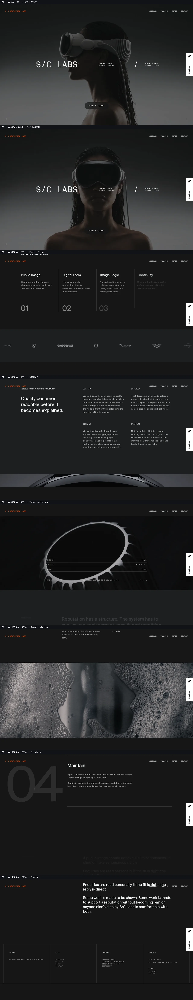
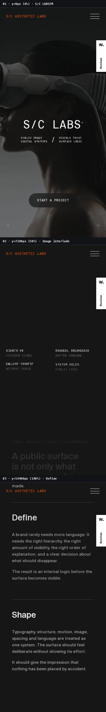

# UI Design System & Master Generation Blueprint: sc-aesthetic-labs-com

> **Digital Systems for Visible Trust – S/C Lab** (https://sc-aesthetic-labs.com/) — Digital Systems for Visible Trust by S/C Lab. Public image, digital form and visible trust for serious brands, clinics and institutions.





---

## 1. Executive Visual Persona & Design Archetype

- **Brand Essence & Persona**: **Digital Systems for Visible Trust – S/C Lab** (`https://sc-aesthetic-labs.com/`). Digital Systems for Visible Trust by S/C Lab. Public image, digital form and visible trust for serious brands, clinics and institutions.
- **Capture Provenance**: Live browser capture (`tier1_fast`, HTTP `200`, captured `2026-11-24`).
- **Visual Archetype**: **High-Contrast Obsidian / Atmospheric Design System (`#151616` canvas, `#f2f4f4` ink, `#ff4d00` accent)**.
- **Anti-AI-Slop Differentiators**:
  - **Live-Computed Chromatic Polarity**: Anchors the viewport in `#151616` (live computed `body` `background-color` (`computed_styles.json`)) paired with `#f2f4f4` primary typography and `#ff4d00` accents.
  - **Grounded Typographic Hierarchy**: Pairs `AL Mono` for display copy (`S/C LABSTM`) with `AL Suisse` and `AL Mono`.
  - **Calibrated Spatial Grid & Motion**: Combines `1440px` container bounds (`gap: var(--gutter)`, padding `43px`) with `cubic-bezier(0.16,1,0.3,1)` easing.

---

## 2. Spatial Architecture & Modular Grid Mathematics

### Viewport Allocation & Container Geometry
- **Captured Journey Filmstrips**: Desktop `1280×6624px` (`assets/desktop-journey.webp`, `8` keyframes up to `y=14400px` / doc `15597px`), Mobile `390×2616px` (`assets/mobile-journey.webp`, `3` keyframes).
- **Master Container Bounds**: `1440px` (full-bleed `100%` desktop stage measured on `1440px` viewport).
- **Canvas Lateral Padding & Spacing**: `43px` lateral canvas padding with `var(--gutter)` grid gap.
- **Border Radius Scale**: `50%`, `999px`.

### Responsive Breakpoint Architecture
- **Desktop Layout**: Multi-column CSS Grid / Flexbox layout at `1440px` (`max-width: 1440px`, `gap: var(--gutter)`).
- **Mobile Layout**: Single-column vertical stack at `390px` viewport width with `43px` horizontal padding.
- **Extracted CSS Media Queries**: `@media (prefers-reduced-motion: reduce)`, `@media (max-width: 1100px)`, `@media (max-width: 720px)`, `@media (max-width: 767px)`.

---

## 3. Color System, Materiality & Atmospheric Lighting

### Semantic Palette & Source Grounding
| Semantic Role | Ground-Truth Value | Extracted Live / CSS Source |
|---|---|---|
| **Primary Canvas Substrate** | `#151616` | live computed `body` `background-color` (`computed_styles.json`) |
| **Primary Typography Ink** | `#f2f4f4` | live computed `h1` `color` (`computed_styles.json`) |
| **Elevated Surface / Card Substrate** | `#696967` | `.type33-dots span { background: #696967 }` |
| **Interactive Accent / Highlight** | `#ff4d00` | live computed `a` `color` (`computed_styles.json`) |
| **Secondary / Muted Copy** | `#ff4d00` | live computed `a` `color` (`computed_styles.json`) |
| **Structural Hairline Border** | `#3e3f3f` | `var(--line-dark)` in `:root` (`rgba(247, 248, 248, 0.18)`) |
| **Variable Token (`--off`)** | `#1d1f1f` | `var(--off)` in `:root` |
| **Variable Token (`--soft`)** | `#171818` | `var(--soft)` in `:root` |
| **Variable Token (`--soft-2`)** | `#1d1f20` | `var(--soft-2)` in `:root` |

### Sanitized Root CSS Variables (`ui-ux.md` Ground Truth)
| Variable Name | Extracted Value | Semantic Role |
|---|---|---|
| `--paper` | `#151616` | Canvas / Surface Token |
| `--ink` | `#151616` | Typography Ink Token |
| `--white` | `#f2f4f4` | Canvas / Surface Token |
| `--off` | `#1d1f1f` | Color / Atmospheric Token |
| `--soft` | `#171818` | Color / Atmospheric Token |
| `--soft-2` | `#1d1f20` | Color / Atmospheric Token |
| `--line-dark` | `rgba(247, 248, 248, 0.18)` | Canvas / Surface Token |
| `--accent` | `#FF4D00` | Brand / Palette Token |
| `--edge` | `40px` | Dimension / Scale Token |
| `--gutter` | `30px` | Layout / Spatial Grid Token |
| `--max` | `1760px` | Dimension / Scale Token |
| `--font` | `"AL Suisse", "Helvetica Neue", Arial, sans-serif` | Typography / Scale Token |
| `--mono` | `"AL Mono", "SFMono-Regular", Consolas, monospace` | Typography / Scale Token |
| `--tight` | `-0.025em` | Dimension / Scale Token |
| `--image-matte-top` | `rgba(18, 19, 20, 0.18)` | Color / Atmospheric Token |
| `--image-matte-bottom` | `rgba(18, 19, 20, 0.42)` | Color / Atmospheric Token |

---

## 4. Typographic Scale & Editorial Hierarchy

### Font Family Stacks
- **Display Typography**: `AL Mono`.
- **Primary Body Stack**: `AL Suisse`.
- **Technical / Metadata Stack**: `AL Mono`.

### Typographic Scale & Rules (Live Computed & Stylesheet Grounded)
- **Hero Display (`H1`)**: live computed `h1` (`font-size: 60.48px`, `line-height: 60.48px`, `font-weight: 400`); CSS variables `--hero-title-opacity: 0`, `--hero-title-y: 32px`, `--hero-title-blur: 0px`; rule `h1` (`font-size: clamp(48px, 5.6vw, 104px)`, `line-height: 1.02`, `letter-spacing: -0.02em`, `font-weight: 400`).
- **Section Heading (`H2`)**: live computed `h2` (`font-size: 89.28px`, `line-height: 91.0656px`, `font-weight: 400`, `letter-spacing: -2.232px`); rule `h2` (`font-size: clamp(30px, 2.45vw, 48px)`, `line-height: 1.12`, `font-weight: 400`).
- **Body Copy**: live computed `body` (`font-size: 16px`, `line-height: normal`, `font-weight: 400`); rule `body` (`font-weight: 400`).
- **Metadata & Navigation Labels**: live computed `nav/a` (`font-size: 16px`, `line-height: normal`, `font-weight: 400`); CSS variables `--mono: "AL Mono", "SFMono-Regular", Consolas, monospace`, `--hero-label-y: 0px`, `--hero-label-opacity: 1`; rule `.mono` (`font-size: 12px`, `line-height: 16px`, `letter-spacing: 0`, `font-weight: 400`).

---

## 5. Choreographed Motion & Interaction Physics

### Primary Easing Curves
- **Extracted Timing Functions**: `cubic-bezier(0.16,1,0.3,1)`, `cubic-bezier(0.19,1,0.22,1)`.

### Per-Element Transition & Choreography Rules
- **Selector `.poster-mark`**: `transition: opacity 260ms ease, transform 260ms ease` extracted from `sc-aesthetic-labs-com` stylesheet.
- **Selector `.scroll-video-hero .hero-sticky::...`**: `transition: opacity 80ms linear` extracted from `sc-aesthetic-labs-com` stylesheet.
- **Selector `eo-hero .page-hero-media .hero-fr...`**: `transition: opacity 120ms linear` extracted from `sc-aesthetic-labs-com` stylesheet.
- **Extracted Easing Curve (`cubic-bezier(0.16,1,0.3,1)`)**: Governs interactive state transitions across `<header.page-hero>` and `<article.what-col>`.
- **State & Hover Choreography**: Opacity and transform transitions on `<section.what-grid>` and `<article.what-col>` interactive targets.
### Measured Runtime Scroll & Interaction Telemetry (`behavioral_journey_v2`)
- **Scroll Driver Mode**: `native` (max document height `15597px`, deepest scrollY reached `14400px` across `8` desktop keyframes).
- **Detected Scroll / Motion Libraries**: Native browser scroll / standard CSS transitions.
- **Hover Physics (`primary_cta` · `START A PROJECT`)**: Computed transition `0s` / `ease` (no static color/transform shift captured at rest).
- **Route Transition Architecture**: First internal navigation (`/contact.html`) measured as `MPA` in `1134ms`.

---

## 6. Component Wireframe & Structural DOM Map

### Visual Layout Schematic — Desktop (`1440px`, Grounded in `dom.html` & Landmark Bounding Boxes)
```
┌────────────────────────────────────────────────────────────────────────┐
│ DESKTOP VIEWPORT (1440px) — Digital Systems for Visible Trust – S/C La │
│ ====================================================================== │
│ [ <header.page-hero> (1440x2880px)    | S/C Aesthetic Labs · Approac ] │
│ ---------------------------------------------------------------------- │
│ | HERO STAGE: <section.what-grid> (w=1440px)                         | │
│ | H1: S/C LABSTM                                                     | │
│ | Substrate: #151616 | Ink: #f2f4f4 | Accent: #ff4d00                | │
│ ---------------------------------------------------------------------- │
│ | SHOWCASE GRID (<article.what-col>) max-w: 1440px                   | │
│ | +------------------------------+  +------------------------------+ | │
│ | | S/C Labs TM                  |  | Public Image                 | | │
│ | +------------------------------+  +------------------------------+ | │
│ ---------------------------------------------------------------------- │
│ | DETAIL MODULE (<article.what-col:nth(2)>) — Digital Form           | │
│ ---------------------------------------------------------------------- │
│ [ FOOTER (<footer.footer>     ) | https://sc-aesthetic-labs.com/       │
└────────────────────────────────────────────────────────────────────────┘
```

### Visual Layout Schematic — Mobile Reflow (`390px`)
```
┌────────────────────────────────────────────────────────────────────────┐
│ MOBILE VIEWPORT REFLOW (390px) — Single-Column Stack (gap: var(--gu)   │
│ ====================================================================== │
│ [ HEADER BAR (<header.page-hero>      ) | Compact Menu (390px)         │
│ ---------------------------------------------------------------------- │
│ | HERO STAGE (<section.what-grid>) — 390px Vertical Lead             | │
│ | H1: S/C LABSTM                                                     | │
│ ---------------------------------------------------------------------- │
│ | SHOWCASE STACK (<article.what-col>) — 1-Col Stack                  | │
│ | [ Item 1: S/C Labs TM                                            ] | │
│ | [ Item 2: Public Image                                           ] | │
│ ---------------------------------------------------------------------- │
│ | DETAIL STACK (<article.what-col:nth(2)) — 1-Col (Digital Form)     | │
│ ---------------------------------------------------------------------- │
│ [ FOOTER (<footer.footer>     ) | Stacked 390px Colophon               │
└────────────────────────────────────────────────────────────────────────┘
```

### Granular DOM Region Breakdown
1. **Brand Header & Navigation Bar (<header.page-hero> — `sc-aesthetic-labs-com`)**:
   - Landmark `<header class="page-hero poster-hero">` (`1440x2880px`) hosting `Digital Systems for Visible Trust – ` navigation (`S/C Aesthetic Labs · Approach · Practice · Notes · Contact`), DOM attributes (`data-final-text="S/C Aesthetic Labs"`, `data-final-text="Approach"`, `data-final-text="Practice"`, `data-final-text="Notes"`), and stylesheet rule `body { margin: 0; background: var(--paper); color: var(--white); font-weight: 4... }`.
2. **Hero Stage & Focal Lead (<section.what-grid> — `S/C LABSTM`)**:
   - Landmark `<section class="what-grid tone-graphite">` presenting display lead `S/C LABSTM` and copy excerpt *"S/C Aesthetic Labs designs identities, websites and digital exper"* over `#151616` canvas and `#f2f4f4` ink.
3. **Primary Showcase & Content Grid (<article.what-col> — `S/C Labs TM`)**:
   - Landmark `<article class="what-col">` rendering section `S/C Labs TM` with copy *"Public Image Digital Systems"*, asset references (`favicon.svg`, `favicon.ico`, `apple-touch-icon.png`, `site.css`), and grid rule `textarea { font-weight: 400; }`.
4. **Interactive Detail & Feature Matrix (<article.what-col:nth(2)> — `Public Image`)**:
   - Landmark `<article class="what-col">` framing `Public Image` and `Digital Form` (*"Visible Trust Surface Logic"*) with `#696967` surface cards, `#ff4d00` accents, and `img { display: block; width: 100%; height: 100%; object-fit: cover; }`.
5. **Colophon & Global Directory Footer (<footer.footer> — `https://sc-aesthetic-labs.com/`)**:
   - Landmark `<footer class="footer">` anchoring `Digital Systems for Visible Trus` footer links (`S/C Aesthetic Labs · Approach · Practice · Notes · Contact`), copy *"Each project takes the shape the brand needs. Discuss a proj"*, and `#3e3f3f` structural dividers.
### Full Vertical Scroll Sequence (Desktop `1440×900` Keyframes)
- **Step 01** (`y=0px`, `0%`): Active landmark `S/C LABSTM` · sticky/fixed elements: `7`
- **Step 02** (`y=850px`, `6%`): Active landmark `S/C LABSTM` · sticky/fixed elements: `7`
- **Step 03** (`y=3400px`, `23%`): Active landmark `Public Image` · sticky/fixed elements: `6`
- **Step 04** (`y=5950px`, `40%`): Active landmark `SIGNALS` · sticky/fixed elements: `6`
- **Step 05** (`y=8500px`, `58%`): Active landmark `Image interlude` · sticky/fixed elements: `6`
- **Step 06** (`y=11050px`, `75%`): Active landmark `Image interlude` · sticky/fixed elements: `6`
- **Step 07** (`y=13600px`, `93%`): Active landmark `Maintain` · sticky/fixed elements: `7`
- **Step 08** (`y=14400px`, `98%`): Active landmark `Footer` · sticky/fixed elements: `6`

### Multi-Page Internal Route Map
- **Other Route (`/contact.html`)**: `https://sc-aesthetic-labs.com/contact.html?v=20261114b` — H1: `WRITE PLAINLY.`, scrollHeight `4672px`, transition `MPA` (`1134ms`)
- **Other Route (`/index.html`)**: `https://sc-aesthetic-labs.com/index.html` — H1: `S/C LABSTM`, scrollHeight `15597px`, transition `direct` (`441ms`)
- **Other Route (`/approach.html`)**: `https://sc-aesthetic-labs.com/approach.html` — H1: `THE SYSTEM BEGINS.`, scrollHeight `10873px`, transition `direct` (`329ms`)

---

## 7. Master Zero-Shot AI Generation Prompt

```markdown
# Master Zero-Shot Frontend Generation Prompt: sc-aesthetic-labs-com (Digital Systems for Visible Trust – S/C Lab)

You are a principal frontend architect and design systems engineer. Build a complete, production-ready web application replicating the exact design system, DOM landmarks, typographic hierarchy, color tokens, and motion physics of `sc-aesthetic-labs-com` (**Digital Systems for Visible Trust – S/C Lab** — `https://sc-aesthetic-labs.com/`).

### 1. Visual Archetype & Anti-AI-Slop Mandates
- **Archetype**: High-Contrast Obsidian / Atmospheric Design System (`#151616` canvas, `#f2f4f4` ink, `#ff4d00` accent).
- **Identity & Domain Context**: Digital Systems for Visible Trust by S/C Lab. Public image, digital form and visible trust for serious brands, clinics and institutions.
- **Primary Substrate**: `#151616` (live computed `body` `background-color` (`computed_styles.json`)), **Primary Ink**: `#f2f4f4`, **Accent / Highlight**: `#ff4d00`.
- **Site-Specific Differentiators**:
  - **Live-Computed Chromatic Polarity**: Anchors the viewport in `#151616` (live computed `body` `background-color` (`computed_styles.json`)) paired with `#f2f4f4` primary typography and `#ff4d00` accents.
  - **Grounded Typographic Hierarchy**: Pairs `AL Mono` for display copy (`S/C LABSTM`) with `AL Suisse` and `AL Mono`.
  - **Calibrated Spatial Grid & Motion**: Combines `1440px` container bounds (`gap: var(--gutter)`, padding `43px`) with `cubic-bezier(0.16,1,0.3,1)` easing.

### 2. Ground-Truth CSS Variables (`:root` Token Contract)
Declare and consume these exact custom properties extracted from `sc-aesthetic-labs-com` in your global stylesheet:

:root {
  /* Digital Systems for Visible Trust – S/C Lab (sc-aesthetic-labs-com) — Live-Grounded CSS Variables */
  --paper: #151616; /* Canvas / Surface Token (sc-aesthetic-labs-com) */
  --ink: #151616; /* Typography Ink Token (sc-aesthetic-labs-com) */
  --white: #f2f4f4; /* Canvas / Surface Token (sc-aesthetic-labs-com) */
  --off: #1d1f1f; /* Color / Atmospheric Token (sc-aesthetic-labs-com) */
  --soft: #171818; /* Color / Atmospheric Token (sc-aesthetic-labs-com) */
  --soft-2: #1d1f20; /* Color / Atmospheric Token (sc-aesthetic-labs-com) */
  --line-dark: rgba(247, 248, 248, 0.18); /* Canvas / Surface Token (sc-aesthetic-labs-com) */
  --accent: #FF4D00; /* Brand / Palette Token (sc-aesthetic-labs-com) */
  --edge: 40px; /* Dimension / Scale Token (sc-aesthetic-labs-com) */
  --gutter: 30px; /* Layout / Spatial Grid Token (sc-aesthetic-labs-com) */
  --max: 1760px; /* Dimension / Scale Token (sc-aesthetic-labs-com) */
  --font: "AL Suisse", "Helvetica Neue", Arial, sans-serif; /* Typography / Scale Token (sc-aesthetic-labs-com) */
  --mono: "AL Mono", "SFMono-Regular", Consolas, monospace; /* Typography / Scale Token (sc-aesthetic-labs-com) */
  --tight: -0.025em; /* Dimension / Scale Token (sc-aesthetic-labs-com) */
  --image-matte-top: rgba(18, 19, 20, 0.18); /* Color / Atmospheric Token (sc-aesthetic-labs-com) */
  --image-matte-bottom: rgba(18, 19, 20, 0.42); /* Color / Atmospheric Token (sc-aesthetic-labs-com) */
}

### 3. Semantic Color & Materiality Contract
Map every surface, ink, and border strictly to these source-grounded tokens:
- **Primary Canvas Substrate**: `#151616` — grounded in live computed `body` `background-color` (`computed_styles.json`)
- **Primary Typography Ink**: `#f2f4f4` — grounded in live computed `h1` `color` (`computed_styles.json`)
- **Elevated Surface / Card Substrate**: `#696967` — grounded in `.type33-dots span { background: #696967 }`
- **Interactive Accent / Highlight**: `#ff4d00` — grounded in live computed `a` `color` (`computed_styles.json`)
- **Secondary / Muted Copy**: `#ff4d00` — grounded in live computed `a` `color` (`computed_styles.json`)
- **Structural Hairline Border**: `#3e3f3f` — grounded in `var(--line-dark)` in `:root` (`rgba(247, 248, 248, 0.18)`)
- **Variable Token (`--off`)**: `#1d1f1f` — grounded in `var(--off)` in `:root`
- **Variable Token (`--soft`)**: `#171818` — grounded in `var(--soft)` in `:root`
- **Variable Token (`--soft-2`)**: `#1d1f20` — grounded in `var(--soft-2)` in `:root`

### 4. Spatial Grid, Container Bounds & Responsive Breakpoints
- **Desktop Viewport Reference**: `1280×6624px` (multi-frame vertical journey filmstrip (6624px), `1440px` standard desktop width).
- **Mobile Viewport Reference**: `390×2616px` (multi-frame vertical journey filmstrip (2616px), `390px` standard mobile width).
- **Container Max-Width**: `1440px` (full-bleed `100%` desktop stage measured on `1440px` viewport)
- **Padding & Gutters**: `43px` lateral canvas padding with `var(--gutter)` grid gap
- **Desktop Grid**: Multi-column CSS Grid / Flexbox layout at `1440px` (`max-width: 1440px`, `gap: var(--gutter)`)
- **Mobile Adaptation**: Single-column vertical stack at `390px` viewport width with `43px` horizontal padding
- **Media Queries**: `@media (prefers-reduced-motion: reduce)`, `@media (max-width: 1100px)`, `@media (max-width: 720px)`, `@media (max-width: 767px)`
- **Corner Radii**: `50%`, `999px`

### 5. Typography & Editorial Scale Contract
- **Display Font Stack**: `AL Mono`
- **Body Font Stack**: `AL Suisse`
- **Monospace / Technical Font Stack**: `AL Mono`
- **H1 Display Rule**: live computed `h1` (`font-size: 60.48px`, `line-height: 60.48px`, `font-weight: 400`); CSS variables `--hero-title-opacity: 0`, `--hero-title-y: 32px`, `--hero-title-blur: 0px`; rule `h1` (`font-size: clamp(48px, 5.6vw, 104px)`, `line-height: 1.02`, `letter-spacing: -0.02em`, `font-weight: 400`)
- **H2 Section Rule**: live computed `h2` (`font-size: 89.28px`, `line-height: 91.0656px`, `font-weight: 400`, `letter-spacing: -2.232px`); rule `h2` (`font-size: clamp(30px, 2.45vw, 48px)`, `line-height: 1.12`, `font-weight: 400`)
- **Body Copy Rule**: live computed `body` (`font-size: 16px`, `line-height: normal`, `font-weight: 400`); rule `body` (`font-weight: 400`)
- **Metadata & Index Rule**: live computed `nav/a` (`font-size: 16px`, `line-height: normal`, `font-weight: 400`); CSS variables `--mono: "AL Mono", "SFMono-Regular", Consolas, monospace`, `--hero-label-y: 0px`, `--hero-label-opacity: 1`; rule `.mono` (`font-size: 12px`, `line-height: 16px`, `letter-spacing: 0`, `font-weight: 400`)

### 6. Component Hierarchy, Verbatim Copy & Real DOM Landmarks
Scaffold `sc-aesthetic-labs-com` (`Digital Systems for Visible Trust – S/C Lab`) with these exact structural regions, extracted copy, and CSS rules from `dom.html`:
1. **Brand Header & Navigation Bar (<header.page-hero> — `sc-aesthetic-labs-com`)**:
   - DOM & Selectors: Landmark `<header class="page-hero poster-hero">` (`1440x2880px`) hosting `Digital Systems for Visible Trust – ` navigation (`S/C Aesthetic Labs · Approach · Practice · Notes · Contact`), DOM attributes (`data-final-text="S/C Aesthetic Labs"`, `data-final-text="Approach"`, `data-final-text="Practice"`, `data-final-text="Notes"`), and stylesheet rule `body { margin: 0; background: var(--paper); color: var(--white); font-weight: 4... }`.
   - Responsive Contract: Header `Brand Header & Navigation Bar (<header.page-hero> — `sc-aesthetic-labs-com`)` (`sc-aesthetic-labs-com`) adapts across `@media (prefers-reduced-motion: reduce)`, `@media (max-width: 1100px)`, `@media (max-width: 720px)`, `@media (max-width: 767px)` with `cubic-bezier(0.16,1,0.3,1)`, `cubic-bezier(0.19,1,0.22,1)` transitions and links `S/C Aesthetic Labs · Approach · Practice · Notes · Contact`.
2. **Hero Stage & Focal Lead (<section.what-grid> — `S/C LABSTM`)**:
   - DOM & Selectors: Landmark `<section class="what-grid tone-graphite">` presenting display lead `S/C LABSTM` and copy excerpt *"S/C Aesthetic Labs designs identities, websites and digital exper"* over `#151616` canvas and `#f2f4f4` ink.
   - Responsive Contract: Hero stage (`1280×6624px` desktop / `390×2616px` mobile) sets `#151616` background with `#f2f4f4` headline `S/C LABSTM`.
3. **Primary Showcase & Content Grid (<article.what-col> — `S/C Labs TM`)**:
   - DOM & Selectors: Landmark `<article class="what-col">` rendering section `S/C Labs TM` with copy *"Public Image Digital Systems"*, asset references (`favicon.svg`, `favicon.ico`, `apple-touch-icon.png`, `site.css`), and grid rule `textarea { font-weight: 400; }`.
   - Responsive Contract: Showcase grid `Primary Showcase & Content Grid (<article.what-col> — `S/C Labs TM`)` applies Multi-column CSS Grid / Flexbox layout at `1440px` (`max-width: 1440px`, `gap: var(--gutter)`) on desktop and Single-column vertical stack at `390px` viewport width with `43px` horizontal padding on mobile.
4. **Interactive Detail & Feature Matrix (<article.what-col:nth(2)> — `Public Image`)**:
   - DOM & Selectors: Landmark `<article class="what-col">` framing `Public Image` and `Digital Form` (*"Visible Trust Surface Logic"*) with `#696967` surface cards, `#ff4d00` accents, and `img { display: block; width: 100%; height: 100%; object-fit: cover; }`.
   - Responsive Contract: Detail module `Interactive Detail & Feature Matrix (<article.what-col:nth(2)> — `Public Image`)` uses `50%`, `999px` radii, `#ff4d00` highlights, and assets (favicon.svg, favicon.ico, apple-touch-icon.png).
5. **Colophon & Global Directory Footer (<footer.footer> — `https://sc-aesthetic-labs.com/`)**:
   - DOM & Selectors: Landmark `<footer class="footer">` anchoring `Digital Systems for Visible Trus` footer links (`S/C Aesthetic Labs · Approach · Practice · Notes · Contact`), copy *"Each project takes the shape the brand needs. Discuss a proj"*, and `#3e3f3f` structural dividers.
   - Responsive Contract: Footer `Colophon & Global Directory Footer (<footer.footer> — `https://sc-aesthetic-labs.com/`)` aligns to `1440px` (full-bleed `100%` desktop stage measured on `1440px` viewport) with `43px` lateral canvas padding with `var(--gutter)` grid gap and attributes (data-final-text="S/C Aesthetic Labs", data-final-text="Approach", data-final-text="Practice").

#### Verbatim DOM Copy Excerpts (`dom.html`)
- Copy Excerpt 1: *"S/C Aesthetic Labs designs identities, websites and digital experiences, alongside..."*
- Copy Excerpt 2: *"Public Image Digital Systems"*
- Copy Excerpt 3: *"Visible Trust Surface Logic"*
- Copy Excerpt 4: *"Each project takes the shape the brand needs. Discuss a project →"*

### 7. Motion, Extracted Stylesheet Rules & Interaction Choreography
- **Primary Easing Functions**: `cubic-bezier(0.16,1,0.3,1)`, `cubic-bezier(0.19,1,0.22,1)`
- **Extracted Stylesheet Rules (`sc-aesthetic-labs-com`)**:
- `body { margin: 0; background: var(--paper); color: var(--white); font-weight: 4... }`
- `textarea { font-weight: 400; }`
- `img { display: block; width: 100%; height: 100%; object-fit: cover; }`
- `.body { margin: 0; font-size: 19px; line-height: 1.22; font-weight: 400; letter-... }`
- `.micro { margin: 0; font-size: 15px; line-height: 24px; font-weight: 400; letter-... }`
- **Per-Selector Transition Rules**:
- **Selector `.poster-mark`**: `transition: opacity 260ms ease, transform 260ms ease` extracted from `sc-aesthetic-labs-com` stylesheet.
- **Selector `.scroll-video-hero .hero-sticky::...`**: `transition: opacity 80ms linear` extracted from `sc-aesthetic-labs-com` stylesheet.
- **Selector `eo-hero .page-hero-media .hero-fr...`**: `transition: opacity 120ms linear` extracted from `sc-aesthetic-labs-com` stylesheet.
- **Extracted Easing Curve (`cubic-bezier(0.16,1,0.3,1)`)**: Governs interactive state transitions across `<header.page-hero>` and `<article.what-col>`.
- **State & Hover Choreography**: Opacity and transform transitions on `<section.what-grid>` and `<article.what-col>` interactive targets.
### 7b. Full-Page Scroll Choreography, Interactive States & Multi-Page Routes
- **Scroll Mechanics**: Implement `native` vertical progression up to `15597px` across 8 distinct viewport chapters.
- **Vertical Chapter Sequence**: S/C LABSTM (0%) -> S/C LABSTM (6%) -> Public Image (23%) -> SIGNALS (40%) -> Image interlude (58%) -> Image interlude (75%) -> Maintain (93%) -> Footer (98%).
- **Multi-Page Routes**: Scaffold internal routes `/contact.html` (other, MPA), `/index.html` (other, direct), `/approach.html` (other, direct) sharing the global header/footer shell and design tokens.

### 8. Technical Deliverables
- Implement in Next.js (App Router) with TypeScript and Tailwind CSS consuming the `:root` custom properties defined above for `sc-aesthetic-labs-com`.
- Reproduce both the `1440px` desktop architecture and `390px` mobile breakpoint transitions, preserving semantic HTML5 landmarks (`<header>`, `<nav>`, `<main>`, `<section>`, `<footer>`) and `prefers-reduced-motion` accessibility guards.
```
---

## 8. Full-Page Scroll Journey, Interactive States & Subpage Inventory

### Desktop Scroll Keyframes (`1440×900` WebP)
| Step | Scroll Y | Progress | Active Landmark / Section | Sticky/Fixed | Visual Asset |
| :---: | :---: | :---: | :--- | :---: | :--- |
| `#01` | `0px` | `0%` | S/C LABSTM | `7` | [desktop-step-01.webp](assets/desktop-step-01.webp) |
| `#02` | `850px` | `6%` | S/C LABSTM | `7` | [desktop-step-02.webp](assets/desktop-step-02.webp) |
| `#03` | `3400px` | `23%` | Public Image | `6` | [desktop-step-03.webp](assets/desktop-step-03.webp) |
| `#04` | `5950px` | `40%` | SIGNALS | `6` | [desktop-step-04.webp](assets/desktop-step-04.webp) |
| `#05` | `8500px` | `58%` | Image interlude | `6` | [desktop-step-05.webp](assets/desktop-step-05.webp) |
| `#06` | `11050px` | `75%` | Image interlude | `6` | [desktop-step-06.webp](assets/desktop-step-06.webp) |
| `#07` | `13600px` | `93%` | Maintain | `7` | [desktop-step-07.webp](assets/desktop-step-07.webp) |
| `#08` | `14400px` | `98%` | Footer | `6` | [desktop-step-08.webp](assets/desktop-step-08.webp) |

### Mobile Condensed Keyframes (`390×844` WebP)
| Step | Scroll Y | Progress | Active Landmark | Visual Asset |
| :---: | :---: | :---: | :--- | :--- |
| `#01` | `0px` | `0%` | S/C LABSTM | [mobile-step-01.webp](assets/mobile-step-01.webp) |
| `#02` | `7200px` | `50%` | Image interlude | [mobile-step-02.webp](assets/mobile-step-02.webp) |
| `#03` | `14400px` | `100%` | Define | [mobile-step-03.webp](assets/mobile-step-03.webp) |

### Internal Subpage Filmstrips (`1080px` Wide WebP)
| # | Template | Route URL | H1 / Title | Scroll Height | Transition | Filmstrip Asset |
| :-: | :---: | :--- | :--- | :---: | :---: | :--- |
| `1` | `other` | `https://sc-aesthetic-labs.com/contact.html?v=20261114b` | WRITE PLAINLY. | `4672px` | `MPA` (`1134ms`) | [subpage-01-contact-html.webp](assets/subpage-01-contact-html.webp) |
| `2` | `other` | `https://sc-aesthetic-labs.com/index.html` | S/C LABSTM | `15597px` | `direct` (`441ms`) | [subpage-02-index-html.webp](assets/subpage-02-index-html.webp) |
| `3` | `other` | `https://sc-aesthetic-labs.com/approach.html` | THE SYSTEM BEGINS. | `10873px` | `direct` (`329ms`) | [subpage-03-approach-html.webp](assets/subpage-03-approach-html.webp) |

